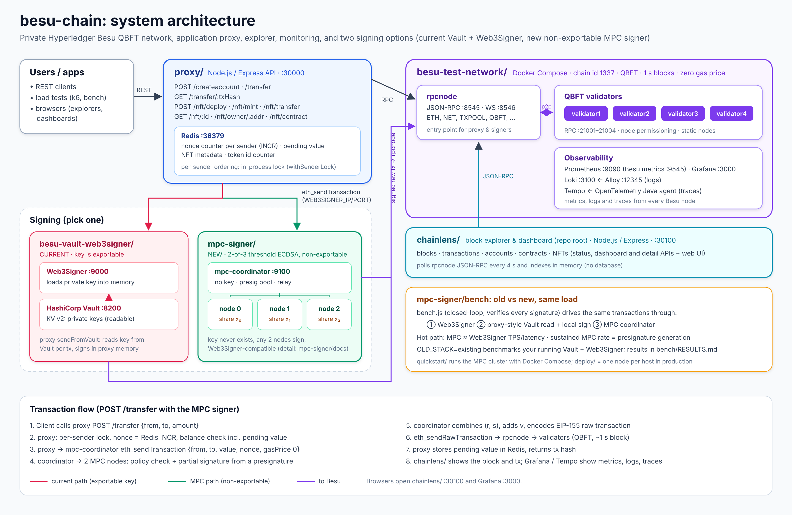
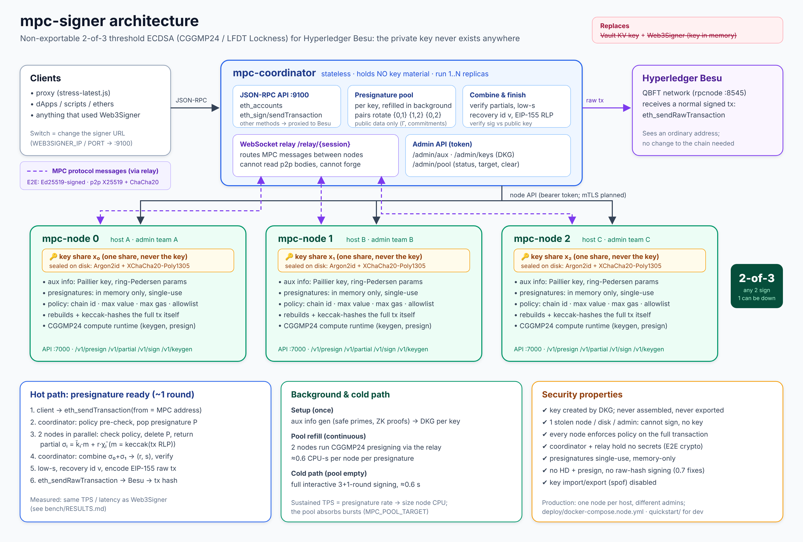

# besu-chain

A private Hyperledger Besu (QBFT) network with:
- an application API (proxy) for accounts, transfers and NFTs
- a block explorer (`chainlens/`) and monitoring
- two ways to sign transactions:
  - **current:** HashiCorp Vault + Web3Signer
  - **new:** a non-exportable 2-of-3 MPC signer, where the private key never exists anywhere

## Architecture



<sub>Source: [`docs/architecture.svg`](docs/architecture.svg)</sub>

### Components

| Folder | What it is | Ports |
|---|---|---|
| [`besu-test-network/`](besu-test-network) | Besu QBFT network (Docker Compose): 4 validators + `rpcnode`, chain id 1337, 1 s blocks, zero gas price, node permissioning. Observability: Prometheus, Grafana, Loki + Alloy (logs), Tempo + OpenTelemetry Java agent (traces). The Chainlens services bundled in this compose file are not used; the explorer is [`chainlens/`](chainlens). | 8545/8546 rpcnode, 21001–21004 validators, 9090 Prometheus, 3000 Grafana, 3100 Loki |
| [`proxy/`](proxy) | Node.js/Express API used by applications: `POST /createaccount`, `/transfer`, `/nft/deploy`, `/nft/mint`, `/nft/transfer`, plus read endpoints. Redis holds a per-sender nonce counter (`INCR`), pending value and NFT metadata. Signs through Web3Signer, or for user accounts reads the key from Vault (`sendFromVault`). | 30000 API, 36379 Redis |
| [`chainlens/`](chainlens) | **The block explorer in use.** Node.js/Express app with a web UI: blocks, transactions, accounts, contracts, NFTs. Polls `rpcnode` JSON-RPC every 4 s and keeps its index in memory (no database). | 30100 |
| [`besu-vault-web3signer/`](besu-vault-web3signer) | **Current signer.** Vault KV v2 stores private keys; Web3Signer loads them into memory and signs `eth_sendTransaction`. The key is exportable. | 8200 Vault, 9000 Web3Signer |
| [`mpc-signer/`](mpc-signer) | **New signer.** 2-of-3 threshold ECDSA (CGGMP24 / LFDT Lockness). Three nodes each hold one key share; a stateless coordinator exposes the same JSON-RPC as Web3Signer. Includes a Docker quick start, production deploy files and a benchmark against the current signer. | 9100 coordinator |

### Transaction flow (`POST /transfer`)

1. The client calls the proxy's `POST /transfer`.
2. The proxy takes a per-sender lock, gets the next nonce from Redis and checks the balance, including value still pending.
3. The proxy calls the signer's `eth_sendTransaction`, at `WEB3SIGNER_IP:WEB3SIGNER_PORT`.
   - **Current:** Web3Signer signs with the key it loaded from Vault.
   - **MPC:** the coordinator asks 2 of the 3 nodes for partial signatures. Each node checks the transaction against its policy before signing. The coordinator combines the partials into a normal ECDSA signature.
4. The signed raw transaction goes to `rpcnode`, and the validators include it in a block (about 1 s).
5. `chainlens/` picks up the block on its next poll and shows the transaction. Grafana and Tempo show the metrics, logs and traces.

### Current vs MPC signer

| | Vault + Web3Signer | MPC signer |
|---|---|---|
| Private key | stored in Vault; loaded into Web3Signer / proxy memory | never exists; 3 shares on 3 hosts, any 2 sign |
| One host or admin compromised | key can be stolen | cannot sign, cannot recover the key |
| Policy | none in the signer | every node checks chain id, value and gas limits, and an optional destination allowlist |
| Client interface | JSON-RPC `eth_sendTransaction` | same JSON-RPC (drop-in: change the URL) |
| Throughput | baseline | about the same while presignatures are ready; sustained rate depends on node CPU |

MPC signer internals:



The MPC signer's architecture, quick start, deployment and benchmark are documented in
[`mpc-signer/README.md`](mpc-signer/README.md) and
[`mpc-signer/bench/RESULTS.md`](mpc-signer/bench/RESULTS.md).

## Getting started

```bash
# 1. Besu network + monitoring
cd besu-test-network && ./run.sh

# 1b. Block explorer (http://localhost:30100)
cd chainlens && npm install && BESU_RPC=http://127.0.0.1:8545 node server.js

# 2a. Current signer: see besu-vault-web3signer/README.md (Vault init/unseal, provisioning)
# 2b. or the MPC signer (Docker)
cd mpc-signer/quickstart && ./quickstart.sh init && ./quickstart.sh up && ./quickstart.sh setup

# 3. Proxy API (set BESU_IP, WEB3SIGNER_IP/PORT, REDIS_* in proxy/.env)
cd proxy && docker compose up -d
```
