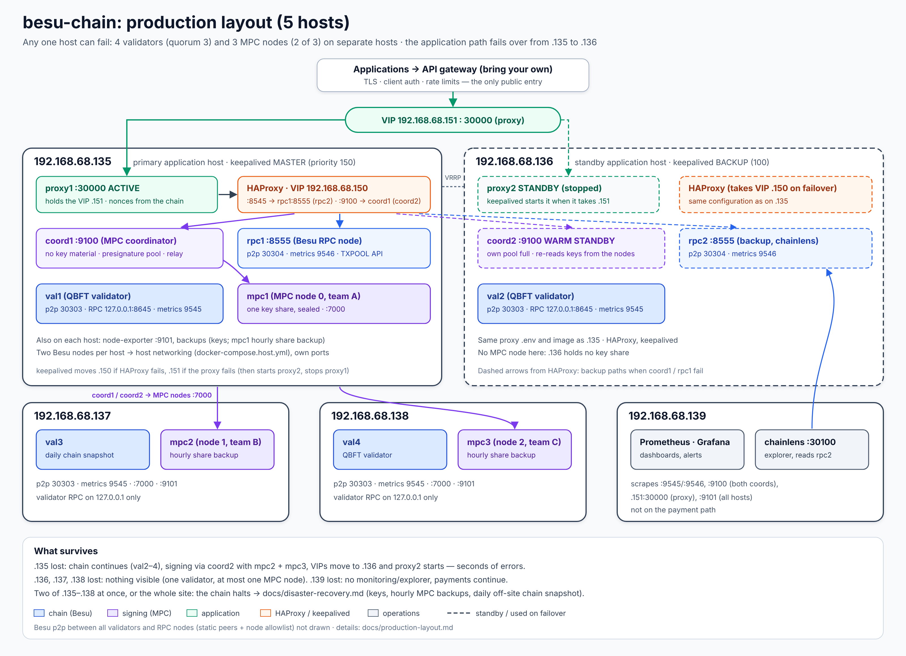

# besu-chain

A private Hyperledger Besu (QBFT) blockchain with:

- **`proxy/`**: an application API for accounts, ETH transfers and NFT collections;
- **`mpc-signer/`**: **non-exportable transaction signing**, a 2-of-3 MPC signer where the private
  key never exists anywhere. It replaces Vault + Web3Signer.
- **`chainlens/`**: a block explorer;
- **`monitoring/`**: Prometheus + Grafana dashboards and alerts for production Besu and the MPC signer;
- **`ha/`**: HAProxy + keepalived for the production application path (floating IPs, failover).

The same components run in two setups:

| | Development / test | Production |
|---|---|---|
| Where | everything on one Docker host | 5 hosts (`192.168.68.135`–`.139`), HA pair for the application path, MPC nodes run by 3 teams |
| Besu | [`besu-test-network/`](besu-test-network) | [`besu-production/`](besu-production) |
| MPC signer | [`mpc-signer/quickstart/`](mpc-signer/quickstart) (3 nodes on one host) | [`mpc-signer/deploy/`](mpc-signer/deploy) (one node per host and team) |
| Proxy, explorer | `proxy/`, `chainlens/` with Docker Compose | same images, private network, behind an API gateway |
| Guide | [Development](#development--test-environment) | [Production](#production) |

**Contents**
- [Components](#components)
- [What happens on a request](#what-happens-on-a-request)
- [Production](#production): architecture, deployment order, failure tolerance, remaining gaps
- [Development / test environment](#development--test-environment)
- [Proxy API](#proxy-api)
- [Documentation index](#documentation-index)

---

## Components

| Folder | What it is | Ports |
|---|---|---|
| [`besu-production/`](besu-production) | **Production Besu**: per-host packages for validators and RPC nodes. Keys are generated on each host; network files are checksummed; static peers + node allowlist; validators added or removed by vote. | 30303 p2p, 8545 RPC nodes, 9545 metrics |
| [`besu-test-network/`](besu-test-network) | **Development Besu**: 4 validators + `rpcnode` on one host, chain id 1337, 1 s blocks, zero gas price. Prometheus, Grafana, Loki + Alloy, Tempo. (Its bundled Chainlens services are not used.) | 8545 / 8546 rpcnode, 21001–21004, 9090, 3000, 3100 |
| [`mpc-signer/`](mpc-signer) | **2-of-3 threshold ECDSA signer** (CGGMP24 / LFDT Lockness), Web3Signer-compatible JSON-RPC. Quick start, production packages, benchmark. | 9100 coordinator, 7000 nodes |
| [`proxy/`](proxy) | **Application API** (Node.js/Express): accounts, transfers, NFT collections. Redis is an optional cache: correctness comes from memory + the chain. | 30000 API, 36379 Redis |
| [`chainlens/`](chainlens) | **Block explorer** (Node.js/Express): blocks, transactions, accounts, contracts, NFTs. NFT sales show the image. Registered contracts (`contracts/deployments`) get a page with their functions; view functions can be run (read only). Polls RPC every 4 s, indexes in memory, re-indexes after a chain reset. | 30100 |
| [`remix/`](remix) | **Self-hosted Remix IDE** with a local Solidity compiler mirror: compile and test contracts without internet access; deployment goes through `besu-production/operator/deploy-contract.js` (MPC-signed). | 30200 |
| [`contracts/`](contracts/deployments) | **Contract registry**: one record per deployed contract (address, ABI, deployment); chainlens shows their functions and reads them. | — |
| [`ha/`](ha) | **High availability** for .135/.136: HAProxy (Besu RPC and MPC signer behind one floating IP), keepalived (floating IPs, starts/stops the standby proxy), firewalld rules for every host. | VIPs 192.168.68.150 (:8545, :9100), 192.168.68.151 (:30000) |
| [`ansible/`](ansible) | **Production deployment** with Ansible from the operator machine: hosts, images, coordinators and key ceremony, Besu, proxy, HAProxy + keepalived, monitoring, backups. Stops for the MPC teams, who run their own nodes. | — |
| [`monitoring/`](monitoring) | **Production monitoring**: Prometheus + Grafana on one host. Dashboards for Besu (quorum, block age, peers, sync, RPC, JVM), the MPC signer (nodes vs threshold, hot/cold signing, latency, pool, policy refusals) and hosts; alert rules. | 3000 Grafana, 9090 Prometheus (localhost), 9101 node-exporter |
| [`besu-vault-web3signer/`](besu-vault-web3signer) | **Previous signer, being retired**: Vault KV keeps exportable private keys and Web3Signer loads them into memory. Kept for comparison benchmarks. | 8200 Vault, 9000 Web3Signer |

## What happens on a request

**`POST /transfer`** (ETH from an account):
1. The proxy takes the sender's lock and computes the nonce as max(cached counter, chain pending count), so a lost or stale Redis is harmless.
2. It checks the balance, including value still pending.
3. It calls `eth_sendTransaction` on the MPC coordinator.
4. **2 of the 3 MPC nodes** each check the transaction against their own policy (chain id, value and gas limits, allowlist) and produce a partial signature from a single-use presignature. The coordinator combines them into a normal ECDSA signature.
5. The signed transaction goes to a Besu RPC node, and the QBFT validators include it in the next block.

**`POST /createaccount`**: the 3 MPC nodes run **distributed key generation**. The new account's private key never exists. `SENDER01` then funds it.

**NFTs** (collections are `NftCollection` version 2, deployed by `SENDER01`):
- **`POST /nft/mint`** mints to `SENDER01` and stores the **price** on chain. Nothing is paid.
- **`POST /nft/transfer`** is a sale. The buyer signs **one atomic `buy` transaction**: they pay exactly the price to `SENDER01` and receive the NFT, or nothing happens at all.
- Collections can be chosen by name, symbol or address.

---

## Production



<sub>Source: [`docs/architecture-production.svg`](docs/architecture-production.svg)</sub>

Five hosts on one private network. Full details (every setting and port, the step-by-step
deployment from scratch, the failover tests): **[`docs/production-layout.md`](docs/production-layout.md)**.

| Host | Runs |
|---|---|
| **192.168.68.135** | val1, rpc1, coord1, **proxy1** (active), mpc1, HAProxy + keepalived |
| **192.168.68.136** | val2, rpc2, coord2 (warm), **proxy2** (standby), HAProxy + keepalived |
| **192.168.68.137** | val3, mpc2 |
| **192.168.68.138** | val4, mpc3 |
| **192.168.68.139** | Prometheus, Grafana, chainlens |

| Floating IP (keepalived) | Serves |
|---|---|
| `192.168.68.150` | HAProxy: Besu RPC `:8545` (rpc1, rpc2 as backup) and the MPC signer `:9100` (coord1, coord2 as backup) |
| `192.168.68.151` | the active proxy `:30000`: the entry point for applications |

- **Chain:** 4 validators, one per host .135–.138 (quorum 3): any one host can fail.
- **Signing:** 3 MPC nodes on .135, .137, .138, each run by **its own team** (2 of 3 sign). Two
  coordinators; either one signs for every account (they re-read the key list from the nodes).
- **Application path:** everything on .135 has a twin on .136. keepalived moves the floating IPs and
  starts the standby proxy; only one proxy is ever active (it counts nonces in memory).

### Network zones

| Zone | Contents | Reachable from |
|---|---|---|
| **Public edge** | API gateway in front of `192.168.68.151:30000` (bring your own: TLS, client authentication, rate limits) | internet: the **only** public entry |
| **App** | proxy1/proxy2, HAProxy, chainlens (.139) | the gateway; admins |
| **Signing** | coord1/coord2 (no key material), mpc1/mpc2/mpc3 | proxy → coordinator → nodes, nodes → coordinator relay; each team's admin |
| **Chain** | val1–val4 (p2p only, RPC on localhost), rpc1/rpc2 | coordinators and proxies via HAProxy; chainlens → rpc2 |
| **Ops** | Prometheus, Grafana (.139), node-exporter everywhere, backups | scrapes metrics; cannot call signing APIs |

`ha/firewall-layout.sh` applies exactly these rules with firewalld on each host, and the same allow
list to the ports Docker publishes, which firewalld alone does not filter (nftables table
`inet besu_docker`, see [`docs/production-layout.md`](docs/production-layout.md), section 3).

### Deployment order

Every command, host by host: **[`docs/production-layout.md`](docs/production-layout.md), section 4
"Deploying from scratch"**. Automated with Ansible (everything except the MPC nodes, which their
teams run): **[`ansible/`](ansible/README.md)**.

| # | Step | Guide |
|---|---|---|
| 1 | Hosts: Docker, synchronized clocks, repository in `/opt/besu-chain`, firewall (`ha/firewall-layout.sh`), node-exporter | [`docs/production-layout.md`](docs/production-layout.md) |
| 2 | **MPC:** image + tokens, mpc1/2/3 (each team), `cluster.json`, coord1 + coord2, key ceremony → `SENDER01` | [`mpc-signer/docs/production.md`](mpc-signer/docs/production.md) |
| 3 | **Besu:** 6 nodes (val1–4, rpc1–2), network files with `ALLOC="<SENDER01>=…"`, validators then RPC nodes | [`besu-production/README.md`](besu-production/README.md) |
| 4 | **Proxy** on .135 and .136 (`proxy/.env.example`: everything through the VIPs): build only | [`docs/proxy-with-mpc-signer.md`](docs/proxy-with-mpc-signer.md) |
| 5 | **HA:** HAProxy + keepalived on .135 and .136; keepalived starts proxy1 | [`ha/README.md`](ha/README.md) |
| 6 | **Check** through the VIPs; **NFT collections:** `POST /nft/deploy` (unique name and symbol) | [`proxy/api.txt`](proxy/api.txt) |
| 7 | **Monitoring + chainlens** on .139 | [`monitoring/README.md`](monitoring/README.md) |
| 8 | **Backups:** node keys, hourly MPC shares, daily chain snapshot on val3 (.137) with an off-site copy | [`docs/disaster-recovery.md`](docs/disaster-recovery.md) |
| 9 | **API gateway** in front of the proxy VIP; **failover tests**; go live | [`ha/README.md`](ha/README.md) |

### What keeps running when something fails

| Failure | Effect |
|---|---|
| **host .135** | chain continues (3 validators); signing via coord2 and mpc2 + mpc3; the VIPs move to .136 and proxy2 starts: a few seconds of failed requests |
| host .136, .137 or .138 | none (one validator and at most one MPC node lost) |
| host .139 | no monitoring and no explorer; payments continue |
| rpc1, coord1 or the proxy process | HAProxy or keepalived switches to the twin on .136 |
| 1 MPC node or admin team | none: 2 of 3 sign. `/createaccount` waits for all 3 (key generation) |
| theft of 1 MPC node, disk or backup | the attacker gets one share: **no key, cannot sign** |
| Redis down, empty or stale | none for correctness: the proxy uses memory + the chain |
| **two** of .135–.138 at once, or the whole site | the chain halts: [`docs/disaster-recovery.md`](docs/disaster-recovery.md) |
| sustained load beyond the presignature rate | signing slows to the cold path (~0.6 s per signature). Size MPC node CPU at ~0.4 cores per sustained TPS ([`mpc-signer/bench/RESULTS.md`](mpc-signer/bench/RESULTS.md)) |

### Remaining gaps before full production

- **One site:** all hosts share one subnet (the floating IPs need it). A site-wide disaster is
  covered by off-site backups and the DR runbook, not by failover.
- **Proxy:** one active instance at a time (nonces are counted in its memory); keepalived provides
  the standby.
- **MPC signer:**
  - no mTLS on the node API and no authentication on the relay; mitigated by the private
    network and firewall;
  - no key refresh: if a share is lost for good, create new keys and move funds;
  - EIP-1559 transactions not supported;
  - `cggmp24 0.7.0-alpha.3` is an alpha release, and its audit covers an earlier version.
- **Besu:** no TLS on JSON-RPC (private network or an internal TLS proxy); the node allowlist is
  a file, so changing it means restarting the nodes.
- **API gateway** and **alert delivery** (Alertmanager or Grafana contact points for mail/Slack)
  are not included in this repository; bring your own.

---

## Development / test environment

Everything on one host with Docker Compose. All ports are open, keys are test keys, and both
signers are available side by side. **Do not use it for production.**


<sub>Source: [`docs/architecture-dev.svg`](docs/architecture-dev.svg)</sub>

```bash
# 1. Besu test network + monitoring (chain id 1337, rpcnode on :8545, Grafana on :3000)
cd besu-test-network && ./run.sh

# 2. MPC signer: 3 nodes + coordinator on this host (prints SENDER01 after setup)
cd mpc-signer/quickstart
MPC_BIGINT=bigint-rug CHAIN_ID=1337 ./quickstart.sh init
./quickstart.sh up && ./quickstart.sh setup
#    then in quickstart/.env: MPC_POOL_KEYS=<SENDER01>  and  ./quickstart.sh up

# 3. Fund SENDER01: add it to besu-test-network/config/besu/genesis.json "alloc" before step 1
#    (or transfer from a funded test account)

# 4. Proxy + Redis (proxy/.env: BESU_IP/PORT, WEB3SIGNER_IP/PORT=<coordinator>:9100, SENDER01,
#    MPC_ADMIN_URL, MPC_ADMIN_TOKEN, REDIS_*)
cd proxy && docker compose up -d --build

# 5. Explorer on http://localhost:30100 (chainlens/.env: BESU_RPC)
cd chainlens && cp .env.example .env && docker compose up -d --build
```

The full walkthrough, including troubleshooting (policy limit, nonce gaps, stale NFT contract
after a chain reset) is [`docs/proxy-with-mpc-signer.md`](docs/proxy-with-mpc-signer.md).

**Benchmark** the MPC signer against Vault + Web3Signer:

```bash
cd mpc-signer && bench/run-bench.sh                     # its own Besu + Vault + Web3Signer
cd mpc-signer && OLD_STACK=existing bench/run-bench.sh  # your running stack
```

Results are in [`mpc-signer/bench/RESULTS.md`](mpc-signer/bench/RESULTS.md).

---

## Proxy API

| Endpoint | Body / query | What it does |
|---|---|---|
| `POST /createaccount` | `{amount, pool?}` | new account = new MPC key, funded with `amount` ETH from `SENDER01`. `pool`: `big`, `small` (default, `MPC_NEW_ACCOUNT_POOL`) or `none`: how many presignatures are kept ready for fast signing |
| `POST /account/pool` | `{address, pool}` | change an account's presignature pool class (`big`, `small`, `none`) |
| `POST /transfer` | `{from, to, amount, memo?}` | ETH transfer signed by the MPC signer |
| `GET /transfer/:txHash` | | transaction status and memo |
| `POST /nft/deploy` | `{name, symbol}` | deploys a **new** collection (names and symbols must be unique) |
| `GET /nft/collections` | | all collections (address, name, symbol, default) |
| `POST /nft/mint` | `{collection?, name, image, description?, attributes?, properties?, amount}` | mints to `SENDER01`; `amount` = the price, stored on chain |
| `POST /nft/transfer` | `{collection?, to, tokenId, from?}` | sale: the buyer signs one atomic `buy` (pays the price to `SENDER01`, receives the NFT) |
| `GET /nft/:tokenId`, `/nft/:tokenId/metadata` | `?collection=` | token, owner, metadata (read from the chain if Redis has nothing) |
| `GET /nft/owner/:address` | `?collection=` | tokens owned, per collection |
| `GET /status/senders` | | per sender: next nonce vs. Besu, value in flight, nonce gaps and stalls, corrections made by the background chain check |
| `GET /metrics` | | the same in Prometheus format (scraped by `monitoring/`) |

`collection` accepts a collection's name, symbol or address; without it the default (first)
collection is used. Full examples: [`proxy/api.txt`](proxy/api.txt).

## Documentation index

| Document | Topic |
|---|---|
| [`besu-production/README.md`](besu-production/README.md) | Production Besu: hosts, network files, start, validator add/remove, operations |
| [`mpc-signer/docs/production.md`](mpc-signer/docs/production.md) | Production MPC signer: 3 teams, tokens, key ceremony, backups and restore, operations |
| [`docs/proxy-with-mpc-signer.md`](docs/proxy-with-mpc-signer.md) | Running the proxy on the MPC signer, Redis-optional design, troubleshooting |
| [`docs/production-layout.md`](docs/production-layout.md) | **Production layout**: the 5 hosts, every setting and port, step-by-step deployment from scratch, failure table, failover tests |
| [`ansible/README.md`](ansible/README.md) | **Automated deployment**: settings, the three runs and the MPC team steps, the operator state, reruns, security notes |
| [`ansible/OPERATOR.md`](ansible/OPERATOR.md) | **Running the Ansible deployment** on the operator machine, step by step: tools, SSH access, settings, the three runs, after the deployment |
| [`docs/sections.md`](docs/sections.md) | **Sections**: per-section accounts (upfront, consumption, payment), API key, the on-chain SectionRegistry, the proxy admin API, the chainlens Sections page, flows and build steps (steps 1–4 built: also contract deployment by the contract account center, `/contract/call`, `/contract/send`) |
| [`ansible/CHAINLENS-DEPLOY.md`](ansible/CHAINLENS-DEPLOY.md) | **Deploying contracts from chainlens**: the Deploy page (off by default; operator only, token, one MPC deployer account), turning it on, deploying, the records |
| [`ansible/ACCESS.md`](ansible/ACCESS.md) | **Who may connect**: the access lists per service (proxy, chainlens, Grafana, Remix, operator), addresses and networks (`192.168.68.0/24`), applying, removing and checking access |
| [`ansible/GPG-KEY.md`](ansible/GPG-KEY.md) | **GPG key for the node key backups**: create it (also on a headless server), public half for Ansible, private half offline, check and decrypt backups |
| [`ansible/RESTORE.md`](ansible/RESTORE.md) | **Restoring everything from the backups** (whole site lost) with Ansible: prepare the hosts, restore node keys, chain snapshot and MPC shares, then `site.yml` |
| [`mpc-signer/docs/upgrade.md`](mpc-signer/docs/upgrade.md) | **Upgrading the MPC signer** (e.g. to 1.3.0): ship the image, MPC nodes one at a time by their teams, then coordinators and proxy; rollback |
| [`ha/README.md`](ha/README.md) | HAProxy + keepalived setup, operations, failover tests |
| [`docs/disaster-recovery.md`](docs/disaster-recovery.md) | **Disaster recovery runbook**: what to back up, schedule, alerts, recovery steps per scenario, drills |
| [`monitoring/README.md`](monitoring/README.md) | Production monitoring: metrics endpoints, targets, dashboards, alerts, firewall |
| [`mpc-signer/README.md`](mpc-signer/README.md) | MPC signer design, Docker quick start, security notes ([diagram](mpc-signer/docs/architecture.png)) |
| [`mpc-signer/bench/RESULTS.md`](mpc-signer/bench/RESULTS.md) | Throughput: MPC vs Vault + Web3Signer, sizing |
| [`proxy/api.txt`](proxy/api.txt) | Proxy API examples |
| [`proxy/contracts/NftCollection.sol`](proxy/contracts/NftCollection.sol) | NFT collection v2 (price at mint, atomic `buy`) |
