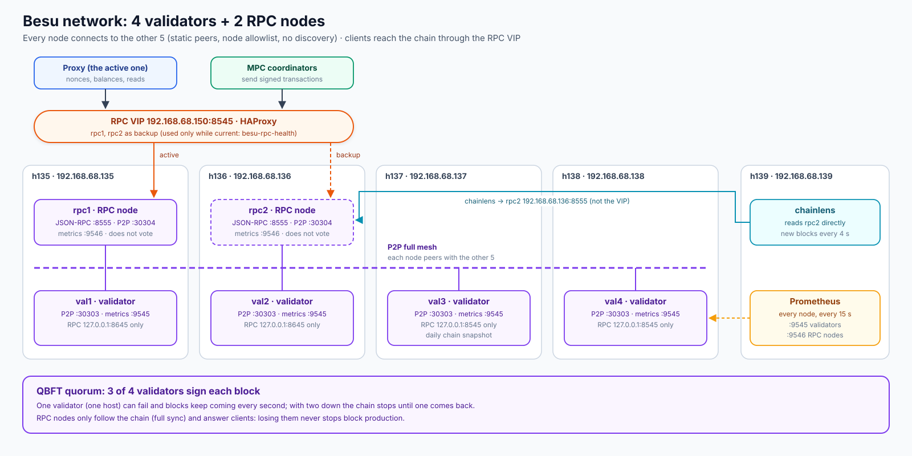
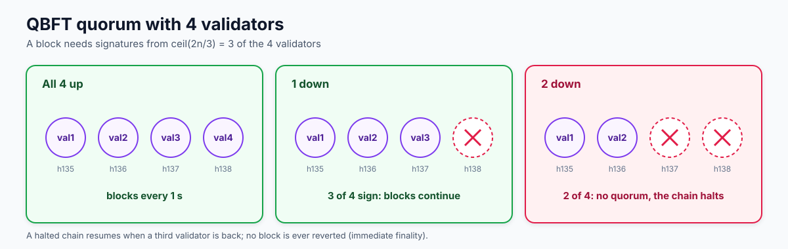

# Hyperledger Besu 체인

> **내용:** 블록체인 자체: QBFT 합의를 사용하는 사설 Hyperledger Besu 네트워크입니다. 노드, 합의,
> 제네시스, 구성, 포트, 권한 관리, API, 메트릭, 일상 운영을 설명합니다.
>
> **대상:** 체인을 이해해야 하는 모든 사람, 운영자.
>
> **관련 문서:** [Besu 수동 설치](../deployment/besu-manual.md)(노드 수동 설치) ·
> [고가용성](../deployment/high-availability.md)(RPC VIP) ·
> [알림 런북](../operations/alert-runbook.md#besu) · [Grafana 대시보드](../operations/dashboards.md#besu-production-qbft)

**목차**

- [한눈에 보기](#at-a-glance)
- [노드](#nodes)
- [합의 (QBFT)](#consensus-qbft)
- [제네시스와 네트워크 파일](#genesis-and-network-files)
- [노드 구성](#node-configuration)
- [포트](#ports)
- [체인에 연결하는 주체](#who-connects-to-the-chain)
- [가스와 트랜잭션](#gas-and-transactions)
- [메트릭과 상태](#metrics-and-health)
- [운영](#operations)
- [파일](#files)

---

## 한눈에 보기 {#at-a-glance}

| | |
|---|---|
| **클라이언트** | Docker에서 실행되는 Hyperledger Besu(`besu_image`, 기본값 `hyperledger/besu:26.11.1`) |
| **합의** | QBFT(비잔틴 장애 허용 권한 증명) |
| **검증자** | 4개(val1–val4, 호스트 .135–.138에 하나씩). 블록 생성에 3개 필요 |
| **RPC 노드** | 2개(.135의 rpc1, .136의 rpc2), 검증하지 않음, RPC VIP `192.168.68.150:8545` 뒤에 위치 |
| **체인 ID** | `chain_id`(기본값 1337) |
| **블록 시간** | `block_period`(기본값 1초) |
| **가스** | 무료: 가스 가격 0(`zeroBaseFee`, `min-gas-price=0`). 블록 가스 한도 30,000,000 |
| **EVM** | Cancun(모든 포크가 블록 0부터 적용. 컨트랙트는 EVM 버전 `cancun`으로 컴파일) |
| **네트워크** | 사설: 정적 피어, 노드 허용 목록, 디스커버리 없음, 공개 RPC 없음 |
| **자금 보유 계정** | SENDER01(키 세레모니에서 만든 MPC 키), 제네시스에서 사전 충전 |

## 노드 {#nodes}



| 노드 | 호스트 | 역할 | 제공하는 것 |
|---|---|---|---|
| val1 | h135 `.135` | 검증자 | 블록 생성. RPC는 호스트의 localhost에서만 |
| val2 | h136 `.136` | 검증자 | val1과 같음 |
| val3 | h137 `.137` | 검증자 | val1과 같음. 일일 체인 스냅샷을 여기서 만듭니다 |
| val4 | h138 `.138` | 검증자 | val1과 같음 |
| rpc1 | h135 | RPC 노드 | 프록시, MPC 코디네이터, 운영자를 위한 JSON-RPC(보통 RPC VIP 뒤) |
| rpc2 | h136 | RPC 노드 | RPC VIP 뒤의 대기 노드. chainlens가 직접 읽습니다 |

모든 노드는 자체 디렉터리 `/opt/besu-<node>`(컨테이너 `besu-<node>-besu-1`)에서 실행되며 자체 키를
`/data/key`에 보관합니다. 각 노드는 다른 모든 노드에 연결합니다: 노드당 피어 5개.

**검증자**는 블록만 만듭니다: JSON-RPC는 호스트의 `127.0.0.1`에만 게시되며, 운영자의 QBFT 명령
(`qbft.sh`)에 사용됩니다. **RPC 노드**는 투표하지 않습니다. 체인을 따라가며(전체 동기화) 애플리케이션에
응답합니다. HAProxy는 RPC 트래픽을 rpc1로 보내고, rpc1이 최신 상태가 아니면 rpc2로 보냅니다
(`besu-rpc-health`: `eth_syncing`뿐 아니라 블록 경과 시간과 높이도 확인).

## 합의 (QBFT) {#consensus-qbft}



- **권한 증명:** 목록에 있는 검증자만 차례대로(라운드 로빈) 블록을 만듭니다. 채굴도 스테이킹도
  없습니다.
- **비잔틴 장애 허용:** 블록에는 ceil(2n/3)개 검증자의 서명이 필요합니다. 검증자가 4개이면 3개입니다:
  **검증자 하나(호스트 하나)가 실패해도 됩니다.** 두 개가 다운되면 하나가 돌아올 때까지 체인이 멈춥니다.
  블록은 절대 되돌려지지 않습니다(즉시 완결성).
- **블록 주기** `block_period`(하나의 LAN에서는 1초, 여러 사이트에 걸치면 최소 2초)와 **라운드 타임아웃**
  `request_timeout`(기본값 2초, 블록 주기보다 커야 함): 제안자가 제시간에 응답하지 않으면 다음 검증자가
  제안합니다.
- **빈 블록:** 트랜잭션이 없어도 매 주기마다 블록이 만들어지므로, 정상일 때 *Seconds since last
  block*은 1초 미만을 유지합니다.
- **검증자 변경**은 검증자의 과반수가 체인에서 투표합니다(`qbft.sh propose`). 운영 중인 체인에서는
  제네시스를 절대 편집하지 않습니다([Besu 수동 설치](../deployment/besu-manual.md)).

## 제네시스와 네트워크 파일 {#genesis-and-network-files}

`besu-production/operator/make-network.sh`(Ansible 단계 `05-besu.yml`, 각 노드의 공개 키 파일 기반)가
한 번 만든 다음, 모든 노드에 복사하고 체크섬을 확인합니다.

| 파일 | 내용 |
|---|---|
| `genesis.json` | 체인 ID. 블록 0에서 Berlin → Cancun 포크. `zeroBaseFee`. QBFT 설정(`blockperiodseconds`, `epochlength` 30000, `requesttimeoutseconds`). 초기 검증자(`extraData`에 포함). 가스 한도. 사전 충전 계정(`ALLOC`, SENDER01) |
| `static-nodes.json` | 모든 노드의 enode 주소: 각 노드가 연결할 대상 |
| `permissions_config.toml` | 노드 허용 목록: 다른 노드로부터의 연결은 거부됩니다 |
| `SHA256SUMS` | 체크섬: 모든 노드는 동일한 파일을 가져야 합니다 |

이 파일들은 운영자 머신의 `ansible/state/network/`에 있습니다. **운영 중인 체인에서는 제네시스가 절대
바뀌지 않습니다.** 노드를 추가하거나 옮기면 `static-nodes.json`과 `permissions_config.toml`만 바뀌며
(`add-node.sh`, `move-node.sh`), 그다음 모든 노드를 하나씩 재시작합니다.

## 노드 구성 {#node-configuration}

`besu-production/node/`에 있는 템플릿 두 개는 같은 역할의 모든 노드에 동일합니다. 호스트별 값
(P2P 주소와 포트, 바인드 주소)은 `docker-compose.yml`을 통해 `.env`에서 가져옵니다.

| 설정 | 검증자(`validator.toml`) | RPC 노드(`rpc.toml`) | 이유 |
|---|---|---|---|
| `sync-mode` | FULL | FULL | 모든 블록을 로컬에서 실행 |
| `discovery-enabled` | false | false | 정적 피어만 |
| `permissions-nodes-config-file-enabled` | true | true | 노드 허용 목록 |
| `sync-min-peers` | 1 | 1 | 작은 네트워크는 Besu의 기본값 5에 도달하지 못함 |
| `max-peers` | 25 | 25 | |
| `tx-pool-max-future-by-sender` | 2000 | 2000 | 프록시의 바쁜 발신자는 처리 중인 트랜잭션이 수백 개일 수 있음. 기본값 200이면 일부가 버려져 해당 발신자가 멈춤 |
| `min-gas-price` | 0 | 0 | 무료 가스 |
| `rpc-http-api` | ETH, NET, QBFT, ADMIN, TXPOOL | ETH, NET, WEB3, TXPOOL | 관리와 투표는 검증자에서만, localhost에서만 |
| `host-allowlist` | localhost | localhost + RPC VIP(`BESU_HOST_ALLOWLIST`) | 클라이언트가 `Host: 192.168.68.150`을 보냄 |
| `rpc-ws-enabled` | false | true | |
| `graphql-http-enabled` | false | false | |
| `metrics-enabled` | true(`:9545`) | true(컨테이너 내부 `:9545`) | Prometheus |
| Java 힙 | `besu_java_opts`(기본값 `-Xmx4g`) | 같음 | |

## 포트 {#ports}

| 포트 | 노드 | 접근 가능한 곳 |
|---|---|---|
| 30303 TCP/UDP | 검증자(P2P) | 다른 Besu 호스트 |
| 30304 TCP/UDP | RPC 노드(P2P) | 다른 Besu 호스트 |
| 8555 | RPC 노드(JSON-RPC, 호스트 주소에서) | HAProxy와 코디네이터(.135, .136), chainlens(.139), 운영자 |
| 8545 | RPC VIP `.150`(HAProxy → rpc1 / rpc2) | 프록시, 코디네이터, 운영자 |
| 8645 | 검증자의 JSON-RPC(h135 / h136. h137 / h138에서는 8545) | 해당 호스트의 localhost만 |
| 9545 / 9546 | 메트릭(검증자 / RPC 노드) | 모니터링 호스트 |

방화벽(`ha/firewall-layout.sh`, Ansible 단계 01)은 정확히 이 포트들만 엽니다
([접근 제어](../deployment/access-control.md)).

## 체인에 연결하는 주체 {#who-connects-to-the-chain}

| 클라이언트 | 경로 | 용도 |
|---|---|---|
| 프록시 | RPC VIP `.150:8545` | 논스, 잔액, 영수증, 컨트랙트 읽기, `eth_getLogs`(레지스트리 이벤트) |
| MPC 코디네이터 | RPC VIP `.150:8545` | `eth_sendRawTransaction`(서명된 트랜잭션), 체인 ID, 가스 추정 |
| Chainlens | rpc2 `.136:8555` 직접 | 4초마다 새 블록을 폴링하여 색인 |
| 모니터링 | 각 노드의 메트릭 포트 | Prometheus가 15초마다 |
| `besu-rpc-health` | 각 RPC 노드 + 로컬 검증자 | HAProxy를 위한 블록 경과 시간과 높이 |
| 운영자 | VIP 또는 검증자의 localhost | `qbft.sh`, 점검, `deploy-contract.js` |

애플리케이션은 Besu와 직접 통신하지 않습니다: 프록시를 사용합니다([프록시 API](../reference/proxy-api.md)).

## 가스와 트랜잭션 {#gas-and-transactions}

- **가스는 무료**(가격 0)이지만 한도가 있습니다: 블록당 30,000,000 가스(`block_gas_limit`). MPC 노드의
  정책도 트랜잭션당 가스를 제한합니다(`MAX_GAS`, 기본값은 같은 30M).
- 트랜잭션은 MPC 서명기가 **레거시(EIP-155) 방식으로 서명**합니다. EIP-1559 트랜잭션은 사용하지
  않습니다.
- **계정은 ETH를 보유합니다:** 체인 자체의 통화로, 제네시스에서만 생성되며(SENDER01의 할당) 이체로
  이동합니다.
- **처리량:** 유휴 노드당 약 0.02 CPU 코어. 부하가 걸리면 한계는 블록 가스와 MPC 서명기의 사전 서명
  생성 속도입니다([MPC 벤치마크](../development/mpc-benchmarks.md)).

## 메트릭과 상태 {#metrics-and-health}

| 신호 | 위치 |
|---|---|
| 높이, 블록 경과 시간, 피어, 동기화, 풀, RPC 요청률과 지연 시간, P2P 트래픽, JVM | Grafana → **Besu production**([패널별 설명](../operations/dashboards.md#besu-production-qbft)) |
| 알림 | `BesuValidatorQuorumLost`, `BesuNoNewBlocks`, `BesuNodeDown`, `BesuNodeStalled`, `BesuNotInSync`, `BesuPeersMissing`, `BesuPeersLow`, `BesuTxPoolGrowing`, `BesuHeapHigh`, `BesuUnpermittedPeers`([런북](../operations/alert-runbook.md#besu)) |
| HAProxy가 보는 RPC 노드 상태 | h135 / h136에서 `curl -s http://127.0.0.1:8410/` |

운영자 머신에서의 빠른 점검:

```bash
curl -s -X POST -H 'Content-Type: application/json' --data '{"jsonrpc":"2.0","id":1,"method":"eth_blockNumber","params":[]}' http://192.168.68.150:8545
```

검증자 호스트에서(RPC가 로컬입니다. h135 / h136에서는 앞에 `RPC=http://127.0.0.1:8645`를 붙입니다):

```bash
cd /opt/besu-chain/besu-production/operator && ./qbft.sh validators
```

```bash
./qbft.sh health
```

## 운영 {#operations}

| 작업 | 방법 |
|---|---|
| 모든 노드 배포 또는 업데이트 | `ansible-playbook 01-hosts.yml 05-besu.yml`(한 번에 노드 하나씩) |
| 노드 하나 재시작 | 해당 호스트에서 `docker restart besu-<node>-besu-1` |
| 노드가 블록 가져오기를 멈춤(STALLED) | RPC 노드: VIP에서 제외되고 5분 후 자동으로 재시작됩니다. 검증자: 재시작하십시오([런북](../operations/alert-runbook.md#besunodestalled)) |
| 쿼럼이 돌아왔는데 체인이 정지된 상태 | 모든 검증자를 함께 재시작([런북](../operations/alert-runbook.md#besunonewblocks)) |
| 검증자 추가 또는 제거 | `layout.yml`의 `besu_nodes`, `05-besu.yml`, 그다음 `qbft-vote.yml`([노드 추가 및 제거](../operations/adding-nodes.md)) |
| 노드를 다른 호스트로 옮기기 | `move-node.sh`([재해 복구](../operations/disaster-recovery.md)) |
| 노드 키 백업 | `10-backups.yml`(GPG 암호화, [GPG 키](../deployment/gpg-key.md)) |
| 일일 체인 스냅샷 | val3에서 03:17에(`snapshot-chain.sh`). 복원은 `restore-chain.sh` |
| Besu 업그레이드 | `besu_image`를 설정하고 `02-images.yml 05-besu.yml` 실행(한 번에 노드 하나씩. 체인은 계속 동작) |
| 컨트랙트 배포 | chainlens Deploy 페이지([컨트랙트 배포](../features/contract-deployment.md)) 또는 `deploy-contract.js` |

## 파일 {#files}

| 경로 | 용도 |
|---|---|
| `besu-production/node/validator.toml`, `rpc.toml` | 역할별 노드 구성 |
| `besu-production/node/docker-compose.yml`, `docker-compose.host.yml`, `start.sh`, `init.sh` | 노드 실행 |
| `besu-production/node/backup-key.sh`, `restore-key.sh`, `snapshot-chain.sh`, `restore-chain.sh`, `reset-chain.sh` | 키와 체인 데이터 |
| `besu-production/operator/make-network.sh`, `add-node.sh`, `remove-node.sh`, `move-node.sh` | 네트워크 파일 |
| `besu-production/operator/qbft.sh` | 검증자 투표, 피어, 상태 |
| `besu-production/operator/deploy-contract.js` | MPC 계정으로 서명하여 컨트랙트 배포 |
| `ansible/05-besu.yml` | 위의 모든 것을 위한 Ansible 단계(나중에 목록에 추가한 노드도 추가) |
| `ansible/qbft-vote.yml` | 검증자를 투표로 추가 또는 제외 |
| `ansible/state/network/` | 네트워크 파일(운영자) |
