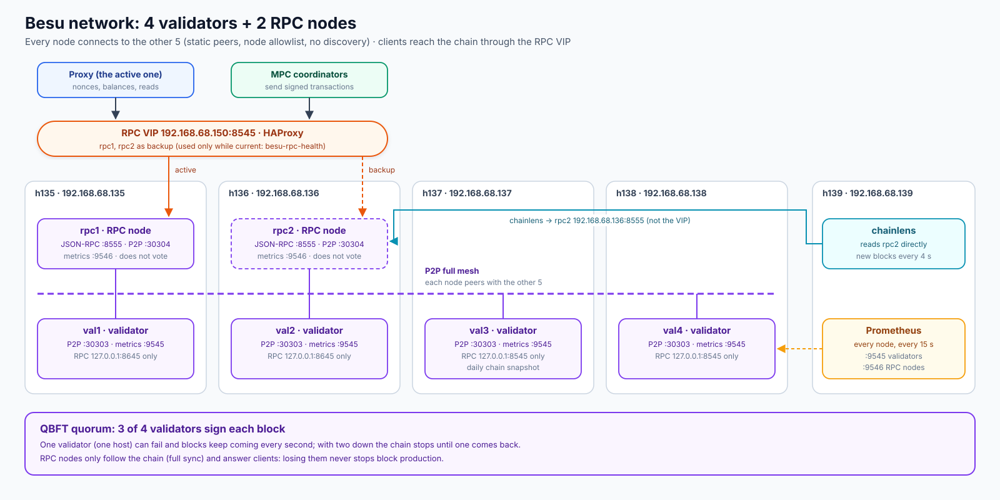
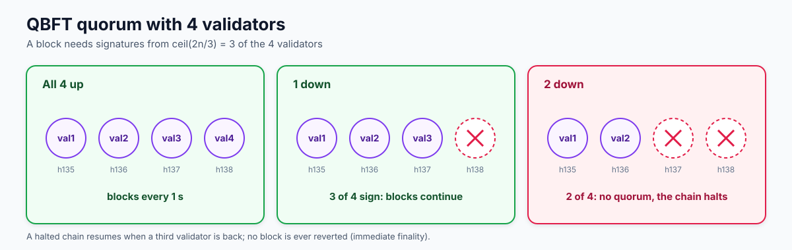

# Hyperledger Besu chain

> **What:** the blockchain itself: a private Hyperledger Besu network with QBFT consensus. Its
> nodes, consensus, genesis, configuration, ports, permissioning, APIs, metrics and day-to-day
> operations.
>
> **For:** everyone who needs to understand the chain; operators.
>
> **Related:** [Besu manual setup](../deployment/besu-manual.md) (installing nodes by hand) ·
> [high availability](../deployment/high-availability.md) (the RPC VIP) ·
> [alert runbook](../operations/alert-runbook.md#besu) · [Grafana dashboards](../operations/dashboards.md#besu-production-qbft)

**Contents**

- [At a glance](#at-a-glance)
- [Nodes](#nodes)
- [Consensus (QBFT)](#consensus-qbft)
- [Genesis and network files](#genesis-and-network-files)
- [Node configuration](#node-configuration)
- [Ports](#ports)
- [Who connects to the chain](#who-connects-to-the-chain)
- [Gas and transactions](#gas-and-transactions)
- [Metrics and health](#metrics-and-health)
- [Operations](#operations)
- [Files](#files)

---

## At a glance

| | |
|---|---|
| **Client** | Hyperledger Besu (`besu_image`, default `hyperledger/besu:26.11.1`) in Docker |
| **Consensus** | QBFT (Byzantine fault tolerant proof of authority) |
| **Validators** | 4 (val1–val4, one per host .135–.138); 3 needed to make blocks |
| **RPC nodes** | 2 (rpc1 on .135, rpc2 on .136), non-validating, behind the RPC VIP `192.168.68.150:8545` |
| **Chain id** | `chain_id` (default 1337) |
| **Block time** | `block_period` (default 1 s) |
| **Gas** | free: gas price 0 (`zeroBaseFee`, `min-gas-price=0`); block gas limit 30,000,000 |
| **EVM** | Cancun (all forks from block 0; compile contracts with EVM version `cancun`) |
| **Network** | private: static peers, node allowlist, no discovery, no public RPC |
| **Funded account** | SENDER01 (the MPC key from the key ceremony), prefunded in the genesis |

## Nodes



| Node | Host | Role | Serves |
|---|---|---|---|
| val1 | h135 `.135` | validator | makes blocks; RPC on the host's localhost only |
| val2 | h136 `.136` | validator | as val1 |
| val3 | h137 `.137` | validator | as val1; the daily chain snapshot is taken here |
| val4 | h138 `.138` | validator | as val1 |
| rpc1 | h135 | RPC node | JSON-RPC for the proxy, the MPC coordinators and the operator (normally behind the RPC VIP) |
| rpc2 | h136 | RPC node | standby behind the RPC VIP; chainlens reads it directly |

Every node runs from its own directory `/opt/besu-<node>` (container `besu-<node>-besu-1`) with
its own key in `/data/key`. Each node connects to all the others: 5 peers per node.

**Validators** only make blocks: their JSON-RPC is published on `127.0.0.1` of their host, for the
operator's QBFT commands (`qbft.sh`). **RPC nodes** don't vote; they follow the chain (full sync)
and answer applications. HAProxy sends RPC traffic to rpc1, and to rpc2 when rpc1 is not current
(`besu-rpc-health`: block age and height, not only `eth_syncing`).

## Consensus (QBFT)



- **Proof of authority:** only the listed validators make blocks, in turn (round robin). There is no
  mining and no staking.
- **Byzantine fault tolerance:** a block needs signatures from ceil(2n/3) validators. With 4
  validators that is 3: **one validator (one host) can fail**; with two down the chain stops until
  one comes back. No block is ever reverted (immediate finality).
- **Block period** `block_period` (1 s on one LAN; at least 2 s across sites) and **round timeout**
  `request_timeout` (default 2 s, greater than the block period): when a proposer doesn't answer in
  time, the next validator proposes.
- **Empty blocks:** a block is made every period even without transactions, so *Seconds since last
  block* stays under 1 s when healthy.
- **Validator changes** are voted on chain (`qbft.sh propose`), by more than half of the validators;
  the genesis is never edited on a live chain ([Besu manual setup](../deployment/besu-manual.md)).

## Genesis and network files

Created once by `besu-production/operator/make-network.sh` (Ansible phase `05-besu.yml`, from each
node's public key file), then copied to every node and checksummed:

| File | Contents |
|---|---|
| `genesis.json` | chain id; forks Berlin → Cancun at block 0; `zeroBaseFee`; QBFT settings (`blockperiodseconds`, `epochlength` 30000, `requesttimeoutseconds`); the initial validators (in `extraData`); the gas limit; prefunded accounts (`ALLOC`, SENDER01) |
| `static-nodes.json` | the enode address of every node: whom each node connects to |
| `permissions_config.toml` | the node allowlist: connections from any other node are refused |
| `SHA256SUMS` | checksums: every node must have identical files |

They live in `ansible/state/network/` on the operator. **The genesis never changes on a live
chain.** Adding or moving a node changes only `static-nodes.json` and `permissions_config.toml`
(`add-node.sh`, `move-node.sh`), then every node is restarted one at a time.

## Node configuration

Two templates in `besu-production/node/`, the same for every node of a role; host-specific values
(P2P address and port, bind addresses) come from `.env` through `docker-compose.yml`.

| Setting | Validator (`validator.toml`) | RPC node (`rpc.toml`) | Why |
|---|---|---|---|
| `sync-mode` | FULL | FULL | every block executed locally |
| `discovery-enabled` | false | false | only the static peers |
| `permissions-nodes-config-file-enabled` | true | true | the node allowlist |
| `sync-min-peers` | 1 | 1 | a small network never reaches Besu's default of 5 |
| `max-peers` | 25 | 25 | |
| `tx-pool-max-future-by-sender` | 2000 | 2000 | the proxy's busy sender can have hundreds of transactions in flight; the default 200 drops some and stalls that sender |
| `min-gas-price` | 0 | 0 | free gas |
| `rpc-http-api` | ETH, NET, QBFT, ADMIN, TXPOOL | ETH, NET, WEB3, TXPOOL | admin and voting only on validators, localhost only |
| `host-allowlist` | localhost | localhost + the RPC VIP (`BESU_HOST_ALLOWLIST`) | clients send `Host: 192.168.68.150` |
| `rpc-ws-enabled` | false | true | |
| `graphql-http-enabled` | false | false | |
| `metrics-enabled` | true (`:9545`) | true (`:9545` in the container) | Prometheus |
| Java heap | `besu_java_opts` (default `-Xmx4g`) | same | |

## Ports

| Port | Node | Reachable from |
|---|---|---|
| 30303 TCP/UDP | validators (P2P) | the other Besu hosts |
| 30304 TCP/UDP | RPC nodes (P2P) | the other Besu hosts |
| 8555 | RPC nodes (JSON-RPC, on the host address) | HAProxy and coordinators (.135, .136), chainlens (.139), the operator |
| 8545 | the RPC VIP `.150` (HAProxy → rpc1 / rpc2) | the proxies, coordinators and the operator |
| 8645 | validators' JSON-RPC (h135 / h136; 8545 on h137 / h138) | localhost of the host only |
| 9545 / 9546 | metrics (validator / RPC node) | the monitoring host |

The firewall (`ha/firewall-layout.sh`, Ansible phase 01) opens exactly these
([access control](../deployment/access-control.md)).

## Who connects to the chain

| Client | Through | Uses |
|---|---|---|
| Proxy | RPC VIP `.150:8545` | nonces, balances, receipts, contract reads, `eth_getLogs` (registry events) |
| MPC coordinators | RPC VIP `.150:8545` | `eth_sendRawTransaction` (signed transactions), chain id, gas estimates |
| Chainlens | rpc2 `.136:8555` directly | polls new blocks every 4 s and indexes them |
| Monitoring | each node's metrics port | Prometheus every 15 s |
| `besu-rpc-health` | each RPC node + the local validator | block age and height, for HAProxy |
| Operator | the VIP, or a validator's localhost | `qbft.sh`, checks, `deploy-contract.js` |

Applications never talk to Besu directly: they use the proxy ([proxy API](../reference/proxy-api.md)).

## Gas and transactions

- **Gas is free** (price 0) but limited: 30,000,000 gas per block (`block_gas_limit`). The MPC
  nodes' policy also caps gas per transaction (`MAX_GAS`, the same 30M by default).
- Transactions are **legacy (EIP-155) signed** by the MPC signer; EIP-1559 transactions are not
  used.
- **Accounts hold ETH**: the chain's own currency, created only in the genesis (SENDER01's
  allocation) and moved by transfers.
- **Throughput:** about 0.02 CPU cores per idle node; under load the limits are the block gas and
  the MPC signer's presignature rate ([MPC benchmarks](../development/mpc-benchmarks.md)).

## Metrics and health

| Signal | Where |
|---|---|
| Height, block age, peers, sync, pool, RPC rate and latency, P2P traffic, JVM | Grafana → **Besu production** ([panel by panel](../operations/dashboards.md#besu-production-qbft)) |
| Alerts | `BesuValidatorQuorumLost`, `BesuNoNewBlocks`, `BesuNodeDown`, `BesuNodeStalled`, `BesuNotInSync`, `BesuPeersMissing`, `BesuPeersLow`, `BesuTxPoolGrowing`, `BesuHeapHigh`, `BesuUnpermittedPeers` ([runbook](../operations/alert-runbook.md#besu)) |
| RPC nodes as HAProxy sees them | `curl -s http://127.0.0.1:8410/` on h135 / h136 |

Quick checks from the operator:

```bash
curl -s -X POST -H 'Content-Type: application/json' --data '{"jsonrpc":"2.0","id":1,"method":"eth_blockNumber","params":[]}' http://192.168.68.150:8545
```

On a validator host (its RPC is local; on h135 / h136 prefix `RPC=http://127.0.0.1:8645`):

```bash
cd /opt/besu-chain/besu-production/operator && ./qbft.sh validators
```

```bash
./qbft.sh health
```

## Operations

| Task | How |
|---|---|
| Deploy or update all nodes | `ansible-playbook 01-hosts.yml 05-besu.yml` (one node at a time) |
| Restart one node | `docker restart besu-<node>-besu-1` on its host |
| A node stopped importing (STALLED) | RPC node: removed from the VIP and restarted after 5 min automatically; validator: restart it ([runbook](../operations/alert-runbook.md#besunodestalled)) |
| Chain halted with quorum back | restart all validators together ([runbook](../operations/alert-runbook.md#besunonewblocks)) |
| Add or remove a validator | `besu_nodes` in `layout.yml`, `05-besu.yml`, then `qbft-vote.yml` ([adding and removing nodes](../operations/adding-nodes.md)) |
| Move a node to another host | `move-node.sh` ([disaster recovery](../operations/disaster-recovery.md)) |
| Back up node keys | `10-backups.yml` (GPG-encrypted, [GPG key](../deployment/gpg-key.md)) |
| Daily chain snapshot | on val3 at 03:17 (`snapshot-chain.sh`); restore with `restore-chain.sh` |
| Upgrade Besu | set `besu_image`, run `02-images.yml 05-besu.yml` (one node at a time; the chain keeps going) |
| Deploy a contract | chainlens Deploy page ([contract deployment](../features/contract-deployment.md)) or `deploy-contract.js` |

## Files

| Path | What |
|---|---|
| `besu-production/node/validator.toml`, `rpc.toml` | node configuration per role |
| `besu-production/node/docker-compose.yml`, `docker-compose.host.yml`, `start.sh`, `init.sh` | running a node |
| `besu-production/node/backup-key.sh`, `restore-key.sh`, `snapshot-chain.sh`, `restore-chain.sh`, `reset-chain.sh` | keys and chain data |
| `besu-production/operator/make-network.sh`, `add-node.sh`, `remove-node.sh`, `move-node.sh` | network files |
| `besu-production/operator/qbft.sh` | validator votes, peers, health |
| `besu-production/operator/deploy-contract.js` | deploy a contract signed by an MPC account |
| `ansible/05-besu.yml` | the Ansible phase for all of the above (also adds nodes listed later) |
| `ansible/qbft-vote.yml` | votes a validator in or out |
| `ansible/state/network/` | the network files (operator) |
