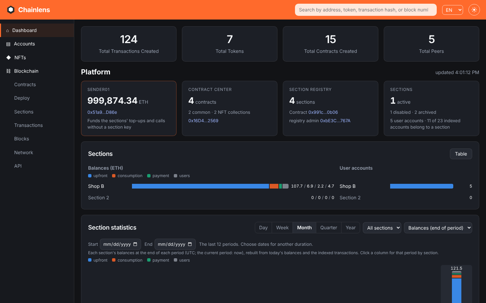
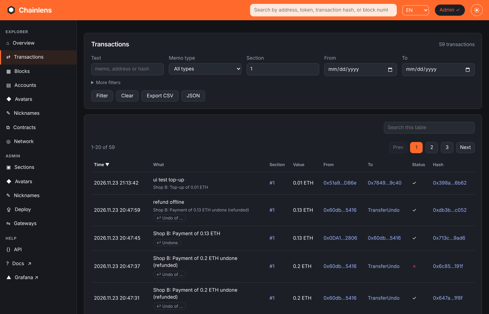
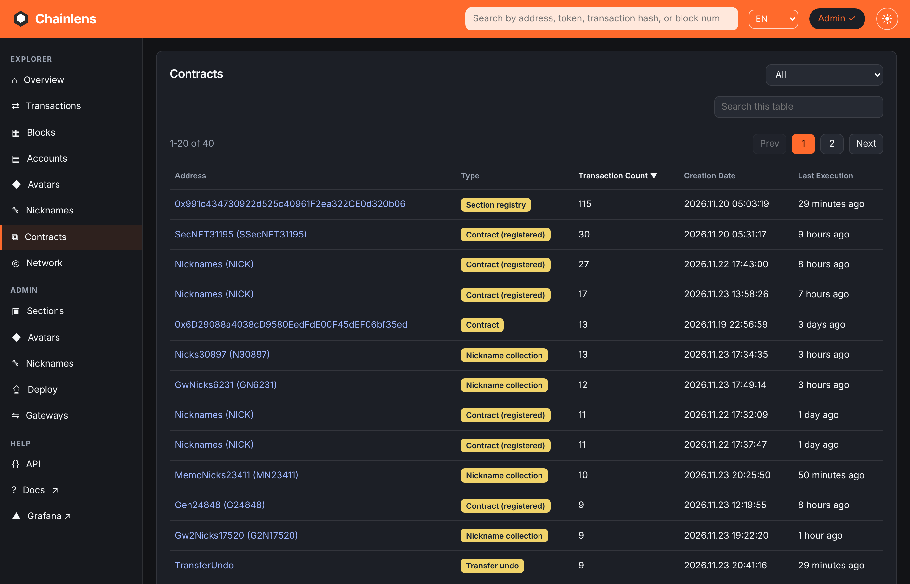
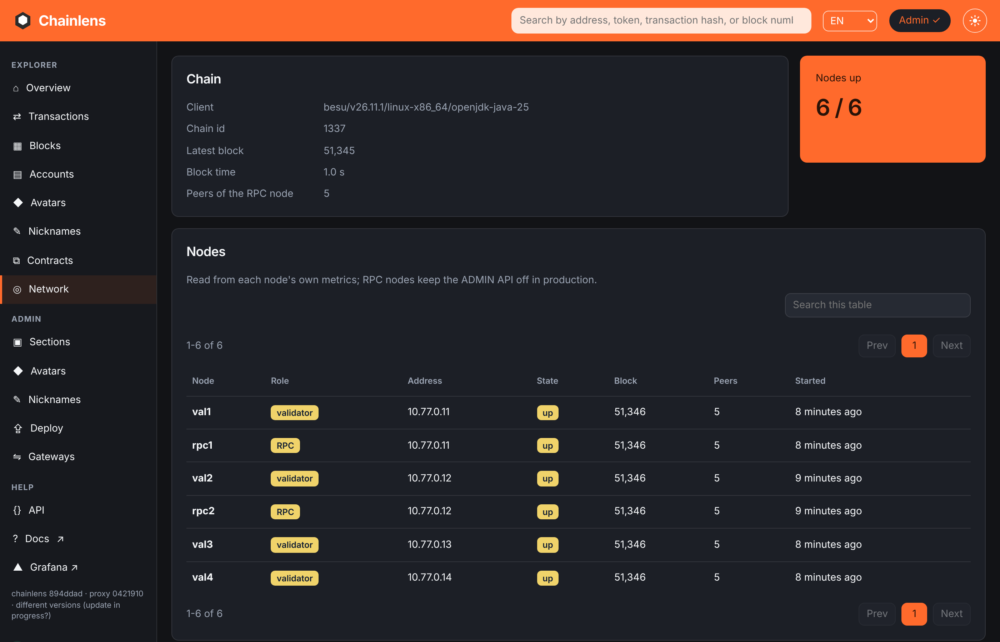
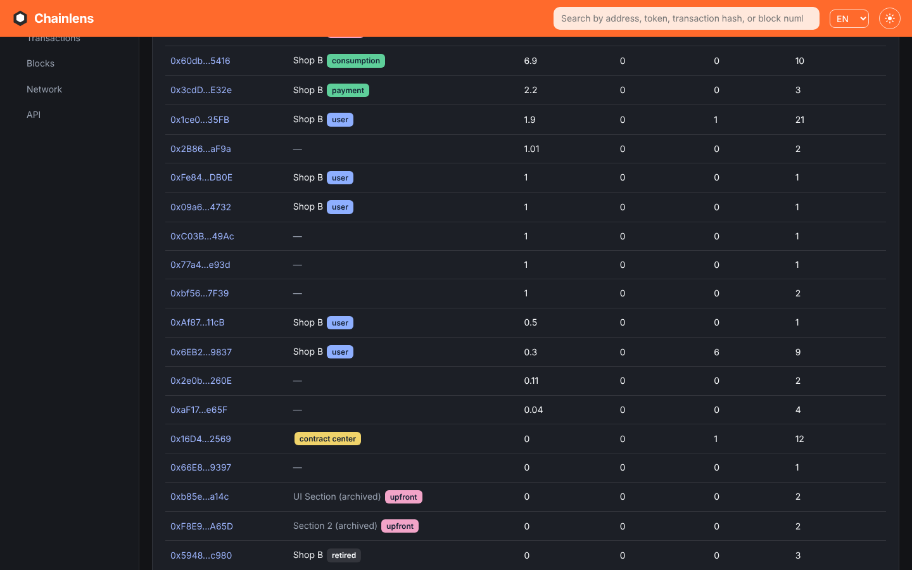
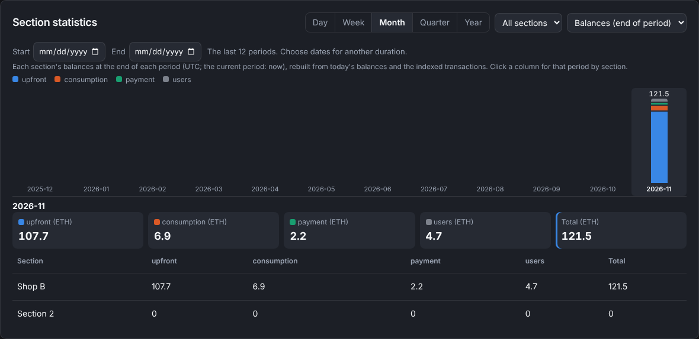
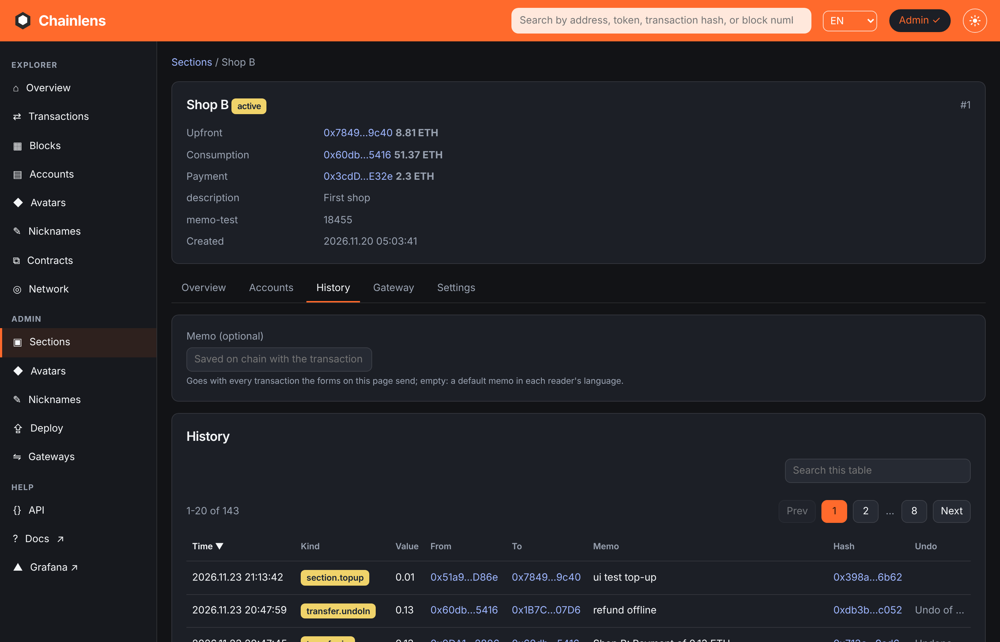
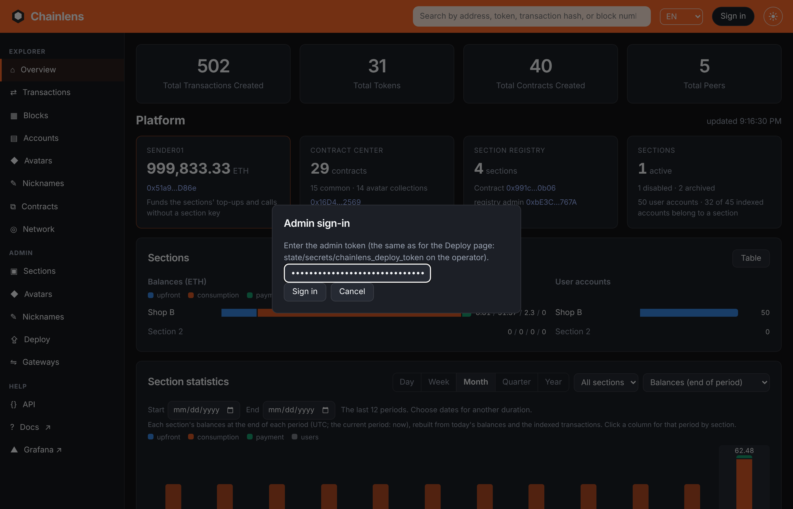

# Chainlens (블록 탐색기)

> **내용:** 체인의 웹 탐색기(`chainlens/`)입니다. 블록, 트랜잭션, 계정, 컨트랙트, NFT, 플랫폼 개요와
> 섹션 통계를 보여 주며, 컨트랙트 배포, 섹션 관리, 아바타와 닉네임의 민팅, 판매, 취소를 위한 관리자 페이지도 제공합니다.
>
> **대상:** 체인을 조회하는 모든 사용자. 관리자 페이지는 운영자용입니다.
>
> **관련 문서:** [섹션](../features/sections.md) · [컨트랙트 배포](../features/contract-deployment.md) ·
> [아바타](../features/avatars.md) · [접근 제어](../deployment/access-control.md) · [섹션 게이트웨이](gateway.md)

**목차**

- [한눈에 보기](#at-a-glance)
- [페이지](#pages)
- [관리자 페이지](#admin-pages)
- [동작 방식](#how-it-works)
- [설정](#settings)
- [실행 및 업데이트](#run-and-update)

---

## 한눈에 보기 {#at-a-glance}

| | |
|---|---|
| **URL** | `http://192.168.68.139:30100` (운영 환경, h139); `http://localhost:30100` (개발 환경) |
| **접속 가능 대상** | `settings.yml`의 `chainlens_ips` (및 운영자). [접근 제어](../deployment/access-control.md)를 참조하십시오 |
| **읽는 데이터** | rpc2 직접 조회(`BESU_RPC`), SectionRegistry의 이벤트, `contracts/deployments/`의 컨트랙트 레코드 |
| **쓰는 데이터** | 자체적으로는 없습니다. 관리자 페이지는 요청을 프록시의 관리자 API로 전달합니다 |
| **언어 / 테마** | 영어, 한국어, 중국어(EN / 한국어 / 中文), 다크 및 라이트 |



## 페이지 {#pages}

내비게이션은 세 묶음입니다: **탐색**(모두), **관리**(관리자 주소에서만 보임), **도움말**. 이전 링크(`#/transactions`,
`#/memos`, `#/blocks`, `#/nfts`, `#/sections`, `#/nicknames`, `#/deploy`)는 새 주소로 이동합니다.

| 묶음 | 페이지 | URL | 내용 |
|---|---|---|---|
| 탐색 | **개요** | `#/` | 합계(트랜잭션, 토큰, 컨트랙트, 피어); **플랫폼 개요**: SENDER01, 컨트랙트 계정 센터, 섹션 레지스트리, 섹션 수, 섹션별 잔액(누적)과 사용자 계정; 일·주·월·분기·연 또는 기간별 **섹션 통계**; 트랜잭션 차트; 가장 활발한 컨트랙트 |
| | **트랜잭션** | `#/activity/transactions` | 모든 트랜잭션과 페이지 언어로 된 [메모](../features/memos.md)(**내용**: 호출자 문구, 그 아래 기본 문구), 섹션, 금액, 보낸 쪽 → 받는 쪽, 상태; *취소됨* / *원거래* 칩과 한 API 호출이 만든 트랜잭션 칩(⛓ 2). URL에 저장되는 필터: 텍스트, **종류**(이체, 계정, 섹션, 아바타, 닉네임, 컨트랙트, 메모 없음 또는 메모 종류 하나), 섹션, 날짜; *필터 더 보기*: 요청 id, 계정. **CSV / JSON 내보내기**(`/api/activity`). 이전의 메모 페이지가 이 페이지입니다 |
| | **블록** | `#/activity/blocks` | 블록과 그 트랜잭션 |
| | **계정** | `#/accounts` | 모든 계정의 잔액과 트랜잭션 수; **섹션** 열(섹션과 역할)과 섹션 필터. 계정 페이지는 섹션, 트랜잭션, 토큰을 보여줌 |
| | **아바타** / **닉네임** | `#/items/avatars`, `#/items/nicknames` | 모든 아바타 / 닉네임 컬렉션의 아이템: 이미지 또는 이름, 소유자, 가격; 아이템 페이지는 메타데이터와 이력을 보여줌 |
| | **컨트랙트** | `#/contracts` | **레지스트리에서 가져온 종류**와 함께: 아바타 컬렉션, 닉네임 컬렉션, 섹션 레지스트리, 이체 취소, 컨트랙트(등록됨), ERC721, 컨트랙트; 종류 필터. 등록된 컨트랙트는 함수 페이지가 있음(view / pure 함수는 페이지에서 실행) |
| | **네트워크** | `#/network` | 체인(클라이언트, 체인 id, 최신 블록, 블록 시간)과 **모든 Besu 노드**(역할, 정상/중단, 블록, 피어, 시작 시각): 각 노드 자체의 지표 엔드포인트에서 읽음(`NETWORK_NODES`). 운영 환경의 RPC 노드는 ADMIN API를 끄므로 노드 정보가 더 이상 그것에 의존하지 않음. RPC 노드의 피어 목록은 ADMIN API가 켜진 곳(개발)에서만 |
| 도움말 | **API**, **문서 ↗**, **Grafana ↗** | `#/api`, `DOCS_URL`, `GRAFANA_URL` | chainlens 자체 JSON API; 문서 사이트; Grafana |

사이드바에는 chainlens와 프록시의 **버전**(커밋)이 표시되며, 서로 다르면 빨간색입니다(업데이트 진행 중: 예를 들어
`site.yml`이 프록시는 이미 업데이트했지만 chainlens는 아직인 경우).











## 관리자 페이지 {#admin-pages}

`operator_ip`와 `chainlens_deploy_ips`에서만 보입니다. 위쪽 바의 버튼으로 **한 번 로그인**합니다(관리 토큰:
`cat ansible/state/secrets/chainlens_deploy_token`). 그러면 칩이 *관리자 ✓*로 바뀝니다(누르면 로그아웃). 토큰이
틀리거나 만료되면 로그인 창이 다시 열리고, 그 밖의 오류는 토큰 요청이 아니라 오류 그대로 표시됩니다.

**결과를 바로:** 모든 관리 작업은 결과를 즉시 토스트로 보여줍니다(프록시의 응답: 메모, 금액, 트랜잭션). chainlens가
트랜잭션을 인덱싱하면(라이브 피드 `/api/live`, 보통 1–3초) 토스트가 ✓로 바뀌고 페이지가 스스로 새로 고쳐집니다.
수동 새로 고침이 필요 없습니다.
요청은 프록시의 관리자 API로 전달되므로, 서명은 항상 프록시가 하며 chainlens는 서명하지 않습니다.
**Deploy**와 닉네임 컬렉션 배포는 `/admin/contract/deploy`, **Mint**, **Change a price**, 사용자 레벨은
`/admin/contract/send`(컨트랙트 계정 센터가 서명), **Sell an avatar**는 `/contract/send`(구매자가 서명),
**Undo**와 **Undo level**은 `from` 없이 `/contract/send`(돈을 받은 소비 계정이 서명하고 구매자에게 환불)를
호출하며, 목록은 `/contract/list`와 `/contract/call`(`totalSupply`, `ownerOf`, `priceOf`, `paymentsOf`…)로 읽습니다.

| 페이지 / 카드 | 활성화 설정 | 기능 | 안내 문서 |
|---|---|---|---|
| **Deploy** (`#/admin/deploy`) | `chainlens_deploy_enabled: true` | 컴파일된 컨트랙트(Remix / Hardhat / Foundry 아티팩트)를 컨트랙트 계정 센터로 배포하고, 먼저 검사한 뒤 등록합니다 | [컨트랙트 배포](../features/contract-deployment.md) |
| **Sections** (`#/admin/sections`) — 탭 **개요**(자금), **계정**, **내역**(**취소** 포함), **게이트웨이**, **설정** | `chainlens_sections_enabled: true` | 섹션 생성, 충전, 스윕, 반환, 이름 변경, 정보 필드, 키, 계정 교체, 보관; 섹션의 사용자 계정 | [섹션](../features/sections.md) |
| **Nicknames** (`#/admin/nicknames`) | `chainlens_sections_enabled: true` | 닉네임 컬렉션 배포(이름, 심볼, 취소 기간(일)); **Mint nicknames**(한 줄에 하나, 가격 하나); **Change a price**; **User levels**(단계 가격, 판매 여부, 보유자 수; 레벨 추가); 닉네임 목록(토큰 ID, 닉네임, 가격, 계정 또는 *for sale*, 사용자 레벨)과 가능한 동안 **Undo** / **Undo level** | [닉네임](../features/nicknames.md) |
| **Avatars** (`#/admin/avatars`: 컬렉션 선택; 컬렉션 페이지에도 있음) | 위 둘 중 하나 | **Mint an avatar**(이미지, 가격, 설명, 속성); **Change a price**(판매 전까지); **Sell an avatar**(토큰 ID 또는 이미지 URL, 구매자: 섹션의 사용자 계정); 아바타 목록(최신 순)과 가능한 동안 **Undo** | [아바타](../features/avatars.md) |

**섹션 게이트웨이 안내:** 섹션 게이트웨이를 사용하면(`gateway_enabled`) **Sections** 페이지가 각 게이트웨이의
상태를 묻고(`GET /api/sections/gateways`: `GATEWAYS`의 모든 게이트웨이에 `/gateway/status` 호출, 타임아웃 3초),
게이트웨이가 online이 아닌 섹션마다 맨 위에 빨간 안내를 표시합니다. *게이트웨이가 프록시에 연결할 수 없음
(… 이후 offline, 큐 N개) … 복구될 때까지 이 섹션에 관리 쓰기(이체, 충전, 스윕, 계정 교체)를 하지 마십시오*,
또는 *게이트웨이가 응답하지 않음*입니다. [단일 작성자 규칙](gateway.md#the-single-writer-rule)을 참조하십시오.

**Gateway 카드:** 섹션에 게이트웨이가 있으면 섹션 페이지에 **Gateway** 카드가 나타납니다: 모드, 큐, 예비 계정,
단절 횟수, 정정, 마지막 스냅숏, **Acknowledge** 버튼이 있는 [정정](gateway.md#corrections) 목록, 대사 보고서
(`GET /api/sections/:id/gateway`, `POST /api/sections/:id/gateway/ack/:report`. 게이트웨이의 보고서 토큰
`GATEWAY_REPORT_TOKEN`을 사용하며, 이 토큰은 읽기와 확인만 할 수 있습니다). Sections 목록은 미확인 정정이 있는
섹션마다 안내를 보여줍니다.

| **Gateways** (`#/admin/gateways`) | 섹션 게이트웨이(`gateway_enabled`) | 모든 게이트웨이: 모드, 시작, 큐, 예비 계정, 미확인 / 전체 정정, 단절; 각 섹션의 게이트웨이 탭 링크 | [섹션 게이트웨이](gateway.md) |






## 동작 방식 {#how-it-works}

- **인덱싱:** 1.5초마다 RPC 노드를 폴링하고, 트랜잭션이 있는 새 블록을 열린 페이지로 보내며(`/api/live`, Server-Sent Events), 블록, 트랜잭션, 계정, NFT를 메모리에 인덱싱합니다.
  체인이 초기화되면 처음부터 다시 인덱싱합니다. 잔액은 백그라운드에서 갱신됩니다.
- **레지스트리:** 15초마다 SectionRegistry의 이벤트를 배포 블록부터 1,000블록 단위로 읽습니다.
  섹션, 섹션 계정과 역할, ABI가 포함된 등록 컨트랙트를 읽습니다.
- **개요 및 통계:** `/api/overview`(잔액은 15초마다 읽음)와 `/api/sections/stats`(인덱싱된 트랜잭션으로
  계산, 15초 캐시). 과거 잔액은 오늘의 잔액에서 거꾸로 재구성합니다(이 체인에서는 가스가 무료입니다).

## 설정 {#settings}

Ansible(`ansible/templates/chainlens.env.j2`)이 h139의 `chainlens/.env`에 작성합니다.

| 변수 | 의미 |
|---|---|
| `BESU_RPC` | chainlens가 읽는 RPC 노드(rpc2) |
| `PORT` | 30100 |
| `REGISTRY_CONTRACT`, `REGISTRY_FROM_BLOCK` | SectionRegistry와 그 배포 블록 |
| `CONTRACT_CENTER` | 컨트랙트 계정 센터(Accounts와 개요에 표시됨) |
| `ADMIN_TOKEN`, `ADMIN_ALLOWED_IPS` | 관리자 페이지의 토큰과 허용 주소 |
| `PROXY_ADMIN_URL`, `PROXY_ADMIN_TOKEN` | 관리자 페이지가 요청을 전달하는 곳(프록시 VIP) |
| `DEPLOY_ENABLED`, `SECTIONS_ENABLED` | 관리자 페이지 활성화 |
| `GATEWAYS` | 섹션 게이트웨이, `<section id>=http://<gateway host>:30010 …`(Sections 페이지 안내, Gateway 카드) |
| `GATEWAY_REPORT_TOKEN` | 게이트웨이의 정정을 읽고 확인(`state/secrets/gateway_report_token`) |
| `NETWORK_NODES` | 네트워크 페이지: `name=host:metrics_port:role …`, `besu_nodes`에서 생성(각 노드의 지표 엔드포인트; 모니터링 호스트가 읽을 수 있음) |
| `APP_COMMIT`, `GRAFANA_URL`, `DOCS_URL` | 사이드바의 버전(프록시 버전은 프록시의 `GET /version`); 도움말 링크 |
| `TRANSFER_UNDO_DAYS` | 섹션 내역의 **취소** 버튼([이체 취소](../features/transfer-undo.md)) |

`settings.yml`의 항목: `chainlens_ips`, `chainlens_deploy_enabled`, `chainlens_sections_enabled`,
`chainlens_deploy_ips`.

## 실행 및 업데이트 {#run-and-update}

```bash
# production (from ansible/, after a git pull): copy the code, build the image, deploy
ansible-playbook 01-hosts.yml 02-images.yml 11-chainlens.yml
```

```bash
# development
cd chainlens && cp .env.example .env && docker compose up -d --build
```
