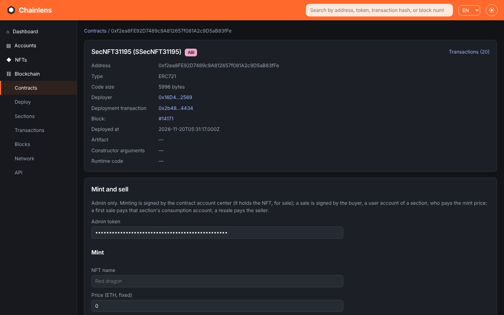
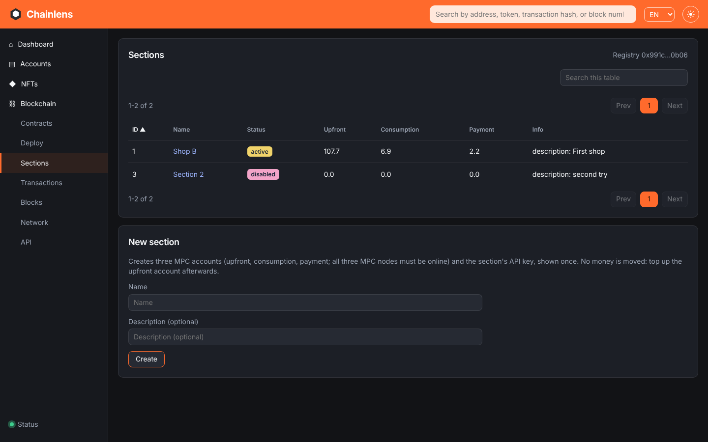
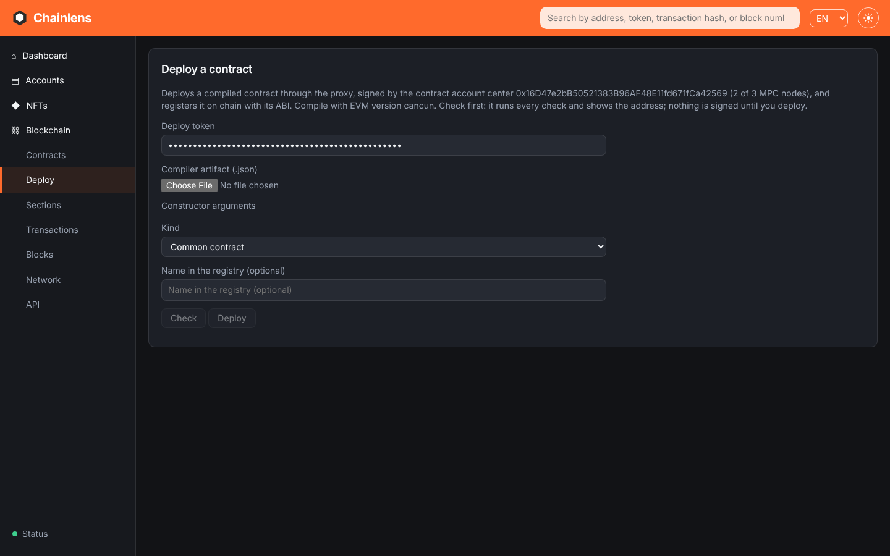

# Chainlens (블록 탐색기)

> **내용:** 체인의 웹 탐색기(`chainlens/`)입니다. 블록, 트랜잭션, 계정, 컨트랙트, NFT, 플랫폼 개요와
> 섹션 통계를 보여 주며, 컨트랙트 배포, 섹션 관리, NFT 민팅 및 판매를 위한 관리자 페이지도 제공합니다.
>
> **대상:** 체인을 조회하는 모든 사용자. 관리자 페이지는 운영자용입니다.
>
> **관련 문서:** [섹션](../features/sections.md) · [컨트랙트 배포](../features/contract-deployment.md) ·
> [NFT 워크플로](../features/nft-workflow.md) · [접근 제어](../deployment/access-control.md)

**목차**

- [한눈에 보기](#at-a-glance)
- [페이지](#pages)
- [관리자 페이지](#admin-pages)
- [동작 방식](#how-it-works)
- [설정](#settings)
- [실행 및 업데이트](#run-and-update)

---

## 한눈에 보기 {#at-a-glance}

| | |
|---|---|
| **URL** | `http://192.168.68.139:30100` (운영 환경, h139); `http://localhost:30100` (개발 환경) |
| **접속 가능 대상** | `settings.yml`의 `chainlens_ips` (및 운영자). [접근 제어](../deployment/access-control.md)를 참조하십시오 |
| **읽는 데이터** | rpc2 직접 조회(`BESU_RPC`), SectionRegistry의 이벤트, `contracts/deployments/`의 컨트랙트 레코드 |
| **쓰는 데이터** | 자체적으로는 없습니다. 관리자 페이지는 요청을 프록시의 관리자 API로 전달합니다 |
| **언어 / 테마** | 영어와 중국어(EN / 中文 전환), 다크 및 라이트 |


## 페이지 {#pages}

| 페이지 | URL | 표시 내용 |
|---|---|---|
| **Dashboard** | `#/` | 합계(트랜잭션, 토큰, 컨트랙트, 피어); **Platform overview**: SENDER01, 컨트랙트 계정 센터, 섹션 레지스트리, 섹션 수, 각 섹션의 잔액(선지급 / 소비 / 결제 / 사용자, 누적 표시)과 사용자 계정; 일, 주, 월, 분기, 연 단위 또는 날짜 범위별 **Section statistics**(누적 기말 잔액, 신규 사용자, 수입, NFT 판매, 충전, 스윕 등); 트랜잭션 차트; 가장 활발한 컨트랙트; 토큰 유형 |
| **Accounts** | `#/accounts` | 모든 계정의 잔액과 트랜잭션 수; **Section** 열(섹션 및 역할: user, upfront, consumption, payment, retired; 시스템 계정 SENDER01, 컨트랙트 센터, 레지스트리 관리자)과 섹션 필터. 계정 페이지에는 해당 계정의 섹션, 트랜잭션, 토큰이 표시됩니다 |
| **NFTs** | `#/nfts` | 모든 컬렉션의 NFT와 이미지, 소유자, 가격; NFT 페이지에는 메타데이터와 이력이 표시됩니다 |
| **Contracts** | `#/contracts` | 체인에서 확인된 컨트랙트; 등록된 컨트랙트(프록시를 통해 배포되었거나 `contracts/deployments/`에 기록된 컨트랙트)에는 함수 목록이 있는 페이지가 있으며, **view / pure 함수는 페이지에서 실행됩니다**(읽기 전용). NFT 컬렉션에는 **Mint and sell** 카드(관리자용)가 표시됩니다 |
| **Transactions** / **Blocks** | `#/transactions`, `#/blocks` | 목록 및 상세 페이지(디코딩된 함수 호출, 이벤트, 메모) |
| **Network** | `#/network` | chainlens가 읽는 노드: 피어, 버전 |
| **API** | `#/api` | chainlens 자체 JSON API(`/api/...`) |

관리자 페이지를 제외한 모든 내용은 chainlens에 접속할 수 있는 모든 사용자에게 표시됩니다. 이 정보는
어차피 체인에 공개되어 있습니다.




## 관리자 페이지 {#admin-pages}

활성화하기 전까지는 숨겨져 있으며, `operator_ip`와 `chainlens_deploy_ips`에서만 관리자 토큰
(`cat ansible/state/secrets/chainlens_deploy_token`; 해당 브라우저 탭에만 보관됨)으로 사용할 수 있습니다.
요청은 프록시의 관리자 API로 전달되므로, 서명은 항상 프록시가 하며 chainlens는 서명하지 않습니다.

| 페이지 / 카드 | 활성화 설정 | 기능 | 안내 문서 |
|---|---|---|---|
| **Deploy** (`#/deploy`) | `chainlens_deploy_enabled: true` | 컴파일된 컨트랙트(Remix / Hardhat / Foundry 아티팩트)를 컨트랙트 계정 센터로 배포하고, 먼저 검사한 뒤 등록합니다 | [컨트랙트 배포](../features/contract-deployment.md) |
| **Sections** (`#/sections`) | `chainlens_sections_enabled: true` | 섹션 생성, 충전, 스윕, 반환, 이름 변경, 정보 필드, 키, 계정 교체, 보관; 섹션의 사용자 계정 | [섹션](../features/sections.md) |
| **Mint and sell** (NFT 컬렉션 페이지) | 위 둘 중 하나 | NFT 민팅(가격은 민팅 시 확정); 섹션의 사용자 계정에 판매 | [NFT 워크플로](../features/nft-workflow.md) |





## 동작 방식 {#how-it-works}

- **인덱싱:** 4초마다 RPC 노드를 폴링하여 블록, 트랜잭션, 계정, NFT를 메모리에 인덱싱합니다.
  체인이 초기화되면 처음부터 다시 인덱싱합니다. 잔액은 백그라운드에서 갱신됩니다.
- **레지스트리:** 15초마다 SectionRegistry의 이벤트를 배포 블록부터 1,000블록 단위로 읽습니다.
  섹션, 섹션 계정과 역할, ABI가 포함된 등록 컨트랙트를 읽습니다.
- **개요 및 통계:** `/api/overview`(잔액은 15초마다 읽음)와 `/api/sections/stats`(인덱싱된 트랜잭션으로
  계산, 15초 캐시). 과거 잔액은 오늘의 잔액에서 거꾸로 재구성합니다(이 체인에서는 가스가 무료입니다).

## 설정 {#settings}

Ansible(`ansible/templates/chainlens.env.j2`)이 h139의 `chainlens/.env`에 작성합니다.

| 변수 | 의미 |
|---|---|
| `BESU_RPC` | chainlens가 읽는 RPC 노드(rpc2) |
| `PORT` | 30100 |
| `REGISTRY_CONTRACT`, `REGISTRY_FROM_BLOCK` | SectionRegistry와 그 배포 블록 |
| `CONTRACT_CENTER` | 컨트랙트 계정 센터(Accounts와 개요에 표시됨) |
| `ADMIN_TOKEN`, `ADMIN_ALLOWED_IPS` | 관리자 페이지의 토큰과 허용 주소 |
| `PROXY_ADMIN_URL`, `PROXY_ADMIN_TOKEN` | 관리자 페이지가 요청을 전달하는 곳(프록시 VIP) |
| `DEPLOY_ENABLED`, `SECTIONS_ENABLED` | 관리자 페이지 활성화 |

`settings.yml`의 항목: `chainlens_ips`, `chainlens_deploy_enabled`, `chainlens_sections_enabled`,
`chainlens_deploy_ips`.

## 실행 및 업데이트 {#run-and-update}

```bash
# production (from ansible/, after a git pull): copy the code, build the image, deploy
ansible-playbook 01-hosts.yml 02-images.yml 11-chainlens.yml
```

```bash
# development
cd chainlens && cp .env.example .env && docker compose up -d --build
```
