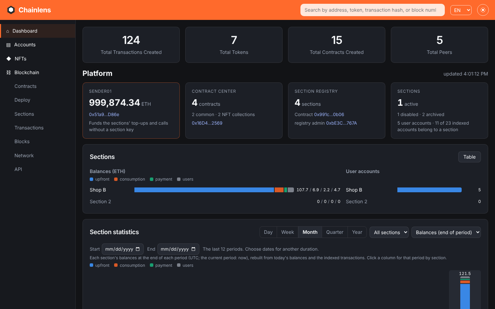
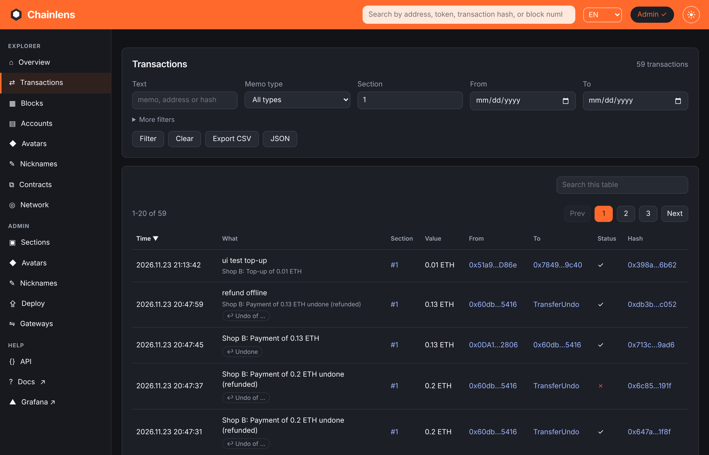
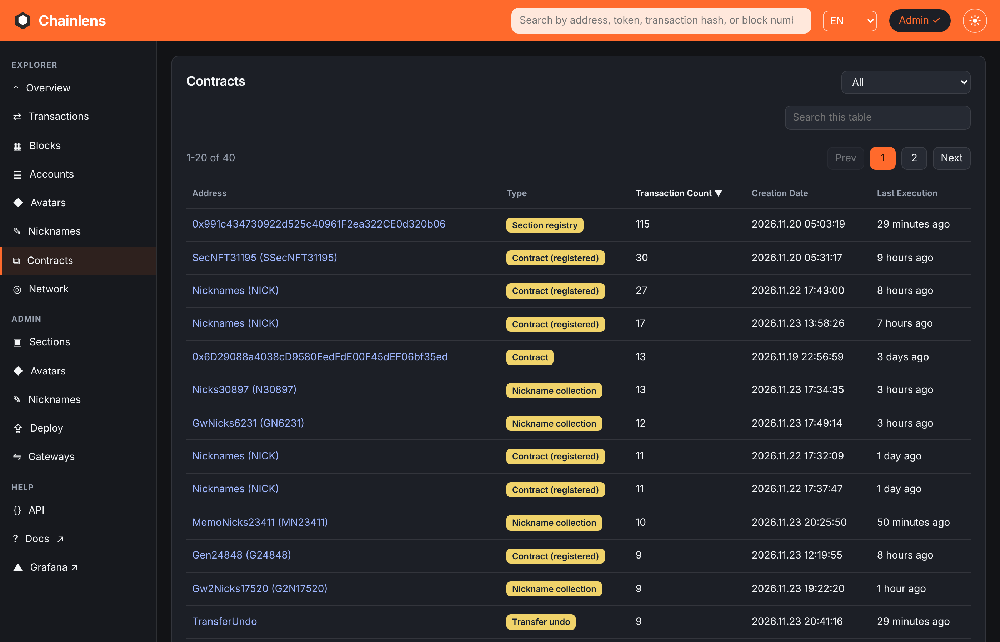
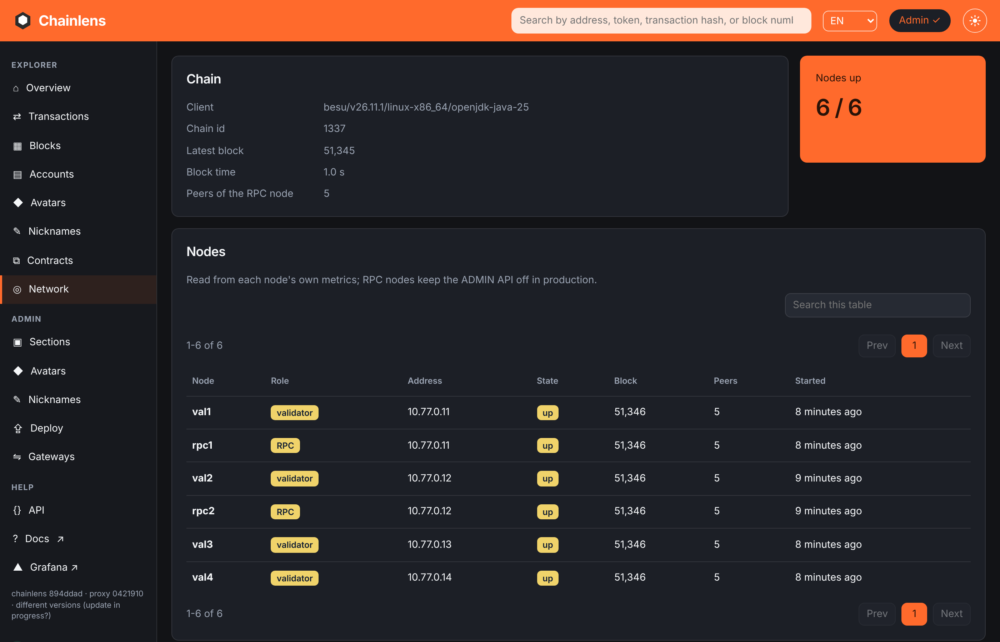
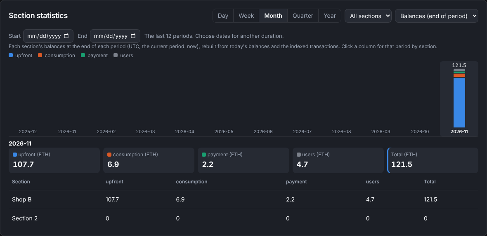
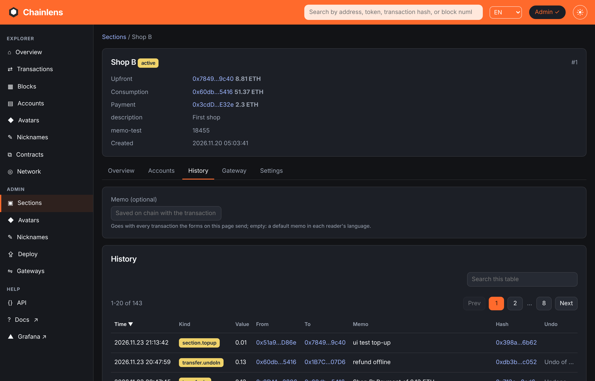
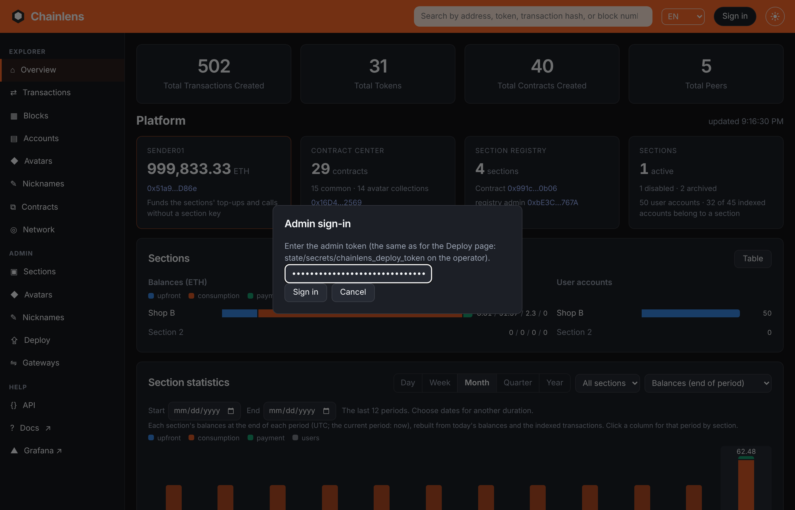
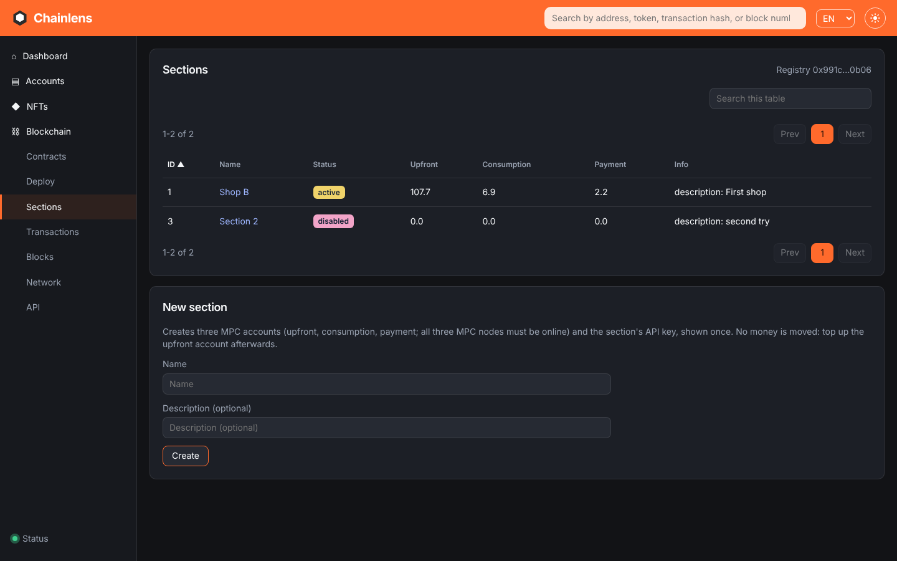
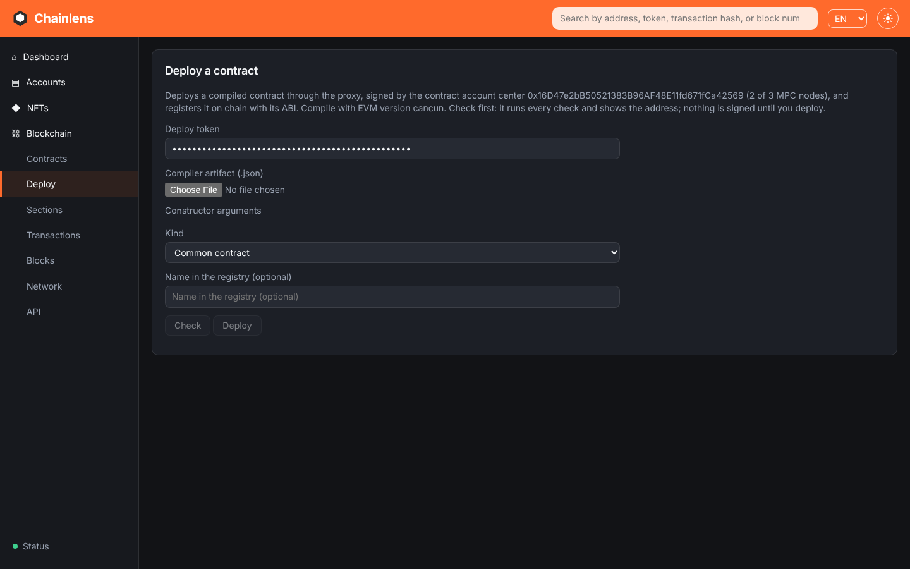

# Chainlens (block explorer)

> **What:** the web explorer of the chain (`chainlens/`): blocks, transactions, accounts, contracts,
> NFTs, the platform overview and section statistics, plus admin pages for deploying contracts,
> managing sections, and minting, selling and undoing avatars and nicknames.
>
> **For:** everyone who looks at the chain; the admin pages are for operators.
>
> **Related:** [sections](../features/sections.md) · [contract deployment](../features/contract-deployment.md) ·
> [avatars](../features/avatars.md) · [access control](../deployment/access-control.md) · [section gateway](gateway.md)

**Contents**

- [At a glance](#at-a-glance)
- [Pages](#pages)
- [Admin pages](#admin-pages)
- [How it works](#how-it-works)
- [Settings](#settings)
- [Run and update](#run-and-update)

---

## At a glance

| | |
|---|---|
| **URL** | `http://192.168.68.139:30100` (production, h139); `http://localhost:30100` (development) |
| **Who can open it** | `chainlens_ips` in `settings.yml` (plus the operator); see [access control](../deployment/access-control.md) |
| **Reads** | rpc2 directly (`BESU_RPC`), the SectionRegistry's events, the contract records in `contracts/deployments/` |
| **Writes** | nothing by itself; the admin pages forward to the proxy's admin API |
| **Languages / themes** | English, Korean, Chinese (EN / 한국어 / 中文), dark and light |



## Pages

The navigation has three groups: **Explorer** (everyone), **Admin** (shown only from the admin
addresses) and **Help**. Older links (`#/transactions`, `#/memos`, `#/blocks`, `#/nfts`, `#/sections`,
`#/nicknames`, `#/deploy`) redirect to the new ones.

| Group | Page | URL | Shows |
|---|---|---|---|
| Explorer | **Overview** | `#/` | totals (transactions, tokens, contracts, peers); **Platform overview**: SENDER01, the contract account center, the section registry, section counts, each section's balances (stacked) and user accounts; **Section statistics** per day, week, month, quarter or year, or a date range; the transaction chart; most active contracts |
| | **Transactions** | `#/activity/transactions` | every transaction with its [memo](../features/memos.md) in the page's language (**What**: the caller's text, the default text under it), section, amount, from → to, status; chips for *undone* / *undo of* and for transactions made by one API call (⛓ 2). Filters in the URL: text, **kind** (Transfers, Accounts, Sections, Avatars, Nicknames, Contracts, No memo, or one memo type), section, dates; *More filters*: request id, account. **Export CSV / JSON** (`/api/activity`). The former Memos page is this page |
| | **Blocks** | `#/activity/blocks` | blocks and their transactions |
| | **Accounts** | `#/accounts` | every account with balance and transaction count; the **Section** column (section and role) and a section filter. An account's page shows its section, transactions and tokens |
| | **Avatars** / **Nicknames** | `#/items/avatars`, `#/items/nicknames` | the items of every avatar / nickname collection, with image or name, owner and price; an item's page shows its metadata and history |
| | **Contracts** | `#/contracts` | contracts with their **type from the registry**: Avatar collection, Nickname collection, Section registry, Transfer undo, Contract (registered), ERC721, Contract; a type filter. Registered contracts have a page with their functions (view / pure functions run in the page) |
| | **Network** | `#/network` | the chain (client, chain id, latest block, block time) and **every Besu node** (role, up/down, block, peers, started), read from each node's own metrics endpoint (`NETWORK_NODES`): RPC nodes keep the ADMIN API off in production, so node details no longer depend on it. Peers of the RPC node only where its ADMIN API is on (development) |
| Help | **API**, **Docs ↗**, **Grafana ↗** | `#/api`, `DOCS_URL`, `GRAFANA_URL` | chainlens's own JSON API; the documentation site; Grafana |

The sidebar shows the **versions** (commits) of chainlens and the proxy; in red when they differ (an
update in progress: for example the proxy already updated by `site.yml`, chainlens not yet).










## Admin pages

Shown only from `operator_ip` and `chainlens_deploy_ips`. **Sign in once** with the button in the top
bar (the admin token: `cat ansible/state/secrets/chainlens_deploy_token`); the chip then reads
*Admin ✓* (click to sign out). A wrong or expired token opens the sign-in again; any other error is
shown as it is (not as a token prompt).

**Results at once:** every admin action shows its result as a toast right away (the proxy's answer:
memo, amount, transaction); when chainlens indexes the transaction (live feed `/api/live`, usually 1–3
seconds) the toast turns ✓ and the page refreshes by itself. No manual refresh.
They forward to the proxy's admin API, so the proxy signs, never chainlens: **Deploy** and the
nickname collection's deploy call `/admin/contract/deploy`; **Mint**, **Change a price** and the user
levels call `/admin/contract/send` (signed by the contract account center); **Sell an avatar** calls
`/contract/send` (signed by the buyer); **Undo** and **Undo level** call `/contract/send` without `from`
(signed by the consumption account that was paid, which refunds the buyer); the lists read
`/contract/list` and `/contract/call` (`totalSupply`, `ownerOf`, `priceOf`, `paymentsOf`…).

| Page / card | Enabled by | Does | Guide |
|---|---|---|---|
| **Deploy** (`#/admin/deploy`) | `chainlens_deploy_enabled: true` | deploy a compiled contract (Remix / Hardhat / Foundry artifact) as the contract account center, check first, register it | [contract deployment](../features/contract-deployment.md) |
| **Sections** (`#/admin/sections`) — tabs **Overview** (money), **Accounts**, **History** (with **Undo**), **Gateway**, **Settings** | `chainlens_sections_enabled: true` | create sections, top up, sweep, pay back, rename, info fields, keys, replace accounts, archive; a section's user accounts | [sections](../features/sections.md) |
| **Nicknames** (`#/admin/nicknames`) | `chainlens_sections_enabled: true` | deploy the nickname collection (name, symbol, undo period in days); **Mint nicknames** (one per line, one price); **Change a price**; **Sell a nickname** (token id or nickname, buyer: a section's user account); **User levels** (step price, for sale, holders; add a level); the list of nicknames (token id, nickname, price, account or *for sale*, user level) with **Undo** / **Undo level** while possible | [nicknames](../features/nicknames.md) |
| **Avatars** (`#/admin/avatars`: pick a collection; also on the collection's page) | either of the above | **Mint an avatar** (image, price, description, attributes); **Change a price** (until sold); **Sell an avatar** (token id or image URL, buyer: a section's user account); the list of avatars (newest first) with **Undo** while possible | [avatars](../features/avatars.md) |

**Section gateway notice:** with section gateways (`gateway_enabled`), the **Sections** page asks each
gateway for its status (`GET /api/sections/gateways`, which calls `/gateway/status` on every gateway in
`GATEWAYS`, 3 s timeout) and shows a red notice at the top for each section whose gateway is not
online: *its gateway cannot reach the proxy (offline since …, N queued) … make no admin writes on this
section (transfers, top-ups, sweeps, account changes) until it is back*, or *its gateway does not
answer*. See [the single-writer rule](gateway.md#the-single-writer-rule).

**Gateway card:** on a section's page, when the section has a gateway, a **Gateway** card shows its
mode, queue, spare accounts, cuts, corrections and last snapshot, the list of
[corrections](gateway.md#corrections) with an **Acknowledge** button, and the reconcile reports
(`GET /api/sections/:id/gateway`, `POST /api/sections/:id/gateway/ack/:report`, through the
gateways' report token `GATEWAY_REPORT_TOKEN`, which can only read and acknowledge). The Sections list
shows a notice per section with open corrections.

| **Gateways** (`#/admin/gateways`) | section gateways (`gateway_enabled`) | every gateway: mode, since, queue, spares, open / all corrections, cuts; links to each section's Gateway tab | [section gateway](gateway.md) |









## How it works

- **Indexing:** polls the RPC node every 1.5 s, pushes each new block with transactions to open pages (`/api/live`, Server-Sent Events), indexes blocks, transactions, accounts and NFTs in
  memory; re-indexes from scratch after a chain reset. Balances are refreshed in the background.
- **Registry:** reads the SectionRegistry's events every 15 s from its deployment block, in
  1,000-block chunks: sections, section accounts and roles, registered contracts with their ABI.
- **Overview and statistics:** `/api/overview` (balances read every 15 s) and
  `/api/sections/stats` (computed from the indexed transactions, cached 15 s). Past balances are
  rebuilt backwards from today's (gas is free on this chain).

## Settings

Written by Ansible (`ansible/templates/chainlens.env.j2`) into `chainlens/.env` on h139:

| Variable | Meaning |
|---|---|
| `BESU_RPC` | the RPC node chainlens reads (rpc2) |
| `PORT` | 30100 |
| `REGISTRY_CONTRACT`, `REGISTRY_FROM_BLOCK` | the SectionRegistry and its deployment block |
| `CONTRACT_CENTER` | the contract account center (marked in Accounts and the overview) |
| `ADMIN_TOKEN`, `ADMIN_ALLOWED_IPS` | the admin pages' token and allowed addresses |
| `PROXY_ADMIN_URL`, `PROXY_ADMIN_TOKEN` | where the admin pages forward (the proxy VIP) |
| `DEPLOY_ENABLED`, `SECTIONS_ENABLED` | turn the admin pages on |
| `GATEWAYS` | the section gateways, `<section id>=http://<gateway host>:30010 …` (the Sections page notice, the Gateway card) |
| `GATEWAY_REPORT_TOKEN` | reads the gateways' corrections and acknowledges them (`state/secrets/gateway_report_token`) |
| `NETWORK_NODES` | the Network page: `name=host:metrics_port:role …`, from `besu_nodes` (each node's metrics endpoint; the monitoring host may read them) |
| `APP_COMMIT`, `GRAFANA_URL`, `DOCS_URL` | the version in the sidebar (the proxy's comes from its `GET /version`); the Help links |
| `TRANSFER_UNDO_DAYS` | the section history's **Undo** button ([transfer undo](../features/transfer-undo.md)) |

In `settings.yml`: `chainlens_ips`, `chainlens_deploy_enabled`, `chainlens_sections_enabled`,
`chainlens_deploy_ips`.

## Run and update

```bash
# production (from ansible/, after a git pull): copy the code, build the image, deploy
ansible-playbook 01-hosts.yml 02-images.yml 11-chainlens.yml
```

```bash
# development
cd chainlens && cp .env.example .env && docker compose up -d --build
```
