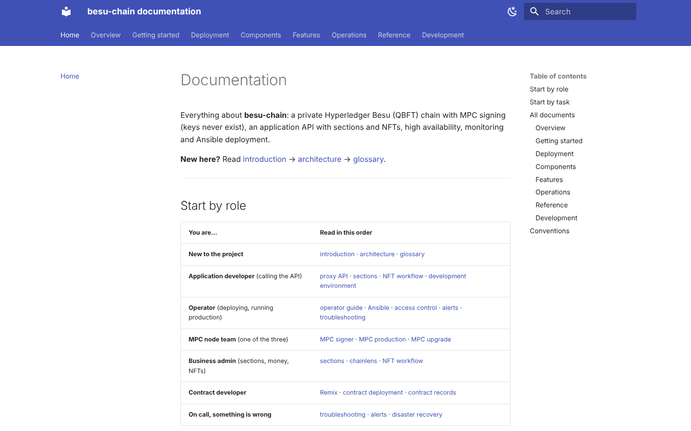
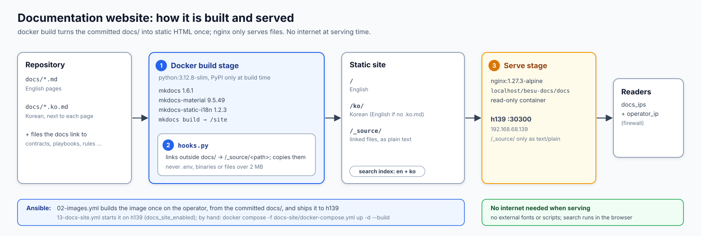

# 문서 웹사이트

> **내용:** 이 문서를 자체 호스팅 웹사이트로 제공합니다. `docs/`를 MkDocs(Material 테마)로 정적 HTML로
> 빌드하고 Docker의 nginx로 제공합니다. 검색, 다크 모드를 지원하며 인터넷이 필요하지 않습니다.
>
> **대상:** 운영자(배포), 모든 사용자(열람).
>
> **관련 문서:** [문서 지도](../README.md) · [접근 제어](../deployment/access-control.md) ·
> [Ansible](../deployment/ansible.md)

**목차**

- [한눈에 보기](#at-a-glance)
- [운영 환경(Ansible)](#production-ansible)
- [임의의 Docker 호스트](#any-docker-host)
- [빌드 방식](#how-it-is-built)
- [문서 작성](#writing-documentation)

---

## 한눈에 보기 {#at-a-glance}

| | |
|---|---|
| **URL** | `http://192.168.68.139:30300` (운영 환경, 모니터링 호스트) |
| **소스** | `docs/` (GitHub에 표시되는 것과 같은 Markdown) |
| **이미지** | `localhost/besu-docs/docs`: 빌드된 사이트를 포함한 nginx, 읽기 전용 컨테이너 |
| **접속 가능 대상** | `settings.yml`의 `docs_ips` 및 운영자 |
| **인터넷 필요 여부** | 필요 없음: 외부 글꼴이나 스크립트가 없으며, 검색은 브라우저에서 실행됩니다 |
| **파일** | `docs-site/` (`Dockerfile`, `mkdocs.yml`, `hooks.py`, `nginx.conf`, `docker-compose.yml`) |



사이트는 `docs/`와 같은 구조입니다. Overview, Getting started, Deployment, Components, Features,
Operations, Reference, Development 탭이 있으며, 전문 검색, 라이트 / 다크 전환, 모든 코드 블록의 복사
버튼을 제공합니다.

## 운영 환경(Ansible) {#production-ansible}

기본적으로 켜져 있습니다(`docs_site_enabled: true`). `ansible/group_vars/all/settings.yml`에서 설정합니다.

```yaml
docs_site_enabled: true
docs_ips: [192.168.68.0/24]     # who may read it: addresses or networks
```

적용합니다(단계 01은 코드를 복사하고 방화벽을 열며, 02는 커밋된 `docs/`로 이미지를 빌드하고, 09는
모니터링 호스트에서 실행합니다).

```bash
ansible-playbook 01-hosts.yml 02-images.yml 13-docs-site.yml
```

사이트는 **커밋된** 문서를 보여 줍니다. 02를 실행하기 전에 `docs/`의 변경 사항을 커밋하십시오.
끄려면 `docs_site_enabled: false`로 설정하고 `13-docs-site.yml`을 실행합니다(컨테이너가 중지됩니다).

## 임의의 Docker 호스트 {#any-docker-host}

저장소 루트에서 실행합니다.

```bash
docker compose -f docs-site/docker-compose.yml up -d --build
```

그런 다음 `http://<host>:30300`을 엽니다. `docs-site/.env`의 설정(선택 사항): `BIND_IP`(기본값 모든
주소), `PORT`(기본값 30300). 문서를 변경한 후에는 다시 빌드합니다.

```bash
docker compose -f docs-site/docker-compose.yml up -d --build
```

## 빌드 방식 {#how-it-is-built}



1. **빌드 단계** (`python:3.12.8-slim`): `mkdocs 1.6.1`, `mkdocs-material 9.5.49`,
   `mkdocs-static-i18n 1.2.3`과 그 의존성을 설치하고(모두 `docs-site/requirements.txt`에 버전이 고정되어 있으며,
   빌드 시에만 PyPI에서 받거나 네트워크 없이 `docs-site/offline/wheels.tgz`에서 설치합니다:
   [오프라인 빌드](../deployment/offline-build.md)), 저장소를 복사한 뒤(비밀 정보, 상태, 대용량 파일은 `Dockerfile.dockerignore`로 제외)
   `mkdocs build`를 실행합니다.
2. **소스 파일 링크:** 문서는 `docs/` 외부의 파일(컨트랙트, 플레이북, 알림 규칙 등)에 링크합니다.
   `hooks.py`는 이러한 링크를 `/_source/<path>`로 바꾸고 파일을 그곳에 복사하므로, 사이트에서 일반
   텍스트로 열립니다(폴더는 목록으로 표시). `.env` 파일, 바이너리, 2 MB를 초과하는 파일은 복사하지 않습니다.
3. **제공 단계** (`nginx:1.27.3-alpine`): 포트 30300에서 정적 사이트를 제공하며, `/_source/`는
   `text/plain`으로만 제공합니다.

제목 앵커는 GitHub의 규칙을 따르므로, 같은 링크가 GitHub와 사이트에서 모두 동작합니다.

## 문서 작성 {#writing-documentation}

- `docs/`의 알맞은 폴더에 페이지를 추가한 다음, `docs-site/mkdocs.yml`의 `nav:`와
  [`docs/README.md`](../README.md)에 등록합니다.
- 페이지는 **What / For / Related** 블록으로 시작하고, 내용이 길면 **Contents** 목록을 넣습니다.
- 상대 링크(`../features/sections.md`)를 사용합니다. `docs/` 외부의 코드로 링크해도 됩니다.
- 로컬에서 빌드를 확인합니다(경고에 깨진 링크와 앵커가 표시됩니다).

```bash
pip install -r docs-site/requirements.txt
mkdocs build -f docs-site/mkdocs.yml -d /tmp/site
```
