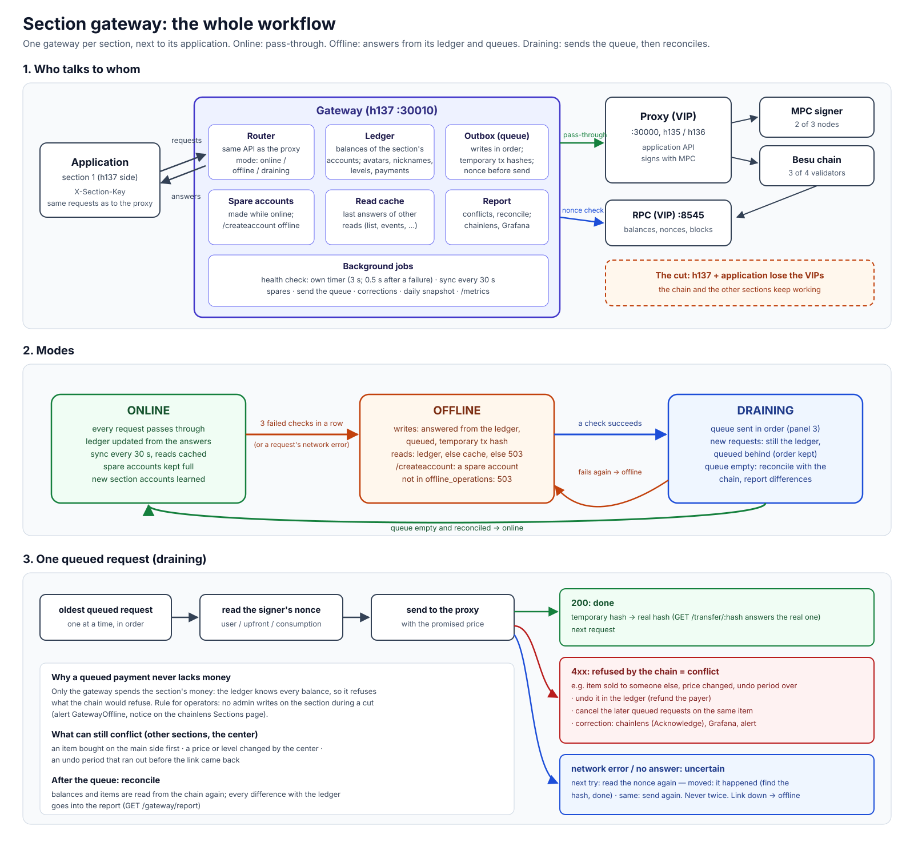

# 섹션 게이트웨이

> **내용:** 낙관적 섹션 게이트웨이(`gateway/`)입니다. 섹션마다 하나씩, 그 애플리케이션 옆에서 실행되는
> 작은 서비스로, 프록시의 애플리케이션 API를 그대로 제공합니다. 프록시에 연결할 수 없는 동안에는 로컬
> 원장으로 직접 응답하고 쓰기를 큐에 저장했다가, 연결이 돌아오면 전송합니다.
>
> **대상:** 운영자(배포), 애플리케이션 팀(호출), 비즈니스 관리자(단절 중 단일 작성자 규칙, 정정).
>
> **관련 문서:** [프록시 API](../reference/proxy-api.md) · [섹션](../features/sections.md) ·
> [알림](../operations/alerts.md#7-section-gateways-gatewayyml) · [Ansible](../deployment/ansible.md)

**목차**

- [한눈에 보기](#at-a-glance)
- [필요한 이유](#why)
- [워크플로](#the-workflow)
- [애플리케이션 팀을 위한 안내](#for-the-application-team)
- [작동 방식](#how-it-works)
- [오프라인에서 되는 것](#what-works-offline)
- [단일 작성자 규칙](#the-single-writer-rule)
- [예비 계정](#spare-accounts)
- [게이트웨이 자체 라우트](#the-gateways-own-routes)
- [정정](#corrections)
- [설정](#settings)
- [배포](#deployment)
- [방화벽](#firewall)
- [모니터링](#monitoring)
- [백업](#backup)
- [랩 테스트](#lab-test)
- [알려진 한계](#known-limits)
- [파일](#files)

---

## 한눈에 보기 {#at-a-glance}

| | |
|---|---|
| **URL** | `http://<gateway host>:30010`, 프록시와 같은 라우트(`/transfer`, `/createaccount`, `/contract/*` …) |
| **호출자** | 섹션의 애플리케이션, 섹션 키(`X-Section-Key: sk_…`), 요청은 그대로 |
| **응답** | 프록시의 응답과 완전히 같음(`answer_gateway_field: true`가 아니면 추가 필드 없음) |
| **개수** | 섹션당 하나(`gateway_hosts`의 호스트에 `gateway_section: <id>`: 다섯 서버 중 하나, 또는 전용 호스트) |
| **프로그램** | `gateway/gateway.js`: Node.js 22, npm 패키지 없음(`node:http`, `node:sqlite`, `fetch`) |
| **이미지** | `localhost/besu-gateway/gateway`(`02-images.yml`이 빌드), 컨테이너 사용자 uid 1000 |
| **데이터** | `/var/lib/besu-gateway/gateway.db`(SQLite: 원장, 큐, 예비 계정, 보고서), `backup/`에 일일 스냅숏 |
| **설정** | `/etc/besu-gateway/gateway.json`, `section.key`, `report.token`(`14-gateway.yml`이 작성) |
| **정정** | chainlens(Sections → 섹션 → Gateway, **Acknowledge** 버튼), Grafana(Sections → Gateways), 알림 `GatewayCorrectionsOpen` |
| **기본값은 꺼짐** | `settings.yml`의 `gateway_enabled: false` |

## 필요한 이유 {#why}

섹션의 애플리케이션은 보통 VIP `.151:30000`의 프록시를 호출합니다. 애플리케이션 호스트와 프록시 사이의
연결이 끊기면(스위치, 방화벽 변경, 건물 간 단절) 애플리케이션이 멈춥니다: 결제도, 아이템 판매도, 조회도
안 됩니다.

애플리케이션 옆에 게이트웨이가 있으면 **애플리케이션과 그 호스트가 프록시와 끊겨 있는 동안에도
애플리케이션이 계속 동작합니다**: 게이트웨이가 알고 있는 것으로 응답하고, 쓰기를 큐에 저장했다가 연결이
돌아오면 순서대로 보냅니다. 이것은 *낙관적*입니다: 큐에 넣은 쓰기가 실행될 것이라고 약속하고, 나중에
체인이 거부하면 원장에서 되돌리고 [정정](#corrections)으로 기록합니다.

이것이 가능한 이유는 단절 중에는 **게이트웨이만 섹션의 자금을 움직이기** 때문입니다
([단일 작성자 규칙](#the-single-writer-rule)): 원장이 모든 잔액을 알므로 큐에 넣은 결제에 돈이 모자라는
일이 없습니다.

## 워크플로 {#the-workflow}



## 애플리케이션 팀을 위한 안내 {#for-the-application-team}

애플리케이션은 설정 두 개 말고는 **바뀌지 않습니다**:

| 이전 | 게이트웨이 사용 시 |
|---|---|
| 프록시 URL `http://<proxy VIP>:30000` | 게이트웨이 URL `http://<gateway host>:30010` |
| 섹션 키 | 같은 키, 또는 운영자가 새로 만든 키(`gateway_new_key=true`) |

나머지는 모두 같습니다: 같은 라우트, 같은 본문, 같은 `X-Section-Key` 헤더, 같은 응답. 애플리케이션은
온라인과 오프라인을 구별할 수 없고, 구별할 필요도 없습니다.

세 가지 습관이 중요합니다(프록시를 쓸 때도 좋은 습관입니다):

1. **트랜잭션 상태는 게이트웨이에 물어보십시오**: 게이트웨이의 `GET /transfer/<txHash>`. 단절 중
   애플리케이션이 받은 `txHash`는 임시 해시입니다. 게이트웨이는 그것에 `pending`으로 응답하고, 요청이
   전송된 뒤에는 실제 트랜잭션의 응답을 줍니다(애플리케이션이 아는 같은 `txHash`로). 임시 해시로 블록
   익스플로러나 RPC에 직접 물으면 아무것도 나오지 않습니다.
2. **애플리케이션 쪽에서 시간 초과나 연결 오류가 났을 때 `/transfer`(또는 구매)를 무작정 재시도하지
   마십시오**: 첫 요청이 이미 응답되고 큐에 들어갔을 수 있으며, 재시도는 두 번째 결제가 됩니다. 프록시와
   마찬가지로 먼저 확인하십시오(계정 잔액, `paymentsOf`, `tokensOf`).
3. **`/createaccount`가 503 "the proxy did not answer: try again"으로 응답할 수 있습니다**: 프록시가 계정을
   만드는 도중 연결이 끊긴 경우입니다. 다시 시도하는 것이 맞습니다. 첫 계정이 존재할 수 있습니다(사용되지
   않고 섹션에 등록된 상태이며, 게이트웨이가 다음 동기화 때 알게 됩니다).

정정(나중에 체인이 거부한 큐 쓰기)은 운영자가 chainlens에서 처리합니다. 직접 대응하고 싶은
애플리케이션은 `correction_webhook`으로 받을 수 있습니다.

## 작동 방식 {#how-it-works}

게이트웨이는 항상 세 모드 중 하나입니다(`GET /gateway/status`, 지표 `gateway_mode`):

| 모드 | 쓰기 | 읽기 |
|---|---|---|
| **online** (0) | 프록시로 그대로 전달. 매번 체인에서 원장을 갱신 | 그대로 전달. 응답마다 캐시 |
| **offline** (1) | 게이트웨이가 원장으로 응답하고 큐에 저장 | 원장(플랫폼 컬렉션) 또는 마지막으로 캐시된 응답 |
| **draining** (2) | 큐를 순서대로 전송. 새 쓰기는 원장으로 응답하고 그 뒤에 큐잉 | offline과 같음 |

### 온라인: 전달과 원장

모든 요청은 섹션 키와 함께 프록시로 가고, 프록시의 응답이 그대로 돌아갑니다. 그동안 게이트웨이는 로컬
**원장**을 유지합니다:

- 섹션 계정(선지급, 소비, 지급, 모든 사용자 계정)의 **잔액**: `sync_seconds`(30초)마다, 그리고 쓰기마다
  체인에서 읽음;
- **섹션의 계정**: `14-gateway.yml`의 계정, 게이트웨이를 통해 만든 계정, 그리고 다른 곳(chainlens, 관리자
  API, 키 없는 호출)에서 만든 계정. 마지막 것은 동기화 때마다 레지스트리의 `AccountAdded` 이벤트에서 알게
  됨;
- 플랫폼 컬렉션의 **아이템**(아바타와 닉네임: 소유자, 가격, 레벨, 결제, 취소 기한): 컬렉션 이벤트에서 읽음;
- 직접 계산할 수 없는 조회를 위한 **모든 조회의 마지막 응답**(캐시).

또한 [예비 계정](#spare-accounts)을 비축합니다.

### 단절 감지

| 항목 | 방법 |
|---|---|
| **헬스 체크** | `health_check_seconds`(3초)마다 `GET /contract/list?type=none`. **자체 타이머**로 실행(동기화, 큐, 예비 계정에 밀리지 않음). 연결과 응답에 `health_timeout_ms`(2초) 제한 |
| **실패 후** | 다음 체크는 3초가 아니라 `recheck_ms`(0.5초) 뒤 |
| **오프라인** | 연속 `offline_after_failures`(3)회 실패 후. 요청 자체의 네트워크 오류(연결 거부, 시간 초과)도 실패로 셈 |
| **연결** | 프록시로 가는 모든 요청은 `connect_timeout_ms`(2초) 안에 연결되어야 함. 연결하지 못한 요청은 프록시에 도달하지 않았으므로 다른 오프라인 요청처럼 원장으로 응답하고 큐에 넣음 |
| **진행 중 요청** | 오프라인이 되면 아직 프록시를 기다리는 요청을 끊고 즉시 원장으로 응답하며 `uncertain`으로 표시(프록시가 실행했을 수 있음: 아래 nonce 확인이 판단). 진행 중이던 `/createaccount`는 대신 **503 "try again"**으로 응답(존재할 수 있는 계정 대신 예비 계정을 주지 않음) |

### 오프라인: 응답과 큐

오프라인에서는 각 쓰기를 원장으로 확인한 뒤(계정이 섹션의 사용자인지, 잔액이 충분한지, 아이템이 판매
중인지, 취소 기간이 열려 있는지, 작업이 `offline_operations`에 있는지), **원장에 반영하고 큐에 넣고
프록시처럼 응답합니다**. `txHash`는 실제 해시가 생길 때까지 임시 해시(`sha256("gateway:" + 요청 id)`)입니다:

```json
POST http://<gateway host>:30010/transfer   { "account": "0xUser", "amount": "0.2", "memo": "offline +x" }
→ { "success": true, "section": { "id": 1, "name": "Shop B" }, "direction": "account -> consumption",
    "from": "0xUser", "to": "0xConsumption", "amount": "0.2", "memo": "offline +x",
    "txHash": "0x1789…f124" }
```

`answer_gateway_field: true`이면 응답에 `"gateway": { "mode": "offline", "queued": true, "request": "d8498d08-…" }`도
붙습니다.

### 드레이닝: 큐 전송

단절 후 첫 체크가 성공하면 게이트웨이는 **draining**이 됩니다(큐가 비어 있으면 바로 online). 큐를
**한 번에 하나씩, 순서대로** 보냅니다:

| 단계 | 내용 |
|---|---|
| **Nonce 확인** | 보내기 전에 서명자의 nonce를 기록합니다. 이전 전송에 응답이 없던 요청(`uncertain`)은 두 번 보내지 않습니다: 서명자의 nonce가 기록보다 커졌으면 최근 60블록에서 그 트랜잭션을 찾아 완료로 표시합니다 |
| **전송됨** | 프록시가 200으로 응답: 요청은 실제 트랜잭션 해시와 함께 `done` |
| **프록시 오류**(5xx, 연결 끊김) | 요청은 `uncertain`으로 남고, 다음 라운드에 nonce를 확인하고 재시도 |
| **충돌**(4xx: 체인이나 프록시가 거부) | 요청은 `failed`. 효과를 **원장에서 되돌리고**, 같은 아이템의 이후 큐 요청은 `cancelled`(역시 되돌림). [정정](#corrections)으로 기록 |
| **대사(reconcile)** | 큐가 비면 전체 동기화로 모든 잔액과 아이템을 체인에서 읽고, 원장과의 차이를 보고서(`reconcile`)에 기록한 뒤 **online** |

### 모드와 소요 시간

랩, 2차(기본값: `health_check_seconds` 3, `health_timeout_ms` 2000, `recheck_ms` 500,
`offline_after_failures` 3, `connect_timeout_ms` 2000):

| | 시간 |
|---|---|
| 연결 거부(REJECT) → offline | 3.6초 |
| 패킷 무응답 폐기(DROP) → offline | 9.6초(자체 타이머 이전에는 22.4초) |
| 무응답 단절 중 진행 중이던 요청 | 게이트웨이가 offline이 될 때 응답(`/createaccount`: 9.9초 후 503) |
| 무응답 단절 중 새 요청 | 최대 2초 연결 제한 후 원장으로 응답 |
| 연결 복구 → online(큐 없음) | 2.1–2.6초 |
| 연결 복구 → draining → online | 다음 체크, 그 후 큐 전송과 전체 동기화 1회(랩: 요청 10개에 24초) |

모드, 큐, 원장은 디스크에 있으므로 게이트웨이를 재시작해도 유지됩니다.

## 오프라인에서 되는 것 {#what-works-offline}

### 라우트

| 라우트 | 오프라인 |
|---|---|
| `POST /transfer` | 섹션 사용자 계정의 **+x**(사용자 → 소비)와 **−x**(선지급 → 사용자). 잔액은 원장으로 확인 |
| `POST /createaccount` | [예비 계정](#spare-accounts)을 내줌. 선지급 계정에서의 자금 지원과 풀 클래스는 큐에 들어감. `registryTxHash`는 `null`(예비 계정은 이미 등록됨) |
| `POST /account/pool` | 큐에 들어감 |
| `POST /contract/send` | 플랫폼 컬렉션(아래 표). 다른 컨트랙트는 `"0xContract:function"`이 `offline_operations`에 있을 때 |
| `POST /contract/call` | 플랫폼 컬렉션은 원장에서(아래 표). 그 밖의 호출: 같은 컨트랙트, 함수, 인자의 마지막 캐시 응답, 없으면 오류. 배치(`calls`)는 호출마다 따로 응답 |
| `GET /transfer/:txHash` | 게이트웨이의 임시 해시: `pending` / `failed`. 그 밖의 해시: `pending` |
| 그 밖의 조회(`GET /contract/list`, `POST /contract/events`, …) | 같은 요청의 마지막 캐시 응답. 온라인에서 한 번도 묻지 않은 조회: 503 |

### 플랫폼 컨트랙트 함수

SectionRegistry에 등록된 아바타와 닉네임 컬렉션(`/contract/list?type=avatar`, `type=nickname`):

| 함수 | 오프라인 |
|---|---|
| `buy`(`tokenId`, `imageUrl` 또는 `nickname`으로) | **쓰기:** 원장에서 아이템이 팔리지 않았어야 함. 가격은 사용자 → 소비로 지급되고 취소 기한이 지금부터 시작. 큐 요청에 그 가격이 담기므로, 그 사이 센터가 가격을 바꾸면 구매는 다른 금액의 결제가 아니라 [정정](#corrections)이 됨 |
| `upgradeLevel`(닉네임) | **쓰기:** 소유자만, 레벨은 올리기만, 거치는 모든 레벨이 판매 중 |
| `undo` | **쓰기:** 취소 기간 안에서: 소비 계정이 그 아이템에 지급된 전액을 환불하고 아이템은 센터로 돌아감 |
| `undoLevel`(닉네임) | **쓰기:** 가장 최근 레벨 업그레이드, 그 취소 기간 안에서 |
| `ownerOf`, `priceOf`, `imageOf`, `nicknameOf`, `levelOf`, `tokenURI`, `paymentsOf`, `tokensOf`, `balanceOf`, `tokenOf`, `levelCount`, `levelInfo`, `quote`, `holdSeconds`, `totalSupply`, `minter`, `name`, `symbol` | 원장에서 **읽기**(오프라인 결제는 `pending: true`) |
| 그 밖의 함수(`mint`, `setPrice`, `addLevel`, …) | 거부(503): 관리 작업은 메인 측에서 |

### `offline_operations` {#offline_operations}

하나의 목록이 오프라인에서 응답할 쓰기를 정합니다(대소문자 무관):

| 항목 | 대상 |
|---|---|
| `transfer` | `POST /transfer`(+x와 −x) |
| `createaccount` | `POST /createaccount`(예비 계정) |
| `account_pool` | `POST /account/pool` |
| `avatar:buy`, `nickname:buy` | 아바타 / 닉네임 컬렉션의 `buy` |
| `nickname:upgradeLevel`, `nickname:undoLevel` | 닉네임 레벨 |
| `*:undo` | 모든 플랫폼 컬렉션의 `undo`(한 종류만: `avatar:undo` 또는 `nickname:undo`) |
| `0xContract:function` | 다른 컨트랙트의 함수(원장 확인 없이 큐에 들어가며 결과는 `null`) |

기본값: `[transfer, createaccount, account_pool, "avatar:buy", "nickname:buy",
"nickname:upgradeLevel", "*:undo", "nickname:undoLevel"]`. ETH 한도는 없습니다: 원장이 잔액으로 낼 수 없는
것을 거부하고, `offline_max_hours`(24)가 긴 단절의 낙관적 응답을 끝냅니다.

### 오프라인에서 거부되는 것

| 거부 | 상태 |
|---|---|
| 관리 작업(`mint`, `setPrice`, 레벨…; 관리자 API는 게이트웨이가 제공하지 않음) | 503 |
| `offline_operations`에 없는 작업 | 503 |
| `offline_max_hours`보다 오래 오프라인, 또는 남은 예비 계정 없음 | 503 |
| 섹션의 사용자가 아닌 계정 | 403 |
| 원장의 잔액 부족 | 400 |
| 이미 팔린 아이템, 취소 기간 종료 | 409 |
| 온라인에서 한 번도 묻지 않은 조회 | 503 |

## 단일 작성자 규칙 {#the-single-writer-rule}

단절 중에는 **게이트웨이만 섹션의 자금을 움직일 수 있습니다.** 원장은 그것을 전제로 합니다: 메인 측(chainlens
Sections 페이지, 관리자 API, 키 없는 호출)에서 한 충전, 정산, 반환, 이체, 계정 변경은 게이트웨이에 보이지
않으며, 전송될 때 큐 요청을 실패하게 만들 수 있습니다(정산은 취소 환불에 쓰일 소비 계정을 비웁니다).

- **관리자:** 그 섹션의 게이트웨이가 offline이나 draining인 동안 그 섹션에 쓰기를 하지 마십시오. 센터의
  컬렉션 변경(새 가격, 메인 측 판매)은 처리되지만, 각각 큐 요청을 [정정](#corrections)으로 바꿀 수 있습니다.
- **Chainlens:** **Sections** 페이지가 게이트웨이가 online이 아닌 섹션마다 빨간 안내를 보여줍니다: *"its
  gateway cannot reach the proxy (offline since …, N queued) … make no admin writes on this section … until
  it is back"*, 또는 게이트웨이가 아예 응답하지 않는다는 안내.
- **알림:** [GatewayOffline](../operations/alert-runbook.md#gatewayoffline)이 1분 후 발생합니다.

## 예비 계정 {#spare-accounts}

`/createaccount`에는 3개 MPC 노드가 모두 필요하므로(키 생성), 단절 중에는 할 수 없습니다. 그래서 게이트웨이는
**온라인이고 큐가 비어 있을 때** 프록시를 통해 미리 계정을 만듭니다(섹션 키로 `/createaccount`, 금액 `0`,
풀 `none`: 섹션에 등록됨). 라운드마다 하나씩, `spare_accounts`(100)개가 될 때까지. 오프라인 `/createaccount`는
가장 오래된 예비 계정을 내주고, 자금 지원은 −x 이체로, 풀 클래스(기본 `small`)는 `/account/pool` 요청으로
큐에 넣습니다.

예비 계정은 체인에 섹션의 사용자 계정으로 등록됩니다. chainlens는 이를 따로 보여줍니다(게이트웨이가 섹션 키
또는 보고서 토큰으로 `GET /gateway/spares`에서 아직 지급하지 않은 예비 계정을 알려줌): 개요와 섹션의 계정은
**실제 사용자 계정**과 **예비 계정**을 따로 세고(스위치로 예비 계정을 볼 수 있음), 계정 페이지는 역할을 *예비*로
표시하며, 통계는 예비 계정이 지급될 때에만 새 사용자로 셉니다.

남은 예비 계정이 30분 동안 `spare_alert_below`(20)보다 적으면 `GatewaySparesLow`가 발생합니다. 하나도
없으면 오프라인 `/createaccount`는 503으로 응답합니다.

## 게이트웨이 자체 라우트 {#the-gateways-own-routes}

| 라우트 | 인증 | 응답 |
|---|---|---|
| `GET /gateway/status` | 없음 | `section`, `mode`, `since`(단절 시작), `queue`, `oldestSeconds`, `spares`, `offlineEth`(이번 단절에서 쓴 금액), `corrections`(`open`, `total`, `refundedEth`, `undelivered`), `cuts`, `lastSync`, `lastBackup`, `limits` |
| `GET /gateway/request/:id` | 섹션 키 | id나 임시 해시로 큐 요청 하나: `status`(`queued`, `sending`, `uncertain`, `done`, `failed`, `cancelled`), `txHash`(전송 후에는 실제 해시), `error`, `created` |
| `GET /gateway/report?since=<ISO 시각>&open=1&kind=conflict` | 섹션 키 또는 보고서 토큰 | 최근 500개 보고서(최신순): 정정(`conflict`)과 `reconcile` 항목. `open=1`: 확인되지 않은 정정 |
| `POST /gateway/report/:id/ack` `{ "by": "…" }` | 섹션 키 또는 보고서 토큰 | 정정을 확인(Acknowledge) |
| `GET /metrics` | 없음 | Prometheus 지표([모니터링](#monitoring)) |

**인증:** 그 밖의 모든 라우트는 섹션 키가 필요합니다. 키가 틀리거나 없으면 **즉시 401**입니다. **한 주소에서
60초 안에 틀린 키가 10번**이면 그 주소는 **60초 동안 429**를 받습니다(올바른 키를 써도 모든 요청). 지표
`gateway_auth_failures_total`.

**보고서 토큰**(`ansible/state/secrets/gateway_report_token`, 모든 게이트웨이에 공통)은 chainlens가
사용합니다(`Authorization: Bearer …`): 보고서를 읽고 정정을 확인할 수만 있고, 그 밖에는 아무것도 할 수 없습니다.

## 정정 {#corrections}

**정정**은 연결이 돌아온 뒤 체인이 거부한 큐 요청입니다. 게이트웨이는 원장에서 되돌리고(원장이 가져갔던
금액이 계정으로 돌아갑니다. 체인에서는 돈이 나간 적이 없습니다), 같은 아이템의 이후 큐 요청을 취소하고,
종류와 함께 기록합니다:

| 종류 | 예 |
|---|---|
| `already_sold` | 메인 측에서 먼저 구매됨(`token 2 is already sold`) |
| `price_changed` | 센터가 가격을 바꿈(`value: the price is 0.15 ETH`) |
| `level` | 레벨이 바뀌었거나 더 이상 판매 중이 아님 |
| `undo_period_over` | 연결이 돌아오기 전에 취소 기간이 끝남 |
| `balance` | 체인에 돈이 부족함(단절 중 메인 측 쓰기) |
| `other` | 그 밖의 경우 |

보는 곳:

| 위치 | 내용 |
|---|---|
| **Chainlens** | Sections → 섹션 → **Gateway** 카드: 모드, 큐, 예비 계정, 단절 횟수, 정정(미확인 / 전체, 돌려준 ETH), 마지막 동기화와 스냅숏. 정정 목록(시각, 종류, 요청, 계정, 돌려준 ETH, 이유, 취소된 요청)과 **Acknowledge** 버튼. 대사 보고서. Sections 목록은 미확인 정정이 있는 섹션마다 안내를 보여줌 |
| **Grafana** | Sections 대시보드 → **Gateways** 행: 모드와 큐, 종류별 정정, 돌려준 ETH, 미확인과 미전달 정정, 예비 계정, 단절 |
| **알림** | `GatewayCorrectionsOpen`: 1시간 동안 확인되지 않은 정정 |
| **웹훅**(선택) | `correction_webhook`: 정정마다 애플리케이션으로 POST(2xx가 올 때까지 재시도) |

웹훅 본문(그리고 보고서 항목):

```json
{ "id": "d8498d08-…", "section": 1, "at": "2026-11-23T19:24:…Z",
  "request": "d8498d08-…", "txHash": "0x…(애플리케이션이 받은 임시 해시)",
  "operation": "nickname_buy", "path": "/contract/send", "body": { "contract": "0xNicknames", "function": "buy", "args": { "tokenId": "2" }, "from": "0xUser" },
  "promised": { "tokenId": "2", "nickname": "Ben", "buyer": "0xUser", "paid": "0.2", "undoUntil": "…" },
  "result": "failed", "reason": "token 2 is already sold",
  "refund": [ { "account": "0xUser", "amount": "0.2" } ],
  "cancelled": [ "50e6ad6b-…" ] }
```

**운영자가 할 일:** 섹션 팀에 사용자에게 무엇이 바뀌었는지(아이템이 다른 사람에게 갔고, 사용자는 ETH를 돌려받음)
알린 뒤 **Acknowledge**를 누르십시오. 보고서는 `report_keep_days`(365) 동안 보관됩니다.

## 설정 {#settings}

`ansible/group_vars/all/settings.yml`에서:

| 설정 | 기본값 | 의미 |
|---|---|---|
| `gateway_enabled` | `false` | 게이트웨이를 켭니다(이미지, 방화벽, `14-gateway.yml`, Prometheus 대상, chainlens) |
| `gateway_port` | `30010` | 모든 게이트웨이의 호스트 포트 |
| `gateway_client_ips` | `[]` | 게이트웨이를 호출할 수 있는 곳: 애플리케이션(주소 또는 네트워크) |
| `gateway_sections` | `{}` | 섹션 id별로 `gateway_defaults`와 다른 값만, 예: `{ 1: { spare_accounts: 200 } }` |

`gateway_defaults`:

| 설정 | 기본값 | 의미 |
|---|---|---|
| `health_check_seconds` | `3` | 프록시를 확인하는 주기(자체 타이머) |
| `health_timeout_ms` | `2000` | 프록시가 이 시간 안에 응답하지 않으면 체크 실패 |
| `recheck_ms` | `500` | 체크가 실패하면 다음 체크까지의 시간 |
| `offline_after_failures` | `3` | 연속 실패 → offline(요청의 네트워크 오류도 셈) |
| `connect_timeout_ms` | `2000` | 이 시간 안에 연결하지 못한 요청은 오프라인으로 응답 |
| `offline_max_hours` | `24` | 이만큼 오래 오프라인이면 더 이상 낙관적 응답 없음(503). 취소 기간(7일)보다 훨씬 짧게 유지 |
| `offline_operations` | ([위](#offline_operations) 참고) | 오프라인에서 응답하는 쓰기 |
| `spare_accounts` | `100` | 오프라인 `/createaccount`용으로 미리 만드는 계정 수 |
| `spare_alert_below` | `20` | 이보다 적으면 `GatewaySparesLow` |
| `answer_gateway_field` | `false` | `true`: 응답에 `gateway` 필드(모드, 큐잉 여부, 요청 id) |
| `correction_webhook` | `""` | 선택: 정정을 받는 애플리케이션의 URL |
| `report_keep_days` | `365` | 보고서 보관 기간 |
| `sync_seconds` | `30` | 온라인일 때 체인을 읽는 주기(잔액, 아이템, 새 섹션 계정) |
| `backup_keep_days` | `7` | 보관하는 일일 스냅숏 수 |

**설정 변경:** `settings.yml`을 편집한 뒤 `ansible-playbook 14-gateway.yml`. `gateway.json`을 다시 쓰고
컨테이너를 다시 만듭니다. `/var/lib/besu-gateway`의 원장, 큐, 예비 계정, 보고서는 유지됩니다.
`gateway_port`나 `gateway_client_ips`를 바꾸면 `01-hosts.yml`(방화벽)도, `gateway_port`는 `09-monitoring.yml`과
`11-chainlens.yml`도 필요합니다.

## 배포 {#deployment}

1. 섹션 애플리케이션 옆의 **호스트를 고르고** `ansible/inventory.yml`에 섹션을 지정합니다. 다섯 서버 중 하나,
   또는 **게이트웨이 전용 호스트**(Docker, 방화벽, node-exporter, 게이트웨이만 설치됨):

   ```yaml
   gateway_hosts:
     vars:
       ansible_user: root
     hosts:
       h137: { gateway_section: 1 }                                  # 서버 중 하나
       gw-shop: { ansible_host: 192.168.70.20, gateway_section: 2 }  # 전용 호스트
   ```

2. `settings.yml`에서 **켭니다**: `gateway_enabled: true`, 그리고 `gateway_client_ips`에 애플리케이션 주소.
3. **섹션 키.** 게이트웨이는 섹션의 키를 쓰고, 애플리케이션은 **같은** 키로 게이트웨이를 호출합니다. 섹션의
   현재 키를 `ansible/state/secrets/gateway-section-<id>.key`(한 줄)에 넣거나, Ansible이 새 키를 만들게 하십시오:
   `-e gateway_new_key=true`(이전 키는 즉시 중지되므로 애플리케이션을 동시에 게이트웨이로 전환하십시오).
4. **적용**(`ansible/`에서):

   ```bash
   ansible-playbook 01-hosts.yml 02-images.yml 14-gateway.yml -e gateway_new_key=true
   ```

   ```bash
   ansible-playbook 09-monitoring.yml 11-chainlens.yml
   ```

   `14-gateway.yml`은 프록시 관리자 API에서 섹션과 사용자 계정을 읽고, `/etc/besu-gateway/gateway.json`(새 섹션
   계정을 알기 위한 레지스트리 주소 포함), `section.key`, `report.token`을 쓰고, 컨테이너를 시작한 뒤
   `/gateway/status`를 기다립니다. 모드, 예비 계정(온라인인 동안 몇 분에 걸쳐 만들어짐), 미확인 정정을 출력합니다.
5. 애플리케이션이 프록시 대신 `http://<gateway host>:30010`을 **가리키게 합니다**
   ([애플리케이션 팀을 위한 안내](#for-the-application-team)).

`site.yml`은 `09-monitoring.yml`보다 먼저 `14-gateway.yml`을 실행하므로(`gateway_enabled`일 때) Prometheus가
응답하는 게이트웨이를 찾습니다. `gateway/`를 바꾼 뒤: `01-hosts.yml 02-images.yml 14-gateway.yml`.

## 방화벽 {#firewall}

`ha/firewall-layout.sh`(단계 `01-hosts.yml`)는 `gateway_enabled`일 때 다음을 엽니다:

| 포트 | 출발지 | 대상 |
|---|---|---|
| 30010(`GATEWAY_PORT`) | `gateway_client_ips`, 모니터링 호스트(Prometheus, chainlens), `operator_ip` | 게이트웨이 호스트(`HAS_GATEWAY=1`) |
| 30000(프록시 VIP) | 게이트웨이 호스트(`PROXY_CLIENTS`에 추가) | HA 쌍 |
| 8545(RPC VIP) | 게이트웨이 호스트(`GATEWAYS`: 잔액, nonce, 이벤트) | HA 쌍 |

게이트웨이 전용 호스트는 `ROLE=gateway`가 됩니다: `operator_ip`에서 SSH, 모니터링 호스트에서 node-exporter,
그리고 게이트웨이 포트. 애플리케이션은 `proxy_client_ips`가 아니라 `gateway_client_ips`만 있으면 됩니다.

## 모니터링 {#monitoring}

Prometheus job `gateway`(IP 계획에서 만든 대상: `name: gateway-<section id>`), `GET /metrics`의 지표, 레이블
`section_id`와 `section`:

| 지표 | 의미 |
|---|---|
| `gateway_mode` | 0 online, 1 offline, 2 draining |
| `gateway_queue_length`, `gateway_queue_oldest_seconds` | 전송 대기 요청 수, 가장 오래된 요청의 나이 |
| `gateway_offline_eth` | 현재 단절 중 쓴 ETH |
| `gateway_spare_accounts`, `gateway_spare_target`, `gateway_spare_alert_below` | 남은 예비 계정, 목표, 알림 기준 |
| `gateway_corrections_total{kind}` | 종류별 정정 |
| `gateway_corrections_refunded_eth_total` | 정정으로 돌려준 ETH |
| `gateway_corrections_open` | 확인되지 않은 정정 |
| `gateway_corrections_undelivered` | 웹훅이 받지 않은 정정(웹훅이 없으면 0) |
| `gateway_conflicts_total` | 모든 정정(이전 대시보드용으로 유지) |
| `gateway_cuts_total`, `gateway_offline_seconds_total` | 오프라인이 된 횟수와 오프라인 시간 |
| `gateway_auth_failures_total` | 틀린 키의 요청 |
| `gateway_last_sync_timestamp_seconds`, `gateway_last_backup_timestamp_seconds` | 마지막 전체 동기화와 스냅숏 |

Grafana: **Sections** 대시보드의 **Gateways** 행: 섹션별 표(모드, 큐, 가장 오래된 요청, 예비 계정, 미확인과
미전달 정정, 단절, 오프라인 시간), 시간에 따른 모드와 큐, 기간별 종류별 정정, 기간별 돌려준 ETH, 예비 계정,
기간별 단절.

알림(`monitoring/prometheus/rules/gateway.yml`, [알림](../operations/alerts.md#7-section-gateways-gatewayyml)):

| 알림 | 심각도 | 대기 | 발생 조건 |
|---|---|---|---|
| [GatewayOffline](../operations/alert-runbook.md#gatewayoffline) | warning | 1분 | 게이트웨이가 프록시에 연결할 수 없음 |
| [GatewayDrainingLong](../operations/alert-runbook.md#gatewaydraininglong) | warning | 15분 | 아직 큐를 전송 중 |
| [GatewayQueueOld](../operations/alert-runbook.md#gatewayqueueold) | warning | 5분 | 큐 요청이 1시간보다 오래됨 |
| [GatewaySparesLow](../operations/alert-runbook.md#gatewayspareslow) | warning | 30분 | 예비 계정이 `spare_alert_below`보다 적음 |
| [GatewayConflicts](../operations/alert-runbook.md#gatewayconflicts) | warning | – | 지난 1시간 동안 큐 요청이 거부됨 |
| [GatewayCorrectionsOpen](../operations/alert-runbook.md#gatewaycorrectionsopen) | warning | 1시간 | chainlens에서 확인되지 않은 정정 |
| [GatewayDown](../operations/alert-runbook.md#gatewaydown) | critical | 2분 | 게이트웨이가 응답하지 않음 |

## 백업 {#backup}

게이트웨이는 하루에 한 번 데이터베이스의 일관된 사본(`VACUUM INTO`)을
`/var/lib/besu-gateway/backup/gateway-YYYYMMDD.db`에 쓰고, `backup_keep_days`(7)보다 오래된 사본을 지웁니다.
지표 `gateway_last_backup_timestamp_seconds`, 상태의 `lastBackup`.

**복원**(아직 전송되지 않은 단절의 큐가 들어 있으므로 데이터베이스를 잃었을 때만): 컨테이너를 멈추고
(`/opt/besu-chain/gateway`에서 `docker compose down`), 스냅숏을 `/var/lib/besu-gateway/gateway.db`로 복사하고
(소유자 uid 1000), `gateway.db-wal`과 `gateway.db-shm`을 지운 뒤 다시 시작합니다. 다음 동기화가 잔액과 아이템을
최신으로 맞추고, 대사 보고서가 스냅숏 이후 바뀐 것을 보여줍니다.

## 랩 테스트 {#lab-test}

랩 구성(`10.77.0.x`)에서 h137의 게이트웨이 하나가 섹션 1("Shop B")을 담당하며, 기본값에서 `spare_accounts: 3`,
`sync_seconds: 20`만 바꿨습니다. h137에서 iptables로 두 VIP(프록시와 RPC)로의 연결을 끊었고, 운영자는 끊지
않았습니다.

**2차**(이 버전):

| 테스트 | 결과 |
|---|---|
| 키 없는 요청 | 0.003초 만에 401 |
| 게이트웨이가 아니라 프록시(관리자 API)에서 만든 계정 | 다음 동기화 때 레지스트리에서 알게 됨. 그 계정의 +x를 오프라인에서 응답 |
| 온라인 응답 | 프록시의 필드 그대로, `gateway` 필드 없음 |
| REJECT 단절 / 복구 | 3.6초 후 offline / 2.4초 후 online |
| DROP 단절(양방향) / 복구 | 9.6초 후 offline / 2.1초 후 online |
| 무응답 단절 중 이체 | 연결 제한 시간 후 원장으로 응답, 큐에 넣고 단절 후 전송 |
| 오프라인: `/createaccount`(예비 계정), +x, 이미지로 아바타 구매, 이름으로 닉네임 구매, `upgradeLevel`, `undoLevel`, `GET /transfer/<임시 해시>` | 모두 즉시 응답, 프록시와 같은 응답. 임시 해시는 `pending` |
| 오프라인 `mint` | 503(`offline_operations`에 없음) |
| 연결이 끊길 때 진행 중이던 `/createaccount` | 게이트웨이가 offline이 될 때(9.9초) 503 *the proxy did not answer: try again* |
| 응답이 사라진 이체(프록시는 실행함) | 원장으로 응답, `uncertain`. 단절 후 nonce 확인으로 트랜잭션을 찾아 `done`, **두 번 보내지 않음**(nonce가 정확히 1 증가) |
| 충돌(아바타 3 가격 변경, 단절 중 프록시에서 닉네임 "Ben" 구매) | 정정 2건: `price_changed`(0.1 반환), `already_sold`(0.2 반환) |
| chainlens Gateway 카드 | 상태, 두 차례의 정정 4건(종류와 환불 포함), 대사 보고서. **Acknowledge**로 `acked`(by chainlens), 미확인 4 → 3 |
| 틀린 토큰으로 보고서 | 401 |
| Prometheus | `gateway_corrections_open` 3. 알림 `GatewayConflicts`, `GatewayCorrectionsOpen` 발생 |
| 스냅숏 | 시작할 때 `backup/gateway-20261123.db` 작성 |
| 틀린 키 10번 | 401 × 9 후 429. 그 주소에서는 올바른 키도 1분이 지날 때까지 429 |

**1차**(첫 버전)는 같은 오프라인 작업, 요청 14개의 드레이닝, 충돌 2건을 통과했습니다. 그 대사 결과는 소비
계정에서 0.2 차이였습니다: 단절 중 프록시에서 한 구매로, 게이트웨이가 볼 수 없던 것입니다
([단일 작성자 규칙](#the-single-writer-rule)).

## 알려진 한계 {#known-limits}

| 한계 | 영향 |
|---|---|
| **단일 작성자 규칙**은 규칙이지 잠금이 아님 | 단절 중 메인 측 쓰기는 정정이나 대사 차이가 됨 |
| **진행 중이던 `/createaccount`**는 503으로 응답 | 계정이 존재할 수 있음. 재시도는 또 하나를 만듦(둘 다 섹션 소유이며 첫 계정은 사용되지 않음) |
| **원장 갱신 전에 끊긴 전달 쓰기** | 다음 동기화까지 원장에 빠져 있음(단절 후 대사가 바로잡음) |
| **429 제동은 주소 단위** | 같은 주소 뒤의 애플리케이션도 함께 제동됨 |
| **온라인에서 묻지 않은 조회** | 오프라인에서 응답할 수 없음(503) |

## 파일 {#files}

| 파일 | 내용 |
|---|---|
| [`gateway/gateway.js`](../../gateway/gateway.js) | 프로그램 |
| [`gateway/Dockerfile`](../../gateway/Dockerfile), [`gateway/docker-compose.yml`](../../gateway/docker-compose.yml) | 이미지(`node:22-alpine`)와 컨테이너(포트, `/config`, `/data`) |
| [`ansible/14-gateway.yml`](../../ansible/14-gateway.yml) | 배포: 섹션, 키, 보고서 토큰, 설정, 컨테이너 |
| [`ansible/group_vars/all/settings.yml`](../../ansible/group_vars/all/settings.yml) | `gateway_enabled`, `gateway_port`, `gateway_defaults`, `gateway_sections`, `gateway_client_ips` |
| [`ansible/inventory.yml`](../../ansible/inventory.yml) | `gateway_section`이 있는 `gateway_hosts` |
| [`ha/firewall-layout.sh`](../../ha/firewall-layout.sh) | `GATEWAYS`, `HAS_GATEWAY`, `GATEWAY_CLIENTS`, `GATEWAY_PORT`, `ROLE=gateway` |
| [`ansible/templates/targets/gateway.yml.j2`](../../ansible/templates/targets/gateway.yml.j2) | Prometheus 대상 |
| [`monitoring/prometheus/rules/gateway.yml`](../../monitoring/prometheus/rules/gateway.yml) | 알림 7개 |
| [`monitoring/grafana/tools/gen_sections_dashboard.py`](../../monitoring/grafana/tools/gen_sections_dashboard.py) | Sections 대시보드의 Gateways 행 |
| [`ansible/templates/chainlens.env.j2`](../../ansible/templates/chainlens.env.j2) | chainlens용 `GATEWAYS`, `GATEWAY_REPORT_TOKEN` |
| [`chainlens/server.js`](../../chainlens/server.js), [`chainlens/public/app.js`](../../chainlens/public/app.js) | Gateway 카드(`/api/sections/:id/gateway`, `…/gateway/ack/:report`) |
| 게이트웨이 호스트 | `/etc/besu-gateway/gateway.json`, `section.key`, `report.token`; `/var/lib/besu-gateway/gateway.db`, `backup/`; `/opt/besu-chain/gateway/.env` |
| 운영자 머신 | `ansible/state/secrets/gateway-section-<id>.key`, `gateway_report_token` |
