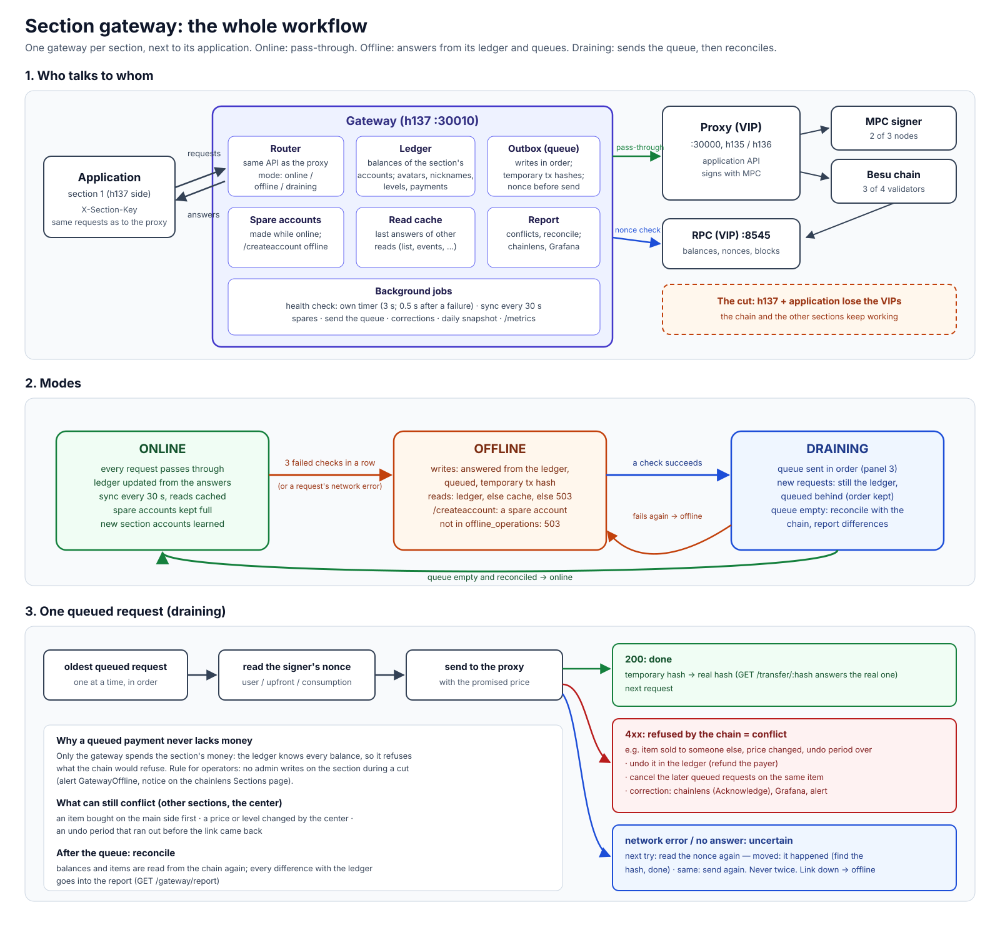

# Section gateway

> **What:** the optimistic section gateway (`gateway/`): one small service per section, next to its
> application. It speaks the proxy's application API; while the proxy can't be reached it answers by
> itself from a local ledger and queues the writes, then sends them when the link is back.
>
> **For:** operators (deploying it), application teams (calling it), business admins (the
> single-writer rule during a cut, the corrections).
>
> **Related:** [proxy API](../reference/proxy-api.md) · [sections](../features/sections.md) ·
> [alerts](../operations/alerts.md#7-section-gateways-gatewayyml) · [Ansible](../deployment/ansible.md)

**Contents**

- [At a glance](#at-a-glance)
- [Why](#why)
- [The workflow](#the-workflow)
- [For the application team](#for-the-application-team)
- [How it works](#how-it-works)
- [What works offline](#what-works-offline)
- [The single-writer rule](#the-single-writer-rule)
- [Spare accounts](#spare-accounts)
- [The gateway's own routes](#the-gateways-own-routes)
- [Corrections](#corrections)
- [Settings](#settings)
- [Deployment](#deployment)
- [Firewall](#firewall)
- [Monitoring](#monitoring)
- [Backup](#backup)
- [Lab test](#lab-test)
- [Known limits](#known-limits)
- [Files](#files)

---

## At a glance

| | |
|---|---|
| **URL** | `http://<gateway host>:30010`, the same routes as the proxy (`/transfer`, `/createaccount`, `/contract/*` …) |
| **Caller** | the section's application, with the section's key (`X-Section-Key: sk_…`), unchanged requests |
| **Answers** | exactly the proxy's answers (no extra field unless `answer_gateway_field: true`) |
| **One per** | section (`gateway_section: <id>` on a host of `gateway_hosts`: one of the servers, or a host of its own) |
| **Program** | `gateway/gateway.js`: Node.js 22, no npm packages (`node:http`, `node:sqlite`, `fetch`) |
| **Image** | `localhost/besu-gateway/gateway` (built by `02-images.yml`), container user uid 1000 |
| **Data** | `/var/lib/besu-gateway/gateway.db` (SQLite: ledger, queue, spare accounts, reports), daily snapshots in `backup/` |
| **Settings** | `/etc/besu-gateway/gateway.json`, `section.key` and `report.token`, written by `14-gateway.yml` |
| **Corrections** | chainlens (Sections → the section → Gateway, with **Acknowledge**), Grafana (Sections → Gateways), alert `GatewayCorrectionsOpen` |
| **Off by default** | `gateway_enabled: false` in `settings.yml` |

## Why

A section's application normally calls the proxy on the VIP `.151:30000`. If the link between the
application's host and the proxy breaks (a switch, a firewall change, a cut between two buildings),
the application stops: no payments, no item sales, no reads.

With a gateway next to the application, **the application keeps working while it and its host are
cut from the proxy**: the gateway answers from what it knows, queues the writes, and sends them in
order when the link is back. It is *optimistic*: it promises that a queued write will happen, and if
the chain refuses it later, it undoes it in its ledger and records a
[correction](#corrections).

This works because **only the gateway moves the section's money** during a cut
([the single-writer rule](#the-single-writer-rule)): its ledger knows every balance, so a queued
payment never lacks the money.

## The workflow



## For the application team

The application does **not** change, apart from two settings:

| Before | With a gateway |
|---|---|
| proxy URL `http://<proxy VIP>:30000` | gateway URL `http://<gateway host>:30010` |
| the section's key | the same key, or the new one when the operator made one (`gateway_new_key=true`) |

Everything else stays: the same routes, the same bodies, the same `X-Section-Key` header, the same
answers. The application can't tell online from offline, and it doesn't need to.

Three habits matter (they are good practice with the proxy too):

1. **Ask the transaction's status through the gateway**: `GET /transfer/<txHash>` on the gateway.
   During a cut the `txHash` the application got is a temporary hash; the gateway answers
   `pending` for it, and once the request is sent, the real transaction's answer (with the same
   `txHash` the application knows). Asking a block explorer or the RPC directly with a temporary hash
   finds nothing.
2. **Don't retry `/transfer` (or a buy) blindly** after a timeout or a connection error on the
   application's side: the first request may have been answered and queued, and a retry is a second
   payment. Check first (the account's balance, `paymentsOf`, `tokensOf`), as with the proxy.
3. **`/createaccount` may answer 503 "the proxy did not answer: try again"** when the link dropped
   while the proxy was creating the account. Trying again is correct; the first account may exist
   (unused, registered to the section; the gateway learns it at its next sync).

The corrections (a queued write the chain refused later) are handled by the operators in chainlens;
an application that wants to react itself can receive them on a `correction_webhook`.

## How it works

The gateway is always in one of three modes (`GET /gateway/status`, metric `gateway_mode`):

| Mode | Writes | Reads |
|---|---|---|
| **online** (0) | passed through to the proxy; the ledger is updated from the chain after each one | passed through; each answer is cached |
| **offline** (1) | answered by the gateway from its ledger and queued | from the ledger (platform collections) or the last cached answer |
| **draining** (2) | the queue is sent in order; new writes are answered from the ledger and queued behind it | as offline |

### Online: pass-through and the ledger

Every request goes to the proxy with the section's key, and the proxy's answer goes back unchanged.
Meanwhile the gateway keeps a local **ledger**:

- **balances** of the section's accounts (upfront, consumption, payment and every user account),
  read from the chain every `sync_seconds` (30 s) and after each write;
- **the section's accounts**: those of `14-gateway.yml`, those created through the gateway, and
  those created anywhere else (chainlens, the admin API, a keyless call), learned from the
  registry's `AccountAdded` events at each sync;
- the **items** of the platform collections (avatars and nicknames: owner, price, level, payments,
  undo deadlines), read from the collections' events;
- the **last answer of every read** (cache), for the reads it cannot compute itself.

It also keeps a stock of [spare accounts](#spare-accounts).

### Detecting a cut

| What | How |
|---|---|
| **Health check** | `GET /contract/list?type=none` every `health_check_seconds` (3 s), on **its own timer** (never delayed by the sync, the queue or the spare accounts), with a `health_timeout_ms` (2 s) limit for connecting and answering |
| **After a failure** | the next check comes after `recheck_ms` (0.5 s) instead of 3 s |
| **Offline** | after `offline_after_failures` (3) failures in a row. A request's own network error (connection refused, timeout) counts as a failure too |
| **Connecting** | every request to the proxy must connect within `connect_timeout_ms` (2 s). A request that can't connect never reached the proxy: it is answered from the ledger and queued like any offline request |
| **In flight** | when the gateway goes offline, the requests still waiting for the proxy are cut and answered from the ledger at once, marked `uncertain` (the proxy may have done them: the nonce check below decides). An in-flight `/createaccount` answers **503 "try again"** instead (no spare account in place of an account that may exist) |

### Offline: answers and the queue

Offline, each write is checked against the ledger (the account is a user of the section, the balance
is enough, the item is for sale, the undo period is open, the operation is in `offline_operations`),
then **applied to the ledger, queued, and answered** like the proxy would answer. The `txHash` is a
temporary hash (`sha256("gateway:" + request id)`) until the real one exists:

```json
POST http://<gateway host>:30010/transfer   { "account": "0xUser", "amount": "0.2", "memo": "offline +x" }
→ { "success": true, "section": { "id": 1, "name": "Shop B" }, "direction": "account -> consumption",
    "from": "0xUser", "to": "0xConsumption", "amount": "0.2", "memo": "offline +x",
    "txHash": "0x1789…f124" }
```

With `answer_gateway_field: true` the answer also carries
`"gateway": { "mode": "offline", "queued": true, "request": "d8498d08-…" }`.

### Draining: sending the queue

The first successful check after a cut switches the gateway to **draining** (or straight to online
when nothing is queued). It sends the queue **one request at a time, in order**:

| Step | What |
|---|---|
| **Nonce check** | before sending, it records the signer's nonce. A request whose earlier send has no answer (`uncertain`) is not sent twice: if the signer's nonce moved past the recorded one, the gateway finds that transaction in the last 60 blocks and marks the request done |
| **Sent** | the proxy answers 200: the request is `done`, with its real transaction hash |
| **Proxy error** (5xx, link down) | the request stays `uncertain`; the next round checks the nonce and retries |
| **Conflict** (4xx: the chain or the proxy refuses it) | the request is `failed`; its effect is **undone in the ledger**; later queued requests on the **same item** are `cancelled` (undone too); a [correction](#corrections) is recorded |
| **Reconcile** | when the queue is empty, a full sync reads every balance and item from the chain; any difference against the ledger is written to the report (`reconcile`); then the gateway is **online** |

### Modes and timing

Lab, round 2 (defaults: `health_check_seconds` 3, `health_timeout_ms` 2000, `recheck_ms` 500,
`offline_after_failures` 3, `connect_timeout_ms` 2000):

| | Time |
|---|---|
| link refused (REJECT) → offline | 3.6 s |
| packets silently dropped (DROP) → offline | 9.6 s (was 22.4 s before the own timer) |
| an in-flight request during a silent cut | answered when the gateway goes offline (`/createaccount`: 503 after 9.9 s) |
| a new request during a silent cut | answered from the ledger after the 2 s connect timeout at most |
| link back → online (nothing queued) | 2.1–2.6 s |
| link back → draining → online | the next check, then the time to send the queue and one full sync (lab: 24 s for 10 requests) |

The mode, the queue and the ledger are on disk: a restart of the gateway keeps them.

## What works offline

### Routes

| Route | Offline |
|---|---|
| `POST /transfer` | **+x** (user → consumption) and **−x** (upfront → user), for the section's user accounts; balance checked in the ledger |
| `POST /createaccount` | hands out a [spare account](#spare-accounts); the funding from the upfront account and the pool class are queued. `registryTxHash` is `null` (the spare is already registered) |
| `POST /account/pool` | queued |
| `POST /contract/send` | the platform collections (table below); other contracts when `"0xContract:function"` is in `offline_operations` |
| `POST /contract/call` | the platform collections from the ledger (table below); any other call: the last cached answer of the same contract, function and arguments, or an error. A batch (`calls`) answers each call on its own |
| `GET /transfer/:txHash` | the gateway's temporary hashes: `pending` / `failed`; other hashes: `pending` |
| other reads (`GET /contract/list`, `POST /contract/events`, …) | the last cached answer of the same request; never asked online: 503 |

### Platform contract functions

The avatar and nickname collections registered in the SectionRegistry (`/contract/list?type=avatar`
and `type=nickname`):

| Function | Offline |
|---|---|
| `buy` (by `tokenId`, `imageUrl` or `nickname`) | **write:** the item must be unsold in the ledger; the price is paid user → consumption; the undo deadline starts now. The queued request carries that price: if the center changes it meanwhile, the buy becomes a [correction](#corrections), never a different payment |
| `upgradeLevel` (nicknames) | **write:** owner only, level only up, every level on the way for sale |
| `undo` | **write:** within the undo period: the consumption account refunds everything paid for the item, which goes back to the center |
| `undoLevel` (nicknames) | **write:** the newest level upgrade, within its undo period |
| `ownerOf`, `priceOf`, `imageOf`, `nicknameOf`, `levelOf`, `tokenURI`, `paymentsOf`, `tokensOf`, `balanceOf`, `tokenOf`, `levelCount`, `levelInfo`, `quote`, `holdSeconds`, `totalSupply`, `minter`, `name`, `symbol` | **read** from the ledger (offline payments show `pending: true`) |
| any other function (`mint`, `setPrice`, `addLevel`, …) | refused (503): admin work is done on the main side |

### `offline_operations`

One list says which writes are answered offline (case does not matter):

| Entry | Covers |
|---|---|
| `transfer` | `POST /transfer` (+x and −x) |
| `createaccount` | `POST /createaccount` (a spare account) |
| `account_pool` | `POST /account/pool` |
| `avatar:buy`, `nickname:buy` | `buy` on an avatar / nickname collection |
| `nickname:upgradeLevel`, `nickname:undoLevel` | the nickname levels |
| `*:undo` | `undo` on any platform collection (`avatar:undo` or `nickname:undo` for one type) |
| `0xContract:function` | another contract's function (queued with no ledger check: the result is `null`) |

Default: `[transfer, createaccount, account_pool, "avatar:buy", "nickname:buy",
"nickname:upgradeLevel", "*:undo", "nickname:undoLevel"]`. There is no ETH limit: the ledger refuses
what the balances can't pay, and `offline_max_hours` (24) ends the optimistic answers of a long cut.

### Refused offline

| Refusal | Status |
|---|---|
| admin work (`mint`, `setPrice`, levels…; the admin API is never served by the gateway) | 503 |
| an operation not in `offline_operations` | 503 |
| offline longer than `offline_max_hours`, or no spare account left | 503 |
| an account that isn't a user of the section | 403 |
| not enough balance in the ledger | 400 |
| item already sold, undo period over | 409 |
| a read never asked while online | 503 |

## The single-writer rule

During a cut, **the gateway is the only one that may move the section's money.** Its ledger assumes
it: a top-up, sweep, pay back, transfer or account change made on the main side (the chainlens
Sections page, the admin API, a keyless call) is invisible to it, and can make queued requests fail
when they are sent (a sweep empties the consumption account an undo pays from).

- **Admins:** make no writes on that section while its gateway is offline or draining. Changes of the
  center to the collections (a new price, a sale made on the main side) are handled, but each one
  can turn queued requests into [corrections](#corrections).
- **Chainlens:** the **Sections** page shows a red notice per section whose gateway is not online:
  *"its gateway cannot reach the proxy (offline since …, N queued) … make no admin writes on this
  section … until it is back"*, or that the gateway does not answer at all.
- **Alert:** [GatewayOffline](../operations/alert-runbook.md#gatewayoffline) fires after 1 minute.

## Spare accounts

`/createaccount` needs all 3 MPC nodes (key generation), which the gateway can't reach during a cut.
So while **online with nothing queued**, the gateway creates accounts in advance through the proxy
(`/createaccount` with the section's key, amount `0`, pool `none`: registered under the section),
one per round, until it has `spare_accounts` (100). Offline, `/createaccount` hands out the oldest
spare, queues its funding as a −x transfer and its pool class (`small` by default) as an
`/account/pool` request.

`GatewaySparesLow` fires when fewer than `spare_alert_below` (20) are left for 30 minutes. With none
left, `/createaccount` offline answers 503.

## The gateway's own routes

| Route | Auth | Answer |
|---|---|---|
| `GET /gateway/status` | none | `section`, `mode`, `since` (start of the cut), `queue`, `oldestSeconds`, `spares`, `offlineEth` (spent during this cut), `corrections` (`open`, `total`, `refundedEth`, `undelivered`), `cuts`, `lastSync`, `lastBackup`, `limits` |
| `GET /gateway/request/:id` | section key | one queued request by its id or temporary hash: `status` (`queued`, `sending`, `uncertain`, `done`, `failed`, `cancelled`), `txHash` (the real one once sent), `error`, `created` |
| `GET /gateway/report?since=<ISO time>&open=1&kind=conflict` | section key or report token | the last 500 reports, newest first: corrections (`conflict`) and `reconcile` entries; `open=1`: corrections not acknowledged |
| `POST /gateway/report/:id/ack` `{ "by": "…" }` | section key or report token | acknowledges a correction |
| `GET /metrics` | none | Prometheus metrics ([monitoring](#monitoring)) |

**Auth:** every other route needs the section's key. A wrong or missing key answers **401 at
once**. After **10 wrong keys within 60 s from one address**, that address gets **429 for 60 s**
(every request, even with the right key); metric `gateway_auth_failures_total`.

The **report token** (`ansible/state/secrets/gateway_report_token`, the same for all gateways) is
what chainlens uses (`Authorization: Bearer …`): it can read the reports and acknowledge
corrections, nothing else.

## Corrections

A **correction** is a queued request the chain refused after the link came back. The gateway undoes
it in its ledger (the account gets back what the ledger had taken; the money never left on chain),
cancels the later queued requests on the same item, and records it with a kind:

| Kind | Example |
|---|---|
| `already_sold` | the item was bought on the main side first (`token 2 is already sold`) |
| `price_changed` | the center changed the price (`value: the price is 0.15 ETH`) |
| `level` | a level changed or is no longer for sale |
| `undo_period_over` | the undo period ran out before the link came back |
| `balance` | not enough money on chain (a main-side write during the cut) |
| `other` | anything else |

Where they are seen:

| Where | What |
|---|---|
| **Chainlens** | Sections → the section → **Gateway** card: mode, queue, spare accounts, cuts, corrections (open / total, ETH given back), last sync and snapshot; the corrections list (time, kind, request, account, ETH back, reason, cancelled requests) with an **Acknowledge** button; the reconcile reports. The Sections list shows a notice per section with open corrections |
| **Grafana** | Sections dashboard → **Gateways** row: mode and queue, corrections by kind, ETH given back, open and undelivered corrections, spare accounts, cuts |
| **Alert** | `GatewayCorrectionsOpen`: corrections not acknowledged for 1 hour |
| **Webhook** (optional) | `correction_webhook`: each correction POSTed to the application (retried until 2xx) |

The webhook body (and the report entry):

```json
{ "id": "d8498d08-…", "section": 1, "at": "2026-11-23T19:24:…Z",
  "request": "d8498d08-…", "txHash": "0x…(the temporary hash the application got)",
  "operation": "nickname_buy", "path": "/contract/send", "body": { "contract": "0xNicknames", "function": "buy", "args": { "tokenId": "2" }, "from": "0xUser" },
  "promised": { "tokenId": "2", "nickname": "Ben", "buyer": "0xUser", "paid": "0.2", "undoUntil": "…" },
  "result": "failed", "reason": "token 2 is already sold",
  "refund": [ { "account": "0xUser", "amount": "0.2" } ],
  "cancelled": [ "50e6ad6b-…" ] }
```

**What the operator does:** tell the section's team what changed for their user (the item went to
someone else, the user has their ETH back), then press **Acknowledge**. Reports are kept
`report_keep_days` (365).

## Settings

In `ansible/group_vars/all/settings.yml`:

| Setting | Default | Meaning |
|---|---|---|
| `gateway_enabled` | `false` | turns the gateways on (images, firewall, `14-gateway.yml`, Prometheus targets, chainlens) |
| `gateway_port` | `30010` | the host port of every gateway |
| `gateway_client_ips` | `[]` | who may call the gateways: the applications (addresses or networks) |
| `gateway_sections` | `{}` | per section id, only the values that differ from `gateway_defaults`, e.g. `{ 1: { spare_accounts: 200 } }` |

`gateway_defaults`:

| Setting | Default | Meaning |
|---|---|---|
| `health_check_seconds` | `3` | how often it checks the proxy (its own timer) |
| `health_timeout_ms` | `2000` | one check fails when the proxy hasn't answered within this |
| `recheck_ms` | `500` | after a failed check, the next one comes this soon |
| `offline_after_failures` | `3` | failures in a row → offline (a request's network error counts) |
| `connect_timeout_ms` | `2000` | a request that can't connect within this is answered offline |
| `offline_max_hours` | `24` | after this long offline: no more optimistic answers (503). Keep it far below the undo period (7 days) |
| `offline_operations` | (see [above](#offline_operations)) | the writes answered offline |
| `spare_accounts` | `100` | accounts created in advance, for `/createaccount` offline |
| `spare_alert_below` | `20` | `GatewaySparesLow` below this |
| `answer_gateway_field` | `false` | `true`: answers carry a `gateway` field (mode, queued, request id) |
| `correction_webhook` | `""` | optional: the application's URL that receives the corrections |
| `report_keep_days` | `365` | how long reports are kept |
| `sync_seconds` | `30` | how often it reads the chain while online (balances, items, new section accounts) |
| `backup_keep_days` | `7` | how many daily snapshots are kept |

**To change a setting:** edit `settings.yml`, then `ansible-playbook 14-gateway.yml`. It rewrites
`gateway.json` and recreates the container; the ledger, the queue, the spare accounts and the
reports in `/var/lib/besu-gateway` are kept. A change of `gateway_port` or `gateway_client_ips` also
needs `01-hosts.yml` (the firewall); of `gateway_port`, `09-monitoring.yml` and `11-chainlens.yml` too.

## Deployment

1. **Choose the host** next to the section's application and name its section in
   `ansible/inventory.yml`. Either one of the five servers, or a **gateway-only host** of its own
   (it gets Docker, the firewall, node-exporter and the gateway, nothing else):

   ```yaml
   gateway_hosts:
     vars:
       ansible_user: root
     hosts:
       h137: { gateway_section: 1 }                                  # one of the servers
       gw-shop: { ansible_host: 192.168.70.20, gateway_section: 2 }  # a host of its own
   ```

2. **Turn it on** in `settings.yml`: `gateway_enabled: true`, and the applications' addresses in
   `gateway_client_ips`.
3. **The section key.** The gateway uses the section's key, and the application calls the gateway
   with the **same** key. Either put the section's current key in
   `ansible/state/secrets/gateway-section-<id>.key` (one line), or let Ansible make a new one:
   `-e gateway_new_key=true` (the old key stops at once: switch the application to the gateway at the
   same time).
4. **Apply** (from `ansible/`):

   ```bash
   ansible-playbook 01-hosts.yml 02-images.yml 14-gateway.yml -e gateway_new_key=true
   ```

   ```bash
   ansible-playbook 09-monitoring.yml 11-chainlens.yml
   ```

   `14-gateway.yml` reads the section and its user accounts from the proxy admin API, writes
   `/etc/besu-gateway/gateway.json` (with the registry's address, to learn new section accounts),
   `section.key` and `report.token`, starts the container and waits for `/gateway/status`. It prints
   the mode, the spare accounts (made over the next minutes, while online) and the open corrections.
5. **Point the application** at `http://<gateway host>:30010` instead of the proxy
   ([for the application team](#for-the-application-team)).

`site.yml` runs `14-gateway.yml` (when `gateway_enabled`) before `09-monitoring.yml`, so Prometheus
finds the gateways answering. After a change to `gateway/`: `01-hosts.yml 02-images.yml 14-gateway.yml`.

## Firewall

`ha/firewall-layout.sh` (phase `01-hosts.yml`) opens, when `gateway_enabled`:

| Port | From | On |
|---|---|---|
| 30010 (`GATEWAY_PORT`) | `gateway_client_ips`, the monitoring host (Prometheus, chainlens), `operator_ip` | the gateway hosts (`HAS_GATEWAY=1`) |
| 30000 (proxy VIP) | the gateway hosts (added to `PROXY_CLIENTS`) | the HA pair |
| 8545 (RPC VIP) | the gateway hosts (`GATEWAYS`: balances, nonces, events) | the HA pair |

A gateway-only host gets `ROLE=gateway`: SSH from `operator_ip`, node-exporter from the monitoring
host, and the gateway port. The application then needs only `gateway_client_ips`, not
`proxy_client_ips`.

## Monitoring

Prometheus job `gateway` (targets from the IP plan: `name: gateway-<section id>`), metrics from
`GET /metrics`, labels `section_id` and `section`:

| Metric | Meaning |
|---|---|
| `gateway_mode` | 0 online, 1 offline, 2 draining |
| `gateway_queue_length`, `gateway_queue_oldest_seconds` | requests waiting to be sent, and the oldest one's age |
| `gateway_offline_eth` | ETH spent during the current cut |
| `gateway_spare_accounts`, `gateway_spare_target`, `gateway_spare_alert_below` | spare accounts left, wanted, alert threshold |
| `gateway_corrections_total{kind}` | corrections by kind |
| `gateway_corrections_refunded_eth_total` | ETH given back by corrections |
| `gateway_corrections_open` | corrections not acknowledged |
| `gateway_corrections_undelivered` | corrections the webhook hasn't taken (0 without a webhook) |
| `gateway_conflicts_total` | all corrections (kept for older dashboards) |
| `gateway_cuts_total`, `gateway_offline_seconds_total` | times it went offline, and the time spent offline |
| `gateway_auth_failures_total` | requests with a wrong key |
| `gateway_last_sync_timestamp_seconds`, `gateway_last_backup_timestamp_seconds` | the last full sync and snapshot |

Grafana: **Sections** dashboard, row **Gateways**: a table per section (mode, queued, oldest,
spares, open and undelivered corrections, cuts, time offline), mode and queue over time,
corrections per period by kind, ETH given back per period, spare accounts, cuts per period.

Alerts (`monitoring/prometheus/rules/gateway.yml`, [alerts](../operations/alerts.md#7-section-gateways-gatewayyml)):

| Alert | Severity | Wait | Fires when |
|---|---|---|---|
| [GatewayOffline](../operations/alert-runbook.md#gatewayoffline) | warning | 1 min | the gateway can't reach the proxy |
| [GatewayDrainingLong](../operations/alert-runbook.md#gatewaydraininglong) | warning | 15 min | still sending its queue |
| [GatewayQueueOld](../operations/alert-runbook.md#gatewayqueueold) | warning | 5 min | a queued request is older than 1 hour |
| [GatewaySparesLow](../operations/alert-runbook.md#gatewayspareslow) | warning | 30 min | fewer spare accounts than `spare_alert_below` |
| [GatewayConflicts](../operations/alert-runbook.md#gatewayconflicts) | warning | – | queued requests were refused in the last hour |
| [GatewayCorrectionsOpen](../operations/alert-runbook.md#gatewaycorrectionsopen) | warning | 1 h | corrections not acknowledged in chainlens |
| [GatewayDown](../operations/alert-runbook.md#gatewaydown) | critical | 2 min | the gateway doesn't answer |

## Backup

Once a day the gateway writes a consistent copy of its database (`VACUUM INTO`) to
`/var/lib/besu-gateway/backup/gateway-YYYYMMDD.db`, and deletes the copies older than
`backup_keep_days` (7). Metric `gateway_last_backup_timestamp_seconds`, `lastBackup` in the status.

**To restore** (the queue of a cut that isn't sent yet is in it; restore only when the database is
lost): stop the container (`docker compose down` in `/opt/besu-chain/gateway`), copy the snapshot to
`/var/lib/besu-gateway/gateway.db` (owner uid 1000), remove `gateway.db-wal` and `gateway.db-shm`,
start it again. The next sync brings the balances and items up to date; a reconcile report shows
what changed since the snapshot.

## Lab test

On the lab layout (`10.77.0.x`), one gateway on h137 for section 1 ("Shop B"), with the defaults
except `spare_accounts: 3`, `sync_seconds: 20`. The link was cut with iptables on h137 to both VIPs
(the proxy and the RPC); the operator was never cut.

**Round 2** (this version):

| Test | Result |
|---|---|
| a request without the key | 401 in 0.003 s |
| an account made at the proxy (admin API), not through the gateway | learned from the registry at the next sync; +x for it answered offline |
| online answers | exactly the proxy's fields, no `gateway` field |
| REJECT cut / back | offline after 3.6 s / online after 2.4 s |
| DROP cut (both directions) / back | offline after 9.6 s / online after 2.1 s |
| a transfer during a silent cut | answered from the ledger after the connect timeout, queued, sent after the cut |
| offline: `/createaccount` (spare), +x, avatar buy by image, nickname buy by name, `upgradeLevel`, `undoLevel`, `GET /transfer/<temp hash>` | all answered at once, plain answers; `pending` for the temporary hash |
| offline `mint` | 503 (not in `offline_operations`) |
| `/createaccount` in flight when the link dropped | 503 *the proxy did not answer: try again* when the gateway went offline (9.9 s) |
| a transfer whose answer was lost (the proxy did it) | answered from the ledger, `uncertain`; after the cut the nonce check found the transaction: `done`, **not sent twice** (the nonce moved by exactly 1) |
| conflicts (avatar 3 repriced, nickname "Ben" bought at the proxy during the cut) | 2 corrections: `price_changed` (0.1 back) and `already_sold` (0.2 back) |
| chainlens Gateway card | status, the 4 corrections of both rounds with kinds and refunds, reconcile reports; **Acknowledge** set `acked` (by chainlens), open 4 → 3 |
| report with a wrong token | 401 |
| Prometheus | `gateway_corrections_open` 3; alerts `GatewayConflicts` and `GatewayCorrectionsOpen` firing |
| snapshot | `backup/gateway-20261123.db` written at start |
| 10 wrong keys | 401 × 9, then 429; the right key from that address: 429 until the minute is over |

**Round 1** (the first version) passed the same offline operations, the draining of 14 requests,
and the two conflicts; its reconcile showed 0.2 on the consumption account: a purchase made at the
proxy during the cut, which the gateway could not see ([the single-writer rule](#the-single-writer-rule)).

## Known limits

| Limit | Effect |
|---|---|
| **The single-writer rule** is a rule, not a lock | main-side writes during a cut become corrections or reconcile differences |
| **An in-flight `/createaccount`** answers 503 | the account may exist; the retry makes another (both are the section's; the first stays unused) |
| **A pass-through write cut before its ledger update** | the ledger misses it until the next sync (the reconcile after the cut fixes it) |
| **The 429 brake is per address** | an application behind the same address as a misbehaving client is braked too |
| **Reads never asked online** | can't be answered offline (503) |

## Files

| File | What |
|---|---|
| [`gateway/gateway.js`](../../gateway/gateway.js) | the program |
| [`gateway/Dockerfile`](../../gateway/Dockerfile), [`gateway/docker-compose.yml`](../../gateway/docker-compose.yml) | the image (`node:22-alpine`) and the container (port, `/config`, `/data`) |
| [`ansible/14-gateway.yml`](../../ansible/14-gateway.yml) | deployment: section, key, report token, settings, container |
| [`ansible/group_vars/all/settings.yml`](../../ansible/group_vars/all/settings.yml) | `gateway_enabled`, `gateway_port`, `gateway_defaults`, `gateway_sections`, `gateway_client_ips` |
| [`ansible/inventory.yml`](../../ansible/inventory.yml) | `gateway_hosts` with `gateway_section` |
| [`ha/firewall-layout.sh`](../../ha/firewall-layout.sh) | `GATEWAYS`, `HAS_GATEWAY`, `GATEWAY_CLIENTS`, `GATEWAY_PORT`, `ROLE=gateway` |
| [`ansible/templates/targets/gateway.yml.j2`](../../ansible/templates/targets/gateway.yml.j2) | Prometheus targets |
| [`monitoring/prometheus/rules/gateway.yml`](../../monitoring/prometheus/rules/gateway.yml) | the 7 alerts |
| [`monitoring/grafana/tools/gen_sections_dashboard.py`](../../monitoring/grafana/tools/gen_sections_dashboard.py) | the Gateways row of the Sections dashboard |
| [`ansible/templates/chainlens.env.j2`](../../ansible/templates/chainlens.env.j2) | `GATEWAYS`, `GATEWAY_REPORT_TOKEN` for chainlens |
| [`chainlens/server.js`](../../chainlens/server.js), [`chainlens/public/app.js`](../../chainlens/public/app.js) | the Gateway card (`/api/sections/:id/gateway`, `…/gateway/ack/:report`) |
| On the gateway host | `/etc/besu-gateway/gateway.json`, `section.key`, `report.token`; `/var/lib/besu-gateway/gateway.db`, `backup/`; `/opt/besu-chain/gateway/.env` |
| On the operator | `ansible/state/secrets/gateway-section-<id>.key`, `gateway_report_token` |
