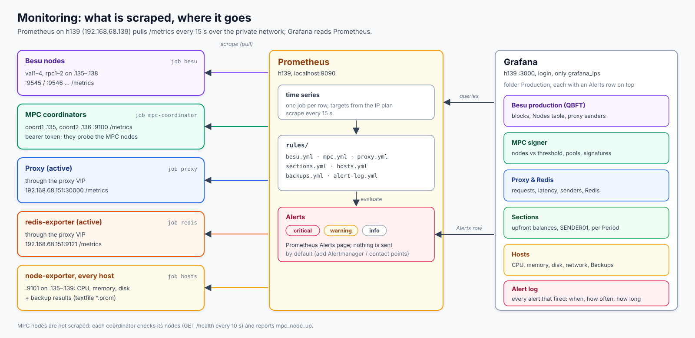
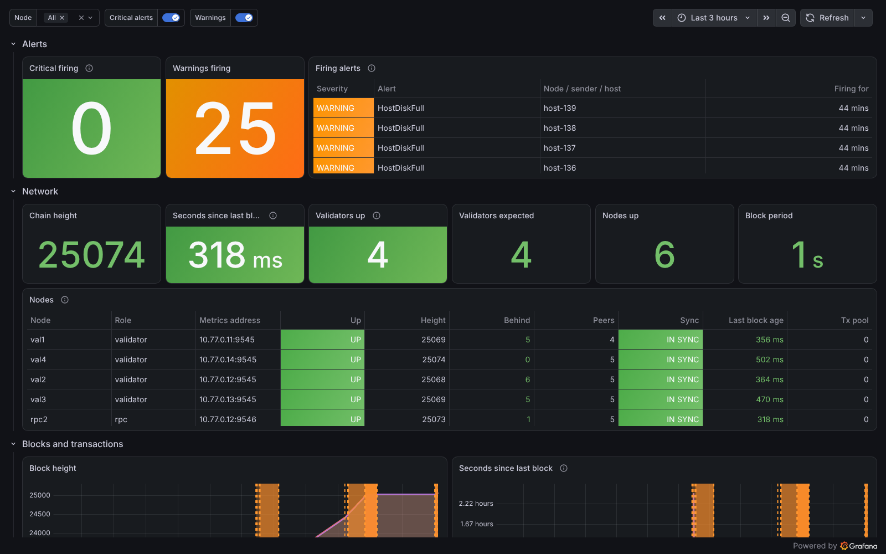

# 모니터링 (Prometheus 및 Grafana)

> **내용:** 운영 환경용 Prometheus와 Grafana: 수집 대상, 대시보드, 알림 목록, 방화벽, 일상 운영.
>
> **대상:** 운영자.
>
> **관련 문서:** [알림](../operations/alerts.md) · [문제 해결](../operations/troubleshooting.md) · [Ansible](../deployment/ansible.md)

**목차**

- [수집 대상](#what-is-scraped)
- [대시보드](#dashboards)
- [알림](#alerts)
- [단계별 설정](#step-by-step)
- [Ansible 사용](#with-ansible)
- [운영](#operations)
- [보안](#security)

---

이 문서는 [`besu-test-network/`](../../besu-test-network)에 포함된 Prometheus와 Grafana의 운영 환경
버전입니다. 파일은 [`monitoring/`](../../monitoring)에 있습니다. **모니터링 호스트 한 대**에서 실행되며,
운영 환경 구성([운영 환경 구성](../overview/production-layout.md))에서는 chainlens와 함께
192.168.68.139에서 실행됩니다.

## 수집 대상 {#what-is-scraped}



Prometheus는 사설 네트워크를 통해 15초마다 수집합니다. 행마다 작업(job) 하나입니다
([`prometheus/prometheus.yml`](../../monitoring/prometheus/prometheus.yml)).

| 작업 | 엔드포인트 | 제공 주체 | 대상 파일 |
|---|---|---|---|
| `besu` | 모든 검증자와 RPC 노드: `http://<BIND_IP>:<METRICS_PORT>/metrics` (9545, 9546 …) | `besu-production/node` | `besu.yml` |
| `mpc-coordinator` | 두 MPC 코디네이터, 각각 자체 IP: `http://<coordinator>:9100/metrics` (bearer 토큰) | `mpc-signer` 코디네이터 | `mpc.yml` |
| `proxy` | 활성 프록시, 플로팅 IP 경유: `http://192.168.68.151:30000/metrics` | `proxy` | `proxy.yml` |
| `redis` | 활성 프록시의 Redis, 같은 플로팅 IP 경유: `http://192.168.68.151:9121/metrics` | `proxy/docker-compose.yml`의 `redis-exporter` | `redis.yml` |
| `hosts` | 모든 호스트의 CPU, 메모리, 디스크, 네트워크, 백업 결과: `http://<host>:9101/metrics` | `node-exporter/` (호스트당 하나) | `hosts.yml` |
| `prometheus` | Prometheus 자체, `localhost:9090` | | static |

- **MPC 노드는 수집하지 않습니다.** 각 코디네이터가 10초마다 자신의 노드를 점검(`GET /health`)하고
  `mpc_node_up`을 보고합니다. Prometheus는 MPC 노드 호스트에 접근할 필요가 없습니다.
- **프록시:** 송신자별 지표(처리 중, 논스 공백, 정지, 복구, 필러), 경로 및 상태별 HTTP 요청, 응답 시간
  히스토그램, 처리 중인 요청, 이벤트 루프 지연, 메모리, Redis 연결, 섹션 및 SENDER01 잔액.
- **Redis:** `redis-exporter`는 두 HA 호스트(.135, .136) 모두에서 실행됩니다. 활성 호스트의 Redis만
  실행되므로, 대기 호스트의 exporter는 `redis_up 0`을 보고합니다. VIP를 통해 수집하면 항상 활성 호스트에
  도달합니다.
- 여기 있는 어떤 구성 요소도 서명하거나 투표할 수 없습니다.

```
  monitoring host ─────────────── private network ──────────────────────────────
  ┌──────────────┐──9545/9546──► validators + RPC nodes (Besu metrics)
  │  Prometheus  │──9100──► MPC coordinator /metrics ──(probes /health)──► MPC node 0,1,2
  │  (localhost) │──30000─► proxy VIP .151 (active proxy)
  │              │──9121──► proxy VIP .151 (redis-exporter of the active proxy's Redis)
  │              │──9101──► node-exporter on every host
  └──────┬───────┘
         │ compose network
  ┌──────┴───────┐
  │   Grafana    │◄── browser (login required)   BIND_IP:3000
  └──────────────┘
```

## 대시보드 {#dashboards}

모든 대시보드는 Grafana 폴더 **Production**에 있습니다. Grafana는 **Besu production**으로 열립니다.
모든 대시보드의 모든 패널, 정상 값, 조치 방법: [Grafana 대시보드](../operations/dashboards.md).
모든 대시보드는 **Alerts** 행으로 시작합니다. 발생 중인 critical 및 warning 알림 수와, 발생 중인 모든 알림의
표(critical 먼저, "Firing for" 포함)가 표시됩니다.



| 대시보드 | 파일 | 표시 내용 |
|---|---|---|
| **Besu production (QBFT)** | `besu-production.json` | 체인 높이, 마지막 블록 이후 경과 초, 기대값 대비 가동 중인 검증자 수, 가동 중인 노드, 블록 주기; **Nodes** 표(아래); 블록 높이, 블록 시간, tx/s, 블록당 가스, tx pool, 뒤처진 블록 수; 트랜잭션량(범위 내, 최근 1시간, 최근 24시간, 평균 tx/s); 피어, 거부된 연결, JSON-RPC 요청률과 p95 지연 시간, P2P 트래픽; CPU, JVM heap, GC, 상주 메모리; **Proxy senders**: 송신자별 채굴 OK / STALLED, 처리 중, 대기 중, 논스 공백, 복구, 필러 |
| **MPC signer** | `mpc-signer.json` | 코디네이터 가동 여부, 임계값 대비 가동 중인 MPC 노드, 키, 준비된 사전 서명, 초당 서명 수; **MPC nodes** 표; 초당 서명 수(hot/cold), 서명 지연 시간, 실패 및 정책 거부, 열린 중계 세션; big 키(개별) 및 small 키(합계)의 풀, 사전 서명 생성 속도, 소요 시간 및 실행 중인 세션, 풀 클래스별 키, 노드 도달 가능성 |
| **Proxy & Redis** | `proxy-redis.json` | 활성 프록시: 가동 여부, 초당 요청 수, 5xx 비율, p95 지연 시간, 처리 중, Redis 연결, 가동 시간; 경로별 요청 및 오류(4xx / 5xx), 응답 시간 p50/p95/p99(`/createaccount`와 `/admin` 제외)와 경로별 p95, 경로별 표; 송신자별 처리 중인 트랜잭션, 논스 공백, 정지 및 복구; 메모리, 이벤트 루프 지연, 처리 중인 요청; **Redis**: 가동 여부, 클라이언트, 메모리, 키, 적중률, 마지막 저장, 가동 시간, 초당 명령 수 및 평균 명령 시간 |
| **Hosts** | `hosts.json` | 호스트별 표, CPU, 메모리, 디스크 사용량, 디스크 I/O, 네트워크 송수신; **Backups**: 백업 및 노드별 마지막 성공, 마지막 실행, 크기, (체인 스냅샷의) 블록 |
| **Alert log** | `alert-log.json` | 배포 이후 발생한 모든 알림: 지금 발생 중인 알림, 범위 안의 알림과 발생 횟수, 심각도별 발생 중인 알림 추이, 알림별 타임라인, 로그 표(심각도, 알림, 대상, 현재 상태, 마지막 시작, 마지막 발생 확인, 발생 횟수, 발생 시간). [패널별 설명](../operations/dashboards.md#alert-log) |
| **Sections** | `sections.json` | ([섹션](../features/sections.md)) 활성 섹션, 임계값 미만인 선지급 계정, 임계값, SENDER01, 전체 선지급, 전체 소비 + 결제; 각 섹션의 선지급 / 소비 / 결제 계정 잔액(표 및 시계열); **Period**별, 섹션 및 종류별 작업 수와 이동한 ETH |

**Nodes 표(Besu production).** 노드당 한 행: Node, Role, Metrics address, Up, Height, Behind, Peers,
Sync, Last block age, Tx pool.

| 열 | 의미 |
|---|---|
| **Sync** | Besu 자체 플래그만이 아니라 측정값으로 계산합니다. `IN SYNC`(녹색); `SYNCING`(주황색): 노드가 동기화 중이라고 보고함; `STALLED`(빨간색): 동기화되었다고 보고하지만 다른 노드는 최신 상태인데 이 노드의 최신 블록이 60초보다 오래됨(가져오기가 멈춤); `BEHIND`(주황색): 가장 높은 노드보다 30블록 넘게 낮고 최신 블록이 30초보다 오래됨 |
| **Behind** | 가장 높은 노드보다 낮은 블록 수. Prometheus가 노드를 몇 초 간격으로 읽기 때문에 약 15까지는 정상입니다. 31부터 주황색, 300부터 빨간색 |
| **Last block age** | 노드의 최신 블록 경과 시간. 녹색, 30초부터 주황색, 60초부터 빨간색 |
| **Peers** | (노드 수 − 1)이어야 합니다 |

**Sections: Period 변수.** `Day`, `Week`, `Month`(30일), `Quarter`(90일) 또는 `Year`(365일).
"last period" 통계, 기간별 차트와 표의 범위를 설정합니다. `Year`에는 365일이 넘는 데이터가 필요합니다.
[운영](#operations)의 *Retention*을 참조하십시오.

**생성되는 대시보드.** 세 대시보드는 스크립트로 생성됩니다. JSON이 아니라 스크립트를 수정한 다음 다시
생성하십시오.

```bash
python3 monitoring/grafana/tools/gen_sections_dashboard.py monitoring/grafana/dashboards/sections.json
```

```bash
python3 monitoring/grafana/tools/gen_proxy_dashboard.py monitoring/grafana/dashboards/proxy-redis.json
```

```bash
python3 monitoring/grafana/tools/gen_alert_log_dashboard.py monitoring/grafana/dashboards/alert-log.json
```

## 알림 {#alerts}

규칙은 [`prometheus/rules/`](../../monitoring/prometheus/rules/)에 영역별로 파일 하나씩 있습니다. 알림은
Prometheus *Alerts* 페이지와 모든 대시보드의 Alerts 행에 표시됩니다. 기본적으로는 아무것도 전송되지
않습니다. [운영](#operations)을 참조하십시오.

**각 알림의 의미와 조치 방법: [알림](../operations/alerts.md).** 아래 목록은 색인일 뿐입니다.

| 파일 | 알림 |
|---|---|
| `besu.yml` | critical: `BesuValidatorQuorumLost`, `BesuNoNewBlocks`. warning: `BesuNodeDown`, `BesuPeersMissing`, `BesuPeersLow`, `BesuNodeStalled`, `BesuNotInSync`, `BesuTxPoolGrowing`, `BesuHeapHigh`. info: `BesuUnpermittedPeers` |
| `mpc.yml` | critical: `MpcCoordinatorDown`, `MpcBelowThreshold`. warning: `MpcNodeDown`, `MpcPoolEmpty`, `MpcSmallPoolsEmpty`, `MpcPresignFailing`, `MpcSignErrors`, `MpcPolicyRefusals` |
| `proxy.yml` | critical: `ProxyDown`, `ProxySenderStalled`. warning: `ProxyNonceGap`, `ProxySenderCheckFailing`, `ProxyHttpErrors`, `ProxySlow`, `ProxyEventLoopBlocked`, `ProxyRedisDisconnected`, `RedisDown`, `RedisMemoryHigh`. info: `ProxyNonceRepaired` |
| `sections.yml` | critical: `SectionUpfrontEmpty`. warning: `SectionUpfrontLow`, `Sender01Low`, `SectionMetricsFailing` |
| `hosts.yml` | warning: `HostDown`, `HostDiskFull`, `HostMemoryHigh`, `HostClockNotSynced` |
| `alert-log.yml` | 알림 없음: [Alert log](../operations/dashboards.md#alert-log) 대시보드를 위한 기록 규칙 2개(`alert_log:firing_since`, `alert_log:firing_seen`) |
| `backups.yml` | warning: `BackupFailed`, `ChainSnapshotTooOld`, `ChainSnapshotMissing`, `MpcShareBackupTooOld`, `MpcShareBackupMissing`, `ValidatorKeyBackupMissing` |

설정에서 가져오는 임계값: `SectionUpfrontLow` / `SectionUpfrontEmpty`는 `upfront_low_balance_eth`를,
`Sender01Low`는 `sender01_low_balance_eth`를 사용합니다(`ansible/group_vars/all/settings.yml`; 0이면
꺼집니다).

시험 실행(검증자 4개 + RPC 노드, MPC 노드 3개 + 코디네이터, 모든 대상 가동): 검증자 하나와 MPC 노드 하나
중지 → `BesuNodeDown`, `MpcNodeDown`; 각각 하나씩 더 중지 → `BesuValidatorQuorumLost`, `BesuNoNewBlocks`,
`MpcBelowThreshold`; 정책 한도를 넘는 금액 → `MpcPolicyRefusals`; 거의 가득 찬 테스트 디스크 →
`HostDiskFull`. 나머지 규칙은 `promtool`로 확인했지만 실제로 발생시키지는 않았습니다.

## 단계별 설정 {#step-by-step}

수동 설정입니다. Ansible을 사용하면 3–5단계가 자동으로 수행됩니다. [Ansible 사용](#with-ansible)을
참조하십시오.

### 1. 메트릭 노출 {#1-expose-the-metrics}

**Besu 노드:** 할 일이 없습니다. 메트릭은 모든 노드의 `BIND_IP:METRICS_PORT`에 있으며, 노드 패키지는
`BIND_IP`를 호스트 허용 목록에 추가하므로 Prometheus 요청이 허용됩니다(이전 노드 패키지는 **403**으로
응답합니다. 현재 `docker-compose*.yml`을 복사하고 `./start.sh`를 실행하십시오). 각 노드의 `BIND_IP`와
`METRICS_PORT`(9545, 여러 노드가 한 호스트를 공유하면 9545/9546/9547)를 기록해 두십시오.

**MPC 코디네이터:** 코디네이터의 `.env`에 토큰을 설정하고 재시작합니다. 토큰을 생성합니다.

```bash
openssl rand -hex 24
```

출력을 코디네이터의 `.env`(`mpc-signer/deploy/coordinator/.env`)에 넣습니다.

```bash
MPC_METRICS_TOKEN=<token>
```

```bash
docker compose up -d
```

**프록시와 Redis:** 할 일이 없습니다. 프록시는 포트 30000에서 `GET /metrics`를 제공하며,
`proxy/docker-compose.yml`은 두 HA 호스트에서 포트 9121(`REDIS_EXPORTER_PORT`)로 `redis-exporter`를
시작합니다. 프록시에 `METRICS_TOKEN`을 설정했다면 `prometheus.yml`의 `proxy` 작업에 `authorization`
블록을 추가하십시오.

**모든 호스트(CPU, 메모리, 디스크, 백업용):** `node-exporter/`를 호스트에 복사하고 실행합니다.

```bash
BIND_IP=<this host's private IP> docker compose up -d
```

`BIND_IP:9101`에서 수신합니다(9100은 MPC 코디네이터의 포트입니다). 또한 해당 호스트의 백업 스크립트
(`snapshot-chain.sh`, `backup-key.sh`, MPC `backup.sh`) 결과도 게시합니다. 이 스크립트들은 작은 `*.prom`
파일을 `/var/lib/node_exporter/textfile`에 기록하며(여기서는 `TEXTFILE_DIR`, 스크립트에서는
`BACKUP_METRICS_DIR`로 변경), 이 결과는 **Backups** 표에 표시되고 `rules/backups.yml`에서 알림 대상이 됩니다.
백업을 실행하는 모든 호스트에서 node-exporter를 실행하십시오.

### 2. 방화벽 {#2-firewall}

모니터링 호스트가 다음 포트에 접근할 수 있도록 허용하고, 그 외에는 허용하지 마십시오. 운영 환경 구성에서는
[`ha/firewall-layout.sh`](../../ha/firewall-layout.sh)가 이 포트를 모두 엽니다(`MON=`).

| 대상 | 포트 | 범용 스크립트 |
|---|---|---|
| 모든 Besu 노드 | 해당 `METRICS_PORT` | `besu-production/firewall-example.sh` (`PROMETHEUS=`, `METRICS_PORTS=`) |
| 모든 MPC 코디네이터 | 9100 | `mpc-signer/deploy/firewall-example.sh` (`PROMETHEUS=`) |
| 두 HA 호스트(프록시 VIP) | 30000 (프록시), 9121 (redis-exporter) | `ha/firewall-layout.sh` |
| node-exporter가 있는 모든 호스트 | 9101 | `besu-production/firewall-example.sh` (`PROMETHEUS=` 사용), `mpc-signer/deploy/firewall-example.sh` (`NODE_EXPORTER_FROM=`) |

Grafana(모니터링 호스트의 포트 3000)는 사용자에게만 열어야 합니다(Ansible 설정의 `grafana_ips`,
`ha/firewall-layout.sh`의 `GRAFANA_USERS`).

### 3. 모니터링 호스트에 설치 {#3-install-on-the-monitoring-host}

```bash
cp -r monitoring /opt/monitoring && cd /opt/monitoring
```

```bash
MPC_METRICS_TOKEN=<token> ./setup.sh
```

`setup.sh`는 무작위 Grafana 관리자 비밀번호(한 번만 출력됨)로 `.env.example`에서 `.env`를 생성하고
`secrets/mpc-metrics-token`을 작성합니다. 기존 `.env`는 절대 덮어쓰지 않습니다. 그런 다음 `.env`를
편집합니다: `BIND_IP` = 이 호스트의 사설 IP(Grafana가 여기에 게시됩니다).

### 4. 대상 목록 작성 {#4-list-your-targets}

`prometheus/targets/`의 다섯 파일을 편집합니다. 운영 환경 구성에 맞게 미리 채워져 있습니다: .135에
val1 + rpc1, .136에 val2 + rpc2, .137에 val3, .138에 val4(검증자는 메트릭 포트 9545, RPC 노드는 9546),
.135/.136에 coord1/coord2, 플로팅 IP `.151`에 프록시와 Redis, 다섯 호스트 모두에 node-exporter.

| 파일 | 항목 단위 | 레이블 |
|---|---|---|
| `besu.yml` | Besu 노드: `"<BIND_IP>:<METRICS_PORT>"` | `node` = 해당 `NODE_NAME`, `role` = `validator` 또는 `rpc` |
| `mpc.yml` | 코디네이터, 자체 주소(VIP 아님): `"<host>:9100"` | `name` |
| `proxy.yml` | 프록시의 **플로팅 IP**: `"192.168.68.151:30000"` (대기 프록시는 중지되어 있으므로, 그 호스트는 항상 down으로 표시됩니다) | `name` |
| `redis.yml` | 프록시의 플로팅 IP, redis-exporter: `"192.168.68.151:9121"` | `name` |
| `hosts.yml` | node-exporter가 있는 호스트: `"<host>:9101"` | `host` |

`role` 레이블이 중요합니다. 쿼럼 알림은 `role: validator`를 셉니다. Prometheus는 1분 이내에 이 파일들을
자동으로 다시 읽으므로, 나중에 노드를 추가해도 재시작할 필요가 없습니다.

디렉터리는 `.env`의 `PROMETHEUS_TARGETS_DIR`(기본값 `./prometheus/targets`)로 설정합니다.
`check-targets.sh`도 같은 설정을 읽습니다.

### 5. 시작 {#5-start}

```bash
docker compose up -d
```

`http://<BIND_IP>:3000`을 열고 `admin`과 `setup.sh`가 출력한 비밀번호로 로그인합니다.

### 6. 메트릭 엔드포인트 테스트 {#6-test-the-metrics-endpoints}

**한 번에 모두** (네트워크 경로가 Prometheus와 같도록 모니터링 호스트에서 실행):

```bash
./check-targets.sh
```

대상 디렉터리에서 `besu.yml`, `mpc.yml`, `proxy.yml`, `hosts.yml`을 읽어 모든 `/metrics`를 호출하고
(코디네이터에는 토큰 사용) 대상마다 한 줄씩 출력합니다. 실패한 대상이 있으면 1로 종료합니다.
`redis.yml`은 확인하지 않으므로 수동으로 테스트하십시오(아래).

```
Besu nodes (targets/besu.yml)
  OK   besu   val1           192.168.68.135:9545
  FAIL besu   rpc1           192.168.68.135:9546  -> 403: Besu refuses the Host header: old node package, ...
MPC coordinators (targets/mpc.yml)
  FAIL mpc    coord2         192.168.68.136:9100  -> 404: old coordinator image without /metrics: ...
Proxy (targets/proxy.yml)
  OK   proxy  proxy          192.168.68.151:30000
Hosts / node-exporter (targets/hosts.yml)
  OK   host   host-135       192.168.68.135:9101
Prometheus scrape status:
      7 "health":"up"
      2 "health":"down"
```

**엔드포인트 하나를 수동으로** (HTTP 상태를 출력합니다. `200` = OK).

Besu 노드(해당 노드 `.env`의 `<BIND_IP>:<METRICS_PORT>`):

```bash
curl -s -o /dev/null -w '%{http_code}\n' http://192.168.68.135:9545/metrics
```

MPC 코디네이터(메트릭 토큰 필요):

```bash
curl -s -o /dev/null -w '%{http_code}\n' -H "Authorization: Bearer $(cat secrets/mpc-metrics-token)" http://<coordinator IP>:9100/metrics
```

활성 프록시의 redis-exporter:

```bash
curl -s -o /dev/null -w '%{http_code}\n' http://192.168.68.151:9121/metrics
```

호스트의 node-exporter:

```bash
curl -s -o /dev/null -w '%{http_code}\n' http://192.168.68.136:9101/metrics
```

**몇 가지 값 확인** (수치가 실제 값인지 확인).

Besu: 높이, 피어, 동기화 여부:

```bash
curl -s http://192.168.68.135:9545/metrics | grep -E '^(ethereum_blockchain_height|ethereum_peer_count|besu_synchronizer_in_sync) '
```

MPC: 가동 중인 노드, 키, 풀, 서명:

```bash
curl -s -H "Authorization: Bearer $(cat secrets/mpc-metrics-token)" http://<coordinator IP>:9100/metrics | grep -E '^mpc_(node_up|keys|pool_ready|signs_total)'
```

프록시: Redis 연결과 처리 중인 요청; Redis: 가동 여부:

```bash
curl -s http://192.168.68.151:30000/metrics | grep -E '^proxy_(redis_up|http_in_flight) '
```

```bash
curl -s http://192.168.68.151:9121/metrics | grep -E '^redis_up '
```

**Prometheus가 보는 내용** (Grafana가 사용하는 것과 같은 데이터):

```bash
curl -s localhost:9090/api/v1/targets | grep -o '"health":"[a-z]*"' | sort | uniq -c
```

down 상태인 모든 대상의 오류, 예:
`"scrapeUrl":"http://192.168.68.136:9101/metrics","lastError":"Get "...": connect: connection refused"`:

```bash
curl -s localhost:9090/api/v1/targets | grep -oE '"scrapeUrl":"[^"]*","globalUrl":"[^"]*","lastError":"([^"\\]|\\.)+"' | sed -E 's/"globalUrl":"[^"]*",//; s/\\"/"/g'
```

| 상태 | 의미 | 해결 방법 |
|---|---|---|
| `200` | OK | |
| `403` (Besu) | 이전 노드 패키지: Besu가 Host 헤더를 거부합니다 | 새 `docker-compose*.yml`을 노드에 복사하고 `./start.sh` 실행 |
| `401` (코디네이터) | `secrets/mpc-metrics-token` ≠ 코디네이터의 `MPC_METRICS_TOKEN` | 양쪽에 같은 값을 설정하고 코디네이터 재시작 |
| `404` (코디네이터) | `/metrics` 이전의 코디네이터 이미지 | 새 `mpc-signer` 이미지를 빌드 및 배포하고 `MPC_IMAGE` 설정 |
| `401` (프록시) | 프록시에 `METRICS_TOKEN`이 설정되어 있습니다 | `proxy` 작업에 `authorization` 블록 추가 |
| `404` (프록시) | `/metrics` 이전의 프록시 | 프록시 업데이트: `proxy/`에서 `docker compose up -d --build` |
| `000` | 응답 없음 | 대상의 IP/포트가 잘못되었거나, 서비스가 다운되었거나, 방화벽이 모니터링 호스트를 차단합니다 |

## Ansible 사용 {#with-ansible}

모니터링 호스트에서 실행하는 단계 [`ansible/09-monitoring.yml`](../../ansible/09-monitoring.yml)(`site.yml`의
일부)은 다음을 수행합니다(chainlens, Remix, 문서 웹사이트는 별도 단계 11–13에서 처리합니다).

1. `monitoring/`을 `/opt/monitoring`으로 복사하고 생성된 메트릭 토큰으로 `setup.sh`를 실행합니다.
2. IP 계획으로부터 다섯 개의 대상 파일을 `prometheus/targets.generated/`에 생성하고(템플릿은
   [`ansible/templates/targets/`](../../ansible/templates/targets/)에 있으며, 생성된 파일을 편집하면 덮어써집니다)
   `PROMETHEUS_TARGETS_DIR=./prometheus/targets.generated`를 설정합니다.
3. `.env`에 `BIND_IP`, `PROMETHEUS_IMAGE`, `GRAFANA_IMAGE`, `PROMETHEUS_RETENTION`,
   `PROMETHEUS_RETENTION_SIZE`를 설정합니다.
4. Grafana 비밀번호를 `ansible/state/secrets/grafana_admin_password`에 보관합니다.
5. Prometheus와 Grafana를 시작하고, 파일이 변경되면 Prometheus를 다시 로드하며(잘못된 규칙이 있으면 여기서
   실패합니다), 모든 대상이 응답할 때까지 `check-targets.sh`를 실행합니다.

설정(`ansible/group_vars/all/settings.yml`):

| 설정 | 기본값 | 효과 |
|---|---|---|
| `prometheus_image`, `grafana_image` | `prom/prometheus:v3.16.0`, `grafana/grafana:13.2` | 이미지 버전 |
| `prometheus_retention` | `400d` | 메트릭 보관 기간(Sections의 *Year* 기간에는 365일 초과 필요) |
| `prometheus_retention_size` | `20GB` | 디스크 상한: 초과하면 가장 오래된 데이터부터 삭제 |
| `grafana_ips` | `[]` | Grafana에 접속할 수 있는 대상(방화벽) |
| `upfront_low_balance_eth`, `sender01_low_balance_eth` | `100`, `10000` | 섹션 알림의 임계값 |

## 운영 {#operations}

| 작업 | 방법 |
|---|---|
| 노드 추가 / 제거 | 대상 파일을 편집합니다(자동 반영). Ansible을 사용하면 IP 계획을 변경하고 `09-monitoring.yml`을 실행합니다 |
| 알림 규칙 또는 `prometheus.yml` 변경 | 편집한 다음 다시 로드합니다(아래) |
| Prometheus 자체 확인 | `127.0.0.1:9090`에서만 수신합니다: `ssh -L 9090:127.0.0.1:9090 <monitoring host>` |
| 알림 전송(메일, Slack, PagerDuty) | Alertmanager를 추가하고 `prometheus.yml`의 `alerting:` 주석을 해제하거나, Grafana *Alerting → Contact points*를 사용합니다 |
| 대시보드 변경 | 프로비저닝된 대시보드는 UI에서 저장할 수 없습니다: *Export → JSON* 후 `grafana/dashboards/`의 파일을 교체하면 Grafana가 다시 불러옵니다. **Sections**와 **Proxy & Redis**는 `grafana/tools/`의 생성 스크립트를 변경하고 다시 생성합니다([대시보드](#dashboards)) |
| 보관 기간 | `.env`의 `PROMETHEUS_RETENTION`(기본값 `30d`)과 디스크 상한 `PROMETHEUS_RETENTION_SIZE`(기본값 `0B` = 상한 없음). Ansible 사용 시: `prometheus_retention`(400d)과 `prometheus_retention_size`(20GB). 변경 후 Prometheus를 재시작합니다: `docker compose up -d` |
| 메트릭 토큰 교체 | 코디네이터에 새 `MPC_METRICS_TOKEN`을 설정하고 재시작한 다음, 여기서 `MPC_METRICS_TOKEN=<new> ./setup.sh`를 실행합니다(Prometheus가 파일을 다시 읽습니다) |
| 백업 | 중요한 것은 없습니다: 대시보드와 규칙은 이 폴더의 파일이며, 메트릭 이력은 `prometheus-data` 볼륨에 있습니다 |

`prometheus.yml` 또는 `rules/`를 편집한 후 Prometheus를 다시 로드합니다.

```bash
curl -X POST http://127.0.0.1:9090/-/reload
```

## 보안 {#security}

- Grafana는 로그인이 필요합니다. 익명 접근과 회원 가입은 꺼져 있습니다.
- Prometheus에는 로그인이 없으므로 `127.0.0.1`에만 게시됩니다.
- 메트릭에는 키나 비밀 정보가 없습니다. 카운터, 블록 번호, 피어 수, 잔액, MPC 키와 송신자의 주소만
  포함됩니다. 그래도 포트 9100, 9545/9546, 9101, 30000, 9121은 모니터링 호스트와 필요한 클라이언트에서만
  접근할 수 있도록 유지하십시오.
- `secrets/`와 `.env`는 git에서 무시됩니다. 절대 커밋하지 마십시오.
