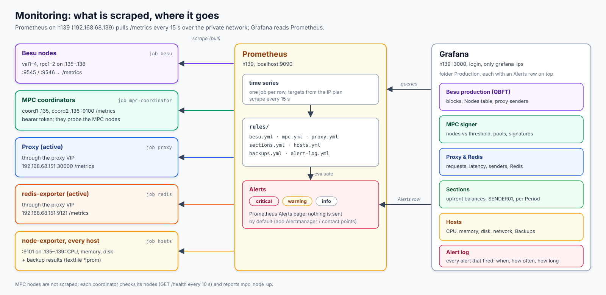
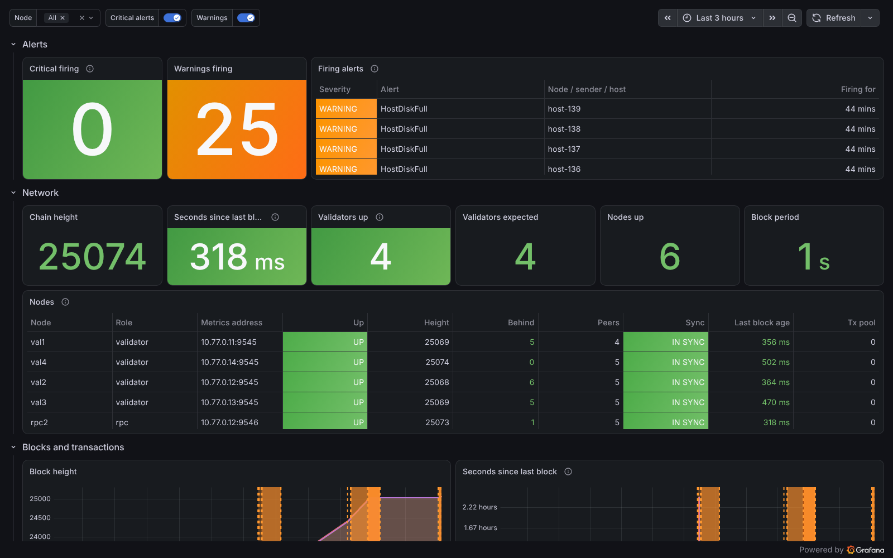

# Monitoring (Prometheus and Grafana)

> **What:** Prometheus and Grafana for production: what is scraped, the dashboards, the alert list, the firewall and day-to-day operations.
>
> **For:** operators.
>
> **Related:** [alerts](../operations/alerts.md) · [troubleshooting](../operations/troubleshooting.md) · [Ansible](../deployment/ansible.md)

**Contents**

- [What is scraped](#what-is-scraped)
- [Dashboards](#dashboards)
- [Alerts](#alerts)
- [Step by step](#step-by-step)
- [With Ansible](#with-ansible)
- [Operations](#operations)
- [Security](#security)

---

This is the production counterpart of the Prometheus and Grafana bundled in
[`besu-test-network/`](../../besu-test-network). The files are in
[`monitoring/`](../../monitoring). It runs on **one monitoring host**, 192.168.68.139 in the
production layout ([Production layout](../overview/production-layout.md)), next to chainlens.

## What is scraped



Prometheus scrapes every 15 s, over the private network. One job per row
([`prometheus/prometheus.yml`](../../monitoring/prometheus/prometheus.yml)):

| Job | Endpoint | Exposed by | Target file |
|---|---|---|---|
| `besu` | every validator and RPC node: `http://<BIND_IP>:<METRICS_PORT>/metrics` (9545, 9546 …) | `besu-production/node` | `besu.yml` |
| `mpc-coordinator` | both MPC coordinators, each on its own IP: `http://<coordinator>:9100/metrics` (bearer token) | `mpc-signer` coordinator | `mpc.yml` |
| `proxy` | the active proxy, through its floating IP: `http://192.168.68.151:30000/metrics` | `proxy` | `proxy.yml` |
| `redis` | the active proxy's Redis, through the same floating IP: `http://192.168.68.151:9121/metrics` | `redis-exporter` in `proxy/docker-compose.yml` | `redis.yml` |
| `hosts` | CPU, memory, disk, network and backup results of every host: `http://<host>:9101/metrics` | `node-exporter/` (one per host) | `hosts.yml` |
| `prometheus` | Prometheus itself, `localhost:9090` | | static |

- **MPC nodes are not scraped.** Each coordinator probes its nodes (`GET /health`) every 10 s
  and reports `mpc_node_up`. Prometheus never needs to reach the MPC node hosts.
- **Proxy:** per sender (in flight, nonce gaps, stalls, repairs, fillers), HTTP requests per
  route and status, answer time histogram, requests in flight, event-loop delay, memory, the
  Redis link, and the section and SENDER01 balances.
- **Redis:** `redis-exporter` runs on both HA hosts (.135, .136). Only the active host's Redis
  runs, so the exporter on the standby host reports `redis_up 0`. Scraping through the VIP
  always reaches the active one.
- Nothing here can sign or vote.

```
  monitoring host ─────────────── private network ──────────────────────────────
  ┌──────────────┐──9545/9546──► validators + RPC nodes (Besu metrics)
  │  Prometheus  │──9100──► MPC coordinator /metrics ──(probes /health)──► MPC node 0,1,2
  │  (localhost) │──30000─► proxy VIP .151 (active proxy)
  │              │──9121──► proxy VIP .151 (redis-exporter of the active proxy's Redis)
  │              │──9101──► node-exporter on every host
  └──────┬───────┘
         │ compose network
  ┌──────┴───────┐
  │   Grafana    │◄── browser (login required)   BIND_IP:3000
  └──────────────┘
```

## Dashboards

All dashboards are in the Grafana folder **Production**. Grafana opens on **Besu production**.
Every panel of every dashboard, with healthy values and what to do: [Grafana dashboards](../operations/dashboards.md).
Every dashboard starts with an **Alerts** row: the number of critical and warning alerts firing,
and a table of every firing alert (critical first, with "Firing for").



| Dashboard | File | Shows |
|---|---|---|
| **Besu production (QBFT)** | `besu-production.json` | chain height, seconds since last block, validators up vs expected, nodes up, block period; the **Nodes** table (below); block height, block time, tx/s, gas per block, tx pool, blocks behind; transaction volume (in range, last hour, last 24 h, average tx/s); peers, refused connections, JSON-RPC rate and p95 latency, P2P traffic; CPU, JVM heap, GC, resident memory; **Proxy senders**: per sender mined OK / STALLED, in flight, waiting, nonce gap, repairs, fillers |
| **MPC signer** | `mpc-signer.json` | coordinator up, MPC nodes up vs threshold, keys, presignatures ready, signatures/s; an **MPC nodes** table; signatures/s (hot/cold), signing latency, failures and policy refusals, open relay sessions; pools of big keys (one by one) and of small keys (totals), presign rate, duration and sessions running, keys per pool class, node reachability |
| **Proxy & Redis** | `proxy-redis.json` | the active proxy: up, requests/s, 5xx share, latency p95, in flight, Redis link, uptime; requests and errors (4xx / 5xx) per route, answer time p50/p95/p99 (without `/createaccount` and `/admin`) and p95 per route, a table per route; transactions in flight, nonce gaps, stalls and repairs per sender; memory, event-loop delay, requests in flight; **Redis**: up, clients, memory, keys, hit ratio, last save, uptime, commands/s and average command time |
| **Hosts** | `hosts.json` | a table per host, CPU, memory, disk used, disk I/O, network in/out; **Backups**: per backup and node, last success, last run, size and (chain snapshot) block |
| **Alert log** | `alert-log.json` | every alert that fired since the deployment: firing now, alerts and episodes in the range, firing alerts per severity over time, a timeline per alert, and the log table (severity, alert, subject, now, last started, last seen firing, times fired, time firing). [Panel by panel](../operations/dashboards.md#alert-log) |
| **Sections** | `sections.json` | ([Sections](../features/sections.md)) active sections, upfront accounts below the threshold, the threshold, SENDER01, all upfront, all consumption + payment; balances of every section's upfront / consumption / payment account (table and over time); operations and ETH moved per section and kind, per **Period** |

**Nodes table (Besu production).** One row per node: Node, Role, Metrics address, Up, Height,
Behind, Peers, Sync, Last block age, Tx pool.

| Column | Meaning |
|---|---|
| **Sync** | computed from the measurements, not only from Besu's own flag. `IN SYNC` (green); `SYNCING` (orange): the node says it is syncing; `STALLED` (red): it says it is in sync, but its newest block is over 60 s old while another node is current (it stopped importing); `BEHIND` (orange): more than 30 blocks below the highest node and its newest block over 30 s old |
| **Behind** | blocks below the highest node. Up to about 15 is normal, because Prometheus reads the nodes a few seconds apart. Orange from 31, red from 300 |
| **Last block age** | age of the node's newest block. Green, orange from 30 s, red from 60 s |
| **Peers** | should be (number of nodes − 1) |

**Sections: the Period variable.** `Day`, `Week`, `Month` (30 days), `Quarter` (90 days) or
`Year` (365 days). It sets the window of the "last period" stats, the per-period charts and
tables. `Year` needs more than 365 days of data: see *Retention* under [Operations](#operations).

**Generated dashboards.** Three dashboards are generated by a script. Edit the script, not the JSON,
then regenerate:

```bash
python3 monitoring/grafana/tools/gen_sections_dashboard.py monitoring/grafana/dashboards/sections.json
```

```bash
python3 monitoring/grafana/tools/gen_proxy_dashboard.py monitoring/grafana/dashboards/proxy-redis.json
```

```bash
python3 monitoring/grafana/tools/gen_alert_log_dashboard.py monitoring/grafana/dashboards/alert-log.json
```

## Alerts

The rules are in [`prometheus/rules/`](../../monitoring/prometheus/rules/), one file per area.
Alerts show on the Prometheus *Alerts* page and in the Alerts row of every dashboard. Nothing is
sent by default; see [Operations](#operations).

**What each alert means and what to do: [Alerts](../operations/alerts.md).** The list below is
only an index.

| File | Alerts |
|---|---|
| `besu.yml` | critical: `BesuValidatorQuorumLost`, `BesuNoNewBlocks`. warning: `BesuNodeDown`, `BesuPeersMissing`, `BesuPeersLow`, `BesuNodeStalled`, `BesuNotInSync`, `BesuTxPoolGrowing`, `BesuHeapHigh`. info: `BesuUnpermittedPeers` |
| `mpc.yml` | critical: `MpcCoordinatorDown`, `MpcBelowThreshold`. warning: `MpcNodeDown`, `MpcPoolEmpty`, `MpcSmallPoolsEmpty`, `MpcPresignFailing`, `MpcSignErrors`, `MpcPolicyRefusals` |
| `proxy.yml` | critical: `ProxyDown`, `ProxySenderStalled`. warning: `ProxyNonceGap`, `ProxySenderCheckFailing`, `ProxyHttpErrors`, `ProxySlow`, `ProxyEventLoopBlocked`, `ProxyRedisDisconnected`, `RedisDown`, `RedisMemoryHigh`. info: `ProxyNonceRepaired` |
| `sections.yml` | critical: `SectionUpfrontEmpty`. warning: `SectionUpfrontLow`, `Sender01Low`, `SectionMetricsFailing` |
| `hosts.yml` | warning: `HostDown`, `HostDiskFull`, `HostMemoryHigh`, `HostClockNotSynced` |
| `alert-log.yml` | no alerts: two recording rules for the [Alert log](../operations/dashboards.md#alert-log) dashboard (`alert_log:firing_since`, `alert_log:firing_seen`) |
| `backups.yml` | warning: `BackupFailed`, `ChainSnapshotTooOld`, `ChainSnapshotMissing`, `MpcShareBackupTooOld`, `MpcShareBackupMissing`, `ValidatorKeyBackupMissing` |

Thresholds that come from settings: `SectionUpfrontLow` / `SectionUpfrontEmpty` use
`upfront_low_balance_eth`, `Sender01Low` uses `sender01_low_balance_eth`
(`ansible/group_vars/all/settings.yml`; 0 turns them off).

Dry run (4 validators + RPC node, 3 MPC nodes + coordinator, all targets up): one validator and
one MPC node stopped → `BesuNodeDown`, `MpcNodeDown`; a second of each → `BesuValidatorQuorumLost`,
`BesuNoNewBlocks`, `MpcBelowThreshold`; a value above the policy limit → `MpcPolicyRefusals`; a
nearly full test disk → `HostDiskFull`. The other rules were checked with `promtool` but not
triggered.

## Step by step

By hand. With Ansible, steps 3–5 are done for you: see [With Ansible](#with-ansible).

### 1. Expose the metrics

**Besu nodes:** nothing to do. Metrics are on `BIND_IP:METRICS_PORT` of every node, and the node
package adds `BIND_IP` to the host allowlist so Prometheus is accepted (an older node package
answers **403**: copy the current `docker-compose*.yml` and run `./start.sh`). Note each node's
`BIND_IP` and `METRICS_PORT` (9545, or 9545/9546/9547 when several nodes share a host).

**MPC coordinator(s):** set a token in the coordinator's `.env` and restart it. Create the token:

```bash
openssl rand -hex 24
```

Put the output in the coordinator's `.env` (`mpc-signer/deploy/coordinator/.env`):

```bash
MPC_METRICS_TOKEN=<token>
```

```bash
docker compose up -d
```

**Proxy and Redis:** nothing to do. The proxy serves `GET /metrics` on its port 30000, and
`proxy/docker-compose.yml` starts `redis-exporter` on port 9121 (`REDIS_EXPORTER_PORT`) on both
HA hosts. If you set `METRICS_TOKEN` on the proxy, add an `authorization` block to the `proxy`
job in `prometheus.yml`.

**Every host (for CPU, memory, disk and backups):** copy `node-exporter/` to the host and run:

```bash
BIND_IP=<this host's private IP> docker compose up -d
```

It listens on `BIND_IP:9101` (9100 is the MPC coordinator's port). It also publishes the results of
the backup scripts on that host (`snapshot-chain.sh`, `backup-key.sh`, the MPC `backup.sh`): they
write small `*.prom` files to `/var/lib/node_exporter/textfile` (change with `TEXTFILE_DIR` here
and `BACKUP_METRICS_DIR` for the scripts), shown in the **Backups** table and alerted on in
`rules/backups.yml`. Run node-exporter on every host that runs a backup.

### 2. Firewall

Allow the monitoring host to reach these ports, and nothing else. For the production layout,
[`ha/firewall-layout.sh`](../../ha/firewall-layout.sh) opens all of them (`MON=`).

| To | Port | Generic script |
|---|---|---|
| every Besu node | its `METRICS_PORT` | `besu-production/firewall-example.sh` (`PROMETHEUS=`, `METRICS_PORTS=`) |
| every MPC coordinator | 9100 | `mpc-signer/deploy/firewall-example.sh` (`PROMETHEUS=`) |
| both HA hosts (proxy VIP) | 30000 (proxy), 9121 (redis-exporter) | `ha/firewall-layout.sh` |
| every host with node-exporter | 9101 | `besu-production/firewall-example.sh` (with `PROMETHEUS=`), `mpc-signer/deploy/firewall-example.sh` (`NODE_EXPORTER_FROM=`) |

Grafana (port 3000 on the monitoring host) should be open only to its users
(`grafana_ips` in the Ansible settings, `GRAFANA_USERS` in `ha/firewall-layout.sh`).

### 3. Install on the monitoring host

```bash
cp -r monitoring /opt/monitoring && cd /opt/monitoring
```

```bash
MPC_METRICS_TOKEN=<token> ./setup.sh
```

`setup.sh` creates `.env` from `.env.example` with a random Grafana admin password (printed once)
and writes `secrets/mpc-metrics-token`. It never overwrites an existing `.env`. Then edit `.env`:
`BIND_IP` = this host's private IP (Grafana is published there).

### 4. List your targets

Edit the five files in `prometheus/targets/`. They are filled in for the production layout:
val1 + rpc1 on .135, val2 + rpc2 on .136, val3 on .137, val4 on .138 (validators on metrics port
9545, RPC nodes on 9546), coord1/coord2 on .135/.136, the proxy and its Redis on the floating IP
`.151`, and node-exporter on all five hosts.

| File | One entry per | Labels |
|---|---|---|
| `besu.yml` | Besu node: `"<BIND_IP>:<METRICS_PORT>"` | `node` = its `NODE_NAME`, `role` = `validator` or `rpc` |
| `mpc.yml` | coordinator, its own address (not the VIP): `"<host>:9100"` | `name` |
| `proxy.yml` | the proxy's **floating IP**: `"192.168.68.151:30000"` (the standby proxy is stopped, so its host would always show down) | `name` |
| `redis.yml` | the proxy's floating IP, redis-exporter: `"192.168.68.151:9121"` | `name` |
| `hosts.yml` | host with node-exporter: `"<host>:9101"` | `host` |

The `role` label matters: the quorum alert counts `role: validator`. Prometheus re-reads these
files by itself within a minute, so adding a node later needs no restart.

The directory is set by `PROMETHEUS_TARGETS_DIR` in `.env` (default `./prometheus/targets`).
`check-targets.sh` reads the same setting.

### 5. Start

```bash
docker compose up -d
```

Open `http://<BIND_IP>:3000` and log in with `admin` and the password from `setup.sh`.

### 6. Test the metrics endpoints

**All at once** (on the monitoring host, so the network path is the same as Prometheus'):

```bash
./check-targets.sh
```

It reads `besu.yml`, `mpc.yml`, `proxy.yml` and `hosts.yml` from the targets directory, calls every
`/metrics` (with the token for coordinators) and prints one line per target. It exits with 1 if
any target fails. It does not check `redis.yml`: test that one by hand (below).

```
Besu nodes (targets/besu.yml)
  OK   besu   val1           192.168.68.135:9545
  FAIL besu   rpc1           192.168.68.135:9546  -> 403: Besu refuses the Host header: old node package, ...
MPC coordinators (targets/mpc.yml)
  FAIL mpc    coord2         192.168.68.136:9100  -> 404: old coordinator image without /metrics: ...
Proxy (targets/proxy.yml)
  OK   proxy  proxy          192.168.68.151:30000
Hosts / node-exporter (targets/hosts.yml)
  OK   host   host-135       192.168.68.135:9101
Prometheus scrape status:
      7 "health":"up"
      2 "health":"down"
```

**One endpoint by hand** (prints the HTTP status; `200` = OK).

Besu node (`<BIND_IP>:<METRICS_PORT>` from that node's `.env`):

```bash
curl -s -o /dev/null -w '%{http_code}\n' http://192.168.68.135:9545/metrics
```

MPC coordinator (needs the metrics token):

```bash
curl -s -o /dev/null -w '%{http_code}\n' -H "Authorization: Bearer $(cat secrets/mpc-metrics-token)" http://<coordinator IP>:9100/metrics
```

redis-exporter of the active proxy:

```bash
curl -s -o /dev/null -w '%{http_code}\n' http://192.168.68.151:9121/metrics
```

node-exporter on a host:

```bash
curl -s -o /dev/null -w '%{http_code}\n' http://192.168.68.136:9101/metrics
```

**Look at a few values** (to see that the numbers are real).

Besu: height, peers, in sync:

```bash
curl -s http://192.168.68.135:9545/metrics | grep -E '^(ethereum_blockchain_height|ethereum_peer_count|besu_synchronizer_in_sync) '
```

MPC: nodes up, keys, pool, signatures:

```bash
curl -s -H "Authorization: Bearer $(cat secrets/mpc-metrics-token)" http://<coordinator IP>:9100/metrics | grep -E '^mpc_(node_up|keys|pool_ready|signs_total)'
```

Proxy: Redis link and in flight; Redis: up:

```bash
curl -s http://192.168.68.151:30000/metrics | grep -E '^proxy_(redis_up|http_in_flight) '
```

```bash
curl -s http://192.168.68.151:9121/metrics | grep -E '^redis_up '
```

**What Prometheus sees** (the same data Grafana uses):

```bash
curl -s localhost:9090/api/v1/targets | grep -o '"health":"[a-z]*"' | sort | uniq -c
```

The error of every target that is down, e.g.
`"scrapeUrl":"http://192.168.68.136:9101/metrics","lastError":"Get "...": connect: connection refused"`:

```bash
curl -s localhost:9090/api/v1/targets | grep -oE '"scrapeUrl":"[^"]*","globalUrl":"[^"]*","lastError":"([^"\\]|\\.)+"' | sed -E 's/"globalUrl":"[^"]*",//; s/\\"/"/g'
```

| Status | Meaning | Fix |
|---|---|---|
| `200` | OK | |
| `403` (Besu) | old node package: Besu rejects the Host header | copy the new `docker-compose*.yml` to the node, `./start.sh` |
| `401` (coordinator) | `secrets/mpc-metrics-token` ≠ the coordinator's `MPC_METRICS_TOKEN` | same value on both sides, restart the coordinator |
| `404` (coordinator) | coordinator image older than `/metrics` | build and deploy the new `mpc-signer` image, set `MPC_IMAGE` |
| `401` (proxy) | `METRICS_TOKEN` is set on the proxy | add an `authorization` block to the `proxy` job |
| `404` (proxy) | proxy older than `/metrics` | update the proxy: `docker compose up -d --build` in `proxy/` |
| `000` | no answer | wrong IP/port in the targets, service down, or firewall blocks the monitoring host |

## With Ansible

Phase [`ansible/09-monitoring.yml`](../../ansible/09-monitoring.yml) (part of `site.yml`) on the
monitoring host (chainlens, Remix and the documentation site have their own phases, 11–13):

1. copies `monitoring/` to `/opt/monitoring` and runs `setup.sh` with the generated metrics token;
2. generates the five target files from the IP plan into `prometheus/targets.generated/`
   (templates in [`ansible/templates/targets/`](../../ansible/templates/targets/); edits there are
   overwritten) and sets `PROMETHEUS_TARGETS_DIR=./prometheus/targets.generated`;
3. sets `BIND_IP`, `PROMETHEUS_IMAGE`, `GRAFANA_IMAGE`, `PROMETHEUS_RETENTION` and
   `PROMETHEUS_RETENTION_SIZE` in `.env`;
4. keeps the Grafana password in `ansible/state/secrets/grafana_admin_password`;
5. starts Prometheus and Grafana, reloads Prometheus when the files changed (a bad rule fails
   here), and runs `check-targets.sh` until every target answers.

Settings (`ansible/group_vars/all/settings.yml`):

| Setting | Default | Effect |
|---|---|---|
| `prometheus_image`, `grafana_image` | `prom/prometheus:v3.16.0`, `grafana/grafana:13.2` | image versions |
| `prometheus_retention` | `400d` | how long metrics are kept (the Sections *Year* period needs more than 365 days) |
| `prometheus_retention_size` | `20GB` | disk cap: above it the oldest data goes first |
| `grafana_ips` | `[]` | who may open Grafana (firewall) |
| `upfront_low_balance_eth`, `sender01_low_balance_eth` | `100`, `10000` | thresholds of the section alerts |

## Operations

| Task | How |
|---|---|
| Add / remove a node | edit the target files (picked up automatically). With Ansible, change the IP plan and run `09-monitoring.yml` |
| Change alert rules or `prometheus.yml` | edit, then reload (below) |
| Look at Prometheus itself | it listens on `127.0.0.1:9090` only: `ssh -L 9090:127.0.0.1:9090 <monitoring host>` |
| Send alerts (mail, Slack, PagerDuty) | add an Alertmanager and uncomment `alerting:` in `prometheus.yml`, or use Grafana *Alerting → Contact points* |
| Change a dashboard | provisioned dashboards can't be saved from the UI: *Export → JSON*, replace the file in `grafana/dashboards/`, Grafana reloads it. For **Sections** and **Proxy & Redis**, change the generator script in `grafana/tools/` and regenerate ([Dashboards](#dashboards)) |
| Retention | `PROMETHEUS_RETENTION` in `.env` (default `30d`) and the disk cap `PROMETHEUS_RETENTION_SIZE` (default `0B` = no cap). With Ansible: `prometheus_retention` (400d) and `prometheus_retention_size` (20GB). Restart Prometheus after a change: `docker compose up -d` |
| Rotate the metrics token | new `MPC_METRICS_TOKEN` on the coordinator(s), restart them, then `MPC_METRICS_TOKEN=<new> ./setup.sh` here (Prometheus re-reads the file) |
| Backups | nothing critical: dashboards and rules are files in this folder; metrics history is in the `prometheus-data` volume |

Reload Prometheus after editing `prometheus.yml` or `rules/`:

```bash
curl -X POST http://127.0.0.1:9090/-/reload
```

## Security

- Grafana requires a login: anonymous access and sign-up are off.
- Prometheus has no login: it is published on `127.0.0.1` only.
- The metrics contain no keys or secrets: counters, block numbers, peer counts, balances and the
  addresses of the MPC keys and senders. Still, keep ports 9100, 9545/9546, 9101, 30000 and 9121
  reachable only from the monitoring host and the clients that need them.
- `secrets/` and `.env` are git-ignored. Never commit them.
