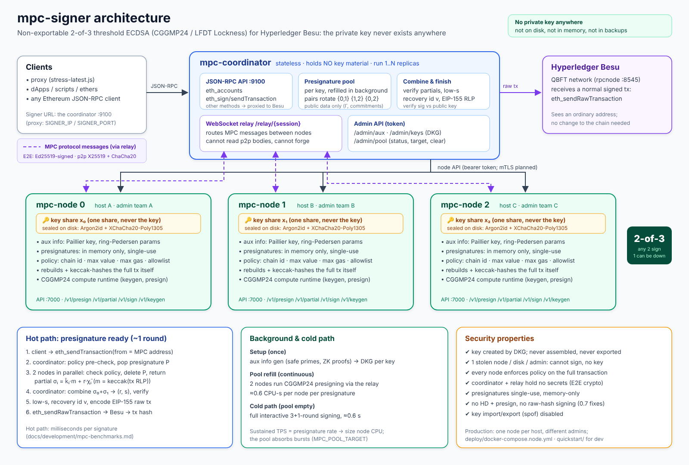

# MPC 서명기

> **내용:** 2-of-3 MPC 서명기: 설계, 프로토콜, 퀵 스타트, 보안 참고 사항.
>
> **대상:** MPC 노드 팀, 개발자, 검토자.
>
> **관련 문서:** [MPC 운영 환경](../deployment/mpc-signer-production.md) · [MPC 업그레이드](../operations/mpc-signer-upgrade.md) · [벤치마크](../development/mpc-benchmarks.md)

**목차**

- [서명 동작 방식](#how-signing-works)
- [사전 서명 풀: big, small, none](#presignature-pools-big-small-none)
- [코디네이터 API](#coordinator-api)
- [구성](#layout)
- [퀵 스타트(Docker)](#quick-start-docker)
- [운영 환경 배포](#production-deployment)
- [알려진 미비점](#known-gaps)
- [벤치마크](#benchmark)

---

**CGGMP24 / LFDT Lockness** 기반의 2-of-3 임계값 ECDSA(secp256k1) 서명기입니다. `cggmp21` 크레이트의
패치된 후속 버전으로, `cggmp24`(`0.7.0-alpha.3`에 고정)로 배포됩니다. 코드는
[`mpc-signer/`](../../mpc-signer)에 있습니다.

**개인 키는 어디에도 존재하지 않습니다.** 개인 키는 세 노드에 걸친 분산 키 생성으로 만들어집니다. 각 노드는
키 조각 하나를 보관합니다. 임의의 두 노드가 함께 일반 Ethereum 서명을 생성합니다. 노드, 디스크 또는 관리자
계정 하나가 탈취되더라도 서명할 수 없고 키를 복구할 수도 없습니다.

클라이언트는 JSON-RPC를 통해 이를 Ethereum 서명기로 사용합니다: `eth_accounts`, `eth_signTransaction`,
`eth_sendTransaction`. 그 밖의 모든 메서드는 Besu로 전달됩니다. [프록시](proxy.md)는 이를 통해 트랜잭션을
전송합니다.



<sub>원본: [`docs/images/mpc-signer-architecture.svg`](../images/mpc-signer-architecture.svg)</sub>

## 서명 동작 방식 {#how-signing-works}

두 종류의 프로그램이 있으며, 모두 같은 이미지에 들어 있습니다.

| 프로그램 | 보관 | 기능 |
|---|---|---|
| `mpc-node` (3) | 키별로 봉인된 키 조각 하나, aux info, 사전 서명(메모리에만) | 서명 정책을 적용하고, 키 생성, 사전 서명 생성, 서명에 참여합니다 |
| `mpc-coordinator` (1개 이상) | 키 자료 없음, 토큰만 | 클라이언트용 JSON-RPC, MPC 메시지용 WebSocket 중계, 사전 서명 풀, 관리자 API, `/metrics` |

각 작업에 필요한 노드 수:

| 작업 | 필요한 노드 |
|---|---|
| Aux info(클러스터당 한 번) 및 **키 생성**(`POST /admin/keys`, `/createaccount`) | **3개 모두** |
| 서명, 사전 서명 생성 | **3개 중 2개** |
| 키 목록 읽기, 풀 클래스 저장 | 3개 중 2개 응답 |

두 가지 서명 경로:

| 경로 | 조건 | 요청 시 비용 |
|---|---|---|
| **핫** | 키의 풀에 사전 서명이 준비되어 있음 | 2개 노드로 병렬 HTTP 호출 1회; 각 노드는 `k·m + r·χ`를 계산합니다(네트워크 라운드 없음) |
| **콜드** | 사전 서명 없음(풀이 비었거나 클래스 `none`의 키) | 완전한 CGGMP24 대화형 서명(3+1 라운드, Paillier ZK 증명), 약 0.5–1.5초 |

코디네이터는 백그라운드에서 풀을 보충하며, 다운된 노드를 건너뛰고 세션을 노드 쌍 {0,1}, {1,2}, {0,2}에
분산합니다. 핫 서명 하나는 사전 서명 하나를 소모합니다. **따라서 지속 처리량은 사전 서명 생성 속도와
같습니다.** 풀은 버스트만 흡수합니다. `MPC_COLD_FALLBACK=false`이면 코디네이터는 풀이 비었을 때 콜드 경로를
사용하는 대신 서명을 거부합니다.

라이브러리의 보안 참고 사항에서 가져온 규칙:

- 사전 서명은 **일회용**입니다. 노드는 사전 서명을 **메모리에만** 보관하고, 부분 서명을 발급하기 *전에*
  삭제하므로, 재시작이나 백업으로 사전 서명이 되살아나는 일은 없습니다.
- 노드는 **전체 트랜잭션**을 직접 재구성하고 keccak 해시합니다. 해시만으로는 절대 서명하지 않습니다.
  라이브러리는 사전 서명을 사용한 원시 해시 서명을 금지합니다.
- **HD 파생 없음**(`hd-wallet` 기능 꺼짐). HD와 사전 서명의 조합은 0.7에서 수정된 취약점입니다. 각 키는
  자체 DKG를 거치며, aux info는 키 간에 공유됩니다.
- **키 가져오기/내보내기 없음**(`spof` 기능 꺼짐). 기존 개인 키는 설계상 가져올 수 없습니다.
- `cluster.json`의 **서명 정책**(chain id, 최대 금액, 최대 가스, 선택적 수신 주소 허용 목록)은 각 노드가
  기여하기 전에 독립적으로 확인합니다.

**여러 코디네이터:** 코디네이터는 시작 시(3개 중 2개 응답이면 충분), 30초마다, `eth_accounts` 요청 시 보유한
사본이 5초보다 오래된 경우, 그리고 알 수 없는 계정을 만났을 때 노드에서 키 목록을 읽습니다. 한 코디네이터를
통해 생성한 계정은 다른 코디네이터를 통해 즉시 서명할 수 있으므로, 대기 코디네이터는 재시작 없이 인계받을
수 있습니다.

## 사전 서명 풀: big, small, none {#presignature-pools-big-small-none}

모든 키에는 **풀 클래스**가 있으며, MPC 노드에 키와 함께 저장되므로 재시작 후에도 유지되고 모든 코디네이터가
볼 수 있습니다. 각 코디네이터는 클래스별 풀 크기를 설정합니다.

| 클래스 | 코디네이터당 준비해 두는 사전 서명 수 | 일반적인 용도 |
|---|---|---|
| `big` | `MPC_POOL_TARGET`(바이너리 기본값 200; 운영 환경 500) | `SENDER01` 같은 사용량이 많은 송신자 |
| `small` | `MPC_POOL_TARGET_SMALL`(기본값 20; 0 = 이 코디네이터는 small 풀을 유지하지 않음) | 프록시를 통해 생성한 계정 |
| `none` | 0: 항상 콜드 | 유휴 계정 |

- 키를 생성할 때 클래스를 설정합니다: `{"pool": "small"}`과 함께 `POST /admin/keys`. 프록시의
  `/createaccount`가 이렇게 합니다(`MPC_NEW_ACCOUNT_POOL`, 기본값 `small`).
- 나중에 변경: `{"pool": "big"}`과 함께 `POST /admin/keys/<address>/pool`(`null`은 지웁니다). 최소 2개
  노드에 저장되어야 합니다. 노드 간에 값이 다르면 다수결을 따릅니다.
- **클래스가 저장되지 않은 키**(키 세레모니의 `SENDER01`, 1.3.0 이전에 만든 키): `MPC_POOL_KEYS`에 있으면
  `big`, 그렇지 않으면 `none`입니다. `MPC_POOL_KEYS`가 비어 있으면 모두 `big`이 됩니다.

규모 산정 및 운영: [운영 환경의 MPC 서명기](../deployment/mpc-signer-production.md#presignature-pools-big-small-and-none)의
"Presignature pools"를 참조하십시오.

## 코디네이터 API {#coordinator-api}

포트 9100. 변경을 일으키는 `/admin` 호출에는 `Authorization: Bearer <MPC_ADMIN_TOKEN>`이 필요합니다.

| 메서드와 경로 | 인증 | 기능 |
|---|---|---|
| `POST /` | 없음 | JSON-RPC: `eth_accounts`, `eth_signTransaction`, `eth_sendTransaction`; 다른 메서드는 Besu(`MPC_BESU_RPC`)로 전달 |
| `GET /health`, `GET /upcheck` | 없음 | 활성 상태 확인(`ok` / `OK`) |
| `GET /metrics` | 설정된 경우 `MPC_METRICS_TOKEN` | Prometheus 메트릭: 핫/콜드 서명, 지연 시간, 실패, 정책 거부, 키 및 클래스별 풀, 사전 서명 생성 속도, 노드별 `mpc_node_up` |
| `POST /admin/aux` | 관리자 | aux info(3개 노드 모두, 클러스터당 한 번, 몇 분 소요) |
| `POST /admin/keys` | 관리자 | 새 키(3개 노드 모두); 선택적 본문 `{"pool": "big"\|"small"\|"none"}` |
| `GET /admin/keys` | 없음 | 키 목록과 풀 클래스 |
| `POST /admin/keys/<address>/pool` | 관리자 | 키의 풀 클래스 설정 또는 해제 |
| `GET /admin/pool` | 없음 | 목표값, 풀(`ready`, `inflight`, `pooled`, `class`, `target`), 카운터를 JSON으로 |
| `POST /admin/pool/target` | 관리자 | 재시작 전까지 목표값 변경: `{"target": 500, "small": 20}` |
| `POST /admin/pool/clear` | 관리자 | 준비된 모든 사전 서명 폐기(코디네이터 및 노드) |
| `GET /relay/<session>` | 없음([알려진 미비점](#known-gaps) 참조) | 노드가 사용하는 WebSocket 중계 |

노드 자체 API(포트 7000, `/v1/...`)는 코디네이터만 사용하며 `MPC_NODE_TOKEN`이 필요합니다. 노드의
`GET /health`에는 토큰이 필요하지 않습니다.

## 구성 {#layout}

```
src/eth.rs          legacy EIP-155 RLP, keccak, address, recovery id (tested against EIP-155 vector)
src/transport.rs    signed + encrypted MPC message envelopes over the coordinator relay
src/store.rs        Argon2id + XChaCha20-Poly1305 sealed files (identity, aux info, key shares)
src/policy.rs       per-node policy: chain id, max value, max gas, destination allowlist
src/api.rs          node API types (coordinator <-> node), pool classes
src/cluster.rs      cluster.json: threshold, parties, policy
src/bin/mpc-node.rs         node API: info, keys, aux, keygen, key pool class, presign, partial, sign, discard
src/bin/mpc-coordinator.rs  JSON-RPC, relay, presignature pools, admin API, metrics, node health probe
Dockerfile                  builds both programs (BIGINT=bigint-num or bigint-rug)
quickstart/                 all 3 nodes + coordinator in Docker on one host (evaluation)
scripts/local-cluster.sh    all 3 nodes + coordinator as host processes (dev / bench)
deploy/                     production packages, one node per host (node/, coordinator/, scripts)
bench/                      throughput benchmark (bench/run-bench.sh)
```

## 퀵 스타트(Docker) {#quick-start-docker}

Compose v2가 포함된 Docker와 JSON-RPC가 활성화된 Besu 노드가 필요합니다. 기본적으로 코디네이터는
`http://host.docker.internal:8545`로 Besu에 접속하며, 이는 Besu가 같은 호스트에서 실행된다는 뜻입니다.
다른 주소를 사용하려면 `init` 전에 `MPC_BESU_RPC`를 설정하십시오.

```bash
cd mpc-signer/quickstart
```

```bash
./quickstart.sh init     # build image, generate secrets (.env), node identities, cluster.json
./quickstart.sh up       # start node0, node1, node2 and the coordinator
./quickstart.sh setup    # aux info (once, a few minutes) + first key: prints the MPC address
./quickstart.sh status   # keys and presignature pool
```

`init`이 생성하는 항목:

- **`.env`**(모드 600): 노드 패스프레이즈, 노드 토큰, 관리자 토큰. 절대 커밋하지 마십시오.
- **`cluster.json`**: 노드 공개 키와 서명 정책(`chain_id`, 금액 한도, 가스 한도, 허용 목록).
- **노드당 Docker 볼륨 하나**(`node0-data` …): 해당 노드의 봉인된 키 조각.

기타 명령:

| 명령 | 기능 |
|---|---|
| `./quickstart.sh newkey` | 키를 하나 더 생성합니다(풀 클래스 없음: `MPC_POOL_KEYS`가 결정) |
| `./quickstart.sh admin METHOD PATH [JSON]` | 관리자 토큰으로 코디네이터 관리자 API를 호출합니다. 예: `./quickstart.sh admin POST /admin/keys '{"pool":"small"}'` |
| `./quickstart.sh logs` | 로그를 따라갑니다 |
| `./quickstart.sh down` | 클러스터를 중지하고 키 조각은 유지합니다 |
| `./quickstart.sh destroy` | 모든 키 조각과 비밀 정보를 삭제합니다. 이 경우 MPC 주소가 보유한 자금은 모두 잃게 됩니다 |

`init` 전에 환경 변수로 설정하는 옵션:

- `MPC_BIGINT=bigint-rug`는 GMP를 사용합니다. 사전 서명 생성이 몇 배 빨라지지만 LGPL 의존성이 추가됩니다.
  기본값: `bigint-num`(순수 Rust).
- `CHAIN_ID=…`는 서명 정책의 chain id를 설정합니다(기본값 1337).

`.env`의 옵션(`quickstart/docker-compose.yml`이 읽음):

- `MPC_PUBLISH=0.0.0.0:9100`은 코디네이터를 localhost 외부에 노출합니다(기본값 `127.0.0.1:9100`).
- `MPC_METRICS_TOKEN`은 `GET /metrics`를 보호합니다. 대시보드와 알림: [모니터링](monitoring.md).
- `MPC_POOL_KEYS`, `MPC_POOL_TARGET`(기본값 200), `MPC_REFILL_CONCURRENCY`(기본값 4),
  `MPC_COMPUTE_THREADS`(기본값 2)는 사전 서명 풀을 조정합니다. `MPC_POOL_TARGET_SMALL`은 퀵 스타트 compose
  파일이 전달하지 않으므로, small 풀은 기본값 20을 유지합니다.

여기서는 세 노드가 모두 한 호스트에서 실행됩니다. 평가용으로는 괜찮지만 임계값 보호는 제공되지 않습니다.
운영 환경은 [운영 환경 배포](#production-deployment)를 참조하십시오.

Docker 없이 실행:

```bash
cargo build --release && scripts/local-cluster.sh init && scripts/local-cluster.sh start && scripts/local-cluster.sh setup
```

코디네이터를 통해 트랜잭션 전송:

```bash
curl -s localhost:9100 -H 'content-type: application/json' --data \
 '{"jsonrpc":"2.0","id":1,"method":"eth_sendTransaction","params":[{"from":"0x<mpc address>","to":"0x…","gas":"0x5208","gasPrice":"0x0","value":"0x1"}]}'
```

프록시의 경우 [프록시(애플리케이션 API)](proxy.md)를 따르십시오. 요약하면 `SIGNER_IP` / `SIGNER_PORT`를
코디네이터(포트 9100)로 설정하고, MPC 주소를 `SENDER01`로 사용하며, `/createaccount`가 MPC 키를 생성하도록
`MPC_ADMIN_URL` / `MPC_ADMIN_TOKEN`을 설정하고, 코디네이터의 `MPC_POOL_KEYS`를 사용량이 많은 송신자로
설정합니다. 각 사용자 계정은 MPC 키입니다(`POST /admin/keys`).

## 운영 환경 배포 {#production-deployment}

처음부터 끝까지 사전 검증(dry-run)한 단계별 안내서인 **[운영 환경의 MPC 서명기](../deployment/mpc-signer-production.md)**를
따르십시오. Ansible 배포([Ansible 배포](../deployment/ansible.md))에서는 단계 `03-mpc-nodes.yml`이 각 팀의
안내문을 작성하고 `cluster.json`을 빌드하며, `04-coordinators.yml`이 두 코디네이터를 시작하고 키 세레모니를
실행합니다. 각 팀은 여전히 자신의 노드를 직접 초기화하고 시작합니다.

`mpc-signer/deploy/`의 역할별 패키지:

| 경로 | 사용 주체 | 내용 |
|---|---|---|
| `deploy/node/` | 각 노드 팀 | `docker-compose.yml`, `.env.example`, `init.sh`, `backup.sh`, `backup-metrics.sh`, `restore.sh` |
| `deploy/coordinator/` | 코디네이터 호스트 | `docker-compose.yml`, `.env.example` |
| `deploy/make-cluster.sh` | 운영자 | 세 노드의 공개 키와 정책으로 `cluster.json`을 빌드합니다 |
| `deploy/ceremony.sh` | 운영자 | aux info + 첫 번째 키(`SENDER01`) |
| `deploy/firewall-example.sh` | 모든 호스트 | 역할별 ufw 규칙 |

세 노드는 사설 네트워크를 통해 **세 호스트에서, 서로 다른 세 팀이 운영**합니다. 한 사람이나 한 머신이 두
노드에 접근할 수 있다면 임계값은 아무것도 보호하지 못합니다. 운영 환경 구성
([운영 환경 구성](../overview/production-layout.md))에서 노드는 192.168.68.135, .137, .138에 있으며, 두
코디네이터(.135, .136)는 `192.168.68.150:9100`의 HAProxy 뒤에 있습니다.

## 알려진 미비점 {#known-gaps}

운영 환경에서 의존하기 전에 해결해야 할 사항:

- 노드 API의 mTLS. 현재는 bearer 토큰을 사용하며, 메시지 *내용*은 이미 종단 간 보호됩니다.
- 중계의 인증. 현재는 중계에 접근할 수 있는 누구나 세션을 방해할 수 있지만(서비스 거부), 메시지를 위조할
  수는 없습니다.
- 사전적 키 갱신(proactive key refresh). 라이브러리가 아직 지원하지 않습니다. 새 키를 생성하고 자금을
  옮기는 방식으로 교체하십시오.
- EIP-1559(type-2) 트랜잭션. 레거시 EIP-155만 구현되어 있으며, 이는 프록시가 사용하는 방식입니다
  (`gasPrice` 0).
- `cggmp24 0.7.0-alpha.3`은 알파 버전입니다. Kudelski 감사는 이전 버전을 대상으로 합니다. 버전을 고정하고
  감사 이후의 변경 사항을 검토하십시오.

## 벤치마크 {#benchmark}

`bench/run-bench.sh`는 퀵 스타트 클러스터(`quickstart/`, Docker)를 시작하고 사전 서명 생성, 핫 경로 서명,
Besu로의 엔드투엔드 제출, 콜드 경로, 지속 처리율을 측정합니다. Docker, bash, curl만 있으면 됩니다. 부하
생성기는 Node.js가 설치되어 있으면 이를 사용하고, 그렇지 않으면 `node:22` 이미지에서 실행됩니다.
`mpc-signer/`에서 실행합니다.

```bash
bench/run-bench.sh
```

실행할 때마다 `mpc-signer/bench/results/<time>.md`(보고서)와 `<time>.jsonl`(원시 데이터)이 기록됩니다.

기본값을 변경하려면 다음 변수를 명령 앞에 붙입니다.

| 변수 | 효과 |
|---|---|
| `REQUESTS` | 서명 실행당 요청 수(기본값 500) |
| `CONCURRENCIES` | 테스트할 클라이언트 동시성 수준(기본값 "1 16 64") |
| `SEND_REQUESTS` | 엔드투엔드 실행의 요청 수(기본값 500) |
| `MPC_BIGINT=bigint-rug` | 더 빠른 GMP 백엔드로 MPC 이미지를 빌드합니다(최초 init 시 적용) |
| `MPC_RUNTIME=native` | MPC 클러스터를 대신 호스트 프로세스로 실행합니다(`cargo build --release` 필요) |
| `BENCH_NODE_DOCKER=1` | Node.js가 설치되어 있어도 부하 생성기를 Docker에서 실행합니다 |

프록시 설정(`HTTPS_PROXY`, `NO_PROXY`)과 `NODE_EXTRA_CA_CERTS`는 Node 컨테이너로 전달됩니다.

결과와 규모 산정: [MPC 서명기 벤치마크](../development/mpc-benchmarks.md).
