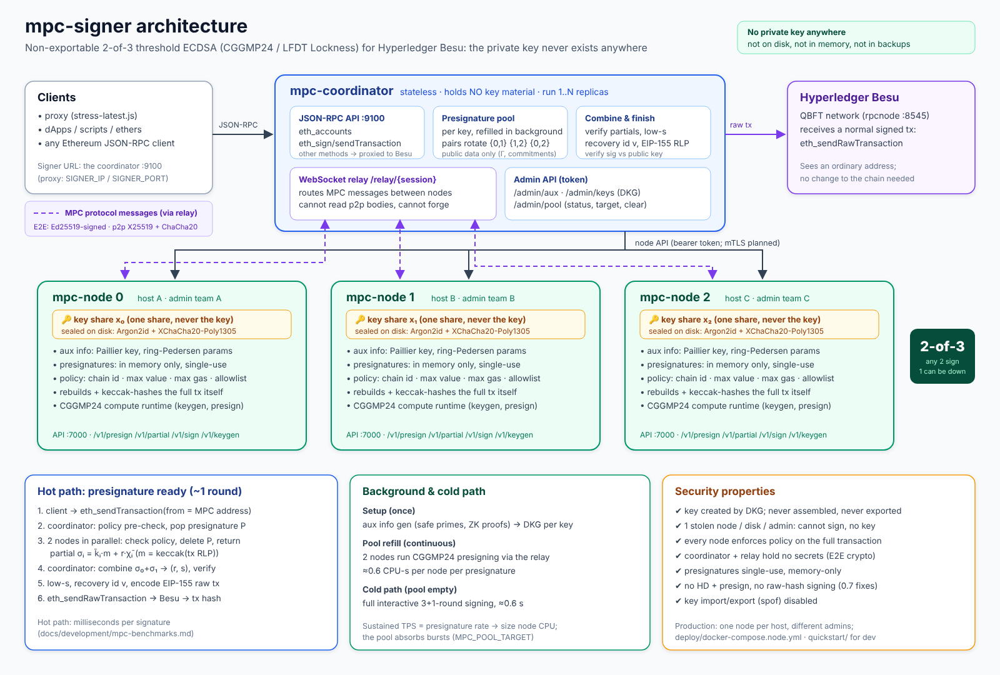

# MPC signer

> **What:** The 2-of-3 MPC signer: design, protocol, quick start and security notes.
>
> **For:** MPC node teams, developers, reviewers.
>
> **Related:** [MPC production](../deployment/mpc-signer-production.md) · [MPC upgrade](../operations/mpc-signer-upgrade.md) · [benchmarks](../development/mpc-benchmarks.md)

**Contents**

- [How signing works](#how-signing-works)
- [Presignature pools: big, small, none](#presignature-pools-big-small-none)
- [Coordinator API](#coordinator-api)
- [Layout](#layout)
- [Quick start (Docker)](#quick-start-docker)
- [Production deployment](#production-deployment)
- [Known gaps](#known-gaps)
- [Benchmark](#benchmark)

---

A 2-of-3 threshold ECDSA (secp256k1) signer built on **CGGMP24 / LFDT Lockness**. This is the
patched successor of the `cggmp21` crate, published as `cggmp24` (pinned to `0.7.0-alpha.3`).
The code is in [`mpc-signer/`](../../mpc-signer).

**The private key never exists anywhere.** It is created by distributed key generation across
three nodes. Each node holds one share. Any two nodes produce a normal Ethereum signature
together. One stolen node, disk or admin account cannot sign and cannot recover the key.

Clients use it as an Ethereum signer over JSON-RPC: `eth_accounts`, `eth_signTransaction` and
`eth_sendTransaction`; every other method is passed on to Besu. The [proxy](proxy.md) sends its
transactions through it.



<sub>Source: [`docs/images/mpc-signer-architecture.svg`](../images/mpc-signer-architecture.svg)</sub>

## How signing works

There are two kinds of program, both in the same image:

| Program | Holds | Does |
|---|---|---|
| `mpc-node` (3) | one sealed key share per key, aux info, presignatures (memory only) | enforces the signing policy, takes part in key generation, presigning and signing |
| `mpc-coordinator` (1 or more) | no key material, only tokens | JSON-RPC for clients, WebSocket relay for MPC messages, presignature pools, admin API, `/metrics` |

How many nodes each operation needs:

| Operation | Nodes needed |
|---|---|
| Aux info (once per cluster) and **key generation** (`POST /admin/keys`, `/createaccount`) | **all 3** |
| Signing, presigning | **2 of 3** |
| Reading the key list, storing a pool class | 2 of 3 answering |

Two signing paths:

| Path | When | Request-time cost |
|---|---|---|
| **Hot** | a presignature is ready in the key's pool | 1 parallel HTTP call to 2 nodes; each node computes `k·m + r·χ` (no network rounds) |
| **Cold** | no presignature (pool empty, or a key of class `none`) | full CGGMP24 interactive signing (3+1 rounds, Paillier ZK proofs), about 0.5–1.5 s |

The coordinator refills the pools in the background and spreads sessions across the node pairs
{0,1}, {1,2} and {0,2}, skipping nodes that are down. Each hot signature uses up one presignature.
**Sustained throughput therefore equals the presignature generation rate.** The pool only absorbs
bursts. With `MPC_COLD_FALLBACK=false` the coordinator refuses to sign when the pool is empty,
instead of using the cold path.

Rules taken from the library's security notes:

- A presignature is **single-use**. Nodes keep presignatures **only in memory** and delete one
  *before* issuing its partial signature, so a restart or backup can never resurrect one.
- Nodes rebuild and keccak-hash the **full transaction** themselves. They never sign a bare hash.
  The library forbids raw-hash signing with presignatures.
- **No HD derivation** (`hd-wallet` feature off). HD combined with presignatures is the
  vulnerability fixed in 0.7. Each key gets its own DKG; aux info is shared across keys.
- **No key import/export** (`spof` feature off). An existing private key cannot be imported, by design.
- **Signing policy** in `cluster.json` (chain id, maximum value, maximum gas, optional destination
  allowlist), checked by every node on its own before it contributes.

**Several coordinators:** a coordinator reads the key list from the nodes at start (2 of 3
answering are enough), every 30 s, for `eth_accounts` when its copy is older than 5 s, and when it
meets an unknown account. An account created through one coordinator signs at once through
another, so a standby coordinator can take over without a restart.

## Presignature pools: big, small, none

Every key has a **pool class**, stored with the key on the MPC nodes, so it survives restarts and
every coordinator sees it. Each coordinator sets the pool size per class:

| Class | Presignatures kept ready, per coordinator | Typical use |
|---|---|---|
| `big` | `MPC_POOL_TARGET` (binary default 200; production 500) | hot senders such as `SENDER01` |
| `small` | `MPC_POOL_TARGET_SMALL` (default 20; 0 = this coordinator keeps no small pools) | accounts created through the proxy |
| `none` | 0: always cold | idle accounts |

- Set the class when creating a key: `POST /admin/keys` with `{"pool": "small"}`. The proxy's
  `/createaccount` does this (its `MPC_NEW_ACCOUNT_POOL`, default `small`).
- Change it later: `POST /admin/keys/<address>/pool` with `{"pool": "big"}` (`null` clears it).
  It must be stored on at least 2 nodes. If nodes disagree, the majority wins.
- **Keys without a stored class** (`SENDER01` from the key ceremony, keys made before 1.3.0):
  `big` if listed in `MPC_POOL_KEYS`, otherwise `none`. An empty `MPC_POOL_KEYS` makes all of them
  `big`.

Sizing and operations: "Presignature pools" in
[MPC signer in production](../deployment/mpc-signer-production.md#presignature-pools-big-small-and-none).

## Coordinator API

Port 9100. `/admin` calls that change something need `Authorization: Bearer <MPC_ADMIN_TOKEN>`.

| Method and path | Auth | Does |
|---|---|---|
| `POST /` | none | JSON-RPC: `eth_accounts`, `eth_signTransaction`, `eth_sendTransaction`; other methods go to Besu (`MPC_BESU_RPC`) |
| `GET /health`, `GET /upcheck` | none | liveness (`ok` / `OK`) |
| `GET /metrics` | `MPC_METRICS_TOKEN` if set | Prometheus metrics: signatures hot/cold, latency, failures, policy refusals, pool per key and class, presign rate, `mpc_node_up` per node |
| `POST /admin/aux` | admin | aux info (all 3 nodes, once per cluster, a few minutes) |
| `POST /admin/keys` | admin | new key (all 3 nodes); optional body `{"pool": "big"\|"small"\|"none"}` |
| `GET /admin/keys` | none | the keys and their pool class |
| `POST /admin/keys/<address>/pool` | admin | set or clear a key's pool class |
| `GET /admin/pool` | none | targets, pools (`ready`, `inflight`, `pooled`, `class`, `target`) and counters as JSON |
| `POST /admin/pool/target` | admin | change the targets until restart: `{"target": 500, "small": 20}` |
| `POST /admin/pool/clear` | admin | drop every ready presignature (coordinator and nodes) |
| `GET /relay/<session>` | none (see [Known gaps](#known-gaps)) | WebSocket relay used by the nodes |

The nodes' own API (port 7000, `/v1/...`) is used only by the coordinators and needs
`MPC_NODE_TOKEN`. `GET /health` on a node needs no token.

## Layout

```
src/eth.rs          legacy EIP-155 RLP, keccak, address, recovery id (tested against EIP-155 vector)
src/transport.rs    signed + encrypted MPC message envelopes over the coordinator relay
src/store.rs        Argon2id + XChaCha20-Poly1305 sealed files (identity, aux info, key shares)
src/policy.rs       per-node policy: chain id, max value, max gas, destination allowlist
src/api.rs          node API types (coordinator <-> node), pool classes
src/cluster.rs      cluster.json: threshold, parties, policy
src/bin/mpc-node.rs         node API: info, keys, aux, keygen, key pool class, presign, partial, sign, discard
src/bin/mpc-coordinator.rs  JSON-RPC, relay, presignature pools, admin API, metrics, node health probe
Dockerfile                  builds both programs (BIGINT=bigint-num or bigint-rug)
quickstart/                 all 3 nodes + coordinator in Docker on one host (evaluation)
scripts/local-cluster.sh    all 3 nodes + coordinator as host processes (dev / bench)
deploy/                     production packages, one node per host (node/, coordinator/, scripts)
bench/                      throughput benchmark (bench/run-bench.sh)
```

## Quick start (Docker)

You need Docker with Compose v2 and a Besu node with JSON-RPC enabled. By default the
coordinator reaches Besu at `http://host.docker.internal:8545`, which means Besu runs on the
same host. Set `MPC_BESU_RPC` before `init` to use a different address.

```bash
cd mpc-signer/quickstart
```

```bash
./quickstart.sh init     # build image, generate secrets (.env), node identities, cluster.json
./quickstart.sh up       # start node0, node1, node2 and the coordinator
./quickstart.sh setup    # aux info (once, a few minutes) + first key: prints the MPC address
./quickstart.sh status   # keys and presignature pool
```

What `init` creates:

- **`.env`** (mode 600): node passphrases, the node token and the admin token. Never commit it.
- **`cluster.json`**: node public keys and the signing policy (`chain_id`, value limit, gas limit, allowlist).
- **One Docker volume per node** (`node0-data` …): that node's sealed key share.

Other commands:

| Command | Does |
|---|---|
| `./quickstart.sh newkey` | creates another key (no pool class: `MPC_POOL_KEYS` decides) |
| `./quickstart.sh admin METHOD PATH [JSON]` | calls the coordinator admin API with the admin token, e.g. `./quickstart.sh admin POST /admin/keys '{"pool":"small"}'` |
| `./quickstart.sh logs` | follows the logs |
| `./quickstart.sh down` | stops the cluster and keeps the shares |
| `./quickstart.sh destroy` | deletes all shares and secrets. Any funds held by MPC addresses are then lost |

Options, set as environment variables before `init`:

- `MPC_BIGINT=bigint-rug` uses GMP: presigning is several times faster, but it adds an LGPL
  dependency. Default: `bigint-num` (pure Rust).
- `CHAIN_ID=…` sets the chain id in the signing policy (default 1337).

Options in `.env` (read by `quickstart/docker-compose.yml`):

- `MPC_PUBLISH=0.0.0.0:9100` exposes the coordinator beyond localhost (default `127.0.0.1:9100`).
- `MPC_METRICS_TOKEN` protects `GET /metrics`. Dashboards and alerts:
  [Monitoring](monitoring.md).
- `MPC_POOL_KEYS`, `MPC_POOL_TARGET` (default 200), `MPC_REFILL_CONCURRENCY` (default 4) and
  `MPC_COMPUTE_THREADS` (default 2) tune the presignature pool. `MPC_POOL_TARGET_SMALL` is not
  passed by the quick-start compose file, so small pools keep the default of 20.

All three nodes run on one host here, which is fine for evaluation but gives no threshold
protection. For production, see [Production deployment](#production-deployment).

Without Docker:

```bash
cargo build --release && scripts/local-cluster.sh init && scripts/local-cluster.sh start && scripts/local-cluster.sh setup
```

Send a transaction through the coordinator:

```bash
curl -s localhost:9100 -H 'content-type: application/json' --data \
 '{"jsonrpc":"2.0","id":1,"method":"eth_sendTransaction","params":[{"from":"0x<mpc address>","to":"0x…","gas":"0x5208","gasPrice":"0x0","value":"0x1"}]}'
```

For the proxy, follow [Proxy (application API)](proxy.md). In short: set `SIGNER_IP` /
`SIGNER_PORT` to the coordinator (port 9100), use the MPC address as `SENDER01`, set
`MPC_ADMIN_URL` / `MPC_ADMIN_TOKEN` so `/createaccount` creates MPC keys, and set `MPC_POOL_KEYS` on
the coordinator to the hot sender(s). Each user account is an MPC key (`POST /admin/keys`).

## Production deployment

Follow **[MPC signer in production](../deployment/mpc-signer-production.md)**, a step-by-step
guide that was dry-run end to end. With the Ansible deployment
([Ansible deployment](../deployment/ansible.md)), phase `03-mpc-nodes.yml` writes each team's
instructions and builds `cluster.json`, and `04-coordinators.yml` starts both coordinators and
runs the key ceremony. The teams still initialise and start their own nodes.

The per-role packages in `mpc-signer/deploy/`:

| Path | Used by | Contents |
|---|---|---|
| `deploy/node/` | each node team | `docker-compose.yml`, `.env.example`, `init.sh`, `backup.sh`, `backup-metrics.sh`, `restore.sh` |
| `deploy/coordinator/` | coordinator host(s) | `docker-compose.yml`, `.env.example` |
| `deploy/make-cluster.sh` | operator | builds `cluster.json` from the three nodes' public keys and the policy |
| `deploy/ceremony.sh` | operator | aux info + first key (`SENDER01`) |
| `deploy/firewall-example.sh` | every host | ufw rules per role |

Three nodes on **three hosts, run by three different teams**, over a private network. If one
person or machine can reach two nodes, the threshold protects nothing. In the production layout
([Production layout](../overview/production-layout.md)) the nodes are on 192.168.68.135,
.137 and .138, and two coordinators (.135, .136) sit behind HAProxy on `192.168.68.150:9100`.

## Known gaps

To fix before relying on it in production:

- mTLS on the node API. Today it uses a bearer token; message *contents* are already
  end-to-end protected.
- Authentication on the relay. Today anyone who can reach it can disrupt a session (denial of
  service), but cannot forge messages.
- Proactive key refresh. The library does not support it yet; rotate by creating a new key
  and moving funds.
- EIP-1559 (type-2) transactions. Only legacy EIP-155 is implemented, which is what the proxy
  uses (`gasPrice` 0).
- `cggmp24 0.7.0-alpha.3` is an alpha. The Kudelski audit covers an earlier version. Pin it and
  review the changes since the audit.

## Benchmark

`bench/run-bench.sh` starts the quick-start cluster (`quickstart/`, in Docker) and measures
presignature generation, hot-path signing, end-to-end submission to Besu, the cold path and the
sustained rate. You only need Docker, bash and curl. The load generator uses your Node.js if it is
installed, and otherwise runs in the `node:22` image. From `mpc-signer/`:

```bash
bench/run-bench.sh
```

Each run writes `mpc-signer/bench/results/<time>.md` (the report) and `<time>.jsonl` (raw data).

To change the defaults, prefix the command with any of these variables:

| Variable | Effect |
|---|---|
| `REQUESTS` | requests per signing run (default 500) |
| `CONCURRENCIES` | client concurrency levels to test (default "1 16 64") |
| `SEND_REQUESTS` | requests in the end-to-end run (default 500) |
| `MPC_BIGINT=bigint-rug` | build the MPC image with the faster GMP backend (applies on first init) |
| `MPC_RUNTIME=native` | run the MPC cluster as host processes instead (needs `cargo build --release`) |
| `BENCH_NODE_DOCKER=1` | run the load generator in Docker even if Node.js is installed |

Proxy settings (`HTTPS_PROXY`, `NO_PROXY`) and `NODE_EXTRA_CA_CERTS` are passed into the Node
container.

Results and sizing: [MPC signer benchmarks](../development/mpc-benchmarks.md).
