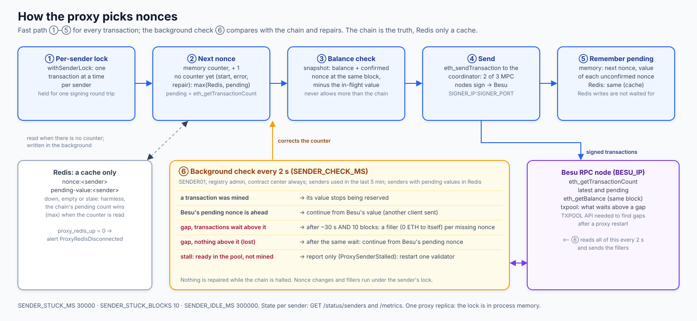

# 프록시 (애플리케이션 API)

> **내용:** MPC 서명기 위에서 프록시(애플리케이션 API)를 운영하는 방법입니다. 설치, 설정, 서명 주체 결정, Redis가 필수가 아닌 논스 설계, NFT 컬렉션, 섹션, 메트릭, 문제 해결을 다룹니다.
>
> **대상:** 개발자 및 운영자.
>
> **관련 문서:** [프록시 API](../reference/proxy-api.md) · [섹션](../features/sections.md) · [아키텍처](../overview/architecture.md)

**목차**

- [1단계: MPC 서명기를 시작하고 송신자 키 생성](#step-1-start-the-mpc-signer-and-create-the-sender-key)
- [2단계: 제네시스 블록에서 `SENDER01`에 잔액 부여](#step-2-give-sender01-a-balance-in-the-genesis-block)
- [3단계: 코디네이터가 Besu를 가리키게 하고 핫 송신자만 풀에 포함](#step-3-point-the-coordinator-at-besu-and-pool-only-the-hot-sender)
- [4단계: MPC 서명기용 프록시 구성](#step-4-configure-the-proxy-for-the-mpc-signer)
- [5단계: 확인](#step-5-verify)
- [설정 (`proxy/.env`)](#settings-proxyenv)
- [프록시가 서명 주체를 결정하는 방식](#how-the-proxy-decides-who-signs)
- [논스와 잔액 검사: 빠른 경로 + 주기적인 체인 검사](#nonces-and-balance-checks-fast-path--periodic-chain-check)
- [Redis는 선택 사항 (복제본 불필요)](#redis-is-optional-no-replica-needed)
- [NFT 컬렉션](#nft-collections)
- [섹션과 등록된 컨트랙트](#sections-and-registered-contracts)
- [메트릭과 모니터링](#metrics-and-monitoring)
- [운영](#operating-it)
- [문제 해결](#troubleshooting)

---

이 가이드는 아무것도 없는 상태에서 시작하여, 모든 트랜잭션이 2-of-3 MPC 서명기로 서명되도록
프록시를 설정합니다.

- 핫 송신자 `SENDER01`은 MPC 키입니다.
- `/createaccount`로 생성되는 모든 계정은 MPC 키입니다.
- 개인 키는 어디에서도 생성, 저장, 내보내기되지 않습니다.

코디네이터의 API는 Ethereum 서명기 JSON-RPC(`eth_accounts`, `eth_signTransaction`,
`eth_sendTransaction`)이며, 키 생성과 사전 서명 풀을 위한 관리 API가 추가로 있습니다.

```
client → proxy :30000 ──eth_sendTransaction──► mpc-coordinator :9100 ──► 2 of 3 mpc-nodes
            │  └─/createaccount─► POST /admin/keys (DKG)          │
            └── Redis :36379                                       └──raw tx──► Besu :8545
```

프록시 코드는 [`proxy/stress-latest.js`](../../proxy/stress-latest.js) 파일 하나입니다. 모든
엔드포인트와 요청 본문, 응답은 [프록시 API 레퍼런스](../reference/proxy-api.md)에 있습니다.

1~5단계는 섹션이 없는 **개발용** 프록시를 설정합니다. 호출은 `SENDER01`을 사용하며, 컨트랙트와
NFT 컬렉션은 없습니다(섹션이 필요합니다). 프로덕션에서는 SectionRegistry, 컨트랙트 계정 센터, 관리 API가
추가됩니다([섹션과 등록된 컨트랙트](#sections-and-registered-contracts)). Ansible이 이 모두를
설정합니다.

1~5단계의 모든 내용은 처음부터 끝까지 테스트되었습니다.

- `/createaccount`는 약 0.7초 만에 MPC 키를 생성했습니다.
- 사용자 계정에서의 `/transfer`는 콜드 경로에서 약 1.5초가 걸렸습니다.

예시는 Docker 호스트 하나, `192.168.68.130`(개발)을 가정합니다. 이 값을 사용자 호스트의 IP로 바꾸십시오.

**프로덕션**(호스트 5대, [프로덕션 구성](../overview/production-layout.md))에서는 같은 프록시가
192.168.68.135(proxy1, 활성)와 .136(proxy2, 대기)에서 실행되며, 같은 `.env`를 사용합니다. 이 파일은
Ansible이 [`ansible/templates/proxy.env.j2`](../../ansible/templates/proxy.env.j2)로 작성합니다(수동 작성 시:
[`proxy/.env.example`](../../proxy/.env.example)). Besu와 MPC 서명기는 플로팅 IP `192.168.68.150`의
HAProxy를 통해 접근합니다(`BESU_IP`, `SIGNER_IP`, `MPC_ADMIN_URL`).
애플리케이션은 프록시의 플로팅 IP `192.168.68.151:30000`을 호출합니다. keepalived는 해당 IP를 보유한
호스트에서만 프록시를 시작하므로([고가용성 (HAProxy와 keepalived)](../deployment/high-availability.md)),
정확히 하나의 프록시만 활성 상태입니다.

---

## 1단계: MPC 서명기를 시작하고 송신자 키 생성 {#step-1-start-the-mpc-signer-and-create-the-sender-key}

```bash
cd mpc-signer/quickstart
MPC_BIGINT=bigint-rug CHAIN_ID=1337 ./quickstart.sh init
./quickstart.sh up
./quickstart.sh setup
```

| 설정 | 효과 |
|---|---|
| `MPC_BIGINT=bigint-rug` | GMP 백엔드로, 사전 서명이 더 빠릅니다. LGPL 의존성이 추가됩니다. 순수 Rust 기본값을 사용하려면 생략하십시오. |
| `CHAIN_ID` | Besu 제네시스의 `chainId`와 같아야 합니다(`besu-test-network`에서는 1337). |

`init`이 **already initialised**를 출력하면 이전 실행에서 만든 클러스터가 존재하는 것입니다. 다음 중 하나를 수행하십시오.

- 유지하기: `grep chain_id cluster.json`이 사용자의 체인 ID를 표시하는지 확인한 다음 `up`과 `setup`을 실행합니다. 더 빠른 백엔드로 전환하려면 `.env`에 `MPC_BIGINT=bigint-rug`를 설정하고 먼저 `docker compose build node0`을 실행합니다.
- 또는 `./quickstart.sh destroy`를 실행하여 클러스터와 키 조각을 삭제한 다음 `init`을 다시 실행합니다.

`setup`은 aux-info 생성을 한 번 실행하고(몇 분 소요), 첫 번째 키를 생성하여 출력합니다.

```json
{"key_id":"0x3a55…111d","address":"0x3a554bc204821a020b6a12749aaf95b23b82111d", ...}
```

**이 주소가 `SENDER01`입니다.** 새 계정에 자금을 공급하는(섹션이 있으면 섹션 충전도)
계정입니다. 이 주소를 기록해 두십시오. 아직 Besu가 실행 중일 필요는 없습니다. 키 생성에는
MPC 노드 3개만 관여합니다.

`quickstart/cluster.json`의 서명 정책을 확인하십시오. 모든 노드가 이 정책을 적용합니다.

- `chain_id`는 체인과 일치해야 합니다.
- `max_value_wei`는 가장 큰 `/createaccount` 금액이나 이체 금액을 포함해야 합니다. 기본값은 1000 ETH입니다.

정책을 수정한 경우 클러스터를 재시작하십시오.

```bash
./quickstart.sh down && ./quickstart.sh up
```

## 2단계: 제네시스 블록에서 `SENDER01`에 잔액 부여 {#step-2-give-sender01-a-balance-in-the-genesis-block}

새로 시작하는 경우 가장 간단한 방법은 제네시스에서 MPC 주소에 미리 자금을 넣는 것입니다.
`besu-test-network/config/besu/genesis.json`의 `alloc` 섹션을 수정하십시오.

```json
"alloc": {
  "3a554bc204821a020b6a12749aaf95b23b82111d": {
    "balance": "0xd3c21bcecceda1000000"
  }
}
```

- 1단계에서 얻은 주소를 `0x` 접두사 없이 사용합니다. `0xd3c21bcecceda1000000`은 1,000,000 ETH입니다.
- **잘 알려진 개발용 계정을 제거하십시오**(`fe3b55…`, `627306…`, `f17f52…`, …). 이 계정들의 개인 키는 공개되어 있으므로 누구나 해당 잔액을 사용할 수 있습니다.
- 이 체인의 가스 가격은 0이므로 `SENDER01`에는 송금하는 금액만큼의 ETH만 있으면 됩니다.

네트워크를 시작하십시오. 이전에 실행한 적이 있다면 `./remove.sh`가 기존 체인 데이터를 삭제하므로,
처음부터 시작할 때만 실행하십시오.

```bash
cd besu-test-network
./remove.sh      # only if a previous chain exists: deletes it
./run.sh
```

잔액을 확인하십시오.

```bash
curl -s localhost:8545 -H 'content-type: application/json' \
  --data '{"jsonrpc":"2.0","id":1,"method":"eth_getBalance","params":["0x<SENDER01>","latest"]}'
```

## 3단계: 코디네이터가 Besu를 가리키게 하고 핫 송신자만 풀에 포함 {#step-3-point-the-coordinator-at-besu-and-pool-only-the-hot-sender}

`mpc-signer/quickstart/.env`를 수정하십시오.

```bash
# Besu as seen from the coordinator container (rpcnode on the same host)
MPC_BESU_RPC=http://host.docker.internal:8545
# SENDER01 keeps a big presignature pool (fast signing, ~1 network round). Accounts created by
# /createaccount get a small pool by default (MPC_NEW_ACCOUNT_POOL on the proxy, MPC_POOL_TARGET_SMALL
# here) or none ("pool":"none": cold path, ~0.6-1.5 s). See docs/deployment/mpc-signer-production.md.
MPC_POOL_KEYS=0x3a554bc204821a020b6a12749aaf95b23b82111d
# Listen on the host IP so the proxy container can reach the coordinator
MPC_PUBLISH=192.168.68.130:9100
```

변경 사항을 적용하십시오.

```bash
cd mpc-signer/quickstart && ./quickstart.sh up
curl -s http://192.168.68.130:9100/admin/pool
```

풀 출력에서 `SENDER01`은 `"pooled": true`로 표시되어야 합니다. `ready`는 `MPC_POOL_TARGET`(200)을 향해 증가합니다.

자주 송금하는 계정이 더 있다면(예: 두 번째 자금 공급 계정) 쉼표로 구분하여 `MPC_POOL_KEYS`에
추가하십시오. 풀 등급은
[운영 환경의 MPC 서명기](../deployment/mpc-signer-production.md#presignature-pools-big-small-and-none)에서 설명합니다.

## 4단계: MPC 서명기용 프록시 구성 {#step-4-configure-the-proxy-for-the-mpc-signer}

`proxy/.env`:

```bash
PORT=30000
BESU_IP=192.168.68.130
BESU_PORT=8545

# The MPC coordinator: signs every transaction (Ethereum signer JSON-RPC)
SIGNER_IP=192.168.68.130
SIGNER_PORT=9100
SENDER01=0x3a554bc204821a020b6a12749aaf95b23b82111d

# /createaccount creates MPC keys through the coordinator admin API
MPC_ADMIN_URL=http://192.168.68.130:9100
MPC_ADMIN_TOKEN=<value of MPC_ADMIN_TOKEN in mpc-signer/quickstart/.env>

```

`proxy/docker-compose.yml`이 컨테이너 자체에 `REDIS_IP=redis`, `REDIS_PORT=6379`,
`LISTEN_HOST=0.0.0.0`을 설정하므로 이 값들은 `.env`에 넣을 필요가 없습니다. 모든 설정은
[설정](#settings-proxyenv)에 있습니다.

> **비밀 정보:** `proxy/.env`는 `.gitignore`에 포함되어 있습니다. 절대 커밋하지 말고 `chmod 600`으로 유지하십시오.
> `MPC_ADMIN_TOKEN`을 가진 사람은 키를 생성할 수 있지만 임의의 트랜잭션에 서명할 수는 없습니다. 각 노드의
> 정책이 계속 적용됩니다. `ADMIN_TOKEN`(프로덕션)은 관리 API를 엽니다.

프록시, Redis, Redis 익스포터를 빌드하고 시작하십시오.

```bash
cd proxy
docker compose up -d --build
```

## 5단계: 확인 {#step-5-verify}

계정을 생성하십시오. 이 계정은 MPC 키가 되며 `SENDER01`에서 자금을 받습니다.

```bash
curl -s localhost:30000/createaccount -H 'content-type: application/json' --data '{"amount":"5"}'
# → {"success":true,"address":"0x1293…717d","from":"0x3a55…111d","amount":"5","pool":"small","txHash":"0x…","nonce":0}
```

새 계정에서 이체하십시오. 이 계정의 키는 MPC 키이므로 프록시가 코디네이터를 통해 서명합니다.

```bash
curl -s localhost:30000/transfer -H 'content-type: application/json' \
  --data '{"from":"0x1293…717d","to":"0x3a55…111d","amount":"1.5","memo":"hello"}'
```

NFT 컬렉션, 닉네임, 그 밖의 컨트랙트에는 섹션(SectionRegistry와 컨트랙트 계정 센터)이 필요합니다.
섹션이 없으면 `/contract/*`는 503 `sections are not configured`로 응답합니다. 섹션이 있으면 컬렉션은
템플릿으로 배포하고, 센터가 민팅하며, `POST /contract/send`의 `buy`로 판매합니다.
[NFT 컬렉션](#nft-collections)과 [NFT 워크플로](../features/nft-workflow.md)를 참조하십시오.

서명기 측:

```bash
curl -s http://192.168.68.130:9100 -H 'content-type: application/json' \
  --data '{"jsonrpc":"2.0","id":1,"method":"eth_accounts","params":[]}'   # SENDER01 + every created account
curl -s http://192.168.68.130:9100/admin/pool                              # hot_signs / cold_signs counters
```

## 설정 (`proxy/.env`) {#settings-proxyenv}

시작 시 읽습니다. 프로덕션에서는 Ansible이 파일을 작성하며
([`proxy.env.j2`](../../ansible/templates/proxy.env.j2)), 값은
`ansible/group_vars/all/settings.yml`과 `ansible/state/`에서 가져옵니다.

| 설정 | 기본값 | 의미 |
|---|---|---|
| `PORT` | 30000 | API 포트 |
| `LISTEN_HOST` | `BESU_IP` | 수신 주소. `docker-compose.yml`은 `0.0.0.0`으로 설정합니다 |
| `BESU_IP`, `BESU_PORT` | –, 8545 | Besu JSON-RPC (프로덕션: RPC VIP `.150`) |
| `SIGNER_IP`, `SIGNER_PORT` | – | MPC 코디네이터의 서명기 JSON-RPC (포트 9100, 프로덕션: VIP `.150`) |
| `MPC_ADMIN_URL`, `MPC_ADMIN_TOKEN` | – | 코디네이터 관리 API: `/createaccount`와 섹션 계정의 키 생성, 풀 등급 |
| `MPC_NEW_ACCOUNT_POOL` | `small` | 요청에 풀 등급이 지정되지 않았을 때 새 계정의 풀 등급: `big`, `small`, `none` |
| `SENDER01` | – | 핫 MPC 키: 키 없는 `/createaccount`와 섹션 충전에 자금을 공급합니다 |
| `REDIS_IP`, `REDIS_PORT` | –, 36379 | Redis (`docker-compose.yml`이 `redis` 컨테이너로 설정) |
| `REDIS_IMAGE`, `REDIS_EXPORTER_IMAGE`, `REDIS_EXPORTER_PORT` | `redis:8.10.3`, `oliver006/redis_exporter:v1.67.0`, 9121 | `docker-compose.yml`에서만 사용 |
| `REGISTRY_CONTRACT`, `REGISTRY_ADMIN` | – | SectionRegistry와 여기에 쓰기를 하는 MPC 키 (Ansible: `state/registry.json`). 둘 다 설정하면 섹션이 켜집니다 |
| `REGISTRY_FROM_BLOCK` | 0 | 레지스트리가 배포된 블록. 레지스트리 이벤트를 이 블록부터 읽습니다 |
| `CONTRACT_CENTER` | – | 컨트랙트 계정 센터 (Ansible: `state/contract-center`): 컨트랙트와 NFT 컬렉션을 배포하고, 그 NFT를 민팅하며, `/admin/contract/send`에 서명합니다 |
| `ADMIN_TOKEN`, `ADMIN_ALLOWED_IPS` | – | 관리 API(`/admin/*`): 토큰(16자 이상)과 허용된 출발지 주소 또는 네트워크. Ansible: `state/secrets/proxy_admin_token`, `operator_ip`, 모니터링 호스트. 둘 다 없으면 관리 API는 404를 응답합니다 |
| `SECTION_KEY_REQUIRED` | `false` | `true`: `X-Section-Key`가 없는 호출을 거부합니다 (Ansible: `sections_required`) |
| `UPFRONT_LOW_BALANCE_ETH`, `SENDER01_LOW_BALANCE_ETH` | 0 (꺼짐) | `/metrics`에 게시되는 알림 임계값 (Ansible: `upfront_low_balance_eth`, `sender01_low_balance_eth`) |
| `METRICS_TOKEN` | – | 선택 사항: `GET /metrics`용 bearer 토큰 |
| `SENDER_CHECK_MS`, `SENDER_STUCK_MS`, `SENDER_STUCK_BLOCKS`, `SENDER_IDLE_MS` | 2000, 30000, 10, 300000 | 백그라운드 체인 검사 ([아래 참조](#nonces-and-balance-checks-fast-path--periodic-chain-check)) |

## 프록시가 서명 주체를 결정하는 방식 {#how-the-proxy-decides-who-signs}

프록시는 `SIGNER_IP:SIGNER_PORT`(코디네이터)에서 `eth_accounts`를 호출하고 목록을
10초 동안 캐시합니다.

- **목록에 있는 주소**(`SENDER01`, `/createaccount`로 생성된 모든 계정, 섹션 계정,
  컨트랙트 계정 센터, 레지스트리 관리자): 프록시가 코디네이터에 `eth_sendTransaction`을 보내고,
  MPC 노드 3개 중 2개가 서명합니다.
- **목록에 없는 주소:** 요청이 거부됩니다(`sender not managed by the MPC signer`).
  프록시는 자체 키를 보유하지 않습니다.

요청이 어떤 계정에서 송신할 수 있는지는 그 전에 결정됩니다.

| 요청 | 송신자 |
|---|---|
| 키 없는 `/createaccount` | `SENDER01` |
| 키 없는 `/transfer {from, to, amount}` | `from` (음수 `amount`는 `to`에서 `from`으로 송금). 섹션의 계정, 레지스트리 관리자, 컨트랙트 센터는 거부됩니다(403) |
| `X-Section-Key`가 있는 `/createaccount`, `/transfer` | 섹션의 선지급 계정, 또는 `+x`의 경우 사용자 계정 ([섹션](../features/sections.md#application-api-section-calls)) |
| `/contract/send` | `from`, 호출자 섹션의 사용자 계정 (NFT의 `buy` / `approve`와 닉네임 `buyNickname` / `upgradeEdge`도 포함) |
| `/admin/contract/send` | 컨트랙트 계정 센터 (NFT `mint`, 닉네임 가격, 테두리 레벨, 예약 이름) |
| `/admin/*` 쓰기 | 레지스트리 관리자(레지스트리), `SENDER01` / 섹션 계정(자금), 컨트랙트 계정 센터(배포) |

## 논스와 잔액 검사: 빠른 경로 + 주기적인 체인 검사 {#nonces-and-balance-checks-fast-path--periodic-chain-check}



한 송신자의 트랜잭션은 연속된 논스를 사용해야 하므로, 프록시는 트랜잭션을 **송신자별로 한 번에
하나씩** 보냅니다(송신자별 잠금). 이 잠금을 짧게 유지하기 위해 잠금 동안 **서명 왕복 한 번**만 수행합니다.

- **논스:** 메모리에서 계산합니다. 프록시가 해당 송신자의 논스를 아직 갖고 있지 않을 때만 Besu를 읽습니다
  (시작 시, 오류 후, 복구 후).
- **잔액 검사:** 스냅샷(잔액과 확정된 논스를 **같은 블록에서** 읽은 값)에서 이 송신자의 아직 확정되지 않은
  트랜잭션 금액을 뺀 값을 기준으로 합니다. 체인이 허용하는 것보다 더 많이 허용하지 않습니다.
- Redis 쓰기는 기다리지 않으며, 서명기의 키 목록은 10초 동안 캐시됩니다.

**백그라운드 검사**(`SENDER_CHECK_MS`마다, 기본 2초)는 `SENDER01`, 레지스트리 관리자,
컨트랙트 계정 센터(시작 시부터 항상), 최근 `SENDER_IDLE_MS`(5분) 동안 사용된 모든 송신자,
Redis에 트랜잭션이 기록된 모든 송신자에 대해 Besu를 읽습니다.
검사는 상태를 스스로 바로잡습니다.

| 상황 | 검사가 하는 일 |
|---|---|
| 트랜잭션이 채굴됨 | 해당 금액의 예약이 해제됩니다(이제 줄어든 잔액에 반영됨) |
| 누군가 송신자에게 ETH를 입금함 | 검사 주기 한 번 안에 사용 가능해집니다 |
| Besu의 pending 논스가 프록시의 논스보다 **앞섬** (다른 클라이언트가 이 키로 송신함) | Besu의 값부터 이어갑니다. 로그: `chain nonce N is ahead of ours` |
| **위에 대기 중인 트랜잭션이 있는 논스 공백** (Besu의 풀에서 확인되므로 요청 없이도 **프록시 재시작 후에도** 발견됨) | 아무것도 확정되지 않은 채 체인이 계속 블록을 생성하면(`SENDER_STUCK_MS`, 기본 30초, **그리고** `SENDER_STUCK_BLOCKS`, 기본 10) 누락된 각 논스에 **필러**를 보냅니다. 송신자에서 자기 자신으로 보내는 0 ETH입니다. 그러면 대기 중인 트랜잭션이 채굴됩니다. 로그: `nonce N missing for … sent 1 filler transaction(s)` |
| **위에 아무것도 없는 논스 공백** (송신되었으나 모든 노드에서 유실됨. 예: 전파되기 전에 RPC 노드가 재시작됨) | 같은 시간을 기다린 후 Besu의 pending 논스부터 이어가므로 다음 요청이 그 논스를 재사용합니다. 해당 트랜잭션은 절대 채굴되지 않습니다. 호출자가 받은 `txHash`는 알 수 없는 상태로 남습니다. 로그: `nonces A..B were sent but no Besu node mined them … they were lost` |
| **정지(stall)**: 트랜잭션이 RPC 노드의 풀에 **준비됨** 상태(pending > confirmed)이지만 블록이 계속 생성되는데도 포함되지 않음 | **검증자**가 해당 트랜잭션을 갖고 있지 않습니다(예: `tx-pool-max-future-by-sender`를 초과하여 버려짐). 이는 프록시가 고칠 수 없습니다. 같은 시간을 기다린 후 보고됩니다. 로그 `… are ready in Besu's pool … but none was mined … the validators do not have them`, `/status/senders` `stalled: true`, 알림 `ProxySenderStalled`. **해결:** 검증자 **하나**를 재시작하십시오. 재연결 시 RPC 노드의 풀을 다시 가져옵니다. 예방: 검증자에 `tx-pool-max-future-by-sender=2000` 설정(`besu-production/node/validator.toml`). |

체인이 멈춘 동안에는 아무것도 복구되지 않습니다. 모든 규칙은 새 블록을 기다립니다.

필러와 풀 검사에는 프록시가 사용하는 RPC 노드(`BESU_IP`)의 **TXPOOL** API가 필요합니다.
프로덕션 RPC 노드에는 이 API가 있습니다. 이 API가 없으면 프록시가 실행되는 동안에는 공백이 여전히 복구되지만
재시작 후에는 복구되지 않으며, 로그에 이 사실이 한 번 기록됩니다.

상태와 수행된 수정 내역을 보려면 다음을 실행하십시오.

```bash
curl -s http://<proxy>:30000/status/senders
```

송신자별 항목: `nextNonce`, `chainPendingNonce`, `confirmedNonce`, `balanceWei`, `inFlightWei`,
`inFlightTransactions`, `gapSeconds`와 `waitingAboveGap`(누락된 논스와 그 뒤에서 대기 중인 것),
`stalled`와 `stallSeconds`, 카운터 `nonceRepairs`, `fillerTransactions`,
`nonceAdoptedFromChain`, `stalls`, 그리고 `lastCheckError`. 같은 값이 `GET /metrics`에도 있습니다
([메트릭과 모니터링](#metrics-and-monitoring)).

검증자 4개 + RPC 노드 + MPC 클러스터에서 테스트한 결과는 다음과 같습니다.

- 프록시가 중단된 동안 남은 공백(누락된 논스 위에 트랜잭션 3개 대기): 재시작된
  프록시가 요청 없이 12블록 후 필러 1개를 보냈고 모두 채굴되었습니다.
- RPC 노드는 프록시의 트랜잭션을 수락했지만 검증자는 거부한 경우(프로덕션에서
  발생한 정지): 10블록 후 보고되었고, 알림 `ProxySenderStalled`가 발생했으며,
  검증자가 재시작되어 RPC 노드의 풀을 가져온 후 해소되었습니다.
- rpc1이 재시작되는 동안 체인이 멈춘 경우(복구 없음, 정지 보고 없음, 재개 시 채굴됨).
- 트랜잭션이 실제로 유실된 경우(11블록 후 초기화, 다음 이체에서 재사용).
- 다른 클라이언트가 이 키로 송신한 경우(체인 값 채택, 실패한 요청 없음).
- 연속 요청 중 정책 거부, 같은 잔액을 두고 경합하는 두 결제, 입금, Redis 중단.
- 한 송신자에서 동시성 100으로 200–400건 이체: 오류, 중복 논스, 공백, 잘못된
  정지 보고가 없었습니다.

## Redis는 선택 사항 (복제본 불필요) {#redis-is-optional-no-replica-needed}

프록시는 Redis를 캐시로 취급합니다. 체인이 진실의 원천이며, 프로세스 내 메모리가
실시간 상태를 보유합니다. Redis가 중단되었거나, 비어 있거나, 오래된 스냅샷에서 복원되어도 모든 엔드포인트가
계속 동작합니다. Redis 명령은 즉시 실패하며(대기열 없음), 로그에
`redis unavailable (...); continuing with memory + chain`이 표시됩니다. 연결이 끊어진 동안
`/metrics`의 `proxy_redis_up`은 0입니다(알림 `ProxyRedisDisconnected`).

| Redis 키 | Redis가 없을 때 |
|---|---|
| `nonce:<sender>` | 논스는 메모리에서 계산합니다. 프록시가 시작할 때(또는 오류 후) max(Redis, `eth_getTransactionCount(pending)`)를 취하므로 오래되었거나 없는 값은 문제가 되지 않습니다 |
| `pending-value:<sender>` | 메모리에 유지합니다. 해당 논스가 채굴되면 항목이 제거됩니다 |
| `nft:nextId:<contract>` | 컬렉션별 `mint`의 다음 토큰 ID: max(메모리/Redis, 체인에서 민팅된 가장 큰 토큰 ID) + 1 |

섹션, 섹션의 계정, 등록된 컨트랙트는 Redis에 저장되지 않습니다. 프록시는 이를 체인의
SectionRegistry에서 읽습니다(섹션은 10초 동안 캐시, 컨트랙트는 10초마다 다시 읽음).

테스트 항목: 부하 중 Redis 중단, Redis를 빈 인스턴스로 교체하고 프록시 재시작, 논스가 롤백된
오래된 스냅샷. 세 경우 모두 이체, 계정 생성, NFT 민팅과 메타데이터가 계속 동작했으며,
모든 트랜잭션이 논스 공백 없이 채굴되었습니다.

프록시 복제본은 여전히 하나입니다. 송신자별 잠금이 프로세스 메모리에 있기 때문입니다.

## NFT 컬렉션 {#nft-collections}

프록시는 컬렉션 컨트랙트 하나를 지원합니다: **버전 3**([`NftCollection.sol`](../../proxy/contracts/NftCollection.sol),
이미지에 `nft-collection-v3.json`으로 컴파일되어 있음). 섹션과 `CONTRACT_CENTER`가 필요합니다.

| | |
|---|---|
| 배포 주체 | 컨트랙트 계정 센터: `{"template": "nft-collection", "name", "symbol"}`로 `POST /admin/contract/deploy`, 또는 chainlens Deploy 페이지. 이름과 심볼은 NFT 컬렉션 사이에서 고유(409) |
| SectionRegistry 등록 | 예 (종류 NFT). `GET /contract/list?type=nft`가 컬렉션을 나열 |
| 민팅 주체 | 컨트랙트 계정 센터: `POST /admin/contract/send` `mint` (프록시가 메타데이터를 만들고, 다음 토큰 ID를 고르고, 가격을 변환) |
| 판매 | 구매자가 `X-Section-Key`로 `POST /contract/send` `buy` `{ tokenId }`를 보내며, 구매자는 해당 섹션의 사용자 계정이어야 합니다. 관리 API 호출자(`ADMIN_ALLOWED_IPS`에서 온 관리 토큰, 예: chainlens Sell 양식)는 키 없이 보낼 수 있으며, 이때 섹션은 구매자의 섹션입니다 |
| 최초 판매 대금 수령 | 섹션의 소비 계정 (`isConsumptionAccount`로 온체인 확인) |
| 재판매 대금 수령 | 판매자. 먼저 판매자의 섹션이 `/contract/send`로 `approve` `{ tokenId }`(컬렉션을 승인)를 보내고, 그다음 구매자의 섹션이 `buy`를 보냅니다(섹션이 달라도 됨) |
| 조회 | `/contract/call`(소유자, 가격, 메타데이터. 일괄 처리 가능)과 `/contract/events`(보유 토큰, 민팅 트랜잭션, 판매 내역) |

가격은 민팅 시 정해지며 이후 모든 판매에서 고정됩니다. 판매는 구매자가 서명한 하나의 `buy`
트랜잭션이며, 토큰과 ETH는 함께 이동하거나 전혀 이동하지 않습니다. 토큰 ID는 각 컬렉션에서 1부터
시작합니다.

**버전 2 컬렉션**([`NftCollectionV2.sol`](../../proxy/contracts/NftCollectionV2.sol), `SENDER01`이 민팅)은
폐기되었습니다: 프록시는 더 이상 이를 읽거나, 민팅하거나, 판매하지 않습니다. 이전의 `/nft/*` 라우트는
대체 호출을 알려 주는 410으로 응답합니다. 예시는
[프록시 API 레퍼런스](../reference/proxy-api.md#nft-collections)에 있습니다.

## 섹션과 등록된 컨트랙트 {#sections-and-registered-contracts}

`REGISTRY_CONTRACT`와 `REGISTRY_ADMIN`이 설정되면 프록시가 섹션을 제공합니다. 섹션은 자체 API 키
(`X-Section-Key`)와 계정을 가진 사업 단위로, 온체인 SectionRegistry(버전 2)에 기록됩니다.
프록시가 유일한 송신자입니다. 레지스트리 쓰기는 레지스트리 관리자가 서명하며, 다른 모든 트랜잭션과 같은
송신자별 대기열을 통해 한 번에 하나씩 처리됩니다. 시작 시 프록시는 레지스트리가 응답하는지, 버전 2인지,
관리자가 `REGISTRY_ADMIN`인지 확인합니다(로그 `sections:
registry 0x… v2, N section(s), admin API on`).

| 기능 | 엔드포인트 | 가이드 |
|---|---|---|
| 섹션 호출 | `X-Section-Key`를 사용하는 `/createaccount`, `/transfer`(+x / −x), `/contract/send`(NFT 판매와 닉네임 포함) | [섹션](../features/sections.md#application-api-section-calls) |
| 관리 API | `/admin/sections/*`: 생성, 이름 변경, 정보, 키 교체, 활성화 / 비활성화, 충전, 스윕, 반환, 계정 교체, 보관, 사용자 계정 | [섹션](../features/sections.md#admin-api) |
| 컨트랙트 | `/admin/contract/check`와 `/deploy`(컨트랙트 계정 센터가 서명하며 ABI와 함께 등록. 플랫폼 컨트랙트용 템플릿), `/contract/call`(읽기, 일괄 처리 가능), `/contract/events`, `/contract/list`, `/contract/send`(쓰기, 호출자 섹션의 사용자 계정이 서명)와 `/admin/contract/send`(센터가 서명) | [컨트랙트 배포](../features/contract-deployment.md) |

본문과 응답이 포함된 전체 목록은 [프록시 API 레퍼런스](../reference/proxy-api.md)에 있습니다.

## 메트릭과 모니터링 {#metrics-and-monitoring}

`GET /metrics`(Prometheus 텍스트 형식, 설정된 경우 bearer 토큰 `METRICS_TOKEN`). Prometheus는
플로팅 IP를 통해 활성 프록시를 수집합니다(`monitoring/prometheus/targets/proxy.yml`,
`192.168.68.151:30000`, job `proxy`).

| 그룹 | 메트릭 |
|---|---|
| 프로세스 | `proxy_up`, `proxy_process_resident_memory_bytes`, `proxy_process_heap_used_bytes`, `proxy_process_start_time_seconds`, `proxy_event_loop_lag_p99_seconds`, `proxy_event_loop_lag_max_seconds` (마지막 수집 이후) |
| HTTP | `proxy_http_requests_total{route, method, code}` (route = 패턴, 예: `/transfer/:txHash`. 알 수 없는 경로는 `unmatched`. 클라이언트가 먼저 떠나면 code `aborted`), `proxy_http_request_duration_seconds{route}` (히스토그램, 버킷 0.01–60초), `proxy_http_in_flight` |
| Redis | `proxy_redis_up` (프록시 자체의 연결) |
| 송신자 | `proxy_senders_tracked`, 그리고 `sender`별: `proxy_sender_next_nonce`, `_pending_nonce`, `_confirmed_nonce`, `_inflight_transactions`, `_waiting_above_gap`, `_gap_seconds`, `_stalled`, `_stall_seconds`, `_check_error`, 카운터 `_nonce_repairs_total`, `_filler_transactions_total`, `_nonce_adopted_total`, `_stalls_total` |
| 섹션 | `proxy_section_*`, `proxy_sender01_*`, `proxy_sections_metrics_*`: [섹션, 모니터링](../features/sections.md#monitoring) 참조 |

**Redis**에는 자체 익스포터가 있습니다.
[`proxy/docker-compose.yml`](../../proxy/docker-compose.yml)의 `redis-exporter` 서비스이며, 포트 9121로 두 HA 호스트 모두에서 실행됩니다.
Prometheus는 프록시 플로팅 IP를 통해 이를 수집하므로(`targets/redis.yml`, `192.168.68.151:9121`,
job `redis`) 항상 활성 프록시의 Redis를 읽습니다. 방화벽은 9121을
모니터링 호스트에만 엽니다.

Grafana: **Proxy & Redis** 대시보드(라우트별 요청, 오류, 지연 시간, 이름별 모든 송신자와
조치가 필요한 항목, 메모리와 이벤트 루프 지연, Redis 클라이언트, 메모리, 키, 적중률, 명령)와
**Sections**. 알림(`ProxyDown`,
`ProxySenderStalled`, `ProxyNonceGap`, `ProxyNonceRepaired`, `ProxySenderCheckFailing`,
`ProxyHttpErrors`, `ProxySlow`, `ProxyEventLoopBlocked`, `ProxyRedisDisconnected`, `RedisDown`,
`RedisMemoryHigh`)은 `monitoring/prometheus/rules/proxy.yml`에 있습니다. 각 알림의 의미와 조치 방법:
[알림](../operations/alerts.md#3-proxy-and-redis-proxyyml). 설정: [모니터링](monitoring.md).

## 운영 {#operating-it}

| 작업 | 방법 |
|---|---|
| 서명 관찰 | `GET :9100/admin/pool`: `SENDER01`의 `ready`, `hot_signs`, `cold_signs`, `failed_signs` |
| 프록시 관찰 | `GET /status/senders`, Grafana **Proxy & Redis**, 활성 프록시 호스트에서 `docker logs proxy-proxy-1` |
| 지속 처리량 향상 | MPC 노드당 CPU 증설, `MPC_REFILL_CONCURRENCY`, `MPC_COMPUTE_THREADS`, 버스트용으로 더 큰 `MPC_POOL_TARGET` ([MPC 벤치마크](../development/mpc-benchmarks.md) 참조) |
| 백업 | 각 노드의 Docker 볼륨(`node0-data`, `node1-data`, `node2-data`) **및** `quickstart/.env`의 패스프레이즈. 노드별로 분리하여 보관하십시오. 프록시 자체에는 백업할 것이 없습니다. 상태는 체인에 있습니다(Redis는 캐시) |
| 노드 하나가 중단됨 | 나머지 2개로 서명이 계속됩니다. `/createaccount`와 섹션 생성에는 **3개 모두**가 필요하므로(키 생성) 노드가 복구될 때까지 새 계정 생성이 실패합니다. |
| 프로덕션 | [프로덕션 구성](../overview/production-layout.md): MPC 노드는 서로 다른 팀이 운영하는 호스트 3대에서 실행(`mpc-signer/deploy/`), HAProxy 뒤에 코디네이터 2개, 프록시는 .135에서 활성, .136에서 대기(활성 복제본 하나: 송신자 잠금과 논스 카운터가 메모리에 있음). Ansible `06-proxy.yml`이 `.env`를 작성하고 프록시를 시작합니다 |

## 문제 해결 {#troubleshooting}

추가 사례: [문제 해결](../operations/troubleshooting.md#proxy-and-transactions).

| 증상 | 원인 | 해결 |
|---|---|---|
| `policy: value above limit` | 금액이 `quickstart/cluster.json`의 `max_value_wei`(기본값 트랜잭션당 1000 ETH)를 초과함 | 값을 올린 다음 `./quickstart.sh down && ./quickstart.sh up` 실행 |
| `/createaccount` 또는 `/transfer`가 `txHash`를 반환하지만 chainlens에 트랜잭션이 없고 영수증이 `null`임 | **논스 공백**: 논스가 사용되었지만 해당 트랜잭션이 체인에 도달하지 않아 이후 트랜잭션이 Besu의 풀에서 대기함. | 프록시가 스스로 복구합니다(*논스와 잔액 검사* 참조). `GET /status/senders`(`gapSeconds`, `nonceRepairs`)와 로그를 확인하십시오. 이전 버전 프록시의 경우: 코디네이터에서 송신자가 자기 자신에게 `value 0x0`, `nonce` = 누락된 값으로 `eth_sendTransaction`을 한 번 보내 공백을 채우십시오. |
| 410 `… was removed: use …` | 이전 `/nft/*`, `/nickname/*` 또는 `/admin/nickname/*` 라우트 | 메시지가 알려 주는 호출을 사용하십시오 ([제거된 라우트](../reference/proxy-api.md#removed-routes)) |
| `sender not managed by the MPC signer` | `from` 주소가 이 클러스터의 MPC 키가 아님 | `/createaccount`로 계정 생성 |
| `X-Section-Key is required` | `SECTION_KEY_REQUIRED=true`이거나, 항상 키가 필요한 호출(`/contract/send`) | 섹션의 키를 보내십시오 ([섹션](../features/sections.md#application-api-section-calls)) |
| `sections are not configured (REGISTRY_CONTRACT, REGISTRY_ADMIN)` (503) | 레지스트리가 없는 프록시에 섹션 호출 또는 관리 호출을 함 | `ansible-playbook 06-proxy.yml`을 실행하거나 `.env`에 둘 다 설정 |
| `the admin API is off` (404) / `not allowed from this address` (403) / `wrong admin token` (401) | `ADMIN_TOKEN` 또는 `ADMIN_ALLOWED_IPS`가 설정되지 않았거나, 호출자 주소가 목록에 없거나, 토큰이 틀림 | [접근 제어](../deployment/access-control.md) |
| 로그 `sections: the registry is version 1; this proxy needs version 2` | 레지스트리가 업그레이드되지 않음 | `ansible-playbook 06-proxy.yml 08-check.yml` (버전 2 배포, 마이그레이션) |
| chainlens가 `Missing batch response`로 멈춤 | 이전 chainlens 이미지 (배치가 Besu의 1024 제한 초과) | `git pull` 후 `chainlens/`에서 `docker compose up -d --build` |
