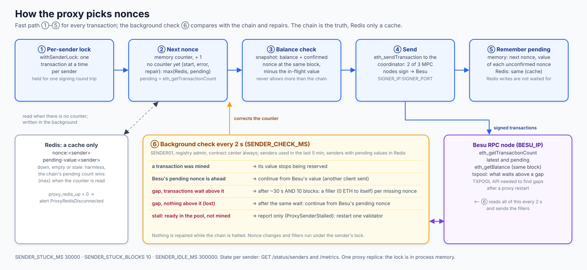

# Proxy (application API)

> **What:** Running the proxy (the application API) on the MPC signer: setup, settings, who signs, the Redis-optional nonce design, NFT collections, sections, metrics and troubleshooting.
>
> **For:** developers and operators.
>
> **Related:** [proxy API](../reference/proxy-api.md) · [sections](../features/sections.md) · [architecture](../overview/architecture.md)

**Contents**

- [Step 1: Start the MPC signer and create the sender key](#step-1-start-the-mpc-signer-and-create-the-sender-key)
- [Step 2: Give `SENDER01` a balance in the genesis block](#step-2-give-sender01-a-balance-in-the-genesis-block)
- [Step 3: Point the coordinator at Besu, and pool only the hot sender](#step-3-point-the-coordinator-at-besu-and-pool-only-the-hot-sender)
- [Step 4: Configure the proxy for the MPC signer](#step-4-configure-the-proxy-for-the-mpc-signer)
- [Step 5: Verify](#step-5-verify)
- [Settings (`proxy/.env`)](#settings-proxyenv)
- [How the proxy decides who signs](#how-the-proxy-decides-who-signs)
- [Nonces and balance checks: fast path + periodic chain check](#nonces-and-balance-checks-fast-path--periodic-chain-check)
- [Redis is optional (no replica needed)](#redis-is-optional-no-replica-needed)
- [NFT collections](#nft-collections)
- [Sections and registered contracts](#sections-and-registered-contracts)
- [Metrics and monitoring](#metrics-and-monitoring)
- [Operating it](#operating-it)
- [Troubleshooting](#troubleshooting)

---

This guide starts from nothing and sets up the proxy so that every transaction is signed by the
2-of-3 MPC signer:

- The hot sender `SENDER01` is an MPC key.
- Every account created by `/createaccount` is an MPC key.
- No private key is ever created, stored or exported anywhere.

The coordinator's API is an Ethereum signer JSON-RPC (`eth_accounts`, `eth_signTransaction`,
`eth_sendTransaction`), plus an admin API for key generation and presignature pools.

```
client → proxy :30000 ──eth_sendTransaction──► mpc-coordinator :9100 ──► 2 of 3 mpc-nodes
            │  └─/createaccount─► POST /admin/keys (DKG)          │
            └── Redis :36379                                       └──raw tx──► Besu :8545
```

The proxy code is one file, [`proxy/stress-latest.js`](../../proxy/stress-latest.js). Every
endpoint, with request bodies and answers, is in the [proxy API reference](../reference/proxy-api.md).

Steps 1 to 5 set up a **development** proxy without sections: calls use `SENDER01`, and NFT
collections are version 2. Production adds the SectionRegistry, the contract account center and
the admin API ([Sections and registered contracts](#sections-and-registered-contracts)); Ansible
sets all of it up.

Everything in steps 1 to 5 was tested end to end:

- `/createaccount` created an MPC key in about 0.7 s.
- `/transfer` from a user account took about 1.5 s on the cold path.
- `/nft/deploy` set the MPC sender as minter.
- `/nft/mint`, paid from a user account, took about 1.8 s.

The examples assume one Docker host, `192.168.68.130` (development). Replace it with your host's IP.

**Production** (5 hosts, [Production layout](../overview/production-layout.md)): the same proxy runs on
192.168.68.135 (proxy1, active) and .136 (proxy2, standby), with the same `.env`, written by
Ansible from [`ansible/templates/proxy.env.j2`](../../ansible/templates/proxy.env.j2) (by hand:
[`proxy/.env.example`](../../proxy/.env.example)). Besu and the MPC signer are reached through
HAProxy on the floating IP `192.168.68.150` (`BESU_IP`, `SIGNER_IP`, `MPC_ADMIN_URL`).
Applications call the proxy's floating IP `192.168.68.151:30000`. keepalived starts the proxy only
on the host holding that IP ([High availability (HAProxy and keepalived)](../deployment/high-availability.md)),
so exactly one proxy is active.

---

## Step 1: Start the MPC signer and create the sender key

```bash
cd mpc-signer/quickstart
MPC_BIGINT=bigint-rug CHAIN_ID=1337 ./quickstart.sh init
./quickstart.sh up
./quickstart.sh setup
```

| Setting | Effect |
|---|---|
| `MPC_BIGINT=bigint-rug` | GMP backend, faster presigning. It adds an LGPL dependency; leave it out to use the pure-Rust default. |
| `CHAIN_ID` | Must equal the `chainId` in Besu's genesis (1337 in `besu-test-network`). |

If `init` says **already initialised**, a cluster from an earlier run exists. Either:

- keep it: check `grep chain_id cluster.json` shows your chain id, then run `up` and `setup`. To switch to the faster backend, set `MPC_BIGINT=bigint-rug` in `.env` and run `docker compose build node0` first.
- or run `./quickstart.sh destroy` to delete it and its key shares, then `init` again.

`setup` runs aux-info generation once (a few minutes), then creates the first key and prints it:

```json
{"key_id":"0x3a55…111d","address":"0x3a554bc204821a020b6a12749aaf95b23b82111d", ...}
```

**This address is `SENDER01`**, the account that funds new accounts and, without sections, mints
NFTs (version-2 collections). Write it down. Besu does not need to be running yet: key generation
only involves the 3 MPC nodes.

Check the signing policy in `quickstart/cluster.json`. Every node enforces it:

- `chain_id` must match the chain.
- `max_value_wei` must cover your largest `/createaccount` amount or transfer. The default is 1000 ETH.

If you edit the policy, restart the cluster:

```bash
./quickstart.sh down && ./quickstart.sh up
```

## Step 2: Give `SENDER01` a balance in the genesis block

Starting fresh, the simplest way is to pre-fund the MPC address in genesis. Edit
`besu-test-network/config/besu/genesis.json`, in the `alloc` section:

```json
"alloc": {
  "3a554bc204821a020b6a12749aaf95b23b82111d": {
    "balance": "0xd3c21bcecceda1000000"
  }
}
```

- Use your address from step 1, without the `0x` prefix. `0xd3c21bcecceda1000000` is 1,000,000 ETH.
- **Remove the well-known development accounts** (`fe3b55…`, `627306…`, `f17f52…`, …). Their private keys are public, so anyone could spend those balances.
- The gas price is 0 on this chain, so `SENDER01` only needs ETH for the value it sends.

Start the network. If it ran before, `./remove.sh` deletes the old chain data, so only do that
when starting from scratch:

```bash
cd besu-test-network
./remove.sh      # only if a previous chain exists: deletes it
./run.sh
```

Check the balance:

```bash
curl -s localhost:8545 -H 'content-type: application/json' \
  --data '{"jsonrpc":"2.0","id":1,"method":"eth_getBalance","params":["0x<SENDER01>","latest"]}'
```

## Step 3: Point the coordinator at Besu, and pool only the hot sender

Edit `mpc-signer/quickstart/.env`:

```bash
# Besu as seen from the coordinator container (rpcnode on the same host)
MPC_BESU_RPC=http://host.docker.internal:8545
# SENDER01 keeps a big presignature pool (fast signing, ~1 network round). Accounts created by
# /createaccount get a small pool by default (MPC_NEW_ACCOUNT_POOL on the proxy, MPC_POOL_TARGET_SMALL
# here) or none ("pool":"none": cold path, ~0.6-1.5 s). See docs/deployment/mpc-signer-production.md.
MPC_POOL_KEYS=0x3a554bc204821a020b6a12749aaf95b23b82111d
# Listen on the host IP so the proxy container can reach the coordinator
MPC_PUBLISH=192.168.68.130:9100
```

Apply the changes:

```bash
cd mpc-signer/quickstart && ./quickstart.sh up
curl -s http://192.168.68.130:9100/admin/pool
```

In the pool output, `SENDER01` should show `"pooled": true`. `ready` climbs toward `MPC_POOL_TARGET` (200).

If more accounts send often (for example a second funding account), add them to `MPC_POOL_KEYS`,
separated by commas. Pool classes are explained in
[MPC signer in production](../deployment/mpc-signer-production.md#presignature-pools-big-small-and-none).

## Step 4: Configure the proxy for the MPC signer

`proxy/.env`:

```bash
PORT=30000
BESU_IP=192.168.68.130
BESU_PORT=8545

# The MPC coordinator: signs every transaction (Ethereum signer JSON-RPC)
SIGNER_IP=192.168.68.130
SIGNER_PORT=9100
SENDER01=0x3a554bc204821a020b6a12749aaf95b23b82111d

# /createaccount creates MPC keys through the coordinator admin API
MPC_ADMIN_URL=http://192.168.68.130:9100
MPC_ADMIN_TOKEN=<value of MPC_ADMIN_TOKEN in mpc-signer/quickstart/.env>

# leave NFT_CONTRACT unset: deploy a new collection in step 5
```

`proxy/docker-compose.yml` sets `REDIS_IP=redis`, `REDIS_PORT=6379` and `LISTEN_HOST=0.0.0.0` for
the container itself, so these need not be in `.env`. All settings are in
[Settings](#settings-proxyenv).

> **Secrets:** `proxy/.env` is in `.gitignore`: never commit it, and keep it `chmod 600`.
> `MPC_ADMIN_TOKEN` lets the holder create keys, but not sign arbitrary transactions: each node's
> policy still applies. `ADMIN_TOKEN` (production) opens the admin API.

Build and start the proxy, Redis and the Redis exporter:

```bash
cd proxy
docker compose up -d --build
```

## Step 5: Verify

Create an account. It becomes an MPC key, funded from `SENDER01`:

```bash
curl -s localhost:30000/createaccount -H 'content-type: application/json' --data '{"amount":"5"}'
# → {"success":true,"address":"0x1293…717d","from":"0x3a55…111d","amount":"5","pool":"small","txHash":"0x…","nonce":0}
```

Transfer from the new account. Its key is an MPC key, so the proxy signs through the coordinator:

```bash
curl -s localhost:30000/transfer -H 'content-type: application/json' \
  --data '{"from":"0x1293…717d","to":"0x3a55…111d","amount":"1.5","memo":"hello"}'
```

Deploy an NFT collection. Without sections, the proxy deploys a **version-2** collection and
`SENDER01` is its minter:

```bash
curl -s localhost:30000/nft/deploy -H 'content-type: application/json' --data '{"name":"MPC NFT","symbol":"MNFT"}'
```

Mint. Every NFT is minted to `SENDER01` and nothing is paid. `amount` is the NFT's **price**,
stored on chain in the collection:

```bash
curl -s localhost:30000/nft/mint -H 'content-type: application/json' \
  --data '{"name":"Badge 1","image":"https://example/badge.png","amount":"0.5"}'
```

Sell it to the user. This is **one** `buy` transaction signed by the buyer, carrying exactly the
price. The NFT moves and the ETH goes to `SENDER01` atomically; if anything fails, nothing moves:

```bash
curl -s localhost:30000/nft/transfer -H 'content-type: application/json' \
  --data '{"to":"0x1293…717d","tokenId":"1"}'
```

With sections configured (production), collections are version 3 and a sale needs a section key:
see [NFT collections](#nft-collections) and the [NFT workflow](../features/nft-workflow.md).

Signer side:

```bash
curl -s http://192.168.68.130:9100 -H 'content-type: application/json' \
  --data '{"jsonrpc":"2.0","id":1,"method":"eth_accounts","params":[]}'   # SENDER01 + every created account
curl -s http://192.168.68.130:9100/admin/pool                              # hot_signs / cold_signs counters
```

## Settings (`proxy/.env`)

Read at start-up. In production Ansible writes the file
([`proxy.env.j2`](../../ansible/templates/proxy.env.j2)); the values come from
`ansible/group_vars/all/settings.yml` and `ansible/state/`.

| Setting | Default | Meaning |
|---|---|---|
| `PORT` | 30000 | API port |
| `LISTEN_HOST` | `BESU_IP` | listen address; `docker-compose.yml` sets `0.0.0.0` |
| `BESU_IP`, `BESU_PORT` | –, 8545 | Besu JSON-RPC (production: the RPC VIP `.150`) |
| `SIGNER_IP`, `SIGNER_PORT` | – | the MPC coordinator's signer JSON-RPC (port 9100; production: the VIP `.150`) |
| `MPC_ADMIN_URL`, `MPC_ADMIN_TOKEN` | – | coordinator admin API: key generation for `/createaccount` and section accounts, pool classes |
| `MPC_NEW_ACCOUNT_POOL` | `small` | pool class of a new account when the request names none: `big`, `small`, `none` |
| `SENDER01` | – | the hot MPC key: funds keyless `/createaccount`, section top-ups; minter of version-2 collections |
| `REDIS_IP`, `REDIS_PORT` | –, 36379 | Redis (set by `docker-compose.yml` to the `redis` container) |
| `REDIS_IMAGE`, `REDIS_EXPORTER_IMAGE`, `REDIS_EXPORTER_PORT` | `redis:8.10.3`, `oliver006/redis_exporter:v1.67.0`, 9121 | used by `docker-compose.yml` only |
| `NFT_CONTRACT` | – | optional: the default NFT collection (otherwise the first one deployed or found) |
| `NFT_BASE_URL` | – | optional: public base URL for NFT metadata links |
| `REGISTRY_CONTRACT`, `REGISTRY_ADMIN` | – | the SectionRegistry and the MPC key that writes it (Ansible: `state/registry.json`). Both set = sections on |
| `REGISTRY_FROM_BLOCK` | 0 | the block the registry was deployed in; its events are read from there |
| `CONTRACT_CENTER` | – | the contract account center (Ansible: `state/contract-center`): deploys contracts and version-3 collections, mints their NFTs |
| `ADMIN_TOKEN`, `ADMIN_ALLOWED_IPS` | – | the admin API (`/admin/*`): token (16+ characters) and allowed source addresses or networks. Ansible: `state/secrets/proxy_admin_token`, `operator_ip` and the monitoring host. Without both the admin API answers 404 |
| `SECTION_KEY_REQUIRED` | `false` | `true`: calls without `X-Section-Key` are refused (Ansible: `sections_required`) |
| `UPFRONT_LOW_BALANCE_ETH`, `SENDER01_LOW_BALANCE_ETH` | 0 (off) | alert thresholds published on `/metrics` (Ansible: `upfront_low_balance_eth`, `sender01_low_balance_eth`) |
| `METRICS_TOKEN` | – | optional bearer token for `GET /metrics` |
| `SENDER_CHECK_MS`, `SENDER_STUCK_MS`, `SENDER_STUCK_BLOCKS`, `SENDER_IDLE_MS` | 2000, 30000, 10, 300000 | the background chain check ([below](#nonces-and-balance-checks-fast-path--periodic-chain-check)) |

## How the proxy decides who signs

The proxy calls `eth_accounts` on `SIGNER_IP:SIGNER_PORT` (the coordinator) and caches the list
for 10 s:

- **Address in the list** (`SENDER01`, every account from `/createaccount`, the section accounts,
  the contract account center, the registry admin): the proxy sends `eth_sendTransaction` to the
  coordinator, and 2 of the 3 MPC nodes sign.
- **Address not in the list:** the request is refused (`sender not managed by the MPC signer`).
  The proxy holds no keys of its own.

Which account a request may send from is decided before that:

| Request | Sender |
|---|---|
| keyless `/createaccount` | `SENDER01` |
| keyless `/transfer {from, to, amount}` | `from` (a negative `amount` sends from `to` to `from`); a section's account, the registry admin or the contract center is refused (403) |
| `/createaccount`, `/transfer` with `X-Section-Key` | the section's upfront account, or the user account for `+x` ([sections](../features/sections.md#application-api-section-calls)) |
| `/nft/mint` | the collection's minter: `SENDER01` (v2) or the contract account center (v3) |
| `/nft/transfer` | the buyer (`buy`), plus the seller's `approve` for a resale |
| `/contract/send` | `from`, a user account of the caller's section |
| `/admin/*` writes | the registry admin (registry), `SENDER01` / section accounts (money), the contract account center (deployments) |

## Nonces and balance checks: fast path + periodic chain check



Transactions from one sender must use consecutive nonces, so the proxy sends them **one at a time
per sender** (a per-sender lock). To keep that lock short, it holds only **one signing round trip**:

- **nonce:** counted in memory. Besu is read only when the proxy has no nonce for the sender yet
  (start-up, after an error, after a repair);
- **balance check:** against a snapshot (balance and confirmed nonce read **at the same block**)
  minus the value of this sender's transactions not confirmed yet. It never allows more than the
  chain would;
- Redis writes are not waited for, and the signer's key list is cached for 10 s.

A **background check** (every `SENDER_CHECK_MS`, default 2 s) reads Besu for `SENDER01`, the
registry admin and the contract account center (always, from start-up), for every sender used in
the last `SENDER_IDLE_MS` (5 minutes), and for every sender with transactions recorded in Redis.
It corrects the state on its own:

| Situation | What the check does |
|---|---|
| a transaction was mined | its value stops being reserved (it is now in the lower balance) |
| someone deposited ETH to the sender | spendable within one check interval |
| Besu's pending nonce is **ahead** of the proxy's (another client sent from this key) | continue from Besu's value. Log: `chain nonce N is ahead of ours` |
| **nonce gap with transactions waiting above it** (seen in Besu's pool, so also found **after a proxy restart**, with no request needed) | once the chain kept producing blocks (`SENDER_STUCK_MS`, default 30 s, **and** `SENDER_STUCK_BLOCKS`, default 10) without confirming anything, send a **filler** at each missing nonce: 0 ETH from the sender to itself. The waiting transactions are then mined. Log: `nonce N missing for … sent 1 filler transaction(s)` |
| **nonce gap with nothing above it** (sent, then lost by every node, e.g. the RPC node restarted before they spread) | same wait, then continue from Besu's pending nonce, so the next request reuses it. Those transactions are never mined: their callers got a `txHash` that stays unknown. Log: `nonces A..B were sent but no Besu node mined them … they were lost` |
| **stall**: transactions are **ready** in the RPC node's pool (pending > confirmed) but blocks keep coming without them | the **validators** don't have them (e.g. dropped above their `tx-pool-max-future-by-sender`), which the proxy can't fix. Reported after the same wait: log `… are ready in Besu's pool … but none was mined … the validators do not have them`, `/status/senders` `stalled: true`, alert `ProxySenderStalled`. **Fix:** restart **one** validator: on reconnect it fetches the RPC node's pool again. Prevention: `tx-pool-max-future-by-sender=2000` on the validators (`besu-production/node/validator.toml`). |

Nothing is repaired while the chain is halted: every rule waits for new blocks.

Fillers and the pool check need the **TXPOOL** API on the RPC node the proxy uses (`BESU_IP`).
The production RPC nodes have it. Without it, gaps are still repaired while the proxy runs, but
not after a restart, and the log says so once.

To see the state and the corrections made:

```bash
curl -s http://<proxy>:30000/status/senders
```

Per sender: `nextNonce`, `chainPendingNonce`, `confirmedNonce`, `balanceWei`, `inFlightWei`,
`inFlightTransactions`, `gapSeconds` and `waitingAboveGap` (a missing nonce and what waits behind
it), `stalled` and `stallSeconds`, and the counters `nonceRepairs`, `fillerTransactions`,
`nonceAdoptedFromChain`, `stalls`, plus `lastCheckError`. The same values are on `GET /metrics`
([Metrics and monitoring](#metrics-and-monitoring)).

Tested on 4 validators + RPC node + MPC cluster:

- a gap left while the proxy was down (3 transactions waiting above a missing nonce): the restarted
  proxy, with no request, sent 1 filler after 12 blocks and all were mined;
- the validators refusing the proxy's transactions while the RPC node accepted them (the stall
  seen in production): reported after 10 blocks, alert `ProxySenderStalled` fired, cleared once the
  validators restarted and fetched the RPC node's pool;
- the chain halted while rpc1 restarted (no repair, no stall reported; mined on resume);
- transactions really lost (reset after 11 blocks, reused by the next transfers);
- another client sending from the key (adopted, no failed request);
- a policy refusal in a series, two payments racing for the same balance, a deposit, Redis stopped;
- 200–400 transfers from one sender at concurrency 100: no errors, duplicate nonces, gaps or false
  stalls.

## Redis is optional (no replica needed)

The proxy treats Redis as a cache. The chain is the source of truth, and in-process memory holds
the live state. If Redis is down, empty, or restored from an old snapshot, every endpoint keeps
working. Redis commands fail fast (no queueing), and the log shows
`redis unavailable (...); continuing with memory + chain`. `proxy_redis_up` on `/metrics` is 0
while the connection is down (alert `ProxyRedisDisconnected`).

| Redis key | Without Redis |
|---|---|
| `nonce:<sender>` | the nonce is counted in memory; when the proxy starts (or after an error) it takes max(Redis, `eth_getTransactionCount(pending)`), so a stale or missing value is harmless |
| `pending-value:<sender>` | kept in memory; entries are dropped once their nonce is mined |
| `nft:contract` (default collection) | `NFT_CONTRACT` env → memory → Redis → **found on chain** (SENDER01's deployment addresses whose `minter()` is SENDER01) |
| `nft:collections` (all collections) | memory → Redis → found on chain the same way; version-3 collections are always added from the SectionRegistry (`ContractRegistered`, kind NFT) |
| `nft:nextId:<contract>` | per collection: max(memory/Redis, highest token id minted on chain) + 1 |
| `nft:meta:<contract>:<tokenId>` | metadata decoded from the token's on-chain `tokenURI` (`data:application/json;base64,…`) |

Sections, their accounts and the registered contracts are never in Redis: the proxy reads them from
the SectionRegistry on chain (sections cached for 10 s, contracts re-read every 10 s).

Tested: Redis stopped during load; Redis replaced by an empty instance plus a proxy restart; and a
stale snapshot with a nonce rolled back. In all three, transfers, account creation and NFT mint
and metadata kept working, and every transaction was mined with no nonce gaps.

Still one proxy replica: the per-sender lock is in process memory.

## NFT collections

Two versions of the collection contract are supported. Older collections on the chain are ignored
in listings and refused when selected.

| | Version 3 ([`NftCollection.sol`](../../proxy/contracts/NftCollection.sol)) | Version 2 ([`NftCollectionV2.sol`](../../proxy/contracts/NftCollectionV2.sol)) |
|---|---|---|
| Deployed by `/nft/deploy` when | sections are configured and `CONTRACT_CENTER` is set | otherwise (development) |
| Deployed and minted by | the contract account center | `SENDER01` |
| Registered in the SectionRegistry | yes (kind NFT) | no |
| `/nft/transfer` | needs `X-Section-Key`; the buyer must be a user account of that section. The admin API caller (admin token from `ADMIN_ALLOWED_IPS`, e.g. the chainlens Sell form) may sell without it: the section is then the buyer's | no key |
| First sale pays | the section's consumption account (checked on chain by `isConsumptionAccount`) | `SENDER01` |
| Resale pays | the seller (same section); the proxy sends the seller's approval when needed | the seller |

In both, the price is set at mint (`amount`) and fixed for every later sale, and a sale is one
`buy` transaction signed by the buyer: the token and the ETH move together or not at all.

`POST /nft/deploy` deploys a **new** collection every time (default name `Proxy NFT`, symbol
`PNFT`). The first one is the default, and `GET /nft/collections` lists them all. Names and
symbols must be unique across collections; a duplicate is rejected with 409. Version-3 collections
can also be deployed from the chainlens Deploy page ([NFT workflow](../features/nft-workflow.md)).

Choose a collection with `"collection"` in the `/nft/mint` and `/nft/transfer` body, or with
`?collection=` on `GET /nft/:id`, `/nft/:id/metadata` and `/nft/owner/:address`. The value can be
the collection's **name**, its **symbol** (both case-insensitive) or its **address**. Without it,
the default collection is used, so single-collection requests still work. `contract` is accepted
as an alias. Token ids start at 1 in each collection. Examples are in the
[proxy API reference](../reference/proxy-api.md#nft-collections).

## Sections and registered contracts

With `REGISTRY_CONTRACT` and `REGISTRY_ADMIN` set, the proxy serves sections: business units with
their own API key (`X-Section-Key`) and accounts, recorded in the on-chain SectionRegistry
(version 2). The proxy is the only sender: registry writes are signed by the registry admin, one at
a time, through the same per-sender queue as every other transaction. At start-up the proxy checks
that the registry answers, is version 2 and that its admin is `REGISTRY_ADMIN` (log `sections:
registry 0x… v2, N section(s), admin API on`).

| Feature | Endpoints | Guide |
|---|---|---|
| section calls | `/createaccount`, `/transfer` (+x / −x), `/nft/transfer`, `/contract/send` with `X-Section-Key` | [sections](../features/sections.md#application-api-section-calls) |
| admin API | `/admin/sections/*`: create, rename, info, key rotation, enable / disable, top-up, sweep, pay back, replace an account, archive, user accounts | [sections](../features/sections.md#admin-api) |
| contracts | `/admin/contracts/check` and `/deploy` (signed by the contract account center, registered with their ABI); `/contract/call` (read) and `/contract/send` (write, signed by a user account of the caller's section) | [contract deployment](../features/contract-deployment.md) |

The full list with bodies and answers is in the [proxy API reference](../reference/proxy-api.md).

## Metrics and monitoring

`GET /metrics` (Prometheus text format; bearer token `METRICS_TOKEN` if set). Prometheus scrapes the
active proxy through its floating IP (`monitoring/prometheus/targets/proxy.yml`,
`192.168.68.151:30000`, job `proxy`).

| Group | Metrics |
|---|---|
| process | `proxy_up`, `proxy_process_resident_memory_bytes`, `proxy_process_heap_used_bytes`, `proxy_process_start_time_seconds`, `proxy_event_loop_lag_p99_seconds`, `proxy_event_loop_lag_max_seconds` (since the last scrape) |
| HTTP | `proxy_http_requests_total{route, method, code}` (route = the pattern, e.g. `/nft/:tokenId`; `unmatched` for unknown paths; code `aborted` when the client left first), `proxy_http_request_duration_seconds{route}` (histogram, buckets 0.01–60 s), `proxy_http_in_flight` |
| Redis | `proxy_redis_up` (the proxy's own connection) |
| senders | `proxy_senders_tracked`, and per `sender`: `proxy_sender_next_nonce`, `_pending_nonce`, `_confirmed_nonce`, `_inflight_transactions`, `_waiting_above_gap`, `_gap_seconds`, `_stalled`, `_stall_seconds`, `_check_error`, and the counters `_nonce_repairs_total`, `_filler_transactions_total`, `_nonce_adopted_total`, `_stalls_total` |
| sections | `proxy_section_*`, `proxy_sender01_*`, `proxy_sections_metrics_*`: see [sections, monitoring](../features/sections.md#monitoring) |

**Redis** has its own exporter: the `redis-exporter` service in
[`proxy/docker-compose.yml`](../../proxy/docker-compose.yml), port 9121, on both HA hosts.
Prometheus scrapes it through the proxy floating IP (`targets/redis.yml`, `192.168.68.151:9121`,
job `redis`), so it always reads the active proxy's Redis. The firewall opens 9121 for the
monitoring host only.

Grafana: the **Proxy & Redis** dashboard (requests, errors and latency per route, senders and
every sender by name with what needs attention, memory and event-loop delay, Redis clients, memory,
keys, hit ratio and commands) and **Sections**. Alerts (`ProxyDown`,
`ProxySenderStalled`, `ProxyNonceGap`, `ProxyNonceRepaired`, `ProxySenderCheckFailing`,
`ProxyHttpErrors`, `ProxySlow`, `ProxyEventLoopBlocked`, `ProxyRedisDisconnected`, `RedisDown`,
`RedisMemoryHigh`) are in `monitoring/prometheus/rules/proxy.yml`; what each means and what to do:
[alerts](../operations/alerts.md#3-proxy-and-redis-proxyyml). Setup: [monitoring](monitoring.md).

## Operating it

| Task | How |
|---|---|
| Watch signing | `GET :9100/admin/pool`: `ready` for `SENDER01`, `hot_signs`, `cold_signs`, `failed_signs` |
| Watch the proxy | `GET /status/senders`; Grafana **Proxy & Redis**; `docker logs proxy-proxy-1` on the active proxy host |
| Faster sustained throughput | more CPU per MPC node, `MPC_REFILL_CONCURRENCY`, `MPC_COMPUTE_THREADS`, a larger `MPC_POOL_TARGET` for bursts (see [MPC benchmarks](../development/mpc-benchmarks.md)) |
| Backups | each node's Docker volume (`node0-data`, `node1-data`, `node2-data`) **and** its passphrase in `quickstart/.env`. Keep them separate per node. The proxy itself holds nothing to back up: its state is on chain (Redis is a cache) |
| A node is down | signing continues with the other 2. `/createaccount` and section creation need **all 3** (key generation), so new accounts fail until it returns. |
| Production | [Production layout](../overview/production-layout.md): MPC nodes on 3 hosts run by different teams (`mpc-signer/deploy/`), two coordinators behind HAProxy, the proxy active on .135 and standby on .136 (one active replica: the sender lock and nonce counter are in its memory). Ansible `06-proxy.yml` writes `.env` and starts it |

## Troubleshooting

More cases: [troubleshooting](../operations/troubleshooting.md#proxy-and-transactions).

| Symptom | Cause | Fix |
|---|---|---|
| `policy: value above limit` | the amount is above `max_value_wei` in `quickstart/cluster.json` (default 1000 ETH per transaction) | raise it, then `./quickstart.sh down && ./quickstart.sh up` |
| `/createaccount` or `/transfer` returns a `txHash`, but chainlens shows no transaction and the receipt is `null` | **nonce gap**: a nonce was used but its transaction never reached the chain, so later transactions wait in Besu's pool. | the proxy repairs this by itself (see *Nonces and balance checks*): check `GET /status/senders` (`gapSeconds`, `nonceRepairs`) and the log. With an old proxy: fill the gap once with `eth_sendTransaction` on the coordinator from the sender to itself, `value 0x0`, `nonce` = the missing one. |
| `NFT_CONTRACT 0x… has no contract on this chain (was the chain reset?)` | `NFT_CONTRACT` in `proxy/.env` points to a contract from **before the chain was reset** | delete the `NFT_CONTRACT` line and run `docker compose up -d --build`; the proxy finds the collections on chain, or deploy one with `/nft/deploy` |
| `collection 0x… is an old version without buy()` | the collection predates version 2 | deploy a new collection |
| `sender not managed by the MPC signer` | the `from` address is not an MPC key of this cluster | create accounts with `/createaccount` |
| `X-Section-Key is required` | `SECTION_KEY_REQUIRED=true`, or a call that always needs a key (`/contract/send`, a version-3 `/nft/transfer`) | send the section's key ([sections](../features/sections.md#application-api-section-calls)) |
| `sections are not configured (REGISTRY_CONTRACT, REGISTRY_ADMIN)` (503) | a section call or admin call on a proxy without the registry | run `ansible-playbook 06-proxy.yml`, or set both in `.env` |
| `the admin API is off` (404) / `not allowed from this address` (403) / `wrong admin token` (401) | `ADMIN_TOKEN` or `ADMIN_ALLOWED_IPS` not set, the caller's address is not listed, or the token is wrong | [access control](../deployment/access-control.md) |
| log `sections: the registry is version 1; this proxy needs version 2` | registry not upgraded | `ansible-playbook 06-proxy.yml 08-check.yml` (deploys version 2, migrates) |
| chainlens stuck with `Missing batch response` | old chainlens image (batch over Besu's 1024 limit) | `git pull`, then `docker compose up -d --build` in `chainlens/` |
