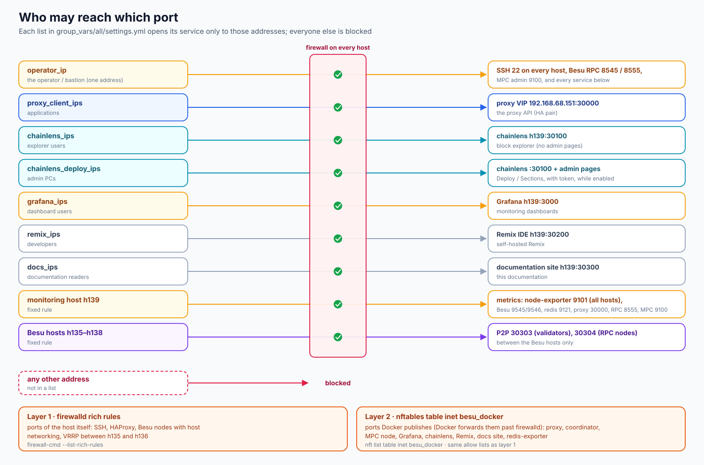

# 접근 제어

> **내용:** 각 서비스(프록시, chainlens, Grafana, Remix, 문서 사이트, 운영자)에 누가 접속할 수 있는지, 주소나 네트워크를 허용하는 방법, 그리고 확인하는 방법을 다룹니다.
>
> **대상:** 운영자.
>
> **관련 문서:** [Ansible](ansible.md) · [고가용성](high-availability.md) · [프로덕션 구성](../overview/production-layout.md)

**목차**

- [관리자 페이지와 프록시 관리 API](#admin-pages-and-the-proxy-admin-api)
- [고정 규칙 (설정 아님)](#fixed-rules-not-settings)
- [단일 주소와 네트워크](#single-addresses-and-networks)
- [변경 적용](#apply-a-change)
- [확인](#check)
- [client_ips / remix_users에서 업그레이드](#upgrading-from-client_ips--remix_users)

---



모든 호스트의 방화벽(`ha/firewall-layout.sh`, `01-hosts.yml`이 적용)은 각 서비스를
`group_vars/all/settings.yml`의 해당 목록에 있는 IP에만 엽니다. 그 외에는 모두 차단됩니다.

방화벽은 두 계층으로 동작합니다.

| 계층 | 대상 | 위치 |
|---|---|---|
| firewalld rich rule | 호스트 자체의 포트(SSH, HAProxy, 호스트 네트워킹을 사용하는 Besu 노드, VRRP) | 기본 존. `firewall-cmd --list-rich-rules` |
| nftables 테이블 `inet besu_docker` | Docker가 게시하는 포트(프록시, 코디네이터, MPC 노드, Grafana, chainlens, Remix, 문서 사이트, redis-exporter, 호스트 네트워킹을 사용하지 않는 Besu 노드). Docker는 이 포트를 firewalld를 거치지 않고 직접 포워딩합니다 | 규칙은 `/etc/besu-docker-firewall.rules`에 있으며, `/usr/local/sbin/besu-docker-firewall`이 적용하고, 부팅 시 `besu-docker-firewall.service`가 적용합니다 |

두 계층은 같은 허용 목록을 받습니다. nftables 테이블은 Docker와 firewalld의 자체 규칙과 분리되어
있으므로, Docker 재시작이나 firewalld 다시 로드로 틈이 생기지 않습니다(Docker의 `DOCKER-USER`
체인은 사용하지 않습니다). 이 테이블에서는 목록에 있는 출발지만 게시된 포트로 새 연결을 열 수 있으며,
그 외의 모든 새 연결은 버려집니다. 호스트별 포트: [프로덕션 구성](../overview/production-layout.md),
3절.

| 설정 | 서비스 | 포트 |
|---|---|---|
| `operator_ip` | 운영자 / 배스천: SSH, MPC 관리 API, Besu RPC, **그리고 아래의 모든 서비스** | 22, 8545, 8555, 9100, … |
| `proxy_client_ips` | 프록시 API를 호출하는 애플리케이션 | VIP `.151:30000` |
| `chainlens_ips` | 블록 익스플로러인 chainlens의 사용자 | 모니터링 호스트 `:30100` |
| `grafana_ips` | 모니터링 대시보드인 Grafana의 사용자 | 모니터링 호스트 `:3000` |
| `remix_ips` | Remix IDE를 사용하는 개발자 | 모니터링 호스트 `:30200` |
| `docs_ips` | 문서 웹사이트의 독자([문서 웹사이트](../components/docs-site.md)) | 모니터링 호스트 `:30300` |
| `gateway_client_ips` | 섹션 게이트웨이를 호출하는 애플리케이션([섹션 게이트웨이](../components/gateway.md)) | 게이트웨이 호스트 `:30010`, `gateway_enabled`일 때만 |
| `chainlens_deploy_ips` | chainlens 관리자 페이지(아래)를 사용하는 관리자 PC | 모니터링 호스트 `:30100`, `chainlens_deploy_enabled` 또는 `chainlens_sections_enabled`가 켜져 있을 때만 |

**섹션**([섹션](../features/sections.md))은 API 키로 식별됩니다. 섹션의 애플리케이션이 프록시에
접근하려면 그 주소가 `proxy_client_ips`에 있어야 합니다.

`operator_ip`는 필수이며 하나의 주소입니다. 방화벽은 SSH에 대해 이 주소만 허용하므로, 값이 틀리면
접속할 수 없게 됩니다. 목록은 비워 둘 수 있습니다(그러면 운영자만 해당 서비스에 접근합니다).

## 관리자 페이지와 프록시 관리 API {#admin-pages-and-the-proxy-admin-api}

방화벽 위에 두 개의 관리 계층이 있습니다. 두 계층 모두 토큰 **및** 호출자의 주소를 확인합니다.

| 대상 | 허용 대상 | 토큰 |
|---|---|---|
| chainlens Deploy 페이지(`#/deploy`, `chainlens_deploy_enabled`)와 Sections 페이지(`#/sections`, `chainlens_sections_enabled`) | `operator_ip`와 `chainlens_deploy_ips`(`chainlens_ips`는 아님) | `state/secrets/chainlens_deploy_token` |
| 해당 페이지가 호출하는 프록시 관리 API(`:30000`의 `/admin/*`) | `operator_ip`와 모니터링 호스트(chainlens) | `state/secrets/proxy_admin_token` |

`chainlens_ips`의 사용자는 익스플로러는 볼 수 있지만 관리자 페이지는 볼 수 없습니다. 관리자 페이지를
사용할 수 있는 사람은 컨트랙트를 배포하고 섹션 자금을 이동할 수 있으므로, `chainlens_deploy_ips`에는
관리자 머신만 넣으십시오. 자세한 내용: [컨트랙트 배포 (chainlens Deploy 페이지)](../features/contract-deployment.md),
[섹션](../features/sections.md), [프록시 API](../reference/proxy-api.md).

## 고정 규칙 (설정 아님) {#fixed-rules-not-settings}

다음 규칙은 접근 목록이 아니라 구성(`inventory.yml`)에 따라 정해집니다.

| 포트 | 허용 대상 | 적용 호스트 |
|---|---|---|
| 22 (SSH) | `operator_ip` | 모든 호스트 |
| 9101 (node-exporter) | 모니터링 호스트 | 모든 호스트 |
| 30303 tcp/udp (검증자 p2p), 30304 tcp/udp (RPC 노드 p2p) | Besu 호스트 | Besu 호스트 (30304는 HA 쌍) |
| 9545, 9546 (Besu 메트릭) | 모니터링 호스트 | Besu 호스트 (9546은 HA 쌍) |
| 8545 (RPC VIP의 HAProxy) | HA 쌍, 게이트웨이 호스트, `operator_ip` | HA 쌍 |
| 8555 (RPC 노드 직접) | HA 쌍, 모니터링 호스트, `operator_ip` | HA 쌍 |
| 9100 (코디네이터) | HA 쌍, MPC 호스트, 모니터링 호스트, `operator_ip` | HA 쌍 |
| 30000 (프록시) | `proxy_client_ips`, 게이트웨이 호스트, 모니터링 호스트, `operator_ip` | HA 쌍 |
| 30010 (섹션 게이트웨이) | `gateway_client_ips`, 모니터링 호스트, `operator_ip` | 게이트웨이 호스트 |
| 9121 (redis-exporter) | 모니터링 호스트 | HA 쌍 |
| VRRP | 다른 HA 호스트 | HA 쌍 |
| 7000 (MPC 노드) | HA 쌍 (코디네이터) | MPC 호스트 |

## 단일 주소와 네트워크 {#single-addresses-and-networks}

각 목록에는 단일 IPv4 주소와 CIDR 형식의 전체 네트워크를 섞어서 지정할 수 있습니다.

```yaml
proxy_client_ips: [192.168.68.21, 192.168.68.22]
chainlens_ips: [192.168.68.0/24]
grafana_ips: [192.168.68.0/24, 10.1.2.9]
remix_ips: [10.1.5.0/26]
```

`192.168.68.*` 같은 와일드카드는 허용되지 않습니다(사전 점검이 메시지와 함께 멈춥니다). 대신 네트워크를
작성하십시오.

| 와일드카드 (허용 안 됨) | 작성할 CIDR | 범위 |
|---|---|---|
| `192.168.68.*` | `192.168.68.0/24` | `192.168.68.0` – `192.168.68.255` |
| — | `192.168.68.0/25` | `192.168.68.0` – `192.168.68.127` |
| — | `192.168.68.128/26` | `192.168.68.128` – `192.168.68.191` |
| `192.168.*.*` | `192.168.0.0/16` | `192.168.0.0` – `192.168.255.255` |

**서버 자체 서브넷에 주의하십시오.** `192.168.68.0/24` 같은 네트워크는 사용자의 PC뿐 아니라 그 LAN의
*모든* 머신을 허용합니다. chainlens, Grafana, Remix, 문서 사이트에서는 보통 문제가 없습니다.
`proxy_client_ips`에서는 LAN의 어떤 머신이든 프록시 API를 호출할 수 있다는 뜻이므로(계정 생성, 전송),
여기에는 애플리케이션 호스트를 하나씩 나열하십시오.

## 변경 적용 {#apply-a-change}

`group_vars/all/settings.yml`을 편집한 다음 실행합니다.

```bash
ansible-playbook 01-hosts.yml
```

사전 점검(`00-preflight.yml`, `site.yml`의 첫 단계이기도 함)은 `proxy_client_ips`,
`chainlens_ips`, `grafana_ips`, `remix_ips`, `chainlens_deploy_ips`에 IPv4 주소나 네트워크가
들어 있는지 확인합니다(`docs_ips`는 아직 확인하지 않으므로 같은 방식으로 작성하십시오). 적용하기 전에
확인하려면 다음을 실행합니다.

```bash
ansible-playbook 00-preflight.yml
```

`operator_ip`와 `chainlens_deploy_ips`는 프록시와 chainlens 설정(위의 관리자 허용 목록)에도
기록되며, 관리자 페이지를 켜거나 끄면 chainlens가 변경됩니다. 이 값을 변경한 후에는 대신 전체 배포를
실행하십시오.

```bash
ansible-playbook site.yml
```

**주소나 네트워크 제거:** Docker가 게시하는 포트(프록시, chainlens, Grafana, Remix, 문서 사이트)의
규칙은 실행할 때마다 다시 쓰이므로, 해당 주소는 즉시 그 포트에 대한 접근을 잃습니다. firewalld 규칙은
추가만 되며 Ansible이 제거하지 않습니다. 더 이상 원하지 않는 규칙은 호스트에서 삭제하십시오.

```bash
firewall-cmd --permanent --list-rich-rules | grep <IP or network>
```

```bash
firewall-cmd --permanent --remove-rich-rule='<the rule exactly as listed>' && firewall-cmd --reload
```

## 확인 {#check}

호스트에서 Docker가 게시하는 포트에 대해 무엇이 허용되는지 확인합니다(규칙 파일, 그다음 nftables에
로드된 내용).

```bash
cat /etc/besu-docker-firewall.rules
```

```bash
nft list table inet besu_docker
```

```bash
systemctl status besu-docker-firewall
```

firewalld 규칙:

```bash
firewall-cmd --list-rich-rules
```

어떤 머신에서 접속이 되는지(`open`) 안 되는지(`blocked`) 확인합니다. 예: Grafana.

```bash
timeout 3 bash -c '</dev/tcp/192.168.68.139/3000' && echo open || echo blocked
```

## client_ips / remix_users에서 업그레이드 {#upgrading-from-client_ips--remix_users}

이전 버전에는 `client_ips`(프록시와 chainlens 공용)와 `remix_users`가 있었습니다. 이 값이 아직 설정되어
있으면 사전 점검이 멈춥니다(Grafana 사용자는 `grafana_ips`입니다). IP를 `proxy_client_ips` 및/또는
`chainlens_ips`로 옮기고, `remix_users`를 `remix_ips`로 이름을 바꾸고, 이전 줄을 삭제한 뒤
`01-hosts.yml`을 실행하십시오.

그 후 `git pull`이 `settings.yml`에서 충돌을 보고하면(사용자의 값과 새 버전이 모두 변경한 경우),
새 이름으로 사용자의 값을 유지하고, 충돌 표시가 남아 있지 않은지 확인한 뒤 병합을 완료하십시오.

```bash
grep -nE '^(<<<<<<<|=======|>>>>>>>)' group_vars/all/settings.yml
```

```bash
git add group_vars/all/settings.yml && git commit --no-edit && git pull
```
