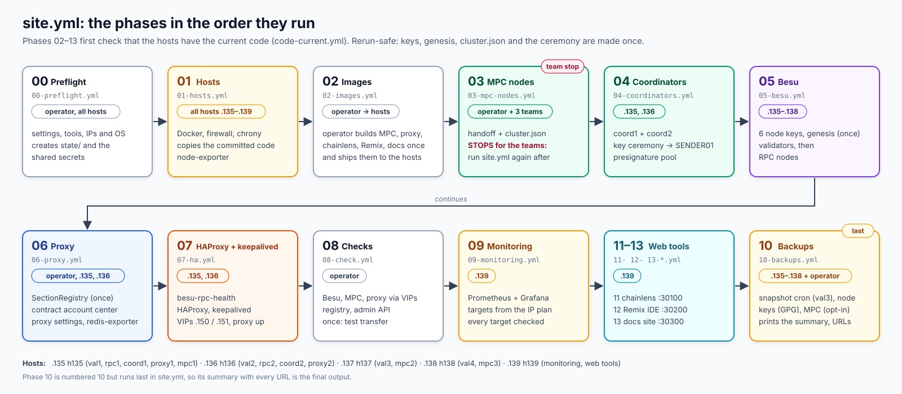

# Ansible 배포

> **내용:** Ansible 배포를 다룹니다. 설정, 단계, MPC 팀의 작업 단계, 운영자 상태, 재실행, 보안 참고 사항을 설명합니다.
>
> **대상:** 운영자.
>
> **관련 문서:** [운영자 가이드](operator-guide.md) · [접근 제어](access-control.md) · [문제 해결](../operations/troubleshooting.md)

**목차**

- [1. 요구 사항](#1-requirements)
- [2. 설정](#2-settings)
- [3. 실행](#3-run)
- [4. 운영자 상태 (`state/`, 커밋하지 않음)](#4-the-operators-state-state-never-committed)
- [5. 다시 실행하기](#5-running-it-again)
- [6. 보안 참고 사항](#6-security-notes)
- [7. 테스트 방법](#7-how-it-was-tested)

---

Ansible은 전체 프로덕션 구성([프로덕션 구성](../overview/production-layout.md))을 5개 호스트에
배포합니다. **MPC 노드를 제외한** 모든 것을 수행합니다. 각 MPC 노드 팀이 자기 노드를 초기화하고
시작하므로, 어떤 사람이나 도구도 두 개의 키 조각을 보유하지 않습니다. 플레이북은 팀의 작업이 필요할 때
멈추고, 팀이 해야 할 일을 정확히 알려 주며, 다시 실행하면 멈춘 지점부터 계속합니다.

아래의 모든 명령은 운영자 머신의 `ansible/`에서 실행합니다.

| 단계 | 플레이북 | 위치 | 내용 |
|---|---|---|---|
| 0 | `00-preflight.yml` | 운영자, 모든 호스트 | 설정(접근 목록, IP 계획), 도구, 각 호스트의 IP와 OS를 점검하고, `state/`와 공유 비밀 값을 생성하며, 커밋되지 않은 변경 사항을 경고합니다 |
| 1 | `01-hosts.yml` | 모든 호스트 | Docker, firewalld, nftables, chrony(`ntp_servers`), cron. **커밋된 코드**를 `/opt/besu-chain`에 복사하고 복사한 커밋을 기록합니다(`state/repo.commit`). 방화벽(`ha/firewall-layout.sh`), node-exporter |
| 2 | `02-images.yml` | 운영자 → 호스트 | MPC, 프록시, chainlens, Remix, 문서 사이트 이미지를 **한 번** 빌드하여 복사합니다(모든 호스트에 동일한 이미지). 서드파티 이미지를 실행할 위치에 배치합니다(Besu, .135/.136의 redis와 redis-exporter, .139의 Prometheus와 Grafana) |
| 3 | `03-mpc-nodes.yml` | 운영자 | **MPC 팀을 위해 멈춥니다**(두 번). 팀 지침, `cluster.json`, 노드 응답 확인 |
| 4 | `04-coordinators.yml` | .135, .136 | coord1 + coord2, 키 세레모니 → `SENDER01`, 사전 서명 풀 |
| 5 | `05-besu.yml` | .135–.138 | 6개 노드 키(각 호스트에서), `SENDER01`에 자금이 지급된 제네시스(1회), 검증자, 그다음 RPC 노드 |
| 6 | `06-proxy.yml` | 운영자, .135, .136 | SectionRegistry(1회, 또는 이전 버전의 업그레이드), 컨트랙트 계정 센터(1회), 프록시 설정(여기서 프록시를 시작하지 않으며, 실행 중인 프록시는 업데이트됩니다), 두 호스트의 redis-exporter |
| 7 | `07-ha.yml` | .135, .136 | RPC 상태 검사기(`besu-rpc-health`), HAProxy, keepalived: VIP는 .135에 있으며, 프록시 VIP를 보유한 호스트에서 프록시가 시작됩니다 |
| 8 | `08-check.yml` | 운영자 | VIP를 통한 Besu, MPC, 프록시 점검. 프록시 관리 API와 SectionRegistry, 이전 레지스트리의 마이그레이션(1회), 1회: 테스트 계정 + 전송 |
| 9 | `09-monitoring.yml` | .139 | Prometheus와 Grafana: 파일, IP 계획에서 생성된 대상, 설정, 규칙 변경 후 다시 로드. 모든 대상을 점검합니다 |
| 10 | `10-backups.yml` | .135–.138 | 일일 체인 스냅샷 cron(val3), 노드 키 백업(GPG), MPC 키 조각 백업(선택). URL과 수동으로 남는 작업을 출력합니다 |
| 11 | `11-chainlens.yml` | .139 | chainlens([Chainlens](../components/chainlens.md)). Deploy 페이지 기록을 운영자 저장소로 다시 복사합니다 |
| 12 | `12-remix.yml` | .139 | Remix IDE([Remix IDE (자체 호스팅)](../components/remix.md)). `remix_enabled: false`이면 중지합니다 |
| 13 | `13-docs-site.yml` | .139 | 문서 웹사이트([문서 웹사이트](../components/docs-site.md)). `docs_site_enabled: false`이면 중지합니다 |
| 14 | `14-gateway.yml` | `gateway_hosts` | 섹션 게이트웨이, 섹션마다 애플리케이션 옆에 하나([섹션 게이트웨이](../components/gateway.md)). `gateway_enabled: true`일 때만 |

`site.yml`은 이 단계들을 순서대로 실행하되, 14단계는 08단계 바로 다음에(모니터링 전에, Prometheus가
게이트웨이의 응답을 확인할 수 있도록), 10단계는 마지막에 실행합니다(모든 URL이 담긴 요약을
출력하기 때문입니다). 02~14단계는 먼저 호스트에 현재 코드가 있는지 확인합니다
(`code-current.yml`, [5. 다시 실행하기](#5-running-it-again) 참고).



**운영자를 위한 단계별 가이드(설치, SSH, 설정, 세 차례 실행):
[운영자 가이드](operator-guide.md).**

## 1. 요구 사항 {#1-requirements}

**운영자 머신**(배스천): Ansible(`ansible-core`, 2.22에서 테스트됨), Docker, git, curl,
5개 호스트에 대한 SSH 키 로그인, 이 저장소의 클론이 필요합니다. 호스트에는 **커밋된 HEAD**가 전달됩니다
(커밋되지 않은 변경 사항은 배포되지 않으며, 사전 점검에서 경고합니다). `remix_enabled: true`
(기본값)이면 운영자 머신은 `remix_commit`마다 한 번 github.com에서 Remix 사이트를 가져옵니다.

**호스트:** RHEL 계열(dnf) 또는 Debian/Ubuntu(apt)이며, 구성에 맞는 IP(192.168.68.135–.139),
sudo 권한이 있는 계정(`inventory.yml`의 `ansible_user`, 기본값 `root`), Python 3이 필요합니다.
패키지 저장소가 필요하며, Besu, node-exporter, Prometheus, Grafana, redis, redis-exporter 이미지를
아카이브로 제공하지 않는 한(`image_archives_dir`, 아래 참고) Docker Hub도 필요합니다.

## 2. 설정 {#2-settings}

`group_vars/all/settings.yml`을 편집합니다. 모든 설정에는 주석이 달려 있습니다. 구성 자체(어느
노드가 어디에서 실행되는지, 포트, 상태 파일 이름)는 `group_vars/all/layout.yml`에 있으며 저장소의
나머지 부분과 일치해야 합니다. 그 파일만 따로 변경하지 마십시오.

### IP 계획 {#the-ip-plan}

모든 주소는 두 곳에서 가져옵니다.

| 위치 | 내용 |
|---|---|
| `inventory.yml` | 각 호스트의 IP(`ansible_host`). 호스트 이름(`h135` …)은 레이블일 뿐입니다 |
| `group_vars/all/settings.yml` | `vip_rpc`(HAProxy: Besu RPC `:8545`, MPC 서명기 `:9100`), `vip_proxy`(프록시 `:30000`), `vip_prefix`(마스크 길이) |

Ansible은 주소가 들어가는 모든 파일을 이 값으로 생성합니다. HAProxy(`haproxy.cfg`),
keepalived(`keepalived.conf`와 세 개의 스크립트), RPC 상태 검사기 설정
(`/etc/besu-rpc-health.env`), 모든 호스트의 방화벽 규칙, Prometheus 대상
(`/opt/monitoring/prometheus/targets.generated/`), Besu, 코디네이터, 프록시, chainlens의
`.env` 파일, MPC 팀 지침(`MPC_BIND_IP`)이 해당됩니다. `ha/`와
`monitoring/prometheus/targets/`의 고정 파일은 문서에 나온 주소로 수동 설정할 때만 사용합니다.

새 계획에 대한 규칙:

- 두 HA 호스트(`app_hosts`)와 두 VIP는 **같은 서브넷**에 있어야 합니다(keepalived는 ARP로 VIP를
  이동합니다). VIP는 **사용하지 않는** 주소여야 하며, `vip_prefix`는 서브넷의 마스크 길이입니다.
- 모든 호스트는 [프로덕션 구성](../overview/production-layout.md) 3절의 포트로 서로 접근할 수
  있어야 합니다.
- `operator_ip`와 접근 목록(아래)은 새 네트워크에 맞아야 합니다.

사전 점검은 각 호스트가 실제로 인벤토리 IP를 가지고 있는지, 모든 주소가 서로 다른지, 어떤 호스트도
VIP를 사용하지 않는지 확인합니다. 계획은 첫 배포 **전에** 변경하십시오. 그 시점에 Besu 노드
주소(enode)와 MPC 노드 URL이 제네시스 파일과 `cluster.json`에 기록됩니다. 배포된 노드를 새 IP로
옮기려면 [재해 복구](../operations/disaster-recovery.md) 6.1 "New IP"를 따르십시오.

### 접속 허용 대상 (필수) {#who-may-connect-required}

| 설정 | 값 |
|---|---|
| `operator_ip` | 호스트에서 보이는 운영자 머신의 IP입니다. **방화벽은 이 IP만 허용합니다**(SSH, MPC 관리, Besu RPC, 그리고 아래의 모든 서비스). 값이 틀리면 접속할 수 없게 됩니다 |
| `proxy_client_ips` | 프록시 API(`.151:30000`)를 호출하는 애플리케이션 |
| `chainlens_ips` | 익스플로러인 chainlens(`.139:30100`)의 사용자 |
| `grafana_ips` | 대시보드인 Grafana(`.139:3000`)의 사용자 |
| `remix_ips` | Remix IDE(`.139:30200`)를 사용하는 개발자 |
| `docs_ips` | 문서 웹사이트(`.139:30300`)의 독자 |
| `gateway_client_ips` | 섹션 게이트웨이를 호출하는 애플리케이션(게이트웨이 호스트의 `:30010`, `gateway_enabled`일 때만) |
| `chainlens_deploy_ips` | `operator_ip` 외에 chainlens 관리자 페이지(Deploy, Sections)를 사용할 수 있는 관리자 PC입니다. 해당 페이지 중 하나가 켜져 있으면 방화벽은 이들에게도 chainlens를 엽니다 |

목록에는 주소와 네트워크를 지정합니다(`192.168.68.*`가 아니라 `192.168.68.0/24`). 접근 추가, 제거,
확인: **[접근 제어](access-control.md)**.

### 시간 {#time}

`ntp_servers`(목록, 비어 있으면 배포판의 공용 서버). 1단계는 이 값을 chrony 설정에서 포함하는
별도의 chrony 파일(`/etc/chrony/ntp-servers.conf`, RHEL은 `/etc/chrony-ntp-servers.conf`)에 기록하고,
기본 `pool`/`server` 줄을 주석 처리하며, 설정을 점검(`chronyd -p`)한 뒤 chrony를 재시작합니다.
목록이 비어 있으면 기본값을 복원합니다. 인터넷에 접근할 수 없는 호스트는 여기에 내부 서버가 필요합니다.
QBFT는 타임스탬프가 잘못된 블록을 거부합니다. `HostClockNotSynced` 알림(동기화되지 않았거나 100 ms
이상 어긋난 상태가 10분 지속)과 Hosts 대시보드의 Clock 열이 모든 호스트를 감시합니다.

### 이미지 버전과 아카이브 {#image-versions-and-archives}

모든 호스트에서 사용하는 정확한 태그:

| 설정 | 버전 | `image_archives_dir`의 아카이브 파일 |
|---|---|---|
| `besu_image` | `hyperledger/besu:26.11.1` | `besu-26.11.1-docker.tar` |
| `node_exporter_image` | `prom/node-exporter:v1.12.1` | `node-exporter-v1.12.1-docker.tar` |
| `prometheus_image` | `prom/prometheus:v3.16.0` | `prometheus-3.16.0-docker.tar` |
| `grafana_image` | `grafana/grafana:13.2` | `grafana-13.2-docker.tar` |
| `redis_image` | `redis:8.10.3` | `redis-8.10.3-docker.tar` |
| `redis_exporter_image` | `oliver006/redis_exporter:v1.67.0` | `redis-exporter-v1.67.0-docker.tar` |

아카이브 파일 이름은 같은 파일의 `image_archives`에 있습니다. `image_archives_dir`을 이러한
`docker save` 아카이브가 있는 운영자 머신의 디렉터리로 설정하십시오. Ansible은 각 아카이브를 그것을
실행하는 호스트에만 복사하여 그곳에서 로드하고(Docker Hub 접근 불필요, 속도 제한 없음), 아카이브에
정확히 그 이름과 태그가 들어 있는지 확인합니다. 비어 있으면 호스트가 이미지를 pull합니다.

배포의 **모든** 이미지(위의 6개와 `02-images.yml`이 빌드하는 MPC 서명기, 프록시, chainlens, Remix
이미지를 `mpc-signer-<tag>-docker.tar`, `proxy-docker.tar`, `chainlens-docker.tar`,
`remix-docker.tar`로)를 그 디렉터리에 저장하려면 운영자 머신에서 다음을 실행합니다.

```bash
ansible-playbook save-images.yml
```

또는 다른 디렉터리를 지정합니다.

```bash
ansible-playbook save-images.yml -e image_archives_dir=/opt/000
```

없는 서드파티 이미지는 pull하고, 이미 올바른 이미지가 든 아카이브는 유지하며, 없거나 다른 아카이브는
다시 씁니다. 빌드된 이미지는 `state/images/`에서 복사되므로 먼저 `site.yml`(또는 `02-images.yml`)을
실행하십시오. 다시 빌드된 프록시, chainlens, Remix는 해당 아카이브를 교체합니다.
`mpc_image_build: false`이면 MPC 이미지를 레지스트리에서 pull하여 저장합니다.
`remix_enabled: false`이면 Remix 아카이브가 없습니다.

버전을 변경하려면 새 태그(그리고 `image_archives`의 아카이브 파일 이름)를 설정하고 `site.yml`을
다시 실행하십시오. Besu 노드는 한 번에 하나씩 다시 생성되며, 각 노드가 다시 동기화된 후 다음 노드로
넘어갑니다.

**인터넷 없이 빌드하기.** `save-images.yml`은 빌드의 **베이스 이미지**(Dockerfile의 `FROM` 줄: node,
python, nginx, rust, debian)도 `base-<image>.tar`로 저장하며(베이스 이미지만 저장하려면
`--tags base-images`), `02-images.yml`은 없는 베이스 이미지를 그곳에서 로드합니다.
`offline_build: true`이면 모든 빌드가 네트워크 없이, 저장소에 커밋된 패키지 아카이브와 Remix의
아카이브를 사용하여 실행됩니다: [오프라인 빌드](offline-build.md).

### 사전 서명 풀 {#presignature-pools}

`mpc_pool_target`(`SENDER01` 같은 큰 키), `mpc_pool_target_small`(작은 키),
`mpc_new_account_pool`(클래스를 지정하지 않은 `/createaccount` 계정의 클래스: `big`, `small`,
`none`). [운영 환경의 MPC 서명기](mpc-signer-production.md)의 "Presignature pools"를 참고하십시오.
MPC 이미지 버전이 변경되면 MPC 노드 팀은 `site.yml`을 다시 실행하기 **전에** 노드를 업그레이드해야
합니다: [MPC 서명기 업그레이드](../operations/mpc-signer-upgrade.md).

### 섹션과 chainlens 관리자 페이지 {#sections-and-the-chainlens-admin-pages}

섹션([섹션](../features/sections.md))은 각 애플리케이션 그룹에 고유한 API 키와 계정을 제공하며,
`06-proxy.yml`이 배포하는 SectionRegistry에 체인상으로 등록됩니다.

| 설정 | 기본값 | 내용 |
|---|---|---|
| `sections_required` | `false` | `false`: `X-Section-Key` 없이 `/createaccount`와 `/transfer`를 호출해도 계속 `SENDER01`을 사용합니다(아직 이전하지 않은 애플리케이션). `true`: 이러한 호출을 거부합니다. 모든 애플리케이션이 키를 보내게 되면 설정하십시오. `true`이면 8단계의 스모크 테스트를 건너뜁니다(키 없이 호출하기 때문입니다) |
| `upfront_low_balance_eth` | `100` | `SectionUpfrontLow` 알림: 활성화된 섹션의 선지급 계정이 이 ETH 값보다 낮을 때(0 = 끔) |
| `sender01_low_balance_eth` | `10000` | `Sender01Low` 알림: `SENDER01`(모든 충전 자금을 지급)이 이 ETH 값보다 낮을 때(0 = 끔) |
| `chainlens_deploy_enabled` | `false` | chainlens의 Deploy 페이지(`#/deploy`): 브라우저에서 프록시를 통해 컨트랙트를 배포하며, 컨트랙트 계정 센터가 서명합니다: [컨트랙트 배포](../features/contract-deployment.md) |
| `chainlens_sections_enabled` | `false` | chainlens의 Sections 페이지(`#/sections`): 섹션 생성, 충전, 스윕, 반환, API 키, 계정, 보관, 이력 |
| `chainlens_deploy_ips` | `[]` | `operator_ip`(위) 외에 이 두 페이지를 사용할 수 있는 대상 |

두 페이지 모두 `state/secrets/chainlens_deploy_token`의 토큰과 `operator_ip` 또는
`chainlens_deploy_ips`에 있는 출발지 주소가 필요합니다. chainlens는 프록시 관리 토큰
(`state/secrets/proxy_admin_token`)과 함께 요청을 프록시 관리 API로 전달합니다. 자세한 내용:
[Chainlens](../components/chainlens.md), [프록시 API](../reference/proxy-api.md).

### Remix IDE와 문서 사이트 {#remix-ide-and-the-documentation-site}

| 설정 | 기본값 | 내용 |
|---|---|---|
| `remix_enabled` | `true` | 모니터링 호스트의 자체 호스팅 Remix IDE(`.139:30200`). `false`이면 중지합니다 |
| `remix_repo`, `remix_commit` | remix-live, Remix 2.6.15 | 운영자 머신이 가져오는 사전 빌드된 Remix 사이트(커밋당 한 번) |
| `remix_solc_versions` | `["0.8.28"]` | 로컬에서 제공하는 컴파일러(Remix의 기본 버전은 항상 추가됩니다) |

열 수 있는 대상: `remix_ips`. 자세한 내용: [Remix IDE (자체 호스팅)](../components/remix.md).

`docs_site_enabled`(기본값 `true`): 모니터링 호스트(`.139:30300`)에서 이 문서를 웹사이트로
제공합니다. `02-images.yml`이 `docs/`로부터 이미지를 빌드하고 `13-docs-site.yml`이 시작합니다.
`false`이면 중지합니다. 열 수 있는 대상: `docs_ips`. 자세한 내용:
[문서 웹사이트](../components/docs-site.md).

### 섹션 게이트웨이 {#section-gateways}

| 설정 | 기본값 | 내용 |
|---|---|---|
| `gateway_enabled` | `false` | 섹션마다 애플리케이션 옆에 낙관적 게이트웨이 하나, `gateway_hosts`의 호스트에서(`inventory.yml`, 각 호스트에 `gateway_section: <id>`) |
| `gateway_port` | `30010` | 게이트웨이의 포트 |
| `gateway_defaults` | 해당 페이지 참고 | 상태 점검과 제한 시간, `offline_operations`, 예비 계정, `answer_gateway_field`, 선택적 정정 웹훅, 스냅숏 |
| `gateway_sections` | `{}` | 섹션 id별로 다른 값 |

섹션 키: `state/secrets/gateway-section-<id>.key`, 또는 새 키는 `-e gateway_new_key=true`.
chainlens는 `state/secrets/gateway_report_token`(처음 사용할 때 생성)으로 정정을 읽습니다. 게이트웨이 호스트는
서버 중 하나이거나 `gateway_hosts`에만 있는 **게이트웨이 전용 호스트**일 수 있습니다(단계 00, 01, 02, 14가
준비하며 방화벽은 `ROLE=gateway`).
호출할 수 있는 대상: `gateway_client_ips`. 자세한 내용: [섹션 게이트웨이](../components/gateway.md).

### HAProxy 호스트의 RPC 상태 검사 {#rpc-health-on-the-haproxy-hosts}

`besu-rpc-health`(`ha/rpc-health.py`, `07-ha.yml`이 설치)는 어느 RPC 노드가 최신 상태인지
HAProxy에 알려 줍니다. [고가용성](high-availability.md)의 "RPC health"를 참고하십시오.

| 설정 | 기본값 | 내용 |
|---|---|---|
| `rpc_max_block_age` | `30` | 다른 노드에 더 새로운 블록이 있는데 RPC 노드의 최신 블록이 이 초보다 오래되면 해당 노드가 VIP에서 제외됩니다 |
| `rpc_max_blocks_behind` | `10` | … 또는 이 블록 수보다 더 뒤처졌을 때 |
| `rpc_auto_restart_minutes` | `5` | 체인이 진행되는 동안 이 시간만큼 정지 상태로 남은 노드를 재시작합니다(`docker restart`. RPC 노드는 키를 보유하지 않습니다). 0 = 재시작하지 않음 |

### 모니터링 {#monitoring}

| 설정 | 기본값 | 내용 |
|---|---|---|
| `prometheus_retention` | `400d` | Prometheus의 메트릭 보존 기간(Sections 대시보드의 "Year" 기간에는 365일 이상이 필요합니다) |
| `prometheus_retention_size` | `20GB` | 디스크 상한: 이를 넘으면 가장 오래된 데이터부터 삭제됩니다(`0B` = 상한 없음) |

Prometheus는 Proxy & Redis 대시보드를 위해 프록시 VIP를 통해 redis-exporter(포트 9121)도
수집합니다. 대시보드와 알림: [모니터링](../components/monitoring.md),
[알림](../operations/alerts.md).

### 백업 {#backups}

`snapshot_dir`, `snapshot_copy_to`(일일 체인 스냅샷의 오프사이트 대상,
`user@host:/path`, .137의 root SSH 키 사용), `snapshot_cron_hour`, `snapshot_cron_minute`,
`snapshot_first_run`, `key_backup_gpg_public_key`, `mpc_backup_cron`, `mpc_backup_dir`,
`mpc_node_dir`: [3. 실행](#3-run)의 백업 표를 참고하십시오.

### 기타 설정 {#the-rest}

다음을 검토하십시오: 체인 ID, 블록 주기, 라운드 타임아웃, 가스 한도(제네시스를 생성할 때만 사용),
`SENDER01` 자금 지급, MPC 서명 정책(`mpc_max_value_wei`, `mpc_max_gas`,
`mpc_allowed_to`), `mpc_image`, `mpc_image_build`(운영자 머신에서 빌드하거나 레지스트리에서 pull),
`mpc_bigint`, `besu_java_opts`, `install_packages`, `vrrp_interface`(비어 있으면 호스트의 IP를
가진 인터페이스), `smoke_test`, `repo_dir`. `build_compose_overrides`는 프록시, chainlens,
Remix 빌드에 compose 파일을 추가합니다. 예를 들어 빌드용 프록시나 사내 CA에 사용합니다.

## 3. 실행 {#3-run}

```bash
ansible-playbook site.yml
```

**첫 번째 멈춤**(3단계): "waiting for the MPC teams".

1. 각 팀에 지침 `state/handoff/mpc1.md`, `mpc2.md`, `mpc3.md`와
   `MPC_NODE_TOKEN`(`state/secrets/mpc_node_token`)을 보안 채널로 전달합니다.
2. 각 팀은 자기 호스트에서 `init.sh`를 실행하고(MPC 이미지는 이미 로드되어 있습니다), 패스프레이즈를
   자체 보안 저장소에 보관한 뒤, `node<ID>.json`(공개 키만 포함)을 회신합니다.
3. 세 파일을 `state/mpc/`에 넣고 `ansible-playbook site.yml`을 다시 실행합니다.

**두 번째 멈춤:** 플레이북이 `state/cluster.json`을 생성하고 그 sha256을 출력합니다. 이를 세 팀에
보냅니다. 각 팀은 두 번째 채널로 체크섬을 비교하고, 파일을 노드 폴더
(`mpc_node_dir`, 기본값 `/opt/besu-chain/mpc-signer/deploy/node`)에 복사한 뒤
`docker compose up -d`를 실행합니다. `ansible-playbook site.yml`을 다시 실행합니다.

세 번째 실행은 끝까지 진행됩니다(약 5~10분, 처음에는 MPC 이미지 빌드 시간 추가). 진행 중에
SectionRegistry를 배포하고 컨트랙트 계정 센터를 생성하며(6단계), 테스트 전송을 실행합니다(8단계).
마지막에 URL(애플리케이션, Grafana, chainlens, 켜져 있을 때 chainlens 관리자 페이지, Remix)과
수동 단계를 출력합니다.

- **`state/`를 보안 저장소로**(아래 참고), `state/key-backups/`를 포함합니다.
- **MPC 백업**: `mpc_backup_cron: true`가 아니면 각 팀이 매시간 실행되는 `backup.sh` cron을
  설정합니다(팀 지침의 5단계).
- **오프사이트 스냅샷:** `snapshot_copy_to`가 비어 있으면 경고합니다(스냅샷은 .137에만 남습니다).
- **장애 조치 테스트:** [프로덕션 구성](../overview/production-layout.md) 6절, 그다음 운영을 시작합니다.

10단계는 백업을 설정합니다(각 스크립트가 모니터링에 보고하므로 첫 실행 시 백업 알림이 해제됩니다).

| 백업 | Ansible이 하는 일 | 설정 |
|---|---|---|
| 체인 스냅샷 (val3, .137) | 일일 cron, 그리고 스냅샷이 없으면 지금 첫 스냅샷을 생성합니다. 스크립트가 거부하면(다른 노드가 중단된 상태에서 val3을 멈추면 체인이 정지할 수 있음) 실행은 경고하고 계속하며, cron이 재시도합니다 | `snapshot_first_run`, `snapshot_dir`, `snapshot_copy_to`, `snapshot_cron_hour`, `snapshot_cron_minute` |
| 노드 키 (val1–4, rpc1–2) | 키당 한 번: 데이터 볼륨에서 호스트의 비공개 디렉터리로 복사하고, 그곳에서 **사용자의 GPG 공개 키**로 암호화한 뒤, 평문 사본을 파쇄하고, 암호화된 파일을 `state/key-backups/<node>.key.gpg`로 가져옵니다. 오프라인 개인 키로만 읽을 수 있습니다 | `key_backup_gpg_public_key` (비어 있으면 건너뛰며 `ValidatorKeyBackupMissing` 알림이 유지됩니다) |
| MPC 키 조각 (3개 노드) | 선택 사항(노드는 각 팀의 소유): 팀의 노드가 `mpc_node_dir`에 있는 호스트에서 매시간 cron과 첫 백업을 수행합니다. 아카이브는 봉인되어 있으며(팀의 패스프레이즈 없이는 쓸모없음) 노드의 호스트에 남습니다. 각 팀이 호스트 밖으로 복사합니다 | `mpc_backup_cron` (기본값 `false`), `mpc_backup_dir` |

GPG 키 쌍(생성, Ansible에는 공개 키만 제공, 개인 키는 오프라인 보관, 복원 시 복호화):
**[노드 키 백업용 GPG 키](gpg-key.md)**.

전체 사이트를 잃은 후 이 백업으로 모든 것을 복원하기:
**[Ansible로 복원](../operations/restore.md)**.

## 4. 운영자 상태 (`state/`, 커밋하지 않음) {#4-the-operators-state-state-never-committed}

| 경로 | 내용 | |
|---|---|---|
| `secrets/` | `MPC_NODE_TOKEN`, `MPC_ADMIN_TOKEN`, `MPC_METRICS_TOKEN`, 두 개의 VRRP 비밀번호, Grafana 관리자 비밀번호, 프록시 관리 토큰(`proxy_admin_token`), chainlens 관리자 페이지 토큰(`chainlens_deploy_token`) | **비밀** |
| `registry.json` | SectionRegistry의 주소와 관리자. 업그레이드 후에는 이전 주소와 그 섹션이 마이그레이션되었는지 여부(`previous`, `migrated`)도 포함합니다([섹션](../features/sections.md)) | 공개, 무결성 중요 |
| `registry-admin`, `registry-record/` | 레지스트리의 관리자 MPC 키, 배포 기록(주소, 블록) | 공개, 무결성 중요 |
| `contract-center` | 컨트랙트 계정 센터: 모든 컨트랙트를 배포하는 MPC 키(`CONTRACT_CENTER`) | 공개 |
| `mpc/node*.json`, `cluster.json` | MPC 노드의 공개 키, 클러스터 파일 | 공개, 무결성 중요 |
| `besu/*.json`, `network/` | Besu 노드의 공개 키, 제네시스와 네트워크 파일 | 공개, 무결성 중요 |
| `sender01` | 핫 MPC 키의 주소 | 공개 |
| `smoke-test.json` | 1회 테스트 전송의 결과(이 파일이 있으면 두 번째 전송을 하지 않습니다) | 공개 |
| `handoff/` | 팀 지침 | 공개 |
| `key-backups/*.key.gpg` | GPG 공개 키로 암호화된 Besu 노드 키 | 오프라인 개인 키로만 읽을 수 있음 |
| `repo.commit` | 1단계가 마지막으로 호스트에 복사한 커밋(02~13단계에서 확인) | |
| `images/`, `build/`, `repo.tar.gz` | 빌드 산출물 | 삭제 가능 |

`state/`의 권한은 700입니다. 변경할 때마다 보안 저장소에 사본을 보관하십시오. 사본이 없으면 재실행으로
배포를 업데이트할 수 없습니다(두 번째 제네시스나 두 번째 키 세레모니 생성을 거부하며, 두 번째
SectionRegistry와 컨트랙트 계정 센터를 배포하게 됩니다).

## 5. 다시 실행하기 {#5-running-it-again}

플레이북은 안전하게 다시 실행할 수 있으며, 변경되지 않은 배포를 다시 실행하면 아무것도 바뀌지 않습니다.
**한 번만 생성되고 다시는 생성되지 않는** 항목: 노드 키, 제네시스와 네트워크 파일, `cluster.json`,
키 세레모니(`SENDER01`), 토큰, Grafana 비밀번호, SectionRegistry의 관리자 키,
컨트랙트 계정 센터, 스모크 테스트.

**`git pull`이나 새 커밋 후에는 먼저 `01-hosts.yml`을 실행하십시오**(또는 전체 `site.yml`).
1단계는 커밋된 코드를 호스트에 복사하며, 2단계의 이미지 빌드는 그 사본을 사용합니다.
02~14단계는 배포된 디렉터리(`layout.yml`의 `deployed_dirs`: `besu-production`, `ha`, `monitoring`,
`mpc-signer/deploy`, `proxy`, `chainlens`, `contracts`, `remix`, `docs-site`, `docs`, `gateway`)를 변경한 마지막
커밋을 `state/repo.commit`과 비교하고, 그 이후 1단계가 실행되지 않았다면 "The hosts have older code"
메시지와 함께 멈춥니다. `settings.yml`, `inventory.yml` 또는 플레이북 변경에는 1단계가 필요하지 않습니다.

```bash
ansible-playbook 01-hosts.yml
```

**변경 후 실행할 플레이북.** `site.yml`은 항상 동작합니다. 아래는 가장 짧은 실행입니다.
변경 사항이 커밋된 코드라면 앞에 `01-hosts.yml`을 붙이십시오(위 참고).

| 변경한 내용 | 실행 |
|---|---|
| `proxy/` 코드 | `01-hosts.yml 02-images.yml 06-proxy.yml` |
| `chainlens/` 코드, 또는 chainlens 설정(`chainlens_*`) | `01-hosts.yml 02-images.yml 11-chainlens.yml` |
| Remix(`remix_commit`, `remix_solc_versions`, `remix_enabled`) | `02-images.yml 12-remix.yml` |
| 문서(`docs/`, `docs-site/`), `docs_site_enabled` | `01-hosts.yml 02-images.yml 13-docs-site.yml` |
| `gateway/` 코드 | `01-hosts.yml 02-images.yml 14-gateway.yml` |
| 게이트웨이 설정(`gateway_defaults`, `gateway_sections`) | `14-gateway.yml`(원장과 큐는 유지) |
| 게이트웨이 호스트 추가(`gateway_hosts`), `gateway_enabled`, `gateway_port` | `01-hosts.yml 02-images.yml 14-gateway.yml 09-monitoring.yml 11-chainlens.yml` |
| `monitoring/`(대시보드, 알림 규칙), Prometheus 설정, IP 계획의 대상 | `01-hosts.yml 09-monitoring.yml` |
| 접근 목록(`*_ips`, `operator_ip`) | `01-hosts.yml`(방화벽). `chainlens_deploy_ips`는 `11-chainlens.yml`도, `operator_ip`는 `06-proxy.yml`과 `11-chainlens.yml`도 실행합니다(각 관리자 허용 목록) |
| `ha/`, RPC 상태 설정(`rpc_*`) | `01-hosts.yml 07-ha.yml` |
| Besu 설정 또는 `besu-production/` | `01-hosts.yml 05-besu.yml`(한 번에 노드 하나씩) |
| 백업 설정 | `10-backups.yml` |
| `besu_nodes` / `besu_hosts`에 Besu 노드를 추가하거나 제거한 경우, MPC 노드를 옮긴 경우 | [노드 추가 및 제거](../operations/adding-nodes.md) 참고: `01`, `02`, `05`, `qbft-vote.yml`, `09`, `10` |

무언가를 변경하려면 설정을 편집하고(또는 코드 변경을 커밋하고) `site.yml`을 다시 실행하십시오.

- `.env` 변경은 영향을 받는 컨테이너만 다시 생성합니다. Besu 노드와 코디네이터는 한 번에 호스트
  하나씩 업데이트됩니다.
- HAProxy와 keepalived는 재시작하지 않고 **다시 로드**하므로 VIP는 그대로 유지됩니다. RPC 상태
  검사기는 스크립트나 설정이 변경된 경우에만 재시작합니다.
- 새 프록시 / chainlens / Remix / 문서 사이트 코드: 운영자 머신에서 다시 빌드하고, 이미지 내용이
  변경된 경우에만 복사합니다. 실행 중인 프록시는 다시 생성됩니다(몇 초).
- **`mpc-signer` 코드 변경 후의 MPC 이미지:** `02-images.yml`은 이미지에 빌드 재료(`Dockerfile`,
  `Cargo.toml`, `Cargo.lock`, `src/`, 벤더링된 크레이트, `mpc_bigint`)의 해시를 레이블로 붙이고, 그 해시가
  바뀌면 같은 `mpc_image` 태그라도 다시 빌드합니다. 코드가 그대로면 다시 빌드하지 않습니다. 이미지를
  내용(레이어와 설정)으로 비교하여 다시 저장하고, 사본이 다른 모든 코디네이터와 MPC 노드 호스트에
  로드합니다. 두 번째 실행에서는 아무것도 로드하지 않습니다. 그다음 `04-coordinators.yml`이 코디네이터를 새
  이미지로 다시 만들고, MPC 노드 팀은 각자 노드를 다시 시작합니다(노드 폴더에서 `docker compose up -d`, 한
  번에 한 팀씩; [MPC 업그레이드](../operations/mpc-signer-upgrade.md)).
- 새 이미지 버전: Besu 노드는 한 번에 하나씩 교체되며(검증자, 그다음 RPC 노드), 각 노드가 동기화된 후
  다음 노드로 넘어갑니다. 실험 환경에서는 업그레이드 중에도 체인이 계속 블록을 생성했습니다(가장 긴
  중단은 약 16초로, 재시작 중인 검증자가 블록을 제안할 차례였을 때 발생했습니다).
- **SectionRegistry 업그레이드:** 6단계는 배포된 레지스트리의 버전을 체인에서 읽습니다. 코드의
  버전(2)보다 오래되었으면 같은 관리자 키로 새 레지스트리를 배포하고 이전 주소를 `state/registry.json`에
  `previous`로 보관합니다. 그다음 8단계가 프록시 관리 API를 통해 이전 레지스트리의 섹션과 사용자
  계정을 한 번 마이그레이션하고 `migrated: true`를 기록합니다.
- **컨트랙트 기록:** 11단계(`11-chainlens.yml`)는 chainlens Deploy 페이지가 작성한 기록을 운영자
  저장소의 `contracts/deployments/`로 다시 복사하고, 아직 커밋되지 않았으면 `git` 명령을 출력합니다.
  모든 저장소 사본에 기록이 있도록 커밋하십시오(그리고 1단계를 실행하십시오).
- 노드에 네트워크 파일이 있는데 `state/network`를 잃어버린 경우 5단계가 멈춥니다. 노드에서
  `network/`를 `state/network/`로 복사하십시오.
- **나중에 `besu_nodes`에 추가한 노드:** 5단계가 해당 노드의 enode를 네트워크 파일에 추가하고
  (`add-node.sh`), 파일을 모든 노드에 복사한 다음 노드를 하나씩 재시작합니다. 새 검증자는 그다음
  `qbft-vote.yml`로 투표하여 추가합니다([노드 추가 및 제거](../operations/adding-nodes.md)).

제한 사항:

- 방화벽 규칙은 firewalld에 **추가**만 됩니다. 접근 목록에서 제거한 IP는 해당 규칙을 제거할 때까지
  호스트 자체 포트에 계속 허용됩니다(`firewall-cmd --permanent
  --remove-rich-rule=…`, `firewall-cmd --reload`). Docker가 게시하는 포트(프록시, 코디네이터,
  MPC 노드, Grafana, chainlens, Remix, 문서 사이트, redis-exporter. nftables 테이블
  `inet besu_docker`)의 허용 목록은 실행할 때마다 완전히 다시 쓰이므로, 여기서는 IP가 즉시 제거됩니다.
  [접근 제어](access-control.md)를 참고하십시오.
- 첫 실행 이후 체인 설정을 변경해도 효과가 없습니다(제네시스는 다시 생성되지 않습니다).

## 6. 보안 참고 사항 {#6-security-notes}

- MPC 노드는 Ansible이 시작, 중지, 설정하지 않으며, 팀의 패스프레이즈는 운영자 머신에 전달되지
  않습니다. 어떤 작업도 팀의 `.env`, `cluster.json`, `node<ID>.json`을 읽거나 쓰지 않습니다. 알아 둘
  두 가지 예외가 있습니다. 노드 폴더(`mpc_node_dir`)는 1단계가 갱신하는 저장소 사본 안에 있으므로,
  저장소의 새 `docker-compose.yml`이나 스크립트가 Ansible 실행과 함께 그곳에 도착합니다(팀의 다음
  `docker compose up -d` 때 적용됩니다). 그리고 `mpc_backup_cron: true`이면 10단계가 그곳에서
  `backup.sh`를 실행합니다. 하지만 이 구성에서 MPC 노드는 운영자가 관리하는 구성 요소와 호스트를
  공유하며(.135에서 mpc1과 val1, mpc2와 val3, mpc3와 val4), 호스트의 root는 그 호스트의 모든 것을
  읽을 수 있습니다. 실질적으로 분리하려면 운영자 계정이 .135/.137/.138에서 Docker에 필요한 권한
  이상의 root 권한을 갖지 않거나, 각 MPC 팀이 자체 호스트를 가져야 합니다.
- `state/secrets`와 호스트의 `.env` 파일에는 토큰이 들어 있습니다. 권한 600, root 전용입니다.
- 프록시 관리 API(`/admin/*`)에는 프록시 관리 토큰 **및** 허용 목록에 있는 출발지 주소가 필요합니다.
  허용 목록은 `operator_ip`와 모니터링 호스트(chainlens)입니다. chainlens 관리자 페이지에는 chainlens
  토큰과 `operator_ip` 또는 `chainlens_deploy_ips`가 필요합니다. 이를 사용할 수 있는 사람은
  컨트랙트를 배포하고 섹션 자금을 이동할 수 있으므로, 관리자 머신만 등록하십시오.
- 레지스트리 관리자와 컨트랙트 계정 센터는 MPC 키입니다. 다른 키와 마찬가지로 이 키로 서명하려면
  3개 MPC 노드 중 2개가 필요합니다.
- Grafana 비밀번호는 `state/secrets/grafana_admin_password`에 있습니다(출력되지 않음).

## 7. 테스트 방법 {#7-how-it-was-tested}

5개의 실험용 호스트(192.168.68.0/24의 systemd, sshd, Docker가 포함된 Ubuntu 24.04 컨테이너)에서
운영자 머신으로 구동하여 종단 간 테스트했습니다.

- 위의 세 차례 실행. MPC 팀의 단계는 생성된 지침에 따라 수동으로 수행했습니다.
- 변경 없는 네 번째 실행: 모든 호스트에서 `changed=0`.
- .135 전원 차단: 몇 초 안에 VIP가 .136으로 이동, proxy2 시작, coord2가 mpc2 + mpc3로 서명한
  전송을 rpc2를 통해 전송.
- .135, 그다음 .136 재부팅: RPC 노드가 스스로 다시 동기화, 두 프록시가 동시에 실행되는 일 없음,
  올바른 논스로 전송 계속.
- `state/network` 제거: 5단계가 새 제네시스 생성을 거부.
- 5개 호스트 전체를 동시에 전원 차단 후 다시 켬: 별도 조치 불필요, 약 3분간의 QBFT 라운드 변경 후
  블록이 초당 1개로 재개, VIP가 하나의 프록시와 함께 .135로 복귀.
- `docker save` 아카이브의 새 이미지 버전으로 실행 중인 배포를 업그레이드:
  이후에도 전송이 동작하고 다음 실행은 `changed=0`.
- 다른 서브넷(호스트 10.77.0.11–.15, VIP 10.77.0.50/.51)에서 `inventory.yml`과 VIP 설정만 변경하여
  처음부터 두 번째 배포: 생성된 모든 파일에 새 주소가 반영됨, 모든 Prometheus 대상 정상,
  프록시 장애 조치, 재실행 `changed=0`.

실험 환경에서 검증하지 않은 항목: `dnf`(RHEL 계열) 패키지 경로, SELinux, 시간 동기화
(실험 환경에는 NTP 접근이 없습니다).
