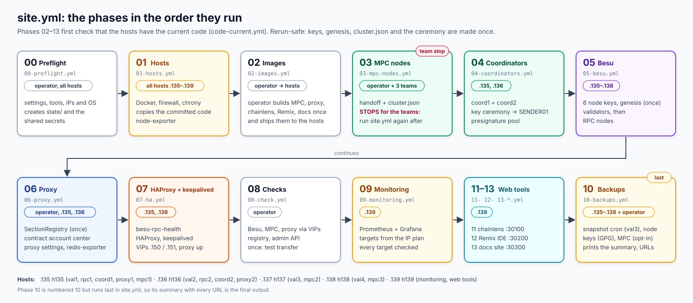

# Ansible deployment

> **What:** The Ansible deployment: settings, phases, the steps of the MPC teams, the operator state, reruns and security notes.
>
> **For:** operators.
>
> **Related:** [operator guide](operator-guide.md) · [access control](access-control.md) · [troubleshooting](../operations/troubleshooting.md)

**Contents**

- [1. Requirements](#1-requirements)
- [2. Settings](#2-settings)
- [3. Run](#3-run)
- [4. The operator's state (`state/`, never committed)](#4-the-operators-state-state-never-committed)
- [5. Running it again](#5-running-it-again)
- [6. Security notes](#6-security-notes)
- [7. How it was tested](#7-how-it-was-tested)

---

Ansible deploys the whole production layout ([Production layout](../overview/production-layout.md))
on the 5 hosts. It does everything **except the MPC nodes**: each MPC node team initialises and starts
its own node, so no person or tool holds two key shares. The playbook stops when it needs the teams,
says exactly what they must do, and continues where it stopped when you run it again.

All commands below run in `ansible/` on the operator.

| Phase | Playbook | Where | What |
|---|---|---|---|
| 0 | `00-preflight.yml` | operator, all hosts | settings (access lists, IP plan), tools, each host's IP and OS; creates `state/` and the shared secrets; warns about uncommitted changes |
| 1 | `01-hosts.yml` | all hosts | Docker, firewalld, nftables, chrony (`ntp_servers`), cron; copies the **committed code** to `/opt/besu-chain` and records which commit it copied (`state/repo.commit`); firewall (`ha/firewall-layout.sh`); node-exporter |
| 2 | `02-images.yml` | operator → hosts | builds the MPC, proxy, chainlens, Remix and documentation site images **once** and copies them (identical image on every host); puts the third-party images where they run (Besu; redis and redis-exporter on .135/.136; Prometheus and Grafana on .139) |
| 3 | `03-mpc-nodes.yml` | operator | **stops for the MPC teams** (twice): team instructions, `cluster.json`, nodes answering |
| 4 | `04-coordinators.yml` | .135, .136 | coord1 + coord2, key ceremony → `SENDER01`, presignature pool |
| 5 | `05-besu.yml` | .135–.138 | 6 node keys (on their hosts), genesis (once) with `SENDER01` funded, validators, then RPC nodes |
| 6 | `06-proxy.yml` | operator, .135, .136 | the SectionRegistry (once, or an upgrade of an older version), the contract account center (once), proxy settings (the proxy is not started here; a running one is updated), redis-exporter on both hosts |
| 7 | `07-ha.yml` | .135, .136 | RPC health checker (`besu-rpc-health`), HAProxy, keepalived: VIPs on .135, the proxy started on the host holding the proxy VIP |
| 8 | `08-check.yml` | operator | Besu, MPC and proxy through the VIPs; the proxy admin API and the SectionRegistry; migration of an older registry (once); once: test account + transfer |
| 9 | `09-monitoring.yml` | .139 | Prometheus and Grafana: files, targets from the IP plan, settings, reload after a rule change; every target checked |
| 10 | `10-backups.yml` | .135–.138 | daily chain snapshot cron (val3), node key backups (GPG), MPC share backups (opt-in); prints the URLs and what stays manual |
| 11 | `11-chainlens.yml` | .139 | chainlens ([Chainlens](../components/chainlens.md)); copies Deploy page records back to the operator's repository |
| 12 | `12-remix.yml` | .139 | Remix IDE ([Remix IDE (self-hosted)](../components/remix.md)); `remix_enabled: false` stops it |
| 13 | `13-docs-site.yml` | .139 | documentation website ([Documentation website](../components/docs-site.md)); `docs_site_enabled: false` stops it |

`site.yml` runs them in order, except phase 10, which runs last (it prints the summary with every
URL). Phases 02–13 first check that the hosts have the current code
(`code-current.yml`, see [5. Running it again](#5-running-it-again)).



**Step-by-step guide for the operator (install, SSH, settings, the three runs):
[Operator guide](operator-guide.md).**

## 1. Requirements

**Operator machine** (the bastion): Ansible (`ansible-core`; tested with 2.22), Docker, git, curl,
SSH key login to the 5 hosts, and a clone of this repository. The hosts get the **committed HEAD**
(uncommitted changes are not deployed; preflight warns about them). With `remix_enabled: true`
(the default), the operator fetches the Remix site from github.com once per `remix_commit`.

**Hosts:** RHEL family (dnf) or Debian/Ubuntu (apt), with the layout's IPs (192.168.68.135–.139),
an account with sudo (`ansible_user` in `inventory.yml`, default `root`) and Python 3. They need
the package repositories, and Docker Hub for the Besu, node-exporter, Prometheus, Grafana, redis
and redis-exporter images unless you give Ansible those images as archives (`image_archives_dir`,
below).

## 2. Settings

Edit `group_vars/all/settings.yml`. Every setting is commented there. The layout itself (which
node runs where, ports, the state file names) is in `group_vars/all/layout.yml` and must match the
rest of the repository: don't change it there alone.

### The IP plan

All addresses come from two places:

| Where | What |
|---|---|
| `inventory.yml` | each host's IP (`ansible_host`). The host names (`h135` …) are only labels |
| `group_vars/all/settings.yml` | `vip_rpc` (HAProxy: Besu RPC `:8545`, MPC signer `:9100`), `vip_proxy` (the proxy `:30000`), `vip_prefix` (their mask length) |

Ansible generates every file that contains addresses from them: HAProxy (`haproxy.cfg`),
keepalived (`keepalived.conf` and its three scripts), the RPC health checker settings
(`/etc/besu-rpc-health.env`), the firewall rules on every host, the Prometheus targets
(`/opt/monitoring/prometheus/targets.generated/`), the Besu, coordinator, proxy and chainlens
`.env` files and the MPC team instructions (`MPC_BIND_IP`). The fixed files in `ha/` and
`monitoring/prometheus/targets/` are only for a setup by hand with the documented addresses.

Rules for a new plan:

- the two HA hosts (`app_hosts`) and both VIPs in the **same subnet** (keepalived moves the VIPs
  with ARP); the VIPs **unused** addresses; `vip_prefix` the subnet's mask length;
- every host reachable from the others on the ports of
  [Production layout](../overview/production-layout.md) section 3;
- `operator_ip` and the access lists (below) in the new network.

Preflight checks that every host really holds its inventory IP, that all addresses are distinct
and that no host uses a VIP. Change the plan **before** the first deployment: the Besu node
addresses (enodes) and the MPC node URLs are written into the genesis files and `cluster.json`
then; moving a deployed node to a new IP follows
[Disaster recovery](../operations/disaster-recovery.md) 6.1 "New IP".

### Who may connect (required)

| Setting | Value |
|---|---|
| `operator_ip` | the operator's IP as the hosts see it. **The firewall only lets this IP in** (SSH, MPC admin, Besu RPC, and every service below): a wrong value locks you out |
| `proxy_client_ips` | the applications calling the proxy API (`.151:30000`) |
| `chainlens_ips` | users of chainlens, the explorer (`.139:30100`) |
| `grafana_ips` | users of Grafana, the dashboards (`.139:3000`) |
| `remix_ips` | developers using the Remix IDE (`.139:30200`) |
| `docs_ips` | readers of the documentation website (`.139:30300`) |
| `chainlens_deploy_ips` | admin PCs allowed to use the chainlens admin pages (Deploy, Sections), besides `operator_ip`. When one of those pages is on, the firewall opens chainlens for them too |

The lists take addresses and networks (`192.168.68.0/24`, not `192.168.68.*`). Adding, removing
and checking access: **[Access control](access-control.md)**.

### Time

`ntp_servers` (a list; empty = the distribution's public servers). Phase 1 writes them
into their own chrony file (`/etc/chrony/ntp-servers.conf`, RHEL `/etc/chrony-ntp-servers.conf`)
included from chrony's configuration, comments out the default `pool`/`server` lines, checks the
configuration (`chronyd -p`) and restarts chrony; an empty list restores the defaults. Hosts
without internet access need internal servers here: QBFT rejects blocks with wrong timestamps.
The alert `HostClockNotSynced` (not synchronized, or more than 100 ms off, for 10 min) and the
Clock columns of the Hosts dashboard watch every host.

### Image versions and archives

Exact tags, used on every host:

| Setting | Version | Archive file in `image_archives_dir` |
|---|---|---|
| `besu_image` | `hyperledger/besu:26.11.1` | `besu-26.11.1-docker.tar` |
| `node_exporter_image` | `prom/node-exporter:v1.12.1` | `node-exporter-v1.12.1-docker.tar` |
| `prometheus_image` | `prom/prometheus:v3.16.0` | `prometheus-3.16.0-docker.tar` |
| `grafana_image` | `grafana/grafana:13.2` | `grafana-13.2-docker.tar` |
| `redis_image` | `redis:8.10.3` | `redis-8.10.3-docker.tar` |
| `redis_exporter_image` | `oliver006/redis_exporter:v1.67.0` | `redis-exporter-v1.67.0-docker.tar` |

The archive file names are in `image_archives` in the same file. Set `image_archives_dir` to a
directory on the operator holding these `docker save` archives: Ansible copies each one only to
the hosts that run it and loads it there (no Docker Hub access needed, no rate limit), and checks
that the archive holds exactly that name and tag. Empty: the hosts pull the images.

To save **all** the deployment's images into that directory (the six above, plus the MPC signer,
proxy, chainlens and Remix images that `02-images.yml` builds, as `mpc-signer-<tag>-docker.tar`,
`proxy-docker.tar`, `chainlens-docker.tar`, `remix-docker.tar`), run on the operator:

```bash
ansible-playbook save-images.yml
```

Or with another directory:

```bash
ansible-playbook save-images.yml -e image_archives_dir=/opt/000
```

It pulls missing third-party images, keeps archives that already hold the right image, and
rewrites missing or different ones. The built images are copied from `state/images/`, so run
`site.yml` (or `02-images.yml`) first; a rebuilt proxy, chainlens or Remix replaces its archive.
With `mpc_image_build: false` the MPC image is pulled from your registry and saved instead. With
`remix_enabled: false` there is no Remix archive.

To change a version, set the new tag (and archive file name in `image_archives`) and rerun
`site.yml`: Besu nodes are recreated one at a time, each back in sync before the next.

### Presignature pools

`mpc_pool_target` (big keys such as `SENDER01`), `mpc_pool_target_small` (small keys) and
`mpc_new_account_pool` (the class of accounts from `/createaccount` that name none: `big`, `small`
or `none`). See "Presignature pools" in [MPC signer in production](mpc-signer-production.md). When
the MPC image version changes, the MPC node teams upgrade their nodes **before** you rerun
`site.yml`: [MPC signer upgrade](../operations/mpc-signer-upgrade.md).

### Sections and the chainlens admin pages

Sections ([Sections](../features/sections.md)) give each application group its own API key and
accounts, registered on chain in the SectionRegistry that `06-proxy.yml` deploys.

| Setting | Default | What |
|---|---|---|
| `sections_required` | `false` | `false`: calls to `/createaccount` and `/transfer` without an `X-Section-Key` still use `SENDER01` (applications not moved yet). `true`: such calls are refused. Set it once every application sends its key. With `true`, the smoke test of phase 8 is skipped (it calls without a key) |
| `upfront_low_balance_eth` | `100` | alert `SectionUpfrontLow`: an enabled section's upfront account below this many ETH (0 = off) |
| `sender01_low_balance_eth` | `10000` | alert `Sender01Low`: `SENDER01` (it funds every top-up) below this many ETH (0 = off) |
| `chainlens_deploy_enabled` | `false` | the Deploy page in chainlens (`#/deploy`): deploy contracts from the browser through the proxy, signed by the contract account center: [Contract deployment](../features/contract-deployment.md) |
| `chainlens_sections_enabled` | `false` | the Sections page in chainlens (`#/sections`): create sections, top up, sweep, pay back, API keys, accounts, archive, history |
| `chainlens_deploy_ips` | `[]` | who may use these two pages besides `operator_ip` (above) |

Both pages need the token in `state/secrets/chainlens_deploy_token` and a source address in
`operator_ip` or `chainlens_deploy_ips`; chainlens forwards them to the proxy's admin API with
the proxy admin token (`state/secrets/proxy_admin_token`). More: [Chainlens](../components/chainlens.md),
[Proxy API](../reference/proxy-api.md).

### Remix IDE and the documentation site

| Setting | Default | What |
|---|---|---|
| `remix_enabled` | `true` | the self-hosted Remix IDE on the monitoring host (`.139:30200`); `false` stops it |
| `remix_repo`, `remix_commit` | remix-live, Remix 2.6.15 | the prebuilt Remix site the operator fetches (once per commit) |
| `remix_solc_versions` | `["0.8.28"]` | the compilers offered, served locally (Remix's default version is always added) |

Who may open it: `remix_ips`. More: [Remix IDE (self-hosted)](../components/remix.md).

`docs_site_enabled` (default `true`): this documentation as a website on the monitoring host
(`.139:30300`), built from `docs/` into an image by `02-images.yml` and started by
`13-docs-site.yml`; `false` stops it. Who may open it: `docs_ips`. More:
[Documentation website](../components/docs-site.md).

### RPC health on the HAProxy hosts

`besu-rpc-health` (`ha/rpc-health.py`, installed by `07-ha.yml`) tells HAProxy which RPC node is
current. See [High availability](high-availability.md), "RPC health".

| Setting | Default | What |
|---|---|---|
| `rpc_max_block_age` | `30` | an RPC node leaves the VIP when its newest block is older than this many seconds while another node has newer blocks |
| `rpc_max_blocks_behind` | `10` | … or when it is more than this many blocks behind |
| `rpc_auto_restart_minutes` | `5` | a node that stays stalled this long while the chain moves on is restarted (`docker restart`; RPC nodes hold no keys). 0 = never restart |

### Monitoring

| Setting | Default | What |
|---|---|---|
| `prometheus_retention` | `400d` | how long Prometheus keeps metrics (the Sections dashboard's "Year" period needs more than 365 days) |
| `prometheus_retention_size` | `20GB` | disk cap: above it the oldest data goes first (`0B` = no cap) |

Prometheus also scrapes redis-exporter (port 9121) through the proxy VIP, for the Proxy & Redis
dashboard. Dashboards and alerts: [Monitoring](../components/monitoring.md),
[Alerts](../operations/alerts.md).

### Backups

`snapshot_dir`, `snapshot_copy_to` (off-site target for the daily chain snapshot,
`user@host:/path`, root's SSH key on .137), `snapshot_cron_hour`, `snapshot_cron_minute`,
`snapshot_first_run`, `key_backup_gpg_public_key`, `mpc_backup_cron`, `mpc_backup_dir`,
`mpc_node_dir`: see the backup table in [3. Run](#3-run).

### The rest

Review: chain id, block period, round timeout and gas limit (only used when the genesis is
created), `SENDER01` funding, the MPC signing policy (`mpc_max_value_wei`, `mpc_max_gas`,
`mpc_allowed_to`), `mpc_image`, `mpc_image_build` (build on the operator, or pull from your
registry), `mpc_bigint`, `besu_java_opts`, `install_packages`, `vrrp_interface` (empty: the
interface holding the host's IP), `smoke_test`, `repo_dir`. `build_compose_overrides` adds
compose files to the proxy, chainlens and Remix builds, e.g. for a build proxy or a company CA.

## 3. Run

```bash
ansible-playbook site.yml
```

**First stop** (phase 3): "waiting for the MPC teams".

1. Give each team its instructions, `state/handoff/mpc1.md`, `mpc2.md`, `mpc3.md`, and the
   `MPC_NODE_TOKEN` (`state/secrets/mpc_node_token`) over a secret channel.
2. Each team runs `init.sh` on its host (the MPC image is already loaded there), stores its
   passphrase in its own vault, and sends back `node<ID>.json` (public keys only).
3. Put the three files in `state/mpc/` and run `ansible-playbook site.yml` again.

**Second stop:** the playbook built `state/cluster.json` and prints its sha256. Send it to the
three teams; each compares the checksum over a second channel, copies it to its node folder
(`mpc_node_dir`, default `/opt/besu-chain/mpc-signer/deploy/node`) and
runs `docker compose up -d`. Run `ansible-playbook site.yml` again.

The third run goes to the end (about 5–10 minutes, plus the MPC image build the first time). On
the way it deploys the SectionRegistry and creates the contract account center (phase 6), and runs
a test transfer (phase 8). At the end it prints the URLs (applications, Grafana, chainlens, the
chainlens admin pages when on, Remix) and the manual steps:

- **`state/` to your vault** (below), including `state/key-backups/`.
- **MPC backups**, unless `mpc_backup_cron: true`: each team's hourly `backup.sh` cron (step 5
  of its instructions).
- **Off-site snapshots:** a warning when `snapshot_copy_to` is empty (snapshots stay on .137 only).
- **Failover tests:** [Production layout](../overview/production-layout.md) section 6, then go live.

Phase 10 sets up the backups (each script reports to monitoring, so the backup alerts clear on
its first run):

| Backup | Done by Ansible | Setting |
|---|---|---|
| Chain snapshot (val3, .137) | daily cron, and a first snapshot now if none exists. If the script refuses (another node is down: stopping val3 could halt the chain), the run warns and continues; the cron retries | `snapshot_first_run`, `snapshot_dir`, `snapshot_copy_to`, `snapshot_cron_hour`, `snapshot_cron_minute` |
| Node keys (val1–4, rpc1–2) | once per key: copied out of the data volume into a private directory on the host, encrypted there with **your GPG public key**, the plain copy shredded, the encrypted file fetched to `state/key-backups/<node>.key.gpg`. Only your offline private key can read them | `key_backup_gpg_public_key` (empty: skipped, and the `ValidatorKeyBackupMissing` alert stays) |
| MPC shares (3 nodes) | opt-in (the nodes belong to their teams): hourly cron and a first backup, on hosts where the team's node is in `mpc_node_dir`. The archives are sealed (useless without the team's passphrase) and stay on the node's host: each team copies them off it | `mpc_backup_cron` (default `false`), `mpc_backup_dir` |

The GPG key pair (create it, give Ansible only the public half, keep the private half offline,
decrypt for a restore): **[GPG key for the node-key backups](gpg-key.md)**.

Restoring everything from these backups after losing the whole site:
**[Restore with Ansible](../operations/restore.md)**.

## 4. The operator's state (`state/`, never committed)

| Path | Contents | |
|---|---|---|
| `secrets/` | `MPC_NODE_TOKEN`, `MPC_ADMIN_TOKEN`, `MPC_METRICS_TOKEN`, the two VRRP passwords, the Grafana admin password, the proxy admin token (`proxy_admin_token`), the chainlens admin pages token (`chainlens_deploy_token`) | **secret** |
| `registry.json` | the SectionRegistry's address and admin; after an upgrade also the previous address and whether its sections were migrated (`previous`, `migrated`) ([Sections](../features/sections.md)) | public, integrity matters |
| `registry-admin`, `registry-record/` | the registry's admin MPC key; the deployment record (address, block) | public, integrity matters |
| `contract-center` | the contract account center: the MPC key that deploys every contract (`CONTRACT_CENTER`) | public |
| `mpc/node*.json`, `cluster.json` | MPC nodes' public keys, the cluster file | public, integrity matters |
| `besu/*.json`, `network/` | Besu nodes' public keys, genesis and network files | public, integrity matters |
| `sender01` | the hot MPC key's address | public |
| `smoke-test.json` | the result of the one-time test transfer (its presence stops a second one) | public |
| `handoff/` | team instructions | public |
| `key-backups/*.key.gpg` | Besu node keys, encrypted to your GPG public key | readable only with your offline private key |
| `repo.commit` | the commit phase 1 last copied to the hosts (checked by phases 02–13) | |
| `images/`, `build/`, `repo.tar.gz` | build artefacts | can be deleted |

`state/` is mode 700. Keep a copy in your vault after every change: without it a rerun can't
update the deployment (it refuses to create a second genesis or a second key ceremony, and would
deploy a second SectionRegistry and contract account center).

## 5. Running it again

The playbooks are safe to rerun, and a rerun of an unchanged deployment changes nothing.
Created **once and never again**: node keys, the genesis and network files, `cluster.json`, the
key ceremony (`SENDER01`), the tokens, the Grafana password, the SectionRegistry's admin key, the
contract account center, the smoke test.

**After a `git pull` or a new commit, run `01-hosts.yml` first** (or the whole `site.yml`).
Phase 1 copies the committed code to the hosts, and the image builds of phase 2 use that copy.
Phases 02–13 compare the last commit touching the deployed directories (`deployed_dirs` in
`layout.yml`: `besu-production`, `ha`, `monitoring`, `mpc-signer/deploy`, `proxy`, `chainlens`,
`contracts`, `remix`, `docs-site`, `docs`) with `state/repo.commit`, and stop with "The hosts have older code" if phase 1
didn't run since. A change to `settings.yml`, `inventory.yml` or the playbooks needs no phase 1.

```bash
ansible-playbook 01-hosts.yml
```

**Which playbooks to run after a change.** `site.yml` always works; these are the shortest runs.
Prefix `01-hosts.yml` when the change is committed code (see above).

| You changed | Run |
|---|---|
| `proxy/` code | `01-hosts.yml 02-images.yml 06-proxy.yml` |
| `chainlens/` code, or a chainlens setting (`chainlens_*`) | `01-hosts.yml 02-images.yml 11-chainlens.yml` |
| Remix (`remix_commit`, `remix_solc_versions`, `remix_enabled`) | `02-images.yml 12-remix.yml` |
| the documentation (`docs/`, `docs-site/`), `docs_site_enabled` | `01-hosts.yml 02-images.yml 13-docs-site.yml` |
| `monitoring/` (dashboards, alert rules), Prometheus settings, the IP plan's targets | `01-hosts.yml 09-monitoring.yml` |
| an access list (`*_ips`, `operator_ip`) | `01-hosts.yml` (the firewall); `chainlens_deploy_ips` also `11-chainlens.yml`, and `operator_ip` also `06-proxy.yml` and `11-chainlens.yml` (their admin allow lists) |
| `ha/`, the RPC health settings (`rpc_*`) | `01-hosts.yml 07-ha.yml` |
| Besu settings or `besu-production/` | `01-hosts.yml 05-besu.yml` (one node at a time) |
| backup settings | `10-backups.yml` |
| a Besu node added to or removed from `besu_nodes` / `besu_hosts`, an MPC node moved | see [adding and removing nodes](../operations/adding-nodes.md): `01`, `02`, `05`, `qbft-vote.yml`, `09`, `10` |

To change something, edit the setting (or commit the code change) and rerun `site.yml`:

- `.env` changes recreate only the affected containers; Besu nodes and coordinators are updated
  one host at a time.
- HAProxy and keepalived are **reloaded**, not restarted, so the VIPs stay where they are. The RPC
  health checker restarts only when its script or settings changed.
- New proxy / chainlens / Remix / documentation site code: rebuilt on the operator, copied only when the image content
  changed; the running proxy is recreated (seconds).
- New image versions: Besu nodes are replaced one at a time (validators, then RPC nodes), each in
  sync before the next; in the lab, the chain kept producing blocks during the upgrade (longest
  pause about 16 s, when the restarting validator's turn to propose came up).
- **SectionRegistry upgrade:** phase 6 reads the deployed registry's version on chain. If it is
  older than the code's version (2), it deploys a new registry with the same admin key and keeps the
  old address as `previous` in `state/registry.json`; phase 8 then migrates the old registry's
  sections and user accounts once, through the proxy admin API, and records `migrated: true`.
- **Contract records:** phase 11 (`11-chainlens.yml`) copies the records written by the chainlens Deploy page back to
  `contracts/deployments/` in the operator's repository and prints the `git` commands when they are
  not committed yet. Commit them (and run phase 1) so every copy of the repository has them.
- If `state/network` is lost while the nodes have network files, phase 5 stops: copy `network/`
  from a node into `state/network/`.
- **A node added to `besu_nodes` later:** phase 5 adds its enode to the network files
  (`add-node.sh`), copies them to every node and restarts the nodes one at a time; a new validator
  is then voted in with `qbft-vote.yml` ([adding nodes](../operations/adding-nodes.md)).

Limits:

- Firewall rules are only **added** to firewalld: an IP removed from one of the access lists stays
  allowed to the host's own ports until you remove its rule (`firewall-cmd --permanent
  --remove-rich-rule=…`, `firewall-cmd --reload`). The allow list for the ports Docker publishes
  (proxy, coordinator, MPC node, Grafana, chainlens, Remix, documentation site, redis-exporter; nftables table
  `inet besu_docker`) is rewritten completely on every run, so there the IP is removed at once.
  See [Access control](access-control.md).
- Changing the chain settings after the first run has no effect (the genesis is never recreated).

## 6. Security notes

- The MPC nodes are never started, stopped or configured by Ansible, and the teams' passphrases
  never reach the operator: no task reads or writes the team's `.env`, `cluster.json` or
  `node<ID>.json`. Two exceptions to know: the node folder (`mpc_node_dir`) is inside the
  repository copy that phase 1 refreshes, so a new `docker-compose.yml` or script from the
  repository arrives there with an Ansible run (it takes effect at the team's next
  `docker compose up -d`); and with `mpc_backup_cron: true`, phase 10 runs `backup.sh` there. But
  in this layout the MPC nodes share their hosts with operator-managed components (mpc1 with val1
  on .135, mpc2 with val3, mpc3 with val4), and root on a host can read anything on it. For real
  separation, the operator account needs no root on .135/.137/.138 beyond what Docker requires,
  or each MPC team gets its own host.
- `state/secrets` and the hosts' `.env` files hold the tokens: mode 600, root only.
- The proxy admin API (`/admin/*`) needs the proxy admin token **and** a source address in its
  allow list: `operator_ip` and the monitoring host (chainlens). The chainlens admin pages need the
  chainlens token and `operator_ip` or `chainlens_deploy_ips`. Whoever can use them can deploy
  contracts and move section funds: list admin machines only.
- The registry admin and the contract account center are MPC keys: signing with them needs 2 of
  the 3 MPC nodes, like any other key.
- The Grafana password is in `state/secrets/grafana_admin_password` (not printed).

## 7. How it was tested

End to end on 5 lab hosts (Ubuntu 24.04 containers with systemd, sshd and Docker, on
192.168.68.0/24), driven from an operator:

- the three runs above, with the MPC teams' steps done by hand from the generated instructions;
- a fourth run with no changes: `changed=0` on every host;
- .135 powered off: VIPs on .136 within seconds, proxy2 started, a transfer signed by coord2 with
  mpc2 + mpc3 and sent through rpc2;
- .135 and then .136 rebooted: RPC nodes back in sync on their own, never two proxies running,
  transfers continue with the right nonces;
- `state/network` removed: phase 5 refuses to create a new genesis;
- all 5 hosts powered off at once and on again: no action needed, blocks resumed at 1/s after
  about 3 minutes of QBFT round changes, VIPs back on .135 with one proxy;
- upgrade of the running deployment to new image versions from `docker save` archives,
  with transfers still working afterwards and the next run at `changed=0`;
- a second deployment from scratch on a different subnet (hosts 10.77.0.11–.15, VIPs
  10.77.0.50/.51) with only `inventory.yml` and the VIP settings changed: every generated file
  carried the new addresses, all Prometheus targets up, proxy failover, rerun `changed=0`.

Not exercised in the lab: the `dnf` (RHEL family) package path, SELinux, and clock
synchronisation (the lab has no NTP access).
