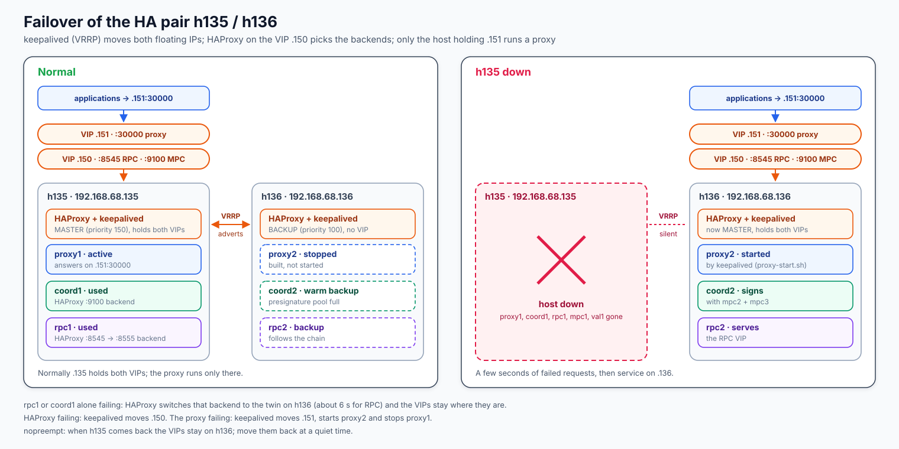
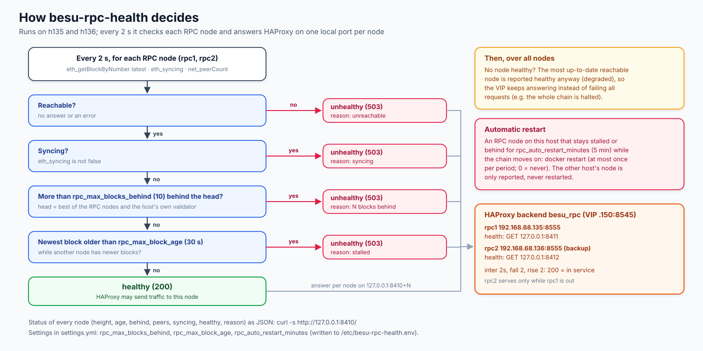

# 고가용성 (HAProxy 및 keepalived)

> **내용:** h135 / h136의 고가용성: HAProxy, keepalived, 플로팅 IP, RPC 상태 점검, 방화벽, 장애 조치 테스트를 다룹니다.
>
> **대상:** 운영자.
>
> **관련 문서:** [아키텍처](../overview/architecture.md) · [문제 해결](../operations/troubleshooting.md) · [운영 환경 구성](../overview/production-layout.md)

**목차**

- [개요](#overview)
- [1. 두 호스트 준비 (.135 및 .136)](#1-prepare-both-hosts-135-and-136)
- [2. VIP를 가리켜야 하는 설정](#2-settings-that-must-point-at-the-vips)
- [3. RPC 상태 점검 (besu-rpc-health)](#3-rpc-health-besu-rpc-health)
- [4. HAProxy (두 호스트 모두)](#4-haproxy-both-hosts)
- [5. keepalived (두 호스트 모두)](#5-keepalived-both-hosts)
- [6. 운영](#6-operations)
- [7. 장애 조치 테스트](#7-failover-tests)
- [8. 위험 요소](#8-risks)

---

> **Ansible로 배포할 때는 `ha/`의 파일을 그대로 사용하지 않습니다.** `ansible/07-ha.yml`은
> IP 계획(`ansible/inventory.yml` 및 `ansible/group_vars/all/settings.yml`, [Ansible 배포](ansible.md#the-ip-plan) 참조)에서
> `haproxy.cfg`, `keepalived.conf`, keepalived 스크립트 세 개, `/etc/besu-rpc-health.env`를 생성하며,
> `firewall-layout.sh`는 계획의 주소로 실행됩니다. 문서에 기재된 주소 192.168.68.135–.139를 사용하는
> `ha/`의 파일은 수동 설치용입니다.

## 개요 {#overview}



플로팅 IP(VIP) 두 개는 평상시에는 **192.168.68.135**가, 장애 조치 후에는 **192.168.68.136**이
보유합니다. 따라서 .135를 잃어도 결제가 멈추지 않습니다. 구성과 설정:
[운영 환경 구성](../overview/production-layout.md).

| VIP | 내용 | 장애 조치 |
|---|---|---|
| `192.168.68.150` | HAProxy: `:8545` → rpc1 `:8555` (rpc2 백업), `:9100` → coord1 (coord2 백업) | HAProxy가 약 6초 안에 백엔드를 전환합니다. HAProxy 자체가 실패하면 keepalived가 VIP를 옮깁니다 |
| `192.168.68.151` | 프록시, `:30000` | keepalived가 VIP를 옮기고 proxy2를 시작하며 proxy1을 중지합니다 |

| `ha/`의 파일 | 설치 위치 (.135 및 .136) | Ansible 생성 원본 |
|---|---|---|
| `haproxy.cfg` | `/etc/haproxy/haproxy.cfg` (두 호스트 동일) | `ansible/templates/haproxy.cfg.j2` |
| `keepalived-135.conf` / `keepalived-136.conf` | `/etc/keepalived/keepalived.conf` | `keepalived.conf.j2` |
| `check-proxy.sh`, `proxy-start.sh`, `proxy-stop.sh` | `/etc/keepalived/` (chmod 700) | `check-proxy.sh.j2`, `proxy-start.sh.j2`, `proxy-stop.sh.j2` |
| `rpc-health.py` | `/usr/local/bin/besu-rpc-health`, `/etc/besu-rpc-health.env`와 함께 | 그대로 복사, 설정은 `besu-rpc-health.env.j2`에서 생성 |
| `firewall-layout.sh` | **모든** 호스트(.135–.139)에서 한 번 실행 | 계획의 주소로 실행 |

이렇게 설계한 이유:

- **한 번에 하나의 백엔드만 사용**(rpc2와 coord2는 `backup`): 프록시는 코디네이터가 트랜잭션을 보내는
  RPC 노드와 같은 노드에서 논스를 읽으며, 사전 서명 풀은 하나만 소비됩니다. coord2는 풀이 가득 찬
  상태로 항상 실행되고 MPC 노드에서 키 목록을 다시 읽으므로, 넘겨받는 즉시 모든 계정에 서명합니다.
- **`eth_syncing`만이 아니라 블록 나이와 높이로 RPC 상태를 판단**: 블록 가져오기를 멈춘 노드도
  여전히 `eth_syncing: false`로 응답합니다. [3절](#3-rpc-health-besu-rpc-health)을 참조하십시오.
- **한 번에 하나의 프록시만 실행**: 프록시는 발신자별 논스를 메모리에서 셉니다. keepalived는
  `.151`을 가져가는 호스트에서 프록시를 시작하고, 이를 내주는 호스트에서 프록시를 중지합니다.
  `check-proxy.sh`(3초마다)는 `.151`이 없는 호스트에서 실행 중인 프록시(예: 재부팅 후 Docker가
  다시 시작한 프록시)도 중지합니다.
- **RPC 노드는 8555 사용**: HAProxy가 두 호스트 모두에서 VIP의 8545를 점유하고, Besu는 호스트의
  어느 주소에서든 포트가 사용 중이면 시작을 거부하므로 그곳에서 rpc1/rpc2는 8545를 사용할 수 없습니다.
- **`nopreempt`**: 장애 조치 후 .135가 돌아와도 VIP는 .136에 남습니다(두 번째 중단 없음).
  한가한 시간에 다시 옮기십시오([6절](#6-operations)).

## 1. 두 호스트 준비 (.135 및 .136) {#1-prepare-both-hosts-135-and-136}

```bash
dnf install -y keepalived haproxy python3
```

`python3`는 `besu-rpc-health`(3절)를 실행합니다.

```bash
echo 'net.ipv4.ip_nonlocal_bind = 1' > /etc/sysctl.d/90-vip.conf && sysctl --system
```

이 sysctl 설정은 VIP를 보유하지 않은 호스트에서도 HAProxy가 VIP에 바인딩할 수 있게 합니다.

SELinux를 사용하는 경우(`getenforce`로 확인: `Enforcing` 또는 `Permissive`):

```bash
setsebool -P haproxy_connect_any 1 && setsebool -P keepalived_connect_any 1
```

- `haproxy_connect_any`: HAProxy가 8404/8545/9100에 바인딩하고 rpc1/rpc2 `:8555`, 코디네이터
  `:9100`, `127.0.0.1:8411`/`8412`의 `besu-rpc-health`에 연결합니다.
- `keepalived_connect_any`: keepalived의 점검이 HAProxy 상태 페이지(`:8404`)와 프록시(`:30000`)에
  도달합니다. 이 설정이 없으면 HAProxy 점검이 실패하고 `.150`이 올라오지 않습니다.

keepalived 스크립트를 복사한 후(5절), `docker compose`를 실행할 수 있도록 레이블을 지정합니다
(`semanage`는 `policycoreutils-python-utils`에 포함되어 있습니다).

```bash
semanage fcontext -a -t keepalived_unconfined_script_exec_t '/etc/keepalived/(check-proxy|proxy-start|proxy-stop)\.sh'
```

```bash
restorecon -v /etc/keepalived/*.sh
```

여전히 차단되는 항목이 있으면:

```bash
ausearch -m avc -ts recent
```

방화벽은 **모든** 호스트에서 설정합니다(열리는 포트는 `firewall-layout.sh`를 참조하십시오).

```bash
PROXY_CLIENTS="<application IPs>" CHAINLENS_USERS="<explorer users>" GRAFANA_USERS="<dashboard users>" REMIX_USERS="<developers>" ADMIN=<bastion IP> ./firewall-layout.sh 135
```

이 스크립트는 호스트 자체 포트에 대한 firewalld 규칙을 작성하고, Docker가 게시하는 포트에도 같은
허용 목록을 적용합니다(Docker는 이 포트를 직접 전달하므로 firewalld가 보지 못합니다): nftables 테이블
`inet besu_docker`, 규칙은 `/etc/besu-docker-firewall.rules`에 있고 부팅 시
`besu-docker-firewall.service`가 적용합니다. Docker의 `DOCKER-USER` 체인은 사용하지 않습니다.
firewalld를 다시 로드하면 Docker가 점프 순서를 바꾸기 때문입니다. 자세한 내용:
[운영 환경 구성](../overview/production-layout.md#3-ports-and-firewall).

keepalived 파일에 사용할 네트워크 인터페이스 이름(`192.168.68.13x`를 가진 인터페이스):

```bash
ip -br addr
```

## 2. VIP를 가리켜야 하는 설정 {#2-settings-that-must-point-at-the-vips}

| 위치 | 설정 |
|---|---|
| rpc1 및 rpc2 `.env` | `BESU_HOST_ALLOWLIST`에 `192.168.68.150` 포함(클라이언트와 `besu-rpc-health`가 `Host: 192.168.68.150`을 보냄), 그다음 `./start.sh` |
| .135 및 .136의 프록시 `.env` | `BESU_IP`와 `SIGNER_IP` = `192.168.68.150`, `MPC_ADMIN_URL=http://192.168.68.150:9100` (`proxy/.env.example`) |
| coord1 및 coord2 `.env` | `MPC_BESU_RPC=http://192.168.68.150:8545`, `MPC_RELAY_URL` = 각 코디네이터의 **자체** 주소 |
| 애플리케이션 | `http://192.168.68.151:30000`의 프록시 |

## 3. RPC 상태 점검 (besu-rpc-health) {#3-rpc-health-besu-rpc-health}



**이유:** 한 RPC 노드가 (피어를 잃은 후) 블록 가져오기를 멈췄지만 여전히 `eth_syncing: false`로
응답한 적이 있습니다. `eth_syncing`만 점검했기 때문에 이 노드가 RPC VIP에 남아 오래된 체인을 제공했습니다.

**내용:** `besu-rpc-health`([`ha/rpc-health.py`](../../ha/rpc-health.py))는 두 HAProxy 호스트의
systemd 서비스입니다. 2초마다 모든 RPC 노드를 점검하고(`eth_getBlockByNumber latest`,
`eth_syncing`, `net_peerCount`), 노드마다 로컬 포트 하나로 HAProxy에 응답합니다:
RPC 노드 N은 `127.0.0.1:8410+N`(rpc1은 8411, rpc2는 8412). HAProxy는 해당 포트가 200으로
응답하는 동안에만 노드를 사용합니다.

다음 조건을 모두 만족하면 노드는 **정상**입니다.

| 점검 | 설정 (`settings.yml`) | 기본값 |
|---|---|---|
| 동기화 중이 아님(`eth_syncing`이 `false`) | — | — |
| (RPC 노드와 호스트 자체 검증자 중) 최신 헤드보다 최대 이 블록 수만큼만 뒤처짐 | `rpc_max_blocks_behind` | 10 |
| 최신 블록이 이 시간보다 새로움. 단, 어느 노드에도 더 새로운 블록이 없는 경우(체인 전체가 정지)는 예외 | `rpc_max_block_age` | 30초 |

- **정상 노드가 없을 때:** 도달 가능한 노드 중 가장 최신인 노드를 정상으로 보고합니다(`degraded`).
  모든 요청을 실패시키는 대신 VIP가 계속 응답하게 하기 위함입니다.
- **자동 재시작:** 같은 호스트의 RPC 노드가 체인이 진행되는 동안 `rpc_auto_restart_minutes`
  (기본값 5) 동안 정지 또는 뒤처짐 상태로 남으면 `docker restart`로 재시작합니다(기간당 최대 한 번).
  RPC 노드는 키를 보유하지 않으므로 안전합니다. `0` = 재시작 안 함.
  다른 호스트의 RPC 노드는 보고만 하고 재시작하지 않습니다.

설정 파일: `/etc/besu-rpc-health.env` (`RPC_NODES`, `LOCAL_NODES`, `HEAD_REFERENCE`,
`HOST_HEADER`, `MAX_AGE`, `MAX_BEHIND`, `CHECK_SECONDS`, `RESTART_MINUTES`, `STATUS_PORT`, 형식은
`rpc-health.py`의 헤더에 있습니다). Ansible은 `besu-rpc-health.env.j2`에서 이 파일을 작성합니다.

모든 노드의 상태(높이, 나이, 뒤처짐, 피어, 동기화, 정상 여부, 사유)를 JSON으로 확인합니다.

```bash
curl -s http://127.0.0.1:8410/
```

상태 변화와 재시작:

```bash
journalctl -u besu-rpc-health -f
```

체인은 최신인데 노드의 최신 블록이 60초보다 오래되면 `BesuNodeStalled` 알림이 발생합니다
([알림](../operations/alerts.md)). 증상과 해결 방법:
[문제 해결](../operations/troubleshooting.md#rpc-and-the-rpc-vip).

**수동 설치**(Ansible은 `07-ha.yml`에서 수행): .135와 .136에서 `ha/` 폴더에서 실행합니다. 설정
파일과 유닛은 저장소에 있습니다: [`ha/besu-rpc-health.env.example`](../../ha/besu-rpc-health.env.example)
및 [`ha/besu-rpc-health.service`](../../ha/besu-rpc-health.service).

```bash
install -m 755 rpc-health.py /usr/local/bin/besu-rpc-health
```

```bash
cp besu-rpc-health.env.example /etc/besu-rpc-health.env
```

`/etc/besu-rpc-health.env`를 편집합니다: .136에서는 `LOCAL_NODES="rpc2"`로 설정합니다(컨테이너 이름은
노드 디렉터리 `/opt/besu-rpc1`, `/opt/besu-rpc2`를 따릅니다). 그다음:

```bash
cp besu-rpc-health.service /etc/systemd/system/
```

```bash
systemctl daemon-reload && systemctl enable --now besu-rpc-health
```

```bash
curl -s http://127.0.0.1:8410/
```

## 4. HAProxy (두 호스트 모두) {#4-haproxy-both-hosts}

`besu_rpc` 백엔드는 `besu-rpc-health`에 질의합니다(Ansible이 `haproxy.cfg.j2`에서 생성).

```
backend besu_rpc
    option httpchk GET /
    http-check expect status 200
    server rpc1 192.168.68.135:8555 check addr 127.0.0.1 port 8411 inter 2s fall 2 rise 2
    server rpc2 192.168.68.136:8555 check addr 127.0.0.1 port 8412 inter 2s fall 2 rise 2 backup
```

수동으로 작성된 `ha/haproxy.cfg`에도 같은 백엔드가 있습니다. 먼저 `besu-rpc-health`를 시작한 후(3절)
다음을 실행합니다.

```bash
cp haproxy.cfg /etc/haproxy/haproxy.cfg
```

```bash
haproxy -c -f /etc/haproxy/haproxy.cfg && systemctl enable --now haproxy
```

`mpc_signer` 백엔드는 각 코디네이터의 `GET /health`를 점검합니다(`inter 2s fall 3 rise 2`).

## 5. keepalived (두 호스트 모두) {#5-keepalived-both-hosts}

.135에서(.136에서는 `keepalived-136.conf`):

```bash
cp keepalived-135.conf /etc/keepalived/keepalived.conf
```

```bash
cp check-proxy.sh proxy-start.sh proxy-stop.sh /etc/keepalived/ && chmod 700 /etc/keepalived/*.sh
```

`/etc/keepalived/keepalived.conf`를 편집합니다: `INTERFACE`와 두 `auth_pass` 값(최대 8자, 두 호스트에서
동일). 프록시가 `/opt/besu-chain/proxy`에 있지 않으면 세 스크립트의 `PROXY_DIR`을 편집하십시오.
프록시는 **두** 호스트 모두에서 이미 설정되고 빌드되어 있어야 하지만(`docker compose build`),
**시작되어 있으면 안 됩니다**: keepalived가 `.151`을 가져가는 호스트에서 프록시를 시작합니다.

| keepalived 항목 | 동작 |
|---|---|
| `chk_haproxy` (2초마다, fall 3) | HAProxy의 `127.0.0.1:8404/healthz`에 `curl`, 실패하면 `.150`이 이동합니다 |
| `chk_proxy` = `check-proxy.sh` (3초마다, fall 3) | `.151`을 보유한 호스트: 프록시가 `/status/senders`에 응답해야 합니다. 다른 호스트: 실행 중인 프록시를 중지하고 통과합니다 |
| `notify_master` = `proxy-start.sh` | 이 호스트가 `.151`을 가져갈 때 `docker compose up -d proxy` |
| `notify_backup` / `notify_fault` = `proxy-stop.sh` | 이 호스트가 `.151`을 내줄 때 `docker compose stop proxy` |

프록시 컨테이너에는 `restart: unless-stopped`가 설정되어 있어 대기 호스트에서도 부팅 시 Docker가
프록시를 다시 시작합니다. `check-proxy.sh`가 몇 초 안에 이를 중지합니다. **대기 호스트에서 프록시가
중지된 상태(`docker ps -a`에 `Exited (137)` 표시)는 정상입니다.**

먼저 .135에서, 그다음 .136에서 keepalived를 시작합니다.

```bash
systemctl enable --now keepalived
```

VIP를 보유한 호스트를 확인합니다(평상시에는 둘 다 .135).

```bash
ip -br addr | grep -E '68\.15[01]/'
```

```bash
curl -s http://192.168.68.150:8545 -H 'content-type: application/json' --data '{"jsonrpc":"2.0","id":1,"method":"eth_blockNumber","params":[]}'
```

```bash
curl -s http://192.168.68.151:30000/status/senders
```

| 로그 | 표시 내용 |
|---|---|
| `journalctl -u keepalived` | VIP 변경 |
| `journalctl -t besu-ha` | 프록시 시작, 중지, 또는 VIP 없이 실행되어 중지됨 |
| `journalctl -u haproxy` | 백엔드 변경 |
| `journalctl -u besu-rpc-health` | RPC 노드 상태 변화와 재시작 |

## 6. 운영 {#6-operations}

| 작업 | 방법 |
|---|---|
| 장애 조치 후 VIP를 .135로 되돌리기 | 한가한 시간에 .136에서 `systemctl restart keepalived` (VIP를 내주면 .135가 가져가고 proxy1을 시작합니다) |
| .135 계획 유지보수 | 먼저 .135에서 `systemctl stop keepalived`(.136으로 깔끔하게 인계), 그다음 유지보수 |
| `haproxy.cfg` 변경 | 두 호스트에 같은 파일, `haproxy -c -f …`, `systemctl reload haproxy`. Ansible 사용 시: `ansible-playbook 07-ha.yml` (다시 로드하며 VIP는 현재 위치에 유지) |
| RPC 상태 임계값 변경 | `settings.yml`의 `rpc_max_block_age`, `rpc_max_blocks_behind`, `rpc_auto_restart_minutes`, 그다음 `ansible-playbook 07-ha.yml` (수동: `/etc/besu-rpc-health.env` 편집, `systemctl restart besu-rpc-health`) |
| 프록시 업그레이드 | **두** 호스트에서 새 이미지 빌드, 활성 호스트에서 `docker compose up -d proxy` (몇 초 중단). 대기 호스트에서는 시작하지 마십시오 |
| 코디네이터 업그레이드 | coord2 먼저, 그다음 coord1 (그동안 HAProxy는 coord2 사용) |

## 7. 장애 조치 테스트 {#7-failover-tests}

| 테스트 | 수행 | 예상 결과 |
|---|---|---|
| RPC | .135에서 rpc1 중지(해당 디렉터리에서 `docker compose stop`) | 약 6초 안에 `.150:8545` 요청이 rpc2를 통해 계속 처리됨, `curl -s http://127.0.0.1:8410/`에 rpc1 도달 불가로 표시 |
| 코디네이터 | coord1 중지 | coord2를 통해 즉시 서명 계속(풀이 가득 차 있음) |
| 프록시 | .135에서 `docker compose stop proxy` | 약 10초 안에 `.151`이 .136으로 이동, proxy2 시작, `.151`에서 `/status/senders` 응답 |
| HAProxy | .135에서 `systemctl stop haproxy` | 약 3–6초 안에 `.150`이 .136으로 이동 |
| 호스트 전체 | .135 전원 끄기 | 두 VIP 모두 .136에 있고 proxy2 실행 중, 체인 계속 진행(검증자 3개), 몇 초간 오류 발생 |

각 테스트 후 모든 것을 다시 시작하고 다음 테스트 전에 Grafana를 확인하십시오. 프록시, HAProxy,
호스트 테스트 후에는 VIP가 .136에 남습니다(`nopreempt`): proxy1을 수동으로 시작하지 마십시오
(`check-proxy.sh`가 중지합니다). 6절의 방법으로 VIP를 되돌리십시오.

## 8. 위험 요소 {#8-risks}

- **스플릿 브레인:** .135와 .136이 모두 살아 있지만 VRRP 메시지를 주고받지 못하면(방화벽 규칙,
  끊어진 링크) 둘 다 VIP를 가져가고 둘 다 프록시를 실행합니다. 자금 손실은 없지만(논스당 트랜잭션
  하나) 요청이 실패합니다. VRRP를 양방향으로 허용하고, 가능하면 두 호스트 사이의 두 번째 링크를
  사용하며, 네트워크 변경 후에는 두 호스트에서 `ip -br addr`를 확인하십시오.
- **같은 서브넷만 가능:** VIP는 192.168.68.0/24 안에서만 이동합니다. 다른 사이트의 호스트에는
  DNS나 라우팅되는 로드 밸런서가 대신 필요합니다.
- **두 호스트를 동일하게 유지:** HAProxy 파일, `besu-rpc-health` 설정(`LOCAL_NODES`와
  `HEAD_REFERENCE` 제외), 프록시 `.env`와 이미지, 코디네이터 설정.
