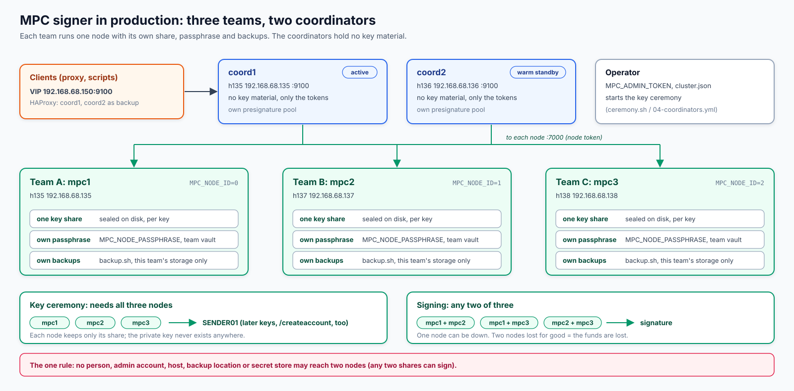

# 운영 환경의 MPC 서명기

> **내용:** 운영 환경의 MPC 서명기: 세 팀, 토큰, 키 세레모니, 백업과 복원, 운영.
>
> **대상:** MPC 노드 팀, 운영자.
>
> **관련 문서:** [MPC 서명기](../components/mpc-signer.md) · [MPC 업그레이드](../operations/mpc-signer-upgrade.md) · [재해 복구](../operations/disaster-recovery.md)

**목차**

- [1. 사전 요구 사항](#1-prerequisites)
- [2. 이미지 빌드 및 배포 (릴리스당 한 번, 예: CI에서)](#2-build-and-distribute-the-image-once-per-release-eg-in-ci)
- [3. 공유 토큰 생성 (운영자)](#3-generate-the-shared-tokens-operator)
- [4. 각 노드 초기화 (각 노드 호스트에서, 해당 노드의 팀이 수행)](#4-initialise-each-node-on-each-node-host-by-that-nodes-team)
- [5. `cluster.json` 생성 (운영자)](#5-build-clusterjson-operator)
- [6. 노드 시작 (각 노드 팀)](#6-start-the-nodes-each-node-team)
- [7. 코디네이터 시작](#7-start-the-coordinators)
- [8. 키 세레모니 (운영자, 노드 3개 모두 실행 중)](#8-key-ceremony-operator-all-3-nodes-up)
- [9. SENDER01 자금 충전 및 프록시 연결](#9-fund-sender01-and-connect-the-proxy)
- [10. 운영 시작 전 확인](#10-verify-before-going-live)
- [11. 백업 (각 노드 팀이 별도로)](#11-backups-each-node-team-separately)
- [12. 노드 복원 (같은 노드 ID, 같은 패스프레이즈)](#12-restore-a-node-same-node-id-same-passphrase)
- [13. 일상 운영](#13-day-2-operations)
- [14. 키 조각을 영구히 잃은 경우](#14-if-a-share-is-lost-for-good)
- [15. 보안 체크리스트](#15-security-checklist)

---

이 가이드는 운영 환경에 2-of-3 MPC 서명기를 배포합니다.

- 세 호스트에 있는 **MPC 노드 3개**, **서로 다른 세 관리자 팀**이 운영합니다.
- 플로팅 IP의 HAProxy 뒤에 있는 **코디네이터 2개**.



운영 환경 구성([운영 환경 구성](../overview/production-layout.md))에서는:
mpc1(`MPC_NODE_ID=0`)은 192.168.68.135, mpc2(1)는 .137, mpc3(2)는 .138에 있고, coord1은 .135,
coord2는 .136에 있습니다. 클라이언트는 `192.168.68.150:9100`(coord1, 백업으로 coord2)에서 코디네이터에 접근합니다.

아래의 모든 단계는 처음부터 끝까지 사전 테스트했습니다: 노드 "호스트" 3개, 코디네이터 1개, 키 세레모니,
노드 하나를 중지한 상태의 서명, 그리고 백업 → 데이터 손실 → 복원 → 다시 서명.

**Ansible로 배포하면**([Ansible 배포](ansible.md)) 운영자 단계는 자동화되지만 팀 단계는 자동화되지
않습니다.

| 단계 | Ansible 단계 |
|---|---|
| 2. 이미지 | `02-images.yml`이 운영자 머신에서 `mpc_image`를 빌드하고(`mpc_image_build: true`, 백엔드 `mpc_bigint`) .135–.138에 로드하거나, 레지스트리에서 가져옵니다 |
| 3. 토큰 | `ansible/state/secrets/`에 한 번 생성됩니다(`mpc_node_token`, `mpc_admin_token`, `mpc_metrics_token`) |
| 4., 6. 노드 | **각 팀**. `03-mpc-nodes.yml`이 각 팀의 지침을 `ansible/state/handoff/mpc1.md` … `mpc3.md`에 작성하고, 노드 파일이 `ansible/state/mpc/`에 들어오고 노드가 응답할 때까지 멈춥니다. 노드 폴더는 `/opt/mpc-node` 대신 `mpc_node_dir`(기본값 `/opt/besu-chain/mpc-signer/deploy/node`, 저장소 사본의 노드 패키지)입니다 |
| 5. `cluster.json` | `03-mpc-nodes.yml`, `chain_id`, `mpc_max_value_wei`, `mpc_max_gas`, `mpc_allowed_to`로부터 생성(`ansible/state/cluster.json`) |
| 7., 8. 코디네이터, 세레모니 | `04-coordinators.yml`: 두 코디네이터(한 번에 하나씩), 세레모니, 그다음 `MPC_POOL_KEYS=<SENDER01>` |
| 11. 백업 | `10-backups.yml`, `mpc_backup_cron: true`일 때만(11절 참조) |

```
                      private network, firewall: only the ports below
  proxy ──► VIP .150:9100 (HAProxy) ──► coord1 (.135) | coord2 (.136, warm standby)
                                            │  ──7000──► mpc1 (.135, team A)
                                            │  ──7000──► mpc2 (.137, team B)
                                            │  ──7000──► mpc3 (.138, team C)
       nodes ──9100──► relay of the coordinator running the session (its own IP)
       coordinators ──8545──► VIP .150:8545 (HAProxy) ──► rpc1 | rpc2
```

| 역할 | 수 | 보유 | 패키지 |
|---|---|---|---|
| MPC 노드 | 정확히 3개, 호스트/사이트/팀마다 하나 | **각각 키 조각 하나**(디스크에 봉인) | `deploy/node/` |
| 코디네이터 | 2개(coord1 활성, coord2 웜 대기) | 토큰 외에는 비밀 없음 | `deploy/coordinator/` |
| 운영자 워크스테이션 / 배스천 | 1개 | `MPC_ADMIN_TOKEN` | `deploy/make-cluster.sh`, `deploy/ceremony.sh` |

> **보안을 보장하는 단 하나의 규칙:** 어떤 사람, 관리자 계정, 호스트, 백업 위치, 비밀 저장소도
> **두** 노드에 접근할 수 있어서는 안 됩니다. 아무 키 조각 두 개로 서명할 수 있습니다. 한 팀이 노드 3개를
> 운영하거나 백업 3개를 한 버킷에 두면 아무런 보호가 되지 않습니다.

---

## 1. 사전 요구 사항 {#1-prerequisites}

**호스트**
- **노드 호스트 3대**(Linux + Docker Engine + Compose v2), 팀마다 하나: .135, .137, .138(각각
  Besu 검증자도 실행합니다).
  - **CPU:** 사전 서명에는 노드당 서명 하나에 약 0.6 CPU-초가 듭니다. **지속 트랜잭션/초당 약 0.4 코어**
    ([MPC 서명기 벤치마크](../development/mpc-benchmarks.md) 참조)에 여유분 2코어를 더해 계획하십시오.
  - **RAM:** 2–4 GB.
  - **디스크:** 1 GB 미만(키 조각은 키당 몇 KB).
- **코디네이터 호스트 2대:** 각각 2코어와 1 GB면 충분합니다: 프록시 옆의 .135와 .136.
  코디네이터는 키 자료를 보유하지 않으므로, coord1이 mpc1과 .135를 공유해도 그곳에 키 조각이 추가되지
  않습니다. 각 MPC 노드의 데이터에는 해당 노드의 팀만 접근할 수 있도록 유지하십시오.

**네트워크**
- **모든 호스트 간의 사설 네트워크**(이 구성에서는 192.168.68.0/24, 신뢰할 수 없는 링크를 지나면
  WireGuard 등으로 암호화). 격리는 **필수**입니다.
  - 노드 API는 HTTP를 통해 bearer 토큰을 사용합니다(아직 mTLS 없음).
  - 릴레이에는 인증이 없습니다.
  - MPC 프로토콜 메시지는 이미 종단 간 서명 및 암호화되지만, 트랜잭션 의도와 토큰은 그렇지 않습니다.
- **방화벽:** 기본 거부 후 다음 포트만 엽니다
  ([`ha/firewall-layout.sh`](../../ha/firewall-layout.sh)가 이 구성에 맞게 firewalld로 적용합니다.
  `deploy/firewall-example.sh`에는 범용 ufw 규칙이 있습니다).

| 출발지 | 목적지 | 포트 | 용도 |
|---|---|---|---|
| 코디네이터 | 각 노드 | 7000/tcp | 노드 API |
| 각 노드 | 코디네이터 | 9100/tcp | MPC 프로토콜 메시지용 릴레이(WebSocket) |
| 프록시, 운영자 | 코디네이터 | 9100/tcp | JSON-RPC(`eth_accounts`, `eth_signTransaction`, `eth_sendTransaction`) + `/admin` |
| 코디네이터 | Besu RPC 노드 | 8545/tcp | 서명된 트랜잭션 전송 |
| 각 팀의 배스천 | 자기 팀 노드 | 22/tcp | 관리 |

## 2. 이미지 빌드 및 배포 (릴리스당 한 번, 예: CI에서) {#2-build-and-distribute-the-image-once-per-release-eg-in-ci}

```bash
cd mpc-signer
docker build --build-arg BIGINT=bigint-rug -t registry.example.com/mpc-signer:1.3.0 .
docker push registry.example.com/mpc-signer:1.3.0
```

- `BIGINT=bigint-rug`는 GMP 백엔드를 사용합니다: 사전 서명이 몇 배 빨라지지만 LGPL 의존성이 추가됩니다.
  순수 Rust 기본값을 사용하려면 생략하십시오.
- **레지스트리가 없으면** 각 호스트에 이미지를 복사합니다:
  `docker save registry.example.com/mpc-signer:1.3.0 | ssh HOST docker load`.
- 정확한 버전 태그를 사용하고 `latest`는 절대 사용하지 마십시오. 이미지 다이제스트를 기록하고
  (`docker inspect --format '{{index .RepoDigests 0}}' …`) 각 팀이 같은 이미지를 실행하는지 확인하게 하십시오.

## 3. 공유 토큰 생성 (운영자) {#3-generate-the-shared-tokens-operator}

```bash
openssl rand -hex 32    # MPC_NODE_TOKEN: same value on all 3 nodes and all coordinators
openssl rand -hex 32    # MPC_ADMIN_TOKEN: coordinators, operator, and the proxy (for /createaccount)
```

각 팀의 비밀 채널로 전달하고, 채팅이나 이메일로는 절대 보내지 마십시오. 노드 패스프레이즈는 공유하지
**않습니다**: 각 노드 팀이 4단계에서 직접 생성합니다.

## 4. 각 노드 초기화 (각 노드 호스트에서, 해당 노드의 팀이 수행) {#4-initialise-each-node-on-each-node-host-by-that-nodes-team}

```bash
cp -r mpc-signer/deploy/node /opt/mpc-node && cd /opt/mpc-node
cp .env.example .env
```

`.env`를 편집합니다.

| 변수 | 값 |
|---|---|
| `MPC_IMAGE` | 2단계의 이미지 |
| `MPC_NODE_ID` | **0, 1 또는 2**, 호스트마다 다름 |
| `MPC_BIND_IP` | 이 호스트의 사설/WireGuard 주소 |
| `MPC_NODE_TOKEN` | 3단계에서 생성 |
| `MPC_COMPUTE_THREADS` | 호스트의 코어 수 정도 |

그다음 실행합니다.

```bash
./init.sh
```

`init.sh`는 다음을 수행합니다.

- 이 노드의 `MPC_NODE_PASSPHRASE`를 생성하여 `.env`에 기록합니다(모드 600).
- `mpc-data` Docker 볼륨에 노드 신원을 생성합니다.
- 노드의 **공개** 키와 URL이 담긴 `node<ID>.json`을 작성합니다.

> `MPC_NODE_PASSPHRASE`를 즉시 **이 팀의** 비밀번호 관리자에 저장하십시오. 이것이 없으면 노드의 봉인된
> 키 조각과 그 백업을 열 수 없습니다.

`node<ID>.json`을 운영자에게 보내십시오. 공개 키만 들어 있습니다.

## 5. `cluster.json` 생성 (운영자) {#5-build-clusterjson-operator}

```bash
cd mpc-signer/deploy
CHAIN_ID=1337 MAX_VALUE_WEI=1000000000000000000000 MAX_GAS=30000000 \
  ./make-cluster.sh node0.json node1.json node2.json > cluster.json
sha256sum cluster.json
```

**서명 정책:** 모든 노드는 정책을 벗어나는 트랜잭션을 독자적으로 거부합니다.

| 설정 | 의미 |
|---|---|
| `CHAIN_ID` | Besu 제네시스 `chainId` |
| `MAX_VALUE_WEI` | 트랜잭션당 최대 값(기본값 1000 ETH) |
| `MAX_GAS` | 트랜잭션당 최대 가스 한도 |
| `ALLOWED_TO` | 선택적 목적지 허용 목록, 예: `ALLOWED_TO="0xabc…,0xdef…"`. **프록시용으로는 비워 두십시오**: 목록이 비어 있지 않으면 모든 키에 대해 다른 모든 목적지와 모든 컨트랙트 생성을 거부하므로 `/createaccount` 자금 충전, 새 주소로의 `/transfer`, `/nft/deploy`가 실패합니다. 잘못된 주소는 거부됩니다. |

**배포:** `cluster.json`을 노드 3개 모두(`docker-compose.yml` 옆)와 모든 코디네이터에 복사합니다.
공개 파일이지만 무결성이 중요하므로, 사용하기 전에 **각 팀이 운영자의 `sha256sum`과 비교**합니다.

## 6. 노드 시작 (각 노드 팀) {#6-start-the-nodes-each-node-team}

```bash
cd /opt/mpc-node && docker compose up -d
docker compose logs --tail 5     # expect: "node loaded" and "node API listening"
```

## 7. 코디네이터 시작 {#7-start-the-coordinators}

```bash
cp -r mpc-signer/deploy/coordinator /opt/mpc-coordinator && cd /opt/mpc-coordinator
cp .env.example .env && chmod 600 .env
```

`.env`를 편집합니다.

| 변수 | 값 |
|---|---|
| `MPC_IMAGE` | 2단계의 이미지 |
| `MPC_BIND_IP` | 이 호스트의 주소(coord1은 `192.168.68.135`, coord2는 `.136`) |
| `MPC_RELAY_URL` | `ws://<this coordinator's OWN IP>:9100/relay`, VIP는 절대 사용하지 않음 |
| `MPC_BESU_RPC` | `http://192.168.68.150:8545`(HAProxy: rpc1, 백업으로 rpc2), 검증자는 절대 사용하지 않음 |
| `MPC_NODE_TOKEN`, `MPC_ADMIN_TOKEN` | 3단계에서 생성 |
| `MPC_METRICS_TOKEN` | Prometheus가 `GET /metrics`에 보내는 토큰([모니터링](../components/monitoring.md)), 비어 있으면 = 공개 |
| `MPC_POOL_KEYS` | 지금은 비워 둠, 세레모니 후(8단계) `SENDER01`로 설정 |
| `MPC_POOL_TARGET`, `MPC_POOL_TARGET_SMALL` | `big` / `small` 키당 사전 서명 수(`.env.example`: 500 / 20, 8단계 참조) |
| `MPC_REFILL_CONCURRENCY` | 동시 사전 서명 세션 수(`.env.example`: 8) |

Ansible을 사용하면 `04-coordinators.yml`이 `ansible/templates/coordinator.env.j2`
(`mpc_pool_target`, `mpc_pool_target_small`)에서 이 `.env`를 `/opt/mpc-coordinator/`에 작성합니다.

그다음 `cluster.json`을 복사해 넣고 시작합니다.

```bash
docker compose up -d
docker compose logs --tail 5     # expect: "keys loaded from nodes keys=0"
```

.136에서도 **coord2**에 대해 자체 `MPC_BIND_IP`와 `MPC_RELAY_URL`로 같은 작업을 수행합니다. 클라이언트는
`192.168.68.150:9100`의 HAProxy를 통해 둘 다에 접근합니다([고가용성 (HAProxy 및 keepalived)](high-availability.md)):
평상시에는 coord1, coord1이 다운되면 coord2. coord2는 항상 실행되며 자체 사전 서명 풀을 채우므로, 웜 상태로
넘겨받습니다.

**여러 코디네이터, 하나의 클러스터:** 각 코디네이터는 시작할 때(3개 중 2개가 응답하면 충분), 그 후 30초마다,
사본이 5초보다 오래되었을 때 `eth_accounts`를 위해, 그리고 모르는 계정을 만날 때마다 MPC 노드에서 키 목록을
읽습니다. 따라서 coord1을 통해 생성한 계정(`/createaccount`)은 coord2를 통해서도 즉시 서명됩니다.

## 8. 키 세레모니 (운영자, 노드 3개 모두 실행 중) {#8-key-ceremony-operator-all-3-nodes-up}

```bash
COORD=http://192.168.68.135:9100 ADMIN_TOKEN=<MPC_ADMIN_TOKEN> mpc-signer/deploy/ceremony.sh
```

- **Aux info**(안전 소수와 영지식 증명)는 클러스터당 한 번 실행되며 1–3분이 걸립니다.
- 그다음 **분산 키 생성**이 첫 번째 키를 생성하고 출력합니다. **그 주소가 `SENDER01`입니다.** 어느 시점에도
  개인 키는 존재하지 않았습니다.

**두** 코디네이터 모두에서 **핫 발신자를 위한 사전 서명 풀을 활성화**합니다.
1. `.env`에 `MPC_POOL_KEYS=<SENDER01>`을 설정합니다.
2. `docker compose up -d`를 실행합니다.
3. 각각 확인합니다: `curl http://192.168.68.135:9100/admin/pool`(및 `.136`)에
   `"pooled": true`가 표시되고 `ready`가 증가해야 합니다.

### 사전 서명 풀: big, small, none {#presignature-pools-big-small-and-none}

사전 서명은 하나의 키에 속하며, 사전 서명으로 서명하면 빠른 라운드 한 번으로 끝납니다(핫 경로, 밀리초).
사전 서명이 없으면 서명에 전체 프로토콜이 실행됩니다(콜드 경로, 약 0.5–1.5초). 각 키에는 MPC 노드에 키와 함께
저장되는 **풀 클래스**가 있습니다(따라서 재시작 후에도 유지되고 두 코디네이터 모두 볼 수 있습니다).

| 클래스 | 준비해 두는 사전 서명 수(코디네이터당) | 대상 |
|---|---|---|
| `big` | `MPC_POOL_TARGET`(예: 500) | 핫 발신자: `SENDER01`, 바쁜 계정 |
| `small` | `MPC_POOL_TARGET_SMALL`(기본값 20) | 일반 계정: 짧은 버스트에 빠르고 계정당 비용이 적음 |
| `none` | 0: 콜드 서명 | 유휴 계정 |

- **새 계정:** 프록시에서 `POST /createaccount {"amount": "1", "pool": "small"}`. `pool`이 없으면 프록시의
  `MPC_NEW_ACCOUNT_POOL`이 적용됩니다(기본값 `small`). 코디네이터에서 직접: 본문 `{"pool": "small"}`로
  `POST /admin/keys`.
- **나중에 변경:** 프록시에서 `POST /account/pool {"address": "0x…", "pool": "big"}`, 또는 코디네이터에서
  `POST /admin/keys/<address>/pool {"pool": "big"}`. 응답하는 모든 MPC 노드에 저장되며(3개 중 최소 2개 필요),
  다른 코디네이터는 30초 안에 따라갑니다. 다운되었던 노드는 이전 클래스를 유지하지만 다른 두 노드에 의해
  다수결에서 밀립니다: 노드가 돌아오면 같은 요청을 반복하여 일치시키십시오.
- **저장된 클래스가 없는 키**(키 세레모니의 `SENDER01`, 1.3.0 이전에 생성된 계정): `MPC_POOL_KEYS`에 있으면
  `big`, 그렇지 않으면 `none`. `MPC_POOL_KEYS`가 비어 있으면 모두 `big`이 됩니다.
- **크기:** 코디네이터당 `MPC_POOL_TARGET`과 `MPC_POOL_TARGET_SMALL`. 실행 중에는:
  `POST /admin/pool/target {"target": 500, "small": 20}`(코디네이터가 재시작될 때까지). coord2에
  `MPC_POOL_TARGET_SMALL=0`을 설정하면 사전 서명 작업이 절반으로 줄어듭니다: 그러면 coord1만 small 풀을 유지하고,
  coord2로 장애 조치된 후 한동안 small 계정은 콜드 서명을 합니다.
- **용량:** 모든 사전 서명은 노드가 생성하며, 속도는 대시보드의 "Presignatures generated per second"와
  비슷하고, 노드의 메모리에 보관됩니다(`MPC_MAX_PRESIGS`, 기본값 노드당 100,000, 두 코디네이터의 풀을 모두
  포함). small 계정 1,000개 × 20 × 코디네이터 2개 = 40,000. 많은 계정에 big 풀을 두면 맞지 않습니다:
  big 키 100개 × 500 × 2 = 100,000.
- **모니터링:** MPC 대시보드는 big 풀을 하나씩, small 풀은 합계(ready, target, 풀이 빈 키)로, 그리고 클래스별
  키 수를 보여 줍니다. 알림: `MpcPoolEmpty`(big 키)와 `MpcSmallPoolsEmpty`(대부분의 small 풀이 15분 동안 비어 있음).

## 9. SENDER01 자금 충전 및 프록시 연결 {#9-fund-sender01-and-connect-the-proxy}

- **자금 충전:** `SENDER01`에 ETH를 넣습니다. Besu 제네시스 `alloc`(새 체인)에 넣거나, 자금이 있는 기존 계정에서
  이체합니다. 운영 제네시스 파일에서 잘 알려진 개발용 계정을 제거하십시오.
- **프록시 `.env`:**

| 변수 | 값 |
|---|---|
| `SIGNER_IP` / `SIGNER_PORT` | `192.168.68.150` / `9100`(HAProxy) |
| `SENDER01` | 세레모니 주소 |
| `MPC_ADMIN_URL` | `http://192.168.68.150:9100` |
| `MPC_ADMIN_TOKEN` | 3단계에서 생성 |
| `MPC_NEW_ACCOUNT_POOL` | `pool` 없이 `/createaccount`로 만든 계정의 풀 클래스: `small`(기본값), `big` 또는 `none`(Ansible: `mpc_new_account_pool`) |

  두 프록시 호스트에 같은 `.env`를 사용합니다(`proxy/.env.example`).
  [프록시 (애플리케이션 API)](../components/proxy.md)를 참조하십시오.
- **컬렉션:** `/nft/deploy`로 NFT 컬렉션을 배포합니다. 민터는 `SENDER01`입니다.

## 10. 운영 시작 전 확인 {#10-verify-before-going-live}

1. 프록시를 통해 값이 0인 테스트 트랜잭션을 보내고 채굴되는지 확인합니다.
2. 노드 하나를 중지하고(해당 호스트에서 `docker compose stop`) 다른 트랜잭션을 보내 역시 채굴되는지 확인합니다
   (3개 중 2개로 여전히 서명). 그다음 노드를 다시 시작합니다.
3. 노드를 재시작한 후 **두 코디네이터 모두에서** `POST /admin/pool/clear`(관리자 토큰)를 실행합니다.
   노드가 메모리에 보관하던 사전 서명은 사라졌으며, 비우면 풀이 유효한 사전 서명으로 다시 채워집니다.
4. coord1을 중지합니다: coord2(HAProxy)를 통해 서명이 계속됩니다. 다시 시작합니다.

## 11. 백업 (각 노드 팀이 별도로) {#11-backups-each-node-team-separately}

```bash
cd /opt/mpc-node && ./backup.sh /secure/backup/location     # safe while the node runs
```

아카이브에는 노드의 봉인된 신원, aux info, **모든 키 조각**이 들어 있습니다.

- **시기:** 세레모니 후, 그리고 이후 **정기적으로**, 예를 들어 cron으로 매시간:
  `0 * * * * /opt/mpc-node/backup.sh /secure/backup`. `/createaccount`마다 새 키 조각이 추가되며, 마지막 백업
  이후 생성된 키 조각은 실행 중인 노드에만 존재합니다.
- **Ansible 사용 시(선택):** `mpc_backup_cron: true`로 설정하면 `10-backups.yml`이 팀의 노드가 설정된 각 MPC
  호스트(`mpc_node_dir`에 `.env`)에 매시 **:07**분에 실행되는 cron 작업을 설치합니다: `mpc_backup_dir`
  (기본값 `/secure/mpc-backup`)로 `backup.sh`를 실행하고 `/var/log/mpc-backup.log`에 기록합니다. 백업이 없으면
  첫 백업도 실행합니다. 노드는 각 팀에 속하므로 기본적으로 꺼져 있습니다. 아카이브는 노드 자체 호스트에
  남으므로, 각 팀이 여전히 호스트 밖으로 복사해야 합니다.
- **위치:** **이 팀의** 저장소에만. 두 노드의 백업을 한곳에 두지 마십시오. 키 조각 두 개로 서명할 수 있기
  때문입니다.
- **패스프레이즈:** 해당 노드의 패스프레이즈 없이는 아카이브를 열 수 없습니다. 팀의 비밀번호 관리자에 보관하고,
  아카이브 옆에 두지 **마십시오**.
- **모니터링:** 각 실행은 node-exporter용으로 결과를 기록합니다(`/var/lib/node_exporter/textfile`,
  `monitoring/node-exporter` 참조). 노드의 백업이 2시간보다 오래되었거나, 누락되었거나, 실패하면 Prometheus가
  알림을 보냅니다(`MpcShareBackupTooOld`, `MpcShareBackupMissing`, `BackupFailed`).
- **재해 복구:** [재해 복구](../operations/disaster-recovery.md).

## 12. 노드 복원 (같은 노드 ID, 같은 패스프레이즈) {#12-restore-a-node-same-node-id-same-passphrase}

```bash
cd /opt/mpc-node            # same .env (MPC_NODE_ID, MPC_NODE_PASSPHRASE) as before
docker compose down
./restore.sh /secure/backup/location/mpc-node0-<time>.tgz
docker compose up -d
```

그다음 코디네이터에서 `POST /admin/pool/clear`를 실행합니다.

`restore.sh`는 다른 노드 ID의 아카이브를 거부하며, 아직 신원이 들어 있는 볼륨을 덮어쓰는 것도 거부합니다.

## 13. 일상 운영 {#13-day-2-operations}

| 작업 | 방법 |
|---|---|
| **업그레이드** | [MPC 서명기 업그레이드](../operations/mpc-signer-upgrade.md). 요약: `.env`에 새 이미지 태그, 그다음 `docker compose up -d`. **노드 먼저, 한 번에 하나씩:** 나머지 두 노드로 서명이 계속됩니다. 그다음 코디네이터를 하나씩(수동: coord2 먼저, 그다음 coord1. 그동안 HAProxy는 다른 쪽을 사용). 각 노드를 재시작한 후 두 코디네이터 모두에서 `/admin/pool/clear`를 실행합니다. |
| **노드 하나가 다운됨** | 3개 중 2개로 서명이 계속되며, 풀이 다시 채워지는 동안은 느려집니다. 키 생성에는 세 노드가 모두 필요하므로 3개가 모두 실행될 때까지 `/createaccount`는 **실패**합니다. 이에 대한 알림을 설정하십시오. |
| **모니터링** | 각 코디네이터에 `MPC_METRICS_TOKEN`을 설정하고 같은 값을 모니터링 호스트에 제공합니다(`MPC_METRICS_TOKEN=<token> ./setup.sh`, 대상은 `prometheus/targets/mpc.yml`, [모니터링](../components/monitoring.md)). 코디네이터는 `GET /metrics`에서 Prometheus 메트릭(핫/콜드 서명, 지연 시간, 실패, 정책 거부, 키 및 클래스별 풀, 사전 서명 속도)을 제공하고 10초마다 모든 MPC 노드를 점검하므로, 서명에 필요하기 전에 `mpc_node_up`이 노드 다운을 보여 줍니다. MPC 서명기 대시보드와 알림(임계값 미만, 노드 다운, 풀 비어 있음, 정책 거부, 키 조각 백업)이 함께 제공됩니다([알림](../operations/alerts.md)). `GET /admin/pool`은 풀 수치를 JSON으로 제공합니다. |
| **정책 변경** | `cluster.json`을 편집하고, 모든 팀과 `sha256sum`을 비교한 후 모든 곳에 복사하고, 노드를 하나씩 재시작한 다음 코디네이터를 재시작합니다 |
| **`MPC_NODE_TOKEN` 교체** | 모든 노드와 코디네이터에 새 값을 설정하고 재시작합니다 |
| **`MPC_ADMIN_TOKEN` 교체** | 코디네이터, 프록시, 운영자를 업데이트하고 재시작합니다 |
| **1.3.0으로 업그레이드(풀 클래스)** | 단계별 안내: [MPC 서명기 업그레이드](../operations/mpc-signer-upgrade.md). **MPC 노드 먼저**(각 팀: `.env`의 `MPC_IMAGE`, `docker compose up -d`, 한 번에 하나씩), 그다음 코디네이터와 프록시. 1.3.0 코디네이터와 이전 버전 노드 조합에서는 풀 클래스를 저장할 수 없습니다: 새 계정이 풀을 받지 못하고 `POST /admin/keys/<address>/pool`이 실패합니다 |
| **계정의 풀 클래스** | 프록시에서 `POST /account/pool {"address", "pool"}`, 8절의 "사전 서명 풀"을 참조하십시오 |
| **처리량** | 지속적인 서명은 사전 서명 CPU에 의해 제한됩니다. 노드에 코어를 더 주고 `MPC_COMPUTE_THREADS`와 `MPC_REFILL_CONCURRENCY`를 늘리십시오. 버스트는 `MPC_POOL_TARGET`으로 처리합니다. |

## 14. 키 조각을 영구히 잃은 경우 {#14-if-a-share-is-lost-for-good}

노드의 데이터 **와** 백업(또는 패스프레이즈)을 잃은 경우:

- 나머지 두 노드로 **서명은 여전히 동작합니다**.
- **더 이상 중복성이 없으며**, 라이브러리는 아직 키를 재공유하거나 갱신할 수 없습니다.

중복성을 복구하려면:

1. 새 키로 **새** 클러스터를 구축합니다(4–8단계).
2. 이전 `SENDER01`과 사용자 계정의 자금을 새 키로 옮깁니다.
3. 새 NFT 컬렉션을 배포합니다. 컬렉션의 민터는 해당 컬렉션을 배포한 `SENDER01`로 고정되어 있습니다.

## 15. 보안 체크리스트 {#15-security-checklist}

- [ ] 3개 호스트(.135, .137, .138)에 노드 3개, 3개 팀이 운영, 어떤 계정도 두 노드에 접근할 수 없음
- [ ] 모든 호스트 간 암호화된 사설 네트워크, 위에 나열한 포트만 연 기본 거부 방화벽
- [ ] 노드 `.env` 파일은 모드 600, root만 읽기 가능, 디스크는 저장 시 암호화
- [ ] 각 노드 패스프레이즈는 해당 팀의 비밀번호 관리자에 있음, 백업은 팀별로 패스프레이즈와 분리하여 보관
- [ ] 모든 팀이 `cluster.json` 체크섬 확인, 이미지 다이제스트 고정 및 확인
- [ ] `MPC_ADMIN_TOKEN`은 코디네이터, 운영자, 프록시만 보유
- [ ] 서명 정책(`max_value_wei`, `max_gas`, 선택적 `allowed_to`)은 사용 용도가 허용하는 한 엄격하게
- [ ] 노드 다운, 풀 비어 있음, 서명 실패에 대한 알림, 백업 실행 및 복원 훈련
- [ ] 수정될 때까지 감수하는 알려진 한계:
  - 노드 API에 mTLS 없음, 릴레이 인증 없음(사설 네트워크와 방화벽으로 완화)
  - 키 갱신 없음
  - `cggmp24 0.7.0-alpha.3`은 알파 릴리스이며, 감사는 이전 버전을 대상으로 했음
