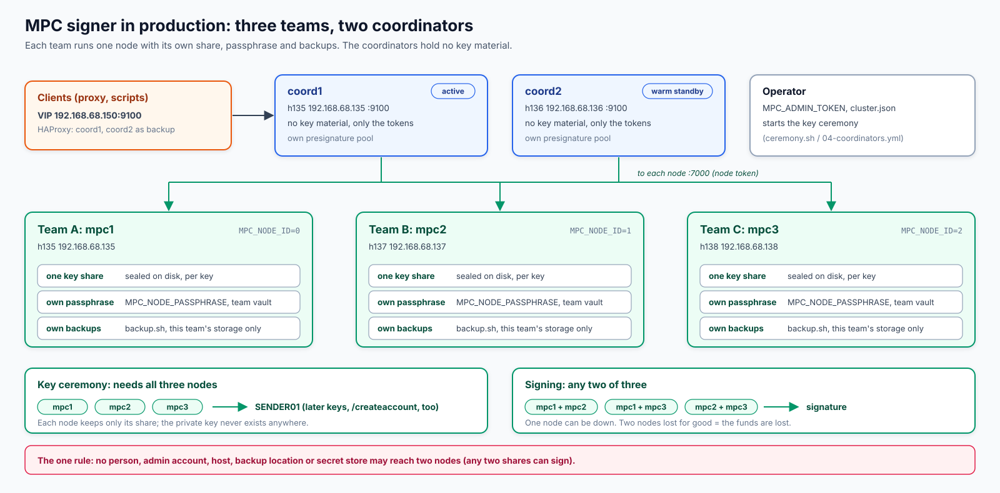

# MPC signer in production

> **What:** The MPC signer in production: three teams, tokens, the key ceremony, backups and restore, operations.
>
> **For:** MPC node teams, operators.
>
> **Related:** [MPC signer](../components/mpc-signer.md) · [MPC upgrade](../operations/mpc-signer-upgrade.md) · [disaster recovery](../operations/disaster-recovery.md)

**Contents**

- [1. Prerequisites](#1-prerequisites)
- [2. Build and distribute the image (once per release, e.g. in CI)](#2-build-and-distribute-the-image-once-per-release-eg-in-ci)
- [3. Generate the shared tokens (operator)](#3-generate-the-shared-tokens-operator)
- [4. Initialise each node (on each node host, by that node's team)](#4-initialise-each-node-on-each-node-host-by-that-nodes-team)
- [5. Build `cluster.json` (operator)](#5-build-clusterjson-operator)
- [6. Start the nodes (each node team)](#6-start-the-nodes-each-node-team)
- [7. Start the coordinator(s)](#7-start-the-coordinators)
- [8. Key ceremony (operator, all 3 nodes up)](#8-key-ceremony-operator-all-3-nodes-up)
- [9. Fund SENDER01 and connect the proxy](#9-fund-sender01-and-connect-the-proxy)
- [10. Verify before going live](#10-verify-before-going-live)
- [11. Backups (each node team, separately)](#11-backups-each-node-team-separately)
- [12. Restore a node (same node id, same passphrase)](#12-restore-a-node-same-node-id-same-passphrase)
- [13. Day-2 operations](#13-day-2-operations)
- [14. If a share is lost for good](#14-if-a-share-is-lost-for-good)
- [15. Security checklist](#15-security-checklist)

---

This guide deploys the 2-of-3 MPC signer for production:

- **three MPC nodes** on three hosts, run by **three different admin teams**;
- **two coordinators**, behind HAProxy on a floating IP.



In the production layout ([Production layout](../overview/production-layout.md)):
mpc1 (`MPC_NODE_ID=0`) on 192.168.68.135, mpc2 (1) on .137, mpc3 (2) on .138; coord1 on .135,
coord2 on .136; clients reach the coordinators at `192.168.68.150:9100` (coord1, coord2 as backup).

Every step below was dry-run end to end: three node "hosts", a coordinator, the key ceremony,
signing with a node stopped, and a backup → data loss → restore → signing again.

**With the Ansible deployment** ([Ansible deployment](ansible.md)) the operator steps are
automated, the team steps are not:

| Step | Ansible phase |
|---|---|
| 2. image | `02-images.yml` builds `mpc_image` on the operator (`mpc_image_build: true`, backend `mpc_bigint`) and loads it on .135–.138, or pulls it from your registry |
| 3. tokens | generated once into `ansible/state/secrets/` (`mpc_node_token`, `mpc_admin_token`, `mpc_metrics_token`) |
| 4., 6. nodes | **the teams**. `03-mpc-nodes.yml` writes each team's instructions to `ansible/state/handoff/mpc1.md` … `mpc3.md` and stops until the node files are in `ansible/state/mpc/` and the nodes answer. The node folder is `mpc_node_dir` (default `/opt/besu-chain/mpc-signer/deploy/node`, the node package in the repository copy) instead of `/opt/mpc-node` |
| 5. `cluster.json` | `03-mpc-nodes.yml`, from `chain_id`, `mpc_max_value_wei`, `mpc_max_gas`, `mpc_allowed_to` (`ansible/state/cluster.json`) |
| 7., 8. coordinators, ceremony | `04-coordinators.yml`: both coordinators (one at a time), the ceremony, then `MPC_POOL_KEYS=<SENDER01>` |
| 11. backups | `10-backups.yml`, only with `mpc_backup_cron: true` (see section 11) |

```
                      private network, firewall: only the ports below
  proxy ──► VIP .150:9100 (HAProxy) ──► coord1 (.135) | coord2 (.136, warm standby)
                                            │  ──7000──► mpc1 (.135, team A)
                                            │  ──7000──► mpc2 (.137, team B)
                                            │  ──7000──► mpc3 (.138, team C)
       nodes ──9100──► relay of the coordinator running the session (its own IP)
       coordinators ──8545──► VIP .150:8545 (HAProxy) ──► rpc1 | rpc2
```

| Role | Count | Holds | Package |
|---|---|---|---|
| MPC node | exactly 3, one per host/site/team | **one key share each** (sealed on disk) | `deploy/node/` |
| Coordinator | 2 (coord1 active, coord2 warm standby) | nothing secret except the tokens | `deploy/coordinator/` |
| Operator workstation / bastion | 1 | `MPC_ADMIN_TOKEN` | `deploy/make-cluster.sh`, `deploy/ceremony.sh` |

> **The one rule that makes this secure:** no person, admin account, host, backup location or
> secret store may reach **two** nodes. Any two shares can sign. Three nodes run by one team,
> or three backups in one bucket, give no protection.

---

## 1. Prerequisites

**Hosts**
- **3 node hosts** (Linux + Docker Engine + Compose v2), one per team: .135, .137, .138 (each
  also runs a Besu validator).
  - **CPU:** presigning costs about 0.6 CPU-seconds per signature per node. Plan for about
    **0.4 cores per sustained transaction/s** (see [MPC signer benchmarks](../development/mpc-benchmarks.md)), plus 2 cores of headroom.
  - **RAM:** 2–4 GB.
  - **Disk:** under 1 GB (shares are a few KB per key).
- **2 coordinator hosts:** 2 cores and 1 GB each are enough: .135 and .136, next to the proxies.
  A coordinator holds no key material, so coord1 sharing .135 with mpc1 doesn't add a share there;
  keep each MPC node's team the only one with access to that node's data.

**Network**
- **A private network between all hosts** (192.168.68.0/24 in the layout; encrypted, e.g.
  WireGuard, if it crosses untrusted links). Isolation is **required**:
  - the node API uses a bearer token over HTTP (no mTLS yet);
  - the relay has no authentication;
  - MPC protocol messages are already end-to-end signed and encrypted, but transaction intents
    and the token are not.
- **Firewall:** default-deny, then open only these ports
  ([`ha/firewall-layout.sh`](../../ha/firewall-layout.sh) applies them with firewalld for the
  layout; `deploy/firewall-example.sh` has generic ufw rules):

| From | To | Port | Purpose |
|---|---|---|---|
| coordinator(s) | each node | 7000/tcp | node API |
| each node | coordinator(s) | 9100/tcp | relay (WebSocket) for MPC protocol messages |
| proxy, operator | coordinator(s) | 9100/tcp | JSON-RPC (`eth_accounts`, `eth_signTransaction`, `eth_sendTransaction`) + `/admin` |
| coordinator(s) | Besu RPC node | 8545/tcp | send signed transactions |
| each team's bastion | its own node | 22/tcp | administration |

## 2. Build and distribute the image (once per release, e.g. in CI)

```bash
cd mpc-signer
docker build --build-arg BIGINT=bigint-rug -t registry.example.com/mpc-signer:1.3.0 .
docker push registry.example.com/mpc-signer:1.3.0
```

- `BIGINT=bigint-rug` uses the GMP backend: presigning is several times faster, but it adds an
  LGPL dependency. Omit it for the pure-Rust default.
- **Without a registry**, copy the image to each host:
  `docker save registry.example.com/mpc-signer:1.3.0 | ssh HOST docker load`.
- Use an exact version tag, never `latest`. Record the image digest
  (`docker inspect --format '{{index .RepoDigests 0}}' …`) and have each team confirm it runs
  the same one.

## 3. Generate the shared tokens (operator)

```bash
openssl rand -hex 32    # MPC_NODE_TOKEN: same value on all 3 nodes and all coordinators
openssl rand -hex 32    # MPC_ADMIN_TOKEN: coordinators, operator, and the proxy (for /createaccount)
```

Hand them over through each team's secret channel, never in chat or email. The node passphrases
are **not** shared: each node team generates its own in step 4.

## 4. Initialise each node (on each node host, by that node's team)

```bash
cp -r mpc-signer/deploy/node /opt/mpc-node && cd /opt/mpc-node
cp .env.example .env
```

Edit `.env`:

| Variable | Value |
|---|---|
| `MPC_IMAGE` | the image from step 2 |
| `MPC_NODE_ID` | **0, 1 or 2**, different on each host |
| `MPC_BIND_IP` | this host's private/WireGuard address |
| `MPC_NODE_TOKEN` | from step 3 |
| `MPC_COMPUTE_THREADS` | about the host's core count |

Then run:

```bash
./init.sh
```

`init.sh`:

- generates this node's `MPC_NODE_PASSPHRASE` into `.env` (mode 600);
- creates the node identity in the `mpc-data` Docker volume;
- writes `node<ID>.json`, containing the node's **public** keys and URL.

> Store `MPC_NODE_PASSPHRASE` in **this team's** password manager immediately. Without it, the
> node's sealed share and its backups cannot be opened.

Send `node<ID>.json` to the operator. It contains only public keys.

## 5. Build `cluster.json` (operator)

```bash
cd mpc-signer/deploy
CHAIN_ID=1337 MAX_VALUE_WEI=1000000000000000000000 MAX_GAS=30000000 \
  ./make-cluster.sh node0.json node1.json node2.json > cluster.json
sha256sum cluster.json
```

**Signing policy:** every node refuses transactions outside it, on its own.

| Setting | Meaning |
|---|---|
| `CHAIN_ID` | Besu genesis `chainId` |
| `MAX_VALUE_WEI` | largest value per transaction (default 1000 ETH) |
| `MAX_GAS` | largest gas limit per transaction |
| `ALLOWED_TO` | optional destination allowlist, e.g. `ALLOWED_TO="0xabc…,0xdef…"`. **Leave empty for the proxy**: a non-empty list refuses every other destination and all contract creation, for every key, so `/createaccount` funding, `/transfer` to new addresses and `/nft/deploy` would fail. Invalid addresses are rejected. |

**Distribute:** copy `cluster.json` to all 3 nodes (next to their `docker-compose.yml`) and to
every coordinator. It is public, but its integrity matters, so **each team compares the
`sha256sum`** with the operator's before using it.

## 6. Start the nodes (each node team)

```bash
cd /opt/mpc-node && docker compose up -d
docker compose logs --tail 5     # expect: "node loaded" and "node API listening"
```

## 7. Start the coordinator(s)

```bash
cp -r mpc-signer/deploy/coordinator /opt/mpc-coordinator && cd /opt/mpc-coordinator
cp .env.example .env && chmod 600 .env
```

Edit `.env`:

| Variable | Value |
|---|---|
| `MPC_IMAGE` | the image from step 2 |
| `MPC_BIND_IP` | this host's address (`192.168.68.135` for coord1, `.136` for coord2) |
| `MPC_RELAY_URL` | `ws://<this coordinator's OWN IP>:9100/relay`, never the VIP |
| `MPC_BESU_RPC` | `http://192.168.68.150:8545` (HAProxy: rpc1, rpc2 as backup), never a validator |
| `MPC_NODE_TOKEN`, `MPC_ADMIN_TOKEN` | from step 3 |
| `MPC_METRICS_TOKEN` | the token Prometheus sends to `GET /metrics` ([Monitoring](../components/monitoring.md)); empty = open |
| `MPC_POOL_KEYS` | empty for now; set to `SENDER01` after the ceremony (step 8) |
| `MPC_POOL_TARGET`, `MPC_POOL_TARGET_SMALL` | presignatures per `big` / `small` key (`.env.example`: 500 / 20; see step 8) |
| `MPC_REFILL_CONCURRENCY` | concurrent presign sessions (`.env.example`: 8) |

With Ansible, `04-coordinators.yml` writes this `.env` from
`ansible/templates/coordinator.env.j2` (`mpc_pool_target`, `mpc_pool_target_small`) into
`/opt/mpc-coordinator/`.

Then copy in `cluster.json` and start:

```bash
docker compose up -d
docker compose logs --tail 5     # expect: "keys loaded from nodes keys=0"
```

Do the same on .136 for **coord2**, with its own `MPC_BIND_IP` and `MPC_RELAY_URL`. Clients reach
both through HAProxy on `192.168.68.150:9100` ([High availability (HAProxy and keepalived)](high-availability.md)):
coord1 normally, coord2 when coord1 is down. coord2 runs all the time and fills its own
presignature pool, so it takes over warm.

**Several coordinators, one cluster:** each coordinator reads the key list from the MPC nodes at
start (2 of 3 answering are enough), again every 30 seconds, for `eth_accounts` when its copy is
older than 5 seconds, and whenever it meets an account it doesn't know. An account created through
coord1 (`/createaccount`) therefore signs through coord2 at once.

## 8. Key ceremony (operator, all 3 nodes up)

```bash
COORD=http://192.168.68.135:9100 ADMIN_TOKEN=<MPC_ADMIN_TOKEN> mpc-signer/deploy/ceremony.sh
```

- **Aux info** (safe primes and zero-knowledge proofs) runs once per cluster and takes 1–3 minutes.
- **Distributed key generation** then creates the first key and prints it. **That address is
  `SENDER01`.** No private key existed at any point.

**Enable the presignature pool for the hot sender** on **both** coordinators:
1. Set `MPC_POOL_KEYS=<SENDER01>` in its `.env`.
2. Run `docker compose up -d`.
3. Check each: `curl http://192.168.68.135:9100/admin/pool` (and `.136`) should show
   `"pooled": true` and `ready` climbing.

### Presignature pools: big, small and none

A presignature belongs to one key, and signing with one takes a single fast round (hot path,
milliseconds). Without one, a signature runs the full protocol (cold path, about 0.5–1.5 s). Each
key has a **pool class**, stored with the key on the MPC nodes (so it survives restarts and both
coordinators see it):

| Class | Presignatures kept ready (per coordinator) | For |
|---|---|---|
| `big` | `MPC_POOL_TARGET` (e.g. 500) | hot senders: `SENDER01`, busy accounts |
| `small` | `MPC_POOL_TARGET_SMALL` (default 20) | ordinary accounts: fast for a short burst, small cost each |
| `none` | 0: cold signing | idle accounts |

- **New accounts:** `POST /createaccount {"amount": "1", "pool": "small"}` on the proxy. Without
  `pool`, the proxy's `MPC_NEW_ACCOUNT_POOL` applies (default `small`). Directly on a
  coordinator: `POST /admin/keys` with body `{"pool": "small"}`.
- **Change later:** `POST /account/pool {"address": "0x…", "pool": "big"}` on the proxy, or
  `POST /admin/keys/<address>/pool {"pool": "big"}` on a coordinator. It is stored on every MPC
  node that answers (at least 2 of 3 are needed); the other coordinator follows within 30 s. A
  node that was down keeps the old class, but is outvoted by the other two: repeat the same
  request once it is back to bring it in line.
- **Keys without a stored class** (`SENDER01` from the key ceremony, accounts created before
  1.3.0): `big` if listed in `MPC_POOL_KEYS`, otherwise `none`. An empty `MPC_POOL_KEYS` makes all
  of them `big`.
- **Sizes:** `MPC_POOL_TARGET` and `MPC_POOL_TARGET_SMALL` per coordinator. At runtime:
  `POST /admin/pool/target {"target": 500, "small": 20}` (until the coordinator restarts). Setting
  `MPC_POOL_TARGET_SMALL=0` on coord2 halves the presigning work: then only coord1 keeps small
  pools, and small accounts sign cold for a while after a failover to coord2.
- **Capacity:** every presignature is made by the nodes, about as fast as the dashboard's
  "Presignatures generated per second", and held in their memory (`MPC_MAX_PRESIGS`, default
  100,000 per node, counts both coordinators' pools). 1,000 small accounts × 20 × 2 coordinators =
  40,000. Big pools for many accounts don't fit: 100 big keys × 500 × 2 = 100,000.
- **Monitoring:** the MPC dashboard shows the big pools one by one, the small pools as totals
  (ready, target, keys with an empty pool) and the number of keys per class. Alerts:
  `MpcPoolEmpty` (a big key) and `MpcSmallPoolsEmpty` (most small pools empty for 15 min).

## 9. Fund SENDER01 and connect the proxy

- **Funding:** give `SENDER01` its ETH, either in the Besu genesis `alloc` (new chain) or with a
  transfer from an existing funded account. Remove the well-known development accounts from
  production genesis files.
- **Proxy `.env`:**

| Variable | Value |
|---|---|
| `SIGNER_IP` / `SIGNER_PORT` | `192.168.68.150` / `9100` (HAProxy) |
| `SENDER01` | the ceremony address |
| `MPC_ADMIN_URL` | `http://192.168.68.150:9100` |
| `MPC_ADMIN_TOKEN` | from step 3 |
| `MPC_NEW_ACCOUNT_POOL` | pool class of accounts from `/createaccount` without `pool`: `small` (default), `big` or `none` (Ansible: `mpc_new_account_pool`) |

  The same `.env` on both proxy hosts (`proxy/.env.example`). See
  [Proxy (application API)](../components/proxy.md).
- **Collections:** deploy your NFT collections with `/nft/deploy`. Their minter is `SENDER01`.

## 10. Verify before going live

1. Send a 0-value test transaction through the proxy and check it is mined.
2. Stop one node (`docker compose stop` on its host), send another, and check it is mined too
   (2 of 3 still sign). Then start the node again.
3. Run `POST /admin/pool/clear` (admin token) **on both coordinators** after restarting a node.
   Presignatures that the node held in memory are gone, and clearing makes the pools refill with
   valid ones.
4. Stop coord1: signing continues through coord2 (HAProxy). Start it again.

## 11. Backups (each node team, separately)

```bash
cd /opt/mpc-node && ./backup.sh /secure/backup/location     # safe while the node runs
```

The archive holds the node's sealed identity, aux info and **all key shares**.

- **When:** after the ceremony and then **regularly**, for example hourly with cron:
  `0 * * * * /opt/mpc-node/backup.sh /secure/backup`. Every `/createaccount` adds a new key
  share, and a share created after the last backup only exists on the live node.
- **With Ansible (opt-in):** `mpc_backup_cron: true` makes `10-backups.yml` install an hourly
  cron job at minute **:07** on each MPC host where the team's node is set up (`.env` in
  `mpc_node_dir`): `backup.sh` into `mpc_backup_dir` (default `/secure/mpc-backup`), logging to
  `/var/log/mpc-backup.log`. It also runs a first backup when there is none. It is off by default
  because the nodes belong to their teams. The archives stay on the node's own host: each team
  still copies them off the host.
- **Where:** in **this team's** storage only. Never put two nodes' backups in one place,
  because two shares can sign.
- **Passphrase:** the archive cannot be opened without that node's passphrase. Keep it in the
  team's password manager, **not** next to the archive.
- **Monitoring:** each run records its result for node-exporter (`/var/lib/node_exporter/textfile`,
  see `monitoring/node-exporter`). Prometheus alerts when a node's backup is older than 2 hours,
  missing, or failed (`MpcShareBackupTooOld`, `MpcShareBackupMissing`, `BackupFailed`).
- **Disaster recovery:** [Disaster recovery](../operations/disaster-recovery.md).

## 12. Restore a node (same node id, same passphrase)

```bash
cd /opt/mpc-node            # same .env (MPC_NODE_ID, MPC_NODE_PASSPHRASE) as before
docker compose down
./restore.sh /secure/backup/location/mpc-node0-<time>.tgz
docker compose up -d
```

Then run `POST /admin/pool/clear` on the coordinator(s).

`restore.sh` refuses an archive for another node id, and refuses to overwrite a volume that still
holds an identity.

## 13. Day-2 operations

| Task | How |
|---|---|
| **Upgrade** | [MPC signer upgrade](../operations/mpc-signer-upgrade.md). In short: new image tag in `.env`, then `docker compose up -d`. **The nodes first, one at a time:** signing continues on the other two. Then the coordinators, one at a time (by hand: coord2 first, then coord1; HAProxy uses the other one meanwhile). Run `/admin/pool/clear` on both coordinators after each node restart. |
| **A node is down** | signing continues with 2 of 3, slower while the pool refills. `/createaccount` **fails** until all 3 are up, because key generation needs all three. Alert on it. |
| **Monitoring** | Set `MPC_METRICS_TOKEN` on each coordinator and give the same value to the monitoring host (`MPC_METRICS_TOKEN=<token> ./setup.sh`, targets in `prometheus/targets/mpc.yml`; [Monitoring](../components/monitoring.md)). The coordinator serves Prometheus metrics on `GET /metrics` (signatures hot/cold, latency, failures, policy refusals, pool per key and class, presign rate) and probes every MPC node every 10 s, so `mpc_node_up` shows a node down before a signature needs it. The MPC signer dashboard and alerts (below threshold, node down, pool empty, policy refusals, share backups) come with it ([Alerts](../operations/alerts.md)). `GET /admin/pool` gives the pool numbers as JSON. |
| **Change the policy** | edit `cluster.json`, compare `sha256sum` across all teams, copy it everywhere, restart the nodes one by one, then the coordinators |
| **Rotate `MPC_NODE_TOKEN`** | set the new value on all nodes and coordinators, then restart them |
| **Rotate `MPC_ADMIN_TOKEN`** | update the coordinators, the proxy and the operator, then restart |
| **Upgrade to 1.3.0 (pool classes)** | step by step: [MPC signer upgrade](../operations/mpc-signer-upgrade.md). The **MPC nodes first** (each team: `MPC_IMAGE` in `.env`, `docker compose up -d`, one at a time), then the coordinators and the proxy. Coordinators on 1.3.0 with older nodes can't store pool classes: new accounts would get no pool and `POST /admin/keys/<address>/pool` fails |
| **Pool class of an account** | `POST /account/pool {"address", "pool"}` on the proxy; see "Presignature pools" in section 8 |
| **Throughput** | sustained signing is limited by presigning CPU. Give the nodes more cores and raise `MPC_COMPUTE_THREADS` and `MPC_REFILL_CONCURRENCY`. Bursts are covered by `MPC_POOL_TARGET`. |

## 14. If a share is lost for good

If a node's data **and** its backup (or its passphrase) are lost:

- **Signing still works** with the other two nodes.
- **There is no redundancy left**, and the library cannot re-share or refresh keys yet.

To recover redundancy:

1. Build a **new** cluster (steps 4–8) with new keys.
2. Move funds from the old `SENDER01` and user accounts to the new keys.
3. Deploy new NFT collections. A collection's minter is fixed to the `SENDER01` that deployed it.

## 15. Security checklist

- [ ] 3 nodes on 3 hosts (.135, .137, .138), run by 3 teams; no account can reach two nodes
- [ ] private encrypted network between all hosts; firewall default-deny with only the ports above
- [ ] node `.env` files are mode 600, readable by root only; disks encrypted at rest
- [ ] each node passphrase is in its own team's password manager; backups are per team and stored apart from the passphrase
- [ ] `cluster.json` checksum confirmed by every team; image digest pinned and confirmed
- [ ] `MPC_ADMIN_TOKEN` held only by the coordinators, the operator and the proxy
- [ ] the signing policy (`max_value_wei`, `max_gas`, optional `allowed_to`) is as tight as your use allows
- [ ] alerts on node down, pool empty and failed signs; backups run and restores are drilled
- [ ] known gaps accepted until fixed:
  - no mTLS on the node API and no relay authentication (mitigated by the private network and firewall);
  - no key refresh;
  - `cggmp24 0.7.0-alpha.3` is an alpha release whose audit covers an earlier version.
