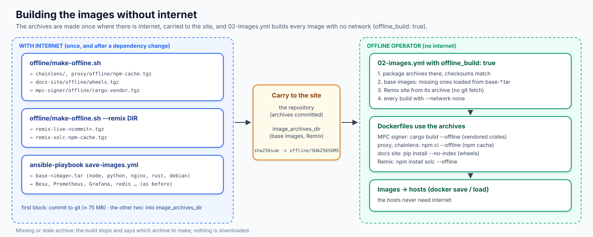

# 오프라인 빌드 (인터넷 없이)

> **내용:** **인터넷 없이** 운영자 머신에서 MPC 서명기, 프록시, chainlens, 문서 사이트, Remix 이미지를
> 빌드하는 방법을 다룹니다. 필요한 아카이브, 인터넷이 되는 머신에서 아카이브를 만드는 방법, Ansible이
> 아카이브를 사용하는 방식을 설명합니다.
>
> **대상:** 인터넷에 접근할 수 없는 온프레미스 사이트의 운영자.
>
> **관련 문서:** [Ansible](ansible.md#image-versions-and-archives) (이미지 아카이브) ·
> [운영자 가이드](operator-guide.md) · [Remix](../components/remix.md) ·
> [문서 웹사이트](../components/docs-site.md)

**목차**

- [동작 방식](#how-it-works)
- [필요한 것](#what-is-needed)
- [1. 아카이브 만들기 (인터넷 연결 상태)](#1-make-the-archives-with-internet)
- [2. 오프라인 사이트로 옮기기](#2-carry-them-to-the-offline-site)
- [3. 오프라인으로 빌드 및 배포](#3-build-and-deploy-offline)
- [무언가 없을 때](#when-something-is-missing)
- [아카이브 갱신](#refreshing-the-archives)
- [테스트 방법](#how-it-was-tested)
- [파일](#files)

---

## 동작 방식 {#how-it-works}



Docker 빌드는 보통 두 종류를 다운로드합니다. `FROM` 줄의 **베이스 이미지**와 `RUN` 단계가 설치하는
**패키지**(npm, pip, cargo)입니다. 오프라인 빌드에서는 둘 다 아카이브에서 가져옵니다.

- **패키지 아카이브**는 크기가 작으며, 각 이미지 자체의 `offline/` 폴더에 들어 있어 저장소에
  커밋됩니다. 아카이브가 있으면 Dockerfile이 임시 빌드 마운트를 통해 자동으로 사용하므로
  (`npm ci --offline`, `pip install --no-index`, `cargo build --offline`), 아카이브는 이미지에
  저장되지 않습니다. 아카이브가 없으면 빌드는 이전처럼 다운로드합니다.
- **베이스 이미지**와 **Remix**는 git에 넣기에는 너무 큽니다. 이들은 운영자 머신의
  `image_archives_dir`에 Besu, Prometheus, Grafana 아카이브와 함께 둡니다.
- `settings.yml`의 **`offline_build: true`**는 `02-images.yml`이 모든 것이 있는지 확인하고,
  없는 베이스 이미지를 `image_archives_dir`에서 로드하며, **모든 빌드를 네트워크 없이**
  (`--network none`) 실행하도록 합니다. 아카이브가 없거나 오래되었으면 무엇을 만들어야 하는지 알려 주는
  메시지와 함께 빌드가 멈추므로, 실수로 다운로드되는 것은 없습니다.

## 필요한 것 {#what-is-needed}

| 아카이브 | 위치 | 생성 기준 | 크기 |
|---|---|---|---|
| chainlens의 npm 패키지 | `chainlens/offline/npm-cache.tgz` (git) | `chainlens/package-lock.json` | 5 MB |
| 프록시의 npm 패키지 | `proxy/offline/npm-cache.tgz` (git) | `proxy/package-lock.json` | 5 MB |
| 문서 사이트의 Python wheel | `docs-site/offline/wheels.tgz` (git) | `docs-site/requirements.txt` (모든 패키지 버전 고정) | 25 MB |
| MPC 서명기의 Rust crate | `mpc-signer/offline/cargo-vendor.tgz` (git) | `mpc-signer/Cargo.lock` (`cargo vendor`) | 41 MB |
| 위 네 가지의 체크섬 | `offline/SHA256SUMS` (git) | | |
| Remix 사이트 | `image_archives_dir`의 `remix-live-<remix_commit>.tgz` | `remix_commit` 시점의 `remix_repo` | 176 MB |
| Remix의 Solidity 컴파일러 | `image_archives_dir`의 `remix-solc-npm-cache.tgz` | `remix_solc_versions` + Remix의 기본 버전 | 13 MB |
| 베이스 이미지 | `image_archives_dir`의 `base-<image>.tar` (+ `.id`) | Dockerfile의 `FROM` 줄 | 아래 참고 |

Dockerfile의 `FROM` 줄에 있는 베이스 이미지는 다음과 같습니다(파일 이름에서는 `/`와 `:`를 `_`로 바꿉니다).

| 베이스 이미지 | 사용처 | 아카이브 |
|---|---|---|
| `node:22-alpine` | 프록시, chainlens, Remix | `base-node_22-alpine.tar` (~60 MB) |
| `python:3.12.8-slim` | 문서 사이트 (빌드 단계) | `base-python_3.12.8-slim.tar` (~46 MB) |
| `nginx:1.27.3-alpine` | 문서 사이트 | `base-nginx_1.27.3-alpine.tar` (~21 MB) |
| `rust:1.100.0-bookworm` | MPC 서명기 (빌드 단계) | `base-rust_1.100.0-bookworm.tar` (~1.5 GB) |
| `debian:bookworm-slim` | MPC 서명기 | `base-debian_bookworm-slim.tar` (~75 MB) |

실행용 이미지(Besu, Prometheus, Grafana, redis, node-exporter, redis-exporter)는 별도의 묶음이며,
이미 `image_archives_dir`에 있습니다([이미지 아카이브](ansible.md#image-versions-and-archives)).

git에 있는 아카이브는 Git LFS가 아닌 **일반 파일**입니다. `01-hosts.yml`은 `git archive`로 저장소를
묶는데, 이때 LFS를 쓰면 아카이브 대신 LFS 포인터 파일이 들어가기 때문입니다.

## 1. 아카이브 만들기 (인터넷 연결 상태) {#1-make-the-archives-with-internet}

인터넷과 Docker가 있는 머신(오프라인으로 전환하기 전의 운영자 머신 또는 다른 머신)의 저장소에서
다음을 실행합니다.

```bash
offline/make-offline.sh --remix /opt/000
```

이 명령은 저장소에 네 가지 패키지 아카이브와 `offline/SHA256SUMS`를 만들고, `/opt/000`(사용하는
`image_archives_dir`)에 Remix의 아카이브 두 개를 만듭니다. 각 패키지 아카이브는 해당 이미지 자체의
베이스 이미지 안에서 만들어지므로 빌드와 정확히 일치합니다. `--only <name>`은 `chainlens`, `proxy`,
`docs-site`, `mpc-signer` 중 하나만 만듭니다. 프록시를 거쳐야 하는 경우 프록시 주소와 CA 인증서를
컨테이너에 전달합니다.

```bash
DOCKER_RUN_ARGS="--network host -e HTTPS_PROXY=http://proxy:3128 -v /etc/ca.crt:/ca.crt:ro -e SSL_CERT_FILE=/ca.crt -e NODE_EXTRA_CA_CERTS=/ca.crt -e PIP_CERT=/ca.crt -e CARGO_HTTP_CAINFO=/ca.crt" offline/make-offline.sh --remix /opt/000
```

그다음 `ansible/`에서 베이스 이미지(그리고 이전과 같이 실행용 이미지)를 저장합니다.

```bash
ansible-playbook save-images.yml -e image_archives_dir=/opt/000
```

베이스 이미지만 저장하려면 다음을 실행합니다.

```bash
ansible-playbook save-images.yml -e image_archives_dir=/opt/000 --tags base-images
```

이미지가 바뀌지 않은 아카이브는 유지됩니다(이미지 ID는 `<archive>.id`에 있습니다). 패키지 아카이브를
커밋합니다.

```bash
git add -A chainlens/offline proxy/offline docs-site/offline mpc-signer/offline offline
```

```bash
git commit -m "Offline build archives"
```

## 2. 오프라인 사이트로 옮기기 {#2-carry-them-to-the-offline-site}

- **저장소**(커밋된 아카이브 포함): 오프라인 운영자 머신에 클론하거나 복사합니다.
- **`image_archives_dir`**(위의 `/opt/000`): 폴더 전체를 복사합니다. `settings.yml`의
  `image_archives_dir`을 오프라인 운영자 머신에서의 해당 경로로 설정합니다.
- 그곳에서 패키지 아카이브를 확인합니다.

  ```bash
  sha256sum -c offline/SHA256SUMS
  ```

## 3. 오프라인으로 빌드 및 배포 {#3-build-and-deploy-offline}

`ansible/group_vars/all/settings.yml`에서 다음과 같이 설정합니다.

```yaml
offline_build: true
image_archives_dir: /opt/000
```

그다음 평소처럼 실행합니다(`site.yml`, 또는 `01-hosts.yml` 후 `02-images.yml`과 이미지를 사용하는
단계). `offline_build: true`이면 `02-images.yml`에서 다음이 이루어집니다.

| 단계 | 수행 내용 |
|---|---|
| 패키지 아카이브 | 각 아카이브가 저장소에 있어야 하며 `offline/SHA256SUMS`와 일치해야 합니다 |
| 베이스 이미지 | `FROM` 줄에서 읽으며, 없는 이미지는 `base-<image>.tar`에서 로드합니다 |
| MPC 서명기 | `docker build --network none`: `cargo-vendor.tgz`의 crate, `cargo --offline` |
| 프록시, chainlens | 네트워크 없이 빌드: `npm-cache.tgz`에서 `npm ci --offline` |
| 문서 사이트 | 네트워크 없이 빌드: `wheels.tgz`에서 `pip install --no-index` |
| Remix | 사이트는 `remix-live-<commit>.tgz`에서 풀고(`git fetch` 대신), solc는 `remix-solc-npm-cache.tgz`에서 가져오며, 네트워크 없음 |

그런 다음 이미지는 늘 그렇듯 호스트로 복사되므로(`docker save` / `docker load`) 호스트에는 인터넷이
전혀 필요하지 않습니다. `offline_build: false`(기본값)이면 같은 아카이브가 있을 때 사용하고, 없는 것은
다운로드합니다.

## 무언가 없을 때 {#when-something-is-missing}

| 메시지 | 해결 방법 |
|---|---|
| `<app>/offline/<archive> is missing: run offline/make-offline.sh …` | 아카이브를 만들고(1단계) 커밋한 다음 `01-hosts.yml`과 `02-images.yml`을 다시 실행합니다 |
| `sha256sum: WARNING: … computed checksum did NOT match` | `make-offline.sh` 실행 후 아카이브가 변경되었습니다. 다시 만드십시오 |
| `<image> is missing and …/base-<image>.tar does not exist: run save-images.yml …` | 베이스 이미지를 `image_archives_dir`에 저장합니다(1단계) |
| `…/remix-live-<commit>.tgz is missing` 또는 `remix-solc-npm-cache.tgz is missing` | `offline/make-offline.sh --remix <image_archives_dir>` |
| 빌드 중 npm `ENOTCACHED`, pip `No matching distribution`, cargo `failed to select a version` | 아카이브가 오래되었습니다. 아카이브를 만든 이후 lock 파일, `requirements.txt`, `remix_solc_versions` 또는 `remix_commit`이 변경되었습니다. 다시 만드십시오 |

## 아카이브 갱신 {#refreshing-the-archives}

다음 항목이 변경되면 아카이브를 다시 만드십시오(1단계).

- `chainlens/package-lock.json` 또는 `proxy/package-lock.json`: 해당 앱의 `npm-cache.tgz`
- `docs-site/requirements.txt`: `wheels.tgz`. 문서 도구 버전을 변경하려면 `requirements.txt`(모든
  패키지의 버전이 여기에 고정되어 있음)를 편집하고, 사이트가 여전히 빌드되는지 확인한 뒤 다시 만듭니다
- `mpc-signer/Cargo.lock`: `cargo-vendor.tgz`
- `remix_commit` 또는 `remix_solc_versions`: Remix 아카이브 두 개
- `FROM` 줄(예: 새 Rust 버전): `save-images.yml --tags base-images`

갱신할 때마다 새 아카이브가 git 기록에 추가됩니다(네 가지 모두 약 75 MB). 커밋할 때마다가 아니라
의존성이 바뀔 때 갱신하십시오.

## 테스트 방법 {#how-it-was-tested}

랩에서 운영자 머신의 Docker가 어떤 레지스트리에도 접근할 수 없는 상태(프록시가 닫힌 포트를 가리켜
`docker pull`이 실패함), `offline_build: true`, 실제 Dockerfile로 테스트했습니다.

- `node`, `python`, `nginx`는 `base-*.tar`에서 로드했고, `rust`와 `debian`은 이미 있었습니다.
- MPC 서명기는 vendor된 crate에서 `cargo --offline`으로(crates.io 접근 없이), 프록시(84개 패키지)와
  chainlens(74개)는 `npm ci --offline`으로, 문서 사이트는 `pip --no-index`로, Remix는 사이트 아카이브와
  npm 캐시의 컴파일러 두 개(0.8.28, 0.8.34)로 빌드했으며, 모두 `--network none`을 사용했습니다.
- 새 이미지를 전송하여 배포했고(`06`, `11`, `12`, `13`), `08-check.yml`이 통과했으며, 프록시를 통한
  전송이 MPC 노드에 의해 서명되어 블록에 포함되었습니다. Remix는 두 컴파일러를 모두 제공했고, 문서
  사이트는 영어와 한국어 페이지를 제공했습니다.
- 패키지 아카이브가 없는 경우와 베이스 이미지가 없는 경우 모두 `02-images.yml`이 위의 메시지와 함께
  멈췄습니다. `save-images.yml`은 두 번째 실행에서 변경되지 않은 베이스 이미지 아카이브를 유지했습니다.

테스트하지 않은 것: 아카이브에서 Rust 베이스 이미지를 로드하는 경우(랩 운영자 머신에 이미 있었고,
1.5 GB 아카이브는 랩 디스크에 들어가지 않았습니다). 이 이미지도 다른 세 이미지와 같은 방식으로 로드됩니다.

## 파일 {#files}

| 경로 | 내용 |
|---|---|
| `offline/make-offline.sh` | 패키지 아카이브(그리고 `--remix`를 지정하면 Remix의 아카이브)를 만듭니다 |
| `offline/README.md`, `offline/SHA256SUMS` | 개요, git에 있는 아카이브의 체크섬 |
| `chainlens/offline/`, `proxy/offline/`, `docs-site/offline/`, `mpc-signer/offline/` | 패키지 아카이브 |
| `remix/offline/` | `02-images.yml`이 빌드를 위해 Remix의 컴파일러 아카이브를 두는 곳 |
| `docs-site/requirements.txt` | 문서 빌드의 모든 Python 패키지(버전 고정) |
| `*/Dockerfile` | 아카이브가 있으면 사용합니다 |
| `ansible/02-images.yml` | `offline_build`: 점검, 베이스 이미지, 아카이브에서 Remix 준비, 네트워크 없는 빌드 |
| `ansible/save-images.yml` | 베이스 이미지도 저장합니다(`--tags base-images`) |
| `ansible/group_vars/all/settings.yml` | `offline_build`, `image_archives_dir` |
| `ansible/group_vars/all/layout.yml` | `build_dockerfiles`, `offline_package_archives`, Remix 아카이브 이름 |
