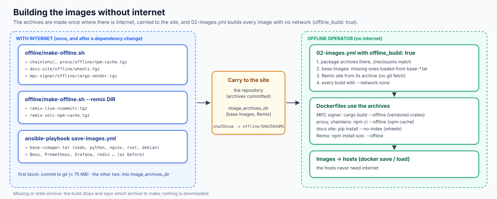

# Offline build (no internet)

> **What:** building the MPC signer, proxy, chainlens, documentation site and Remix images on an
> operator machine **without internet**: which archives it needs, how to make them on a machine
> with internet, and how Ansible uses them.
>
> **For:** operators of an on-premise site without internet access.
>
> **Related:** [Ansible](ansible.md#image-versions-and-archives) (image archives) ·
> [operator guide](operator-guide.md) · [Remix](../components/remix.md) ·
> [documentation website](../components/docs-site.md)

**Contents**

- [How it works](#how-it-works)
- [What is needed](#what-is-needed)
- [1. Make the archives (with internet)](#1-make-the-archives-with-internet)
- [2. Carry them to the offline site](#2-carry-them-to-the-offline-site)
- [3. Build and deploy offline](#3-build-and-deploy-offline)
- [When something is missing](#when-something-is-missing)
- [Refreshing the archives](#refreshing-the-archives)
- [How it was tested](#how-it-was-tested)
- [Files](#files)

---

## How it works



A Docker build normally downloads two kinds of things: the **base images** of its `FROM` lines,
and the **packages** its `RUN` steps install (npm, pip, cargo). For an offline build both come
from archives:

- **Package archives** are small and committed in the repository, in each image's own `offline/`
  folder. The Dockerfiles use them automatically when they are there (`npm ci --offline`,
  `pip install --no-index`, `cargo build --offline`), through a temporary build mount, so the
  archive is not stored in the image. Without them the builds download as before.
- **Base images** and **Remix** are too big for git. They go into `image_archives_dir` on the
  operator, next to the Besu, Prometheus and Grafana archives.
- **`offline_build: true`** in `settings.yml` makes `02-images.yml` check that everything is there,
  load missing base images from `image_archives_dir`, and run **every build with no network**
  (`--network none`). A missing or stale archive then stops the build with a message saying what to
  make; nothing is downloaded by accident.

## What is needed

| Archive | Where | Made from | Size |
|---|---|---|---|
| npm packages of chainlens | `chainlens/offline/npm-cache.tgz` (git) | `chainlens/package-lock.json` | 5 MB |
| npm packages of the proxy | `proxy/offline/npm-cache.tgz` (git) | `proxy/package-lock.json` | 5 MB |
| Python wheels of the documentation site | `docs-site/offline/wheels.tgz` (git) | `docs-site/requirements.txt` (every package pinned) | 25 MB |
| Rust crates of the MPC signer | `mpc-signer/offline/cargo-vendor.tgz` (git) | `mpc-signer/Cargo.lock` (`cargo vendor`) | 41 MB |
| checksums of the four above | `offline/SHA256SUMS` (git) | | |
| Remix site | `remix-live-<remix_commit>.tgz` in `image_archives_dir` | `remix_repo` at `remix_commit` | 176 MB |
| Remix's Solidity compilers | `remix-solc-npm-cache.tgz` in `image_archives_dir` | `remix_solc_versions` + Remix's default version | 13 MB |
| base images | `base-<image>.tar` (+ `.id`) in `image_archives_dir` | the `FROM` lines of the Dockerfiles | see below |

The base images, from the Dockerfiles' `FROM` lines (the file name replaces `/` and `:` with `_`):

| Base image | Used by | Archive |
|---|---|---|
| `node:22-alpine` | proxy, chainlens, Remix | `base-node_22-alpine.tar` (~60 MB) |
| `python:3.12.8-slim` | documentation site (build stage) | `base-python_3.12.8-slim.tar` (~46 MB) |
| `nginx:1.27.3-alpine` | documentation site | `base-nginx_1.27.3-alpine.tar` (~21 MB) |
| `rust:1.100.0-bookworm` | MPC signer (build stage) | `base-rust_1.100.0-bookworm.tar` (~1.5 GB) |
| `debian:bookworm-slim` | MPC signer | `base-debian_bookworm-slim.tar` (~75 MB) |

The running images (Besu, Prometheus, Grafana, redis, node-exporter, redis-exporter) are a separate
set, already in `image_archives_dir` ([image archives](ansible.md#image-versions-and-archives)).

The archives in git are **plain files**, not Git LFS: `01-hosts.yml` packs the repository with
`git archive`, which would put LFS pointer files in their place.

## 1. Make the archives (with internet)

On a machine with internet and Docker (the operator before it goes offline, or any other), in the
repository:

```bash
offline/make-offline.sh --remix /opt/000
```

It makes the four package archives in the repository and `offline/SHA256SUMS`, and Remix's two
archives in `/opt/000` (your `image_archives_dir`). Each package archive is made inside the image's
own base image, so it matches the build exactly. `--only <name>` makes one of `chainlens`, `proxy`,
`docs-site`, `mpc-signer`. Behind a proxy, pass its address and CA certificate to the containers:

```bash
DOCKER_RUN_ARGS="--network host -e HTTPS_PROXY=http://proxy:3128 -v /etc/ca.crt:/ca.crt:ro -e SSL_CERT_FILE=/ca.crt -e NODE_EXTRA_CA_CERTS=/ca.crt -e PIP_CERT=/ca.crt -e CARGO_HTTP_CAINFO=/ca.crt" offline/make-offline.sh --remix /opt/000
```

Then the base images (and, as before, the running images), from `ansible/`:

```bash
ansible-playbook save-images.yml -e image_archives_dir=/opt/000
```

Only the base images:

```bash
ansible-playbook save-images.yml -e image_archives_dir=/opt/000 --tags base-images
```

An archive whose image has not changed is kept (its image id is in `<archive>.id`). Commit the
package archives:

```bash
git add -A chainlens/offline proxy/offline docs-site/offline mpc-signer/offline offline
```

```bash
git commit -m "Offline build archives"
```

## 2. Carry them to the offline site

- The **repository** (with the committed archives): clone or copy it to the offline operator.
- **`image_archives_dir`** (`/opt/000` above): copy the whole folder. Set `image_archives_dir` to
  its path on the offline operator in `settings.yml`.
- Check the package archives there:

  ```bash
  sha256sum -c offline/SHA256SUMS
  ```

## 3. Build and deploy offline

In `ansible/group_vars/all/settings.yml`:

```yaml
offline_build: true
image_archives_dir: /opt/000
```

Then run as usual (`site.yml`, or `01-hosts.yml` then `02-images.yml` and the phases that use the
images). In `02-images.yml`, with `offline_build: true`:

| Step | What happens |
|---|---|
| package archives | each one must be in the repository and match `offline/SHA256SUMS` |
| base images | read from the `FROM` lines; a missing one is loaded from `base-<image>.tar` |
| MPC signer | `docker build --network none`: crates from `cargo-vendor.tgz`, `cargo --offline` |
| proxy, chainlens | built with no network: `npm ci --offline` from `npm-cache.tgz` |
| documentation site | built with no network: `pip install --no-index` from `wheels.tgz` |
| Remix | site extracted from `remix-live-<commit>.tgz` (instead of `git fetch`), solc from `remix-solc-npm-cache.tgz`, no network |

The images are then copied to the hosts as always (`docker save` / `docker load`); the hosts never
need internet. With `offline_build: false` (the default) the same archives are used when present,
and anything missing is downloaded.

## When something is missing

| Message | Fix |
|---|---|
| `<app>/offline/<archive> is missing: run offline/make-offline.sh …` | make it (step 1), commit, run `01-hosts.yml` and `02-images.yml` again |
| `sha256sum: WARNING: … computed checksum did NOT match` | an archive changed after `make-offline.sh`: make it again |
| `<image> is missing and …/base-<image>.tar does not exist: run save-images.yml …` | save the base images (step 1) into `image_archives_dir` |
| `…/remix-live-<commit>.tgz is missing` or `remix-solc-npm-cache.tgz is missing` | `offline/make-offline.sh --remix <image_archives_dir>` |
| npm `ENOTCACHED`, pip `No matching distribution`, cargo `failed to select a version` during a build | the archive is stale: a lock file, `requirements.txt`, `remix_solc_versions` or `remix_commit` changed since it was made. Make it again |

## Refreshing the archives

Make them again (step 1) after a change to:

- `chainlens/package-lock.json` or `proxy/package-lock.json`: that app's `npm-cache.tgz`;
- `docs-site/requirements.txt`: `wheels.tgz`. To change a documentation tool version, edit
  `requirements.txt` (every package is pinned there), check the site still builds, then remake;
- `mpc-signer/Cargo.lock`: `cargo-vendor.tgz`;
- `remix_commit` or `remix_solc_versions`: the two Remix archives;
- a `FROM` line (for example a new Rust version): `save-images.yml --tags base-images`.

Each refresh adds the new archives to the git history (about 75 MB for all four); refresh when the
dependencies change, not on every commit.

## How it was tested

In the lab, with the operator's Docker unable to reach any registry (its proxy pointed at a closed
port, so `docker pull` failed), `offline_build: true`, and the real Dockerfiles:

- `node`, `python` and `nginx` were loaded from `base-*.tar`; `rust` and `debian` were present.
- The MPC signer was built with `cargo --offline` from the vendored crates (no crates.io access),
  the proxy (84 packages) and chainlens (74) with `npm ci --offline`, the documentation site with
  `pip --no-index`, Remix from the site archive and its two compilers (0.8.28, 0.8.34) from the npm
  cache, all with `--network none`.
- The new images were shipped and deployed (`06`, `11`, `12`, `13`); `08-check.yml` passed and a
  transfer through the proxy was signed by the MPC nodes and mined. Remix served both compilers,
  the documentation site its English and Korean pages.
- A missing package archive and a missing base image each stopped `02-images.yml` with the message
  above; `save-images.yml` kept unchanged base image archives on a second run.

Not tested: the Rust base image loaded from its archive (it was present on the lab operator; the
1.5 GB archive did not fit on the lab disk). It is loaded the same way as the three others.

## Files

| Path | What |
|---|---|
| `offline/make-offline.sh` | makes the package archives (and Remix's, with `--remix`) |
| `offline/README.md`, `offline/SHA256SUMS` | overview, checksums of the archives in git |
| `chainlens/offline/`, `proxy/offline/`, `docs-site/offline/`, `mpc-signer/offline/` | the package archives |
| `remix/offline/` | where `02-images.yml` puts Remix's compiler archive for the build |
| `docs-site/requirements.txt` | every Python package of the documentation build, pinned |
| `*/Dockerfile` | use the archives when present |
| `ansible/02-images.yml` | `offline_build`: checks, base images, Remix from archives, builds without network |
| `ansible/save-images.yml` | also saves the base images (`--tags base-images`) |
| `ansible/group_vars/all/settings.yml` | `offline_build`, `image_archives_dir` |
| `ansible/group_vars/all/layout.yml` | `build_dockerfiles`, `offline_package_archives`, the Remix archive names |
