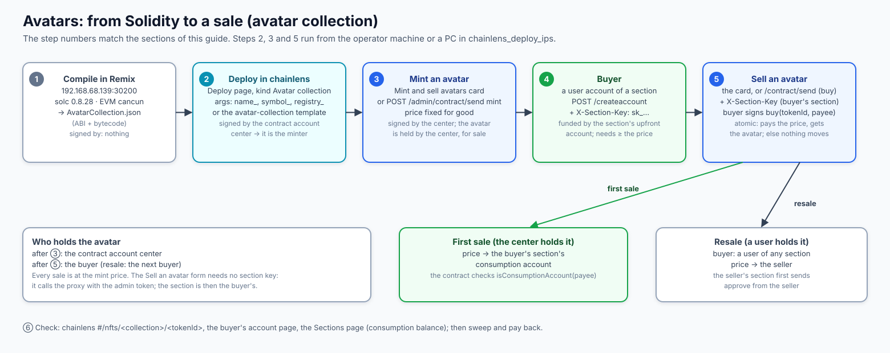
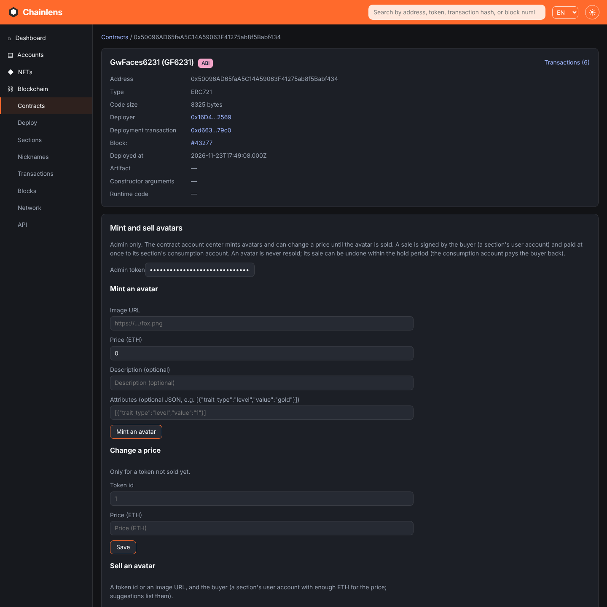

# 아바타

> **내용:** Solidity에서 아바타 판매까지: Remix에서 컴파일하고, 아바타 컬렉션을 배포하고, 아바타를 민팅하고, 가격을 바꾸고, 섹션의 사용자 계정에 아바타를 판매하고(한 번, 영구히), 보류 기간 안에 판매를 취소합니다.
>
> **대상:** 컨트랙트 개발자, 비즈니스 관리자.
>
> **관련 문서:** [닉네임](nicknames.md) · [섹션](sections.md) · [프록시 API](../reference/proxy-api.md#avatar-collections) · [chainlens](../components/chainlens.md)

**목차**

- [규칙](#rules)
- [0. 시작하기 전에](#0-before-you-start)
- [1. Remix에서 컴파일](#1-compile-in-remix)
- [2. 배포](#2-deploy)
- [3. 아바타 민팅](#3-mint)
- [4. 가격 변경](#4-change-a-price)
- [5. 구매자: 섹션의 사용자 계정](#5-a-buyer-a-sections-user-account)
- [6. 아바타 판매(구매)](#6-sell)
- [7. 판매 취소](#7-undo-a-sale)
- [8. 읽기와 확인](#8-check)
- [이전 컬렉션](#older-collections)
- [오류](#errors)
- [파일](#files)

---

**아바타**는 플랫폼의 이미지 토큰(ERC-721)입니다: 가격이 있는 그림으로, 컨트랙트 계정 센터가 민팅하고
섹션의 사용자 계정이 **한 번** 구매하면 그 계정이 계속 보유합니다. 아바타와 [닉네임](nicknames.md)은 모두
**아이템**이며 같은 규칙을 따릅니다([`proxy/contracts/BoundItems.sol`](../../proxy/contracts/BoundItems.sol)).
이 가이드는 [`proxy/contracts/AvatarCollection.sol`](../../proxy/contracts/AvatarCollection.sol)(버전 4)을 사용합니다.

## 규칙 {#rules}

| 규칙 | 지키는 방법 |
|---|---|
| **센터가 민팅** | 컨트랙트 계정 센터(컬렉션의 minter)만 민팅합니다: `mint { image, price, description?, attributes? }`. 토큰 ID는 컬렉션마다 1, 2, 3…입니다. 이름은 없습니다: 이미지가 곧 아바타입니다 |
| **이미지마다 한 번** | 같은 이미지 URL로 두 번째 `mint`를 하면 거부됩니다(`this image is already minted`). `tokenOf { imageUrl }`로 이미지의 토큰을 찾습니다 |
| **판매 전까지 가격 변경 가능** | 센터가 토큰을 보유하는 동안 `setPrice { tokenId, price }`로 가격을 바꿀 수 있고, 판매 후에는 바꿀 수 없습니다 |
| **섹션의 사용자 계정이 한 번 구매** | `buy`: 구매자는 정확히 가격만큼 지불하고, 그 금액은 **즉시** 자기 섹션의 **소비(consumption) 계정**으로 갑니다(에스크로 없음). 컨트랙트가 SectionRegistry로 둘 다 확인합니다 |
| **재판매 없음, 이전 없음** | 구매자에게 귀속(ERC-5192: `locked()`가 true). `approve`, `setApprovalForAll`, `transferFrom`, `safeTransferFrom`은 항상 되돌려집니다(revert) |
| **계정당 여러 개** | 한 계정이 아바타(와 닉네임)를 몇 개든 보유할 수 있습니다 |
| **보류 기간 안에 취소** | 판매 후 `holdSeconds`(기본 7일) 안에 `undo { tokenId }`: 돈을 받은 소비 계정이 구매자에게 환불을 보내고, 아바타는 센터로 돌아가 다시 판매됩니다 |
| **모든 결제 기록** | `paymentsOf { tokenId }`: 각 판매의 시각, 지불자, 받은 계정, 취소 기한, 취소 여부 |

| 단계 | 위치 | 서명 주체 |
|---|---|---|
| 1. 컴파일 | Remix (`http://192.168.68.139:30200`) | 없음 |
| 2. 배포 | chainlens **Deploy** 페이지, 또는 `avatar-collection` 템플릿(`holdDays`)으로 `POST /admin/contract/deploy` | 컨트랙트 계정 센터 |
| 3. 민팅 | 컬렉션의 chainlens 페이지에서 **Mint an avatar**, 또는 `POST /admin/contract/send` `mint` | 컨트랙트 계정 센터 |
| 4. 가격 변경 | 같은 카드의 **Change a price**, 또는 `POST /admin/contract/send` `setPrice` | 컨트랙트 계정 센터 |
| 5. 구매자 | 섹션의 키로 `POST /createaccount`, 또는 chainlens Sections 페이지에서 **Create account** | — (섹션의 선지급 계정에서 자금 공급) |
| 6. 판매 | 카드의 **Sell an avatar**, 또는 섹션의 키로 `POST /contract/send` `buy` | 구매자 |
| 7. 취소 | 카드 목록의 **Undo**, 또는 `POST /contract/send` `undo`(`from` 없음) | 돈을 받은 소비 계정 |



아래 주소는 프로덕션 주소입니다(프록시 VIP `192.168.68.151:30000`, chainlens와 Remix는 h139).
chainlens 관리 페이지는 운영자 머신 또는 `chainlens_deploy_ips`에 있는 PC에서 사용하십시오
([컨트랙트 배포 (chainlens Deploy 페이지)](contract-deployment.md)).

## 0. 시작하기 전에 {#0-before-you-start}

- 섹션이 구성되어 있어야 하며(06 단계에서 SectionRegistry와 컨트랙트 계정 센터를 생성),
  선지급 계정에 자금이 있는 **섹션**이 하나 이상 있어야 합니다(chainlens **Sections**
  페이지 또는 `POST /admin/sections`).
- chainlens 관리 페이지가 켜져 있어야 합니다. Deploy 페이지에는 `chainlens_deploy_enabled: true`가 필요합니다.
  **Mint and sell avatars** 카드는 Deploy 페이지나 Sections 페이지가 켜져 있으면 아바타 컬렉션 페이지에 표시됩니다.
- Remix에서 배포하려면 **SectionRegistry의 주소**(생성자 인수)가 필요합니다. chainlens 대시보드
  (*Platform* → *Section registry*)에 표시되며 `ansible/state/registry.json`에도 있습니다. 템플릿은 이 값을 채웁니다.
- chainlens 관리 페이지용 **관리 토큰**이 필요합니다(Deploy 페이지에서는 *Deploy token*, Mint and sell
  avatars 카드에서는 *Admin token*이라고 부르지만 같은 토큰입니다). 운영자 머신에서:

  ```bash
  cat ansible/state/secrets/chainlens_deploy_token
  ```

  curl 예시는 대신 프록시의 관리 API를 **프록시 관리 토큰**(`ansible/state/secrets/proxy_admin_token`)으로,
  `ADMIN_ALLOWED_IPS`에 있는 주소에서 호출합니다:

  ```bash
  P=http://192.168.68.151:30000; T=$(cat ansible/state/secrets/proxy_admin_token)
  ```

> **Ansible이 하나를 배포합니다:** `08-check.yml`이 `platform_avatar_collections`의 아바타 컬렉션(기본: *Avatars*,
> AVT, 7일)을 한 번 배포합니다([Ansible](../deployment/ansible.md#platform-contracts)). 아래 단계는 다른 컬렉션을
> 만들거나 직접 배포할 때입니다.

## 1. Remix에서 컴파일 {#1-compile-in-remix}

저장소에 컴파일된 아티팩트가 이미 있습니다: `proxy/avatar-collection.json`(템플릿이 사용). Remix 컴파일은
코드를 확인하거나 바꿀 때만 필요합니다.

1. `http://192.168.68.139:30200`을 엽니다([Remix IDE (자체 호스팅)](../components/remix.md)).
   `AvatarCollection.sol`과 `BoundItems.sol`(import 대상)을 같은 폴더에 만들고
   [`proxy/contracts/AvatarCollection.sol`](../../proxy/contracts/AvatarCollection.sol)과
   [`proxy/contracts/BoundItems.sol`](../../proxy/contracts/BoundItems.sol)의 내용을 붙여넣습니다.
2. **Solidity compiler:** 버전 `0.8.28`, **Advanced configurations → EVM version `cancun`**,
   옵티마이저 켜기(200 runs). `AvatarCollection.sol`을 컴파일합니다.
3. **Settings → Generate contract metadata**를 켭니다. Remix가
   `contracts/artifacts/AvatarCollection.json`(ABI + 바이트코드)을 작성합니다. 마우스 오른쪽 버튼 → **Download**.

저장소의 아티팩트를 다시 만들려면 `proxy/`에서:
`node scripts/compile-contract.js contracts/AvatarCollection.sol AvatarCollection avatar-collection.json`
(같은 폴더의 `BoundItems.sol`을 읽습니다).

## 2. 배포 {#2-deploy}

**템플릿으로(가장 간단):** `avatar-collection` 템플릿은 레지스트리 주소를 채워 컴파일된 컨트랙트를 배포하고
등록합니다. `holdDays`는 **취소 기간**입니다(기본 7; 소수 허용, 예: 테스트용 `0.0025` = 216초). 이름과
심볼은 아바타 컬렉션 사이에서 대소문자 무관하게 고유해야 합니다(아니면 409):

```bash
curl -s -X POST $P/admin/contract/deploy -H "Authorization: Bearer $T" -H 'Content-Type: application/json' \
  -d '{"template":"avatar-collection","name":"Faces","symbol":"FACE","holdDays":7}'
```

```
{ "success": true, "name": "Faces", "kind": "avatar", "address": "0xFaces", "deployer": "<center>", "txHash": "0x…",
  "codeCheck": "matches the artifact", "registryTxHash": "0x…", ... }
```

같은 본문으로 `POST /admin/contract/check`를 호출하면 시험 실행(가스, 배포될 주소)입니다.

**또는 chainlens에서** (`http://192.168.68.139:30100/#/deploy`):

1. **Deploy token:** 토큰을 붙여넣습니다.
2. **Compiler artifact:** `AvatarCollection.json`. 파일에 컨트랙트가 여러 개 있으면 **AvatarCollection**을 선택합니다.
3. **Constructor arguments:** `name_`(`Faces`), `symbol_`(`FACE`), `registry_`(SectionRegistry의 주소),
   `holdSeconds_`(취소 기간, 초 단위: `604800` = 7일).
4. **Kind:** *Avatar collection*. 그래야 레지스트리가 아바타 컬렉션으로 기록합니다(`kind: "avatar"`).
   **Name in the registry:** 선택 사항, 예: `Faces`.
5. **Check**, 그다음 **Deploy**. 페이지가 새 컨트랙트로 링크합니다: `#/contracts/0x…`.

컨트랙트 계정 센터가 배포자이므로 컬렉션의 **minter**입니다. 컬렉션은 모든 섹션이 공유합니다.
애플리케이션은 컬렉션의 **주소**를 사용합니다: `GET /contract/list?type=avatar`가 아바타 컬렉션을 이름, 심볼,
minter와 함께 나열합니다. `holdSeconds`로 취소 기간을 읽습니다.

## 3. 아바타 민팅 {#3-mint}

**chainlens에서:** 컬렉션 페이지(`#/contracts/0xFaces`)의 **Mint and sell avatars** 카드에서
**Image URL**과 **Price (ETH)**를 입력합니다. **Description**과 **Attributes**(JSON)는 선택 사항입니다.
**Mint an avatar**를 클릭하면 새 토큰 ID와 가격이 표시됩니다.



**또는 curl로:** 친화적인 `args`로 `POST /admin/contract/send`를 통해 `mint`(컨트랙트 계정 센터가 서명).
프록시가 메타데이터(`image`, `description`, `attributes`)를 만들어 토큰 URI에 체인상으로 저장합니다:

```bash
curl -s -X POST $P/admin/contract/send -H "Authorization: Bearer $T" -H 'Content-Type: application/json' \
  -d '{"contract":"0xFaces","function":"mint","args":{"image":"https://img.example/fox.png","price":"0.3","description":"fox","attributes":[{"trait_type":"color","value":"red"}]}}'
```

```
{ "success": true, "contract": "0xFaces", "function": "mint(string,string,uint256)", "from": "<center>", "txHash": "0x…",
  "result": { "minted": true, "tokenId": "1", "image": "https://img.example/fox.png", "price": "0.3" }, "events": [ … ] }
```

새 아바타는 센터가 판매용으로 보유합니다. `image`는 필수이고, `price`는 ETH입니다(기본 0). 민팅은 섹션과
무관하며 아무것도 지불하지 않습니다. 같은 이미지를 두 번: 400 `Execution reverted (this image is already
minted)`. `name`은 거부됩니다(`args: unknown name(s) name; mint takes image, price, description, attributes`).
블록에 들어가지 않을 만큼 큰 메타데이터: 400 `metadata is too large for the chain`. 섹션은 민팅할 수 없습니다:
`/contract/send`로 보내면 `not minter`로 되돌려집니다.

## 4. 가격 변경 {#4-change-a-price}

센터가 아바타를 보유하는 동안(판매된 적이 없거나 판매가 취소된 경우):

```bash
curl -s -X POST $P/admin/contract/send -H "Authorization: Bearer $T" -H 'Content-Type: application/json' \
  -d '{"contract":"0xFaces","function":"setPrice","args":{"tokenId":"1","price":"0.4"}}'
# → "result": { "tokenId": "1", "price": "0.4" }
```

chainlens에서는 **Change a price**(토큰 ID, 가격). 판매 후: 400 `the transaction would revert: sold: the
price can no longer change`.

## 5. 구매자: 섹션의 사용자 계정 {#5-a-buyer-a-sections-user-account}

구매자는 **섹션의 사용자 계정**이어야 하며 최소한 가격만큼의 잔액이 있어야 합니다:

```bash
curl -s -X POST $P/createaccount -H 'Content-Type: application/json' \
  -H 'X-Section-Key: sk_…' -d '{"amount":"5"}'
# → { "success": true, "section": {"id": 1, "name": "Shop A"}, "address": "0xUser", ... }
```

계정은 그 섹션의 선지급 계정에서 자금을 받습니다. 나중에 ETH를 더 주려면 섹션의 키와 음수 금액으로
`POST /transfer`를 사용합니다(`−x`: 선지급 → 계정; [섹션](sections.md#application-api-section-calls) 참조).
키 없이 chainlens **Sections** 페이지에서도 할 수 있습니다(섹션의 사용자 계정: **Create account**, **Transfer**).

## 6. 아바타 판매(구매) {#6-sell}

**chainlens에서:** 카드의 **Sell an avatar**에서 토큰 ID **또는** 이미지 URL과 구매자를 입력합니다(구매자
입력란은 섹션 사용자 계정을 섹션과 잔액과 함께 제안합니다). **Sell an avatar**를 클릭하면 가격과 판매를
취소할 수 있는 기한이 표시됩니다.

**또는 curl로**, 구매자 섹션의 키로 범용
[`POST /contract/send`](../reference/proxy-api.md#post-contractsend--write)를 사용합니다. `from`은 구매자입니다.
`args`는 `{ "tokenId" }` 또는 `{ "imageUrl" }`입니다. payee와 `value`는 생략하십시오: 프록시가 구매자 섹션의
소비 계정과 토큰의 가격을 채웁니다.

```bash
K=sk_…   # 구매자 섹션의 키
curl -s -X POST $P/contract/send -H 'Content-Type: application/json' -H "X-Section-Key: $K" \
  --data '{"contract":"0xFaces","function":"buy","args":{"imageUrl":"https://img.example/fox.png"},"from":"0xUser"}'
```

```
{ "success": true, "section": {"id": 1, "name": "Shop A"}, "function": "buy(uint256,address)", "from": "0xUser", "value": "0.4", "txHash": "0x…",
  "result": { "tokenId": "1", "image": "https://img.example/fox.png", "price": "0.4", "buyer": "0xUser", "paid": "0.4",
              "paidTo": "0xConsumption", "undoUntil": "2026-11-30T17:36:09.250Z" },
  "events": [ { "name": "Sold", "args": { … } }, ... ] }
```

구매자는 원자적인 `buy(tokenId, payee)` 트랜잭션 하나에 서명합니다: 정확히 가격을 지불하고, 그 금액은 **즉시**
자기 섹션의 소비 계정으로 가며, 아바타를 받습니다. 어떤 확인이라도 실패하면 아무것도 이동하지 않습니다.
컨트랙트 자체가 구매자가 섹션의 사용자 계정인지, `payee`가 구매자 자신의 섹션의 소비 계정인지 확인하므로,
프록시를 거치지 않은 트랜잭션도 돈의 행선지를 바꿀 수 없습니다. 판매된 아바타는 다시 구매할 수 없고
(409 `token 1 is already sold`) 이전할 수도 없습니다.

키가 없으면 프록시는 401 `X-Section-Key is required`로 응답합니다. 유일한 예외는 관리 API 호출자입니다:
chainlens 카드는 섹션 키가 필요 없습니다. chainlens가 프록시의 `ADMIN_ALLOWED_IPS`에 있는 주소에서 관리
토큰으로 프록시를 호출하기 때문이며, 이때 섹션은 구매자의 섹션입니다.

이전의 `POST /nft/transfer`는 제거되었습니다: `/contract/send`를 안내하며 410으로 응답합니다.

## 7. 판매 취소 {#7-undo-a-sale}

판매의 보류 기간 안에는(위 응답의 `undoUntil`, 그리고 `paymentsOf`) 섹션이 판매를 취소할 수 있습니다: 구매자는
가격을 돌려받고 아바타는 센터로 돌아가 다시 판매됩니다(같은 가격이며, 센터가 다시 바꿀 수 있습니다).

**chainlens에서:** 카드의 아바타 목록(최신 순)에서 아직 취소할 수 있는 판매마다 기한과 함께 **Undo**가 있습니다.

**또는 curl로:** 돈을 받은 섹션의 키로, **`from` 없이** `/contract/send`로 `undo`를 보냅니다. 프록시는 그 섹션의
소비 계정(돈을 받은 계정)으로 서명하며, 이 계정이 같은 트랜잭션에서 환불을 보냅니다:

```bash
curl -s -X POST $P/contract/send -H 'Content-Type: application/json' -H "X-Section-Key: $K" \
  --data '{"contract":"0xFaces","function":"undo","args":{"tokenId":"1"}}'
```

```
{ "success": true, "section": {"id": 1, "name": "Shop A"}, "function": "undo(uint256)", "from": "0xConsumption", "value": "0.4", "txHash": "0x…",
  "result": { "tokenId": "1", "undone": "sale", "buyer": "0xUser", "refunded": "0.4", "by": "0xConsumption" }, "events": [ … ] }
```

| 거부되는 경우 | 메시지 |
|---|---|
| 보류 기간 이후 | 409 `the undo period of token 1 ended at 2026-11-30T17:36:09.000Z` |
| 토큰이 판매되지 않음(판매된 적 없음, 또는 이미 취소됨) | 409 `token 1 is not sold` |
| 다른 섹션의 키 | 403 `token 1 was paid to section "Shop A": only its key can undo` |
| 소비 계정의 ETH 부족(예: 스윕 후) | 409 `the refund needs 0.4 ETH but 0x… (section "Shop A" consumption) has 0.1 ETH` |
| 소비 계정이 아닌 `from` | 400 `from: leave it out (an undo is signed by 0x…, the account that was paid)` |

취소 기간이 끝난 돈만 스윕하거나, 아직 필요할 수 있는 취소를 위해 소비 계정에 충분한 금액을 남겨 두십시오.

## 8. 읽기와 확인 {#8-check}

모두 `POST /contract/call`(호출 하나, 또는 최대 50개를 위한 `{ "calls": [ … ] }`), 친화적인 값:

| 함수, `args` | `result` |
|---|---|
| `tokensOf { account }` | 계정이 보유한 아바타: `[ { tokenId, image, price } ]`(센터의 경우: 팔리지 않은 것) |
| `tokenOf { imageUrl }` | `{ tokenId, minted, sold, owner, price }`, 또는 `{ tokenId: null, minted: false }` |
| `ownerOf { tokenId }` | `{ tokenId, owner, sold }` |
| `priceOf { tokenId }` | `{ tokenId, price }` |
| `imageOf { tokenId }` | `{ tokenId, image }` |
| `tokenURI { tokenId }` | `{ tokenId, metadata: { image, description, attributes }, image }` |
| `paymentsOf { tokenId }` | 토큰의 모든 판매, 오래된 것부터: `[ { kind: "sale", amount, payer, paidTo, paidAt, undoUntil, undone, undoable, current } ]` |
| `holdSeconds`, `totalSupply` | 취소 기간(초), 민팅된 아바타 수 |

```bash
curl -s -X POST $P/contract/call -H 'Content-Type: application/json' -H "X-Section-Key: $K" \
  --data '{"contract":"0xFaces","function":"paymentsOf","args":{"tokenId":"1"}}'
# → "result": [ { "kind": "sale", "amount": "0.4", "payer": "0xUser", "paidTo": "0xConsumption", "paidAt": "2026-11-23T17:36:09.000Z",
#                 "undoUntil": "2026-11-30T17:36:09.000Z", "undone": false, "undoable": true, "current": true } ]
```

`undoable`은 지금 판매를 취소할 수 있으면 true입니다. `current`는 유효한 판매를 표시합니다(취소된 이전 판매는
`undone: true`로 목록에 남습니다). `POST /contract/events`는 `Sold`, `Undone`, `PriceSet`, `Transfer`를
나열합니다(가격은 ETH).

- **chainlens:** `#/nfts/0xFaces/1`에 소유자, 메타데이터, 이미지가 표시됩니다. 구매자의 계정 페이지에 섹션과
  아바타가, **Sections** 페이지에 소비 계정의 잔액이 표시됩니다. 대시보드의 **Section statistics**가 판매
  (*Avatar sales*, *Income*)와 취소(*Undone, refunded*)를 셉니다.
- **Grafana → Sections:** `avatar_sale`과 `avatar_undo` 작업과 그 ETH. 수입 = 판매 − 취소.
- **자금:** chainlens **Sections** 페이지에서 소비 계정을 결제 계정으로 스윕하고 SENDER01로 반환합니다.

## 이전 컬렉션 {#older-collections}

| 컬렉션 | 프록시에서 |
|---|---|
| 버전 4(`AvatarCollection`, 이 문서) | 아바타 컬렉션: 친화적인 값, `type: "avatar"` |
| 버전 3(`NftCollection`, 재판매 있음) | 일반 등록 컨트랙트: 친화적인 값 없음, `type: "avatar"` 아님. 새 컬렉션을 배포하고 다시 민팅하십시오 |
| 버전 2(SENDER01이 민팅, 섹션 이전) | **폐기됨**: 프록시가 더 이상 읽거나 민팅하거나 판매하지 않습니다. 이전 라우트(`/nft/mint`, `/nft/transfer`, `/nft/deploy`…)는 410으로 응답합니다 |

이전 컬렉션의 토큰은 체인에 남아 있습니다. 아바타 컬렉션에는 섹션이 필요합니다: 섹션이 없는 프록시(개발)에는
아바타 컬렉션이 없습니다. 프록시는 이전 이름도 받습니다: 템플릿 `nft-collection`, 종류 `nft`, `?type=nft`
([프록시 API](../reference/proxy-api.md#old-names)).

## 오류 {#errors}

| 메시지 | 원인 |
|---|---|
| `X-Section-Key is required: …` | `/contract/send`에 `X-Section-Key` 헤더가 없음(관리 API 호출자도 아님) |
| `unknown section key` | 키가 교체되었거나 섹션이 보관됨 |
| `… is not a user account of a section` | 구매자(`from`)가 `/createaccount`와 섹션 키로 생성되지 않음 |
| `section "…" is disabled` | 구매자의 섹션이 비활성화됨(Sections 페이지) |
| `… is not an account of section "…"` | `from`이 키 섹션의 사용자가 아님(서명하는 계정의 키를 사용) |
| 409 `token N is already sold` | 아바타가 판매됨(재판매 없음). 먼저 판매를 취소할 수는 있습니다 |
| 404 `token N is not minted` / `image … is not minted` | 잘못된 토큰 ID 또는 이미지 URL |
| `insufficient balance: N ETH is needed` | 구매자의 잔액이 가격보다 적음: 충전(`−x` 이체) |
| `value: the price is N ETH …` / `payee: …` | 잘못된 `value`나 payee를 줌: 생략하십시오 |
| `Execution reverted (this image is already minted)` | 이미 토큰이 있는 이미지로 `mint`: `tokenOf { imageUrl }` |
| `the transaction would revert: sold: the price can no longer change` | 판매된 아바타에 `setPrice` |
| `the transaction would revert: not minter` | `/contract/send`로 `mint`: 센터만 민팅하므로 `/admin/contract/send`를 사용 |
| `transferFrom(address,address,uint256) only reads: use POST /contract/call` | 이전 함수는 항상 되돌려지도록(`pure`) 고정되어 프록시가 읽기로 취급: 아바타는 이전할 수 없습니다 |
| `the undo period of token N ended at …` / `token N is not sold` / `… only its key can undo` / `the refund needs X ETH …` | 취소 거부([위](#7-undo-a-sale)) |
| `args: unknown name(s) name; mint takes image, price, description, attributes` | 함수가 받지 않는 이름 |
| `args: no value for "tokenId" (…)` | `args` 이름이 틀림(`{ "token": … }`) |
| `0x… is not a registered contract` | 잘못된 주소: `GET /contract/list?type=avatar`가 아바타 컬렉션을 나열 |
| 409 `a collection named "…" (…) exists at 0x…` | 다른 아바타 컬렉션이 이름이나 심볼을 사용 중 |
| 400 `holdDays: 0 to 365 (default 7)` | 템플릿의 `holdDays`가 잘못됨 |
| 410 `POST /nft/transfer was removed: use POST /contract/send …` | 이전 `/nft/*` 라우트([제거된 라우트](../reference/proxy-api.md#removed-routes)) |

## 파일 {#files}

| 파일 | 내용 |
|---|---|
| `proxy/contracts/BoundItems.sol` | 아이템 공통 규칙: 민팅, `setPrice`, `buy`(즉시 지불), `undo`, `paymentsOf`, `tokensOf`, 귀속 토큰(ERC-721 + ERC-5192 + ERC-4906) |
| `proxy/contracts/AvatarCollection.sol` | 아바타 컬렉션(버전 4): `mint(image, uri, price)`, 이미지당 토큰 하나(`tokenOf`), `imageOf`, `tokenURI` |
| `proxy/avatar-collection.json` | 컴파일된 아티팩트(`node scripts/compile-contract.js contracts/AvatarCollection.sol AvatarCollection avatar-collection.json`) |
| `proxy/stress-latest.js` | 친화적인 args와 결과(`FRIENDLY_KEYS`, `friendlyArgsOf`, `friendlyCall`, `friendlySend`, `paymentsInfo`), `/contract/send` 핸들러(`knownSend`: payee와 가격; 취소 경로: `undoTarget`), `avatar-collection` 템플릿(`templateInput`: `holdDays`), 메트릭(`countKnownSend`) |
| `chainlens/server.js` | 카드의 API: `/api/avataradmin/items`, `/api/avataradmin/mint`, `price`, `sell`, `undo`(프록시의 관리 API를 통해) |
| `chainlens/public/app.js` | **Mint and sell avatars** 카드(`avatarAdminCard`) |
