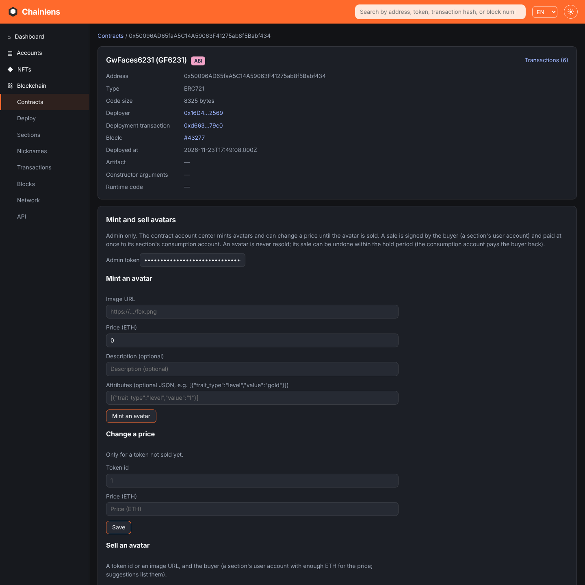

# Avatars

> **What:** From Solidity to an avatar sale: compile in Remix, deploy an avatar collection, mint avatars, change a price, sell an avatar to a section's user account (once, for good), undo a sale within the hold period.
>
> **For:** contract developers, business admins.
>
> **Related:** [nicknames](nicknames.md) · [sections](sections.md) · [proxy API](../reference/proxy-api.md#avatar-collections) · [chainlens](../components/chainlens.md)

**Contents**

- [Rules](#rules)
- [0. Before you start](#0-before-you-start)
- [1. Compile in Remix](#1-compile-in-remix)
- [2. Deploy](#2-deploy)
- [3. Mint avatars](#3-mint)
- [4. Change a price](#4-change-a-price)
- [5. A buyer: a section's user account](#5-a-buyer-a-sections-user-account)
- [6. Sell (buy) an avatar](#6-sell)
- [7. Undo a sale](#7-undo-a-sale)
- [8. Read and check](#8-check)
- [Older collections](#older-collections)
- [Errors](#errors)
- [Files](#files)

---

An **avatar** is the platform's image token (ERC-721): a picture with a price, minted by the contract
account center and bought **once** by a section's user account, which then keeps it. Avatars and
[nicknames](nicknames.md) are both **items**: they share the same rules
([`proxy/contracts/BoundItems.sol`](../../proxy/contracts/BoundItems.sol)). This guide uses
[`proxy/contracts/AvatarCollection.sol`](../../proxy/contracts/AvatarCollection.sol) (version 4).

## Rules

| Rule | How it is kept |
|---|---|
| **Minted by the center** | only the contract account center (the collection's minter) mints: `mint { image, price, description?, attributes? }`. Token ids are 1, 2, 3… in each collection. No name: the image is the avatar |
| **Each image once** | a second `mint` of the same image URL is refused (`this image is already minted`); `tokenOf { imageUrl }` finds an image's token |
| **Price changes until sold** | the center can change a price with `setPrice { tokenId, price }` while it holds the token; after the sale it can't |
| **Bought once, by a section's user account** | `buy`: the buyer pays exactly the price, **at once** to its own section's **consumption account** (no escrow). The contract checks both through the SectionRegistry |
| **No resale, no transfer** | bound to the buyer (ERC-5192: `locked()` is true). `approve`, `setApprovalForAll`, `transferFrom` and `safeTransferFrom` always revert |
| **Many per account** | an account may hold any number of avatars (and nicknames) |
| **Undo within the hold period** | within `holdSeconds` of the sale (default 7 days), `undo { tokenId }`: the consumption account that was paid sends the refund back to the buyer, and the avatar goes back to the center, for sale again |
| **Every payment recorded** | `paymentsOf { tokenId }`: each sale, with the time, the payer, the account paid, the undo deadline, and whether it was undone |

| Step | Where | Signed by |
|---|---|---|
| 1. Compile | Remix (`http://192.168.68.139:30200`) | nothing |
| 2. Deploy | chainlens **Deploy** page, or `POST /admin/contract/deploy` with the `avatar-collection` template (`holdDays`) | the contract account center |
| 3. Mint | **Mint an avatar** on the collection's chainlens page, or `POST /admin/contract/send` `mint` | the contract account center |
| 4. Change a price | **Change a price** on the same card, or `POST /admin/contract/send` `setPrice` | the contract account center |
| 5. Buyer | `POST /createaccount` with a section's key, or **Create account** on the chainlens Sections page | — (funded by the section's upfront account) |
| 6. Sell | **Sell an avatar** on the card, or `POST /contract/send` `buy` with the section's key | the buyer |
| 7. Undo | **Undo** in the card's list, or `POST /contract/send` `undo` (no `from`) | the consumption account that was paid |


The addresses below are the production ones (proxy VIP `192.168.68.151:30000`, chainlens and Remix
on h139). Use the chainlens admin pages from the operator machine or a PC in
`chainlens_deploy_ips` ([Contract deployment (chainlens Deploy page)](contract-deployment.md)).

## 0. Before you start

- The sections are configured (phase 06 created the SectionRegistry and the contract account center),
  and at least one **section** exists, with money on its upfront account (chainlens **Sections**
  page, or `POST /admin/sections`).
- The chainlens admin pages are on: `chainlens_deploy_enabled: true` for the Deploy page. The
  **Mint and sell avatars** card appears on avatar collections' pages when the Deploy or the
  Sections page is on.
- For a deploy from Remix you need the **SectionRegistry's address** (a constructor argument). It is
  shown on the chainlens dashboard (*Platform* → *Section registry*), and is in
  `ansible/state/registry.json`. The template fills it in.
- You need the **admin token** for the chainlens admin pages (the Deploy page calls it *Deploy
  token*, the Mint and sell avatars card *Admin token*; it is the same token), on the operator:

  ```bash
  cat ansible/state/secrets/chainlens_deploy_token
  ```

  The curl examples call the proxy's admin API instead, with the **proxy admin token**
  (`ansible/state/secrets/proxy_admin_token`), from an address in `ADMIN_ALLOWED_IPS`:

  ```bash
  P=http://192.168.68.151:30000; T=$(cat ansible/state/secrets/proxy_admin_token)
  ```

> **Ansible deploys one for you:** `08-check.yml` deploys the avatar collections of
> `platform_avatar_collections` (default: *Avatars*, AVT, 7 days) once ([Ansible](../deployment/ansible.md#platform-contracts)).
> The steps below are for another collection, or by hand.

## 1. Compile in Remix

The repository already has the compiled artifact: `proxy/avatar-collection.json` (the template
uses it). Compile in Remix only to check or change the code.

1. Open `http://192.168.68.139:30200` ([Remix IDE (self-hosted)](../components/remix.md)). Create
   `AvatarCollection.sol` and `BoundItems.sol` (the import) side by side, with the contents of
   [`proxy/contracts/AvatarCollection.sol`](../../proxy/contracts/AvatarCollection.sol) and
   [`proxy/contracts/BoundItems.sol`](../../proxy/contracts/BoundItems.sol).
2. **Solidity compiler:** version `0.8.28`, **Advanced configurations → EVM version `cancun`**,
   optimizer on (200 runs). Compile `AvatarCollection.sol`.
3. **Settings → Generate contract metadata** on. Remix writes
   `contracts/artifacts/AvatarCollection.json` (ABI + bytecode). Right-click it → **Download**.

To rebuild the repository's artifact, in `proxy/`:
`node scripts/compile-contract.js contracts/AvatarCollection.sol AvatarCollection avatar-collection.json`
(it reads `BoundItems.sol` from the same folder).

## 2. Deploy {#2-deploy}

**With the template (simplest):** the `avatar-collection` template deploys the compiled contract
with the registry's address filled in, and registers it. `holdDays` is the **undo period** (default
7; decimals allowed, e.g. `0.0025` = 216 s for a test). Names and symbols must be unique among the
avatar collections, in any letter case (409 otherwise):

```bash
curl -s -X POST $P/admin/contract/deploy -H "Authorization: Bearer $T" -H 'Content-Type: application/json' \
  -d '{"template":"avatar-collection","name":"Faces","symbol":"FACE","holdDays":7}'
```

```
{ "success": true, "name": "Faces", "kind": "avatar", "address": "0xFaces", "deployer": "<center>", "txHash": "0x…",
  "codeCheck": "matches the artifact", "registryTxHash": "0x…", ... }
```

`POST /admin/contract/check` with the same body is a dry run (gas, the future address).

**Or in chainlens** (`http://192.168.68.139:30100/#/deploy`):

1. **Deploy token:** paste the token.
2. **Compiler artifact:** `AvatarCollection.json`. If the file has several contracts, choose **AvatarCollection**.
3. **Constructor arguments:** `name_` (`Faces`), `symbol_` (`FACE`), `registry_` (the
   SectionRegistry's address), `holdSeconds_` (the undo period in seconds: `604800` = 7 days).
4. **Kind:** *Avatar collection*, so that the registry records it as one (`kind: "avatar"`).
   **Name in the registry:** optional, e.g. `Faces`.
5. **Check**, then **Deploy**. The page links to the new contract: `#/contracts/0x…`.

The contract account center is the deployer, so it is the collection's **minter**. The collection is
shared by all sections. Applications use its **address**: `GET /contract/list?type=avatar` lists
the avatar collections with their name, symbol and minter. `holdSeconds` reads the undo period.

## 3. Mint avatars {#3-mint}

**In chainlens:** on the collection's page (`#/contracts/0xFaces`), in the **Mint and sell avatars**
card, fill in **Image URL** and **Price (ETH)**; **Description** and **Attributes** (JSON) are
optional. Click **Mint an avatar**: the answer shows the new token id and price.



**Or with curl:** `mint` through `POST /admin/contract/send` (signed by the contract account center),
with friendly `args`. The proxy builds the metadata (`image`, `description`, `attributes`) and
stores it on chain in the token URI:

```bash
curl -s -X POST $P/admin/contract/send -H "Authorization: Bearer $T" -H 'Content-Type: application/json' \
  -d '{"contract":"0xFaces","function":"mint","args":{"image":"https://img.example/fox.png","price":"0.3","description":"fox","attributes":[{"trait_type":"color","value":"red"}]}}'
```

```
{ "success": true, "contract": "0xFaces", "function": "mint(string,string,uint256)", "from": "<center>", "txHash": "0x…",
  "result": { "minted": true, "tokenId": "1", "image": "https://img.example/fox.png", "price": "0.3" }, "events": [ … ] }
```

The center holds the new avatar, for sale. `image` is required; `price` is in ETH (default 0).
Minting is not tied to a section and pays nothing. The same image a second time: 400
`Execution reverted (this image is already minted)`. A `name` is refused (`args: unknown name(s)
name; mint takes image, price, description, attributes`). Metadata too large for a block: 400
`metadata is too large for the chain`. A section can't mint: through `/contract/send` it reverts with
`not minter`.

## 4. Change a price

While the center holds the avatar (never sold, or its sale undone):

```bash
curl -s -X POST $P/admin/contract/send -H "Authorization: Bearer $T" -H 'Content-Type: application/json' \
  -d '{"contract":"0xFaces","function":"setPrice","args":{"tokenId":"1","price":"0.4"}}'
# → "result": { "tokenId": "1", "price": "0.4" }
```

In chainlens: **Change a price** (token id, price). After the sale: 400 `the transaction would
revert: sold: the price can no longer change`.

## 5. A buyer: a section's user account

The buyer must be a **user account of a section** and must have at least the price:

```bash
curl -s -X POST $P/createaccount -H 'Content-Type: application/json' \
  -H 'X-Section-Key: sk_…' -d '{"amount":"5"}'
# → { "success": true, "section": {"id": 1, "name": "Shop A"}, "address": "0xUser", ... }
```

The account is funded from that section's upfront account. To give it more ETH later, use
`POST /transfer` with the section's key and a negative amount (`−x`: upfront → account; see
[sections](sections.md#application-api-section-calls)). Without the key, the same can be done on the
chainlens **Sections** page (the section's user accounts: **Create account**, **Transfer**).

## 6. Sell (buy) an avatar {#6-sell}

**In chainlens:** in the card, under **Sell an avatar**, enter a token id **or** an image URL, and the
buyer (the field suggests the section user accounts, with their section and balance). Click
**Sell an avatar**: the answer shows the price and until when the sale can be undone.

**Or with curl**, with the key of the buyer's section, through the generic
[`POST /contract/send`](../reference/proxy-api.md#post-contractsend--write). `from` is the buyer.
`args` is `{ "tokenId" }` or `{ "imageUrl" }`. Leave out the payee and `value`: the proxy fills in the
buyer's section's consumption account and the token's price.

```bash
K=sk_…   # the buyer's section key
curl -s -X POST $P/contract/send -H 'Content-Type: application/json' -H "X-Section-Key: $K" \
  --data '{"contract":"0xFaces","function":"buy","args":{"imageUrl":"https://img.example/fox.png"},"from":"0xUser"}'
```

```
{ "success": true, "section": {"id": 1, "name": "Shop A"}, "function": "buy(uint256,address)", "from": "0xUser", "value": "0.4", "txHash": "0x…",
  "result": { "tokenId": "1", "image": "https://img.example/fox.png", "price": "0.4", "buyer": "0xUser", "paid": "0.4",
              "paidTo": "0xConsumption", "undoUntil": "2026-11-30T17:36:09.250Z" },
  "events": [ { "name": "Sold", "args": { … } }, ... ] }
```

The buyer signs one atomic `buy(tokenId, payee)` transaction: it pays exactly the price, which goes
**at once** to its section's consumption account, and receives the avatar; if any check fails,
nothing moves. The contract itself checks that the buyer is a section's user account and that
`payee` is the consumption account of the buyer's own section, so even a transaction sent around the
proxy can't redirect the money. A sold avatar can't be bought again (409 `token 1 is already sold`)
and can't be transferred.

Without a key the proxy answers 401 `X-Section-Key is required`. The one exception is the admin
API caller: the chainlens card needs no section key, because chainlens calls the proxy with the
admin token from an address in the proxy's `ADMIN_ALLOWED_IPS`; the section is then the buyer's.

The old `POST /nft/transfer` was removed: it answers 410 with a pointer to `/contract/send`.

## 7. Undo a sale

Within the hold period of the sale (`undoUntil` in the answer above, and in `paymentsOf`), the
section can undo it: the buyer gets the price back and the avatar goes back to the center, for sale
again (at the same price, which the center can change again).

**In chainlens:** the card's list of avatars (newest first) has **Undo** on each sale that can still
be undone, with its deadline.

**Or with curl:** `undo` through `/contract/send`, with the key of the section that was paid and
**no `from`**. The proxy signs as that section's consumption account (the account that was paid),
which sends the refund in the same transaction:

```bash
curl -s -X POST $P/contract/send -H 'Content-Type: application/json' -H "X-Section-Key: $K" \
  --data '{"contract":"0xFaces","function":"undo","args":{"tokenId":"1"}}'
```

```
{ "success": true, "section": {"id": 1, "name": "Shop A"}, "function": "undo(uint256)", "from": "0xConsumption", "value": "0.4", "txHash": "0x…",
  "result": { "tokenId": "1", "undone": "sale", "buyer": "0xUser", "refunded": "0.4", "by": "0xConsumption" }, "events": [ … ] }
```

| Refused | Message |
|---|---|
| after the hold period | 409 `the undo period of token 1 ended at 2026-11-30T17:36:09.000Z` |
| the token is not sold (never sold, or already undone) | 409 `token 1 is not sold` |
| the key of another section | 403 `token 1 was paid to section "Shop A": only its key can undo` |
| the consumption account has too little ETH (e.g. after a sweep) | 409 `the refund needs 0.4 ETH but 0x… (section "Shop A" consumption) has 0.1 ETH` |
| a `from` that is not the consumption account | 400 `from: leave it out (an undo is signed by 0x…, the account that was paid)` |

Sweep only money whose undo period is over, or keep enough on the consumption account for the
undos you may still need.

## 8. Read and check {#8-check}

All with `POST /contract/call` (one call, or `{ "calls": [ … ] }` for up to 50), friendly values:

| Function, `args` | `result` |
|---|---|
| `tokensOf { account }` | the avatars an account holds: `[ { tokenId, image, price } ]` (for the center: the unsold ones) |
| `tokenOf { imageUrl }` | `{ tokenId, minted, sold, owner, price }`, or `{ tokenId: null, minted: false }` |
| `ownerOf { tokenId }` | `{ tokenId, owner, sold }` |
| `priceOf { tokenId }` | `{ tokenId, price }` |
| `imageOf { tokenId }` | `{ tokenId, image }` |
| `tokenURI { tokenId }` | `{ tokenId, metadata: { image, description, attributes }, image }` |
| `paymentsOf { tokenId }` | every sale of the token, oldest first: `[ { kind: "sale", amount, payer, paidTo, paidAt, undoUntil, undone, undoable, current } ]` |
| `holdSeconds`, `totalSupply` | the undo period (seconds), the number of avatars minted |

```bash
curl -s -X POST $P/contract/call -H 'Content-Type: application/json' -H "X-Section-Key: $K" \
  --data '{"contract":"0xFaces","function":"paymentsOf","args":{"tokenId":"1"}}'
# → "result": [ { "kind": "sale", "amount": "0.4", "payer": "0xUser", "paidTo": "0xConsumption", "paidAt": "2026-11-23T17:36:09.000Z",
#                 "undoUntil": "2026-11-30T17:36:09.000Z", "undone": false, "undoable": true, "current": true } ]
```

`undoable` is true while the sale can be undone now; `current` marks the sale in force (an undone
earlier sale stays in the list with `undone: true`). `POST /contract/events` lists `Sold`, `Undone`,
`PriceSet` and `Transfer` (prices in ETH).

- **chainlens:** `#/nfts/0xFaces/1` shows the owner, the metadata and the image; the buyer's account
  page shows its section and avatars; the **Sections** page shows the consumption account's balance;
  the **Statistics** page (Items, Money) counts the sale (*Avatar sales*, *Income*) and an undo
  (*Undone, refunded*).
- **Grafana → Sections:** the `avatar_sale` and `avatar_undo` operations and their ETH. Income =
  sales − undos.
- **Money:** sweep the consumption account to the payment account, and pay it back to SENDER01, on
  the chainlens **Sections** page.

## Older collections {#older-collections}

| Collection | For the proxy |
|---|---|
| version 4 (`AvatarCollection`, this page) | an avatar collection: friendly values, `type: "avatar"` |
| version 3 (`NftCollection`, with resale) | an ordinary registered contract: no friendly values, not `type: "avatar"`. Deploy a new collection and mint again |
| version 2 (minted by SENDER01, before sections) | **retired**: the proxy no longer reads, mints or sells it; the old routes (`/nft/mint`, `/nft/transfer`, `/nft/deploy`…) answer 410 |

The tokens of older collections stay on the chain. Avatar collections need sections: a proxy without
sections (development) has none. The proxy still accepts the old names: template `nft-collection`,
kind `nft`, `?type=nft` ([proxy API](../reference/proxy-api.md#old-names)).

## Errors

| Message | Cause |
|---|---|
| `X-Section-Key is required: …` | no `X-Section-Key` header on `/contract/send` (and not the admin API caller) |
| `unknown section key` | the key was rotated, or the section archived |
| `… is not a user account of a section` | the buyer (`from`) was not created with `/createaccount` and a section key |
| `section "…" is disabled` | the buyer's section is disabled (Sections page) |
| `… is not an account of section "…"` | `from` is not a user of the key's section (use the key of the account that signs) |
| 409 `token N is already sold` | the avatar was sold (no resale); its sale may be undone first |
| 404 `token N is not minted` / `image … is not minted` | wrong token id or image URL |
| `insufficient balance: N ETH is needed` | the buyer has less than the price: top it up (`−x` transfer) |
| `value: the price is N ETH …` / `payee: …` | a wrong `value` or payee was given: leave them out |
| `Execution reverted (this image is already minted)` | `mint` with an image that has a token: `tokenOf { imageUrl }` |
| `the transaction would revert: sold: the price can no longer change` | `setPrice` on a sold avatar |
| `the transaction would revert: not minter` | `mint` through `/contract/send`: only the center mints, use `/admin/contract/send` |
| `transferFrom(address,address,uint256) only reads: use POST /contract/call` | transfers are fixed to revert (`pure`), so the proxy treats them as reads: avatars can't be transferred |
| `the undo period of token N ended at …` / `token N is not sold` / `… only its key can undo` / `the refund needs X ETH …` | an undo refused ([above](#7-undo-a-sale)) |
| `args: unknown name(s) name; mint takes image, price, description, attributes` | a name the function doesn't take |
| `args: no value for "tokenId" (…)` | `args` misnamed (`{ "token": … }`) |
| `0x… is not a registered contract` | wrong address: `GET /contract/list?type=avatar` lists the avatar collections |
| 409 `a collection named "…" (…) exists at 0x…` | the name or symbol is used by another avatar collection |
| 400 `holdDays: 0 to 365 (default 7)` | a bad `holdDays` in the template |
| 410 `POST /nft/transfer was removed: use POST /contract/send …` | an old `/nft/*` route ([removed routes](../reference/proxy-api.md#removed-routes)) |

## Files

| File | Contents |
|---|---|
| `proxy/contracts/BoundItems.sol` | the shared item rules: mint, `setPrice`, `buy` (paid at once), `undo`, `paymentsOf`, `tokensOf`, bound tokens (ERC-721 + ERC-5192 + ERC-4906) |
| `proxy/contracts/AvatarCollection.sol` | the avatar collection (version 4): `mint(image, uri, price)`, one token per image (`tokenOf`), `imageOf`, `tokenURI` |
| `proxy/avatar-collection.json` | its compiled artifact (`node scripts/compile-contract.js contracts/AvatarCollection.sol AvatarCollection avatar-collection.json`) |
| `proxy/stress-latest.js` | friendly args and results (`FRIENDLY_KEYS`, `friendlyArgsOf`, `friendlyCall`, `friendlySend`, `paymentsInfo`), the `/contract/send` handler (`knownSend`: payee and price; the undo path: `undoTarget`), the `avatar-collection` template (`templateInput`: `holdDays`), the metrics (`countKnownSend`) |
| `chainlens/server.js` | the card's API: `/api/avataradmin/items`, `/api/avataradmin/mint`, `price`, `sell`, `undo` (through the proxy's admin API) |
| `chainlens/public/app.js` | the **Mint and sell avatars** card (`avatarAdminCard`) |
