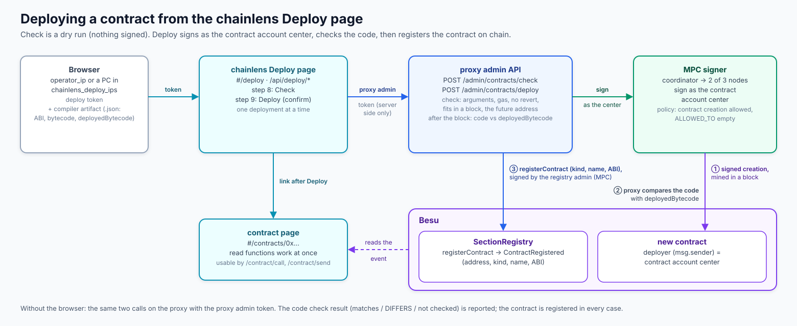
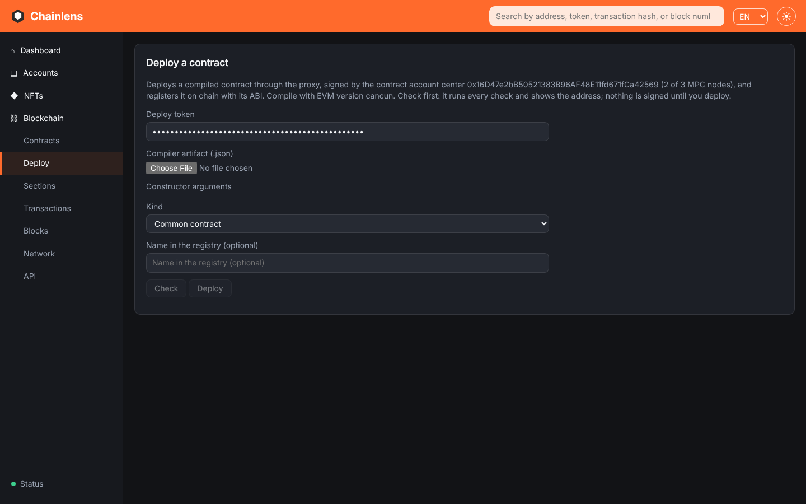

# 컨트랙트 배포 (chainlens Deploy 페이지)

> **내용:** chainlens Deploy 페이지에서 컴파일된 컨트랙트를 배포합니다. 컨트랙트 계정 센터가 서명하고 체인에 등록합니다.
>
> **대상:** 운영자, 컨트랙트 개발자.
>
> **관련 문서:** [Remix](../components/remix.md) · [아바타](avatars.md) · [컨트랙트 레코드](contract-records.md)

**목차**

- [켜기](#turn-it-on)
- [배포](#deploy)
- [레코드](#the-records)
- [끄기](#turn-it-off)
- [문제가 발생한 경우](#if-something-fails)

---

Chainlens는 브라우저에서 컴파일된 컨트랙트를 배포할 수 있습니다: **Blockchain → Deploy**
(`http://<monitoring host>:30100/#/deploy`). Chainlens는 컨트랙트를 프록시에 전달하고, 프록시는
**컨트랙트 계정 센터**(MPC 키, 3개의 MPC 노드 중 2개)의 서명으로 배포한 뒤 종류와 ABI와 함께
SectionRegistry에 체인상 등록합니다([섹션: 컨트랙트](sections.md#contracts)). 그러면 컨트랙트는 즉시
chainlens에 표시되고 애플리케이션(`/contract/call`, `/contract/send`)에서 사용할 수 있습니다.

```
browser ──token──► chainlens /api/deploy/* ──proxy admin token──► proxy /admin/contract/check | deploy
                                                                     │ signed by the contract account center
                                                                     ▼
                                                     Besu ◄── registerContract (registry admin)
```

이 기능은 **기본적으로 꺼져 있으며**, 켜면 세 가지 방식으로 보호됩니다.

| 보호 | 방식 |
|---|---|
| 접속 대상 | `operator_ip`와 `chainlens_deploy_ips`에서만 가능합니다. 그 외 주소에서는 페이지와 메뉴 항목이 존재하지 않습니다(다른 chainlens 사용자에게는 아무것도 보이지 않습니다) |
| 토큰 | Ansible이 한 번 생성하는 48자 토큰: `state/secrets/chainlens_deploy_token`(같은 토큰으로 Sections 페이지와 Mint and sell 카드도 열립니다). 이후 Chainlens는 자체 토큰(`proxy_admin_token`)으로 프록시의 관리자 API를 호출하며, 이 토큰은 브라우저에 전달되지 않습니다 |
| 계정 | 항상 컨트랙트 계정 센터(`state/contract-center`, `06-proxy.yml`이 생성) |

## 켜기 {#turn-it-on}

**1. 설정** (`group_vars/all/settings.yml`):

```yaml
chainlens_deploy_enabled: true
chainlens_deploy_ips: [192.168.68.1]   # optional: admin PCs besides operator_ip
```

`chainlens_deploy_ips`에는 주소 또는 네트워크(`192.168.68.0/24`)를 지정합니다. 목록에 있는 모든 대상은
토큰으로 컨트랙트를 배포할 수 있으므로, 사무실 네트워크 전체가 아니라 관리자 머신만 등록하십시오.
Ansible은 이들에게도 chainlens 포트를 개방합니다(`chainlens_ips`에 중복 등록할 필요가 없습니다).
(이전 버전의 `chainlens_deployer`는 더 이상 사용하지 않습니다.)

프록시에 섹션이 구성되어 있어야 합니다(`06-proxy.yml`이 SectionRegistry를 배포하고 컨트랙트 계정 센터를
생성합니다). 섹션이 없으면 페이지에서 배포에 사용할 계정이 없습니다.

**2. 적용** (`git pull` 후에는 단계 01을 먼저 실행합니다. 01은 새 코드를 복사하며, 단계 02의 이미지 빌드가
이 코드를 사용합니다. 단계 06은 컨트랙트 계정 센터를 생성합니다):

```bash
ansible-playbook 01-hosts.yml 02-images.yml 06-proxy.yml 11-chainlens.yml
```

**3. 토큰**: 운영자 머신에서 확인합니다(페이지에 입력합니다).

```bash
cat state/secrets/chainlens_deploy_token
```

## 배포 {#deploy}



1. **EVM version cancun**으로 컴파일하고(Remix: [Remix IDE(자체 호스팅)](../components/remix.md)) 컴파일러
   아티팩트(ABI와 바이트코드가 포함된 `.json`: Remix `contracts/artifacts/<Name>.json`, Hardhat, Foundry 또는
   solc 출력)를 보관합니다.
2. 운영자 머신 또는 `chainlens_deploy_ips`에 있는 PC에서 `http://192.168.68.139:30100/#/deploy`를 엽니다.
   다른 PC에서는 운영자 머신을 통해 터널링합니다:
   `ssh -L 30100:192.168.68.139:30100 root@<operator>` 후 `http://localhost:30100/#/deploy`를 엽니다.
3. **Deploy token:** 토큰을 붙여 넣습니다. 이 브라우저 탭에만 보관됩니다.
4. **Compiler artifact:** 파일을 선택합니다. 파일에 여러 컨트랙트가 있으면 **Contract**를 선택합니다.
5. **Constructor arguments:** 인수마다 입력란이 하나씩 있습니다. 숫자는 정수(`1000000`), 주소는 `0x…`,
   `true`/`false`, 배열과 튜플은 JSON(`["0xabc…","0xdef…"]`)으로 입력합니다.
6. **Kind:** *Common contract* 또는 *Avatar collection*.
7. **Name in the registry:** 선택 사항이며, chainlens에 표시되는 컨트랙트 이름입니다.
8. **Check:** 프록시가 모든 검사(인수, 가스, 생성이 revert되지 않는지, 한 블록에 들어가는지)를 실행하고,
   페이지에 컨트랙트가 받게 될 주소가 표시됩니다. 아무것도 서명하지 않습니다.
9. **Deploy:** 확인합니다. MPC 노드가 서명하고, 페이지는 블록을 기다린 뒤 체인상의 코드를 아티팩트의
   런타임 바이트코드와 비교하고(immutable 값 제외), 컨트랙트를 등록합니다. 그런 다음 컨트랙트 페이지로
   연결되며, 그곳에서 읽기 함수를 바로 사용할 수 있습니다.



코드 검사 결과는 `matches the artifact`, `matches the artifact (immutable values excluded)`,
`same length as the artifact, not identical`, `DIFFERS from the artifact`, 또는 아티팩트에 런타임
바이트코드가 없을 때 `not checked (no deployedBytecode)` 중 하나입니다. 컨트랙트는 어느 경우에나
등록됩니다. 공지하기 전에 결과를 확인하십시오.

브라우저 없이 같은 두 단계를 수행하려면 프록시 관리자 토큰으로 프록시의 `POST /admin/contract/check`와
`POST /admin/contract/deploy`를 호출합니다([프록시 API](../reference/proxy-api.md#admin-api-contracts-and-registry)).

**Check** 후에 파일, 인수, 종류 또는 이름을 변경하면 다시 검사해야 합니다. 그 사이에 센터의 상태가
변경되면(다른 배포), **Deploy**가 거부되고 새 검사를 요구합니다. chainlens당 한 번에 하나의 배포만
실행됩니다.

아바타 컬렉션의 경우 아티팩트부터 판매까지의 전체 과정은 [아바타](avatars.md)에 있습니다. 프록시가
목록에 포함하도록 종류를 *Avatar collection*(레지스트리 종류 `avatar`)으로 선택하십시오.

컨트랙트의 배포자(생성자의 `msg.sender`)는 센터입니다. 소유자나 역할이 있는 컨트랙트에서 다른 주체가
이를 보유해야 한다면, 생성자 인수로 받도록 하십시오.

## 레코드 {#the-records}

여기서 배포한 컨트랙트는 **체인에 등록됩니다**(SectionRegistry `ContractRegistered` 이벤트: 주소, 종류,
이름, ABI). 복사하거나 커밋할 것이 없습니다. Chainlens와 프록시가 이 이벤트를 읽으므로, 모든 호스트에서
컨트랙트를 알 수 있습니다.

`besu-production/operator/deploy-contract.js`로 배포한 컨트랙트는 온체인 레지스트리에 **등록되지 않습니다**.
대신 `contracts/deployments/`에 파일이 생성되며(커밋하십시오), 이 파일은 chainlens만 읽습니다
([컨트랙트 레코드](contract-records.md)). 이 페이지의 이전 버전이 작성한 레코드는 여전히
`11-chainlens.yml`이 저장소로 다시 복사합니다.

## 끄기 {#turn-it-off}

```yaml
chainlens_deploy_enabled: false
```

```bash
ansible-playbook 01-hosts.yml 11-chainlens.yml
```

토큰을 변경하려면 `state/secrets/chainlens_deploy_token`을 삭제하고 `11-chainlens.yml`을 실행합니다.
Sections 페이지와 Mint and sell 카드도 같은 토큰을 사용합니다.

## 문제가 발생한 경우 {#if-something-fails}

| 메시지 | 원인 |
|---|---|
| (메뉴에 Deploy 항목 없음) | 꺼져 있거나, 브라우저의 주소가 `operator_ip`도 아니고 `chainlens_deploy_ips`에도 없습니다(예: VPN 또는 NAT를 거치는 경우, chainlens는 변환된 이후의 주소를 봅니다) |
| wrong deploy token / wrong admin token | 토큰이 `state/secrets/chainlens_deploy_token`과 일치하지 않습니다 |
| `the contract account center is not configured (CONTRACT_CENTER)` | `06-proxy.yml`을 실행하십시오(센터를 생성합니다) |
| `sections are not configured (REGISTRY_CONTRACT, REGISTRY_ADMIN)` | 프록시에 SectionRegistry가 없습니다: `06-proxy.yml`을 실행하십시오 |
| `no abi + bytecode found` | 파일이 ABI뿐입니다: 전체 컴파일러 아티팩트를 내보내십시오 |
| `the bytecode has unlinked library placeholders` | 내보내기 전에 라이브러리를 링크하십시오 |
| `expects N argument(s)` / `constructor arguments: …` | 인수의 개수나 유형이 잘못되었습니다 |
| `the deployment reverts or is invalid` | 생성자가 실패하거나, 코드가 cancun보다 새로운 EVM용으로 컴파일되었습니다 |
| `policy: contract creation not allowed` | MPC 노드의 `cluster.json` 정책에서 `deny_contract_creation`이 `true`입니다. 배포하려면 `false`여야 합니다 |
| `policy: contract creation not allowed with an allowlist` | MPC 노드의 `ALLOWED_TO`가 설정되어 있습니다. 배포하려면 비어 있어야 합니다 |
| `needs N gas, more than a block holds` | 컨트랙트가 한 블록에 담기에 너무 큽니다 |
| `the deployer's state changed since the check` | **Check**를 다시 클릭하십시오 |
| `another deployment is running` | 완료될 때까지 기다리십시오 |
| `the deployment reverted in block N` | 검사는 통과했지만 체인에서 생성이 실패했습니다. 트랜잭션을 확인하십시오 |

Chainlens와 프록시는 모든 배포를 (요청자의 주소와 함께) 로그에 기록합니다: 모니터링 호스트에서는
`docker logs chainlens-chainlens-1`, 프록시 호스트에서는 `docker logs proxy-proxy-1`.
