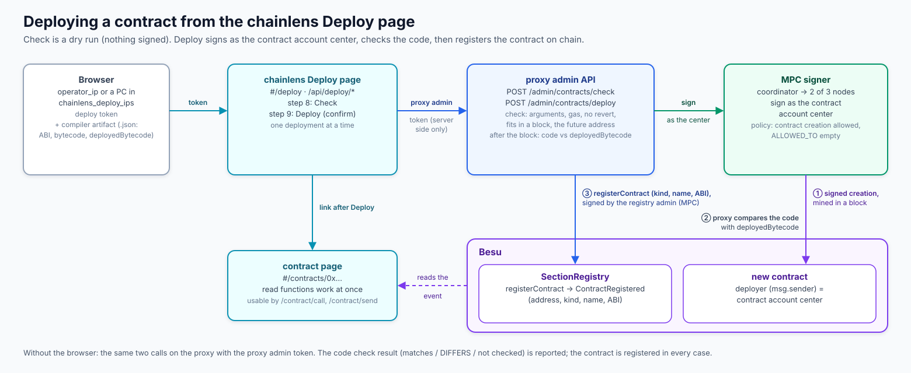
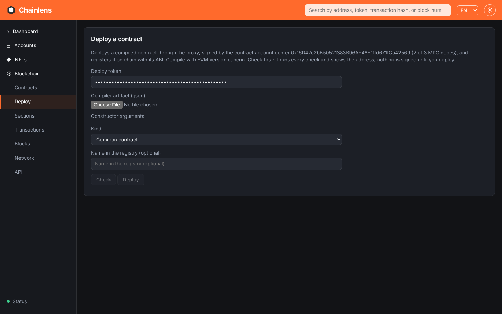

# Contract deployment (chainlens Deploy page)

> **What:** Deploying compiled contracts from the chainlens Deploy page, signed by the contract account center and registered on chain.
>
> **For:** operators, contract developers.
>
> **Related:** [Remix](../components/remix.md) · [avatars](avatars.md) · [contract records](contract-records.md)

**Contents**

- [Turn it on](#turn-it-on)
- [Deploy](#deploy)
- [The records](#the-records)
- [Turn it off](#turn-it-off)
- [If something fails](#if-something-fails)

---

Chainlens can deploy a compiled contract from the browser: **Blockchain → Deploy**
(`http://<monitoring host>:30100/#/deploy`). Chainlens hands it to the proxy, which deploys it
signed by the **contract account center** (an MPC key, 2 of the 3 MPC nodes) and registers it on
chain in the SectionRegistry with its kind and ABI ([Sections: contracts](sections.md#contracts)).
The contract is then visible in chainlens and usable by applications (`/contract/call`,
`/contract/send`) at once.

```
browser ──token──► chainlens /api/deploy/* ──proxy admin token──► proxy /admin/contract/check | deploy
                                                                     │ signed by the contract account center
                                                                     ▼
                                                     Besu ◄── registerContract (registry admin)
```

It is **off by default**, and when on it is protected three ways:

| Protection | How |
|---|---|
| Who | only from `operator_ip` and `chainlens_deploy_ips`; for every other address the page and its menu entry don't exist (other chainlens users see nothing) |
| Token | a 48-character token Ansible generates once: `state/secrets/chainlens_deploy_token` (the same token opens the Sections page and the Mint and sell card). Chainlens then calls the proxy's admin API with its own token (`proxy_admin_token`), which never reaches the browser |
| Account | always the contract account center (`state/contract-center`, created by `06-proxy.yml`) |

## Turn it on

**1. Settings** (`group_vars/all/settings.yml`):

```yaml
chainlens_deploy_enabled: true
chainlens_deploy_ips: [192.168.68.1]   # optional: admin PCs besides operator_ip
```

`chainlens_deploy_ips` takes addresses or networks (`192.168.68.0/24`). Everyone listed can deploy
contracts with the token, so list admin machines only, not a whole office network. Ansible opens
chainlens's port for them as well (no need to repeat them in `chainlens_ips`).
(`chainlens_deployer` from earlier versions is no longer used.)

Sections must be configured on the proxy (`06-proxy.yml` deploys the SectionRegistry and creates the
contract account center): without them the page has nothing to deploy with.

**2. Apply** (phase 01 first after a `git pull`: it copies the new code, which the image build of
phase 02 uses; phase 06 creates the contract account center):

```bash
ansible-playbook 01-hosts.yml 02-images.yml 06-proxy.yml 11-chainlens.yml
```

**3. The token**, on the operator (you type it into the page):

```bash
cat state/secrets/chainlens_deploy_token
```

## Deploy





1. Compile with **EVM version cancun** (Remix: [Remix IDE (self-hosted)](../components/remix.md)) and keep
   the compiler artifact (`.json` with ABI and bytecode: Remix `contracts/artifacts/<Name>.json`,
   Hardhat, Foundry or solc output).
2. On the operator machine or a PC in `chainlens_deploy_ips`, open
   `http://192.168.68.139:30100/#/deploy`. From any other PC, tunnel through the operator:
   `ssh -L 30100:192.168.68.139:30100 root@<operator>`, then open `http://localhost:30100/#/deploy`.
3. **Deploy token:** paste the token. It is kept for this browser tab only.
4. **Compiler artifact:** choose the file. With several contracts in it, choose the **Contract**.
5. **Constructor arguments:** one box per argument. Numbers as whole numbers (`1000000`),
   addresses `0x…`, `true`/`false`, arrays and tuples as JSON (`["0xabc…","0xdef…"]`).
6. **Name in the registry:** optional, the contract's name in chainlens. Contracts deployed here are
   registered as common contracts.
7. **Check:** the proxy runs every check (arguments, gas, the creation doesn't revert, it fits in a
   block) and the page shows the address the contract will get. Nothing is signed.
8. **Deploy:** confirm. The MPC nodes sign, the page waits for the block, the code on chain is
   compared with the artifact's runtime bytecode (immutable values excluded), and the contract is
   registered. Then it links to the contract's page, where its read functions work right away.

The code check reports `matches the artifact`, `matches the artifact (immutable values excluded)`,
`same length as the artifact, not identical`, `DIFFERS from the artifact`, or
`not checked (no deployedBytecode)` when the artifact has no runtime
bytecode. The contract is registered in every case: read the result before you announce it.

Without the browser, the same two steps are `POST /admin/contract/check` and
`POST /admin/contract/deploy` on the proxy, with the proxy admin token
([proxy API](../reference/proxy-api.md#admin-api-contracts-and-registry)).

Changing a file, an argument or the name after **Check** requires a new check. If the
center's state changed in between (another deployment), **Deploy** refuses and asks for a new check.
One deployment runs at a time per chainlens.

Avatar and nickname collections are not deployed from this page: Ansible deploys them
(`platform_avatar_collections`, `platform_nickname_collection`; [Ansible](../deployment/ansible.md#platform-contracts)),
or `POST /admin/contract/deploy` with a `template`; the Nicknames page can deploy a new nickname collection.

The contract's deployer (`msg.sender` in its constructor) is the center. A contract with an owner
or roles should take them as constructor arguments when someone else must hold them.

## The records

Contracts deployed here are **registered on chain** (SectionRegistry `ContractRegistered` event:
address, kind, name, ABI): nothing to copy or commit. Chainlens and the proxy read the event, so
the contract is known on every host.

Contracts deployed with `besu-production/operator/deploy-contract.js` are **not** in the on-chain
registry: they get a file in `contracts/deployments/` instead (commit it), which only chainlens
reads ([contract records](contract-records.md)). Records written by earlier versions of this page are
still copied back to the repository by `11-chainlens.yml`.

## Turn it off

```yaml
chainlens_deploy_enabled: false
```

```bash
ansible-playbook 01-hosts.yml 11-chainlens.yml
```

To change the token, delete `state/secrets/chainlens_deploy_token` and run `11-chainlens.yml`.
The Sections page and the Mint and sell card use the same token.

## If something fails

| Message | Cause |
|---|---|
| (no Deploy entry in the menu) | off, or your browser's address is neither `operator_ip` nor in `chainlens_deploy_ips` (e.g. through a VPN or NAT: chainlens sees the address after it) |
| wrong deploy token / wrong admin token | the token doesn't match `state/secrets/chainlens_deploy_token` |
| `the contract account center is not configured (CONTRACT_CENTER)` | run `06-proxy.yml` (it creates the center) |
| `sections are not configured (REGISTRY_CONTRACT, REGISTRY_ADMIN)` | the proxy has no SectionRegistry: run `06-proxy.yml` |
| `no abi + bytecode found` | the file is only an ABI: export the full compiler artifact |
| `the bytecode has unlinked library placeholders` | link the libraries before exporting |
| `expects N argument(s)` / `constructor arguments: …` | wrong number or type of arguments |
| `the deployment reverts or is invalid` | the constructor fails, or the code was compiled for a newer EVM than cancun |
| `policy: contract creation not allowed` | `deny_contract_creation` is `true` in the MPC nodes' `cluster.json` policy; it must be `false` for deployments |
| `policy: contract creation not allowed with an allowlist` | the MPC nodes' `ALLOWED_TO` is set; it must be empty for deployments |
| `needs N gas, more than a block holds` | the contract is too large for one block |
| `the deployer's state changed since the check` | click **Check** again |
| `another deployment is running` | wait for it to finish |
| `the deployment reverted in block N` | the creation failed on chain after the check passed; see the transaction |

Chainlens and the proxy log every deployment (with the requester's address):
`docker logs chainlens-chainlens-1` on the monitoring host, `docker logs proxy-proxy-1` on the
proxy host.
