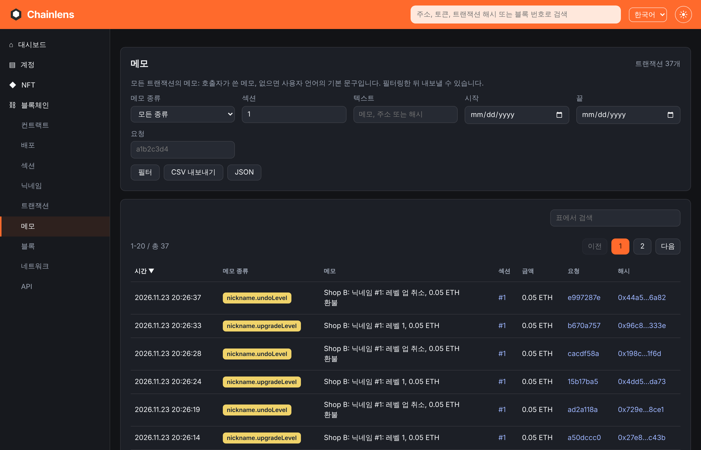

# 메모

> **내용:** 프록시가 보내는 모든 트랜잭션에는 **메모**가 붙습니다: 트랜잭션의 종류와 값, 섹션, 호출자가 쓴
> 문구(있으면), 요청 id. 읽는 쪽은 자기 언어(영어, 한국어, 중국어)로 봅니다.
>
> **대상:** 애플리케이션 개발자(`memo` 파라미터, 응답), 비즈니스 관리자와 회계(chainlens의 메모 기록,
> 내보내기), 운영자(설정).
>
> **관련 문서:** [프록시 API](../reference/proxy-api.md#memos) · [chainlens](../components/chainlens.md) ·
> [섹션 게이트웨이](../components/gateway.md) · [섹션](sections.md)

**목차**

- [한눈에 보기](#at-a-glance)
- [메모 레코드](#the-memo-record)
- [저장 위치: 트레일러](#where-it-is-stored-the-trailer)
- [memo 파라미터](#the-memo-parameter)
- [응답과 언어](#answers-and-languages)
- [메모 종류](#memo-types)
- [Chainlens: 메모 기록](#chainlens-the-memo-log)
- [게이트웨이](#the-gateway)
- [이전 트랜잭션](#older-transactions)
- [설정](#settings)
- [랩 테스트](#lab-test)
- [파일](#files)

---

## 한눈에 보기 {#at-a-glance}

| | |
|---|---|
| **대상 트랜잭션** | 전부: 이체, 새 계정, 충전, 정산, 반환, 섹션 변경, 컨트랙트 호출(아바타, 닉네임, 그 밖의 컨트랙트), 컨트랙트 등록 |
| **저장** | 체인에, 트랜잭션 데이터의 끝([트레일러](#where-it-is-stored-the-trailer)). 컨트랙트 생성은 프록시의 메모 로그에 저장 |
| **저장 내용** | 문장이 아니라 **종류 코드와 값**, 그리고 호출자가 쓴 문구 |
| **호출자 문구** | **모든 쓰기 라우트**에 선택적 `memo`(최대 256바이트) |
| **`memo`가 없으면** | 종류에서 만든 기본 문구, 읽는 사람의 언어로 |
| **언어** | 영어(`en`), 한국어(`ko`), 중국어(`zh`) |
| **읽는 곳** | 프록시의 응답과 `GET /transfer/:txHash`, chainlens(모든 트랜잭션, **메모** 페이지, CSV/JSON 내보내기) |

## 메모 레코드 {#the-memo-record}

```json
{ "v": 1, "t": "avatar.buy", "s": [1, "Shop B"], "p": { "tokenId": "3", "amount": "0.1" },
  "u": "gift for mom", "r": "47181dc1" }
```

| 필드 | 의미 | 설정 주체 |
|---|---|---|
| `v` | 형식 버전(1) | 프록시 |
| `t` | 메모 종류([목록](#memo-types)) | 프록시, 작업에서 |
| `s` | 섹션 id와 **그 시점의** 이름(이름을 바꿔도 이전 메모에는 이전 이름이 남음) | 프록시 |
| `p` | 문구에 필요한 값(금액, 토큰 id, 닉네임, 레벨, 가격, 역할…) | 프록시 |
| `u` | 호출자가 쓴 `memo`, 입력한 그대로 저장하며 번역하지 않음 | 호출자(선택) |
| `r` | 요청 id: 한 API 호출의 모든 트랜잭션에 같은 값(`/createaccount`는 계정 등록 후 충전) | 프록시 |

표시되는 것: 호출자 문구 `u`가 있으면 그것, 없으면 `t`와 `p`의 **기본 문구**를 읽는 사람의 언어로, 앞에 섹션
이름을 붙여서: `Shop B: Avatar #3 bought for 0.1 ETH` · `Shop B: 아바타 #3 0.1 ETH에 구매` ·
`Shop B：以 0.1 ETH 购买头像 #3`.

## 저장 위치: 트레일러 {#where-it-is-stored-the-trailer}

레코드는 **트랜잭션 데이터의 끝**에 붙고, 그 뒤에 7바이트 고정 트레일러가 옵니다:

```
[ 호출 데이터 ][ 메모 레코드(UTF-8 JSON) ][ 길이: 2바이트 ][ "MEMO" ][ 버전: 1바이트 ]
```

| 트랜잭션 | 데이터 |
|---|---|
| 일반 ETH 이체 | 레코드 + 트레일러(호출 데이터 없음) |
| 컨트랙트 호출 | 호출 데이터, 그다음 레코드 + 트레일러. 컨트랙트는 데이터의 앞부분에서 호출을 읽고 남는 바이트는 무시하므로 결과가 같음 |
| 컨트랙트 생성(배포) | **아무것도 붙이지 않음**(생성자는 코드 끝에서 인자를 읽음). 메모는 프록시의 메모 로그로 가고, 뒤따르는 등록 트랜잭션에 같은 `contract.deploy` 메모가 붙음 |

읽는 쪽은 마지막 7바이트를 봅니다: `"MEMO"`와 버전 1이면 길이를 읽고 트레일러 앞의 레코드를 읽습니다. 그 밖의
경우는 이전 트랜잭션입니다([아래](#older-transactions)).

| 확인 | 결과 |
|---|---|
| 가스 | 메모 바이트당 약 16 가스(보통 100–200바이트, 1 600–3 200 가스). 가스 추정에 포함됨 |
| MPC 서명자 | 정책은 체인 id, 가스, 금액, 수신자만 확인하고 데이터는 확인하지 않음: 트레일러 통과 |
| 익스플로러, Remix | 추가 바이트를 원시 데이터로 보여줄 뿐 무해 |
| `msg.data` 전체를 읽는 컨트랙트(드묾; 플랫폼 컨트랙트는 아님) | `memo_skip_contracts`에 넣으면 트레일러 없이 메모 로그로 |

## memo 파라미터 {#the-memo-parameter}

모든 쓰기 라우트가 선택적 `memo`를 받습니다(문자열, UTF-8 최대 256바이트; 아니면 400):

| 라우트 | 트랜잭션의 메모 종류 |
|---|---|
| `POST /transfer` | `transfer.in`(+x), `transfer.out`(−x). 키 없이: `transfer` |
| `POST /createaccount` | `account.create`(등록)와 `account.fund`(충전), 같은 요청 id. 키 없이: `account.fund` |
| `POST /contract/send` | `avatar.buy`, `avatar.undo`, `nickname.buy`, `nickname.upgradeLevel`, `nickname.undo`, `nickname.undoLevel`. 그 밖의 컨트랙트: `contract.call` |
| `POST /admin/contract/send` | `avatar.mint`, `avatar.setPrice`, `nickname.mint`, `nickname.setPrice`, `nickname.addLevel`, `nickname.setLevel`, `contract.call` |
| `POST /admin/contract/deploy` | `contract.deploy` |
| `POST /admin/sections…` | `section.create`, `section.rename`, `section.info`, `section.key`, `section.enable` / `disable`, `section.topup`, `section.sweep`, `section.payback`, `account.replace` + `account.move`, `section.return` + `section.archive`. `/accounts`와 `/transfer`는 위와 같음 |
| `POST /account/pool` | 받기는 하지만 이 라우트는 트랜잭션을 만들지 않으므로(MPC 서명자의 풀 클래스 변경) 저장되지 않음 |

```bash
curl -s -X POST http://192.168.68.151:30000/transfer -H 'X-Section-Key: sk_…' -H 'Content-Type: application/json' \
  -d '{"account":"0xUser","amount":"0.5","memo":"order 1234"}'
```

## 응답과 언어 {#answers-and-languages}

각 쓰기 응답과 `GET /transfer/:txHash`에는 다음 필드가 있습니다:

| 필드 | 값 |
|---|---|
| `memo` | 보여줄 것: 호출자 문구, 없으면 기본 문구 |
| `memoType` | 종류(`transfer.in`, `avatar.buy`…) |
| `memoText` | 기본 문구(호출자 문구가 있어도) |
| `memoParams` | 값 |
| `userMemo` | 호출자 문구 또는 `null` |
| `memoRequest` | 요청 id |

언어: `?lang=ko`(또는 `en`, `zh`), 없으면 `Accept-Language` 헤더, 없으면 `memo_default_lang`(`en`).

```json
POST /transfer?lang=ko  { "account": "0xUser", "amount": "-0.2" }
→ { "success": true, …, "memo": "Shop B: 0.2 ETH 지급", "memoType": "transfer.out",
    "memoText": "Shop B: 0.2 ETH 지급", "memoParams": { "amount": "0.2" }, "userMemo": null, "memoRequest": "fd0e5f44" }
```

## 메모 종류 {#memo-types}

카탈로그는 [`memo/memo-types.json`](../../memo/memo-types.json)입니다: 종류마다 한 항목, 언어마다 문구 하나.
값이 없을 때(이전 트랜잭션)를 위한 짧은 변형을 가질 수 있습니다. 읽는 쪽이 모르는 종류(더 새 프록시)는 코드로
표시됩니다.

| 종류 | 한국어 기본 문구 |
|---|---|
| `transfer.in` / `transfer.out` / `transfer` | {amount} ETH 결제 / {amount} ETH 지급 / {amount} ETH 이체 |
| `transfer.undoIn` / `transfer.undoOut` | {amount} ETH 결제 취소(환불) / {amount} ETH 지급 취소(반환) — [이체 취소](transfer-undo.md) |
| `account.create` / `account.fund` | 새 계정 등록 / 새 계정 충전 {amount} ETH |
| `account.replace` / `account.move` | {role} 계정 교체 / {role} 계정 교체: {amount} ETH를 새 계정으로 이동 |
| `section.create` / `rename` / `info` / `key` | 섹션 "{name}" 생성 / 이름 변경 "{from}" → "{to}" / 정보 "{key}" 변경 / API 키 교체 |
| `section.enable` / `disable` / `archive` / `migrate` | 섹션 활성화 / 비활성화 / 보관 / 새 레지스트리로 이전 |
| `section.topup` / `sweep` / `payback` / `return` | {amount} ETH 충전 / 정산 / 반환 / 보관: {role} 잔액 {amount} ETH 반환 |
| `contract.deploy` / `contract.call` | 컨트랙트 "{name}" 등록({kind}) / {contract}의 {function} |
| `avatar.mint` / `setPrice` / `buy` / `undo` | 아바타 발행, 가격 {price} ETH / 아바타 #{tokenId}: 가격 {price} ETH / 아바타 #{tokenId} {amount} ETH에 구매 / … 구매 취소, {amount} ETH 환불 |
| `nickname.mint` / `setPrice` / `buy` / `undo` | 닉네임 "{nickname}" 발행, 가격 {price} ETH / … / 닉네임 "{nickname}" {amount} ETH에 구매 / … |
| `nickname.upgradeLevel` / `undoLevel` / `addLevel` / `setLevel` | 닉네임 #{tokenId}: 레벨 {level}, {amount} ETH / … 레벨 업 취소, {amount} ETH 환불 / 새 닉네임 레벨, 가격 {price} ETH / 닉네임 레벨 {level} 변경 |
| `nonce.fill` | 빈 트랜잭션(nonce 공백 채움) |
| `other` | 트랜잭션 |

종류를 추가하거나 문구를 바꾸려면: `memo/memo-types.json`을 편집하고(세 언어 모두), `memo/sync.sh`(모듈을
`proxy/`, `chainlens/`, `gateway/`에 복사)와 `node memo/test.js`를 실행한 뒤 이미지를 다시 빌드합니다. 코드만
저장되므로 이전 트랜잭션도 바로 새 문구로 보입니다.

## Chainlens: 메모 기록 {#chainlens-the-memo-log}



| 위치 | 내용 |
|---|---|
| **트랜잭션**(모든 목록) | 모든 트랜잭션의 메모 열, 페이지 언어로. 검색은 문구, 종류, 호출자 문구를 찾음 |
| **트랜잭션 하나** | 메모, 종류(그 종류로 필터한 메모 페이지 링크), 호출자가 직접 쓴 경우 기본 문구, 요청 id(그 호출의 모든 트랜잭션 링크) |
| **메모** 페이지(`#/memos`) | 필터: 종류(또는 `avatar.` 같은 묶음), 섹션, 텍스트(메모, 주소, 해시), 날짜, 요청 id. **CSV 내보내기**(UTF-8, Excel에서 열림)와 **JSON** |
| **섹션 페이지 → 내역** | 메모 열 |
| **관리 양식**(섹션, 아바타 카드, 닉네임) | **메모(선택)** 필드: 그 양식이 보내는 모든 트랜잭션에 붙음 |
| **언어** | 위쪽 선택: English, 한국어, 中文(chainlens 화면 전체가 이제 한국어로도 제공) |

API: `GET /api/memos?type=&section=&q=&from=&to=&request=&lang=&limit=&format=csv`(같은 필터; `limit` 최대 10 000).

## 게이트웨이 {#the-gateway}

[섹션 게이트웨이](../components/gateway.md)는 `memo`, `?lang=`, `Accept-Language`를 프록시로 전달합니다.
**오프라인**일 때도 같은 카탈로그로 만든 같은 메모 필드로 응답하므로 애플리케이션은 차이를 알 수 없습니다. 큐에
넣은 요청은 호출자의 `memo`를 그대로 가지고 있고, 요청이 전송될 때 프록시가 체인에 메모를 씁니다(프록시의 요청 id로).

## 이전 트랜잭션 {#older-transactions}

메모 이전의 트랜잭션도 읽습니다:

| 이전 데이터 | 표시 |
|---|---|
| 이체의 일반 텍스트 메모(`"order 1234"`) | 그 문구, 호출자 메모로 |
| `section 4 top-up`, `… sweep`, `… pay back`, `… account replaced`, `… archived: … returned` | 해당 종류로 번역(`#4: 1 ETH 충전`) |
| `New NFT Token mint: … - https://…` | `avatar.mint`(chainlens는 이미지도 계속 표시) |
| 이전 컨트랙트 호출 | 메모 없음(함수 이름은 전처럼 표시) |

## 설정 {#settings}

`ansible/group_vars/all/settings.yml`에서:

| 설정 | 기본값 | 의미 |
|---|---|---|
| `memo_default_lang` | `en` | 호출자가 언어를 지정하지 않을 때 응답 언어(프록시와 게이트웨이) |
| `memo_skip_contracts` | `[]` | 트레일러를 붙이지 않는 컨트랙트. 메모는 메모 로그로 |

변경 후: `ansible-playbook 06-proxy.yml 14-gateway.yml`. 프록시는 테스트용으로 환경 변수 `MEMO_ENABLED=false`도 읽습니다.

## 랩 테스트 {#lab-test}

랩(`10.77.0.x`), 섹션 1 "Shop B", 프록시와 h137의 게이트웨이를 통해:

| 테스트 | 결과 |
|---|---|
| `memo`를 넣은 +x, 넣지 않은 −x, 응답 `en` / `ko`(`Accept-Language`) / `zh`(`?lang`) | `order 1234`; `Shop B: 0.2 ETH 지급`; `Shop B：付款 0.1 ETH` |
| 세 언어로 `GET /transfer/:txHash` | `Payout of 0.2 ETH` · `0.2 ETH 지급` · `支出 0.2 ETH` |
| 300바이트 메모, 숫자 메모 | 400 *memo is too long*; 400 *invalid memo* |
| `memo`를 넣은 충전, 정산, 정보 | `monthly budget`; `Shop B: Sweep of 0.1 ETH`; `Shop B: 정보 "memo-test" 변경` |
| 배포, 발행, setPrice, **`memo`를 넣은 이미지로 구매**, 취소 | 트레일러가 붙은 채 구매 성공(데이터 283바이트, 체인에서 레코드 복원), 결과 동일 |
| 닉네임 발행, addLevel, 구매, upgradeLevel, undoLevel을 세 언어로 | 예: `Shop B: 닉네임 #1: 레벨 1, 0.05 ETH`, `Shop B：昵称 #1：撤销升级，退款 0.05 ETH` |
| `/createaccount` | 요청 id 하나에 트랜잭션 둘: `account.fund`, `account.create` |
| 게이트웨이 온라인(`ko`)과 오프라인(`ko`, `zh`) | 같은 메모 필드. 오프라인 `memo`는 단절 후 체인에 기록 |
| chainlens `/api/memos` | 섹션, 종류 묶음, 텍스트(`gift for mom`), 요청 id 필터. 이전 메모(`offline +x`) 검색됨. 한국어 CSV |

## 파일 {#files}

| 파일 | 내용 |
|---|---|
| [`memo/memo.js`](../../memo/memo.js) | 인코더, 디코더, 문구, 이전 메모(의존성 없음) |
| [`memo/memo-types.json`](../../memo/memo-types.json) | 카탈로그: 종류와 en, ko, zh 문구 |
| [`memo/test.js`](../../memo/test.js), [`memo/sync.sh`](../../memo/sync.sh) | 테스트(형식, 언어, 한도, 사본 일치); 모듈을 앱에 복사 |
| `proxy/memo/`, `chainlens/memo/`, `gateway/memo/` | 각 이미지가 쓰는 사본 |
| [`proxy/stress-latest.js`](../../proxy/stress-latest.js) | 모든 트랜잭션의 메모, `memo` 파라미터, 응답, 메모 로그 |
| [`chainlens/server.js`](../../chainlens/server.js), [`chainlens/public/app.js`](../../chainlens/public/app.js) | 디코딩, 메모 페이지, 내보내기, 양식 필드 |
| [`chainlens/public/i18n.js`](../../chainlens/public/i18n.js) | 영어, 한국어, 중국어 화면 |
