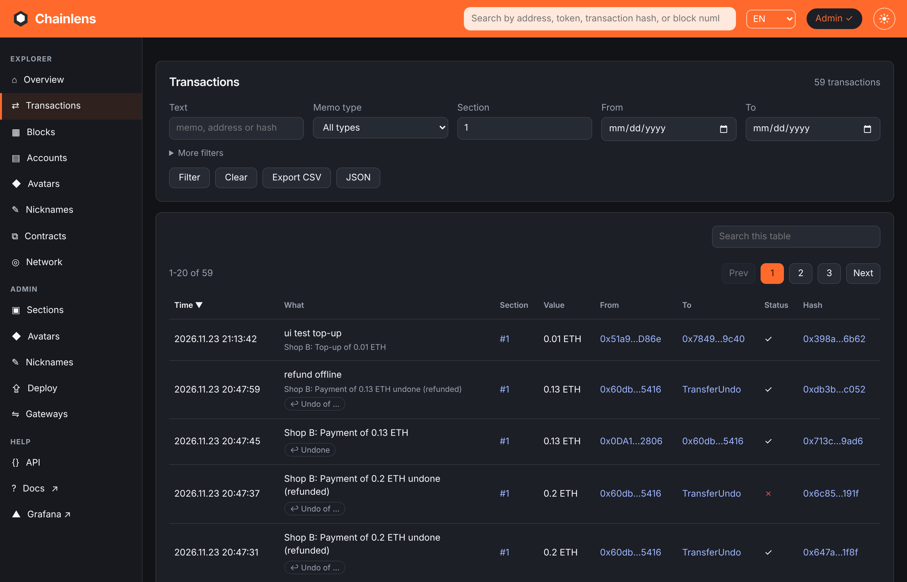

# Memos

> **What:** every transaction the proxy sends carries a **memo**: what the transaction is (its type
> and values), the section, the caller's own text when given, and a request id. Readers show it in
> their language (English, Korean, Chinese).
>
> **For:** application developers (the `memo` parameter, the answers), business admins and
> accountants (the memo log in chainlens, the export), operators (settings).
>
> **Related:** [proxy API](../reference/proxy-api.md#memos) · [chainlens](../components/chainlens.md) ·
> [section gateway](../components/gateway.md) · [sections](sections.md)

**Contents**

- [At a glance](#at-a-glance)
- [The memo record](#the-memo-record)
- [Where it is stored: the trailer](#where-it-is-stored-the-trailer)
- [The memo parameter](#the-memo-parameter)
- [Answers and languages](#answers-and-languages)
- [Memo types](#memo-types)
- [Chainlens: the memo log](#chainlens-the-memo-log)
- [The gateway](#the-gateway)
- [Older transactions](#older-transactions)
- [Settings](#settings)
- [Lab test](#lab-test)
- [Files](#files)

---

## At a glance

| | |
|---|---|
| **Which transactions** | all of them: transfers, new accounts, top-ups, sweeps, pay backs, section changes, contract calls (avatars, nicknames, other contracts), contract registrations |
| **Stored** | on chain, at the end of the transaction's data ([the trailer](#where-it-is-stored-the-trailer)); a contract creation keeps its memo in the proxy's memo log |
| **What is stored** | a **type code and values**, not a sentence, plus the caller's own text |
| **Caller's text** | optional `memo` on **every write route** (at most 256 bytes) |
| **Without `memo`** | a default text from the type, in the reader's language |
| **Languages** | English (`en`), Korean (`ko`), Chinese (`zh`) |
| **Where to read** | the proxy's answers and `GET /transfer/:txHash`, chainlens (every transaction, the **Memos** page, CSV/JSON export) |

## The memo record

```json
{ "v": 1, "t": "avatar.buy", "s": [1, "Shop B"], "p": { "tokenId": "3", "amount": "0.1" },
  "u": "gift for mom", "r": "47181dc1" }
```

| Field | Meaning | Set by |
|---|---|---|
| `v` | format version (1) | proxy |
| `t` | memo type ([the list](#memo-types)) | proxy, from the operation |
| `s` | section id and its name **at that time** (a renamed section keeps its old name in old memos) | proxy |
| `p` | the values the text needs (amount, token id, nickname, level, price, role…) | proxy |
| `u` | the caller's own `memo`, stored as typed, never translated | caller (optional) |
| `r` | request id: the same for all transactions of one API call (a `/createaccount` registers the account, then funds it) | proxy |

What is shown: the caller's text `u` when given, else the **default text** of `t` and `p` in the
reader's language, with the section name in front: `Shop B: Avatar #3 bought for 0.1 ETH` ·
`Shop B: 아바타 #3 0.1 ETH에 구매` · `Shop B：以 0.1 ETH 购买头像 #3`.

## Where it is stored: the trailer

The record is added **at the end of the transaction's data**, followed by a fixed 7-byte trailer:

```
[ call data ][ memo record (UTF-8 JSON) ][ length: 2 bytes ][ "MEMO" ][ version: 1 byte ]
```

| Transaction | Data |
|---|---|
| Plain ETH transfer | the record + trailer (no call data) |
| Contract call | the call data, then the record + trailer. A contract reads its call from the start of the data and ignores the extra bytes: the result is the same |
| Contract creation (deploy) | **nothing added** (a constructor reads its arguments from the end of the code). The memo goes to the proxy's memo log, and the registration transaction that follows carries the same `contract.deploy` memo |

A reader looks at the last 7 bytes: `"MEMO"` and version 1 → it reads the length, then the record
before the trailer. Anything else is an older transaction ([below](#older-transactions)).

| Check | Result |
|---|---|
| Gas | about 16 gas per byte of memo (a typical memo: 100–200 bytes, 1 600–3 200 gas); gas estimation includes it |
| MPC signer | its policy checks chain id, gas, value and destination, not the data: the trailer passes |
| Explorers, Remix | show the extra bytes as raw data; harmless |
| A contract that reads its whole `msg.data` (rare; not the platform's) | list it in `memo_skip_contracts`: no trailer, the memo goes to the memo log |

## The memo parameter

Every write route accepts an optional `memo` (a string, at most 256 UTF-8 bytes; otherwise 400):

| Route | Memo types of its transactions |
|---|---|
| `POST /transfer` | `transfer.in` (+x), `transfer.out` (−x); `transfer` without a key |
| `POST /createaccount` | `account.create` (registration) and `account.fund` (funding), same request id; `account.fund` without a key |
| `POST /contract/send` | `avatar.buy`, `avatar.undo`, `nickname.buy`, `nickname.upgradeLevel`, `nickname.undo`, `nickname.undoLevel`; another contract: `contract.call` |
| `POST /admin/contract/send` | `avatar.mint`, `avatar.setPrice`, `nickname.mint`, `nickname.setPrice`, `nickname.addLevel`, `nickname.setLevel`, `contract.call` |
| `POST /admin/contract/deploy` | `contract.deploy` |
| `POST /admin/sections…` | `section.create`, `section.rename`, `section.info`, `section.key`, `section.enable` / `disable`, `section.topup`, `section.sweep`, `section.payback`, `account.replace` + `account.move`, `section.return` + `section.archive`; `/accounts` and `/transfer` as above |
| `POST /account/pool` | accepted, but this route makes no transaction (it changes the MPC signer's pool class), so nothing is stored |

```bash
curl -s -X POST http://192.168.68.151:30000/transfer -H 'X-Section-Key: sk_…' -H 'Content-Type: application/json' \
  -d '{"account":"0xUser","amount":"0.5","memo":"order 1234"}'
```

## Answers and languages

Each write answer, and `GET /transfer/:txHash`, has these fields:

| Field | Value |
|---|---|
| `memo` | what to show: the caller's text, else the default text |
| `memoType` | the type (`transfer.in`, `avatar.buy`…) |
| `memoText` | the default text (also when the caller gave a text) |
| `memoParams` | the values |
| `userMemo` | the caller's text, or `null` |
| `memoRequest` | the request id |

The language: `?lang=ko` (or `en`, `zh`), else the `Accept-Language` header, else
`memo_default_lang` (`en`).

```json
POST /transfer?lang=ko  { "account": "0xUser", "amount": "-0.2" }
→ { "success": true, …, "memo": "Shop B: 0.2 ETH 지급", "memoType": "transfer.out",
    "memoText": "Shop B: 0.2 ETH 지급", "memoParams": { "amount": "0.2" }, "userMemo": null, "memoRequest": "fd0e5f44" }
```

## Memo types

The catalogue is [`memo/memo-types.json`](../../memo/memo-types.json): one entry per type, with a text in
each language. A text can have shorter variants for when a value is missing (an older transaction).
A type the reader doesn't know (a newer proxy) is shown as its code.

| Type | English default text |
|---|---|
| `transfer.in` / `transfer.out` / `transfer` | Payment of {amount} ETH / Payout of {amount} ETH / Transfer of {amount} ETH |
| `transfer.undoIn` / `transfer.undoOut` | Payment of {amount} ETH undone (refunded) / Payout of {amount} ETH undone (returned) — [transfer undo](transfer-undo.md) |
| `account.create` / `account.fund` | New account registered / New account funded with {amount} ETH |
| `account.replace` / `account.move` | {role} account replaced / {role} account replaced: {amount} ETH moved to the new account |
| `section.create` / `rename` / `info` / `key` | Section "{name}" created / Renamed "{from}" → "{to}" / Info "{key}" changed / API key replaced |
| `section.enable` / `disable` / `archive` / `migrate` | Section enabled / disabled / archived / Moved to the new registry |
| `section.topup` / `sweep` / `payback` / `return` | Top-up / Sweep / Pay back of {amount} ETH / Archive: {role} balance of {amount} ETH returned |
| `contract.deploy` / `contract.call` | Contract "{name}" registered ({kind}) / {function} on {contract} |
| `avatar.mint` / `setPrice` / `buy` / `undo` | Avatar minted at {price} ETH / Avatar #{tokenId}: price {price} ETH / Avatar #{tokenId} bought for {amount} ETH / … purchase undone, {amount} ETH refunded |
| `nickname.mint` / `setPrice` / `buy` / `undo` | Nickname "{nickname}" minted at {price} ETH / … / Nickname "{nickname}" bought for {amount} ETH / … |
| `nickname.upgradeLevel` / `undoLevel` / `addLevel` / `setLevel` | Nickname #{tokenId}: level {level} for {amount} ETH / … level upgrade undone, {amount} ETH refunded / New nickname level at {price} ETH / Nickname level {level} changed |
| `nonce.fill` | Empty transaction (fills a nonce gap) |
| `other` | Transaction |

To add a type or change a text: edit `memo/memo-types.json` (all three languages), run
`memo/sync.sh` (copies the module into `proxy/`, `chainlens/`, `gateway/`) and `node memo/test.js`,
then rebuild the images. Old transactions show the new text at once: only the code is stored.

## Chainlens: the memo log



| Where | What |
|---|---|
| **Transactions** (every list) | the memo column for every transaction, in the page's language; the search finds the text, the type and the caller's text |
| **A transaction** | the memo, its type (link to the Transactions page filtered by it), the default text when the caller wrote their own, the request id (link to all transactions of that call) |
| **Transactions** page (`#/activity/transactions`, formerly the Memos page) | filters: text (memo, address, hash), kind (a family such as Avatars, or one memo type), section, dates, request id, account; **Export CSV** (UTF-8, opens in Excel) and **JSON** |
| **Section page → history** | the memo column |
| **Admin forms** (Sections, the avatar card, Nicknames) | a **Memo (optional)** field: it goes with every transaction those forms send |
| **Language** | the selector at the top: English, 한국어, 中文 (the whole chainlens interface is now also in Korean) |

API: `GET /api/activity?` (every transaction) and `GET /api/memos?type=&section=&q=&from=&to=&request=&lang=&limit=&format=csv` (the same filters;
`limit` up to 10 000).

## The gateway

The [section gateway](../components/gateway.md) passes `memo`, `?lang=` and `Accept-Language` to the
proxy. While **offline**, its answers carry the same memo fields, built from the same catalogue, so
the application sees no difference; the queued request keeps the caller's `memo`, and the proxy
writes the memo on chain when the request is sent (with its own request id).

## Older transactions

Transactions from before memos are read as well:

| Older data | Shown as |
|---|---|
| plain-text memo of a transfer (`"order 1234"`) | that text, as the caller's memo |
| `section 4 top-up`, `… sweep`, `… pay back`, `… account replaced`, `… archived: … returned` | the matching type, translated (`#4: Top-up of 1 ETH`) |
| `New NFT Token mint: … - https://…` | `avatar.mint` (the image still shown in chainlens) |
| an older contract call | no memo (its function name is shown as before) |

## Settings

In `ansible/group_vars/all/settings.yml`:

| Setting | Default | Meaning |
|---|---|---|
| `memo_default_lang` | `en` | the language of answers when the caller names none (proxy and gateways) |
| `memo_skip_contracts` | `[]` | contracts that get no trailer; their memo goes to the memo log |

After a change: `ansible-playbook 06-proxy.yml 14-gateway.yml`. The proxy also reads `MEMO_ENABLED=false`
(environment) to switch memos off for a test.

## Lab test

On the lab (`10.77.0.x`), section 1 "Shop B", through the proxy and the gateway on h137:

| Test | Result |
|---|---|
| +x with `memo`, −x without, answers in `en` / `ko` (`Accept-Language`) / `zh` (`?lang`) | `order 1234`; `Shop B: 0.2 ETH 지급`; `Shop B：付款 0.1 ETH` |
| `GET /transfer/:txHash` in three languages | `Payout of 0.2 ETH` · `0.2 ETH 지급` · `支出 0.2 ETH` |
| a memo of 300 bytes; a number as memo | 400 *memo is too long*; 400 *invalid memo* |
| top-up with `memo`, sweep, info | `monthly budget`; `Shop B: Sweep of 0.1 ETH`; `Shop B: 정보 "memo-test" 변경` |
| deploy, mint, setPrice, **buy by image with `memo`**, undo | the buy worked with the trailer (283 bytes of data, the record decoded from the chain), result unchanged |
| nickname mint, addLevel, buy, upgradeLevel, undoLevel in three languages | e.g. `Shop B: 닉네임 #1: 레벨 1, 0.05 ETH`, `Shop B：昵称 #1：撤销升级，退款 0.05 ETH` |
| `/createaccount` | two transactions with one request id: `account.fund`, `account.create` |
| gateway online (`ko`) and offline (`ko`, `zh`) | the same memo fields; the offline `memo` written on chain after the cut |
| chainlens `/api/memos` | filters by section, type family, text (`gift for mom`), request id; an older memo (`offline +x`) found; CSV in Korean |

## Files

| File | What |
|---|---|
| [`memo/memo.js`](../../memo/memo.js) | encoder, decoder, texts, older memos (no dependencies) |
| [`memo/memo-types.json`](../../memo/memo-types.json) | the catalogue: types and texts in en, ko, zh |
| [`memo/test.js`](../../memo/test.js), [`memo/sync.sh`](../../memo/sync.sh) | tests (format, languages, limits, the copies match); copies the module into the apps |
| `proxy/memo/`, `chainlens/memo/`, `gateway/memo/` | the copies used by each image |
| [`proxy/stress-latest.js`](../../proxy/stress-latest.js) | the memo on every transaction, the `memo` parameter, the answers, the memo log |
| [`chainlens/server.js`](../../chainlens/server.js), [`chainlens/public/app.js`](../../chainlens/public/app.js) | decoding, the Transactions page with memos, the export, the form field |
| [`chainlens/public/i18n.js`](../../chainlens/public/i18n.js) | the interface in English, Korean, Chinese |
