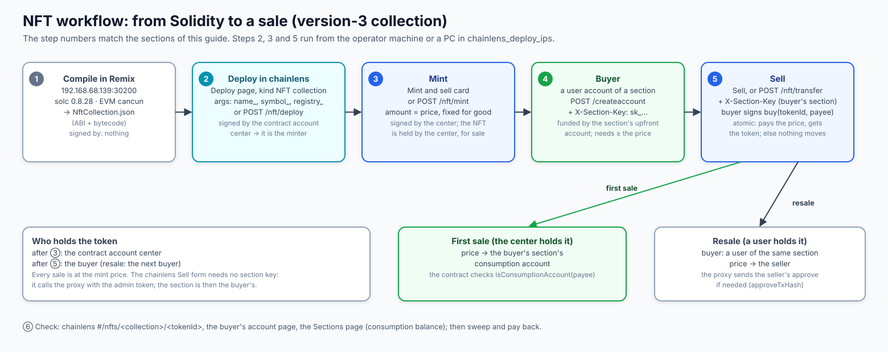
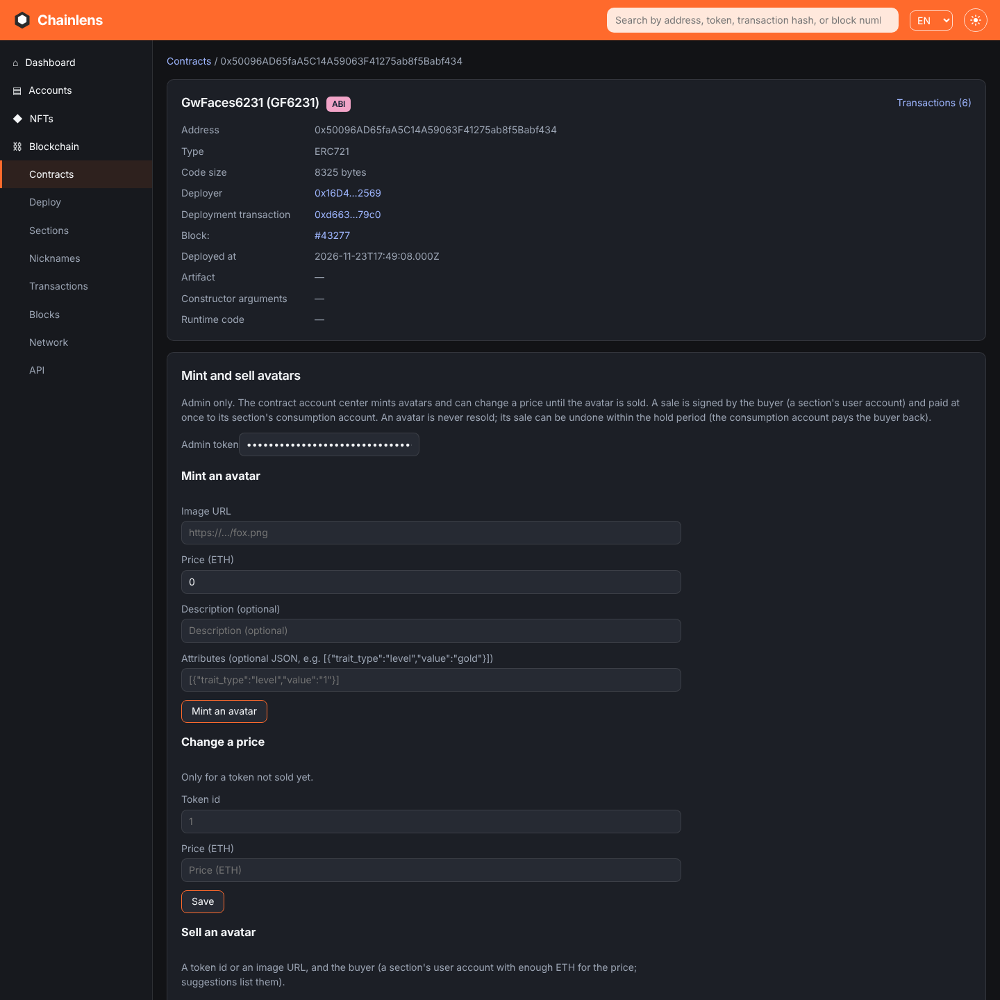

# NFT 워크플로

> **내용:** Solidity에서 NFT 판매까지: Remix에서 컴파일하고, chainlens에서 배포하고, 민팅하고, 구매자를 생성하고, 판매합니다.
>
> **대상:** 컨트랙트 개발자, 비즈니스 관리자.
>
> **관련 문서:** [섹션](sections.md) · [프록시 API](../reference/proxy-api.md) · [chainlens](../components/chainlens.md)

**목차**

- [0. 시작하기 전에](#0-before-you-start)
- [1. Remix에서 컴파일](#1-compile-in-remix)
- [2. chainlens에서 배포](#2-deploy-in-chainlens)
- [3. 민팅](#3-mint)
- [4. 구매자: 섹션의 사용자 계정](#4-a-buyer-a-sections-user-account)
- [5. 판매](#5-sell)
- [6. 확인](#6-check)
- [버전 2 컬렉션: 폐기됨](#version-2-collections-retired)
- [오류](#errors)

---

이 가이드는 NFT 컬렉션을 소스 코드에서 최초 판매와 재판매까지 진행합니다.
[`proxy/contracts/NftCollection.sol`](../../proxy/contracts/NftCollection.sol)(버전 3)을 사용합니다. 규칙은
[섹션](sections.md#nft-collections)에 있습니다.

| 단계 | 위치 | 서명 주체 |
|---|---|---|
| 1. 컴파일 | Remix (`http://192.168.68.139:30200`) | 없음 |
| 2. 배포 | chainlens **Deploy** 페이지 (또는 `nft-collection` 템플릿으로 `POST /admin/contracts/deploy`) | 컨트랙트 계정 센터 |
| 3. 민팅 | 컬렉션의 chainlens 페이지에서 **Mint**, 또는 `POST /admin/contract/send` (`mint`) | 컨트랙트 계정 센터 |
| 4. 구매자 | 섹션의 키로 `POST /createaccount`, 또는 chainlens Sections 페이지에서 **Create account** | — (섹션의 선지급 계정에서 자금 공급) |
| 5. 판매 | 컬렉션의 chainlens 페이지에서 **Sell**, 또는 섹션의 키로 `POST /contract/send` (`buy`) | 구매자 (재판매의 경우 먼저 판매자의 `approve`) |



아래 주소는 프로덕션 주소입니다(프록시 VIP `192.168.68.151:30000`, chainlens와 Remix는
h139). 2, 3, 5단계는 운영자 머신 또는 `chainlens_deploy_ips`에 있는 PC의 브라우저에서 실행하십시오
([컨트랙트 배포 (chainlens Deploy 페이지)](contract-deployment.md)).

## 0. 시작하기 전에 {#0-before-you-start}

- 섹션이 구성되어 있어야 하며(06 단계에서 SectionRegistry와 컨트랙트 계정 센터를 생성),
  선지급 계정에 자금이 있는 **섹션**이 하나 이상 있어야 합니다(chainlens **Sections**
  페이지 또는 `POST /admin/sections`).
- chainlens 관리 페이지가 켜져 있어야 합니다. 브라우저에서 2단계를 하려면 `chainlens_deploy_enabled: true`가 필요합니다.
  **Mint and sell** 카드는 Deploy 페이지나 Sections 페이지가 켜져 있으면 표시됩니다.
- 생성자 인수인 **SectionRegistry의 주소**가 필요합니다. 이 주소는
  chainlens 대시보드(*Platform* → *Section registry*)에 표시되며, `ansible/state/registry.json`에도 있습니다.
- chainlens 관리 페이지용 **관리 토큰**이 필요합니다(Deploy 페이지에서는 *Deploy
  token*, Mint and sell 카드에서는 *Admin token*이라고 부르지만 같은 토큰입니다). 운영자 머신에서 다음을 실행하십시오.

  ```bash
  cat ansible/state/secrets/chainlens_deploy_token
  ```

  2단계와 3단계의 curl 예시는 대신 프록시의 관리 API를 **프록시 관리 토큰**
  (`ansible/state/secrets/proxy_admin_token`)으로, `ADMIN_ALLOWED_IPS`에 있는 주소에서 호출합니다.

## 1. Remix에서 컴파일 {#1-compile-in-remix}

1. `http://192.168.68.139:30200`을 엽니다([Remix IDE (자체 호스팅)](../components/remix.md)).
   `NftCollection.sol`을 생성하고
   [`proxy/contracts/NftCollection.sol`](../../proxy/contracts/NftCollection.sol)의 내용을 붙여넣습니다.
2. **Solidity compiler:** 버전 `0.8.28`, **Advanced configurations → EVM version `cancun`**,
   옵티마이저 켜기(200 runs). 컴파일합니다.
3. **Settings → Generate contract metadata**를 켭니다. Remix가
   `contracts/artifacts/NftCollection.json`(ABI + 바이트코드)을 작성합니다. 이 파일을 마우스 오른쪽 버튼으로 클릭 → **Download**.

   (저장소에 같은 컴파일 결과물이 이미 있으므로 대신 사용할 수 있습니다:
   `proxy/nft-collection-v3.json`.)

먼저 컨트랙트를 시험해 보려면 *Deploy & run → Remix VM (Cancun)*을 사용하십시오. 브라우저 내부 체인이므로
아무것도 브라우저 밖으로 나가지 않습니다.

## 2. chainlens에서 배포 {#2-deploy-in-chainlens}

`http://192.168.68.139:30100/#/deploy`를 여십시오.

1. **Deploy token:** 토큰을 붙여넣습니다.
2. **Compiler artifact:** `NftCollection.json`. 파일에 컨트랙트가 여러 개 있으면 **NftCollection**을 선택합니다.
3. **Constructor arguments:**
   - `name_`은 컬렉션의 이름입니다(`Dragons`).
   - `symbol_`은 컬렉션의 심볼입니다(`DRG`).
   - `registry_`는 SectionRegistry의 주소입니다.
4. **Kind:** *NFT collection*. **Name in the registry:** 선택 사항, 예: `Dragons`.
5. **Check**를 누른 다음 **Deploy**를 누릅니다. 페이지에 새 컨트랙트 링크가 표시됩니다: `#/contracts/0x…`.

컨트랙트 계정 센터가 배포자이므로 컬렉션의 **민터**가 됩니다. 컬렉션은 온체인에 등록되며(종류 NFT)
모든 섹션이 공유합니다. 애플리케이션은 컬렉션의 **주소**를 사용합니다:
`GET /contract/list?type=nft`가 이름, 심볼, 민터와 함께 컬렉션을 나열합니다. 레지스트리가 NFT
컬렉션으로 기록하도록(`kind: "nft"`) 종류는 *NFT collection*을 선택하십시오.

**또는 curl 사용:** `nft-collection` 템플릿은 같은 컨트랙트(프록시 이미지에 컴파일되어 있는
`proxy/nft-collection-v3.json`)를 레지스트리 주소를 채워 배포하고 등록합니다. 이름과 심볼은 NFT 컬렉션
사이에서 대소문자 무관하게 고유해야 합니다(그렇지 않으면 409).

```bash
P=http://192.168.68.151:30000; T=$(cat ansible/state/secrets/proxy_admin_token)
curl -s -X POST $P/admin/contracts/deploy -H "Authorization: Bearer $T" -H 'Content-Type: application/json' \
  -d '{"template":"nft-collection","name":"Dragons","symbol":"DRG"}'
```

```
{ "success": true, "name": "Dragons", "kind": "nft", "address": "0xCollection", "deployer": "<center>", "txHash": "0x…",
  "codeCheck": "matches the artifact", "registryTxHash": "0x…", ... }
```

같은 본문의 `POST /admin/contracts/check`는 시험 실행입니다(가스, 배포될 주소).

## 3. 민팅 {#3-mint}

**chainlens에서:** 컬렉션 페이지(`#/contracts/0x…`)에서 **Mint and sell** 카드를 엽니다.
이름, ETH 단위 가격, 이미지 URL을 입력합니다. 설명과 속성(JSON)은 선택 사항입니다.
**Mint**를 클릭합니다. 결과에 새 토큰 ID와 NFT 링크가 표시됩니다.



**또는 curl 사용:** 친화적인 `args`로 `POST /admin/contract/send`(컨트랙트 계정 센터가 서명)를 통해
`mint`를 호출합니다. 프록시가 메타데이터를 만들고, 다음 토큰 ID를 고르고, 메타데이터를 토큰 URI에
온체인으로 저장합니다.

```bash
curl -s -X POST $P/admin/contract/send -H "Authorization: Bearer $T" -H 'Content-Type: application/json' \
  -d '{"contract":"0xCollection","function":"mint","args":{"name":"Red dragon","image":"https://example.com/red.png","description":"Level 1","attributes":[{"trait_type":"level","value":"1"}],"price":"3"}}'
```

```
{ "success": true, "contract": "0xCollection", "function": "mint(address,uint256,string,uint256)", "from": "<center>", "txHash": "0x…",
  "result": { "minted": true, "tokenId": "1", "owner": "<center>", "price": "3",
              "metadata": { "name": "Red dragon", "description": "Level 1", "image": "https://example.com/red.png", "attributes": [ … ] } }, ... }
```

센터는 판매용으로 NFT를 자신에게 민팅합니다. `price`는 ETH 단위입니다. 가격은 영구 고정되며, 모든
판매(최초 판매와 재판매)가 이 가격으로 이루어집니다. 민팅은 섹션과 연결되지 않으며 아무것도 지불하지
않습니다. `name`과 `image`는 필수입니다. 블록에 들어가지 않을 만큼 큰 메타데이터는 거부됩니다
(`metadata is too large for the chain`). 섹션은 민팅할 수 없습니다: `/contract/send`로 보낸 `mint`는
`not minter`로 revert됩니다.

## 4. 구매자: 섹션의 사용자 계정 {#4-a-buyer-a-sections-user-account}

구매자는 **섹션의 사용자 계정**이어야 하며 최소한 가격만큼의 잔액이 있어야 합니다.

```bash
curl -s -X POST http://192.168.68.151:30000/createaccount -H 'Content-Type: application/json' \
  -H 'X-Section-Key: sk_…' -d '{"amount":"5"}'
```

```
{ "success": true, "section": {"id": 1, "name": "Shop A"}, "address": "0xBuyer…", ... }
```

계정은 해당 섹션의 선지급 계정에서 자금을 받습니다. 나중에 ETH를 더 주려면
섹션의 키와 음수 금액으로 `POST /transfer`를 사용하십시오(`−x`: 선지급 → 계정,
[섹션](sections.md#application-api-section-calls) 참조). 키가 없으면 chainlens **Sections** 페이지에서
같은 작업을 할 수 있습니다(섹션의 사용자 계정: **Create account**, **Transfer**).

## 5. 판매 {#5-sell}

**chainlens에서:** **Mint and sell** 카드의 **Sell** 아래에 토큰 ID와 구매자를 입력합니다.
구매자 필드는 섹션 사용자 계정을 섹션 및 잔액과 함께 제안합니다. **Sell**을 클릭합니다.

**또는 curl 사용**, 구매자 섹션의 키와 함께 범용
[`POST /contract/send`](../reference/proxy-api.md#post-contractsend--write)로 호출합니다. `contract`는
컬렉션 주소(`GET /contract/list?type=nft`), `from`은 구매자입니다. payee와 `value`는 생략하십시오.
프록시가 구매자 섹션의 소비 계정과 토큰 가격을 채웁니다.

```bash
curl -s -X POST $P/contract/send -H 'Content-Type: application/json' -H "X-Section-Key: $K" \
  --data '{"contract":"0xCollection","function":"buy","args":{"tokenId":"1"},"from":"0xBuyer"}'
```

```
{ "success": true, "section": {"id": 1, "name": "Shop A"}, "function": "buy(uint256,address)", "value": "3.0", "txHash": "0x…",
  "result": { "sale": "first sale", "tokenId": "1", "seller": "<center>", "buyer": "0xBuyer", "price": "3",
              "paidTo": "<Shop A's consumption account>" },
  "events": [ { "name": "Sold", "args": { … } }, ... ] }
```

구매자는 원자적인 `buy(tokenId, payee)` 트랜잭션 하나에 서명합니다. 정확히 가격만큼 지불하고
토큰을 받습니다. 어떤 검사라도 실패하면 아무것도 이동하지 않습니다.

- **최초 판매**(센터가 토큰 보유): 대금은 구매자 섹션의
  **소비 계정**으로 갑니다. 컨트랙트 자체가 `payee`가
  활성 섹션의 소비 계정인지 확인합니다(`SectionRegistry.isConsumptionAccount`).
- **재판매**(사용자가 토큰 보유): 호출이 두 번입니다. 먼저 판매자의 섹션이 판매자로 `approve`를 보내
  토큰을 판매에 내놓습니다(`"function":"approve","args":{"tokenId":"1"},"from":"0xSeller"`: 프록시가
  컬렉션 자신을 승인하며 `result.forSale`은 `true`). 그다음 구매자의 섹션이 위와 같이 `buy`를 보냅니다
  (`result.sale`은 `"resale"`). 대금은 **판매자**에게 갑니다(컨트랙트는 payee를 무시). 각 섹션은 자기 계정으로만
  서명하므로 구매자가 판매자와 **다른 섹션**에 있어도 됩니다.

키가 없으면 프록시는 401 `X-Section-Key is required`로 응답합니다. 유일한 예외는 관리
API 호출자입니다. chainlens Sell 양식에는 섹션 키가 필요 없습니다. chainlens가 프록시의
`ADMIN_ALLOWED_IPS`에 있는 주소에서 관리 토큰으로 프록시를 호출하기 때문이며, 이때 섹션은 구매자의 섹션입니다.
재판매라면 판매자가 먼저 승인해야 합니다.

이전의 `POST /nft/transfer`는 제거되었습니다. `/contract/send`를 안내하는 410으로 응답합니다.

## 6. 확인 {#6-check}

- **chainlens:**
  - `#/nfts/<collection>/<tokenId>`에 소유자, 메타데이터, 이미지가 표시됩니다.
  - 구매자의 계정 페이지에 섹션과 NFT가 표시됩니다.
  - **Sections** 페이지에 소비 계정의 잔액이 표시됩니다.
  - 대시보드의 **Section statistics**에 판매가 집계됩니다(*NFT sales*, *Income*).
- **프록시:** 일괄 `POST /contract/call` 한 번으로 토큰의 소유자, 가격, 메타데이터를 읽고,
  `POST /contract/events`로 구매자가 보유한 토큰(`current: true`), 토큰의 민팅 트랜잭션
  (`0x0…0`에서의 `Transfer`), 판매 내역(`Sold`, 가격은 ETH)을 나열합니다.

  ```bash
  curl -s -X POST $P/contract/call -H 'Content-Type: application/json' -H "X-Section-Key: $K" \
    --data '{"calls":[{"contract":"0xCollection","function":"ownerOf","args":{"tokenId":"1"}},{"contract":"0xCollection","function":"priceOf","args":{"tokenId":"1"}},{"contract":"0xCollection","function":"tokenURI","args":{"tokenId":"1"}}]}'
  # results: { "tokenId": "1", "owner": "0xBuyer" }, { "tokenId": "1", "price": "3" }, { "tokenId": "1", "metadata": {…}, "image": "https://example.com/red.png" }
  curl -s -X POST $P/contract/events -H 'Content-Type: application/json' -H "X-Section-Key: $K" \
    --data '{"contract":"0xCollection","event":"Transfer","where":{"to":"0xBuyer"},"current":true}'
  curl -s -X POST $P/contract/events -H 'Content-Type: application/json' -H "X-Section-Key: $K" \
    --data '{"contract":"0xCollection","event":"Transfer","where":{"from":"0x0000000000000000000000000000000000000000","tokenId":"1"}}'
  ```
- **Grafana → Sections:** `nft_first_sale` / `nft_resale` 작업과 이동한 ETH.
- **자금:** chainlens **Sections** 페이지에서 소비 계정을 결제 계정으로 스윕하고, SENDER01로
  반환합니다.

## 버전 2 컬렉션: 폐기됨 {#version-2-collections-retired}

섹션 도입 이전에 배포된 컬렉션([`NftCollectionV2.sol`](../../proxy/contracts/NftCollectionV2.sol),
SENDER01이 민팅)은 **폐기되었습니다**: 프록시는 더 이상 이를 읽거나, 민팅하거나, 판매하지 않으며, 그
라우트(`/nft/mint`, `/nft/transfer`, `/nft/deploy`…)는 410으로 응답합니다. 토큰은 체인에 남아 있습니다.
새 컬렉션은 버전 3이며 섹션이 필요합니다: 섹션이 없는 프록시(개발)에는 NFT 컬렉션이 없습니다.

## 오류 {#errors}

| 메시지 | 원인 |
|---|---|
| `X-Section-Key is required: …` | `/contract/send`에 `X-Section-Key` 헤더가 없음 (관리 API 호출자도 아님) |
| 410 `POST /nft/transfer was removed: use POST /contract/send …` | 이전 `/nft/*` 라우트 ([제거된 라우트](../reference/proxy-api.md#removed-routes)) |
| `unknown section key` | 키가 교체되었거나 섹션이 보관됨 |
| `… is not a user account of a section` | 구매자(`from`)가 `/createaccount`와 섹션 키로 생성되지 않음 |
| `section "…" is disabled` | 구매자의 섹션이 비활성화됨 (Sections 페이지) |
| `… is not an account of section "…"` | `from`이 키에 해당하는 섹션의 사용자가 아님 (서명하는 계정의 섹션 키를 사용하십시오) |
| `insufficient balance: N ETH is needed` | 구매자의 잔액이 가격보다 적음: 충전하십시오 (`−x` 이체) |
| `value: the price is N ETH …` / `payee: …` | 잘못된 `value` 또는 payee를 지정함: 생략하십시오 |
| `the transaction would revert: …` | 컨트랙트가 판매를 거부함, 예: 판매자의 `approve` 없는 재판매 |
| `token not found` / `… already owns token N` | 잘못된 토큰 ID이거나 구매자가 이미 보유함 |
| `0x… is not a registered contract` | 잘못된 주소: `GET /contract/list?type=nft`가 컬렉션을 나열합니다 |
| `args: no value for "tokenId" (…)` | `args` 이름이 틀림 (예: `{"id": …}`는 허용, `{"token": …}`은 불가) |
| `the transaction would revert: not minter` | `/contract/send`로 `mint`: 센터만 민팅하므로 `/admin/contract/send`를 사용하십시오 |
| 409 `a collection named "…" (…) exists at 0x…` | 이름 또는 심볼을 다른 NFT 컬렉션이 사용 중 |
