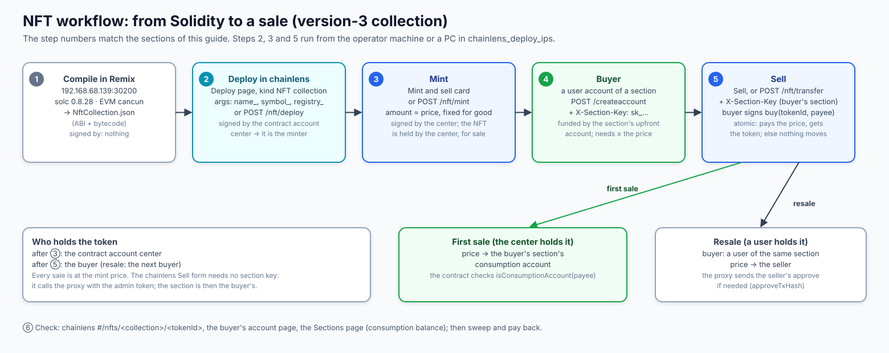
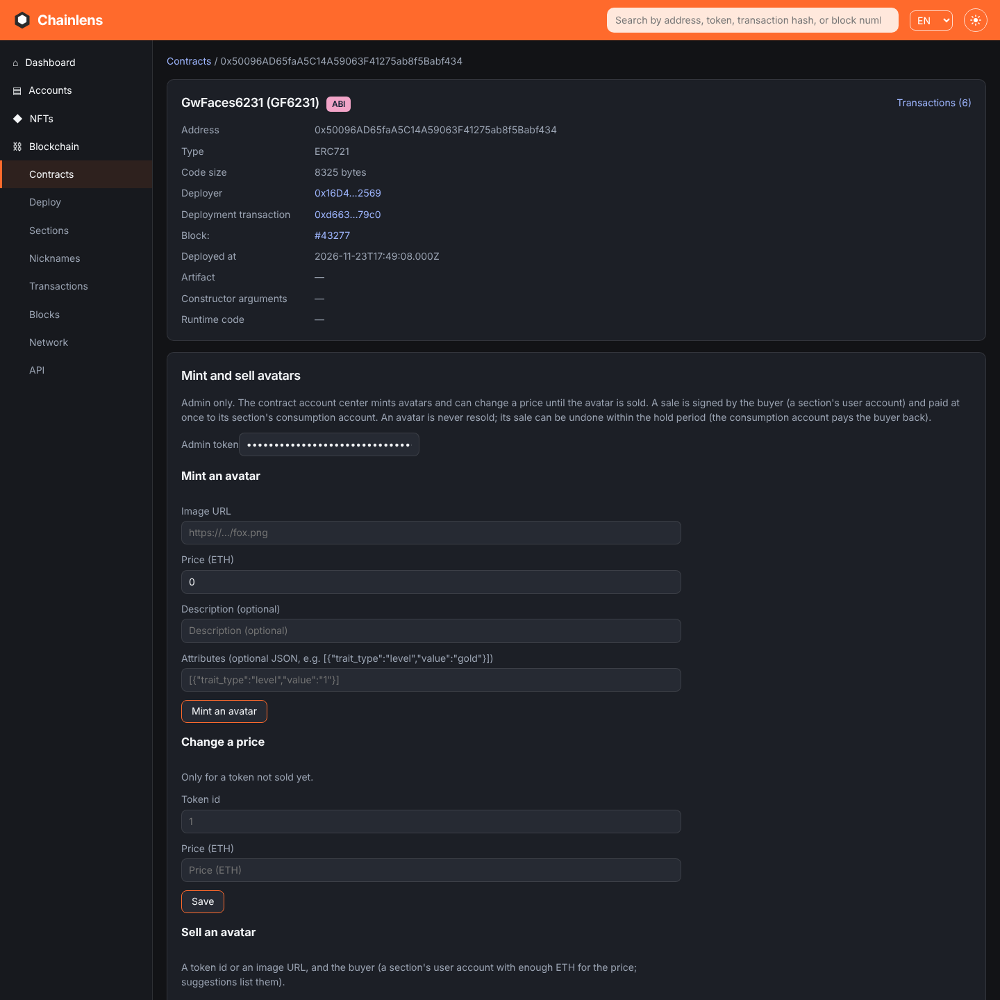

# NFT workflow

> **What:** From Solidity to an NFT sale: compile in Remix, deploy in chainlens, mint, create a buyer, sell.
>
> **For:** contract developers, business admins.
>
> **Related:** [sections](sections.md) · [proxy API](../reference/proxy-api.md) · [chainlens](../components/chainlens.md)

**Contents**

- [0. Before you start](#0-before-you-start)
- [1. Compile in Remix](#1-compile-in-remix)
- [2. Deploy in chainlens](#2-deploy-in-chainlens)
- [3. Mint](#3-mint)
- [4. A buyer: a section's user account](#4-a-buyer-a-sections-user-account)
- [5. Sell](#5-sell)
- [6. Check](#6-check)
- [Version-2 collections: retired](#version-2-collections-retired)
- [Errors](#errors)

---

This guide takes an NFT collection from source code to a first sale and a resale. It uses
[`proxy/contracts/NftCollection.sol`](../../proxy/contracts/NftCollection.sol) (version 3; the rules
are in [sections](sections.md#nft-collections)).

| Step | Where | Signed by |
|---|---|---|
| 1. Compile | Remix (`http://192.168.68.139:30200`) | nothing |
| 2. Deploy | chainlens **Deploy** page (or `POST /admin/contracts/deploy` with the `nft-collection` template) | the contract account center |
| 3. Mint | **Mint** on the collection's chainlens page, or `POST /admin/contract/send` (`mint`) | the contract account center |
| 4. Buyer | `POST /createaccount` with a section's key, or **Create account** on the chainlens Sections page | — (funded by the section's upfront account) |
| 5. Sell | **Sell** on the collection's chainlens page, or `POST /contract/send` (`buy`) with the section's key | the buyer (and, for a resale, first the seller's `approve`) |



The addresses below are the production ones (proxy VIP `192.168.68.151:30000`, chainlens and Remix
on h139). Run steps 2, 3 and 5 in the browser from the operator machine or a PC in
`chainlens_deploy_ips` ([Contract deployment (chainlens Deploy page)](contract-deployment.md)).

## 0. Before you start

- The sections are configured (phase 06 created the SectionRegistry and the contract account center),
  and at least one **section** exists, with money on its upfront account (chainlens **Sections**
  page, or `POST /admin/sections`).
- The chainlens admin pages are on: `chainlens_deploy_enabled: true` for step 2 in the browser. The
  **Mint and sell** card appears when the Deploy or the Sections page is on.
- You need the **SectionRegistry's address**, which is the constructor argument. It is shown on the
  chainlens dashboard (*Platform* → *Section registry*), and is in `ansible/state/registry.json`.
- You need the **admin token** for the chainlens admin pages (the Deploy page calls it *Deploy
  token*, the Mint and sell card *Admin token*; it is the same token), on the operator:

  ```bash
  cat ansible/state/secrets/chainlens_deploy_token
  ```

  The curl examples of steps 2 and 3 call the proxy's admin API instead, with the **proxy admin
  token** (`ansible/state/secrets/proxy_admin_token`), from an address in `ADMIN_ALLOWED_IPS`.

## 1. Compile in Remix

1. Open `http://192.168.68.139:30200` ([Remix IDE (self-hosted)](../components/remix.md)). Create
   `NftCollection.sol` and paste the contents of
   [`proxy/contracts/NftCollection.sol`](../../proxy/contracts/NftCollection.sol).
2. **Solidity compiler:** version `0.8.28`, **Advanced configurations → EVM version `cancun`**,
   optimizer on (200 runs). Compile.
3. **Settings → Generate contract metadata** on. Remix writes
   `contracts/artifacts/NftCollection.json` (ABI + bytecode). Right-click it → **Download**.

   (The repository already has the same compiled artifact, which you can use instead:
   `proxy/nft-collection-v3.json`.)

To try the contract first, use *Deploy & run → Remix VM (Cancun)*: it is an in-browser chain, and
nothing leaves the browser.

## 2. Deploy in chainlens

Open `http://192.168.68.139:30100/#/deploy`:

1. **Deploy token:** paste the token.
2. **Compiler artifact:** `NftCollection.json`. If the file has several contracts, choose **NftCollection**.
3. **Constructor arguments:**
   - `name_` is the collection's name (`Dragons`);
   - `symbol_` is its symbol (`DRG`);
   - `registry_` is the SectionRegistry's address.
4. **Kind:** *NFT collection*. **Name in the registry:** optional, e.g. `Dragons`.
5. **Check**, then **Deploy**. The page links to the new contract: `#/contracts/0x…`.

The contract account center is the deployer, so it is the collection's **minter**. The collection is
registered on chain (kind NFT) and shared by all sections. Applications use its **address**:
`GET /contract/list?type=nft` lists the collections with their name, symbol and minter. Choose kind
*NFT collection*, so that the registry records it as one (`kind: "nft"`).

**Or with curl:** the `nft-collection` template deploys the same contract (compiled into the proxy
image, as `proxy/nft-collection-v3.json`) with the registry's address filled in, and registers it.
Names and symbols must be unique among the NFT collections, in any letter case (409 otherwise):

```bash
P=http://192.168.68.151:30000; T=$(cat ansible/state/secrets/proxy_admin_token)
curl -s -X POST $P/admin/contracts/deploy -H "Authorization: Bearer $T" -H 'Content-Type: application/json' \
  -d '{"template":"nft-collection","name":"Dragons","symbol":"DRG"}'
```

```
{ "success": true, "name": "Dragons", "kind": "nft", "address": "0xCollection", "deployer": "<center>", "txHash": "0x…",
  "codeCheck": "matches the artifact", "registryTxHash": "0x…", ... }
```

`POST /admin/contracts/check` with the same body is a dry run (gas, the future address).

## 3. Mint

**In chainlens:** on the collection's page (`#/contracts/0x…`), open the **Mint and sell** card.
Fill in a name, a price in ETH and an image URL. The description and attributes (JSON) are optional.
Click **Mint**. The result shows the new token id and links to the NFT.



**Or with curl:** `mint` through `POST /admin/contract/send` (signed by the contract account
center), with friendly `args`. The proxy builds the metadata, picks the next token id and stores
the metadata on chain in the token URI:

```bash
curl -s -X POST $P/admin/contract/send -H "Authorization: Bearer $T" -H 'Content-Type: application/json' \
  -d '{"contract":"0xCollection","function":"mint","args":{"name":"Red dragon","image":"https://example.com/red.png","description":"Level 1","attributes":[{"trait_type":"level","value":"1"}],"price":"3"}}'
```

```
{ "success": true, "contract": "0xCollection", "function": "mint(address,uint256,string,uint256)", "from": "<center>", "txHash": "0x…",
  "result": { "minted": true, "tokenId": "1", "owner": "<center>", "price": "3",
              "metadata": { "name": "Red dragon", "description": "Level 1", "image": "https://example.com/red.png", "attributes": [ … ] } }, ... }
```

The center mints the NFT to itself, for sale. `price` is in ETH. It is fixed for good, and every
sale (first sale and resales) is at this price. Minting is not tied to a section and pays nothing.
`name` and `image` are required. Metadata too large for a block is refused (`metadata is too large
for the chain`). A section can't mint: `mint` through `/contract/send` reverts with `not minter`.

## 4. A buyer: a section's user account

The buyer must be a **user account of a section** and must have at least the price:

```bash
curl -s -X POST http://192.168.68.151:30000/createaccount -H 'Content-Type: application/json' \
  -H 'X-Section-Key: sk_…' -d '{"amount":"5"}'
```

```
{ "success": true, "section": {"id": 1, "name": "Shop A"}, "address": "0xBuyer…", ... }
```

The account is funded from that section's upfront account. To give it more ETH later, use
`POST /transfer` with the section's key and a negative amount (`−x`: upfront → account; see
[sections](sections.md#application-api-section-calls)). Without the key, the same can be done on the
chainlens **Sections** page (the section's user accounts: **Create account**, **Transfer**).

## 5. Sell

**In chainlens:** in the **Mint and sell** card, under **Sell**, enter the token id and the buyer. The
buyer field suggests the section user accounts, with their section and balance. Click **Sell**.

**Or with curl**, with the key of the buyer's section, through the generic
[`POST /contract/send`](../reference/proxy-api.md#post-contractsend--write). `contract` is the
collection's address (`GET /contract/list?type=nft`), `from` the buyer. Leave out the payee and
`value`: the proxy fills in the buyer's section's consumption account and the token's price.

```bash
curl -s -X POST $P/contract/send -H 'Content-Type: application/json' -H "X-Section-Key: $K" \
  --data '{"contract":"0xCollection","function":"buy","args":{"tokenId":"1"},"from":"0xBuyer"}'
```

```
{ "success": true, "section": {"id": 1, "name": "Shop A"}, "function": "buy(uint256,address)", "value": "3.0", "txHash": "0x…",
  "result": { "sale": "first sale", "tokenId": "1", "seller": "<center>", "buyer": "0xBuyer", "price": "3",
              "paidTo": "<Shop A's consumption account>" },
  "events": [ { "name": "Sold", "args": { … } }, ... ] }
```

The buyer signs one atomic `buy(tokenId, payee)` transaction. It pays exactly the price and receives
the token; if any check fails, nothing moves.

- **First sale** (the center holds the token): the price goes to the buyer's section's
  **consumption account**. The contract itself checks that `payee` is the consumption account of an
  active section (`SectionRegistry.isConsumptionAccount`).
- **Resale** (a user holds it): two calls. The seller's section first puts the token up for sale
  with `approve` from the seller (`"function":"approve","args":{"tokenId":"1"},"from":"0xSeller"`:
  the proxy approves the collection itself; `result.forSale` is `true`); then the buyer's section
  sends `buy` as above (`result.sale` is `"resale"`). The price goes to the **seller** (the contract ignores the payee). Each
  section signs only for its own accounts, so the buyer may be in **another section** than the seller.

Without the key, the proxy answers 401 `X-Section-Key is required`. The one exception is the admin
API caller: the chainlens Sell form needs no section key, because chainlens calls the proxy with the
admin token from an address in the proxy's `ADMIN_ALLOWED_IPS`; the section is then the buyer's. For
a resale the seller must have approved first.

The old `POST /nft/transfer` was removed: it answers 410 with a pointer to `/contract/send`.

## 6. Check

- **chainlens:**
  - `#/nfts/<collection>/<tokenId>` shows the owner, the metadata and the image;
  - the buyer's account page shows its section and the NFT;
  - the **Sections** page shows the consumption account's balance;
  - the dashboard's **Section statistics** count the sale (*NFT sales*, *Income*).
- **Proxy:** one batch `POST /contract/call` reads the token's owner, price and metadata, and
  `POST /contract/events` lists the tokens the buyer owns (`current: true`), the token's mint
  transaction (a `Transfer` from `0x0…0`) and the sales (`Sold`, prices in ETH):

  ```bash
  curl -s -X POST $P/contract/call -H 'Content-Type: application/json' -H "X-Section-Key: $K" \
    --data '{"calls":[{"contract":"0xCollection","function":"ownerOf","args":{"tokenId":"1"}},{"contract":"0xCollection","function":"priceOf","args":{"tokenId":"1"}},{"contract":"0xCollection","function":"tokenURI","args":{"tokenId":"1"}}]}'
  # results: { "tokenId": "1", "owner": "0xBuyer" }, { "tokenId": "1", "price": "3" }, { "tokenId": "1", "metadata": {…}, "image": "https://example.com/red.png" }
  curl -s -X POST $P/contract/events -H 'Content-Type: application/json' -H "X-Section-Key: $K" \
    --data '{"contract":"0xCollection","event":"Transfer","where":{"to":"0xBuyer"},"current":true}'
  curl -s -X POST $P/contract/events -H 'Content-Type: application/json' -H "X-Section-Key: $K" \
    --data '{"contract":"0xCollection","event":"Transfer","where":{"from":"0x0000000000000000000000000000000000000000","tokenId":"1"}}'
  ```
- **Grafana → Sections:** the `nft_first_sale` / `nft_resale` operations and the ETH they moved.
- **Money:** sweep the consumption account to the payment account, and pay it back to SENDER01, on
  the chainlens **Sections** page.

## Version-2 collections: retired

Collections deployed before sections ([`NftCollectionV2.sol`](../../proxy/contracts/NftCollectionV2.sol),
minted by SENDER01) are **retired**: the proxy no longer reads, mints or sells them, and their
routes (`/nft/mint`, `/nft/transfer`, `/nft/deploy`…) answer 410. The tokens stay on the chain.
New collections are version 3, which needs sections: a proxy without sections (development) has no
NFT collections.

## Errors

| Message | Cause |
|---|---|
| `X-Section-Key is required: …` | no `X-Section-Key` header on `/contract/send` (and not the admin API caller) |
| 410 `POST /nft/transfer was removed: use POST /contract/send …` | an old `/nft/*` route ([removed routes](../reference/proxy-api.md#removed-routes)) |
| `unknown section key` | the key was rotated, or the section archived |
| `… is not a user account of a section` | the buyer (`from`) was not created with `/createaccount` and a section key |
| `section "…" is disabled` | the buyer's section is disabled (Sections page) |
| `… is not an account of section "…"` | `from` is not a user of the key's section (use the key of the account that signs) |
| `insufficient balance: N ETH is needed` | the buyer has less than the price: top it up (`−x` transfer) |
| `value: the price is N ETH …` / `payee: …` | a wrong `value` or payee was given: leave them out |
| `the transaction would revert: …` | the contract refused the sale, e.g. a resale without the seller's `approve` |
| `token not found` / `… already owns token N` | wrong token id, or the buyer already owns it |
| `0x… is not a registered contract` | wrong address: `GET /contract/list?type=nft` lists the collections |
| `args: no value for "tokenId" (…)` | `args` misnamed (e.g. `{"id": …}` is accepted, `{"token": …}` is not) |
| `the transaction would revert: not minter` | `mint` through `/contract/send`: only the center mints, use `/admin/contract/send` |
| 409 `a collection named "…" (…) exists at 0x…` | the name or symbol is used by another NFT collection |
