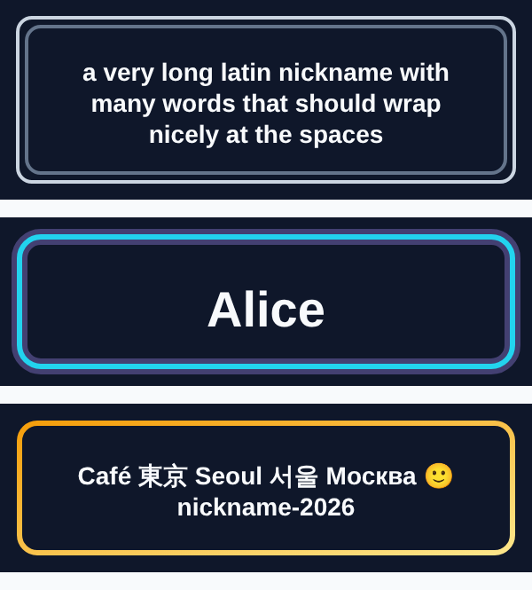

# 닉네임

> **내용:** 닉네임 토큰: 사용자 계정이 닉네임 하나를 구매하고, 추가로 결제해 **테두리(edge)**(닉네임을 둘러싼 프레임)를 올립니다.
>
> **대상:** 애플리케이션 개발자, 비즈니스 관리자.
>
> **관련 문서:** [섹션](sections.md) · [NFT 워크플로](nft-workflow.md) · [프록시 API](../reference/proxy-api.md#nicknames) · [chainlens](../components/chainlens.md)

**목차**

- [규칙](#rules)
- [동작 방식](#how-it-works)
- [테두리 레벨과 스타일](#edge-levels-and-styles)
- [1. 컬렉션 배포](#1-deploy-the-collection)
- [2. 테두리 레벨](#2-edge-levels)
- [3. 닉네임 구매](#3-buy-a-nickname)
- [4. 테두리 올리기](#4-raise-the-edge)
- [자금과 모니터링](#money-and-monitoring)
- [오류](#errors)
- [파일](#files)

---

토큰은 두 종류입니다. **이미지 토큰**은 [NFT 워크플로](nft-workflow.md)의 NFT 컬렉션(버전 3)으로,
센터가 민팅한 그림을 판매하고 재판매합니다. **닉네임 토큰**은 이 문서의 대상으로, 사용자가 자신을
위해 구매하는 이름이며 다시 판매할 수 없습니다.



## 규칙 {#rules}

| 규칙 | 지키는 방법 |
|---|---|
| **1~256자** | 프록시가 유니코드 NFC 정규화와 양 끝 공백 제거 후 글자 수를 셉니다. 컨트랙트는 1~1024바이트를 받습니다 |
| **허용되지 않음:** 제어 문자와 `< > & " ' \` | 프록시와 컨트랙트(그림이 체인 위의 SVG이므로) |
| **고유, 대소문자 구분 없음** | 토큰 ID는 A–Z를 소문자로 바꾼 이름의 `keccak256`이므로 `Alice`, `alice`, `ALICE`는 하나의 닉네임입니다. 다른 문자(한글, 키릴 문자 등)는 NFC 후 정확히 비교합니다 |
| **계정당 닉네임 하나** | 컨트랙트의 `nicknameOf(account)`; 두 번째 구매는 거부됩니다 |
| **첫 구매자에게 귀속** | 소울바운드(ERC-5192: `locked()`가 true). `transferFrom`, `safeTransferFrom`, `approve`, `setApprovalForAll`은 항상 되돌려집니다(revert) |
| **테두리는 올라가기만 함** | `upgradeEdge`는 현재보다 높은 레벨만 받습니다. 낮추기와 만료는 없습니다 |
| **섹션의 사용자 계정이 구매** | 구매자는 사용자 계정(레지스트리 종류 1)이어야 하고, 돈은 **자기 섹션의 소비(consumption) 계정**으로 갑니다. 둘 다 컨트랙트가 SectionRegistry로 확인합니다 |

## 동작 방식 {#how-it-works}

1. 애플리케이션이 섹션 키로 `POST /contract/send`를 호출합니다: 함수 `buyNickname`,
   args `{ "nickname": "Alice" }`, `from` = 사용자 계정.
2. 프록시가 이름을 정규화(NFC, 공백 제거)하고 1~256자인지, 사용 가능한지 확인한 뒤 **payee**(섹션의
   소비 계정)와 **value**(닉네임 가격)를 채웁니다.
3. MPC 서명기가 **사용자 계정으로** `buyNickname(nickname, consumption)`에 서명합니다.
4. 컨트랙트가 SectionRegistry에 묻습니다: 구매자가 사용자 계정인가, 수취인이 그 섹션의 소비 계정인가?
   그다음 토큰을 민팅하고 가격을 전달합니다.
5. 이후 `upgradeEdge`, args `{ "level": 2 }`로 `POST /contract/send`를 호출하면 견적 가격으로
   `upgradeEdge(level, consumption)`이 전송되어 테두리가 올라가고 그림이 다시 그려집니다.

닉네임 전용 라우트는 없습니다. 읽기와 쓰기는 다른 등록 컨트랙트처럼 범용 컨트랙트 API를 사용합니다
([프록시 API, 컨트랙트](../reference/proxy-api.md#contracts)). 읽기는 `POST /contract/call`, 사용자의
쓰기는 [`POST /contract/send`](../reference/proxy-api.md#post-contractsend--write), 관리자의 쓰기(가격,
레벨, 예약 이름)는 컨트랙트 계정 센터가 서명하는 `POST /admin/contract/send`를 사용합니다. `args`를
객체로 주면 값이 친화적이고(ETH 가격, `#rrggbb` 색상, 패턴 이름) 응답에 친화적인 `result`가 있습니다.
이전의 `/nickname/*`와 `/admin/nickname/*` 라우트는 `GET /admin/nickname`을 제외하고 410으로 응답합니다
([제거된 라우트](../reference/proxy-api.md#removed-routes)).

- 컬렉션은 **컨트랙트 계정 센터**가 배포하고 SectionRegistry에 공통(common) 컨트랙트로 등록됩니다.
  사용 중인 컬렉션은 `buyNickname`이 있는 등록 컨트랙트 중 **가장 최근** 것입니다.
  `GET /contract/list?type=nickname`이 이를 `current: true`로 표시합니다.
- 그림(`tokenURI`)은 **체인 위에서** 만들어집니다: JSON과 SVG, base64. 매번 테두리 레벨의 스타일을
  읽으므로 스타일을 수정하면 그 레벨의 모든 닉네임이 다시 그려집니다(지갑과 탐색기를 위해 ERC-4906
  `BatchMetadataUpdate`를 발생시킵니다).
- 긴 이름은 공백에서 줄바꿈되고, 길이에 따라 글꼴이 작아집니다(56, 36, 28 px). 넓은 문자(한글, 중국어,
  일본어, 이모지)는 폭을 반 단위 두 개로 셉니다.

## 테두리 레벨과 스타일 {#edge-levels-and-styles}

레벨 0은 모든 닉네임이 시작하는 기본 테두리입니다. 가격은 항상 0이고 끌 수 없습니다. 다음 레벨마다
**단계 가격**이 있습니다. 레벨 *a*에서 *b*로 올리면 레벨 *a+1 … b*의 단계 가격 합계를 냅니다
(`quote(account, level)`). 그래서 레벨을 건너뛰어도 차례로 올리는 것과 비용이 같습니다.

| 스타일 필드 | 값 |
|---|---|
| `color`, `color2` | `#rrggbb` (`color2`는 `double`, `gradient`, `glow`에서 사용) |
| `width` | 1~20 (픽셀) |
| `radius` | 0~40 (모서리 반경) |
| `pattern` | `solid`, `double`, `dashed`, `gradient`, `glow` |

레벨을 **판매 중지**(`enabled: false`)할 수 있습니다. 그러면 누구도 그 레벨로(또는 그 너머로) 올릴 수
없고, 이미 그 레벨인 닉네임은 그대로 유지됩니다.

## 1. 컬렉션 배포 {#1-deploy-the-collection}

한 번만, chainlens **Nicknames**(`#/nicknames`, `chainlens_sections_enabled: true`일 때 표시)에서
이름, 심볼, 닉네임 가격, 기본 테두리 이름을 입력하고 **Deploy**를 누릅니다. 또는 관리 API와
`nickname-collection` 템플릿으로:

```bash
P=http://192.168.68.151:30000; T=$(cat ansible/state/secrets/proxy_admin_token)
curl -s -H "Authorization: Bearer $T" -H 'Content-Type: application/json' -X POST \
  --data '{"template":"nickname-collection","name":"Nicknames","symbol":"NICK","price":"1","edge0":"Simple"}' \
  $P/admin/contracts/deploy
# { "success": true, "name": "Nicknames", "kind": "common", "address": "0xNicknames", "codeCheck": "matches the artifact", … }
```

본문에 `"another": true`가 없으면 두 번째 배포는 거부됩니다(409). 있으면 그때부터 새 컬렉션이 사용되고,
이전 컬렉션은 체인에서 계속 읽을 수 있습니다. 애플리케이션은 `GET /contract/list?type=nickname`
(`current: true`)으로 사용 중인 컬렉션을 찾습니다.


## 2. 테두리 레벨 {#2-edge-levels}

Nicknames 페이지에서 레벨마다 실시간 미리보기가 있는 편집기가 있고, **Add level**로 다음 레벨을
추가합니다. API로는 컨트랙트 계정 센터가 서명합니다(`POST /admin/contract/send`):

```bash
send() { curl -s -H "Authorization: Bearer $T" -H 'Content-Type: application/json' -X POST --data "$1" $P/admin/contract/send; }
# 다음 레벨 추가
send '{"contract":"0xNicknames","function":"addEdge","args":{"name":"Gold","price":"1","color":"#f59e0b","color2":"#fde68a","width":6,"radius":20,"pattern":"gradient"}}'
# 레벨 변경: 지정한 필드만 바뀜
send '{"contract":"0xNicknames","function":"setEdge","args":{"level":1,"color":"#ff0000"}}'
# { "success": true, …, "result": { "edge": { "level": 1, "name": "Silver", "price": "0.5", "enabled": true, "style": { "color": "#ff0000", … } } } }
# 닉네임 가격(새 구매자에게만), 예약 이름
send '{"contract":"0xNicknames","function":"setNicknamePrice","args":{"price":"1.25"}}'
send '{"contract":"0xNicknames","function":"reserve","args":{"nicknames":["admin"],"reserved":true}}'
```

페이지도 같은 일을 합니다: 닉네임 가격을 바꾸고, 누구도 살 수 없는 이름(예: `admin`)을 **예약**합니다.
`GET /admin/nickname`은 페이지의 요약(가격, 보유자 수가 있는 레벨, 닉네임)을 줍니다.

## 3. 닉네임 구매 {#3-buy-a-nickname}

애플리케이션은 섹션 키로 호출합니다. `from`은 그 섹션의 사용자 계정이며 가격만큼의 ETH가 있어야
합니다(이 체인에서 가스는 무료). payee와 `value`는 생략하십시오. 프록시가 채웁니다.

```bash
K=sk_…   # 섹션의 API 키
call() { curl -s -X POST $P/contract/call -H 'Content-Type: application/json' -H "X-Section-Key: $K" --data "$1"; }
# 사용 중인 컬렉션
curl -s -H "X-Section-Key: $K" "$P/contract/list?type=nickname"
# { "contracts": [ { "address": "0xNicknames", "name": "Nicknames", "type": "nickname", "current": true, … } ] }
# 레벨, 가격, 이름 확인을 한 번에
call '{"calls":[{"contract":"0xNicknames","function":"edgeCount"},{"contract":"0xNicknames","function":"nicknamePrice"},{"contract":"0xNicknames","function":"isAvailable","args":{"nickname":"Alice"}}]}'
# results: { "count": 4, "edges": [ … ] }, { "price": "1" }, { "nickname": "Alice", "characters": 5, "available": true, "reason": null, … }
curl -s -X POST $P/contract/send -H 'Content-Type: application/json' -H "X-Section-Key: $K" \
  --data '{"contract":"0xNicknames","function":"buyNickname","args":{"nickname":"Alice"},"from":"0xUser"}'
# { "success": true, "function": "buyNickname(string,address)", "from": "0xUser", "value": "1.0", "txHash": "0x…",
#   "result": { "nickname": "Alice", "tokenId": "…", "account": "0xUser", "level": 0, "edge": "Simple", "image": "data:image/svg+xml;base64,…",
#               "price": "1", "paidTo": "0xConsumption" },
#   "events": [ { "name": "NicknameBought", "args": { "tokenId": "…", "buyer": "0xUser", "nickname": "Alice", "price": "1", "paidTo": "0xConsumption" } } ] }
```

`nicknameOf`로 언제든 계정의 닉네임, 레벨, 그림을 얻습니다:

```bash
call '{"contract":"0xNicknames","function":"nicknameOf","args":{"account":"0xUser"}}'
# { "result": { "nickname": "Alice", "tokenId": "…", "account": "0xUser", "level": 0, "edge": "Simple", "image": "data:image/svg+xml;base64,…" }, … }
# 닉네임이 없는 계정: { "result": { "account": "0xUser", "nickname": null }, … }
```

## 4. 테두리 올리기 {#4-raise-the-edge}

```bash
call '{"contract":"0xNicknames","function":"quote","args":{"account":"0xUser","level":2}}'
# { "result": { "account": "0xUser", "level": 2, "price": "1.5" }, … }
curl -s -X POST $P/contract/send -H 'Content-Type: application/json' -H "X-Section-Key: $K" \
  --data '{"contract":"0xNicknames","function":"upgradeEdge","args":{"level":2},"from":"0xUser"}'
# { "success": true, "value": "1.5", …, "result": { "nickname": "Alice", "level": 2, "edge": "Gold", "image": "…", "price": "1.5", "paidTo": "0xConsumption", … },
#   "events": [ { "name": "EdgeUpgraded", "args": { "tokenId": "…", "owner": "0xUser", "fromLevel": "0", "toLevel": "2", "price": "1.5", "paidTo": "0xConsumption" } } ] }
```

값은 견적(단계 가격 합계)입니다. `result`에 새 레벨과 새 그림이 있습니다. 같거나 낮은 레벨, 없거나
판매 중지된 레벨, 부족한 ETH는 거부됩니다. 모든 구매와 올리기는 이벤트에 남습니다:
`NicknameBought` 또는 `EdgeUpgraded`로 `POST /contract/events`(가격은 ETH).

## 자금과 모니터링 {#money-and-monitoring}

| 작업 | 보내는 곳 → 받는 곳 | 섹션 작업(메트릭) |
|---|---|---|
| 구매 | 사용자 계정 → 그 섹션의 **소비** 계정(닉네임 가격) | `nickname_sale` |
| 테두리 올리기 | 사용자 계정 → 그 섹션의 **소비** 계정(단계 가격 합계) | `edge_upgrade` |

둘 다 섹션의 **수입**으로 집계됩니다: chainlens 섹션 통계와 Grafana **Sections** 대시보드(All-sections
표의 **Nicknames**, **Edge upgrades** 열). 소비 계정의 돈은 평소처럼 스윕과 반환으로 이어집니다
([섹션](sections.md)).

## 오류 {#errors}

마지막 행들(읽기와 관리 쓰기)을 제외하고 모두 `POST /contract/send`의 오류입니다.

| 상태 | 메시지(시작 부분) | 원인 |
|---|---|---|
| 400 | `nickname: 1 to 256 characters` | 공백 제거 후 비었거나 너무 김 |
| 400 | `nickname: no control characters and none of …` | 금지된 문자 |
| 400 | `args: no value for "…" (…); given: …` | 인수 이름이 틀렸거나 빠짐. 예: `buyNickname`에 `{ "name": … }` |
| 400 | `args[0]: the edge level to reach (1 or more)` | 올바른 레벨 없이 `upgradeEdge` |
| 400 | `level N: …` (컨트랙트 사유) | 레벨이 없거나, 판매 중지되었거나, 현재보다 높지 않음 |
| 400 | `payee: the consumption account of section …` | 다른 계정을 payee로 지정함: 생략하십시오 |
| 400 | `value: the price is X ETH …` | 가격과 다른 value를 지정함: 생략하십시오 |
| 400 | `insufficient balance: X ETH is needed` | ETH 부족 |
| 401 | `X-Section-Key is required` | 키 없음 (관리 호출자도 아님) |
| 403 | `… is not a user account of a section` | `from`이 역할 계정이거나 알 수 없음 |
| 403 | `section "…" is disabled` | 섹션이 꺼져 있음 |
| 404 | `… has no nickname: buy one first (buyNickname)` | 구매 전에 테두리 올리기 |
| 409 | `… already has a nickname (one per account)` | 두 번째 구매 |
| 409 | `nickname "…" is taken` / `is reserved` | 다른 계정이 보유(대소문자 무관)하거나 예약됨 |
| 400 | `price: ETH, e.g. "0.5"` / `color: a color #RRGGBB` / `pattern: …` | 잘못된 친화적 값으로 관리 쓰기 |
| 404 | `level: no edge level N (levels 0-M)` | 없는 레벨에 `setEdge` |
| 409 | `a nickname collection exists at 0x… (send "another": true …)` | 두 번째 배포 |
| 410 | `POST /nickname/buy was removed: use POST /contract/send …` | 이전 `/nickname/*` 또는 `/admin/nickname/*` 라우트 |

## 파일 {#files}

| 파일 | 내용 |
|---|---|
| `proxy/contracts/NicknameCollection.sol` | 컨트랙트(ERC-721 + ERC-5192 + ERC-4906, 체인 위 SVG) |
| `proxy/nickname-collection.json` | 컴파일된 아티팩트(`node scripts/compile-contract.js contracts/NicknameCollection.sol NicknameCollection nickname-collection.json`) |
| `proxy/stress-latest.js` | 범용 컨트랙트 API: 친화적 인수와 결과(`friendlyArgs`, `friendlyCall`, `friendlySend`), `/contract/send`(`knownSend`: payee, 가격, 닉네임 확인), `/admin/contract/send`, `nickname-collection` 템플릿, `GET /admin/nickname` |
| `chainlens/server.js` | Nicknames 페이지의 API: `/admin/nickname`을 읽고, `/admin/contract/send`와 `/admin/contracts/deploy`로 씀 |
| `chainlens/public/app.js` | Nicknames 페이지(`showNicknames`, `edgeEditor`, `edgePreview`) |
| `monitoring/grafana/tools/gen_sections_dashboard.py` | Sections 대시보드의 수입과 새 열 |
