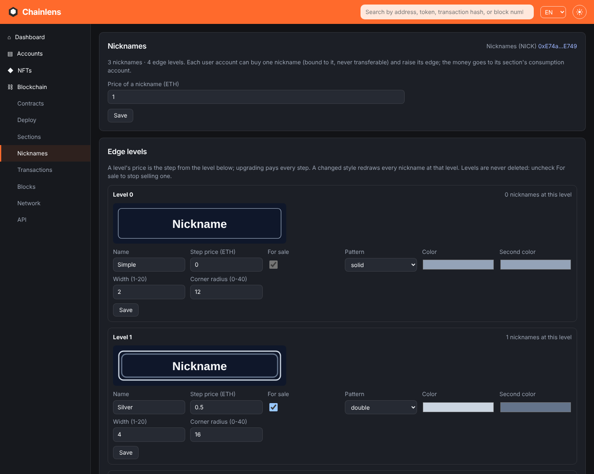

# 닉네임

> **내용:** 닉네임 토큰: 컨트랙트 계정 센터가 닉네임을 민팅하고, 섹션의 사용자 계정이 하나(또는 여러 개)를 각각 한 번, 영구히 구매한 뒤 추가로 결제해 **사용자 레벨**을 올립니다. 판매와 레벨 업그레이드는 보류 기간 안에 취소할 수 있습니다. 토큰에는 닉네임과 레벨(숫자)만 저장되며, 레벨을 어떻게 보여 줄지는 애플리케이션이 정합니다.
>
> **대상:** 애플리케이션 개발자, 비즈니스 관리자.
>
> **관련 문서:** [아바타](avatars.md) · [섹션](sections.md) · [프록시 API](../reference/proxy-api.md#nicknames) · [chainlens](../components/chainlens.md)

**목차**

- [규칙](#rules)
- [동작 방식](#how-it-works)
- [사용자 레벨](#user-levels)
- [1. 컬렉션 배포](#1-deploy-the-collection)
- [2. 닉네임 민팅](#2-mint-nicknames)
- [3. 사용자 레벨 설정](#3-set-the-user-levels)
- [4. 닉네임 구매](#4-buy-a-nickname)
- [5. 사용자 레벨 올리기](#5-raise-the-user-level)
- [6. 판매 또는 레벨 업그레이드 취소](#6-undo-a-sale-or-a-level-upgrade)
- [7. 읽기](#7-read)
- [자금과 모니터링](#money-and-monitoring)
- [오류](#errors)
- [파일](#files)

---

닉네임과 [아바타](avatars.md)는 모두 **아이템**이며 같은 규칙을 따릅니다
([`proxy/contracts/BoundItems.sol`](../../proxy/contracts/BoundItems.sol)): 센터가 민팅하고, 섹션의 사용자
계정이 한 번 구매하면 그 계정에 귀속되며, 가격은 즉시 구매자의 섹션으로 지불되고, 보류 기간 안에는 취소할
수 있습니다. 닉네임에는 그림이 없습니다: 이름과 **사용자 레벨**만 저장하며, 레벨을 어떻게 보여 줄지(프레임,
색상, 배지 등)는 각 애플리케이션이 정합니다. 컨트랙트는
[`proxy/contracts/NicknameCollection.sol`](../../proxy/contracts/NicknameCollection.sol)(버전 6)입니다.

## 규칙 {#rules}

| 규칙 | 지키는 방법 |
|---|---|
| **민팅된 이름만** | 센터가 닉네임마다 가격을 정해 민팅합니다: `mint { nickname, price }`, 토큰 ID 1, 2, 3…. 사용자는 민팅된 이름만 살 수 있습니다: "아무 이름이나 고르기"도, 예약 목록도 없습니다 |
| **1~256자** | 프록시가 유니코드 NFC 정규화와 양 끝 공백 제거 후 글자 수를 셉니다. 컨트랙트는 1~1024바이트를 받습니다 |
| **허용되지 않음:** 제어 문자와 `< > & " ' \` | 프록시와 컨트랙트(토큰의 JSON을 안전하게 유지하기 위해) |
| **고유, 대소문자 구분 없음** | A–Z 대소문자는 구분하지 않습니다: `Alice`, `alice`, `ALICE`는 하나의 닉네임입니다(한 번만 민팅; `buy { nickname: "alice" }`가 `Alice`를 찾음). 다른 문자(한글, 키릴 문자 등)는 NFC 후 정확히 비교합니다 |
| **판매 전까지 가격 변경 가능** | 센터가 닉네임을 보유하는 동안 `setPrice { tokenId, price }` |
| **섹션의 사용자 계정이 한 번 구매** | `buy`: 가격은 **즉시** 구매자 자신의 섹션의 **소비(consumption) 계정**으로 갑니다(에스크로 없음). 둘 다 컨트랙트가 SectionRegistry로 확인합니다 |
| **재판매 없음, 이전 없음** | 구매자에게 귀속(ERC-5192: `locked()`가 true). `transferFrom`, `safeTransferFrom`, `approve`, `setApprovalForAll`은 항상 되돌려집니다(revert) |
| **계정당 여러 개** | 한 계정이 닉네임(과 아바타)을 여러 개 보유할 수 있습니다 |
| **사용자 레벨은 올라가기만 함** | 소유자가 `upgradeLevel`로 올리며, 단계 가격을 즉시 자기 섹션의 소비 계정에 지불합니다. 내려가는 것은 취소할 때뿐입니다 |
| **보류 기간 안에 취소** | `undo`: 판매 후 `holdSeconds`(기본 7일) 안의 판매 취소: 닉네임에 지불한 모든 금액이 환불되고, 레벨은 0이 되며, 닉네임은 센터로 돌아가 다시 판매됩니다. `undoLevel`: 가장 최근의 레벨 업그레이드를 그 업그레이드 자신의 보류 기간 안에 취소: 레벨이 업그레이드 하나만큼 내려가고 그 가격만 환불됩니다. 둘 다 돈을 받은 소비 계정이 서명합니다 |

## 동작 방식 {#how-it-works}

1. 센터가 닉네임을 민팅합니다(chainlens **Nicknames** 페이지, 또는 `POST /admin/contract/send` `mint`).
2. 애플리케이션이 섹션 키로 `POST /contract/send`를 호출합니다: 함수 `buy`, args
   `{ "nickname": "Alice" }`(또는 `{ "tokenId": "1" }`), `from` = 사용자 계정.
3. 프록시가 이름을 정규화(NFC, 공백 제거)하고 토큰을 찾아 판매되지 않았는지 확인한 뒤 **payee**(섹션의
   소비 계정)와 **value**(닉네임의 가격)를 채웁니다.
4. MPC 서명기가 **사용자 계정으로** `buy(tokenId, consumption)`에 서명합니다. 컨트랙트가 SectionRegistry에
   묻습니다: 구매자가 사용자 계정인가, payee가 그 계정 자신의 섹션의 소비 계정인가? 그다음 닉네임은 구매자에게,
   가격은 소비 계정으로 한 트랜잭션에서 이동합니다.
5. 이후 `upgradeLevel` `{ "tokenId": "1", "level": 2 }`도 같은 방식으로 견적 가격(단계 가격 합계)을 보내고
   레벨이 올라갑니다.
6. 보류 기간 안에는 섹션이 `undo` 또는 `undoLevel` `{ "tokenId": "1" }`을(`from` 없이) 보낼 수 있습니다:
   프록시가 소비 계정으로 서명하고, 소비 계정이 같은 트랜잭션에서 환불을 지불합니다.

닉네임 전용 라우트는 없습니다. 읽기와 쓰기는 다른 등록 컨트랙트처럼 범용 컨트랙트 API를 사용합니다
([프록시 API, 컨트랙트](../reference/proxy-api.md#contracts)). 읽기는 `POST /contract/call`, 섹션의 쓰기는
[`POST /contract/send`](../reference/proxy-api.md#post-contractsend--write), 센터의 쓰기(민팅, 가격, 레벨)는
`POST /admin/contract/send`를 사용합니다. `args`를 객체로 주면 값이 친화적이고(ETH 가격) 응답에 친화적인
`result`가 있습니다. 이전의 `/nickname/*`와 `/admin/nickname/*` 라우트는 410으로 응답합니다
([제거된 라우트](../reference/proxy-api.md#removed-routes)).

- 컬렉션은 **컨트랙트 계정 센터**가 배포하고 SectionRegistry에 공통(common) 컨트랙트로 등록됩니다. 사용 중인
  컬렉션은 **가장 최근에** 등록된 버전 6 컬렉션입니다: `GET /contract/list?type=nickname`이 `current: true`로
  표시합니다. 이전 컬렉션(테두리 스타일이 있는 버전 4, 계정당 닉네임 하나와 테두리 레벨이 있는 버전 5)은 프록시에게
  일반 컨트랙트입니다: 친화적인 값이 없고 `type: "nickname"`이 아닙니다. 새 컬렉션을 배포하고 이름을 다시
  민팅하십시오. 이전 닉네임은 이전 컨트랙트에 남습니다.
- `tokenURI`는 체인 위에서 만든 JSON(`data:application/json;base64,…`)으로, 이름과 레벨만 있고 **이미지는
  없습니다**:
  `{"name":"Alice","description":"Nickname","attributes":[{"trait_type":"user level","display_type":"number","value":2}]}`.
  레벨이 바뀌면 지갑과 익스플로러를 위해 ERC-4906 `MetadataUpdate`를 내보냅니다.

## 사용자 레벨 {#user-levels}

레벨은 숫자입니다. 컨트랙트는 레벨마다 두 가지만 저장합니다:

| 필드 | 의미 |
|---|---|
| `price` (단계 가격) | 바로 아래 레벨에서 이 레벨로 올라가는 ETH |
| `forSale` | `false`: 누구도 이 레벨로(또는 그 너머로) 올릴 수 없음. 이미 이 레벨인 닉네임은 유지 |

레벨 0은 항상 있습니다: 모든 닉네임이 여기서 시작하고, 가격은 항상 0이며 항상 판매 중입니다.
레벨 *a*에서 *b*로 올리면 레벨 *a+1 … b*의 단계 가격 합계를 냅니다(`quote { tokenId, level }`). 그래서
레벨을 건너뛰어도 차례로 올리는 것과 비용이 같습니다. 레벨은 삭제되지 않습니다(최대 32개): 대신 판매를
중지하십시오. 판매가 취소되면 레벨은 0으로 돌아갑니다.

## 1. 컬렉션 배포 {#1-deploy-the-collection}

한 번, chainlens **Nicknames**(`#/nicknames`, `chainlens_sections_enabled: true`일 때 표시)에서: 이름, 심볼,
**Undo period (days)**를 입력하고 **Deploy the nickname collection**. 또는 관리 API와
`nickname-collection` 템플릿으로(`holdDays`: 기본 7, 테스트용 소수 허용):

```bash
P=http://192.168.68.151:30000; T=$(cat ansible/state/secrets/proxy_admin_token)
curl -s -H "Authorization: Bearer $T" -H 'Content-Type: application/json' -X POST \
  --data '{"template":"nickname-collection","name":"Nicknames","symbol":"NICK","holdDays":7}' \
  $P/admin/contract/deploy
# { "success": true, "name": "Nicknames", "kind": "common", "address": "0xNicknames", "codeCheck": "matches the artifact", … }
```

템플릿은 가격을 받지 않습니다(닉네임마다 민팅할 때 가격을 정합니다). 두 번째 버전 6 컬렉션은 본문에
`"another": true`가 없으면 거부됩니다(409). 있으면 그때부터 새 컬렉션이 사용되고 이전 컬렉션은 체인에서 계속
읽을 수 있습니다. 애플리케이션은 `GET /contract/list?type=nickname`(`current: true`)으로 사용 중인 컬렉션을 찾습니다.



## 2. 닉네임 민팅 {#2-mint-nicknames}

Nicknames 페이지의 **Mint nicknames**: 한 줄에 이름 하나, 모두 같은 가격(나중에 **Change a price**로 닉네임마다
바꿀 수 있음). 이름마다 따로 민팅되며, 응답은 이름마다 토큰 ID 또는 오류를 나열하고, 실패한 이름은 입력란에
남습니다. API로는 컨트랙트 계정 센터가 서명합니다(`POST /admin/contract/send`):

```bash
send() { curl -s -H "Authorization: Bearer $T" -H 'Content-Type: application/json' -X POST --data "$1" $P/admin/contract/send; }
send '{"contract":"0xNicknames","function":"mint","args":{"nickname":" Alice ","price":"1"}}'
# { "success": true, "function": "mint(string,uint256)", …, "result": { "minted": true, "tokenId": "1", "nickname": "Alice", "level": 0, "price": "1" } }
send '{"contract":"0xNicknames","function":"mint","args":{"nickname":"ALICE","price":"1"}}'
# { "error": "the transaction would revert: this nickname is already minted" }
send '{"contract":"0xNicknames","function":"setPrice","args":{"tokenId":"1","price":"1.25"}}'
# { "success": true, …, "result": { "tokenId": "1", "price": "1.25" } }
```

## 3. 사용자 레벨 설정 {#3-set-the-user-levels}

Nicknames 페이지의 **User levels**: 레벨마다 단계 가격, **For sale** 체크박스, 보유자 수가 있습니다(레벨 0:
무료). 마지막 상자는 가격을 정해 다음 레벨을 추가합니다. API로는:

```bash
# 다음 레벨 추가(단계 가격; 판매 중)
send '{"contract":"0xNicknames","function":"addLevel","args":{"price":"0.5"}}'
# { "success": true, "function": "addLevel(uint256)", …, "result": { "level": { "level": 1, "price": "0.5", "forSale": true } } }
# 레벨 변경: 지정한 필드만 바뀜
send '{"contract":"0xNicknames","function":"setLevel","args":{"level":3,"forSale":false}}'
# { "success": true, "function": "setLevel(uint8,uint256,bool)", …, "result": { "level": { "level": 3, "price": "2", "forSale": false } } }
```

## 4. 닉네임 구매 {#4-buy-a-nickname}

애플리케이션은 섹션의 키로 호출합니다. `from`은 가격만큼의 ETH가 있는 그 섹션의 사용자 계정입니다(이
체인에서 가스는 무료). payee와 `value`는 생략하십시오: 프록시가 채웁니다.

```bash
K=sk_…   # 섹션의 API 키
call() { curl -s -X POST $P/contract/call -H 'Content-Type: application/json' -H "X-Section-Key: $K" --data "$1"; }
# 사용 중인 컬렉션
curl -s -H "X-Section-Key: $K" "$P/contract/list?type=nickname"
# { "contracts": [ { "address": "0xNicknames", "name": "Nicknames", "type": "nickname", "current": true, … } ] }
# 이름 하나와 레벨을 한 번에
call '{"calls":[{"contract":"0xNicknames","function":"tokenOf","args":{"nickname":"alice"}},{"contract":"0xNicknames","function":"levelCount"}]}'
# results: { "tokenId": "1", "minted": true, "sold": false, "owner": "<center>", "price": "1" },
#          { "count": 3, "levels": [ { "level": 0, "price": "0", "forSale": true }, { "level": 1, "price": "0.5", "forSale": true }, … ] }
curl -s -X POST $P/contract/send -H 'Content-Type: application/json' -H "X-Section-Key: $K" \
  --data '{"contract":"0xNicknames","function":"buy","args":{"nickname":"alice"},"from":"0xUser"}'
# { "success": true, "function": "buy(uint256,address)", "from": "0xUser", "value": "1.0", "txHash": "0x…",
#   "result": { "tokenId": "1", "nickname": "Alice", "level": 0, "price": "1", "buyer": "0xUser", "paid": "1",
#               "paidTo": "0xConsumption", "undoUntil": "2026-11-30T17:36:53.234Z" },
#   "events": [ { "name": "Sold", "args": { … } }, … ] }
```

민팅된 적이 없는 이름: 404 `nickname "nobody" is not minted`. 판매된 이름: 409 `token 1 is already sold`.
같은 계정이 닉네임을 더 살 수 있습니다: `tokensOf { account }`가 나열합니다.

## 5. 사용자 레벨 올리기 {#5-raise-the-user-level}

소유자만, 현재 레벨에서 더 높은 레벨로, 견적 금액을 즉시 자기 섹션의 소비 계정에 지불합니다:

```bash
call '{"contract":"0xNicknames","function":"quote","args":{"tokenId":"1","level":2}}'
# { "result": { "tokenId": "1", "level": 2, "price": "1.5" }, … }
curl -s -X POST $P/contract/send -H 'Content-Type: application/json' -H "X-Section-Key: $K" \
  --data '{"contract":"0xNicknames","function":"upgradeLevel","args":{"tokenId":"1","level":2},"from":"0xUser"}'
# { "success": true, "function": "upgradeLevel(uint256,uint8,address)", "value": "1.5", …,
#   "result": { "tokenId": "1", "nickname": "Alice", "level": 2, "price": "1", "fromLevel": 0, "paid": "1.5",
#               "paidTo": "0xConsumption", "undoUntil": "2026-11-30T17:37:13.234Z" },
#   "events": [ { "name": "LevelUpgraded", … }, { "name": "MetadataUpdate", … } ] }
```

값은 견적(단계 가격 합계)입니다. `result.price`는 닉네임의 가격이고, `result.paid`는 이번 업그레이드의
비용입니다. 같거나 낮은 레벨(400 `level 1: the level can only go up`), 없거나 판매 중지된 레벨, 다른 계정의
닉네임(403 `token 1 is not owned by 0x…`), 부족한 ETH는 거부됩니다.

## 6. 판매 또는 레벨 업그레이드 취소 {#6-undo-a-sale-or-a-level-upgrade}

둘 다 돈을 받은 섹션의 키로, `/contract/send`를 통해 **`from` 없이** 보냅니다: 프록시는 그 섹션의 소비
계정(돈을 받은 계정)으로 서명하고, 이 계정이 같은 트랜잭션에서 환불을 보냅니다. chainlens의 Nicknames 목록에는
가능한 동안 닉네임마다 기한과 함께 **Undo**와 **Undo level**이 있습니다.

| 함수 | 취소 대상 | 기한 | 환불 | 이후 |
|---|---|---|---|---|
| `undo { tokenId }` | 판매 | 판매의 보류 기간 | 닉네임에 지불하고 아직 취소되지 않은 모든 금액: 판매 + 레벨 업그레이드 | 레벨 0, 닉네임은 센터로 돌아가 다시 판매 |
| `undoLevel { tokenId }` | 아직 취소되지 않은 **가장 최근의** 레벨 업그레이드(최신부터) | **그** 업그레이드의 보류 기간 | 그 업그레이드의 가격만 | 그 업그레이드 이전 레벨. 판매와 이전 업그레이드는 유지 |

```bash
U() { curl -s -X POST $P/contract/send -H 'Content-Type: application/json' -H "X-Section-Key: $K" --data "$1"; }
# Alice: 1에 구매, 0 → 1(0.5), 이어서 1 → 2(1)로 올림
U '{"contract":"0xNicknames","function":"undoLevel","args":{"tokenId":"1"}}'
# "result": { "tokenId": "1", "undone": "level", "level": 1, "undoneLevel": 2, "refunded": "1" }
U '{"contract":"0xNicknames","function":"undoLevel","args":{"tokenId":"1"}}'
# "result": { "tokenId": "1", "undone": "level", "level": 0, "undoneLevel": 1, "refunded": "0.5" }
U '{"contract":"0xNicknames","function":"undoLevel","args":{"tokenId":"1"}}'
# 409 { "error": "token 1 has no level upgrade to undo" }
# 다시 0 → 2(1.5)로 올린 뒤 판매 취소: 1 + 1.5 환불
U '{"contract":"0xNicknames","function":"undo","args":{"tokenId":"1"}}'
# "result": { "tokenId": "1", "undone": "sale", "buyer": "0xUser", "refunded": "2.5", "by": "0xConsumption" }
```

거부되는 경우: 기간 이후(409 `the undo period of token 1 ended at …`, `the undo period of the level 0 -> 1
upgrade ended at …`), 판매되지 않은 닉네임(409 `token 1 is not sold`), 다른 섹션의 키(403 `… only its key can
undo`), 소비 계정의 ETH 부족(409 `the refund needs X ETH but … has Y ETH`).

## 7. 읽기 {#7-read}

| 함수, `args` | `result` |
|---|---|
| `tokensOf { account }` | 계정의 닉네임: `[ { tokenId, nickname, level, price } ]`(센터의 경우: 팔리지 않은 것) |
| `tokenOf { nickname }` | `{ tokenId, minted, sold, owner, price }`, 또는 `{ tokenId: null, minted: false }`(A–Z 대소문자 무관) |
| `ownerOf { tokenId }` | `{ tokenId, owner, sold }` |
| `priceOf { tokenId }` | `{ tokenId, price }` |
| `nicknameOf { tokenId }` / `levelOf { tokenId }` | `{ tokenId, nickname }` / `{ tokenId, level }` |
| `levelCount` / `levelInfo { level }` | `{ count, levels: [ { level, price, forSale } ] }` / 레벨 하나 |
| `quote { tokenId, level }` | `{ tokenId, level, price }`: 지금 `level`까지 올리는 비용 |
| `tokenURI { tokenId }` | `{ tokenId, metadata: { name, description, attributes: [ { trait_type: "user level", display_type: "number", value } ] } }` |
| `paymentsOf { tokenId }` | 모든 결제, 오래된 것부터: `[ { kind: "sale" \| "level", fromLevel, toLevel, amount, payer, paidTo, paidAt, undoUntil, undone, undoable, current } ]`(`fromLevel`, `toLevel`은 `level`에만) |
| `holdSeconds`, `totalSupply` | 취소 기간(초), 민팅된 닉네임 수 |

`POST /contract/events`는 `Sold`, `Undone`, `LevelUpgraded`, `LevelUndone`, `LevelSet`, `PriceSet`을
나열합니다(가격은 ETH).

## 자금과 모니터링 {#money-and-monitoring}

| 작업 | 보내는 곳 → 받는 곳 | 섹션 작업(메트릭) |
|---|---|---|
| 구매 | 사용자 계정 → 그 섹션의 **소비** 계정(닉네임의 가격) | `nickname_sale` |
| 사용자 레벨 올리기 | 사용자 계정 → 그 섹션의 **소비** 계정(단계 가격 합계) | `level_upgrade` |
| 판매 취소 | 소비 계정 → 구매자(판매 + 취소되지 않은 레벨 업그레이드) | `nickname_undo` |
| 레벨 취소 | 소비 계정 → 소유자(그 업그레이드의 가격) | `level_undo` |

섹션 **수입** = 판매 + 레벨 업그레이드 − 취소: chainlens 섹션 통계(*Nickname sales*, *Level upgrades*,
*Nicknames and levels (ETH)*, *Undone, refunded (ETH)*)와 Grafana **Sections** 대시보드(All-sections 표의
**Nicknames**, **Level upgrades**, **Undone** 열). 돈은 소비 계정에서 평소처럼 스윕과 반환으로 이어집니다
([섹션](sections.md)). 아직 가능한 취소를 위해 소비 계정에 충분한 금액을 남겨 두십시오.

## 오류 {#errors}

마지막 행들(읽기와 관리자 쓰기)을 제외하면 모두 `POST /contract/send`에서 발생합니다.

| 상태 | 메시지(시작 부분) | 원인 |
|---|---|---|
| 400 | `nickname: 1 to 256 characters` | 공백 제거 후 비어 있거나 너무 김 |
| 400 | `nickname: no control characters and none of …` | 금지된 문자 |
| 400 | `args: no value for "…" (…); given: …` | 인수 이름이 틀렸거나 빠짐, 예: `buy`에 `{ "name": … }` |
| 400 | `args: unknown name(s) …; upgradeLevel takes tokenId, level, payee` | 함수가 받지 않는 이름(예: 이전의 `account`) |
| 400 | `tokenId: a token id (1, 2, …)` | 올바른 토큰 ID가 없음 |
| 400 | `level N: …` (컨트랙트의 사유) | `upgradeLevel`: 레벨이 없거나, 판매 중지되었거나, 현재보다 높지 않음 |
| 400 | `payee: the consumption account of section …` | payee를 줬는데 다른 계정임: 생략하십시오 |
| 400 | `value: the price is X ETH …` | value를 줬는데 가격과 다름: 생략하십시오 |
| 400 | `insufficient balance: X ETH is needed` | ETH 부족 |
| 400 | `from: leave it out (an undo is signed by …)` | `undo` / `undoLevel`에 `from`을 줌 |
| 401 | `X-Section-Key is required` | 키 없음(관리자 호출자도 아님) |
| 403 | `… is not a user account of a section` | `from`이 역할 계정이거나 알 수 없음 |
| 403 | `section "…" is disabled` | 섹션이 꺼져 있음 |
| 403 | `token N is not owned by 0x…` | 다른 계정의(또는 팔리지 않은) 닉네임에 `upgradeLevel` |
| 403 | `token N was paid to section "…": only its key can undo` | 다른 섹션의 키로 취소 |
| 404 | `nickname "…" is not minted` / `token N is not minted` | 이름이나 토큰이 없음 |
| 409 | `token N is already sold` | 두 번째 구매(재판매 없음) |
| 409 | `token N is not sold` / `token N has no level upgrade to undo` | 취소할 것이 없음 |
| 409 | `the undo period of token N ended at …` / `the undo period of the level a -> b upgrade ended at …` | 너무 늦음 |
| 409 | `the refund needs X ETH but … has Y ETH` | 소비 계정이 환불을 지불할 수 없음 |
| 400 | `the transaction would revert: this nickname is already minted` | 이미 있는 이름을 `mint`(A–Z 대소문자 무관) |
| 400 | `the transaction would revert: sold: the price can no longer change` | 판매된 닉네임에 `setPrice` |
| 400 | `price: ETH, e.g. "0.5"` | 잘못된 가격으로 관리자 쓰기 |
| 400 | `the transaction would revert: level 0: price 0, always for sale` | 레벨 0에 가격이나 `forSale: false`로 `setLevel` |
| 404 | `level: no level N (levels 0-M)` | 없는 레벨에 `setLevel` |
| 409 | `a nickname collection exists at 0x… (send "another": true …)` | 두 번째 배포 |
| 410 | `POST /nickname/buy was removed: use POST /contract/send …` | 이전 `/nickname/*` 또는 `/admin/nickname/*` 라우트 |

## 파일 {#files}

| 파일 | 내용 |
|---|---|
| `proxy/contracts/BoundItems.sol` | 아이템 공통 규칙: 민팅, `setPrice`, `buy`, `undo`, `paymentsOf`, `tokensOf`, 귀속 토큰 |
| `proxy/contracts/NicknameCollection.sol` | 컨트랙트(버전 6: ERC-721 + ERC-5192 + ERC-4906): `mint(nickname, price)`, A–Z 대소문자 무관하게 고유한 이름(`tokenOf`), 사용자 레벨(`addLevel`, `setLevel`, `upgradeLevel`, `undoLevel`, `quote`), 그림 없는 JSON `tokenURI` |
| `proxy/nickname-collection.json` | 컴파일된 아티팩트(`node scripts/compile-contract.js contracts/NicknameCollection.sol NicknameCollection nickname-collection.json`) |
| `proxy/stress-latest.js` | 친화적인 args와 결과(`FRIENDLY_KEYS`, `friendlyArgsOf`, `friendlyCall`, `friendlySend`, `paymentsInfo`, `nicknameInput`, `readLevels`), `/contract/send`(`knownSend`: payee, 가격, 소유자 확인; 취소 경로: `undoTarget`), `nickname-collection` 템플릿(`templateInput`: `holdDays`), 메트릭(`countKnownSend`) |
| `chainlens/server.js` | Nicknames 페이지의 API(`/api/nicknames`, `/api/nicknames/deploy`, `mint`, `price/:tokenId`, `levels`, `undo/:tokenId`, `undolevel/:tokenId`), 프록시의 관리 API를 통해 |
| `chainlens/public/app.js` | Nicknames 페이지(`showNicknames`, `levelEditor`) |
| `monitoring/grafana/tools/gen_sections_dashboard.py` | 수입(들어온 작업 − 취소 작업)과 Sections 대시보드의 열 |
