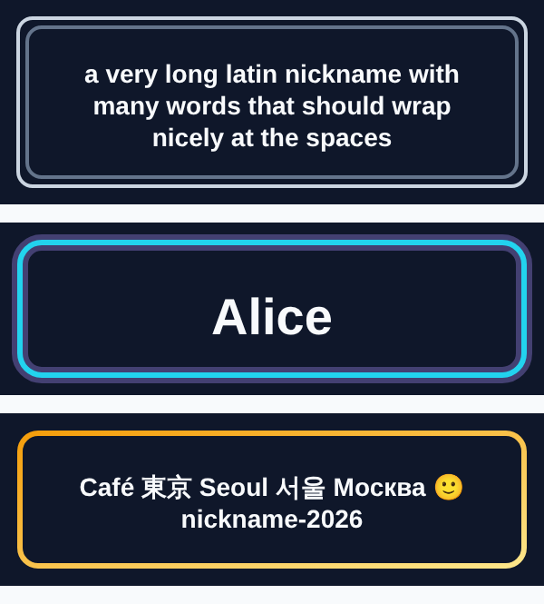
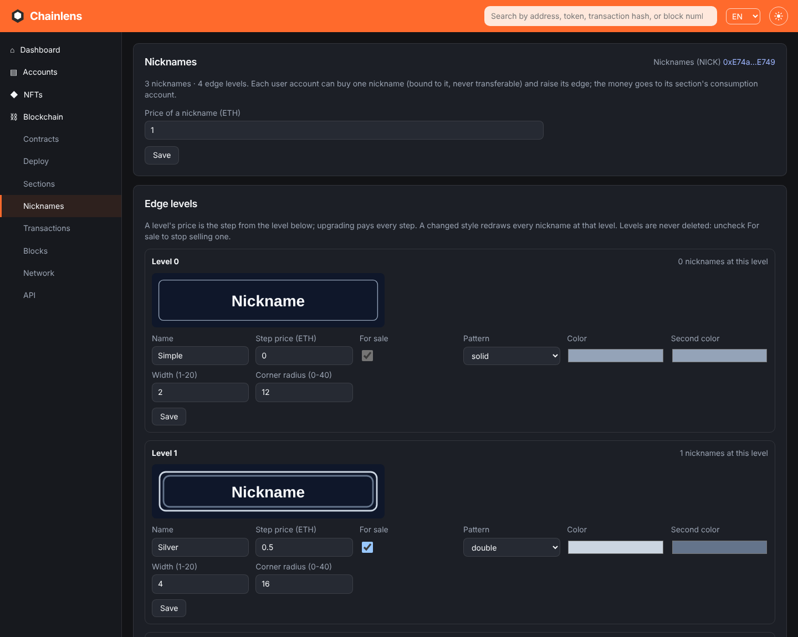

# Nicknames

> **What:** Nickname tokens: a user account buys one nickname, then pays more to raise its **edge** (the frame drawn around it).
>
> **For:** application developers, business admins.
>
> **Related:** [sections](sections.md) · [NFT workflow](nft-workflow.md) · [proxy API](../reference/proxy-api.md#nicknames) · [chainlens](../components/chainlens.md)

**Contents**

- [Rules](#rules)
- [How it works](#how-it-works)
- [Edge levels and styles](#edge-levels-and-styles)
- [1. Deploy the collection](#1-deploy-the-collection)
- [2. Edge levels](#2-edge-levels)
- [3. Buy a nickname](#3-buy-a-nickname)
- [4. Raise the edge](#4-raise-the-edge)
- [Money and monitoring](#money-and-monitoring)
- [Errors](#errors)
- [Files](#files)

---

There are two kinds of token. The **image token** is the NFT collection of the
[NFT workflow](nft-workflow.md) (version 3): a picture, minted by the center, sold and resold.
The **nickname token** is this page: a name a user buys for themself, which can never be sold on.



## Rules

| Rule | How it is kept |
|---|---|
| **1 to 256 characters** | the proxy counts characters after Unicode NFC normalization and trimming spaces at both ends. The contract takes 1 to 1024 bytes |
| **Not allowed:** control characters and `< > & " ' \` | the proxy and the contract (the picture is SVG on the chain) |
| **Unique, case-insensitive** | the token id is `keccak256` of the name with A–Z lowercased, so `Alice`, `alice` and `ALICE` are one nickname. Other scripts (Korean, Cyrillic…) compare exactly, after NFC |
| **One nickname per account** | `nicknameOf(account)` on the contract; a second buy is refused |
| **Bound to its first buyer** | soulbound (ERC-5192: `locked()` is true). `transferFrom`, `safeTransferFrom`, `approve` and `setApprovalForAll` always revert |
| **Edge only goes up** | `upgradeEdge` takes a level above the current one; there is no downgrade and no expiry |
| **Bought by a section's user account** | the buyer must be a user account (registry kind 1) and the money goes to **its own section's consumption account**, both checked by the contract through the SectionRegistry |

## How it works

1. The application calls `POST /contract/send` with the section's key: function `buyNickname`,
   args `{ "nickname": "Alice" }`, `from` = the user account.
2. The proxy normalizes the name (NFC, trim), checks 1–256 characters and that it is free, and fills
   in the **payee** (the section's consumption account) and the **value** (the nickname price).
3. The MPC signer signs `buyNickname(nickname, consumption)` **as the user account**.
4. The contract asks the SectionRegistry: is the buyer a user account, is the payee its section's
   consumption account? Then it mints the token and forwards the price.
5. Later, `POST /contract/send` with `upgradeEdge`, args `{ "level": 2 }`, sends
   `upgradeEdge(level, consumption)` with the quoted price; the edge is raised and the picture redrawn.

There are no nickname routes: reads and writes use the generic contract API, like any registered
contract ([proxy API, contracts](../reference/proxy-api.md#contracts)). Reads go through
`POST /contract/call`, the user's writes through [`POST /contract/send`](../reference/proxy-api.md#post-contractsend--write),
and the admin's writes (price, levels, reserved names) through `POST /admin/contract/send`, signed by
the contract account center. With `args` as an object, the values are friendly (prices in ETH,
`#rrggbb` colors, pattern names) and the answer has a friendly `result`. The old `/nickname/*` and
`/admin/nickname` routes answer 410 ([removed routes](../reference/proxy-api.md#removed-routes)).

- The collection is deployed by the **contract account center** and registered in the SectionRegistry
  as a common contract. The one in use is the **latest** registered contract that has `buyNickname`:
  `GET /contract/list?type=nickname` marks it `current: true`.
- The picture (`tokenURI`) is made **on the chain**: JSON and SVG, base64. It reads the edge level's
  style each time, so a style edit redraws every nickname at that level (ERC-4906 `BatchMetadataUpdate`
  is emitted for wallets and explorers).
- Long names wrap at spaces; the font gets smaller with the length (56, 36, 28 px). Wide characters
  (Korean, Chinese, Japanese, emoji) count as two half-units of width.

## Edge levels and styles

Level 0 is the default edge every nickname starts with; its price is always 0 and it can't be
turned off. Every next level has a **step price**. Raising from level *a* to level *b* pays the step
prices of levels *a+1 … b* (`quote(account, level)`), so skipping levels costs the same as climbing.

| Style field | Values |
|---|---|
| `color`, `color2` | `#rrggbb` (`color2` is used by `double`, `gradient`, `glow`) |
| `width` | 1 to 20 (pixels) |
| `radius` | 0 to 40 (corner radius) |
| `pattern` | `solid`, `double`, `dashed`, `gradient`, `glow` |

A level can be **closed for sale** (`enabled: false`): nobody can upgrade to it (or past it), and
nicknames already at it keep it.

## 1. Deploy the collection

Once, in chainlens **Nicknames** (`#/nicknames`, shown when `chainlens_sections_enabled: true`): name,
symbol, nickname price and the name of the default edge, then **Deploy**. Or with the admin API and
the `nickname-collection` template:

```bash
P=http://192.168.68.151:30000; T=$(cat ansible/state/secrets/proxy_admin_token)
curl -s -H "Authorization: Bearer $T" -H 'Content-Type: application/json' -X POST \
  --data '{"template":"nickname-collection","name":"Nicknames","symbol":"NICK","price":"1","edge0":"Simple"}' \
  $P/admin/contract/deploy
# { "success": true, "name": "Nicknames", "kind": "common", "address": "0xNicknames", "codeCheck": "matches the artifact", … }
```

A second deploy is refused (409) unless the body has `"another": true`: then the new collection is
used from then on and the old one stays readable on the chain. Applications find the collection in
use with `GET /contract/list?type=nickname` (`current: true`).



## 2. Edge levels

On the Nicknames page every level has an editor with a live preview; **Add level** adds the next one.
With the API, the contract account center signs (`POST /admin/contract/send`):

```bash
send() { curl -s -H "Authorization: Bearer $T" -H 'Content-Type: application/json' -X POST --data "$1" $P/admin/contract/send; }
# add the next level
send '{"contract":"0xNicknames","function":"addEdge","args":{"name":"Gold","price":"1","color":"#f59e0b","color2":"#fde68a","width":6,"radius":20,"pattern":"gradient"}}'
# change a level: only the fields given change
send '{"contract":"0xNicknames","function":"setEdge","args":{"level":1,"color":"#ff0000"}}'
# { "success": true, …, "result": { "edge": { "level": 1, "name": "Silver", "price": "0.5", "enabled": true, "style": { "color": "#ff0000", … } } } }
# the nickname price (new buyers only), reserved names
send '{"contract":"0xNicknames","function":"setNicknamePrice","args":{"price":"1.25"}}'
send '{"contract":"0xNicknames","function":"reserve","args":{"nicknames":["admin"],"reserved":true}}'
```

The page does the same: it changes the nickname price and **reserves** names nobody can buy (for
example `admin`). Its summary (price, levels with holder counts, the nicknames) comes from
`/contract/call` (`nicknamePrice`, `edgeCount`, `totalSupply`) and `/contract/events` (`NicknameBought`,
`EdgeUpgraded`).

## 3. Buy a nickname

The application calls with the section's key. `from` is a user account of that section with
enough ETH for the price (the gas is free on this chain). Leave out the payee and `value`: the
proxy fills them in.

```bash
K=sk_…   # the section's API key
call() { curl -s -X POST $P/contract/call -H 'Content-Type: application/json' -H "X-Section-Key: $K" --data "$1"; }
# the collection in use
curl -s -H "X-Section-Key: $K" "$P/contract/list?type=nickname"
# { "contracts": [ { "address": "0xNicknames", "name": "Nicknames", "type": "nickname", "current": true, … } ] }
# levels, price and a name, in one batch
call '{"calls":[{"contract":"0xNicknames","function":"edgeCount"},{"contract":"0xNicknames","function":"nicknamePrice"},{"contract":"0xNicknames","function":"isAvailable","args":{"nickname":"Alice"}}]}'
# results: { "count": 4, "edges": [ … ] }, { "price": "1" }, { "nickname": "Alice", "characters": 5, "available": true, "reason": null, … }
curl -s -X POST $P/contract/send -H 'Content-Type: application/json' -H "X-Section-Key: $K" \
  --data '{"contract":"0xNicknames","function":"buyNickname","args":{"nickname":"Alice"},"from":"0xUser"}'
# { "success": true, "function": "buyNickname(string,address)", "from": "0xUser", "value": "1.0", "txHash": "0x…",
#   "result": { "nickname": "Alice", "tokenId": "…", "account": "0xUser", "level": 0, "edge": "Simple", "image": "data:image/svg+xml;base64,…",
#               "price": "1", "paidTo": "0xConsumption" },
#   "events": [ { "name": "NicknameBought", "args": { "tokenId": "…", "buyer": "0xUser", "nickname": "Alice", "price": "1", "paidTo": "0xConsumption" } } ] }
```

`nicknameOf` gives an account's nickname, level and picture at any time:

```bash
call '{"contract":"0xNicknames","function":"nicknameOf","args":{"account":"0xUser"}}'
# { "result": { "nickname": "Alice", "tokenId": "…", "account": "0xUser", "level": 0, "edge": "Simple", "image": "data:image/svg+xml;base64,…" }, … }
# an account without one: { "result": { "account": "0xUser", "nickname": null }, … }
```

## 4. Raise the edge

```bash
call '{"contract":"0xNicknames","function":"quote","args":{"account":"0xUser","level":2}}'
# { "result": { "account": "0xUser", "level": 2, "price": "1.5" }, … }
curl -s -X POST $P/contract/send -H 'Content-Type: application/json' -H "X-Section-Key: $K" \
  --data '{"contract":"0xNicknames","function":"upgradeEdge","args":{"level":2},"from":"0xUser"}'
# { "success": true, "value": "1.5", …, "result": { "nickname": "Alice", "level": 2, "edge": "Gold", "image": "…", "price": "1.5", "paidTo": "0xConsumption", … },
#   "events": [ { "name": "EdgeUpgraded", "args": { "tokenId": "…", "owner": "0xUser", "fromLevel": "0", "toLevel": "2", "price": "1.5", "paidTo": "0xConsumption" } } ] }
```

The value is the quote (the sum of the step prices); `result` has the new level and the new
picture. A lower or equal level, a level that doesn't exist or is closed for sale, and too little
ETH are refused. Every purchase and raise is in the events: `POST /contract/events` with
`NicknameBought` or `EdgeUpgraded` (prices in ETH).

## Money and monitoring

| Operation | From → to | Section operation (metrics) |
|---|---|---|
| buy | user account → its section's **consumption** account (nickname price) | `nickname_sale` |
| raise the edge | user account → its section's **consumption** account (sum of step prices) | `edge_upgrade` |

Both count as **income** of the section: in chainlens section statistics and in the Grafana
**Sections** dashboard (columns **Nicknames** and **Edge upgrades** in the All-sections table). From
the consumption account the money goes on with the usual sweep and payback ([sections](sections.md)).

## Errors

All from `POST /contract/send`, except the last rows (reads and admin writes).

| Status | Message (start) | Cause |
|---|---|---|
| 400 | `nickname: 1 to 256 characters` | empty after trimming, or too long |
| 400 | `nickname: no control characters and none of …` | a forbidden character |
| 400 | `args: no value for "…" (…); given: …` | a misnamed or missing argument, e.g. `{ "name": … }` for `buyNickname` |
| 400 | `args[0]: the edge level to reach (1 or more)` | `upgradeEdge` without a valid level |
| 400 | `level N: …` (a contract reason) | the level is missing, closed for sale, or not above the current one |
| 400 | `payee: the consumption account of section …` | a payee was given and it is another account: leave it out |
| 400 | `value: the price is X ETH …` | a value was given and it is not the price: leave it out |
| 400 | `insufficient balance: X ETH is needed` | too little ETH |
| 401 | `X-Section-Key is required` | no key (and not the admin caller) |
| 403 | `… is not a user account of a section` | `from` is a role account or unknown |
| 403 | `section "…" is disabled` | the section is turned off |
| 404 | `… has no nickname: buy one first (buyNickname)` | edge raise before a buy |
| 409 | `… already has a nickname (one per account)` | a second buy |
| 409 | `nickname "…" is taken` / `is reserved` | another account has it (any case), or it is reserved |
| 400 | `price: ETH, e.g. "0.5"` / `color: a color #RRGGBB` / `pattern: …` | admin write with a bad friendly value |
| 404 | `level: no edge level N (levels 0-M)` | `setEdge` on a level that doesn't exist |
| 409 | `a nickname collection exists at 0x… (send "another": true …)` | a second deploy |
| 410 | `POST /nickname/buy was removed: use POST /contract/send …` | an old `/nickname/*` or `/admin/nickname/*` route |

## Files

| File | Contents |
|---|---|
| `proxy/contracts/NicknameCollection.sol` | the contract (ERC-721 + ERC-5192 + ERC-4906, on-chain SVG) |
| `proxy/nickname-collection.json` | its compiled artifact (`node scripts/compile-contract.js contracts/NicknameCollection.sol NicknameCollection nickname-collection.json`) |
| `proxy/stress-latest.js` | the generic contract API: friendly args and results (`friendlyArgs`, `friendlyCall`, `friendlySend`), `/contract/send` (`knownSend`: payee, price and nickname checks), `/admin/contract/send`, the `nickname-collection` template, `GET /admin/nickname` |
| `chainlens/server.js` | the Nicknames page's API: reads `/contract/list`, `/contract/call` and `/contract/events`, writes with `/admin/contract/send` and `/admin/contract/deploy` |
| `chainlens/public/app.js` | the Nicknames page (`showNicknames`, `edgeEditor`, `edgePreview`) |
| `monitoring/grafana/tools/gen_sections_dashboard.py` | the income and the new columns of the Sections dashboard |
