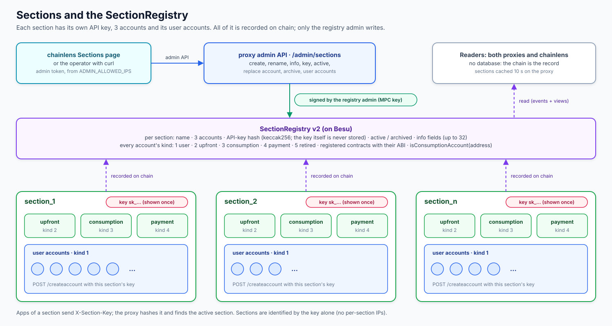
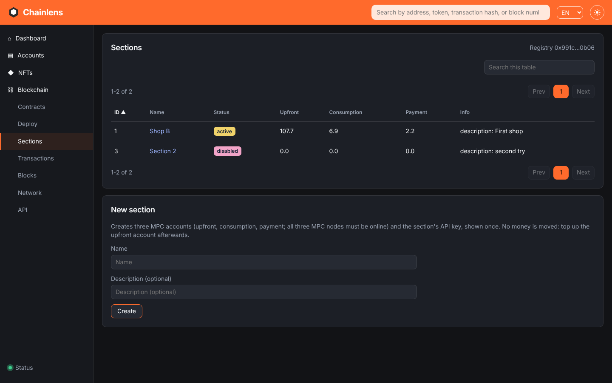
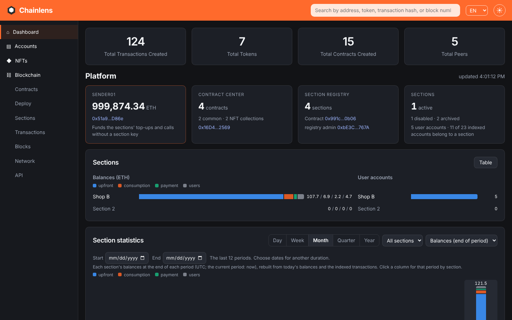
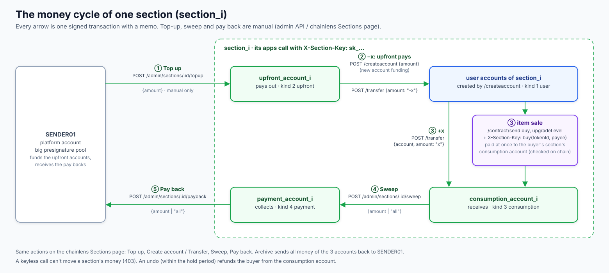

# 섹션

> **내용:** 섹션은 자체 API 키, 계정, 자금 흐름을 가진 사업 단위이며 온체인 SectionRegistry에 기록됩니다. 등록된 컨트랙트, 아바타 컬렉션, 섹션 모니터링도 다룹니다.
>
> **대상:** 아키텍트, 개발자, 비즈니스 관리자.
>
> **관련 문서:** [프록시 API](../reference/proxy-api.md) · [chainlens](../components/chainlens.md) · [아바타](avatars.md)

**목차**

- [계정](#accounts)
- [아키텍처](#architecture)
- [SectionRegistry (온체인, 버전 2)](#the-sectionregistry-on-chain-version-2)
- [관리 API](#admin-api)
- [chainlens Sections 페이지](#chainlens-sections-page)
- [애플리케이션 API: 섹션 호출](#application-api-section-calls)
- [컨트랙트](#contracts)
- [아바타 컬렉션](#avatar-collections)
- [chainlens Accounts 페이지의 섹션](#sections-in-the-chainlens-accounts-page)
- [chainlens Dashboard의 플랫폼 개요](#platform-overview-on-the-chainlens-dashboard)
- [흐름](#flows)
- [모니터링](#monitoring)
- [설정](#settings)

---

**섹션**은 자체 계정과 자체 API 키를 가진 애플리케이션 그룹(section_1 … section_n)입니다.
섹션 사용자를 위한 자금은 SENDER01이 아니라 섹션 자체의 계정에서 나옵니다.

현재 제공되는 기능: SectionRegistry(버전 2), 프록시 관리 API, 섹션 범위의 `/createaccount`와
`/transfer`, chainlens **Sections** 페이지(섹션의 사용자 계정 포함), 컨트랙트 계정 센터가 배포하고 하나의
범용 API(`/contract/call`, `/contract/send`, `/contract/events`, `/contract/list`)로 사용하는 컨트랙트,
아바타와 닉네임 컬렉션(센터가 민팅하는 아이템: 한 번 구매, 대금은 즉시 구매자의 섹션에 지급, 보류 기간 안에 취소 가능),
모니터링(알림과 Grafana
**Sections** 대시보드).

## 계정 {#accounts}

| 계정 | 개수 | 역할 | 레지스트리의 종류 | 사전 서명 풀 |
|---|---|---|---|---|
| SENDER01 | 1 | 선지급 계정에 자금 공급(수동 충전). 결제 계정에서 반환되는 자금을 받습니다 | – | big |
| `upfront_account_i` | 섹션당 1 | **지급:** 새 계정에 자금 공급, `/transfer -x` | 2 upfront | big |
| `consumption_account_i` | 섹션당 1 | **수령:** `/transfer +x`, 아바타와 닉네임 판매, 닉네임 레벨 업그레이드. 취소 환불을 **지급**합니다. `payment_account_i`로 스윕됩니다 | 3 consumption | none |
| `payment_account_i` | 섹션당 1 | 스윕된 자금을 **모읍니다**. SENDER01로 반환할 수 있습니다 | 4 payment | none |
| 사용자 계정 | 다수 | 섹션의 키로 `/createaccount`를 호출하여 생성. 하나의 섹션에 속합니다 | 1 user | 요청에 따름 (기본값 `small`) |
| 퇴역 계정 | 교체 후 | 교체된 선지급 / 소비 / 결제 계정: 여전히 섹션 소속이지만 역할은 없습니다 | 5 retired | 변경 없음 |
| `contract_account_center` | 1 | 모든 컨트랙트(일반 및 아바타)를 배포하고, 아바타와 닉네임을 민팅하며, 그 가격과 사용자 레벨을 정합니다 | – | big |
| 레지스트리 관리자 | 1 | SectionRegistry에 쓰기를 하는 유일한 주체 | – | small |

모든 계정은 MPC 키입니다. 이 계정들에서 **트랜잭션을 보내는 것은 프록시뿐입니다**(계정별 대기열 하나,
순서가 보장된 논스). chainlens는 UI이며 프록시의 관리 API를 호출합니다.

## 아키텍처 {#architecture}

```
  chainlens UI: Sections · Deploy · Contracts · NFTs                       apps of section_i
        │ admin token (operator_ip / chainlens_deploy_ips)                       │ X-Section-Key
        ▼                                                                        ▼
 ┌────────────────────────────────── proxy (active, VIP .151) ───────────────────────────────────┐
 │ Admin API: /admin/sections (create, rename, info, key, active, top-up, sweep, pay back,       │
 │            replace account, archive, user accounts), /admin/contract/*                        │
 │ App API:   /createaccount, /transfer, /contract/call, /send, /events, /list                   │
 │ sender queues: SENDER01 · upfront_i · consumption_i · payment_i · contract_account_center ·   │
 │                registry admin · user accounts                                                 │
 └────────────────┬────────────────────────────────────────────────────────────┬─────────────────┘
                  │ sign (MPC, 2 of 3)                                         │ read / send
                  ▼                                                            ▼
          coordinator → MPC nodes                                   Besu ── SectionRegistry (on chain)
```

## SectionRegistry (온체인, 버전 2) {#the-sectionregistry-on-chain-version-2}



[`proxy/contracts/SectionRegistry.sol`](../../proxy/contracts/SectionRegistry.sol)을
[`proxy/section-registry.json`](../../proxy/section-registry.json)으로 컴파일합니다(solc 0.8.28, EVM cancun,
`proxy/scripts/compile-contract.js`). 두 프록시와 chainlens가 이를 읽습니다. 섹션을 저장하는 곳은 이것뿐이므로
복제하거나 백업할 데이터베이스가 없고(체인이 그 역할을 합니다), 모든 변경은 서명된
트랜잭션이며, 컨트랙트가 이를 확인할 수 있습니다(아바타와 닉네임 컬렉션).

| 보유 정보 | 변경 함수 |
|---|---|
| 이름 (활성 섹션 간에 고유, 1–64바이트) | `createSection`, `setName` |
| 계정 3개 | `createSection`, `replaceAccount` (이전 계정은 섹션 소속으로 남으며 종류는 *retired*) |
| API 키 **해시** (keccak256. 키 자체는 저장되지 않음) | `createSection`, `setKey` |
| 활성 / 보관됨 | `setActive`, `archive` |
| 정보 필드: 키(1–32자: 문자, 숫자, `_ . -`) → 값(최대 512바이트), 섹션당 최대 32개 | `setInfo` (빈 값이면 필드 제거) |
| 각 섹션의 사용자 계정, 모든 계정의 종류 (1 user … 5 retired) | `addAccount`, `addAccounts` (`AccountAdded` 이벤트) |
| 등록된 컨트랙트(종류 1 일반, 2 아바타 컬렉션)와 그 ABI(`ContractRegistered` 이벤트에 포함) | `registerContract` |
| `isConsumptionAccount(address)`: 활성 상태이고 보관되지 않은 섹션의 소비 계정일 때만 true. `sectionOfAccount`, `accountKind`와 함께 아바타와 닉네임 컬렉션의 구매자와 수취인 확인 | (view) |

**레지스트리 관리자**(MPC 키)만 프록시를 통해 한 번에 하나씩 쓰기를 합니다. 새로운 종류의
섹션 정보는 새 컨트랙트 없이 **정보 필드**(설명, 연락처, 한도 등)에 넣습니다.
섹션은 키만으로 식별됩니다. 버전 2에는 섹션별 IP 주소가 없습니다.

`ansible/06-proxy.yml`이 배포합니다. coord1에서 관리자 키를 생성하고,
`besu-production/operator/deploy-contract.js`로 컨트랙트를 배포하며, `ansible/state/registry.json`
(`address`, `admin`)을 작성합니다. 프록시는 이를 `REGISTRY_CONTRACT`와 `REGISTRY_ADMIN`으로, chainlens는
`REGISTRY_CONTRACT`로 받습니다. 같은 플레이북이 컨트랙트 계정 센터도 생성합니다
(`ansible/state/contract-center`, `CONTRACT_CENTER`).

**버전 1에서 업그레이드:** `06-proxy.yml`이 이전 버전을 감지하고 버전 2를 배포합니다(같은
관리자, `registry.json`에 `previous` 기록). 그런 다음 `08-check.yml`이
`POST /admin/registry/migrate`를 한 번 호출하여 섹션(이름, 계정, 키 해시, 활성 상태)과
사용자 계정을 복사합니다(이후 `migrated: true`). 섹션 키는 계속 동작합니다. 버전 1의 허용
IP는 폐기됩니다.

## 관리 API {#admin-api}

프록시(`http://<vip_proxy>:30000/admin/...`)에서 `Authorization: Bearer <token>`
(`ansible/state/secrets/proxy_admin_token`)을 사용하며, `ADMIN_ALLOWED_IPS`에 있는 주소, 즉 `operator_ip`와
모니터링 호스트(chainlens가 여기서 호출함)에서 호출합니다. 본문과 응답:
[프록시 API 레퍼런스](../reference/proxy-api.md#admin-api-sections).

| 요청 | 동작 |
|---|---|
| `GET /admin/sections` (`?archived=1`, `?fresh=1`) | 섹션과 그 3개 계정의 잔액 (보관된 섹션은 요청 시에만. `fresh`는 10초 캐시를 건너뜀) |
| `GET /admin/sections/:id` | 섹션 하나 (보관된 섹션 포함) |
| `POST /admin/sections {name, info}` | MPC 키 3개(**MPC 노드 3개 모두** 온라인 필요), API 키(**한 번만** 반환), 레지스트리 항목, 선택적 정보 필드를 생성합니다. 자금 공급 없음. |
| `POST /admin/sections/:id/name {name}` | 이름 변경 |
| `POST /admin/sections/:id/info {key, value}` | 정보 필드 설정. `value: ""`이면 제거 |
| `POST /admin/sections/:id/key` | 새 API 키(한 번만 반환). 이전 키는 즉시 동작을 멈춥니다 |
| `POST /admin/sections/:id/active {active}` | 활성화 / 비활성화 (`true` / `false`) |
| `POST /admin/sections/:id/topup {amount}` | SENDER01 → `upfront_account_i` |
| `POST /admin/sections/:id/sweep {amount \| "all"}` | `consumption_account_i` → `payment_account_i` |
| `POST /admin/sections/:id/payback {amount \| "all"}` | `payment_account_i` → SENDER01 |
| `POST /admin/sections/:id/account {role}` | `upfront`, `consumption` 또는 `payment`용 새 MPC 키. 이전 계정은 *retired*가 되고 전체 잔액이 새 계정으로 이동합니다 |
| `GET /admin/sections/:id/accounts` | 섹션의 사용자 계정과 잔액 |
| `POST /admin/sections/:id/accounts {amount, pool}` | 섹션의 새 사용자 계정, 선지급 계정에서 자금 공급 (섹션 키로 `/createaccount`를 호출한 것과 동일) |
| `POST /admin/sections/:id/transfer {account, amount, memo}` | `+x` 계정 → 소비, `−x` 선지급 → 계정 (섹션 키로 `/transfer`를 호출한 것과 동일) |
| `POST /admin/sections/:id/archive {confirm: "<name>"}` | 3개 계정의 모든 자금을 SENDER01로 반환한 다음 영구 종료: 키 동작 중지, 이름 해제, 이력 유지 |

모든 자금 이동에는 메모(`section 1 top-up`, `section 1 sweep`, `section 1 pay back`, …)가 붙으므로
체인 자체에 무슨 작업이었는지 기록됩니다. 컨트랙트 배포(`/admin/contract/*`)는
[컨트랙트](#contracts)에 있습니다.

## chainlens Sections 페이지 {#chainlens-sections-page}

**Blockchain → Sections**(`http://<monitoring host>:30100/#/sections`)이며,
`chainlens_sections_enabled: true`일 때 표시됩니다. 접근 조건은 Deploy 페이지와 같습니다. `operator_ip`와
`chainlens_deploy_ips`에서 같은 관리 토큰(`state/secrets/chainlens_deploy_token`)을 사용합니다. 그 밖의
주소에서는 페이지와 메뉴 항목이 존재하지 않습니다. chainlens는 각 작업을 프록시의
관리 API로 전달하며(프록시의 토큰은 브라우저에 전달되지 않음), 요청자의 주소와 함께 로그를 남깁니다.



- **목록:** 각 섹션의 상태, 3개 잔액, 정보 필드를 표시합니다. **New section**(이름,
  선택적 설명)은 API 키를 복사 버튼과 함께 한 번만 표시합니다.
- **섹션 페이지:** 섹션의 계정과 잔액, **사용자 계정**(잔액이 포함된 목록,
  선지급 계정에서 자금을 받는 **Create account**, **Transfer** `+amount` 계정 → 소비 /
  `−amount` 선지급 → 계정), **Top up**, **Sweep**, **Pay back**(금액, 또는 스윕과 반환의 경우
  `all`), **Rename**, **정보 필드**(추가, 편집, 제거), **New API key**,
  **Enable / Disable**, **New upfront / consumption / payment account**, **Archive**(확인을 위해 이름
  입력), 그리고 **이력**: 3개 계정의 최근 인덱싱된 트랜잭션 500건이 레이블과 함께 표시됩니다
  (top-up, upfront → account, account → consumption, sweep, pay back).

## 애플리케이션 API: 섹션 호출 {#application-api-section-calls}

section_i의 애플리케이션은 헤더 **`X-Section-Key: sk_…`**에 키를 담아 보냅니다. 프록시는
키의 해시가 **활성** 상태(비활성화되거나 보관되지 않은)인 섹션에 속할 때 호출을 수락합니다.
프록시에 접근할 수 있는 주체 자체는 방화벽의 `proxy_client_ips`가 정합니다
([접근 제어](../deployment/access-control.md)).

| 요청 | 섹션 호출 시 동작 |
|---|---|
| `POST /createaccount {amount, pool}` | 새 MPC 계정, 온체인에서 **section_i 아래에 등록**, **`upfront_account_i`에서** 자금 공급 |
| `POST /transfer {account, amount: "x", memo}` | `account` → `consumption_account_i` |
| `POST /transfer {account, amount: "-x", memo}` | `upfront_account_i` → `account` |
| `POST /contract/send {contract, function, args, from, value}` | section_i의 사용자 계정인 `from`이 서명한 트랜잭션 ([컨트랙트](#contracts)). 아이템 판매(`buy`, [아바타 컬렉션](#avatar-collections), [닉네임](nicknames.md))와 레벨 업그레이드(`upgradeLevel`)도 포함하며 payee와 가격이 채워짐. 취소(`undo`, `undoLevel`, `from` 없음: consumption_account_i가 서명)도 포함 |

`account`는 section_i의 사용자 계정이어야 합니다(해당 섹션의 키로 생성). 섹션 `/transfer`에서는
`from` / `to`를 받지 않습니다. 응답에는 섹션, 방향, `from`, `to`,
트랜잭션이 포함됩니다.

**키 없는 호출**은 `sections_required: false`(settings.yml)인 동안 SENDER01 동작을 유지합니다.
아직 이전되지 않은 애플리케이션을 위한 것이며, 한 가지 보호 장치가 있습니다. **어떤 섹션의 자금도 이동할 수 없습니다.**
섹션 계정(user, upfront, consumption, payment, retired), 레지스트리 관리자, 컨트랙트
계정 센터를 송신자로 지정하면 거부됩니다. `sections_required: true`이면 키 없는 호출은 모두 거부됩니다
(`X-Section-Key is required`).

| 오류 | 원인 |
|---|---|
| 401 `unknown section key` | 이 키를 가진 활성 섹션이 없음 (교체되었거나 보관되었는지 확인) |
| 401 `X-Section-Key is required` | `sections_required: true`이고 키가 없음. 또는 항상 키가 필요한 호출(`/contract/send`) |
| 403 `section "…" is disabled` | 섹션이 꺼져 있음 |
| 403 `0x… is not an account of section "…"` | 계정이 다른 섹션에 속하거나 사용자 계정이 아님 |
| 403 `0x… belongs to section N: call with that section's X-Section-Key` | 키 없는 호출이 섹션의 자금을 이동하려 함 |
| 403 `the registry admin and contract center accounts can't be used here` | 이 시스템 계정 중 하나에서 키 없는 `/transfer`를 호출함 |
| 400 `insufficient balance` | `upfront_account_i`(또는 `+x`의 경우 해당 계정)가 지불할 수 없음: 충전하거나 대기 중인 이체가 채굴될 때까지 기다리십시오 |
| 503 `sections are not configured` | 프록시에 `REGISTRY_CONTRACT` / `REGISTRY_ADMIN`이 없음 |

## 컨트랙트 {#contracts}

모든 컨트랙트는 **`contract_account_center`**(MPC 키, big 풀, `ansible/06-proxy.yml`이 한 번 생성:
`state/contract-center`)가 프록시를 통해 배포한 다음, 종류(일반 / 아바타 컬렉션), 이름, ABI와 함께
**SectionRegistry에 등록**됩니다. chainlens와 프록시는 체인에서 등록된 컨트랙트를 읽으므로
(`ContractRegistered` 이벤트), 배포된 컨트랙트는 복사할 것 없이 모든 호스트에서 즉시 사용 가능하고 표시됩니다.

**배포** — chainlens **Deploy** 페이지([컨트랙트 배포](contract-deployment.md)) 또는 프록시
관리 API:

| 요청 | 동작 |
|---|---|
| `POST /admin/contract/check {kind, name, abi, bytecode, deployedBytecode, immutableReferences, args}` | 시험 실행: 인수, 가스, revert 없음 확인, 배포될 주소. 아무것도 서명하지 않습니다 |
| `POST /admin/contract/deploy {…same}` | 배포하고(센터가 서명), 온체인 코드를 `deployedBytecode`와 비교하고, 등록합니다(레지스트리 관리자가 서명) |
| `{template: "avatar-collection", name, symbol}` 또는 `{template: "nickname-collection", …}`로 `check` / `deploy` | 프록시 이미지에 컴파일된 플랫폼 자체 컨트랙트(레지스트리 주소는 채워짐) |
| `POST /admin/contract/send {contract, function, args}` | 센터가 서명하는 쓰기: 플랫폼 컨트랙트의 민터이자 소유자(`mint`, `setPrice`, 닉네임 사용자 레벨 `addLevel` / `setLevel`) |

생성 시 컨트랙트의 `msg.sender`는 센터입니다. 소유자나 역할이 있는 컨트랙트에서 센터가 이를 보유하면
안 되는 경우, 생성자 인수로 받도록 하십시오.

**사용** — 애플리케이션이 프록시를 통해 사용:

| 요청 | 동작 |
|---|---|
| `POST /contract/call {contract, function, args}` | **view/pure** 함수를 실행하고(`eth_call`) 친화적인 `result`와 디코딩된 `outputs`를 반환합니다. `{calls: [ … ]}`로 한 번에 최대 50개를 실행합니다. `sections_required: false`인 동안에는 키가 필요 없습니다. |
| `POST /contract/send {contract, function, args, from, value}` + `X-Section-Key` | **상태를 변경하는** 함수를 보냅니다. **호출자 섹션의 사용자 계정**인 `from`이 서명하며, 블록을 기다린 후 상태, `blockNumber`, `gasUsed`, 컨트랙트의 디코딩된 이벤트를 반환합니다. `value`(ETH)는 payable 함수에만 사용합니다. 채굴되었지만 revert된 트랜잭션은 `success: false`와 함께 400으로 응답합니다. |
| `POST /contract/events {contract, event, where, fromBlock, toBlock, limit}` | 컨트랙트의 이벤트, 최신순(`Transfer`와 `where.to`에 `current: true`: 그 주소가 지금 보유한 토큰) |
| `GET /contract/list` | 등록된 컨트랙트(`?type=avatar\|nickname\|contract`, `?has=<function>`, `?functions=1`) |

**등록된** 컨트랙트만, **해당 ABI**의 함수만 사용할 수 있습니다. `function`은 이름이며, 이름이 오버로드된 경우
시그니처(`transfer(address,uint256)`)입니다. `args`는 목록(원시 ABI 값) 또는 객체(입력 이름으로 지정.
플랫폼 컨트랙트에서는 ETH, 메타데이터 같은 친화적인 값)입니다. 숫자는 문자열 또는 숫자, 주소는
`0x…`, 불리언은 `true`/`false`, 배열과 튜플은 JSON(또는 JSON 텍스트)입니다. revert될 트랜잭션은 서명
전에 이유와 함께 거부됩니다(`the transaction would revert: …`). `AvatarCollection.mint`는 이 방식으로
사용할 수 없습니다. 센터만 민팅하므로 `not minter`로 revert됩니다. `POST /admin/contract/send`를
사용하십시오.

플랫폼 자체 컨트랙트에 대해서는 `/contract/send`가 섹션이 정하는 값을 채웁니다. 생략한 `payee`는 보내는
계정 섹션의 소비 계정이 되고, 생략한 `value`는 가격(`buy`, 닉네임 `upgradeLevel`) 또는 환불액(`undo`, 닉네임
`undoLevel`: 돈을 받은 소비 계정이 서명, `from` 없음)이 됩니다. 관리 API 호출자(chainlens)는 키 없이 호출할 수
있으며, 이때 섹션은 `from`의 섹션(취소의 경우: 돈을 받은 계정의 섹션)입니다.
자세한 내용: [프록시 API](../reference/proxy-api.md#post-contractsend--write).

## 아바타 컬렉션 {#avatar-collections}

**아바타**는 플랫폼의 이미지 토큰입니다. 아바타 컬렉션([`proxy/contracts/AvatarCollection.sol`](../../proxy/contracts/AvatarCollection.sol)
버전 4, `proxy/avatar-collection.json`)과 닉네임 컬렉션([닉네임](nicknames.md))은 **아이템**이며 같은 규칙을 따릅니다
([`proxy/contracts/BoundItems.sol`](../../proxy/contracts/BoundItems.sol)). **컨트랙트 계정 센터**(민터)가 배포하고,
SectionRegistry에 등록되며, 모든 섹션이 공유합니다. 아바타 생성자는 `name_`, `symbol_`, `registry_`(SectionRegistry의
주소), `holdSeconds_`(취소 기간; 템플릿의 `holdDays`)를 받습니다.

| 요청 | 동작 |
|---|---|
| `POST /admin/contract/deploy {template: "avatar-collection", name, symbol, holdDays}` | 센터가 아바타 컬렉션을 배포하고(센터가 민터, 레지스트리 주소와 취소 기간 포함, 기본 7일) 등록합니다 |
| `POST /admin/contract/send {contract, function: "mint", args: {image, price, description, attributes}}` | 센터가 아바타를 민팅해 판매용으로 보유합니다. 이미지마다 한 번. 섹션과 연결되지 않습니다 |
| `POST /admin/contract/send {contract, function: "setPrice", args: {tokenId, price}}` | 아바타가 판매되기 전까지 새 가격 |
| `POST /contract/send {contract, function: "buy", args: {tokenId} 또는 {imageUrl}, from}` + `X-Section-Key` | **호출자 섹션의 사용자 계정**인 `from`이 가격을 지불하며 `buy(tokenId, payee)`에 서명합니다(payee와 value는 채워짐). 대금은 **즉시** 섹션의 **소비 계정**으로 갑니다. 아바타는 구매자에게 귀속됩니다: 재판매 없음, 이전 없음 |
| `POST /contract/send {contract, function: "undo", args: {tokenId}}` + `X-Section-Key`(`from` 없음) | 보류 기간 안: 프록시가 돈을 받은 소비 계정으로 서명하고, 그 계정이 같은 트랜잭션에서 구매자에게 환불합니다. 아바타는 센터로 돌아가 다시 판매됩니다 |

돈이 어디로 갈지는 컨트랙트 자체가 강제합니다. `buy`는 구매자가 사용자 계정인지(`accountKind`), `payee`가 구매자 자신의
섹션의 소비 계정인지(`isConsumptionAccount`, `sectionOfAccount`) 확인하므로, 프록시를 우회하여 보낸 트랜잭션도 대금을
다른 곳으로 돌릴 수 없습니다. 그 소비 계정만, 정확히 환불액으로만 취소할 수 있습니다.

아이템 쓰기에는 섹션 키가 필요합니다. 유일한 예외는 관리 API 호출자(`ADMIN_ALLOWED_IPS`에 있는 주소에서 온 관리
토큰)입니다. 컬렉션의 컨트랙트 페이지에 있는 chainlens **Mint and sell avatars** 카드와 **Nicknames** 페이지(Deploy
페이지와 같은 관리 토큰과 IP)가 이 방식으로 프록시를 호출하며, 이때 섹션은 구매자의 섹션(취소의 경우: 돈을 받은 섹션)입니다.
단계별 안내: [아바타](avatars.md), [닉네임](nicknames.md).

소유자, 가격, 메타데이터, 결제는 `/contract/call`(`tokensOf`, `tokenOf`, `ownerOf`, `paymentsOf`…)과
`/contract/events`로 읽습니다([프록시 API, 아바타 컬렉션](../reference/proxy-api.md#avatar-collections)).
이전의 `/nft/*` 라우트는 410으로 응답합니다.

**이전 컬렉션:** 버전 3(재판매 있음)은 프록시에게 일반 컨트랙트입니다. **버전 2 컬렉션**(SENDER01이 민팅, 섹션 이전에
만들어짐)은 **폐기되어** 프록시가 더 이상 읽거나 민팅하거나 판매하지 않습니다.

## chainlens Accounts 페이지의 섹션 {#sections-in-the-chainlens-accounts-page}

모든 chainlens 사용자에게 표시됩니다(정보가 온체인에 공개되어 있음). **Accounts** 목록에는
**Section** 열(섹션 이름과 계정 역할: `user`, `upfront`, `consumption`,
`payment`, `retired`. 시스템 계정은 `SENDER01`, `contract center`, `registry admin`으로 표시)과
필터(섹션 하나, 섹션 없음, 시스템 계정)가 있습니다. 계정 페이지에는 계정의 섹션, 역할,
역할이 하는 일이 표시됩니다. chainlens는 SectionRegistry의 섹션 이벤트(새 섹션과
계정, 이름 변경, 교체된 계정, 보관)를 15초마다 읽습니다.

## chainlens Dashboard의 플랫폼 개요 {#platform-overview-on-the-chainlens-dashboard}

모든 사용자에게 표시되며, Dashboard의 합계 아래에 있습니다. 카드 4개(잔액이 표시되는 **SENDER01**,
배포한 일반 및 아바타 컨트랙트가 표시되는 **contract center**, 컨트랙트와 관리자가 표시되는 **section registry**,
활성, 비활성, 보관, 사용자 계정 수가 표시되는 **sections**)가 있고, 그 아래
**Sections** 카드에 각 섹션의 잔액(선지급 / 소비 / 결제, 그리고 회색으로 **사용자 계정**이 보유한
합계를 누적 표시하며 `upfront / consumption / payment / users`로 레이블 표시, 예:
`970 / 0 / 0 / 30`)과 사용자 계정 수가 섹션별 마우스오버 툴팁 및 **Table**
보기와 함께 표시됩니다. 체인에서 15초마다 읽습니다(`GET /api/overview`).



그 아래에는 **day, week, month, quarter, year**별 **Section statistics**(섹션 통계)가 있습니다(UTC, 최근 14일,
12주 또는 12개월, 8분기, 5년, 기본값: month). 전체 섹션 또는 섹션 하나에 대해 기간별
측정값 하나의 막대 차트를 표시하고, 클릭한 기간(기본값: 현재 기간)의 합계와 섹션별 표를
표시합니다(`GET /api/sections/stats?period=day|week|month|quarter|year`). **Start** / **End** 날짜로
다른 기간을 선택할 수 있습니다(UTC 일 단위, 최대 120열, `&from=YYYY-MM-DD&to=YYYY-MM-DD`). **Last
periods**는 기본값으로 돌아갑니다. chainlens가 인덱싱한 트랜잭션에서 송신자와 수신자의 역할을 기준으로
계산합니다.

| 측정값 | 집계 기준 |
|---|---|
| Balances (end of period), 기본값 | 각 기간의 마감 잔액(선지급 / 소비 / 결제 / 사용자), Sections 막대처럼 누적 표시: 오늘 잔액에서 이후의 모든 변경을 뺀 값 (이 체인에서는 가스가 무료) |
| New users | 레지스트리의 `AccountAdded` (또는 그보다 이른 경우 계정의 최초 자금 공급) |
| +x from users | 사용자 계정 → 섹션의 소비 계정 |
| Avatar sales / Avatar sales (ETH) | 섹션 사용자 계정의 아바타 컬렉션 `buy` 호출 |
| Nickname sales / Level upgrades | 섹션 사용자 계정의 닉네임 컬렉션 `buy`와 `upgradeLevel` 호출 |
| Nicknames and levels (ETH) | 그 닉네임 판매와 레벨 업그레이드의 ETH |
| Undone, refunded (ETH) | 섹션 소비 계정의 `undo`와 `undoLevel` 호출(환불) |
| Income | 사용자의 +x + 아바타와 닉네임 판매 + 레벨 업그레이드 − 환불 (소비 계정에 남는 금액) |
| To users | 선지급 → 사용자 (새 계정 자금 공급과 −x) |
| Top-ups, Swept, Paid back | SENDER01 → 선지급, 소비 → 결제, 결제 → SENDER01 |
| Transactions | 섹션 계정 중 하나에서 보내거나 받은 모든 트랜잭션 |

역할은 현재 기준입니다(교체된 계정은 `retired`로 집계). chainlens 인덱스 시작 이전의
이력은 포함되지 않습니다.

## 흐름 {#flows}



| 작업 | 처리 주체 | 서명 주체 / 동작 |
|---|---|---|
| **섹션 생성** (UI) | 프록시 관리 API | MPC 키 3개, 레지스트리 항목(레지스트리 관리자), API 키 한 번 표시. 자금 공급 없음. |
| **이름 변경 / 정보 / 키 / 활성화–비활성화** (UI) | 프록시 관리 API | 레지스트리 관리자 |
| **Top up** (충전, UI, 금액) | 프록시 관리 API | SENDER01 → `upfront_account_i`, 수동으로만 |
| **Sweep** (스윕, UI, 금액 또는 전체) | 프록시 관리 API | `consumption_account_i` → `payment_account_i` |
| **Pay back** (반환, UI, 금액 또는 전체) | 프록시 관리 API | `payment_account_i` → SENDER01 |
| **계정 교체** (UI) | 프록시 관리 API | 새 MPC 키, 레지스트리 관리자, 이전 계정(이제 retired) → 새 계정 (전체 잔액) |
| **Archive** (보관, UI) | 프록시 관리 API | 3개 계정 → SENDER01 (전액), 이후 레지스트리 관리자 |
| `/createaccount` (section_i) | 프록시 | 레지스트리 관리자: 계정 → section_i, 이후 `upfront_account_i` → 새 사용자 계정 |
| `/transfer +x` (section_i) | 프록시 | 사용자 계정 → `consumption_account_i` |
| `/transfer -x` (section_i) | 프록시 | `upfront_account_i` → 사용자 계정 |
| **컨트랙트 배포** (UI) | 프록시 관리 API → 레지스트리 | `contract_account_center`, 이후 레지스트리 관리자. 섹션과 연결되지 않음 |
| **아바타 컬렉션 배포** (UI 또는 `avatar-collection` 템플릿) | 프록시 → 레지스트리 | `contract_account_center`(민터), 이후 레지스트리 관리자. 모든 섹션이 공유 |
| `/contract/call` | 프록시 | 없음(읽기). 등록된 모든 컨트랙트 |
| `/contract/send` (section_i) | 프록시 | section_i의 사용자 계정. 등록된 컨트랙트와 그 ABI 함수만 |
| `/admin/contract/send` `mint`, `setPrice` (`addLevel`, `setLevel`) | 프록시 (센터의 대기열) | `contract_account_center`: 아바타 `mint(image, uri, price)`, 닉네임 `mint(nickname, price)`. 가격은 아이템이 판매되기 전까지 변경 가능 |
| `/contract/send` `buy` (section_i) | 프록시 (구매자의 대기열) | 구매자: `buy(tokenId, payee = consumption_account_i)`. 아이템 → 구매자(영구), 대금 → 즉시 `consumption_account_i` |
| `/contract/send` `upgradeLevel` (section_i) | 프록시 (소유자의 대기열) | 소유자: `upgradeLevel(tokenId, level, payee = consumption_account_i)`. 단계 가격 → 즉시 `consumption_account_i` |
| `/contract/send` `undo` / `undoLevel` (section_i, `from` 없음) | 프록시 (소비 계정의 대기열) | `consumption_account_i`, 보류 기간 안: 환불 → 구매자. `undo`: 아이템은 센터로 돌아가 다시 판매 |

## 모니터링 {#monitoring}

프록시의 `/metrics`(Prometheus가 프록시 VIP를 통해 수집)에는 다음 섹션 메트릭이 있습니다
(그 밖의 프록시 메트릭: [프록시, 메트릭](../components/proxy.md#metrics-and-monitoring)).

| 메트릭 | |
|---|---|
| `proxy_section_balance_eth{section_id, section, role, active}` | 각 계정의 잔액(역할 upfront / consumption / payment), 15초마다 갱신. 보관된 섹션은 나열되지 않음 |
| `proxy_section_active{section_id, section}` | 1 = 활성화됨 |
| `proxy_section_operations_total`, `proxy_section_amount_eth_total` `{section_id, section, op}` | 프록시 시작 이후의 작업 수와 이동한 ETH (op: `create_account`, `transfer_in`, `transfer_out`, `avatar_sale`, `avatar_undo`, `nickname_sale`, `nickname_undo`, `level_upgrade`, `level_undo`, `topup`, `sweep`, `payback`, `account_replaced`, `archive_return`). 프록시와 함께 0부터 다시 시작합니다(대시보드는 `increase()` 사용) |
| `proxy_sender01_balance_eth` | SENDER01의 잔액 |
| `proxy_section_low_balance_eth`, `proxy_sender01_low_balance_eth` | 알림 임계값 |
| `proxy_sections_metrics_error`, `proxy_sections_metrics_age_seconds` | 1 = 마지막 잔액 갱신 실패, 마지막 갱신 이후 경과 초 |

알림 `SectionUpfrontLow`(WARNING), `SectionUpfrontEmpty`(CRITICAL), `Sender01Low`,
`SectionMetricsFailing`([`monitoring/prometheus/rules/sections.yml`](../../monitoring/prometheus/rules/sections.yml),
조치 방법: [알림](../operations/alerts.md#4-sections-sectionsyml)). 비활성화되거나 보관된 섹션은
선지급 알림을 발생시키지 않습니다.

Grafana의 **Sections** 대시보드는 섹션별 잔액, 임계값 선, 활동을 표시합니다.
**Period** 변수(Day, Week, Month = 30일, Quarter = 90일, Year = 365일)가
활동 패널을 설정합니다. 마지막 기간의 합계, 기간별 작업 수와 ETH 막대, 섹션별 및 작업별
표가 표시됩니다. 여러 기간이 포함되는 대시보드 시간 범위를 선택하십시오(기본값:
최근 30일). 카운터는 프록시에 있으며, Prometheus의 `increase()`가 프록시
재시작을 넘어 값을 이어갑니다.

## 설정 {#settings}

`ansible/group_vars/all/settings.yml`에 있습니다.

| 설정 | 기본값 | 의미 |
|---|---|---|
| `sections_required` | `false` | `true`: 모든 `/createaccount`, `/transfer`, `/contract/call`에 `X-Section-Key`가 필요합니다 (프록시 `SECTION_KEY_REQUIRED`) |
| `chainlens_sections_enabled` | `false` | chainlens Sections 페이지 |
| `chainlens_deploy_enabled` | `false` | chainlens Deploy 페이지 ([컨트랙트 배포](contract-deployment.md)) |
| `chainlens_deploy_ips` | `[]` | `operator_ip` 외에 관리 페이지 사용이 허용된 관리자 PC |
| `upfront_low_balance_eth` | 100 | `SectionUpfrontLow` 임계값 (0 = 꺼짐) |
| `sender01_low_balance_eth` | 10000 | `Sender01Low` 임계값 (0 = 꺼짐) |
| `prometheus_retention`, `prometheus_retention_size` | `400d`, `20GB` | Prometheus의 데이터 보관 기간(가장 오래된 데이터부터 삭제). Year 기간이 동작하도록 설정 |
