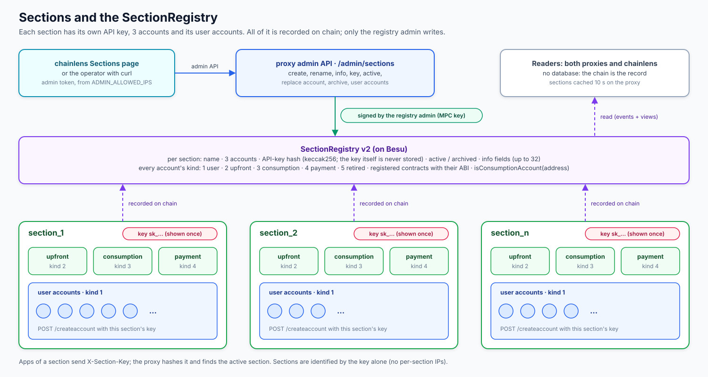
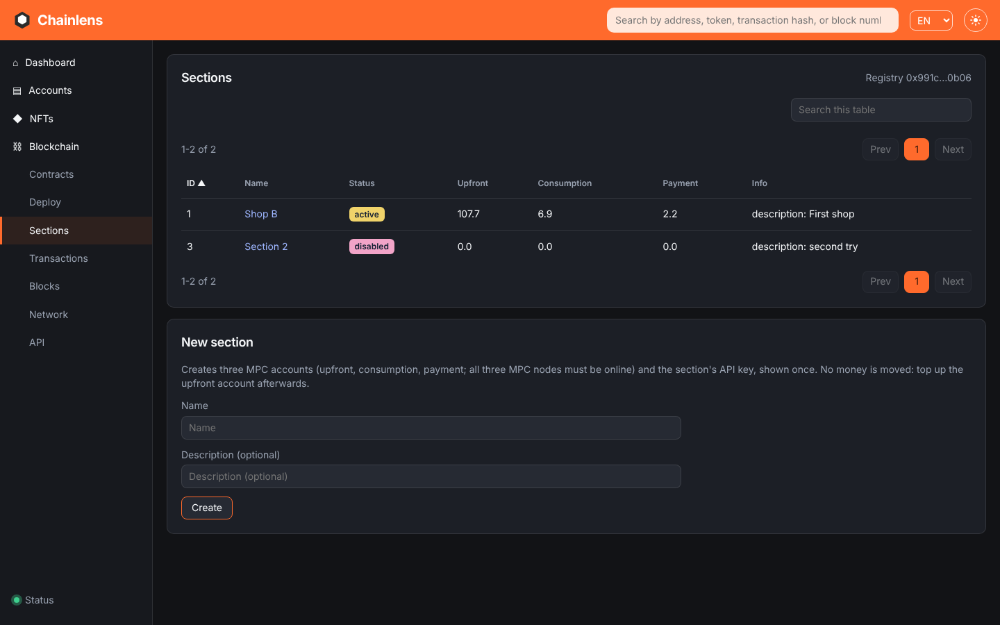
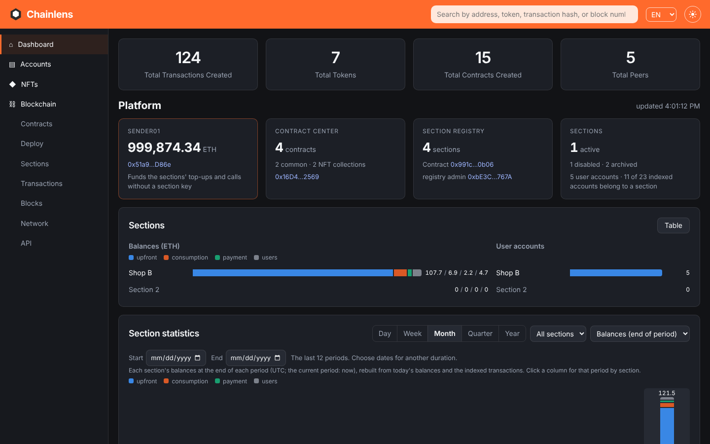
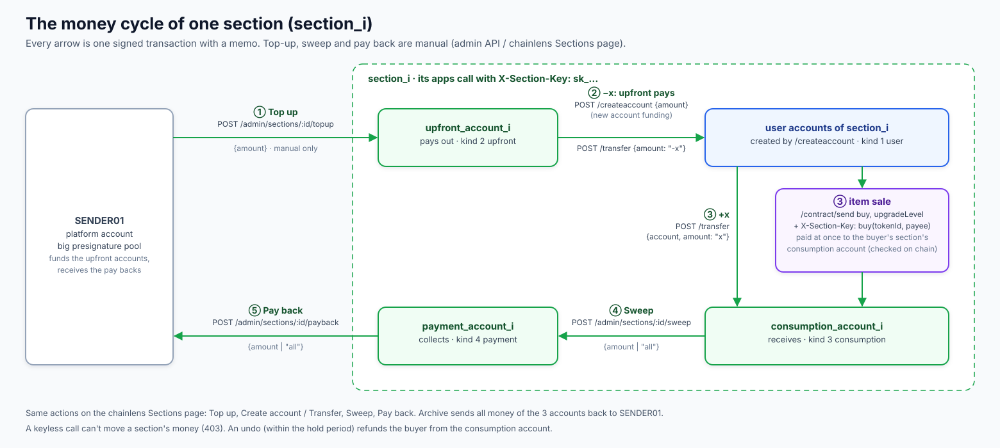

# Sections

> **What:** Sections: business units with their own API key, accounts and money flow, recorded in the on-chain SectionRegistry; plus registered contracts, avatar collections and section monitoring.
>
> **For:** architects, developers, business admins.
>
> **Related:** [proxy API](../reference/proxy-api.md) · [chainlens](../components/chainlens.md) · [avatars](avatars.md)

**Contents**

- [Accounts](#accounts)
- [Architecture](#architecture)
- [The SectionRegistry (on chain, version 2)](#the-sectionregistry-on-chain-version-2)
- [Admin API](#admin-api)
- [Chainlens Sections page](#chainlens-sections-page)
- [Application API: section calls](#application-api-section-calls)
- [Contracts](#contracts)
- [Avatar collections](#avatar-collections)
- [Sections in the chainlens Accounts page](#sections-in-the-chainlens-accounts-page)
- [Platform overview on the chainlens Dashboard](#platform-overview-on-the-chainlens-dashboard)
- [Flows](#flows)
- [Monitoring](#monitoring)
- [Settings](#settings)

---

A **section** is a group of applications (section_1 … section_n) with its own accounts and its own
API key. Money for a section's users comes from the section's own accounts instead of SENDER01.

What exists: the SectionRegistry (version 2), the proxy admin API, section-scoped `/createaccount`
and `/transfer`, the chainlens **Sections** page (with the sections' user accounts), contracts
deployed by the contract account center and used through one generic API (`/contract/call`,
`/contract/send`, `/contract/events`, `/contract/list`), avatar and nickname collections
(items minted by the center, bought once, paid at once to the buyer's section, undone within the
hold period), and monitoring
(alerts and the Grafana **Sections** dashboard).

## Accounts

| Account | How many | Role | Kind in the registry | Presignature pool |
|---|---|---|---|---|
| SENDER01 | 1 | Funds the upfront accounts (manual top-up); receives money back from payment accounts | – | big |
| `upfront_account_i` | 1 per section | **Pays out:** funds new accounts, `/transfer -x` | 2 upfront | big |
| `consumption_account_i` | 1 per section | **Receives:** `/transfer +x`, avatar and nickname sales, nickname level upgrades; **pays** the undo refunds; swept to `payment_account_i` | 3 consumption | none |
| `payment_account_i` | 1 per section | **Collects** the swept money; can pay it back to SENDER01 | 4 payment | none |
| user accounts | many | Created by `/createaccount` with the section's key; belong to one section | 1 user | as requested (default `small`) |
| retired accounts | after a replacement | A replaced upfront / consumption / payment account: still the section's, no role | 5 retired | unchanged |
| `contract_account_center` | 1 | Deploys all contracts (common and avatar), mints the avatars and nicknames, sets their prices and the user levels | – | big |
| registry admin | 1 | The only writer of the SectionRegistry | – | small |

Every account is an MPC key. **Only the proxy sends transactions** from them (one queue per account,
ordered nonces); chainlens is the UI and calls the proxy's admin API.

## Architecture

```
  chainlens UI: Sections · Deploy · Contracts · NFTs                       apps of section_i
        │ admin token (operator_ip / chainlens_deploy_ips)                       │ X-Section-Key
        ▼                                                                        ▼
 ┌────────────────────────────────── proxy (active, VIP .151) ───────────────────────────────────┐
 │ Admin API: /admin/sections (create, rename, info, key, active, top-up, sweep, pay back,       │
 │            replace account, archive, user accounts), /admin/contract/*                        │
 │ App API:   /createaccount, /transfer, /contract/call, /send, /events, /list                   │
 │ sender queues: SENDER01 · upfront_i · consumption_i · payment_i · contract_account_center ·   │
 │                registry admin · user accounts                                                 │
 └────────────────┬────────────────────────────────────────────────────────────┬─────────────────┘
                  │ sign (MPC, 2 of 3)                                         │ read / send
                  ▼                                                            ▼
          coordinator → MPC nodes                                   Besu ── SectionRegistry (on chain)
```

## The SectionRegistry (on chain, version 2)



[`proxy/contracts/SectionRegistry.sol`](../../proxy/contracts/SectionRegistry.sol), compiled to
[`proxy/section-registry.json`](../../proxy/section-registry.json) (solc 0.8.28, EVM cancun;
`proxy/scripts/compile-contract.js`). Both proxies and chainlens read it; nothing else stores
sections, so there is no database to replicate or back up (the chain is), every change is a signed
transaction, and contracts can check it (the avatar and nickname collections).

| Holds | Changed by |
|---|---|
| name (unique among live sections, 1–64 bytes) | `createSection`, `setName` |
| the 3 accounts | `createSection`, `replaceAccount` (the old account stays the section's, kind *retired*) |
| API-key **hash** (keccak256; the key itself is never stored) | `createSection`, `setKey` |
| active / archived | `setActive`, `archive` |
| info fields: a key (1–32 characters: letters, digits, `_ . -`) → a value (up to 512 bytes), up to 32 per section | `setInfo` (an empty value removes the field) |
| user accounts of each section, every account's kind (1 user … 5 retired) | `addAccount`, `addAccounts` (`AccountAdded` events) |
| registered contracts (kind 1 common, 2 avatar collection) and their ABI (in the `ContractRegistered` event) | `registerContract` |
| `isConsumptionAccount(address)`: true only for the consumption account of an active, not archived section; with `sectionOfAccount` and `accountKind`, the buyer and payee checks of the avatar and nickname collections | (view) |

Only the **registry admin** (an MPC key) writes, through the proxy, one write at a time. New kinds of
section information go into **info fields** (description, contact, limits, …) without a new
contract. Sections are identified by their key alone: version 2 has no per-section IP addresses.

Deployed by `ansible/06-proxy.yml`: it creates the admin key on coord1, deploys the contract with
`besu-production/operator/deploy-contract.js` and writes `ansible/state/registry.json`
(`address`, `admin`); the proxy gets them as `REGISTRY_CONTRACT` and `REGISTRY_ADMIN`, chainlens as
`REGISTRY_CONTRACT`. The same playbook creates the contract account center
(`ansible/state/contract-center`, `CONTRACT_CENTER`).

**Upgrade from version 1:** `06-proxy.yml` sees the older version and deploys version 2 (same
admin, `previous` recorded in `registry.json`); `08-check.yml` then calls
`POST /admin/registry/migrate` once, which copies the sections (name, accounts, key hash, active) and
their user accounts (`migrated: true` afterwards). Section keys keep working. Version 1's allowed
IPs are dropped.

## Admin API

On the proxy (`http://<vip_proxy>:30000/admin/...`), with `Authorization: Bearer <token>`
(`ansible/state/secrets/proxy_admin_token`), from an address in `ADMIN_ALLOWED_IPS`: `operator_ip`
and the monitoring host (chainlens calls it from there). Bodies and answers:
[proxy API reference](../reference/proxy-api.md#admin-api-sections).

| Request | Does |
|---|---|
| `GET /admin/sections` (`?archived=1`, `?fresh=1`) | sections with the balances of their 3 accounts (archived ones only on request; `fresh` skips the 10 s cache) |
| `GET /admin/sections/:id` | one section (archived ones too) |
| `POST /admin/sections {name, info}` | creates the 3 MPC keys (needs **all 3 MPC nodes** online), the API key (returned **once**), the registry entry, optional info fields. No funding. |
| `POST /admin/sections/:id/name {name}` | renames |
| `POST /admin/sections/:id/info {key, value}` | sets an info field; `value: ""` removes it |
| `POST /admin/sections/:id/key` | new API key (returned once); the old one stops working at once |
| `POST /admin/sections/:id/active {active}` | enables / disables (`true` / `false`) |
| `POST /admin/sections/:id/topup {amount}` | SENDER01 → `upfront_account_i` |
| `POST /admin/sections/:id/sweep {amount \| "all"}` | `consumption_account_i` → `payment_account_i` |
| `POST /admin/sections/:id/payback {amount \| "all"}` | `payment_account_i` → SENDER01 |
| `POST /admin/sections/:id/account {role}` | a new MPC key for `upfront`, `consumption` or `payment`; the old account becomes *retired* and its whole balance moves to the new one |
| `GET /admin/sections/:id/accounts` | the section's user accounts with their balances |
| `POST /admin/sections/:id/accounts {amount, pool}` | a new user account of the section, funded from its upfront account (as `/createaccount` with its key) |
| `POST /admin/sections/:id/transfer {account, amount, memo}` | `+x` account → consumption, `−x` upfront → account (as `/transfer` with its key) |
| `POST /admin/sections/:id/archive {confirm: "<name>"}` | all money of the 3 accounts back to SENDER01, then closed for good: key stops working, name freed, history stays |

Every money move carries a memo (`section 1 top-up`, `section 1 sweep`, `section 1 pay back`, …),
so the chain itself says what it was. Contract deployment (`/admin/contract/*`) is under
[Contracts](#contracts).

## Chainlens Sections page

**Blockchain → Sections** (`http://<monitoring host>:30100/#/sections`), when
`chainlens_sections_enabled: true`. Same access as the Deploy page: `operator_ip` and
`chainlens_deploy_ips`, with the same admin token (`state/secrets/chainlens_deploy_token`); for every
other address the page and its menu entry don't exist. Chainlens forwards each action to the proxy's
admin API (the proxy's token never reaches the browser) and logs it with the requester's address.



- **List:** each section with its status, the 3 balances and its info fields; **New section** (name,
  optional description) shows the API key once, with a copy button.
- **A section's page:** its accounts and balances; its **user accounts** (list with balances,
  **Create account** funded from the upfront account, **Transfer** `+amount` account → consumption /
  `−amount` upfront → account); **Top up**, **Sweep**, **Pay back** (amount, or
  `all` for sweep and pay back); **Rename**; **info fields** (add, edit, remove); **New API key**;
  **Enable / Disable**; **New upfront / consumption / payment account**; **Archive** (type the
  name to confirm); and its **history**: the last 500 indexed transactions of its 3 accounts, labelled
  (top-up, upfront → account, account → consumption, sweep, pay back).

## Application API: section calls

An application of section_i sends its key in the header **`X-Section-Key: sk_…`**. The proxy
accepts the call when the key's hash belongs to a section that is **active** (not disabled or
archived). Who may reach the proxy at all is the firewall's `proxy_client_ips`
([access control](../deployment/access-control.md)).

| Request | Section call does |
|---|---|
| `POST /createaccount {amount, pool}` | new MPC account, **registered under section_i** on chain, funded **from `upfront_account_i`** |
| `POST /transfer {account, amount: "x", memo}` | `account` → `consumption_account_i` |
| `POST /transfer {account, amount: "-x", memo}` | `upfront_account_i` → `account` |
| `POST /contract/send {contract, function, args, from, value}` | a transaction signed by `from`, a user account of section_i ([Contracts](#contracts)); also the item sales (`buy`, [avatar collections](#avatar-collections), [nicknames](nicknames.md)) and level upgrades (`upgradeLevel`), with the payee and price filled in, and the undos (`undo`, `undoLevel`, no `from`: signed by consumption_account_i) |

`account` must be a user account of section_i (created with that section's key). `from` / `to`
are not accepted on a section `/transfer`. The answer names the section, the direction, `from`, `to`
and the transaction.

**Calls without a key** keep the SENDER01 behaviour while `sections_required: false` (settings.yml),
for applications not moved yet, with one guard: **they can't move any section's money** — a
section account (user, upfront, consumption, payment, retired), the registry admin or the contract
account center as sender is refused. With `sections_required: true` they are refused altogether
(`X-Section-Key is required`).

| Error | Cause |
|---|---|
| 401 `unknown section key` | no live section has this key (rotated? archived?) |
| 401 `X-Section-Key is required` | `sections_required: true` and no key; or a call that always needs one (`/contract/send`) |
| 403 `section "…" is disabled` | the section is switched off |
| 403 `0x… is not an account of section "…"` | the account belongs to another section, or isn't a user account |
| 403 `0x… belongs to section N: call with that section's X-Section-Key` | a keyless call tried to move a section's money |
| 403 `the registry admin and contract center accounts can't be used here` | a keyless `/transfer` from one of these system accounts |
| 400 `insufficient balance` | `upfront_account_i` (or the account for `+x`) can't pay: top up / wait for a pending transfer to be mined |
| 503 `sections are not configured` | the proxy has no `REGISTRY_CONTRACT` / `REGISTRY_ADMIN` |

## Contracts

Every contract is deployed by **`contract_account_center`** (an MPC key, big pool, created once by
`ansible/06-proxy.yml`: `state/contract-center`), through the proxy, then **registered in the
SectionRegistry** with its kind (common / avatar collection), its name and its ABI. Chainlens and the
proxy read the registered contracts from the chain (`ContractRegistered` events), so a deployed
contract is usable and visible at once, on every host, with nothing to copy.

**Deploy** — chainlens **Deploy** page ([contract deployment](contract-deployment.md)), or the proxy
admin API:

| Request | Does |
|---|---|
| `POST /admin/contract/check {kind, name, abi, bytecode, deployedBytecode, immutableReferences, args}` | dry run: arguments, gas, no revert; the address it will get. Nothing is signed |
| `POST /admin/contract/deploy {…same}` | deploys (signed by the center), checks the code on chain against `deployedBytecode`, registers it (signed by the registry admin) |
| `check` / `deploy` with `{template: "avatar-collection", name, symbol}` or `{template: "nickname-collection", …}` | the platform's own contracts, compiled into the proxy image (the registry's address filled in) |
| `POST /admin/contract/send {contract, function, args}` | a write signed by the center: the minter and owner of the platform's contracts (`mint`, `setPrice`, the nickname user levels `addLevel` / `setLevel`) |

The contract's `msg.sender` at construction is the center: a contract with an owner or roles should
take them as constructor arguments when the center must not hold them.

**Use** — applications, through the proxy:

| Request | Does |
|---|---|
| `POST /contract/call {contract, function, args}` | runs a **view/pure** function (`eth_call`), returns a friendly `result` and the decoded `outputs`; `{calls: [ … ]}` runs up to 50 at once. No key needed while `sections_required: false`. |
| `POST /contract/send {contract, function, args, from, value}` + `X-Section-Key` | sends a **state-changing** function, signed by `from`, a **user account of the caller's section**; waits for the block; returns the status, `blockNumber`, `gasUsed` and the contract's decoded events. `value` (ETH) only for payable functions. A transaction mined but reverted answers 400 with `success: false`. |
| `POST /contract/events {contract, event, where, fromBlock, toBlock, limit}` | the contract's events, newest first (`current: true` with `Transfer` and `where.to`: the tokens that address owns now) |
| `GET /contract/list` | the registered contracts (`?type=avatar\|nickname\|contract`, `?has=<function>`, `?functions=1`) |

Only **registered** contracts, only functions of **their ABI**. `function` is a name, or the
signature (`transfer(address,uint256)`) when the name is overloaded. `args` is a list (the raw ABI
values) or an object (by input name; friendly values on the platform's contracts: ETH,
metadata). Numbers as strings or numbers, addresses `0x…`, booleans `true`/`false`, arrays and
tuples as JSON (or JSON text). A transaction that would revert is refused before it is signed, with
the reason (`the transaction would revert: …`). `AvatarCollection.mint` can't be used this way: only
the center mints, so it reverts with `not minter`; use `POST /admin/contract/send`.

For the platform's own contracts `/contract/send` fills in what the section fixes: a `payee` left out
is the sender's section's consumption account, and a `value` left out is the price (`buy`,
nickname `upgradeLevel`) or the refund (`undo`, nickname `undoLevel`: signed by the consumption
account that was paid, no `from`). The admin API caller (chainlens) may call it without a key: the
section is then that of `from` (an undo: of the account that was paid). Details: [proxy API](../reference/proxy-api.md#post-contractsend--write).

## Avatar collections

An **avatar** is the platform's image token. Avatar collections ([`proxy/contracts/AvatarCollection.sol`](../../proxy/contracts/AvatarCollection.sol)
version 4, `proxy/avatar-collection.json`) and nickname collections ([nicknames](nicknames.md)) are
**items**, with the same rules ([`proxy/contracts/BoundItems.sol`](../../proxy/contracts/BoundItems.sol)).
They are deployed by the **contract account center** (the minter), registered in the SectionRegistry
and shared by all sections. The avatar constructor takes `name_`, `symbol_`, `registry_` (the
SectionRegistry's address) and `holdSeconds_` (the undo period; the template's `holdDays`).

| Request | What happens |
|---|---|
| `POST /admin/contract/deploy {template: "avatar-collection", name, symbol, holdDays}` | the center deploys an avatar collection (its minter, with the registry's address and the undo period, default 7 days) and registers it |
| `POST /admin/contract/send {contract, function: "mint", args: {image, price, description, attributes}}` | the center mints the avatar and holds it, for sale; each image once. Not tied to a section |
| `POST /admin/contract/send {contract, function: "setPrice", args: {tokenId, price}}` | a new price, until the avatar is sold |
| `POST /contract/send {contract, function: "buy", args: {tokenId} or {imageUrl}, from}` + `X-Section-Key` | `from`, a **user account of the caller's section**, signs `buy(tokenId, payee)` paying the price (payee and value filled in). The price goes **at once** to the section's **consumption account**; the avatar is bound to the buyer: no resale, no transfer |
| `POST /contract/send {contract, function: "undo", args: {tokenId}}` + `X-Section-Key` (no `from`) | within the hold period: the proxy signs as the consumption account that was paid, which refunds the buyer in the same transaction; the avatar goes back to the center, for sale again |

The contract itself enforces where the money goes: `buy` checks that the buyer is a user account
(`accountKind`) and that `payee` is the consumption account of the buyer's own section
(`isConsumptionAccount`, `sectionOfAccount`), so even a transaction sent around the proxy can't
redirect it. Only that consumption account can undo, and only with exactly the refund.

Item writes need the section key. The one exception is the admin API caller (the admin token
from an address in `ADMIN_ALLOWED_IPS`): the chainlens **Mint and sell avatars** card on a collection's
contract page and the **Nicknames** page (admin token and IP, as the Deploy page) call the proxy that
way, and the section is then the buyer's (an undo: the one that was paid). Step by step:
[avatars](avatars.md), [nicknames](nicknames.md).

Owners, prices, metadata and payments are read with `/contract/call` (`tokensOf`, `tokenOf`,
`ownerOf`, `paymentsOf`…) and `/contract/events` ([proxy API, avatar
collections](../reference/proxy-api.md#avatar-collections)). The old `/nft/*` routes answer 410.

**Older collections:** version 3 (with resale) is an ordinary contract to the proxy; **version-2
collections** (minted by SENDER01, made before sections) are **retired**: the proxy no longer reads,
mints or sells them.

## Sections in the chainlens Accounts page

Visible to every chainlens user (the information is public on chain): the **Accounts** list has a
**Section** column (the section's name and the account's role: `user`, `upfront`, `consumption`,
`payment`, `retired`; system accounts are marked `SENDER01`, `contract center`, `registry admin`)
and a filter (one section, no section, system accounts); an account's page shows its section, role
and what the role does. Chainlens reads the section events of the SectionRegistry (new sections and
accounts, renames, replaced accounts, archives) every 15 s.

## Platform overview on the chainlens Dashboard

Visible to everyone, under the Dashboard's totals: four cards (**SENDER01** with its balance, the
**contract center** with the contracts it deployed, common and avatar, the **section registry** with its
contract and admin, and the **sections**: active, disabled, archived, user accounts), then a
**Sections** card with each section's balances (upfront / consumption / payment, and in gray the
total held by its **user accounts**, stacked, labelled `upfront / consumption / payment / users`, e.g.
`970 / 0 / 0 / 30`) and its number of user accounts, with a hover tooltip per section and a **Table**
view. Read from the chain every 15 s (`GET /api/overview`).



Below it, **Section statistics** per **day, week, month, quarter or year** (UTC; the last 14 days,
12 weeks or months, 8 quarters, 5 years; default: month), for all sections or one: a column chart of
one measure per period, and, for the period you click (default: the current one), totals and a table
by section (`GET /api/sections/stats?period=day|week|month|quarter|year`). **Start** / **End** dates
choose another duration (UTC days, at most 120 columns; `&from=YYYY-MM-DD&to=YYYY-MM-DD`); **Last
periods** goes back to the default. Computed from chainlens's indexed transactions, by the roles of
sender and receiver:

| Measure | Counted from |
|---|---|
| Balances (end of period), the default | each period's closing balances (upfront / consumption / payment / users), stacked like the Sections bars: today's balances minus every later change (gas is free on this chain) |
| New users | the registry's `AccountAdded` (or the account's first funding, if earlier) |
| +x from users | user account → the section's consumption account |
| Avatar sales / Avatar sales (ETH) | `buy` calls of avatar collections by the section's user accounts |
| Nickname sales / Level upgrades | `buy` and `upgradeLevel` calls of nickname collections by the section's user accounts |
| Nicknames and levels (ETH) | the ETH of those nickname sales and level upgrades |
| Undone, refunded (ETH) | `undo` and `undoLevel` calls by the section's consumption account (the refunds) |
| Income | +x from users + avatar and nickname sales + level upgrades − refunds (what stays on the consumption account) |
| To users | upfront → user (new accounts' funding and −x) |
| Top-ups, Swept, Paid back | SENDER01 → upfront, consumption → payment, payment → SENDER01 |
| Transactions | every transaction from or to one of the section's accounts |

Roles are today's (a replaced account counts as `retired`); history older than chainlens's index
start is not included.

## Flows



| Action | Who | Signed by / what happens |
|---|---|---|
| **Create section** (UI) | proxy admin API | 3 MPC keys; registry entry (registry admin); API key shown once. No funding. |
| **Rename / info / key / enable–disable** (UI) | proxy admin API | registry admin |
| **Top up** (UI, amount) | proxy admin API | SENDER01 → `upfront_account_i`, manual only |
| **Sweep** (UI, amount or all) | proxy admin API | `consumption_account_i` → `payment_account_i` |
| **Pay back** (UI, amount or all) | proxy admin API | `payment_account_i` → SENDER01 |
| **Replace an account** (UI) | proxy admin API | new MPC key; registry admin; old account (now retired) → new account (whole balance) |
| **Archive** (UI) | proxy admin API | the 3 accounts → SENDER01 (all), then registry admin |
| `/createaccount` (section_i) | proxy | registry admin: account → section_i; then `upfront_account_i` → new user account |
| `/transfer +x` (section_i) | proxy | user account → `consumption_account_i` |
| `/transfer -x` (section_i) | proxy | `upfront_account_i` → user account |
| **Deploy contract** (UI) | proxy admin API → registry | `contract_account_center`, then registry admin; not tied to a section |
| **Deploy avatar collection** (UI or the `avatar-collection` template) | proxy → registry | `contract_account_center` (the minter), then registry admin; shared by all sections |
| `/contract/call` | proxy | none (read); any registered contract |
| `/contract/send` (section_i) | proxy | a user account of section_i; only registered contracts and their ABI functions |
| `/admin/contract/send` `mint`, `setPrice` (`addLevel`, `setLevel`) | proxy (center's queue) | `contract_account_center`: avatar `mint(image, uri, price)`, nickname `mint(nickname, price)`; the price can change until the item is sold |
| `/contract/send` `buy` (section_i) | proxy (buyer's queue) | the buyer: `buy(tokenId, payee = consumption_account_i)`; item → buyer (for good), price → `consumption_account_i` at once |
| `/contract/send` `upgradeLevel` (section_i) | proxy (owner's queue) | the owner: `upgradeLevel(tokenId, level, payee = consumption_account_i)`; the step prices → `consumption_account_i` at once |
| `/contract/send` `undo` / `undoLevel` (section_i, no `from`) | proxy (consumption account's queue) | `consumption_account_i`, within the hold period: the refund → the buyer; `undo`: the item back to the center, for sale again |

## Monitoring

The proxy's `/metrics` (scraped by Prometheus through the proxy VIP) has these section metrics
(the other proxy metrics: [proxy, metrics](../components/proxy.md#metrics-and-monitoring)):

| Metric | |
|---|---|
| `proxy_section_balance_eth{section_id, section, role, active}` | each account's balance (role upfront / consumption / payment), refreshed every 15 s; archived sections are not listed |
| `proxy_section_active{section_id, section}` | 1 = enabled |
| `proxy_section_operations_total`, `proxy_section_amount_eth_total` `{section_id, section, op}` | operations and ETH moved since the proxy started (op: `create_account`, `transfer_in`, `transfer_out`, `avatar_sale`, `avatar_undo`, `nickname_sale`, `nickname_undo`, `level_upgrade`, `level_undo`, `topup`, `sweep`, `payback`, `account_replaced`, `archive_return`); they restart at 0 with the proxy (dashboards use `increase()`) |
| `proxy_sender01_balance_eth` | SENDER01's balance |
| `proxy_section_low_balance_eth`, `proxy_sender01_low_balance_eth` | the alert thresholds |
| `proxy_sections_metrics_error`, `proxy_sections_metrics_age_seconds` | 1 = the last refresh of the balances failed; seconds since the last refresh |

Alerts `SectionUpfrontLow` (warning), `SectionUpfrontEmpty` (critical), `Sender01Low`,
`SectionMetricsFailing` ([`monitoring/prometheus/rules/sections.yml`](../../monitoring/prometheus/rules/sections.yml);
what to do: [alerts](../operations/alerts.md#4-sections-sectionsyml)). Disabled and archived sections
don't raise the upfront alerts.

The **Sections** dashboard in Grafana shows balances, the threshold line and the activity per
section. Its **Period** variable (Day, Week, Month = 30 days, Quarter = 90 days, Year = 365 days)
sets the activity panels: totals for the last period, bars of operations and ETH per period, and
tables by section and operation. Choose a dashboard time range that holds several periods (default:
last 30 days). The counters live in the proxy; Prometheus's `increase()` carries them over proxy
restarts.

## Settings

In `ansible/group_vars/all/settings.yml`:

| Setting | Default | Meaning |
|---|---|---|
| `sections_required` | `false` | `true`: every `/createaccount`, `/transfer` and `/contract/call` needs `X-Section-Key` (proxy `SECTION_KEY_REQUIRED`) |
| `chainlens_sections_enabled` | `false` | the chainlens Sections page |
| `chainlens_deploy_enabled` | `false` | the chainlens Deploy page ([contract deployment](contract-deployment.md)) |
| `chainlens_deploy_ips` | `[]` | admin PCs allowed to use the admin pages, besides `operator_ip` |
| `upfront_low_balance_eth` | 100 | `SectionUpfrontLow` threshold (0 = off) |
| `sender01_low_balance_eth` | 10000 | `Sender01Low` threshold (0 = off) |
| `prometheus_retention`, `prometheus_retention_size` | `400d`, `20GB` | how long Prometheus keeps the data (the oldest goes first), so the Year period works |
