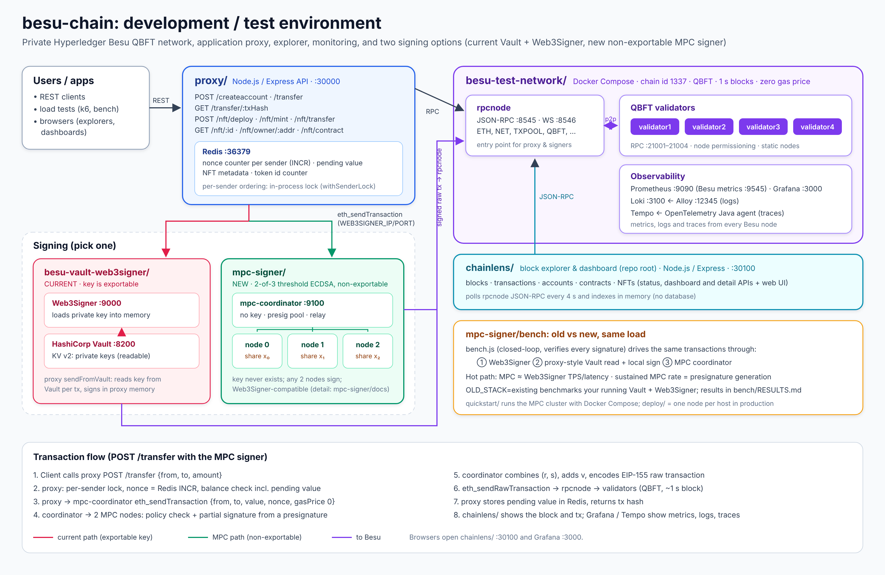

# 개발 환경

> **내용:** 개발과 테스트를 위해 Docker 호스트 한 대에서 실행하는 전체 스택입니다.
>
> **대상:** 개발자.
>
> **관련 문서:** [소개](../overview/introduction.md) · [프록시](../components/proxy.md) ·
> [MPC 서명기](../components/mpc-signer.md) · [벤치마크](../development/mpc-benchmarks.md)

모든 포트가 열려 있고 키는 테스트 키입니다. **프로덕션에 사용하지 마십시오.**



<sub>원본: [`architecture-dev.svg`](../images/architecture-dev.svg)</sub>

---

## 사전 요구 사항 {#prerequisites}

- Compose 플러그인이 포함된 Docker
- 약 8 GB의 여유 메모리 (Besu 노드 6개, MPC 노드 3개, Prometheus, Grafana)
- MPC 서명기 빠른 시작용: `mpc-signer/quickstart/quickstart.sh`로 빌드한 이미지

## 전체 시작 (5단계) {#start-everything-5-steps}

**1. Besu 테스트 네트워크와 모니터링** (chain id 1337, rpcnode는 `:8545`, Grafana는 `:3000`).
SENDER01을 알게 되면(2단계) 먼저 `besu-test-network/config/besu/genesis.json` → `alloc`에 추가하거나,
나중에 자금이 있는 테스트 계정에서 자금을 보내십시오.

```bash
cd besu-test-network && ./run.sh
```

**2. MPC 서명기:** 이 호스트에 노드 3개와 코디네이터 하나를 실행합니다. `setup`이 **SENDER01**을 출력합니다.

```bash
cd mpc-signer/quickstart
MPC_BIGINT=bigint-rug CHAIN_ID=1337 ./quickstart.sh init
./quickstart.sh up && ./quickstart.sh setup
```

그런 다음 `mpc-signer/quickstart/.env`에 `MPC_POOL_KEYS=<SENDER01>`을 넣고 `./quickstart.sh up`을
다시 실행하십시오(SENDER01용 사전 서명을 준비해 둡니다).

**3. 프록시와 Redis.** `proxy/.env`(`proxy/.env.example`에서 생성)에 다음을 설정합니다: `BESU_IP` / `BESU_PORT`,
`SIGNER_IP` / `SIGNER_PORT` = 코디네이터(`:9100`), `SENDER01`, `MPC_ADMIN_URL`,
`MPC_ADMIN_TOKEN`, `REDIS_*`.

```bash
cd proxy && docker compose up -d --build
```

**4. 탐색기**는 `http://localhost:30100`에서 실행됩니다(`chainlens/.env`: `BESU_RPC`):

```bash
cd chainlens && cp .env.example .env && docker compose up -d --build
```

**5. 사용해 보기:**

```bash
curl -s -X POST http://localhost:30000/createaccount -H 'Content-Type: application/json' -d '{"amount":"1"}'
curl -s http://localhost:30000/status/senders
```

모든 엔드포인트: [프록시 API](../reference/proxy-api.md). 사용 안내와 문제 해결(정책 한도,
논스 공백, 체인 초기화 후 아바타 컬렉션): [프록시](../components/proxy.md).

## MPC 서명기 벤치마크 {#benchmark-the-mpc-signer}

```bash
cd mpc-signer && bench/run-bench.sh
```

각 실행은 `mpc-signer/bench/results/<time>.md`를 작성합니다. 요약과 용량 산정은
[벤치마크](../development/mpc-benchmarks.md)에 있습니다.

## 기타 개발 자료 {#other-development-material}

| | |
|---|---|
| [Paladin](../development/paladin.md) | 테스트 네트워크에 포함된 프라이버시 노드 (Pente, Noto, Zeto) |
