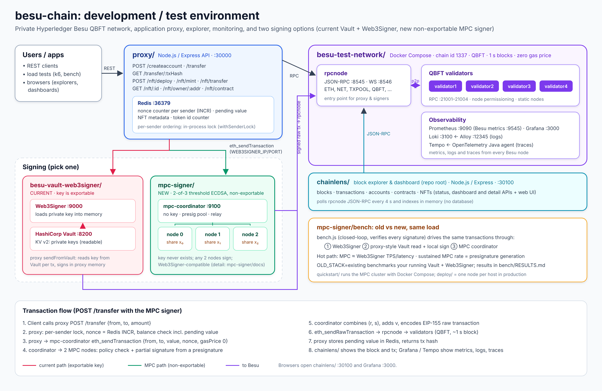

# Development environment

> **What:** the whole stack on one Docker host for development and tests.
> **For:** developers.
> **Related:** [introduction](../overview/introduction.md) · [proxy](../components/proxy.md) ·
> [MPC signer](../components/mpc-signer.md) · [benchmarks](../development/mpc-benchmarks.md)

All ports are open and the keys are test keys. **Do not use it for production.**



<sub>Source: [`architecture-dev.svg`](../images/architecture-dev.svg)</sub>

---

## Prerequisites

- Docker with the Compose plugin
- About 8 GB of free memory (6 Besu nodes, 3 MPC nodes, Prometheus, Grafana)
- For the MPC signer quick start: the image built by `mpc-signer/quickstart/quickstart.sh`

## Start everything (5 steps)

**1. Besu test network and its monitoring** (chain id 1337, rpcnode on `:8545`, Grafana on `:3000`).
Add SENDER01 to `besu-test-network/config/besu/genesis.json` → `alloc` first, once you know it
(step 2), or fund it later from a funded test account.

```bash
cd besu-test-network && ./run.sh
```

**2. MPC signer:** 3 nodes and a coordinator on this host. `setup` prints **SENDER01**.

```bash
cd mpc-signer/quickstart
MPC_BIGINT=bigint-rug CHAIN_ID=1337 ./quickstart.sh init
./quickstart.sh up && ./quickstart.sh setup
```

Then put `MPC_POOL_KEYS=<SENDER01>` in `mpc-signer/quickstart/.env` and run `./quickstart.sh up`
again (keeps presignatures ready for SENDER01).

**3. Proxy and Redis.** In `proxy/.env` (from `proxy/.env.example`): `BESU_IP` / `BESU_PORT`,
`WEB3SIGNER_IP` / `WEB3SIGNER_PORT` = the coordinator (`:9100`), `SENDER01`, `MPC_ADMIN_URL`,
`MPC_ADMIN_TOKEN`, `REDIS_*`.

```bash
cd proxy && docker compose up -d --build
```

**4. Explorer** on `http://localhost:30100` (`chainlens/.env`: `BESU_RPC`):

```bash
cd chainlens && cp .env.example .env && docker compose up -d --build
```

**5. Try it:**

```bash
curl -s -X POST http://localhost:30000/createaccount -H 'Content-Type: application/json' -d '{"amount":"1"}'
curl -s http://localhost:30000/status/senders
```

Every endpoint: [proxy API](../reference/proxy-api.md). Walkthrough and troubleshooting (policy
limit, nonce gaps, NFT contract after a chain reset): [proxy](../components/proxy.md).

## Benchmark the MPC signer

Against Vault + Web3Signer (the retired signer):

```bash
cd mpc-signer && bench/run-bench.sh                     # starts its own Besu + Vault + Web3Signer
cd mpc-signer && OLD_STACK=existing bench/run-bench.sh  # uses your running stack
```

Each run writes `mpc-signer/bench/results/<time>.md`; the summary and sizing are in
[benchmarks](../development/mpc-benchmarks.md).

## Other development material

| | |
|---|---|
| [Vault + Web3Signer](../development/vault-web3signer.md) | the previous signer (exportable keys), kept for comparison |
| [Paladin](../development/paladin.md) | the privacy nodes bundled with the test network (Pente, Noto, Zeto) |
