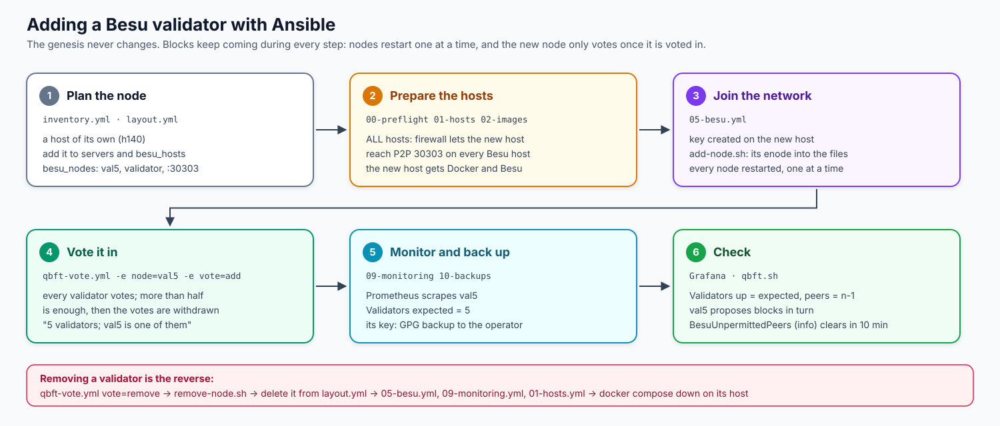
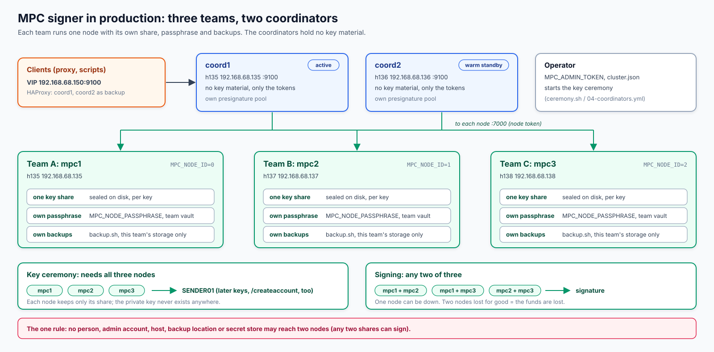

# 노드 추가 및 제거 (Besu, MPC)

> **내용:** 실행 중인 체인에 Besu 검증자를 추가하는 방법(및 제거하는 방법), RPC 노드에 대해 가능한
> 작업, 그리고 "MPC 노드 추가"가 의미할 수 있는 것과 없는 것: 노드를 새 호스트로 옮기기, 또는 새
> 클러스터.
>
> **대상:** 운영자. MPC 부분은 MPC 노드 팀.
>
> **관련 문서:** [Hyperledger Besu 체인](../components/besu.md) · [Ansible](../deployment/ansible.md) ·
> [Besu 수동 설치](../deployment/besu-manual.md) · [MPC 서명기 운영](../deployment/mpc-signer-production.md) ·
> [재해 복구](disaster-recovery.md)

**목차**

- [추가할 수 있는 것](#what-can-be-added)
- [검증자는 몇 개가 적당합니까?](#how-many-validators)
- [Besu 검증자 추가 (Ansible)](#add-a-besu-validator-ansible)
- [Besu 검증자 제거](#remove-a-besu-validator)
- [Ansible 없이](#without-ansible)
- [RPC 노드](#rpc-nodes)
- [MPC 노드](#mpc-nodes)
- [MPC 노드를 다른 호스트로 옮기기](#move-an-mpc-node-to-another-host)
- [파일](#files)

---

## 추가할 수 있는 것 {#what-can-be-added}

| 노드 | 가능 여부 | 방법 |
|---|---|---|
| **Besu 검증자** | 예, 전용 호스트에서 | [Ansible, 6단계](#add-a-besu-validator-ansible): 제네시스는 바뀌지 않으며 체인은 계속 실행됩니다 |
| **Besu 검증자 제거** | 예 | [투표로 제외한 다음 제거](#remove-a-besu-validator) |
| **새 IP의 Besu 검증자 / 분실한 키 교체** | 예 | [재해 복구 6.1](disaster-recovery.md#61-one-validator-host-lost)(`move-node.sh`. 새 키 = 새 노드를 추가하고 이전 노드를 제거) |
| **Besu RPC 노드** | HA 쌍의 2개. 3번째는 먼저 방화벽 변경이 필요 | [RPC 노드](#rpc-nodes) |
| **4번째 MPC 노드**(기존 키의 서명자 추가) | **아니요**: 모든 키는 2-of-3이며 정확히 세 노드가 만들었습니다 | [이유와 대안](#mpc-nodes) |
| **다른 호스트의 MPC 노드**(같은 키 조각) | 예 | [MPC 노드 옮기기](#move-an-mpc-node-to-another-host) |
| **코디네이터 추가** | 아니요: HA 쌍에 2개 | [MPC 노드](#mpc-nodes) |

## 검증자는 몇 개가 적당합니까? {#how-many-validators}

QBFT는 블록을 만들려면 n개 검증자 중 ceil(2n/3)개가 필요합니다([합의](../components/besu.md#consensus-qbft)).
검증자를 추가하는 것은 특정 개수에서만 도움이 됩니다.

| 검증자 | 블록에 필요한 수 | 동시에 다운되어도 되는 수 |
|---|---|---|
| 4 (현재) | 3 | **1** |
| 5 | 4 | 1 |
| 6 | 4 | 2 |
| 7 | 5 | 2 |

- **5개는 4개보다 더 많은 장애를 견디지 못합니다.** 검증자를 호스트 하나에 더 분산할 뿐입니다. 호스트
  두 대가 동시에 다운되어도 견디려면 **6개 또는 7개**로 늘리십시오.
- **다운된 검증자는 모두 체인을 느리게 합니다:** 그 검증자가 블록을 제안할 차례가 되면 나머지는 라운드
  타임아웃(`request_timeout`, 2초)만큼 기다리고 다음 검증자가 제안합니다. 검증자 5개 중 하나를 중지한
  테스트: 30초에 블록 30개 대신 20개.
- 검증자가 하나 늘 때마다 백업할 키와 유지할 호스트가 하나씩 늘어납니다. 7개를 넘으면 검증자 간
  트래픽만 늘고 여기서는 이점이 없습니다.

## Besu 검증자 추가 (Ansible) {#add-a-besu-validator-ansible}



이 예에서는 새 호스트 **h140**(`192.168.68.140`)에 **val5**를 추가합니다. 모든 명령은 운영자 머신의
`ansible/`에서 실행합니다. 실험 환경에서 테스트했습니다: 검증자 4개 → 5개, val5가 블록을 제안했고,
그다음 다시 제거했습니다.

### 1. 노드 계획 {#1-plan-the-node}

- **전용 호스트**를 다른 호스트와 같이 준비합니다(운영 체제, 운영자 머신에서의 SSH:
  [운영자 가이드](../deployment/operator-guide.md)). Docker 브리지 네트워크를 사용하는 Besu 노드 두 개를
  한 호스트에 두면 서로 연결되지 않습니다: 상대 노드에는 Docker 브리지 주소가 보이는데, 이 주소는 노드
  허용 목록에 없습니다. (이 때문에 h135 / h136은 호스트 네트워킹을 사용합니다.)
- `inventory.yml`: 호스트를 `servers`와 `besu_hosts`에 추가합니다.

  ```yaml
  servers:
    hosts:
      h140: { ansible_host: 192.168.68.140 }   # val5
    children:
      besu_hosts: { hosts: { h135: {}, h136: {}, h137: {}, h138: {}, h140: {} } }
  ```

- `group_vars/all/layout.yml`: 노드를 `besu_nodes`에 val3 / val4와 같은 포트로 추가합니다.

  ```yaml
    - { name: val5, host: h140, role: validator, p2p_port: 30303, metrics_port: 9545, rpc_bind: local, rpc_port: 8545, ws_port: 8546, host_network: false }
  ```

### 2. 호스트 준비 {#2-prepare-the-hosts}

```bash
ansible-playbook 00-preflight.yml 01-hosts.yml
```

```bash
ansible-playbook 02-images.yml
```

01은 **모든** 호스트에서 실행됩니다: 각 Besu 호스트의 방화벽이 P2P 포트 30303에서 새 호스트를 허용해야
하며(`BESU_HOSTS`), 새 호스트에는 Docker, 방화벽, 시간 동기화, node-exporter, 코드가 설치됩니다.
02는 Besu 이미지를 새 호스트로 보냅니다.

### 3. 네트워크 참여 {#3-join-the-network}

```bash
ansible-playbook 05-besu.yml
```

| 05가 하는 일 | 결과 |
|---|---|
| h140에서 val5의 키를 만들고 공개 파일(`state/besu/val5.json`)을 가져옵니다 | 키는 h140 밖으로 나가지 않습니다 |
| **Add nodes that joined later to the network files**(나중에 참여한 노드를 네트워크 파일에 추가): `add-node.sh`가 val5의 enode를 `state/network/static-nodes.json`과 `permissions_config.toml`에 넣습니다 | 제네시스는 변경하지 않습니다 |
| 네트워크 파일 4개를 모든 노드에 복사하고 노드를 **하나씩** 재시작하며, 각 노드가 동기화될 때까지 기다립니다 | 블록은 계속 생성됩니다: 검증자 4개 중 3개가 항상 가동 중입니다. rpc1이 재시작하는 동안 RPC VIP는 rpc2로 옮겨갑니다 |
| val5를 시작합니다 | val5는 체인을 따라가지만(전체 동기화) 아직 투표하지 않습니다 |

h140에서 점검합니다(val5에 다른 모든 노드에 대한 피어가 있고 `syncing`이 false여야 합니다).

```bash
cd /opt/besu-chain/besu-production/operator && ./qbft.sh health
```

### 4. 투표로 추가 {#4-vote-it-in}

```bash
ansible-playbook qbft-vote.yml -e node=val5 -e vote=add
```

현재의 모든 검증자가 val5의 주소에 찬성 투표합니다(`qbft_proposeValidatorVote`). 과반수가 투표하면
다음 블록에서 검증자 집합이 바뀝니다. 플레이북은 이를 기다린 후 투표를 철회하고
(`qbft_discardValidatorVote`. 철회하지 않으면 검증자가 계속 그 투표를 제안합니다)
`5 validators; val5 is one of them`으로 끝납니다.

수동으로 하는 경우: 검증자의 과반수에서 `qbft.sh propose 0x<val5 address> true`를 실행하고
(주소는 `state/besu/val5.json`에 있습니다. h135 / h136에서는 앞에 `RPC=http://127.0.0.1:8645`를 붙입니다),
`qbft.sh validators`에 표시되면 `qbft.sh discard 0x<address>`를 실행합니다.

### 5. 모니터링과 백업 {#5-monitoring-and-backups}

```bash
ansible-playbook 09-monitoring.yml 10-backups.yml
```

09는 val5를 Prometheus(`targets/besu.yml`)에 추가합니다. 10은 val5의 키를 GPG 키로 암호화하여
`state/key-backups/`에 백업합니다([GPG 키](../deployment/gpg-key.md)).

### 6. 점검 {#6-check}

- Grafana → **Besu production**: **Validators up** = **Validators expected** = 5, **Nodes up** 7,
  모든 노드에 피어 6개, 모두 **IN SYNC**([대시보드](dashboards.md#besu-production-qbft)).
- val5가 차례대로 블록을 제안합니다.

  ```bash
  curl -s -X POST -H 'Content-Type: application/json' --data '{"jsonrpc":"2.0","id":1,"method":"qbft_getSignerMetrics","params":[]}' http://127.0.0.1:8545
  ```

  (h140에서) 모든 검증자가 표시되고 `proposedBlockCount`가 증가합니다.
- `BesuUnpermittedPeers`(info)가 최대 10분 동안 여러 노드에서 발생할 수 있습니다: 노드가 서로 다른
  파일로 재시작하는 동안 거부된 연결 시도입니다. 저절로 해소됩니다.
- 변경할 때마다 그렇듯이 저장소의 `inventory.yml` / `layout.yml`을 업데이트하고 `ansible/state/`를
  백업해 두십시오.

## Besu 검증자 제거 {#remove-a-besu-validator}

다른 검증자가 다운된 동안에는 절대 검증자를 제거하지 마십시오: 먼저 **Validators up**을 확인하십시오.

1. 투표로 제외합니다(그러면 체인에 필요한 서명 수가 줄어듭니다).

   ```bash
   ansible-playbook qbft-vote.yml -e node=val5 -e vote=remove
   ```

2. 네트워크 파일에서 제거합니다(`add-node.sh`의 반대).

   ```bash
   ../besu-production/operator/remove-node.sh state/network state/besu/val5.json
   ```

3. `layout.yml`의 `besu_nodes`에서 해당 줄을 삭제하고(그 호스트에서 다른 것을 실행하지 않으면
   `besu_hosts` / `servers`에서 호스트도 삭제), 파일을 남은 노드에 복사하고 노드를 하나씩 재시작한 다음
   모니터링과 방화벽을 업데이트합니다.

   ```bash
   ansible-playbook 05-besu.yml 09-monitoring.yml 01-hosts.yml
   ```

4. 해당 호스트에서 노드를 중지합니다.

   ```bash
   cd /opt/besu-val5 && docker compose down
   ```

   키는 Docker 볼륨 `besu-val5_besu-data`와 `state/key-backups/`에 남아 있습니다. 그 주소를 다시는
   사용하지 않을 경우에만 삭제하십시오(`docker compose down -v`).

5. `01-hosts.yml`은 firewalld 규칙을 **추가**만 합니다: 이전 호스트의 P2P 규칙은 제거할 때까지 다른 Besu
   호스트에 남아 있습니다(`firewall-cmd --permanent --remove-rich-rule=…`, 그다음
   `firewall-cmd --reload`. [접근 제어](../deployment/access-control.md)).

실험 환경에서는 이 단계를 마친 후 네트워크 파일이 val5 추가 이전과 바이트 단위로 같았습니다.

## Ansible 없이 {#without-ansible}

스크립트로 하는 같은 절차입니다([Besu 수동 설치](../deployment/besu-manual.md)).

1. 새 호스트: 노드 패키지, `.env`, `./init.sh`(키와 `<name>.json`). json을 운영자에게 보냅니다.
2. 운영자: `operator/add-node.sh network/ val5.json`. `genesis.json`, `static-nodes.json`,
   `permissions_config.toml`, `SHA256SUMS`를 **모든** 노드에 복사합니다.
3. 기존 노드를 하나씩 재시작하고(`./start.sh && docker compose restart`, 동기화될 때까지 대기)
   그다음 새 노드를 시작합니다.
4. 투표: 검증자의 과반수에서 `qbft.sh propose 0x<address> true`, 그다음 `discard`.
5. Prometheus 대상, 방화벽(모든 Besu 호스트에서 새 호스트의 P2P 허용), 키 백업.

제거: 과반수에서 `qbft.sh propose 0x<address> false`, `discard`, `operator/remove-node.sh`,
파일 재배포, 하나씩 재시작, 노드 중지.

## RPC 노드 {#rpc-nodes}

RPC 노드 2개는 HA 쌍에서 실행됩니다: **rpc1**(h135)은 RPC VIP 트래픽을 받고, **rpc2**(h136)는 백업이자
chainlens의 데이터 소스입니다([고가용성](../deployment/high-availability.md)).
방화벽은 RPC 노드 포트(P2P 30304, JSON-RPC 8555, 메트릭 9546)를 **HA 쌍에서만** 엽니다
(`ha/firewall-layout.sh`, 역할 `app`). 따라서 다른 호스트에 3번째 RPC 노드를 두려면 먼저 이 스크립트를
변경해야 하며, 이 문서에서는 다루지 않습니다. 포트가 열려 있으면 절차는 투표를 제외하고 검증자와 같으며,
여기에 `07-ha.yml`을 추가로 실행합니다: HAProxy의 `besu_rpc` 백엔드와 `besu-rpc-health`는 `rpc_nodes`에서
생성되며, 첫 번째 이후의 모든 노드는 `backup`이 됩니다.

## MPC 노드 {#mpc-nodes}



**기존 키에 4번째 MPC 노드를 추가할 수 없습니다.**

- 모든 키(SENDER01, 레지스트리 관리자, 컨트랙트 계정 센터, 각 섹션과 각 사용자의 계정)는
  `cluster.json`에 있는 정확히 세 노드 사이의 키 생성으로 만들어졌습니다. 각 노드는 키 조각 하나를 보유하며,
  임의의 두 노드가 서명할 수 있습니다.
- 서명 라이브러리는 기존 키를 다른 노드 집합으로 다시 분배할 수 없으며, `make-cluster.sh`는 정확히 세
  노드만 받습니다. 4번째 노드는 기존 키의 조각을 하나도 보유하지 못합니다.

대신 할 수 있는 것:

| 원하는 것 | 방법 |
|---|---|
| 더 좋은 호스트나 다른 호스트의 노드 | [옮기기](#move-an-mpc-node-to-another-host): 같은 노드 ID, 같은 키 조각 |
| 더 높은 서명 처리량 | 더 큰 코디네이터 호스트와 사전 서명 풀([MPC 벤치마크](../development/mpc-benchmarks.md)) |
| 영구적으로 잃은 노드, 이중화 복구 | 새 클러스터: [MPC 서명기 운영, 14단계](../deployment/mpc-signer-production.md#14-if-a-share-is-lost-for-good) |
| 다른 노드 수나 임계값(예: 3-of-5) | 이 역시 새 키를 가진 새 클러스터입니다: 모든 주소가 바뀌고, 자금을 옮기고, NFT 컬렉션을 다시 배포해야 하며, 세 노드를 넘으려면 `make-cluster.sh`와 Ansible 구성을 확장해야 합니다 |

**코디네이터**는 키 자료를 보유하지 않습니다: HA 쌍에서 VIP `.150:9100` 뒤에서 실행됩니다(coord1 활성,
coord2 웜 대기, 둘 다 `haproxy.cfg`에 있음). 코디네이터를 늘려도 안전성은 높아지지 않으며, 구성에는
3번째 코디네이터를 둘 자리가 없습니다.

## MPC 노드를 다른 호스트로 옮기기 {#move-an-mpc-node-to-another-host}

노드는 ID와 키 조각을 유지하며 주소만 바뀝니다.
[재해 복구 6.4](disaster-recovery.md#64-one-mpc-node-lost)를 바탕으로 합니다. 예: mpc2(노드 ID 1)를
h137에서 새 호스트 h141(`192.168.68.141`)로 옮깁니다.

노드 폴더는 `mpc_node_dir`입니다(Ansible에서는 기본값 `/opt/besu-chain/mpc-signer/deploy/node`,
수동으로 설치한 경우 `/opt/mpc-node`).

1. **해당 노드의 팀**이 이전 호스트에서(아직 실행 중이면) 노드 폴더에서: 새 백업을 만든 다음 노드를
   중지합니다. 같은 노드 ID의 사본 두 개를 절대 동시에 실행하지 마십시오.

   ```bash
   ./backup.sh /secure/backup && docker compose down
   ```

2. **운영자:** `inventory.yml`(h141을 `servers`와 `mpc_hosts`에 추가, h137을 `mpc_hosts`에서 제외)과
   `layout.yml`의 `mpc_nodes`(`{ id: 1, name: mpc2, host: h141 }`)를 수정한 다음 새 호스트를 준비합니다(코드,
   Docker, MPC 이미지, 방화벽: 코디네이터용 포트 7000).

   ```bash
   ansible-playbook 01-hosts.yml 02-images.yml
   ```

3. **운영자:** 노드의 공개 파일과 `cluster.json`에서 노드의 새 `url`을 설정합니다(그 안의 키는 바뀌지
   않습니다).

   ```bash
   sed -i 's|http://192.168.68.137:7000|http://192.168.68.141:7000|' state/mpc/node1.json state/cluster.json && sha256sum state/cluster.json
   ```

   `cluster.json`을 체크섬과 함께 **세 팀**에 보냅니다.
4. **해당 팀**이 새 호스트의 노드 폴더에서: 이전과 **같은** `.env`(`MPC_NODE_ID`, 같은
   `MPC_NODE_PASSPHRASE`, 토큰)와 새 `cluster.json`을 두고, 복원한 다음 시작합니다.

   ```bash
   ./restore.sh /secure/backup/mpc-node1-<time>.tgz && docker compose up -d
   ```

   **나머지 두 팀**은 `cluster.json`을 교체하고 노드를 재시작합니다
   (`docker compose up -d --force-recreate`). 한 번에 한 팀씩 진행합니다.
5. **운영자:** 세 노드가 모두 응답하는지 점검하고, 새 `cluster.json`으로 코디네이터를 업데이트하고(하나씩
   재시작), 새 호스트에서 매시간 백업을 설정합니다.

   ```bash
   ansible-playbook 03-mpc-nodes.yml 04-coordinators.yml 10-backups.yml
   ```

6. **점검:** Grafana → **MPC signer**: MPC nodes up = 3. 테스트 이체를 하고, 그다음 코디네이터에서
   `POST /admin/pool/clear`(관리자 토큰)를 호출하여 사전 서명 풀이 옮긴 노드와 함께 다시 채워지게 합니다.

## 파일 {#files}

| 경로 | 용도 |
|---|---|
| `ansible/05-besu.yml` | `besu_nodes`에 있지만 네트워크 파일에 없는 노드를 추가하고(`add-node.sh`), 재배포하고, 하나씩 재시작 |
| `ansible/qbft-vote.yml` | 모든 검증자에서 노드를 투표로 추가 또는 제외하고, 기다린 후, 투표를 철회 |
| `besu-production/operator/add-node.sh`, `remove-node.sh` | 노드의 enode를 `static-nodes.json`과 `permissions_config.toml`에 넣거나 뺌 |
| `besu-production/operator/move-node.sh` | 노드의 새 IP 또는 포트 |
| `besu-production/operator/qbft.sh` | 검증자 집합, 투표, 피어, 상태(검증자 호스트에서) |
| `ansible/inventory.yml`, `group_vars/all/layout.yml` | 호스트와 노드 |
| `ansible/state/network/`, `state/besu/`, `state/mpc/`, `state/cluster.json` | 네트워크 파일, 노드의 공개 파일, MPC 클러스터 |
