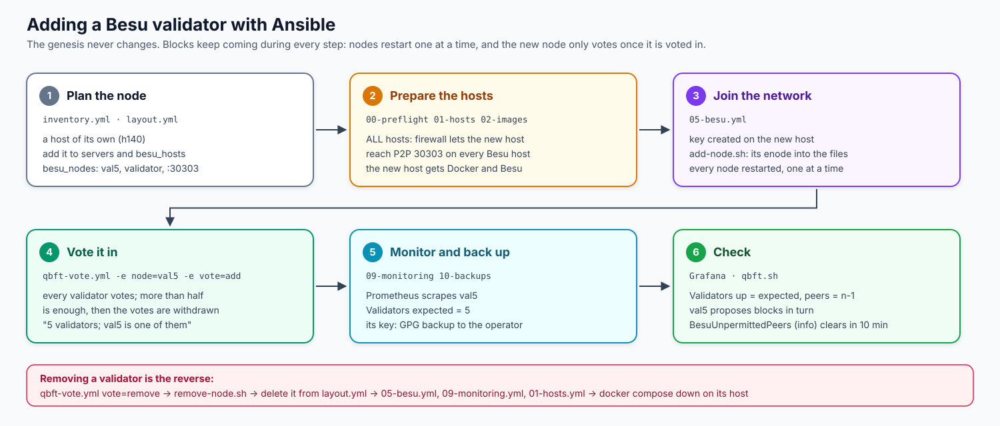
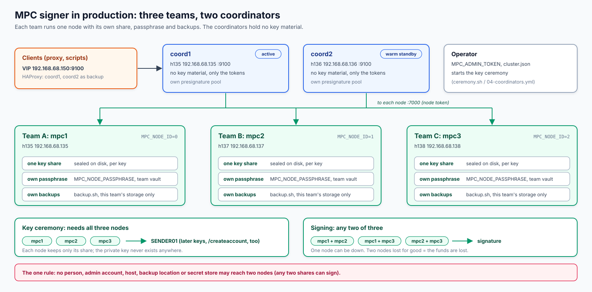

# Adding and removing nodes (Besu, MPC)

> **What:** how to add a Besu validator to the running chain (and remove one), what is possible for
> RPC nodes, and what "adding an MPC node" can and cannot mean: moving a node to a new host, or a new
> cluster.
>
> **For:** operators; the MPC node teams for the MPC part.
>
> **Related:** [Hyperledger Besu chain](../components/besu.md) · [Ansible](../deployment/ansible.md) ·
> [Besu manual setup](../deployment/besu-manual.md) · [MPC signer in production](../deployment/mpc-signer-production.md) ·
> [disaster recovery](disaster-recovery.md)

**Contents**

- [What can be added](#what-can-be-added)
- [How many validators?](#how-many-validators)
- [Add a Besu validator (Ansible)](#add-a-besu-validator-ansible)
- [Remove a Besu validator](#remove-a-besu-validator)
- [Without Ansible](#without-ansible)
- [RPC nodes](#rpc-nodes)
- [MPC nodes](#mpc-nodes)
- [Move an MPC node to another host](#move-an-mpc-node-to-another-host)
- [Files](#files)

---

## What can be added

| Node | Possible? | How |
|---|---|---|
| **Besu validator** | yes, on a host of its own | [Ansible, 6 steps](#add-a-besu-validator-ansible): the genesis never changes, the chain keeps running |
| **Remove a Besu validator** | yes | [vote out, then remove](#remove-a-besu-validator) |
| **Besu validator on a new IP / replace a lost key** | yes | [disaster recovery 6.1](disaster-recovery.md#61-one-validator-host-lost) (`move-node.sh`; a new key = add the new node, remove the old one) |
| **Besu RPC node** | the two on the HA pair; a third needs a firewall change first | [RPC nodes](#rpc-nodes) |
| **A 4th MPC node** (more signers for existing keys) | **no**: every key is 2-of-3, made by exactly three nodes | [why, and what instead](#mpc-nodes) |
| **MPC node on another host** (same share) | yes | [move an MPC node](#move-an-mpc-node-to-another-host) |
| **More MPC coordinators** | no: two, on the HA pair | [MPC nodes](#mpc-nodes) |

## How many validators?

QBFT needs ceil(2n/3) of the n validators to make a block ([consensus](../components/besu.md#consensus-qbft)).
Adding validators only helps at certain numbers:

| Validators | Needed for a block | May be down at once |
|---|---|---|
| 4 (today) | 3 | **1** |
| 5 | 4 | 1 |
| 6 | 4 | 2 |
| 7 | 5 | 2 |

- **5 tolerates no more failures than 4.** It only spreads the validators over one more host. Go to
  **6 or 7** to survive two hosts down at once.
- **Every validator that is down slows the chain:** when it is its turn to propose, the others wait
  for the round timeout (`request_timeout`, 2 s) and the next validator proposes. Tested with 5
  validators and one stopped: 20 blocks in 30 s instead of 30.
- Every validator is another key to back up and another host to keep up. More than 7 adds traffic
  between validators and no benefit here.

## Add a Besu validator (Ansible)



The example adds **val5** on a new host **h140** (`192.168.68.140`). Run every command on the
operator, from `ansible/`. Tested in the lab: 4 → 5 validators, val5 proposing blocks, then removed
again.

### 1. Plan the node

- **A host of its own**, prepared like the others (operating system, SSH from the operator:
  [operator guide](../deployment/operator-guide.md)). Two Besu nodes with Docker's bridge network on
  one host don't connect to each other: the other node sees the Docker bridge address, which is not
  in the node allowlist. (h135 / h136 use host networking for this reason.)
- `inventory.yml`: add the host to `servers` and to `besu_hosts`:

  ```yaml
  servers:
    hosts:
      h140: { ansible_host: 192.168.68.140 }   # val5
    children:
      besu_hosts: { hosts: { h135: {}, h136: {}, h137: {}, h138: {}, h140: {} } }
  ```

- `group_vars/all/layout.yml`: add the node to `besu_nodes`, with the same ports as val3 / val4:

  ```yaml
    - { name: val5, host: h140, role: validator, p2p_port: 30303, metrics_port: 9545, rpc_bind: local, rpc_port: 8545, ws_port: 8546, host_network: false }
  ```

### 2. Prepare the hosts

```bash
ansible-playbook 00-preflight.yml 01-hosts.yml
```

```bash
ansible-playbook 02-images.yml
```

01 runs on **every** host: each Besu host's firewall must let the new host in on P2P port 30303
(`BESU_HOSTS`), and the new host gets Docker, the firewall, time sync, node-exporter and the code.
02 ships the Besu image to it.

### 3. Join the network

```bash
ansible-playbook 05-besu.yml
```

| What 05 does | Effect |
|---|---|
| creates val5's key on h140 and fetches its public file (`state/besu/val5.json`) | the key never leaves h140 |
| **Add nodes that joined later to the network files**: `add-node.sh` puts val5's enode into `state/network/static-nodes.json` and `permissions_config.toml` | the genesis is not touched |
| copies the 4 network files to every node and restarts the nodes **one at a time**, each waiting until it is in sync | blocks continue: 3 of 4 validators are always up; the RPC VIP moves to rpc2 while rpc1 restarts |
| starts val5 | it follows the chain (full sync) but does not vote yet |

Check on h140 (val5 should have a peer for every other node and `syncing` false):

```bash
cd /opt/besu-chain/besu-production/operator && ./qbft.sh health
```

### 4. Vote it in

```bash
ansible-playbook qbft-vote.yml -e node=val5 -e vote=add
```

Every current validator votes for val5's address (`qbft_proposeValidatorVote`); once more than half
have voted, the next block changes the validator set. The playbook waits for that, withdraws the
votes (`qbft_discardValidatorVote`; otherwise a validator keeps proposing them), and ends with
`5 validators; val5 is one of them`.

By hand instead: on more than half of the validators, `qbft.sh propose 0x<val5 address> true`
(the address is in `state/besu/val5.json`; on h135 / h136 prefix `RPC=http://127.0.0.1:8645`), then
`qbft.sh discard 0x<address>` once `qbft.sh validators` lists it.

### 5. Monitoring and backups

```bash
ansible-playbook 09-monitoring.yml 10-backups.yml
```

09 adds val5 to Prometheus (`targets/besu.yml`); 10 backs up its key, encrypted to your GPG key, into
`state/key-backups/` ([GPG key](../deployment/gpg-key.md)).

### 6. Check

- Grafana → **Besu production**: **Validators up** = **Validators expected** = 5, **Nodes up** 7,
  every node has 6 peers, all **IN SYNC** ([dashboard](dashboards.md#besu-production-qbft)).
- val5 proposes blocks in turn:

  ```bash
  curl -s -X POST -H 'Content-Type: application/json' --data '{"jsonrpc":"2.0","id":1,"method":"qbft_getSignerMetrics","params":[]}' http://127.0.0.1:8545
  ```

  (on h140) lists every validator with `proposedBlockCount` rising.
- `BesuUnpermittedPeers` (info) may fire on several nodes for up to 10 minutes: connection attempts
  refused while the nodes restarted with different files. It clears by itself.
- Update `inventory.yml` / `layout.yml` in your repository and keep `ansible/state/` backed up as
  after every change.

## Remove a Besu validator

Never remove a validator while another one is down: check **Validators up** first.

1. Vote it out (the chain then needs fewer signatures):

   ```bash
   ansible-playbook qbft-vote.yml -e node=val5 -e vote=remove
   ```

2. Remove it from the network files (the reverse of `add-node.sh`):

   ```bash
   ../besu-production/operator/remove-node.sh state/network state/besu/val5.json
   ```

3. Delete its line from `besu_nodes` in `layout.yml` (and the host from `besu_hosts` / `servers` if
   it runs nothing else), then copy the files to the remaining nodes, restart them one at a time and
   update the monitoring and the firewall:

   ```bash
   ansible-playbook 05-besu.yml 09-monitoring.yml 01-hosts.yml
   ```

4. On its host, stop it:

   ```bash
   cd /opt/besu-val5 && docker compose down
   ```

   Its key stays in the Docker volume `besu-val5_besu-data` and in `state/key-backups/`. Delete them
   (`docker compose down -v`) only if the address will never be used again.

5. `01-hosts.yml` only **adds** firewalld rules: the old host's P2P rule stays on the other Besu
   hosts until you remove it (`firewall-cmd --permanent --remove-rich-rule=…`, then
   `firewall-cmd --reload`; [access control](../deployment/access-control.md)).

In the lab, after these steps the network files were byte for byte the same as before val5.

## Without Ansible

The same with the scripts ([Besu manual setup](../deployment/besu-manual.md)):

1. New host: the node package, `.env`, `./init.sh` (key and `<name>.json`); send the json to the operator.
2. Operator: `operator/add-node.sh network/ val5.json`; copy `genesis.json`, `static-nodes.json`,
   `permissions_config.toml` and `SHA256SUMS` to **every** node.
3. Restart the existing nodes one at a time (`./start.sh && docker compose restart`, wait until
   in sync), then start the new node.
4. Vote: `qbft.sh propose 0x<address> true` on more than half of the validators, then `discard`.
5. Prometheus target, firewall (P2P from the new host on every Besu host), key backup.

Removal: `qbft.sh propose 0x<address> false` on more than half, `discard`, `operator/remove-node.sh`,
redistribute the files, restart one at a time, stop the node.

## RPC nodes

The two RPC nodes run on the HA pair: **rpc1** (h135) receives the RPC VIP traffic, **rpc2** (h136)
is the backup and chainlens's source ([high availability](../deployment/high-availability.md)).
The firewall opens the RPC node ports (P2P 30304, JSON-RPC 8555, metrics 9546) **only on the HA pair**
(`ha/firewall-layout.sh`, role `app`). A third RPC node on another host therefore needs that script
changed first; it is not covered here. With the ports open, the steps are the same as for a
validator without the vote, plus `07-ha.yml`: HAProxy's `besu_rpc` backend and `besu-rpc-health`
are generated from `rpc_nodes`, every node after the first as `backup`.

## MPC nodes



**A 4th MPC node cannot be added to the existing keys.**

- Every key (SENDER01, the registry admin, the contract account center, each section's and each
  user's account) was made by a key generation among exactly the three nodes in `cluster.json`.
  Each node holds one share; any two can sign.
- The signing library cannot re-share an existing key to a different set of nodes, and
  `make-cluster.sh` accepts exactly three nodes. A 4th node would hold no share of any existing key.

What to do instead:

| You want | Do |
|---|---|
| a node on a better or different host | [move it](#move-an-mpc-node-to-another-host): same node id, same share |
| more signing throughput | bigger coordinator hosts and presignature pools ([MPC benchmarks](../development/mpc-benchmarks.md)) |
| a node lost for good, redundancy back | a new cluster: [MPC signer in production, step 14](../deployment/mpc-signer-production.md#14-if-a-share-is-lost-for-good) |
| another node count or threshold (e.g. 3-of-5) | also a new cluster with new keys: every address changes, funds move, NFT collections are deployed again, and `make-cluster.sh` and the Ansible layout must be extended for more than three nodes |

**Coordinators** hold no key material: they run on the HA pair behind the VIP `.150:9100` (coord1
active, coord2 warm standby, both in `haproxy.cfg`). More coordinators add no safety, and the
layout has no place for a third.

## Move an MPC node to another host

The node keeps its id and its share; only its address changes. Based on
[disaster recovery 6.4](disaster-recovery.md#64-one-mpc-node-lost). Example: mpc2 (node id 1) from
h137 to a new host h141 (`192.168.68.141`).

The node folder is `mpc_node_dir` (default `/opt/besu-chain/mpc-signer/deploy/node` with Ansible;
`/opt/mpc-node` when installed by hand).

1. **The node's team**, on the old host (if it still runs), in the node folder: a fresh backup, then
   stop the node. Never run two copies of the same node id.

   ```bash
   ./backup.sh /secure/backup && docker compose down
   ```

2. **Operator:** `inventory.yml` (h141 in `servers` and `mpc_hosts`, h137 out of `mpc_hosts`) and
   `mpc_nodes` in `layout.yml` (`{ id: 1, name: mpc2, host: h141 }`), then the new host (code,
   Docker, the MPC image, firewall: port 7000 for the coordinators):

   ```bash
   ansible-playbook 01-hosts.yml 02-images.yml
   ```

3. **Operator:** the node's new `url` in its public file and in `cluster.json` (the keys in them
   don't change):

   ```bash
   sed -i 's|http://192.168.68.137:7000|http://192.168.68.141:7000|' state/mpc/node1.json state/cluster.json && sha256sum state/cluster.json
   ```

   Send `cluster.json` with its checksum to the **three teams**.
4. **The team**, on the new host, in the node folder: the **same** `.env` as before (`MPC_NODE_ID`,
   the same `MPC_NODE_PASSPHRASE`, tokens) and the new `cluster.json`, then restore and start:

   ```bash
   ./restore.sh /secure/backup/mpc-node1-<time>.tgz && docker compose up -d
   ```

   **The other two teams** replace their `cluster.json` and restart their node
   (`docker compose up -d --force-recreate`), one team at a time.
5. **Operator:** the check that all three nodes answer, the coordinators with the new
   `cluster.json` (restarted one at a time), and the hourly backup on the new host:

   ```bash
   ansible-playbook 03-mpc-nodes.yml 04-coordinators.yml 10-backups.yml
   ```

6. **Check:** Grafana → **MPC signer**: MPC nodes up = 3; a test transfer; then on the coordinator
   `POST /admin/pool/clear` (admin token) so the presignature pools refill with the moved node.

## Files

| Path | What |
|---|---|
| `ansible/05-besu.yml` | adds nodes listed in `besu_nodes` but missing from the network files (`add-node.sh`), redistributes, restarts one at a time |
| `ansible/qbft-vote.yml` | votes a node in or out on every validator, waits, withdraws the votes |
| `besu-production/operator/add-node.sh`, `remove-node.sh` | a node's enode into / out of `static-nodes.json` and `permissions_config.toml` |
| `besu-production/operator/move-node.sh` | a node's new IP or port |
| `besu-production/operator/qbft.sh` | validator set, votes, peers, health (on a validator host) |
| `ansible/inventory.yml`, `group_vars/all/layout.yml` | hosts and nodes |
| `ansible/state/network/`, `state/besu/`, `state/mpc/`, `state/cluster.json` | network files, nodes' public files, the MPC cluster |
