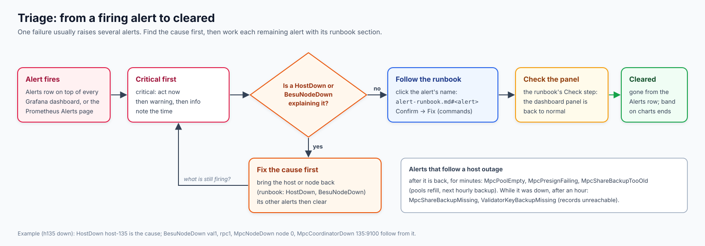

# 알림

> **내용:** 모니터링 스택의 모든 알림: 언제 발생하는지, 무엇을 의미하는지, 무엇을 해야 하는지 설명합니다.
>
> **대상:** 당직 운영자.
>
> **관련 문서:** [알림 런북](alert-runbook.md) (알림별 단계별 해결 방법) · [문제 해결](troubleshooting.md) · [Grafana 대시보드](dashboards.md) · [모니터링](../components/monitoring.md) · [재해 복구](disaster-recovery.md)

**목차**

- [알림의 작동 방식](#how-alerts-work-here)
- [1. Besu: 체인 (`besu.yml`)](#1-besu-the-chain-besuyml)
- [2. MPC 서명 (`mpc.yml`)](#2-mpc-signing-mpcyml)
- [3. 프록시와 Redis (`proxy.yml`)](#3-proxy-and-redis-proxyyml)
- [4. 섹션 (`sections.yml`)](#4-sections-sectionsyml)
- [5. 호스트 (`hosts.yml`)](#5-hosts-hostsyml)
- [6. 백업 (`backups.yml`)](#6-backups-backupsyml)
- [장애 상황 읽기](#reading-an-incident)

---

알림 이름을 클릭하면 [알림 런북](alert-runbook.md)의 단계별 해결 방법으로 이동합니다. 규칙은
[`monitoring/prometheus/rules/`](../../monitoring/prometheus/rules/)에 있습니다(Besu, MPC, 프록시와
Redis, 섹션, 호스트, 백업의 여섯 파일).

## 알림의 작동 방식 {#how-alerts-work-here}

- **표시 위치:** 모든 Grafana 대시보드 상단의 **Alerts** 표(critical 및 warning 개수, 그다음 발생 중인
  알림마다 한 행), 차트 위의 점선이 있는 주황색 음영 띠(알림이 발생하고 해제된 시점), 그리고 Prometheus
  *Alerts* 페이지에 표시됩니다.
- **통지:** 기본값은 없습니다. 메일, Slack 또는 PagerDuty로 받으려면 Alertmanager를 추가하거나
  Grafana *Alerting → Contact points*를 사용하십시오([모니터링 (Prometheus 및 Grafana)](../components/monitoring.md)).
- **심각도:**
  - **critical**: 서비스가 중지되었거나 곧 중지됩니다(블록 없음, 서명 없음, 프록시 없음). 즉시 조치하십시오.
  - **warning**: 성능이 저하되었거나, 장애 한 번이면 서비스 중단이 됩니다. 빠르게 조치하십시오.
  - **info**: 로그에서 확인할 만한 일이 발생했습니다.
- **대기** (규칙의 `for`): 알림이 발생하기 전에 조건이 유지되어야 하는 시간이며, 짧은 순간적 변동을
  숨깁니다. "–"는 첫 번째 평가에서 바로 발생한다는 뜻입니다.

---

## 1. Besu: 체인 (`besu.yml`) {#1-besu-the-chain-besuyml}

| 알림 | 심각도 | 대기 | 발생 조건 | 의미 / 조치 |
|---|---|---|---|---|
| [**BesuValidatorQuorumLost**](alert-runbook.md#besuvalidatorquorumlost) | critical | 30 s | 온라인 검증자 수가 QBFT에 필요한 수보다 적음: ceil(2n/3), 즉 4개 중 3개 | 체인이 **블록을 만들 수 없습니다**. 먼저 검증자를 복구하십시오. `BesuNodeDown` / `HostDown`을 확인하십시오 |
| [**BesuNoNewBlocks**](alert-runbook.md#besunonewblocks) | critical | 1 min | 가장 최신 노드의 최신 블록조차 블록 주기의 3배 + 5 s보다 오래됨(1 s 블록이면 8 s) | 체인이 **정지되었습니다**. 쿼럼이 복구된 후에도 계속 발생하면 모든 검증자를 함께 재시작하십시오([Besu 프로덕션 패키지 (수동 설정)](../deployment/besu-manual.md)의 *Chain halted*) |
| [**BesuNodeDown**](alert-runbook.md#besunodedown) | warning | 1 min | 노드의 메트릭이 응답하지 않음 | 컨테이너가 중지되었거나 충돌했거나, 호스트가 다운되었습니다: 해당 호스트에서 `docker ps -a`, `docker logs`. 검증자 하나가 다운되면 4개 중 3개가 남아 여유가 없습니다 |
| [**BesuNodeStalled**](alert-runbook.md#besunodestalled) | warning | 1 min | 체인은 최신인데 노드의 최신 블록이 60 s 이상 오래됨 | 노드가 **블록 가져오기를 중단했습니다**(자체 동기화 상태는 여전히 "in sync"로 표시될 수 있음). RPC 노드는 RPC VIP에서 빠지고 5분 후 `besu-rpc-health`가 재시작합니다([고가용성 (HAProxy 및 keepalived)](../deployment/high-availability.md)). 검증자는 수동으로 재시작하십시오 |
| [**BesuNotInSync**](alert-runbook.md#besunotinsync) | warning | 5 min | 노드가 동기화 중이라고 보고하거나, 알고 있는 최고 블록보다 10블록 이상 뒤처짐 | 재시작 후 몇 분간 따라잡는 것은 정상입니다. 계속되면 피어와 로그를 확인하십시오 |
| [**BesuPeersMissing**](alert-runbook.md#besupeersmissing) | warning | 5 min | 노드의 피어 수가 (가동 중인 노드 수 − 1)보다 적음 | 모든 노드는 다른 모든 노드에 연결되어야 합니다: 방화벽, `static-nodes.json` 또는 `permissions_config.toml`을 확인하십시오 |
| [**BesuPeersLow**](alert-runbook.md#besupeerslow) | warning | 2 min | 노드의 피어가 2개 미만 | 연결 하나만 끊겨도 고립됩니다. 피어가 하나인 노드는 그 피어가 블록 전송을 멈추면 정지될 수 있습니다. 다른 호스트로의 네트워크와 방화벽을 확인하십시오 |
| [**BesuTxPoolGrowing**](alert-runbook.md#besutxpoolgrowing) | warning | 10 min | 노드에 대기 중인 트랜잭션이 1,000개 초과 | 트랜잭션이 블록에 담기는 속도보다 빠르게 들어오거나, 멈춰 있습니다(논스 공백, 가스). 프록시 발신자와 `ProxySenderStalled`를 확인하십시오 |
| [**BesuHeapHigh**](alert-runbook.md#besuheaphigh) | warning | 10 min | Java 힙이 최대치의 90 % 초과 | 곧 긴 가비지 컬렉션 일시 정지가 발생합니다. 호스트에 RAM이 있으면 `-Xmx`(`besu_java_opts`)를 늘리거나, 무엇이 증가하는지 찾으십시오 |
| [**BesuUnpermittedPeers**](alert-runbook.md#besuunpermittedpeers) | info | – | `permissions_config.toml`에 없는 노드의 연결을 노드가 거부함 | 알 수 없는 머신이거나, 키 또는 IP가 변경된 자체 머신입니다 |

## 2. MPC 서명 (`mpc.yml`) {#2-mpc-signing-mpcyml}

| 알림 | 심각도 | 대기 | 발생 조건 | 의미 / 조치 |
|---|---|---|---|---|
| [**MpcBelowThreshold**](alert-runbook.md#mpcbelowthreshold) | critical | 30 s | 연결 가능한 MPC 노드 수가 임계값(3개 중 2개)보다 적음 | **서명이 불가능합니다**: 어떤 MPC 계정에서도 트랜잭션을 보낼 수 없습니다. MPC 노드를 복구하십시오 |
| [**MpcCoordinatorDown**](alert-runbook.md#mpccoordinatordown) | critical | 1 min | 코디네이터의 `/metrics`가 응답하지 않음(또는 메트릭 토큰이 일치하지 않음) | 다른 코디네이터가 VIP를 통해 인계받지만 여유가 없습니다. 해당 호스트의 컨테이너를 확인하십시오 |
| [**MpcNodeDown**](alert-runbook.md#mpcnodedown) | warning | 1 min | 코디네이터가 MPC 노드에 연결할 수 없음 | 3개 중 2개로 서명은 계속 가능하지만, **키 생성**(새 계정, 새 섹션)에는 3개 모두 필요합니다 |
| [**MpcPoolEmpty**](alert-runbook.md#mpcpoolempty) | warning | 2 min | 큰(핫) 키에 준비된 사전 서명이 없음 | 서명이 느린 경로로 전환됩니다(밀리초 대신 초 단위). 재시작이나 요청 급증 직후 잠시 발생하는 것은 정상입니다. 계속되면 사전 서명 생성이 따라가지 못하는 것입니다 |
| [**MpcSmallPoolsEmpty**](alert-runbook.md#mpcsmallpoolsempty) | warning | 15 min | 작은 키 풀의 절반 이상이 비어 있음 | 사전 서명 생성이 다수의 `/createaccount` 계정을 따라가지 못합니다: `MPC_REFILL_CONCURRENCY` / `MPC_COMPUTE_THREADS`를 늘리거나 작은 키 목표치를 낮추십시오 |
| [**MpcPresignFailing**](alert-runbook.md#mpcpresignfailing) | warning | – | 10분 동안 사전 서명 세션이 5회 넘게 실패함 | 보통 MPC 노드의 재시작이나 노드 간 네트워크 문제입니다. 재시작 후에는 저절로 해제되며, 그렇지 않으면 코디네이터 로그를 확인하십시오 |
| [**MpcSignErrors**](alert-runbook.md#mpcsignerrors) | warning | – | 정책 이외의 이유로 서명 요청이 실패함 | 코디네이터 로그: 노드 시간 초과, 알 수 없는 키 등 |
| [**MpcPolicyRefusals**](alert-runbook.md#mpcpolicyrefusals) | warning | – | 서명 정책(값, 가스, 체인 ID, 대상)에 의해 트랜잭션이 거부됨 | 안전 규칙이 차단했습니다: 호출자의 버그이거나 허용되지 않은 것을 서명하려는 시도입니다 |

## 3. 프록시와 Redis (`proxy.yml`) {#3-proxy-and-redis-proxyyml}

| 알림 | 심각도 | 대기 | 발생 조건 | 의미 / 조치 |
|---|---|---|---|---|
| [**ProxyDown**](alert-runbook.md#proxydown) | critical | 1 min | 활성 프록시(프록시 VIP 경유)가 응답하지 않음 | **애플리케이션이 전송할 수 없습니다.** keepalived가 VIP를 다른 호스트로 옮겨야 합니다: `journalctl -u keepalived`, 프록시 컨테이너를 확인하십시오 |
| [**ProxySenderStalled**](alert-runbook.md#proxysenderstalled) | critical | – | 발신자의 트랜잭션이 RPC 노드의 풀에 준비되어 있지만 블록에 포함되지 않은 채 블록이 계속 생성됨 | 검증자에게 해당 트랜잭션이 없습니다: **검증자 하나를 재시작**하십시오(풀을 다시 가져옵니다). 검증자의 `tx-pool-max-future-by-sender=2000`을 확인하십시오 |
| [**ProxyNonceGap**](alert-runbook.md#proxynoncegap) | warning | – | 논스가 2분 넘게 누락됨 | 해당 발신자의 이후 트랜잭션이 대기합니다. 프록시는 보통 약 30 s 안에 공백을 복구합니다. 그렇지 않으면 프록시 로그를 확인하십시오 |
| [**ProxySenderCheckFailing**](alert-runbook.md#proxysendercheckfailing) | warning | 2 min | 프록시가 백그라운드 발신자 점검을 위해 Besu를 읽을 수 없음 | RPC VIP 또는 노드가 응답하지 않습니다: `BesuNodeDown`, HAProxy를 확인하십시오 |
| [**ProxyNonceRepaired**](alert-runbook.md#proxynoncerepaired) | info | – | 프록시가 공백을 복구함(손실된 트랜잭션 또는 채움 트랜잭션) | 프록시 로그를 확인하십시오 |
| [**ProxyHttpErrors**](alert-runbook.md#proxyhttperrors) | warning | 5 min | 응답의 5 % 이상이 5xx(실제 트래픽이 있을 때: 0.05 req/s 초과) | 프록시가 요청을 실패 처리합니다: *Proxy & Redis* 대시보드(경로별 오류), 프록시 로그를 확인하십시오 |
| [**ProxySlow**](alert-runbook.md#proxyslow) | warning | 10 min | `/createaccount`와 `/admin`을 제외한 95번째 백분위 응답 시간이 5 s 초과(키 생성은 원래 느림) | 느린 RPC 노드, 느린 서명(빈 풀) 또는 과부하된 프록시입니다 |
| [**ProxyEventLoopBlocked**](alert-runbook.md#proxyeventloopblocked) | warning | 5 min | 프록시의 단일 Node.js 스레드가 1 s 넘게 차단됨 | 모든 요청이 대기합니다: 호스트의 CPU 또는 긴 동기 작업을 확인하십시오 |
| [**ProxyRedisDisconnected**](alert-runbook.md#proxyredisdisconnected) | warning | 5 min | 활성 프록시에 Redis 연결이 없음 | 계속 작동하지만(메모리 + 체인), 재시작하면 논스 캐시를 잃습니다. Redis 컨테이너를 확인하십시오 |
| [**RedisDown**](alert-runbook.md#redisdown) | warning | 2 min | 활성 프록시의 Redis(또는 그 익스포터)가 응답하지 않음 | 위와 같은 영향입니다 |
| [**RedisMemoryHigh**](alert-runbook.md#redismemoryhigh) | warning | 10 min | Redis가 `maxmemory`의 90 % 초과(최대값이 설정된 경우에만) | 키가 제거되거나 쓰기가 거부됩니다: 최대값을 늘리거나 증가 원인을 찾으십시오 |

## 4. 섹션 (`sections.yml`) {#4-sections-sectionsyml}

각 섹션의 자금 계정입니다([섹션](../features/sections.md)).

| 알림 | 심각도 | 대기 | 발생 조건 | 의미 / 조치 |
|---|---|---|---|---|
| [**SectionUpfrontEmpty**](alert-runbook.md#sectionupfrontempty) | critical | 1 min | 활성화된 섹션의 선지급 계정이 0임 | 해당 섹션은 **계정을 생성하거나 −x 송금을 지불할 수 없습니다**: chainlens Sections 페이지에서 충전하십시오 |
| [**SectionUpfrontLow**](alert-runbook.md#sectionupfrontlow) | warning | 2 min | 활성화된 섹션의 선지급 잔액이 `upfront_low_balance_eth` 미만(기본값 100, 0 = 꺼짐) | 소진되기 전에 충전하십시오 |
| [**Sender01Low**](alert-runbook.md#sender01low) | warning | 5 min | SENDER01이 `sender01_low_balance_eth` 미만(기본값 10,000) | SENDER01은 모든 충전 자금을 제공합니다: 보충하거나, 섹션의 결제 계정에서 반환하십시오 |
| [**SectionMetricsFailing**](alert-runbook.md#sectionmetricsfailing) | warning | 10 min | 프록시가 섹션 잔액을 읽을 수 없음 | SectionRegistry 또는 Besu가 프록시에 응답하지 않습니다. 그동안 위의 잔액 알림은 작동하지 않습니다 |

비활성화되거나 보관된 섹션은 선지급 알림을 발생시키지 않습니다.

## 5. 호스트 (`hosts.yml`) {#5-hosts-hostsyml}

| 알림 | 심각도 | 대기 | 발생 조건 | 의미 / 조치 |
|---|---|---|---|---|
| [**HostDown**](alert-runbook.md#hostdown) | warning | 2 min | 호스트의 node-exporter가 응답하지 않음 | 보통 호스트 전체가 다운되었거나 연결할 수 없습니다. 같은 호스트에 대한 Besu, MPC 또는 프록시 알림이 함께 발생할 것입니다 |
| [**HostMemoryHigh**](alert-runbook.md#hostmemoryhigh) | warning | 10 min | 호스트 메모리의 90 % 이상이 실제로 사용 중(캐시가 아닌 가용 메모리 기준) | 프로세스가 느려지거나 강제 종료됩니다: `free -m`, `docker stats --no-stream`, `ps aux --sort=-rss \| head`. 각 Besu 노드는 힙을 `besu_java_opts`(`-Xmx`)까지 늘릴 수 있습니다 |
| [**HostDiskFull**](alert-runbook.md#hostdiskfull) | warning | 10 min | 파일 시스템이 80 % 이상 사용됨 | 디스크가 가득 차면 Besu(RocksDB)가 멈추고, 이어서 컨테이너가 멈춥니다: 공간을 확보하거나 디스크를 늘리십시오 |
| [**HostClockNotSynced**](alert-runbook.md#hostclocknotsynced) | warning | 10 min | 시계가 동기화되지 않았거나 100 ms 이상 차이 남 | QBFT와 블록 경과 시간 점검은 시간에 의존합니다: `chronyc tracking`, 설정의 `ntp_servers`를 확인하십시오 |

## 6. 백업 (`backups.yml`) {#6-backups-backupsyml}

각 백업 스크립트는 마지막 성공과 실패를 자신의 호스트의 node-exporter에 기록합니다. 따라서 해당
호스트가 다운된 동안에는 그 백업이 누락된 것처럼 보입니다.

| 알림 | 심각도 | 대기 | 발생 조건 | 의미 / 조치 |
|---|---|---|---|---|
| [**BackupFailed**](alert-runbook.md#backupfailed) | warning | – | 백업의 마지막 실패가 마지막 성공보다 최근임 | 해당 백업을 수동으로 실행하고 오류를 확인하십시오 |
| [**ChainSnapshotTooOld**](alert-runbook.md#chainsnapshottooold) | warning | – | 2일 동안 체인 스냅샷이 없음 | 사이트 전체를 잃으면 마지막 스냅샷 이후의 모든 것이 손실됩니다: 일일 스냅샷 cron을 확인하십시오 |
| [**ChainSnapshotMissing**](alert-runbook.md#chainsnapshotmissing) | warning | 1 h | 체인 스냅샷이 한 번도 기록되지 않음 | `10-backups.yml`이 실행되지 않았거나 스냅샷 cron이 실패합니다 |
| [**MpcShareBackupTooOld**](alert-runbook.md#mpcsharebackuptooold) | warning | – | MPC 노드의 키 조각 백업이 2시간 이상 오래됨(매시 :07에 실행) | 그 이후 생성된 계정의 키 조각은 가동 중인 노드에만 존재합니다. 호스트가 다운되었던 후에 다음 정시 실행까지(또는 `backup.sh`를 수동으로 실행할 때까지) 발생합니다 |
| [**MpcShareBackupMissing**](alert-runbook.md#mpcsharebackupmissing) | warning | 1 h | 키 조각 백업 기록이 있는 MPC 노드가 3개 미만 | 노드에 백업이 설정되지 않았거나(`mpc_backup_cron`), 해당 호스트가 다운되었습니다 |
| [**ValidatorKeyBackupMissing**](alert-runbook.md#validatorkeybackupmissing) | warning | 1 h | 모든 검증자에 키 백업 기록이 있지는 않음 | 검증자 키 4개 중 2개를 잃으면 체인이 영구히 끝납니다: 키 백업(`10-backups.yml`)을 실행하십시오. 검증자의 호스트가 다운된 동안에도 발생합니다 |

---

## 장애 상황 읽기 {#reading-an-incident}

장애 하나는 보통 여러 알림을 발생시킵니다. **critical** 알림부터 시작한 다음, 나머지를 설명하는
`HostDown` 또는 `BesuNodeDown`을 찾으십시오. 예: HA 쌍의 호스트(h135)가 종료된 경우입니다.

1. **원인:** `HostDown` host-135.
2. **결과:** `BesuNodeDown` val1 및 rpc1, `MpcNodeDown` node 0, `MpcCoordinatorDown`
   135:9100(그리고 프록시 VIP가 이동하지 않은 경우에만 `ProxyDown`).
3. **1시간 후:** 호스트의 백업 기록에 연결할 수 없으므로 `MpcShareBackupMissing` 및
   `ValidatorKeyBackupMissing`.
4. **복구 시 몇 분 동안:** 풀이 다시 채워지고 다음 정시 백업이 실행될 때까지 `MpcPoolEmpty`,
   `MpcPresignFailing` 및 `MpcShareBackupTooOld`.
