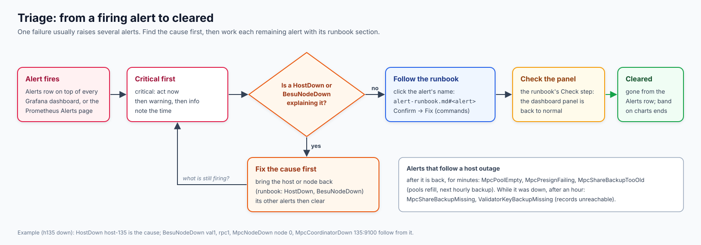

# Alerts

> **What:** Every alert of the monitoring stack: when it fires, what it means and what to do.
>
> **For:** operators on duty.
>
> **Related:** [alert runbook](alert-runbook.md) (the solution for each alert, step by step) · [troubleshooting](troubleshooting.md) · [Grafana dashboards](dashboards.md) · [monitoring](../components/monitoring.md) · [disaster recovery](disaster-recovery.md)

**Contents**

- [How alerts work here](#how-alerts-work-here)
- [1. Besu: the chain (`besu.yml`)](#1-besu-the-chain-besuyml)
- [2. MPC signing (`mpc.yml`)](#2-mpc-signing-mpcyml)
- [3. Proxy and Redis (`proxy.yml`)](#3-proxy-and-redis-proxyyml)
- [4. Sections (`sections.yml`)](#4-sections-sectionsyml)
- [5. Hosts (`hosts.yml`)](#5-hosts-hostsyml)
- [6. Backups (`backups.yml`)](#6-backups-backupsyml)
- [Reading an incident](#reading-an-incident)

---

Click an alert's name for its step-by-step solution in the [alert runbook](alert-runbook.md). The rules are in
[`monitoring/prometheus/rules/`](../../monitoring/prometheus/rules/) (six files: Besu, MPC, proxy
and Redis, sections, hosts, backups).

## How alerts work here

- **Where they show:** the **Alerts** table at the top of every Grafana dashboard (critical and
  warning counts, then one row per firing alert), the orange shaded bands with dashed lines on the
  charts (when an alert fired and cleared), and the Prometheus *Alerts* page.
- **History:** the Grafana **Alert log** dashboard lists every alert that fired since the
  deployment, with when it started, how often and how long ([Alert log](dashboards.md#alert-log)).
- **Notifications:** none by default. For mail, Slack or PagerDuty, add an Alertmanager or use
  Grafana *Alerting → Contact points* ([Monitoring (Prometheus and Grafana)](../components/monitoring.md)).
- **Severity:**
  - **critical**: the service is stopped or about to stop (no blocks, no signatures, no proxy). Act now.
  - **warning**: degraded, or one failure away from an outage. Act soon.
  - **info**: something happened that is worth reading in the logs.
- **Wait** (`for` in the rule): how long the condition must hold before the alert fires; it hides
  short blips. "–" means it fires at the first evaluation.

---

## 1. Besu: the chain (`besu.yml`)

| Alert | Severity | Wait | Fires when | What it means / what to do |
|---|---|---|---|---|
| [**BesuValidatorQuorumLost**](alert-runbook.md#besuvalidatorquorumlost) | critical | 30 s | Fewer validators online than QBFT needs: ceil(2n/3), so 3 of 4 | The chain **cannot make blocks**. Bring validators back first; look for `BesuNodeDown` / `HostDown` |
| [**BesuNoNewBlocks**](alert-runbook.md#besunonewblocks) | critical | 1 min | Even the most current node's newest block is older than 3 × the block period + 5 s (8 s with 1 s blocks) | The chain is **halted**. If it keeps firing after the quorum is back, restart all validators together (*Chain halted* in [Besu production packages (manual setup)](../deployment/besu-manual.md)) |
| [**BesuNodeDown**](alert-runbook.md#besunodedown) | warning | 1 min | A node's metrics don't answer | Container stopped or crashed, or the host is down: `docker ps -a`, `docker logs` on that host. One validator down leaves 3 of 4, with no spare |
| [**BesuNodeStalled**](alert-runbook.md#besunodestalled) | warning | 1 min | A node's newest block is over 60 s old while the chain is current | The node **stopped importing** (its own sync status may still say "in sync"). RPC nodes leave the RPC VIP and are restarted after 5 min by `besu-rpc-health` ([High availability (HAProxy and keepalived)](../deployment/high-availability.md)); restart a validator by hand |
| [**BesuNotInSync**](alert-runbook.md#besunotinsync) | warning | 5 min | The node says it is syncing, or is more than 10 blocks behind the best block it knows | Catching up after a restart is normal for a few minutes. If it lasts, check its peers and log |
| [**BesuPeersMissing**](alert-runbook.md#besupeersmissing) | warning | 5 min | A node has fewer peers than (nodes up − 1) | Every node should connect to all the others: firewall, `static-nodes.json` or `permissions_config.toml` |
| [**BesuPeersLow**](alert-runbook.md#besupeerslow) | warning | 2 min | A node has fewer than 2 peers | One connection away from isolation; a node with one peer can stall when that peer stops sending blocks. Check the network and firewall to the other hosts |
| [**BesuTxPoolGrowing**](alert-runbook.md#besutxpoolgrowing) | warning | 10 min | More than 1,000 pending transactions on a node | Transactions arrive faster than blocks take them, or are stuck (nonce gaps, gas). Check the proxy senders and `ProxySenderStalled` |
| [**BesuHeapHigh**](alert-runbook.md#besuheaphigh) | warning | 10 min | Java heap above 90 % of its maximum | Long garbage-collection pauses come next. Raise `-Xmx` (`besu_java_opts`) if the host has the RAM, or find what grows |
| [**BesuUnpermittedPeers**](alert-runbook.md#besuunpermittedpeers) | info | – | A node refused a connection from a node not in `permissions_config.toml` | An unknown machine, or one of yours with a changed key or IP |

## 2. MPC signing (`mpc.yml`)

| Alert | Severity | Wait | Fires when | What it means / what to do |
|---|---|---|---|---|
| [**MpcBelowThreshold**](alert-runbook.md#mpcbelowthreshold) | critical | 30 s | Fewer MPC nodes reachable than the threshold (2 of 3) | **No signatures possible**: no transaction from any MPC account. Bring MPC nodes back |
| [**MpcCoordinatorDown**](alert-runbook.md#mpccoordinatordown) | critical | 1 min | A coordinator's `/metrics` doesn't answer (or the metrics token doesn't match) | The other coordinator takes over through the VIP, but there is no spare. Check the container on that host |
| [**MpcNodeDown**](alert-runbook.md#mpcnodedown) | warning | 1 min | A coordinator can't reach an MPC node | Signing still works with 2 of 3, but **creating keys** (new accounts, new sections) needs all 3 |
| [**MpcPoolEmpty**](alert-runbook.md#mpcpoolempty) | warning | 2 min | No presignature ready for a big (hot) key | Signing falls back to the slow path (seconds instead of milliseconds). Normal briefly after a restart or a burst; if it lasts, presigning can't keep up |
| [**MpcSmallPoolsEmpty**](alert-runbook.md#mpcsmallpoolsempty) | warning | 15 min | More than half of the small-key pools are empty | Presigning can't keep up with the many `/createaccount` accounts: raise `MPC_REFILL_CONCURRENCY` / `MPC_COMPUTE_THREADS` or lower the small targets |
| [**MpcPresignFailing**](alert-runbook.md#mpcpresignfailing) | warning | – | More than 5 presign sessions failed in 10 min | Usually an MPC node restarting or a network problem between them; clears by itself after a restart, otherwise read the coordinator log |
| [**MpcSignErrors**](alert-runbook.md#mpcsignerrors) | warning | – | Signing requests failed for reasons other than the policy | Coordinator log: a node timing out, an unknown key… |
| [**MpcPolicyRefusals**](alert-runbook.md#mpcpolicyrefusals) | warning | – | A transaction was refused by the signing policy (value, gas, chain id, destination) | A safety rule blocked it: a caller's bug or an attempt to sign something not allowed |

## 3. Proxy and Redis (`proxy.yml`)

| Alert | Severity | Wait | Fires when | What it means / what to do |
|---|---|---|---|---|
| [**ProxyDown**](alert-runbook.md#proxydown) | critical | 1 min | The active proxy (through the proxy VIP) doesn't answer | **Applications can't send.** keepalived should move the VIP to the other host: `journalctl -u keepalived`, the proxy container |
| [**ProxySenderStalled**](alert-runbook.md#proxysenderstalled) | critical | – | A sender's transactions are ready in the RPC node's pool but blocks keep coming without them | The validators don't have them: **restart one validator** (it fetches the pool again); check `tx-pool-max-future-by-sender=2000` on the validators |
| [**ProxyNonceGap**](alert-runbook.md#proxynoncegap) | warning | – | A nonce has been missing for more than 2 min | Later transactions of that sender wait. The proxy normally repairs a gap in about 30 s; otherwise read the proxy log |
| [**ProxySenderCheckFailing**](alert-runbook.md#proxysendercheckfailing) | warning | 2 min | The proxy can't read Besu for its background sender check | The RPC VIP or node doesn't answer: `BesuNodeDown`, HAProxy |
| [**ProxyNonceRepaired**](alert-runbook.md#proxynoncerepaired) | info | – | The proxy repaired a gap (lost transactions or filler transactions) | Read the proxy log |
| [**ProxyHttpErrors**](alert-runbook.md#proxyhttperrors) | warning | 5 min | More than 5 % of the answers are 5xx (with real traffic: above 0.05 req/s) | The proxy fails requests: *Proxy & Redis* dashboard (errors per route), proxy log |
| [**ProxySlow**](alert-runbook.md#proxyslow) | warning | 10 min | 95th-percentile answer time above 5 s, without `/createaccount` and `/admin` (key generation is slow by design) | A slow RPC node, slow signing (empty pools) or an overloaded proxy |
| [**ProxyEventLoopBlocked**](alert-runbook.md#proxyeventloopblocked) | warning | 5 min | The proxy's single Node.js thread was blocked for more than 1 s | Every request waits: CPU on the host, or a long synchronous task |
| [**ProxyRedisDisconnected**](alert-runbook.md#proxyredisdisconnected) | warning | 5 min | The active proxy has no Redis connection | It keeps working (memory + chain) but loses its nonce cache if it restarts. Check the Redis container |
| [**RedisDown**](alert-runbook.md#redisdown) | warning | 2 min | The active proxy's Redis (or its exporter) doesn't answer | Same impact as above |
| [**RedisMemoryHigh**](alert-runbook.md#redismemoryhigh) | warning | 10 min | Redis above 90 % of its `maxmemory` (only when a maximum is set) | Keys will be evicted or writes refused: raise the maximum or find the growth |

## 4. Sections (`sections.yml`)

The money accounts of each section ([sections](../features/sections.md)).

| Alert | Severity | Wait | Fires when | What it means / what to do |
|---|---|---|---|---|
| [**SectionUpfrontEmpty**](alert-runbook.md#sectionupfrontempty) | critical | 1 min | An enabled section's upfront account is at 0 | That section **can't create accounts or pay −x transfers**: top it up on the chainlens Sections page |
| [**SectionUpfrontLow**](alert-runbook.md#sectionupfrontlow) | warning | 2 min | An enabled section's upfront balance is below `upfront_low_balance_eth` (default 100; 0 = off) | Top it up before it runs out |
| [**Sender01Low**](alert-runbook.md#sender01low) | warning | 5 min | SENDER01 below `sender01_low_balance_eth` (default 10,000) | SENDER01 funds every top-up: refill it, or pay back from the sections' payment accounts |
| [**SectionMetricsFailing**](alert-runbook.md#sectionmetricsfailing) | warning | 10 min | The proxy can't read the section balances | The SectionRegistry or Besu doesn't answer the proxy; the balance alerts above are blind meanwhile |

Disabled and archived sections never raise the upfront alerts.

## 5. Hosts (`hosts.yml`)

| Alert | Severity | Wait | Fires when | What it means / what to do |
|---|---|---|---|---|
| [**HostDown**](alert-runbook.md#hostdown) | warning | 2 min | A host's node-exporter doesn't answer | Usually the whole host is down or unreachable; expect Besu, MPC or proxy alerts for the same host |
| [**HostMemoryHigh**](alert-runbook.md#hostmemoryhigh) | warning | 10 min | More than 90 % of the host's memory is really in use (available memory, not cache) | Processes slow down or get killed: `free -m`, `docker stats --no-stream`, `ps aux --sort=-rss \| head`. Each Besu node may grow its heap to `besu_java_opts` (`-Xmx`) |
| [**HostDiskFull**](alert-runbook.md#hostdiskfull) | warning | 10 min | A filesystem is more than 80 % full | A full disk stops Besu (RocksDB), then the containers: free space or grow the disk |
| [**HostClockNotSynced**](alert-runbook.md#hostclocknotsynced) | warning | 10 min | The clock isn't synchronized, or is more than 100 ms off | QBFT and the block-age checks rely on time: `chronyc tracking`, `ntp_servers` in the settings |

## 6. Backups (`backups.yml`)

Each backup script records its last success and failure in the node-exporter of its own host: while
that host is down, its backups look missing.

| Alert | Severity | Wait | Fires when | What it means / what to do |
|---|---|---|---|---|
| [**BackupFailed**](alert-runbook.md#backupfailed) | warning | – | A backup's last failure is newer than its last success | Run that backup by hand and read its error |
| [**ChainSnapshotTooOld**](alert-runbook.md#chainsnapshottooold) | warning | – | No chain snapshot for 2 days | After losing the whole site, everything since the last snapshot would be lost: check the daily snapshot cron |
| [**ChainSnapshotMissing**](alert-runbook.md#chainsnapshotmissing) | warning | 1 h | No chain snapshot was ever recorded | `10-backups.yml` not run, or the snapshot cron fails |
| [**MpcShareBackupTooOld**](alert-runbook.md#mpcsharebackuptooold) | warning | – | An MPC node's key share backup is more than 2 h old (it runs hourly at :07) | Shares of accounts created since then exist only on the live node. Fires after a host was down, until its next hourly run (or run `backup.sh` by hand) |
| [**MpcShareBackupMissing**](alert-runbook.md#mpcsharebackupmissing) | warning | 1 h | Fewer than 3 MPC nodes have a recorded share backup | Backups not set up on a node (`mpc_backup_cron`), or that host is down |
| [**ValidatorKeyBackupMissing**](alert-runbook.md#validatorkeybackupmissing) | warning | 1 h | Not every validator has a recorded key backup | Losing 2 of 4 validator keys ends the chain for good: run the key backup (`10-backups.yml`). Also fires while a validator's host is down |

---

## Reading an incident

One failure usually raises several alerts. Start with the **critical** ones, then look for a
`HostDown` or `BesuNodeDown` that explains the rest. Example: a host of the HA pair (h135) shut down.

1. **Cause:** `HostDown` host-135.
2. **Consequences:** `BesuNodeDown` val1 and rpc1, `MpcNodeDown` node 0, `MpcCoordinatorDown`
   135:9100 (and `ProxyDown` only if the proxy VIP had not moved).
3. **After an hour:** `MpcShareBackupMissing` and `ValidatorKeyBackupMissing`, because the host's
   backup records were unreachable.
4. **On recovery, for a few minutes:** `MpcPoolEmpty`, `MpcPresignFailing` and
   `MpcShareBackupTooOld` until the pools refill and the next hourly backup runs.
