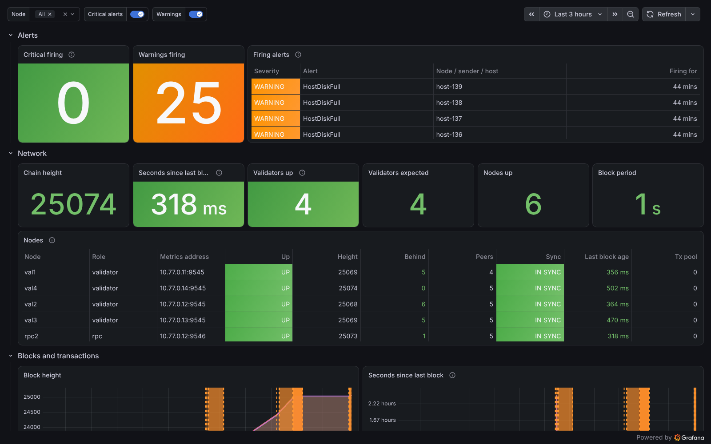
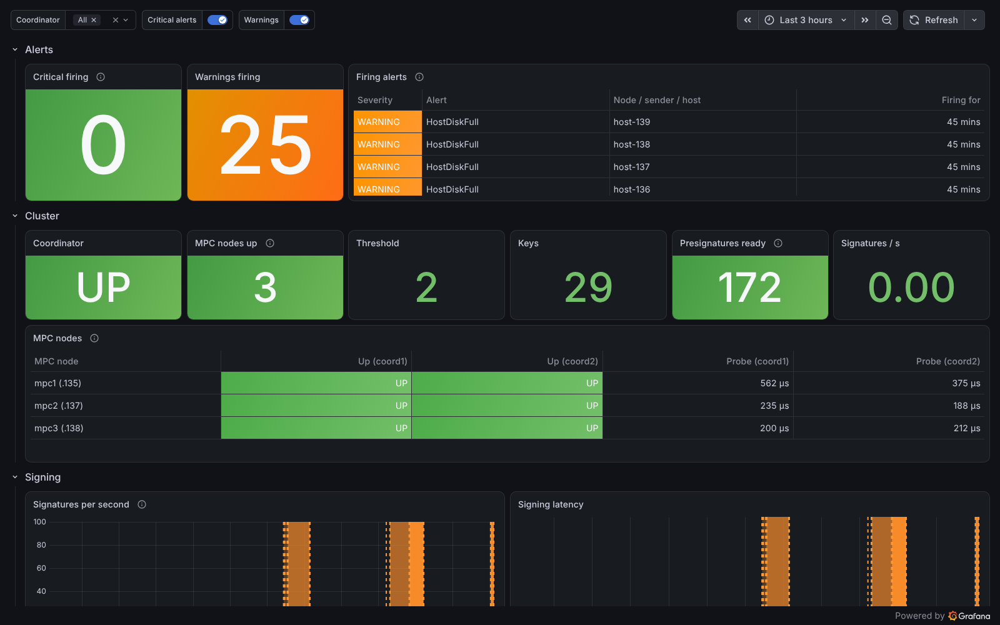
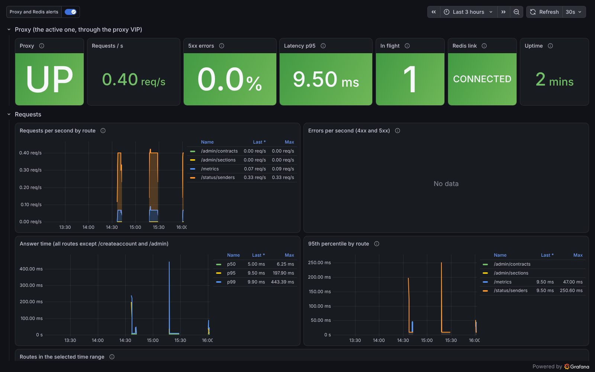
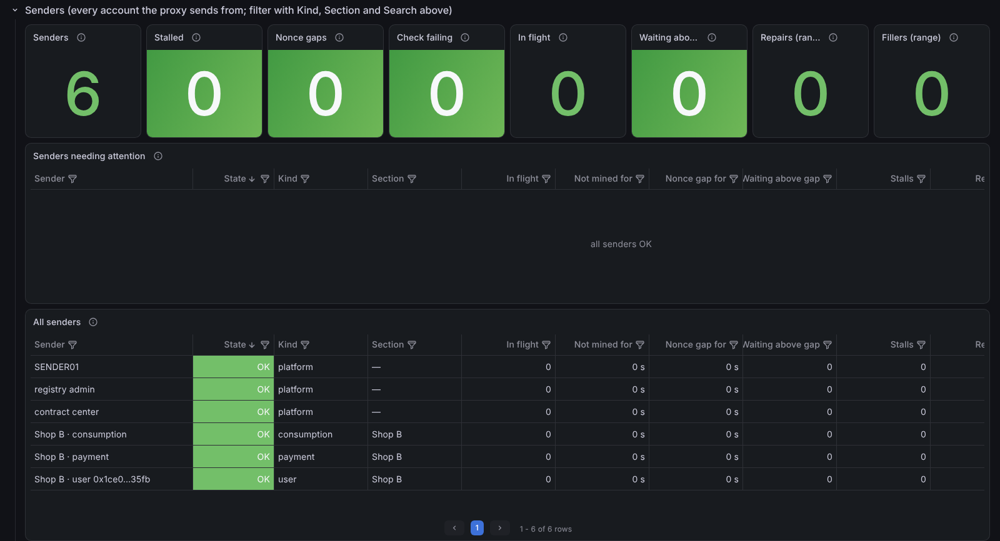
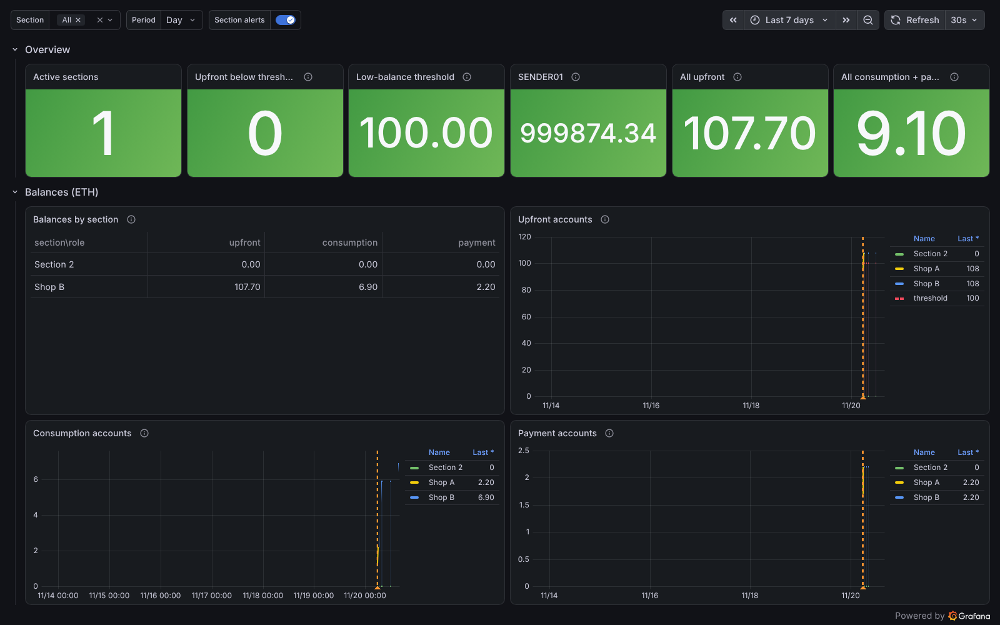
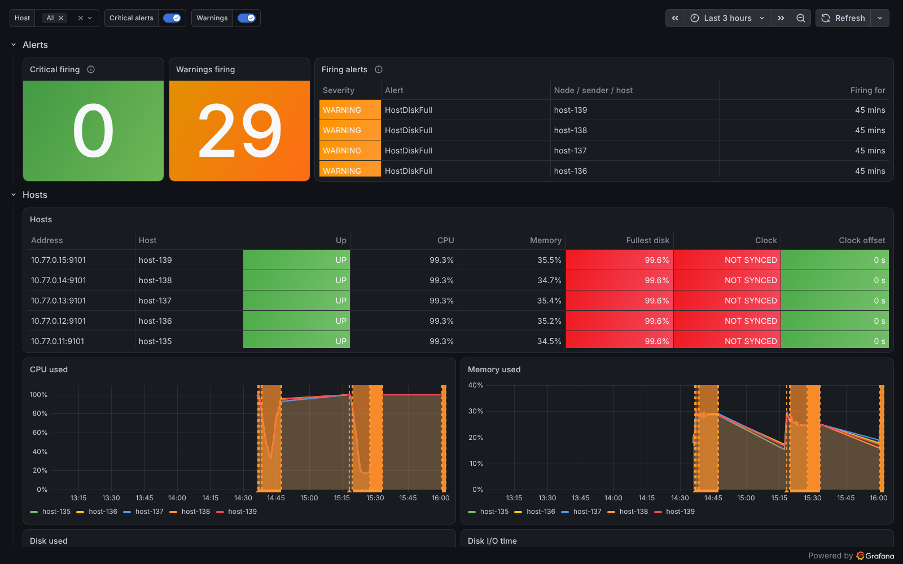
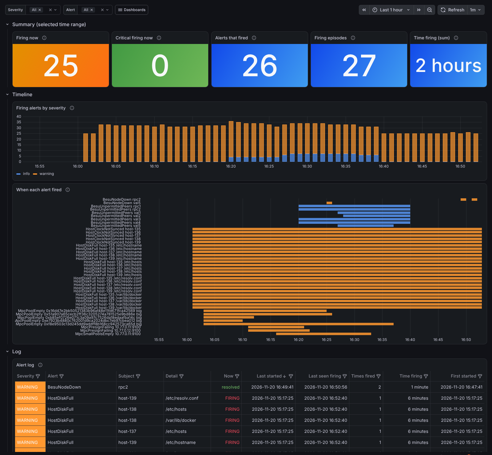

# Grafana 대시보드

> **내용:** 모든 Grafana 대시보드와 그 안의 모든 패널: 무엇을 보여 주는지, 정상 상태는 어떤지,
> 정상이 아닐 때 무엇을 해야 하는지 설명합니다.
>
> **대상:** 당직 운영자 및 대시보드를 보는 모든 사람.
>
> **관련 문서:** [알림](alerts.md) · [문제 해결](troubleshooting.md) ·
> [모니터링](../components/monitoring.md) (스택 구성 방식) · [용어집](../glossary.md)

**목차**

- [대시보드 읽는 법](#reading-any-dashboard)
- [Besu production (QBFT)](#besu-production-qbft)
- [MPC signer](#mpc-signer)
- [Proxy & Redis](#proxy--redis)
- [Sections](#sections)
- [Hosts](#hosts)
- [Alert log (알림 로그)](#alert-log)
- [질문별 대시보드](#which-dashboard-for-which-question)

---

## 대시보드 읽는 법 {#reading-any-dashboard}

**위치:** 모니터링 호스트의 Grafana, `http://192.168.68.139:3000`(사용자 `admin`, 비밀번호는
`ansible/state/secrets/grafana_admin_password`에 있음), 폴더 **Production**. 접근할 수 있는 대상은
`settings.yml`의 `grafana_ips`로 정합니다.

| 보이는 것 | 의미 |
|---|---|
| 모든 대시보드 상단의 **Alerts 행** (Alert log: 이력) | *Critical firing*과 *Warnings firing*은 이 대시보드만이 아니라 플랫폼 전체의 모든 알림 수를 셉니다. *Firing alerts* 표는 critical부터 순서대로 노드, 발신자 또는 호스트와 *Firing for*(규칙의 대기 시간을 포함하여 조건이 시작된 시점부터 계산)를 함께 나열합니다. 모든 알림은 [알림](alerts.md)에 설명되어 있습니다 |
| 시간 차트의 **점선이 있는 주황색 음영 띠** | 알림이 발생 중이던 기간입니다. 점선은 시작과 끝입니다. 선 위에 마우스를 올리면 알림 이름이 보입니다 |
| 상단의 **변수** (`node`, `coordinator`, `host`, `kind`, `section`, `search`, `period`) | 필터입니다. 기본값은 *All*이며, 하나 또는 여러 개를 선택하면 모든 패널이 좁혀집니다 |
| **Dashboards** 메뉴(변수 오른쪽) | 시간 범위를 유지한 채 모든 대시보드로 이동합니다. [Alert log](#alert-log)로 가는 가장 빠른 길입니다 |
| **시간** | 브라우저의 현지 시간입니다. 호스트의 로그(`docker logs`, `journalctl`)는 UTC일 수 있습니다 |
| **노드 간의 작은 차이** | Prometheus는 각 대상을 15 s마다 서로 약간 다른 시점에 읽습니다. 1 s 블록에서는 정상인 두 노드가 한 번의 읽기에서 10–15블록 차이 날 수 있습니다 |
| **"No data"** | 아직 아무 일도 일어나지 않았거나(한 번도 움직이지 않은 카운터), 쿼리에 비해 시간 범위가 너무 짧거나(Sections 기간), 대상이 다운되었습니다 |

대시보드는 `monitoring/grafana/dashboards/*.json`에서 프로비저닝되며 브라우저에서 저장할 수
없습니다. 변경하려면 파일(Sections, Proxy & Redis, Alert log는 생성기 `monitoring/grafana/tools/`)을 수정하고
커밋한 다음 `01-hosts.yml 09-monitoring.yml`을 실행하십시오.

---

## Besu production (QBFT) {#besu-production-qbft}

체인: 블록을 만들고 있는지, 모든 노드가 최신인지, 얼마나 바쁜지, 프록시의 트랜잭션이 채굴되고
있는지를 보여 줍니다. 파일: `besu-production.json`. 변수: **node** (val1–val4, rpc1, rpc2).

### 알림 (Alerts) {#alerts}

플랫폼 전체의 알림 카운터와 표입니다([대시보드 읽는 법](#reading-any-dashboard) 참조).

### 네트워크 (Network) {#network}

| 패널 | 표시 내용 | 정상 | 정상이 아닐 때 |
|---|---|---|---|
| **Chain height** (체인 높이) | 모든 노드 중 가장 높은 블록 번호 | 매초 증가 | 변화 없음: *Seconds since last block*을 확인하십시오 |
| **Seconds since last block** (마지막 블록 이후 초) | 가장 최신 노드의 최신 블록 경과 시간 | 1 s 미만(블록 주기) | 블록 주기의 3배 후 빨간색: 검증자가 쿼럼보다 적습니다. 알림 `BesuNoNewBlocks`, `BesuValidatorQuorumLost` |
| **Validators up** (가동 중인 검증자) | 메트릭이 응답하는 검증자 | 4 | 3이면 여유 없이 블록을 계속 만듭니다. 2 이하면 체인이 멈춥니다 |
| **Validators expected** (예상 검증자) | Prometheus가 알고 있는 검증자 | 4 | *Validators up*과 비교하십시오 |
| **Nodes up** (가동 중인 노드) | 응답하는 모든 Besu 노드(검증자 4개 + RPC 노드 2개) | 6 | `BesuNodeDown`이 해당 노드를 알려 줍니다 |
| **Block period** (블록 주기) | 제네시스의 QBFT 블록 시간 | 1 s | 고정 설정 |

**Nodes** 표, 노드마다 한 행:

| 열 | 의미 | 색상 |
|---|---|---|
| Node, Role, Metrics address | 이름, `validator` 또는 `rpc`, Prometheus가 읽는 위치 | |
| Up | 메트릭이 응답함 | UP 녹색, DOWN 빨간색 |
| Height | 노드의 최신 블록 | |
| Behind | 가장 높은 노드보다 뒤처진 블록 수 | 30까지 녹색, 31부터 주황색, 300부터 빨간색. 약 15까지는 정상입니다(읽기 시점 차이) |
| Peers | 연결된 노드 | (노드 수 − 1) = 5여야 합니다 |
| Sync | 노드 자체 보고만이 아니라 측정값으로 계산 | **IN SYNC** 녹색, **SYNCING** 주황색(노드가 그렇게 보고함), **STALLED** 빨간색(동기화되었다고 보고하지만 다른 노드는 최신인데 최신 블록이 60 s 이상 오래됨: 블록 가져오기를 중단함), **BEHIND** 주황색(30블록 넘게 뒤처지고 최신 블록이 30 s 이상 오래됨) |
| Last block age | 읽었을 때 노드 최신 블록의 경과 시간 | 30 s 미만 녹색, 30 s부터 주황색, 60 s부터 빨간색 |
| Tx pool | 노드의 풀에서 대기 중인 트랜잭션 | 유휴 시 약 0 |

**STALLED** 상태의 RPC 노드는 몇 초 안에 RPC VIP에서 제외되고 5분 후 `besu-rpc-health`가
재시작합니다([고가용성](../deployment/high-availability.md)). 정지된 검증자는 수동으로 재시작해야
합니다. 알림 `BesuNodeStalled`.

### 블록과 트랜잭션 (Blocks and transactions) {#blocks-and-transactions}

| 패널 | 표시 내용 | 정상 | 정상이 아닐 때 |
|---|---|---|---|
| **Block height** (블록 높이) | 시간에 따른 각 노드의 높이 | 모든 선이 하나의 일정한 대각선 위에 있음 | 평평해지는 선: 해당 노드가 블록 가져오기를 중단했습니다 |
| **Seconds since last block** (마지막 블록 이후 초) | 각 읽기 시점의 노드별 최신 블록 경과 시간 | 0과 1 s 사이의 평평한 선(각 노드는 1초 안의 서로 다른 시점에 읽히므로 각자 다른 높이에 있음) | 꾸준히 올라가는 선: 해당 노드가 멈췄습니다 |
| **Transactions per second (in blocks)** (초당 트랜잭션, 블록 기준) | 초당 블록에 포함된 트랜잭션 | 트래픽을 따라감 | 애플리케이션이 전송 중인데 0: 아래 Proxy & Redis → *Senders*를 확인하십시오 |
| **Gas used per block** (블록당 가스 사용량) | 블록 가스 한도(노란색, 30 M) 대비 사용된 가스(녹색) | 한도보다 훨씬 낮음 | 한도에 근접: 블록이 가득 차서 트랜잭션이 대기합니다 |
| **Transaction pool** (트랜잭션 풀) | 노드별 대기 중인 트랜잭션 | 급증 후 약 0으로 돌아옴 | 꾸준한 증가: 블록이 따라가지 못하거나 논스 공백이 있습니다(1,000 초과 시 `BesuTxPoolGrowing`) |
| **Blocks behind** (뒤처진 블록) | 알고 있는 헤드보다 얼마나 뒤처졌는지에 대한 노드 자체 추정치 | 0 | 계속 높음: 따라잡는 중입니다. 정지된 노드는 여기에 0을 표시할 수 있으므로(알지 못함) Nodes 표를 신뢰하십시오 |

### 트랜잭션 양 (Transaction volume) {#transaction-volume}

Besu의 트랜잭션 카운터에서 분 단위로 정확하게 계산합니다(추정 없음).

| 패널 | 표시 내용 |
|---|---|
| **Transactions in selected range** (선택한 범위의 트랜잭션) | 오른쪽 위 시간 범위 동안 채굴된 트랜잭션 |
| **Last 1 hour** / **Last 24 hours** | 고정된 기간의 같은 값(24 h는 24 h의 기록이 필요함) |
| **Average tx/s in range** (범위 내 평균 tx/s) | 트랜잭션 ÷ 범위의 초 |
| **Transactions per interval** (구간별 트랜잭션) | 막대: 구간별 트랜잭션(확대 시 1분, 긴 범위에서는 더 넓음) |
| **Cumulative transactions in range** (범위 내 누적 트랜잭션) | 범위 시작부터의 누적 합계 |

### 피어와 RPC (Peers and RPC) {#peers-and-rpc}

| 패널 | 표시 내용 | 정상 | 정상이 아닐 때 |
|---|---|---|---|
| **Peers** (피어) | 노드별 연결된 피어 | 모든 노드 5 | 더 낮음: 노드 또는 호스트 간 네트워크가 다운되었습니다(`BesuPeersMissing`). 2 미만: `BesuPeersLow`, 노드가 고립 직전입니다 |
| **Refused connections (node allowlist)** (거부된 연결, 노드 허용 목록) | 피어가 `permissions_config.toml`에 없어서 거부된 연결 | 0 | 알 수 없는 머신이거나, 키 또는 주소가 변경된 자체 노드입니다(`BesuUnpermittedPeers`) |
| **JSON-RPC requests per second** (초당 JSON-RPC 요청) | 노드별 응답한 RPC 호출 | rpc1(장애 조치 후에는 rpc2)에 트래픽, 검증자는 0에 가까움 | 재시작 후의 급증은 chainlens나 프록시가 따라잡는 것입니다 |
| **JSON-RPC latency p95 (slowest method)** (JSON-RPC 지연 p95, 가장 느린 메서드) | 각 노드에서 가장 느린 메서드의 95번째 백분위 응답 시간 | 몇 ms | 수백 ms가 지속됨: 노드가 과부하 상태입니다(CPU, 디스크) |
| **P2P traffic in / out** (P2P 트래픽 수신 / 송신) | Besu 노드 간 초당 바이트(블록, 합의) | 일정함, 유휴 시 노드당 몇 kB/s | 재시작 후 노드가 따라잡을 때의 급증은 정상입니다 |

### JVM과 프로세스 (JVM and process) {#jvm-and-process}

Besu는 Java에서 실행됩니다.

| 패널 | 표시 내용 | 정상 | 정상이 아닐 때 |
|---|---|---|---|
| **CPU (cores)** (CPU, 코어) | 노드별 CPU(1.0 = 코어 하나 전체) | 유휴 시 낮음 | 지속적으로 높음: 부하 또는 멈춘 작업 |
| **JVM heap used** (JVM 힙 사용량) | 사용 중인 Java 메모리. 녹색 선은 최대치(`-Xmx`, `besu_java_opts`) | 최대치보다 훨씬 낮은 톱니 모양(메모리가 차고 가비지 컬렉션이 해제함) | 최대치에 근접: 곧 긴 일시 정지가 발생합니다(90 % 초과 시 `BesuHeapHigh`) |
| **GC time (share of wall time)** (GC 시간, 실제 시간 대비 비율) | 가비지 컬렉션에 쓴 시간의 비율 | 1 % 미만 | 약 5 % 초과: 힙이 너무 작거나 압박을 받고 있습니다 |
| **Resident memory** (상주 메모리) | 각 Besu 프로세스의 실제 메모리(힙 + RocksDB 캐시 + 스레드): 호스트 RAM에 계산되는 양 | 천천히 증가한 후 안정됨 | 계속 증가: 호스트 메모리를 주시하십시오(`HostMemoryHigh`) |

### 프록시 발신자 (Proxy senders) {#proxy-senders}

**Proxy & Redis → [Senders](#senders)**로 옮겨졌습니다. 모든 발신자를 이름으로 표시하며(SENDER01, `Shop B · upfront`,
`Shop B · user 0x51a9…`), 종류, 섹션, 검색 필터가 있고, 조치가 필요한 발신자를 먼저 보여 줍니다.

---

## MPC signer {#mpc-signer}

서명: 충분한 MPC 노드가 가동 중인지, 서명이 얼마나 빠른지, 사전 서명 풀이 가득 차 있는지를 보여
줍니다. 파일: `mpc-signer.json`. 변수: **coordinator** (coord1, coord2).

### 클러스터 (Cluster) {#cluster}

| 패널 | 표시 내용 | 정상 | 정상이 아닐 때 |
|---|---|---|---|
| **Coordinator** (코디네이터) | 코디네이터가 응답함 | UP | `MpcCoordinatorDown`. 다른 코디네이터가 VIP를 통해 인계받습니다 |
| **MPC nodes up** (가동 중인 MPC 노드) | 연결 가능한 MPC 노드(어느 코디네이터에서든 가장 많이 연결되는 수) | 3 | 2: 서명은 가능하지만 **새 키**(계정, 섹션)를 생성할 수 없습니다. 2 미만: **서명 불가**(`MpcBelowThreshold`) |
| **Threshold** (임계값) | 서명에 필요한 노드 수 | 2 | 키 세레모니에서 고정됨 |
| **Keys** (키) | 클러스터가 보유한 MPC 키(계정) | `/createaccount`에 따라 증가 | |
| **Presignatures ready** (준비된 사전 서명) | 핫 키 전체의 준비된 사전 서명 | 풀의 목표치에 근접 | 서명 중에 0: 서명이 느린 경로로 전환됩니다 |
| **Signatures / s** (초당 서명) | 초당 서명 수 | 트래픽을 따라감 | |

**MPC nodes** 표: 각 코디네이터에서 본 각 MPC 노드(mpc1 .135, mpc2 .137, mpc3 .138): *Up (coord1)*,
*Up (coord2)* 및 상태 프로브의 응답 시간. 코디네이터 **하나**에서만 Down: 두 호스트 간의
네트워크 문제입니다. 양쪽에서 Down: 노드 자체의 문제입니다(`MpcNodeDown`).

### 서명 (Signing) {#signing}

| 패널 | 표시 내용 | 정상 | 정상이 아닐 때 |
|---|---|---|---|
| **Signatures per second** (초당 서명) | 경로별: **핫**(준비된 사전 서명 사용, 밀리초) 및 **콜드**(전체 대화형 프로토콜, 약 0.6 s) | SENDER01과 다른 큰 키는 핫. 드물게 쓰는 키는 콜드가 정상 | 핫 발신자가 콜드: 해당 풀이 비었습니다 |
| **Signing latency** (서명 지연) | 경로별 p50 및 p95 | 핫: 밀리초, 콜드: 약 1 s 미만 | 증가: MPC 노드의 CPU 또는 노드 간 네트워크 |
| **Failures** (실패) | 서명 실패, 그리고 별도로 정책 거부 | 0 | 거부: 노드의 정책(값, 가스, 체인 ID, 대상)을 벗어난 트랜잭션입니다(`MpcPolicyRefusals`). 기타 실패: 코디네이터 로그(`MpcSignErrors`) |
| **Open relay sessions** (열린 릴레이 세션) | 코디네이터의 릴레이를 통과하는 프로토콜 세션 | 적음, 0으로 돌아옴 | 높은 채로 멈춤: 세션 도중 노드가 응답을 멈췄습니다 |

### 사전 서명 풀 (Presignature pool) {#presignature-pool}

| 패널 | 표시 내용 | 정상 | 정상이 아닐 때 |
|---|---|---|---|
| **Pools of big keys** (큰 키 풀) | 큰 키(SENDER01, 선지급 계정, 기타 핫 발신자)별 준비된 사전 서명과 목표선 | 목표치에 근접 | 서명 중 계속 낮음: 서명이 사전 서명 생성보다 빠릅니다. 급증 후에는 저절로 다시 채워집니다(`MpcPoolEmpty`) |
| **Pools of small keys** (작은 키 풀) | 모든 작은 키(`/createaccount`로 만든 계정)의 준비된 사전 서명 합계와 전체 목표 | 전체 목표에 근접 | 많은 작은 풀이 오랫동안 비어 있음: `MpcSmallPoolsEmpty` |
| **Presignatures generated per second** (초당 생성된 사전 서명) | 사전 서명 생성 속도 | — | **이것이 지속 가능한 용량입니다**: 이보다 빠르게 서명하면 풀이 고갈됩니다 |
| **Average presign duration** (평균 사전 서명 시간) | 사전 서명당 초 | 안정적 | 증가: MPC 노드의 CPU |
| **Presign sessions running** (실행 중인 사전 서명 세션) | 진행 중인 사전 서명 생성 | 보충 동시성보다 낮음 | |
| **Keys per pool class** (풀 등급별 키) | `big`, `small`, `none`인 키의 수 | | 키의 등급 변경: `POST /account/pool` ([프록시 API](../reference/proxy-api.md)) |
| **MPC node reachability** (MPC 노드 연결 가능성) | 코디네이터와 노드 조합마다 한 선(1 = 응답함) | 모두 1 | 하락: 재시작 또는 네트워크 |

MPC 노드 재시작 후에는 몇 분 동안 *Pools*가 비고 *Failures*에 사전 서명 실패가 몇 건 표시될 수
있습니다(`MpcPoolEmpty`, `MpcPresignFailing`). 이는 저절로 해제됩니다.

---

## Proxy & Redis {#proxy--redis}

애플리케이션 API, API가 전송에 쓰는 계정, 그리고 논스 캐시입니다. Prometheus는 프록시와 Redis를
**프록시 VIP를 통해** 읽으므로 이 대시보드는 항상 **활성** 프록시를 보여 줍니다. 파일: `proxy-redis.json`
(`monitoring/grafana/tools/gen_proxy_dashboard.py`로 생성). 다른 모든 대시보드처럼 **Alerts** 행으로
시작합니다.

### 프록시 (Proxy) {#proxy}

| 패널 | 표시 내용 | 정상 | 정상이 아닐 때 |
|---|---|---|---|
| **Proxy** (프록시) | 활성 프록시가 응답함 | UP | `ProxyDown`: keepalived가 VIP를 옮겨야 합니다 |
| **Requests / s** (초당 요청) | 초당 전체 요청 | 트래픽을 따라감 | |
| **5xx errors** (5xx 오류) | 상태 5xx 응답의 비율(프록시가 실패함). 4xx(호출자의 실수)는 계산하지 않음 | 0 % | 1 %부터 주황색, 5 %부터 빨간색(`ProxyHttpErrors`) |
| **Latency p95** (지연 p95) | `/createaccount`와 `/admin`을 제외한 95번째 백분위 응답 시간(키 생성은 원래 느림) | 1 s 미만 | 2 s부터 주황색, 5 s부터 빨간색(`ProxySlow`) |
| **In flight** (처리 중) | 현재 응답 중인 요청 | 적음 | 증가: 프록시 또는 프록시가 기다리는 대상(서명기, Besu)이 느립니다 |
| **Redis link** (Redis 연결) | 프록시와 Redis의 연결 | CONNECTED | NO REDIS: 프록시는 계속 작동하지만(메모리 + 체인) 재시작 시 논스 캐시를 잃습니다(`ProxyRedisDisconnected`) |
| **Uptime** (가동 시간) | 프록시 시작 이후 시간 | 증가 | 초기화됨: 재시작 또는 다른 호스트로의 장애 조치 |

### 요청 (Requests) {#requests}

| 패널 | 표시 내용 |
|---|---|
| **Requests per second by route** (경로별 초당 요청) | 경로 패턴별로 누적(토큰별이 아닌 `/nft/:tokenId`) |
| **Errors per second (4xx and 5xx)** (초당 오류, 4xx 및 5xx) | 경로와 상태별: **5xx** 프록시가 실패함, **4xx** 거부됨(잘못된 입력, 잘못된 키, 허용되지 않음), **aborted** 클라이언트가 먼저 연결을 끊음 |
| **Answer time** (응답 시간) | `/createaccount`와 `/admin`을 제외한 모든 경로의 p50, p95, p99 |
| **95th percentile by route** (경로별 95번째 백분위) | 원래 느린 경로를 포함한 모든 경로 |
| **Routes in the selected time range** (선택한 시간 범위의 경로) | 경로별: 요청, 5xx + aborted, 4xx, p95, 평균(Prometheus `increase()`의 추정치) |

### 발신자 (Senders) {#senders}

프록시가 전송에 쓰는 모든 계정입니다: SENDER01, 컨트랙트 계정 센터, 레지스트리 관리자, 각 섹션의 계정,
그리고 최근 몇 분 동안 사용된 사용자 계정. 발신자가 많을 때는 개수와 **Senders needing attention**
(조치가 필요한 발신자) 표를 읽으십시오. 나머지는 특정 발신자를 찾아볼 때 씁니다.

각 발신자는 프록시가 붙인 **이름**을 가집니다(`proxy_sender_info`, 레이블 `account`): 플랫폼 계정은
이름으로, 섹션 계정은 `<section> · upfront` / `consumption` / `payment`로, 사용자 계정은
`<section> · user 0x1ce0…35fb`로, 그 밖의 계정은 짧은 주소로 표시합니다. 상단의 변수:
**Kind**(platform, upfront, consumption, payment, user, retired, other), **Section**, **Search**
(이름 또는 주소의 일부).

| 패널 | 표시 내용 | 정상 | 정상이 아닐 때 |
|---|---|---|---|
| **Senders** (발신자) | 필터에 맞는 발신자 | | |
| **Stalled** (정지됨) | 블록이 생성되는 동안 준비된 트랜잭션이 채굴되지 않는 발신자 | 0 | 검증자 **하나**를 재시작하십시오(`ProxySenderStalled`) |
| **Nonce gaps** (논스 공백) | 논스가 누락된 발신자(이후 트랜잭션은 대기) | 0 | 프록시가 약 30 s 안에 복구합니다. 120 s 후 `ProxyNonceGap` |
| **Check failing** (확인 실패) | 체인 확인이 실패한 발신자 | 0 | `ProxySenderCheckFailing`: RPC VIP 또는 Besu |
| **In flight** / **Waiting above gap** (처리 중 / 공백 뒤 대기) | 필터에 맞는 모든 발신자의, 전송했지만 채굴되지 않은 트랜잭션 / 공백 뒤에 보류된 트랜잭션 | 급증 후 약 0으로 돌아옴 / 0 | |
| **Repairs (range)** / **Fillers (range)** (복구 / 필러, 범위) | 선택한 시간 범위에서 복구된 공백 / 전송된 필러 트랜잭션 | 0 | 프록시 로그를 확인하십시오 |

**Senders needing attention**: 지금 문제가 있는 발신자만, 가장 심각한 것부터 표시합니다. 문제가 없으면
*all senders OK*가 표시됩니다. **All senders**: 필터에 맞는 모든 발신자를 문제가 있는 것부터 표시하며,
아래에 페이지가 있습니다. 열(각 열은 정렬하거나 깔때기 아이콘으로 필터링할 수 있습니다):

| 열 | 의미 |
|---|---|
| **Sender** / **Kind** / **Section** / **Address** | 이름, 계정 종류, 소속 섹션, 전체 주소 |
| **State** | **STALLED** 빨간색, **CHECK FAILING** 보라색, **NONCE GAP** 주황색, **WAITING** 노란색(공백 뒤의 트랜잭션), **OK** 녹색 |
| **In flight** | 전송했지만 아직 채굴되지 않음 |
| **Not mined for** / **Nonce gap for** | 준비된 트랜잭션이 대기한 시간 / 논스가 누락된 시간. 30 s부터 주황색, 120 s부터 빨간색 |
| **Waiting above gap** | 공백 뒤에 보류된 트랜잭션 |
| **Stalls** / **Repairs** / **Fillers** | 선택한 시간 범위 안의 값 |

| 차트 | 표시 내용 |
|---|---|
| **In flight: top 10 senders** (처리 중: 상위 10개 발신자) | 각 시점에 채굴되지 않은 트랜잭션이 가장 많은 발신자 10개, 이름별 |
| **In flight by kind** (종류별 처리 중) | 플랫폼, 섹션, 사용자 계정, 누적 |
| **Not mined / nonce gap: top 10** (미채굴 / 논스 공백: 상위 10개) | 해당 상황이 발생 중인 발신자만, 가장 오래된 10개 |
| **Stalls, repairs and fillers per hour, by kind** (종류별 시간당 정지, 복구, 필러) | 프록시가 얼마나 자주 개입해야 했는지 |

### 프록시 프로세스 (Proxy process) {#proxy-process}

| 패널 | 표시 내용 | 정상 | 정상이 아닐 때 |
|---|---|---|---|
| **Memory** (메모리) | 프록시의 상주 메모리와 V8 힙 | 안정적 | 꾸준한 증가: 메모리 누수입니다. 재시작하고 보고하십시오 |
| **Event-loop delay** (이벤트 루프 지연) | 준비된 콜백이 단일 Node.js 스레드를 기다린 시간(p99 및 최대) | 약 0.1 s 미만 | 초과: 모든 요청이 대기합니다(1 s 초과 시 `ProxyEventLoopBlocked`) |
| **Requests in flight** (처리 중인 요청) | 통계 값과 같은 값을 시간에 따라 표시 | | |

### Redis {#redis}

| 패널 | 표시 내용 | 정상 |
|---|---|---|
| **Redis** | 활성 프록시의 Redis가 응답함 | UP(그렇지 않으면 `RedisDown`) |
| **Clients** (클라이언트) | 연결(프록시와 익스포터) | 2 이상 |
| **Memory used** / **Keys** (사용 메모리 / 키) | 캐시 크기 | 작고 안정적 |
| **Hit ratio** (적중률) | 키를 찾은 읽기 | 트래픽에 따라 다름. 유휴 프록시에서 0 %는 정상 |
| **Last save** (마지막 저장) | Redis가 마지막으로 스냅샷을 쓴 이후 시간 | 1 h 미만 녹색, 1일까지 주황색, 그 이후 빨간색 |
| **Uptime** (가동 시간) | Redis 시작 이후 시간 | |
| **Commands per second (the proxy's)** (초당 명령, 프록시의 명령) | 익스포터 자체 폴링을 제외한 유형별 명령 | 트래픽을 따라감 |
| **Average command time** (평균 명령 시간) | 명령별 | 마이크로초 |
| **Memory and keys** (메모리와 키) | 사용 메모리와, 설정된 경우 `maxmemory` 선 | 선보다 낮음(90 % 초과 시 `RedisMemoryHigh`) |

---

## Sections {#sections}

섹션별 자금과 활동입니다([섹션](../features/sections.md)). 많은 섹션을 위해 만들어졌습니다: 먼저 개수,
다음으로 조치가 필요한 섹션, 모든 섹션을 담은 하나의 표, 그리고 섹션마다 선 하나 대신 상위 / 하위 10개
차트를 보여 줍니다. 파일: `sections.json`(`monitoring/grafana/tools/gen_sections_dashboard.py`로 생성).
**Alerts** 행으로 시작합니다. 변수: **Section**(하나, 여러 개 또는 전체), **Search**(이름의 일부),
**Period**(Day, Week, Month = 30일, Quarter = 90일, Year = 365일). 기본 시간 범위는 최근 30일입니다.

### 개요 (Overview) {#overview}

| 패널 | 표시 내용 | 정상 | 정상이 아닐 때 |
|---|---|---|---|
| **Active sections** / **Disabled** (활성 섹션 / 비활성) | 활성화된 / 비활성화된 섹션(보관된 섹션은 표시되지 않음) | 보유한 섹션 수 | |
| **Upfront empty** (선지급 잔액 0) | 선지급 계정이 0인 활성 섹션: 새 계정 생성과 −x가 실패합니다 | 0(녹색) | 빨간색: 즉시 충전하십시오(`SectionUpfrontEmpty`) |
| **Upfront low** (선지급 부족) | `upfront_low_balance_eth` 미만인 활성 섹션 | 0 | chainlens Sections 페이지에서 충전하십시오(`SectionUpfrontLow`) |
| **Runs out within 7 days** (7일 안에 소진) | 최근 7일의 지출 기준으로 선지급 계정이 7일을 버티지 못하는 섹션 | 0 | 소진되기 전에 충전하십시오 |
| **SENDER01 (ETH)** | SENDER01의 잔액: 모든 충전 자금을 제공함 | `sender01_low_balance_eth` 초과 | 보충하거나 결제 계정에서 반환하십시오(`Sender01Low`) |
| **All upfront (ETH)** / **Collected (ETH)** (전체 선지급 / 모인 금액) | 모든 선지급 계정의 ETH / 모든 소비 + 결제 계정의 ETH | | |

### 섹션 (Sections) {#sections-1}

**Sections needing attention**(조치가 필요한 섹션): 지금 문제가 있는 섹션만, 가장 심각한 것부터
표시합니다(문제가 없으면 *all sections OK*). **All sections**(모든 섹션): 모든 섹션을 선지급 잔액이 가장
낮은 것부터 표시하며, 아래에 페이지가 있습니다. 각 열은 정렬하거나 깔때기 아이콘으로 필터링할 수 있습니다.

| 열 | 의미 |
|---|---|
| **State** | **EMPTY** 빨간색(선지급 잔액 0), **LOW** 주황색(임계값 미만), **< 7 DAYS LEFT** 노란색, **OK** 녹색 |
| **Status** | active 또는 disabled |
| **Upfront** / **Consumption** / **Payment** | 현재 잔액(ETH) |
| **Days left** | 최근 7일의 지출 기준으로 선지급 계정이 버티는 기간. 지급한 것이 없으면 *no spending*. 3 미만 빨간색, 7 미만 주황색 |
| **Spend / day** | 최근 7일 동안 선지급 계정에서 하루에 지급된 ETH(−x 송금과 새 계정 자금 제공) |
| **New accounts**, **+x in**, **−x out**, **NFT sales**, **Top-ups**, **Swept**, **Paid back** (All sections에만 있음) | 지난 Period의 값 |

### 잔액 (ETH) (Balances (ETH)) {#balances-eth}

| 패널 | 표시 내용 | 조치 |
|---|---|---|
| **Lowest upfront: 10 sections** (선지급 최저: 10개 섹션) | 선지급 잔액이 가장 적은 활성 섹션 10개(0이면 빨간색) | 앞쪽 섹션부터 충전하십시오 |
| **Fewest days left: 10 sections** (남은 일수 최소: 10개 섹션) | 현재 지출 기준으로 가장 먼저 소진되는 섹션 10개 | |
| **Most collected: 10 sections** (가장 많이 모인: 10개 섹션) | 섹션별 소비 + 결제 계정의 ETH | 스윕하고 반환하십시오 |
| **All sections, by account role** (모든 섹션, 계정 역할별) | 선택한 섹션의 선지급, 소비, 결제 잔액을 합산한 시간별 추이 | |
| **Lowest upfront over time: 10 sections** (시간에 따른 선지급 최저: 10개 섹션) | 각 시점의 가장 낮은 10개와 빨간 점선으로 표시된 임계값 | |

### 기간별 활동 (Activity per period) {#activity-per-period}

프록시가 시작된 이후 프록시가 계산합니다. Prometheus는 프록시 재시작 후에도 계산 값을 이어 갑니다.
합계는 `increase()`의 추정치이므로 금액은 약간 다를 수 있고 건수는 반올림됩니다.

| 패널 | 표시 내용 |
|---|---|
| **New accounts / +x from users / NFT first sales / Top-ups, last period** (지난 기간 새 계정 / 사용자로부터의 +x / NFT 최초 판매 / 충전) | 선택한 모든 섹션 |
| **Most income / Most new accounts / Most spent, last period: 10 sections** (지난 기간 수입 / 새 계정 / 지출 최다: 10개 섹션) | 지난 기간의 상위 10개 섹션 |
| **Operations per period** / **ETH moved per period** (기간별 작업 / 기간별 이동한 ETH) | 기간과 작업 종류별 막대(선택한 모든 섹션): `create_account`, `transfer_in` (+x), `transfer_out` (−x), `nft_first_sale`, `nft_resale`, `topup`, `sweep`, `payback`. 각 막대는 해당 날짜에 **시작하는** 기간을 셉니다(오늘의 막대 = 오늘 현재까지) |
| **Income per period: top 10 sections** (기간별 수입: 상위 10개 섹션) | +x와 NFT 최초 판매, 각 기간에 수입이 가장 많은 섹션 10개 |
| **ETH moved in the selected time range** (선택한 시간 범위에서 이동한 ETH) | 대시보드 전체 시간 범위 동안의 섹션(행, 페이지 단위)과 작업별 값 |

여러 기간을 포함하는 시간 범위를 선택하십시오(Day: 최근 14–30일, Year: 수년).
Prometheus는 `prometheus_retention`(기본값 400일) 동안 보관합니다. chainlens 대시보드에는 체인 자체에서
정확한 달력 기간으로 계산한 같은 종류의 통계가 있습니다([chainlens](../components/chainlens.md)).

---

## Hosts {#hosts}

머신과 백업입니다. 파일: `hosts.json`. 변수: **host**.

**Hosts** 표:

| 열 | 의미 | 색상 |
|---|---|---|
| Host, Address | 머신과 그 node-exporter | |
| Up | node-exporter가 응답함 | DOWN 빨간색: 호스트가 꺼졌거나 연결할 수 없습니다(`HostDown`) |
| CPU, Memory, Fullest disk | 사용률 % | 메모리 90 % 초과(`HostMemoryHigh`), 디스크 80 % 초과(`HostDiskFull`) |
| Clock, Clock offset | NTP 동기화 여부, 시간 소스와의 차이 | NOT SYNCED 빨간색. 차이가 50 ms부터 주황색, 100 ms부터 빨간색(`HostClockNotSynced`) |

| 패널 | 표시 내용 | 정상 | 정상이 아닐 때 |
|---|---|---|---|
| **CPU used** (CPU 사용률) | 호스트별 % | 여유가 남아 있음 | 100 % 가까이 지속: 프로세스를 찾으십시오(`docker stats`) |
| **Memory used** (메모리 사용률) | 호스트별 %(캐시가 아닌 실제 사용 메모리) | 90 % 미만 | `free -m`, `docker stats --no-stream`, `ps aux --sort=-rss` |
| **Disk used** (디스크 사용률) | 호스트별 가장 많이 찬 파일 시스템 | 80 % 미만 | `df -h`, `docker system df`. 디스크가 가득 차면 Besu가 멈춥니다 |
| **Disk I/O time** (디스크 I/O 시간) | 디스크가 바쁜 시간의 비율 | 낮음 | 1(100 %)에 근접: 디스크가 병목입니다 |
| **Network in / out** (네트워크 수신 / 송신) | 호스트별 초당 바이트(Docker 가상 인터페이스 제외) | 일정함 | |

**Backups (last result per backup)** 표, 백업과 호스트마다 한 행:

| 열 | 의미 |
|---|---|
| Backup, Node | `chain`(val3의 일일 스냅샷), `validator-key` / `node-key`(Besu 키), `mpc-share`(MPC 노드별 매시간) |
| Last success | 마지막으로 성공한 지 얼마나 되었는지 |
| Last run | **OK** 또는 **FAILED**(빨간색): 수동으로 실행하고 오류를 확인하십시오(`BackupFailed`) |
| Size, Block | 아카이브 크기와 스냅샷의 체인 블록 |

각 백업은 자신의 호스트의 node-exporter에 보고합니다. 호스트가 다운된 동안에는 그 백업이 누락된
것처럼 보이며, 호스트가 돌아오면 함께 돌아옵니다(`…BackupMissing`, `…TooOld`).

---

## Alert log (알림 로그) {#alert-log}

배포 이후 발생한 모든 알림: 언제 시작했는지, 몇 번, 얼마나 오래, 지금도 발생 중인지를 보여 줍니다.
파일: `alert-log.json`(`monitoring/grafana/tools/gen_alert_log_dashboard.py`로 생성). 변수: **Severity**와
**Alert**(하나, 여러 개 또는 전체). 기본 시간 범위는 최근 30일입니다. 더 이전을 보려면 더 긴 범위를
선택하십시오(최대 `prometheus_retention`, Ansible에서는 400일).

### Summary (요약) {#summary}

**선택한 시간 범위** 기준입니다(처음 두 패널은 현재 시점).

| 패널 | 표시 내용 | 정상 |
|---|---|---|
| *Firing now* | 지금 발생 중인 알림(선택한 심각도) | 0(초록) |
| *Critical firing now* | 지금 발생 중인 critical 알림 | 0. 빨간색이면 [알림 런북](alert-runbook.md) |
| *Alerts that fired* | 한 번 이상 발생한 서로 다른 알림(이름 + 대상 + 세부): 아래 로그의 행 수 | 적고, 원인이 설명됨 |
| *Firing episodes* | 알림이 발생을 시작한 횟수(세 번 발생한 알림은 3) | |
| *Time firing (sum)* | 각 알림이 발생 중이던 시간의 합(겹치는 알림은 더해짐) | |

### Timeline (타임라인) {#timeline}

| 패널 | 표시 내용 |
|---|---|
| *Firing alerts by severity* | 막대: 구간마다 발생 중이던 알림 수. 빨강 critical, 주황 warning, 파랑 info. 높은 막대 = 장애이며, 아래에서 찾으십시오 |
| *When each alert fired* | 알림(이름, 대상, 세부)마다 한 줄, 발생 중인 동안 색이 칠해집니다. 긴 시간 범위에서는 한 칸이 한 구간이므로 짧은 알림도 한 칸 전체로 보입니다. 정확한 시각은 확대(차트 위에서 드래그)하여 확인하십시오 |

### Log (로그) {#log}

**Alert log** 표: 시간 범위 안에 발생한 알림마다 한 행이며, 가장 최근에 시작한 것이 먼저 나옵니다.
모든 열은 필터(깔때기 아이콘)하거나 정렬(제목 클릭)할 수 있습니다.

| 열 | 의미 |
|---|---|
| **Severity**, **Alert** | 알림과 심각도. 의미와 조치: [알림](alerts.md), [알림 런북](alert-runbook.md) |
| **Subject** | 알림의 대상: 섹션, 노드, 발신자, MPC 키 주소, 호스트 또는 수집 대상 중 알림에 있는 첫 번째 |
| **Detail** | 대상에 여러 부분이 있을 때 어느 부분인지: 디스크(`mountpoint`), 풀 클래스, 백업 종류 |
| **Now** | **FIRING**(빨강) 또는 *resolved*(초록) |
| **Last started** | 범위 안의 마지막 발생이 시작된 시각(규칙의 대기 시간을 포함하여 조건이 시작된 시점) |
| **Last seen firing** | 해제된 알림이라면 대략 끝난 시각(15 s 이내) |
| **Times fired** | 범위 안의 발생 횟수 |
| **Time firing** | 범위 안에서 발생 중이던 총 시간 |
| **First started** | 범위 안의 첫 발생이 시작된 시각 |

**기록 방식.** Prometheus는 모든 알림의 상태를 `ALERTS`와 `ALERTS_FOR_STATE`(각 발생의 시작)로
보관합니다. 두 기록 규칙(`monitoring/prometheus/rules/alert-log.yml`)이 알림이 발생 중인 동안 15 s마다
`alert_log:firing_since`(발생의 시작)와 `alert_log:firing_seen`(시각)을 `subject`, `detail` 레이블과 함께
기록합니다. 표와 요약은 이 값을 읽으므로 1년 범위에서도 빠릅니다. *pending*까지만 가고 발생하지 않은
알림은 로그에 없습니다.

- 표의 열은 기록 규칙이 설치된 시점(`09-monitoring.yml`)부터 시작합니다. 기존 배포에서는 *Time firing*과
  *Times fired*가 그때부터 계산됩니다. 두 타임라인 차트는 `ALERTS`를 읽으므로 Prometheus가 보관하고 있는
  모든 기간을 보여 줍니다.
- 보관 기간: `prometheus_retention`(기본 400일)과 `prometheus_retention_size`(20 GB). 더 오래된 데이터는
  삭제됩니다. 더 오래 남기려면 표를 내보내십시오(패널 메뉴 → *Inspect* → *Data* → *Download CSV*).
- 스크린샷의 실습 환경에서는 rpc2의 `BesuNodeDown` 발생 두 번(1분씩 두 번 중지)이 보입니다: *Times fired*
  2, *Time firing* 1분, *resolved*. `HostDiskFull` 행은 실습 환경 때문에 생긴 것입니다.

## 질문별 대시보드 {#which-dashboard-for-which-question}

| 질문 | 대시보드 → 패널 |
|---|---|
| 체인이 블록을 만들고 있습니까? | Besu production → *Seconds since last block* |
| 노드가 멈추거나 뒤처졌습니까? | Besu production → *Nodes* (Sync, Behind, Last block age) |
| 트랜잭션이 왜 채굴되지 않습니까? | Proxy & Redis → *Senders needing attention* |
| 어느 섹션의 자금이 가장 먼저 바닥납니까? | Sections → *Sections needing attention*, *Fewest days left* |
| 서명할 수 있습니까? 계정을 생성할 수 있습니까? | MPC signer → *MPC nodes up*, *Threshold* |
| 서명이 왜 느립니까? | MPC signer → *Signatures per second* (콜드 경로), *Pools* |
| API가 실패하거나 느립니까? | Proxy & Redis → *5xx errors*, *Latency p95*, *Errors per second* |
| 어느 섹션에 충전이 필요합니까? | Sections → *Upfront below threshold*, *Upfront accounts* |
| 이번 주 각 섹션은 얼마를 벌었습니까? | Sections, Period = Week → *ETH moved per period* |
| 호스트의 메모리나 디스크가 부족합니까? | Hosts → *Hosts* 표 |
| 백업이 실행되고 있습니까? | Hosts → *Backups* |
| 어젯밤 무엇이 얼마나 오래 발생했습니까? | Alert log → *Alert log* 표 |
| 이 알림이 이번 달 몇 번 발생했습니까? | Alert log, Alert = 해당 알림, 최근 30일 → *Times fired* |
