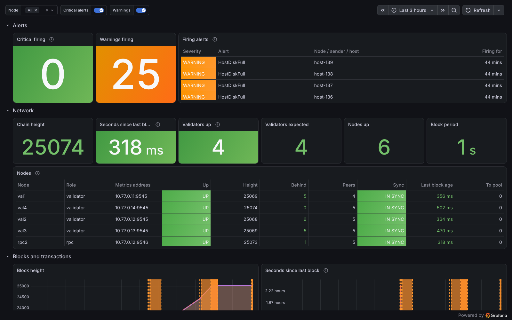
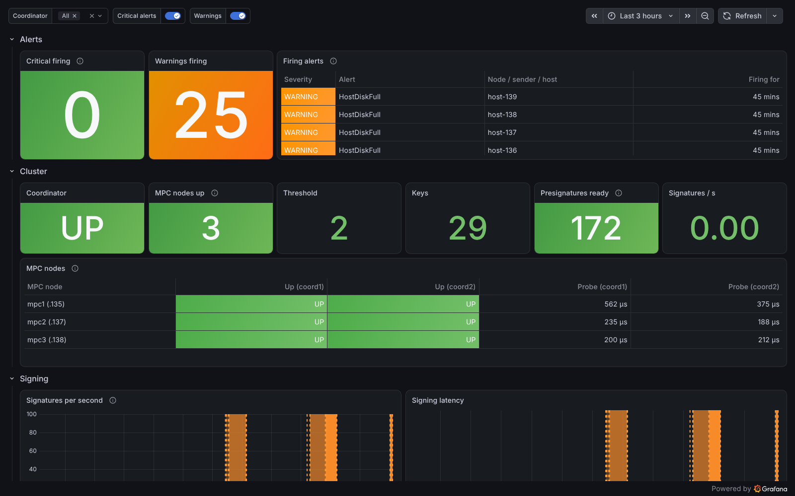
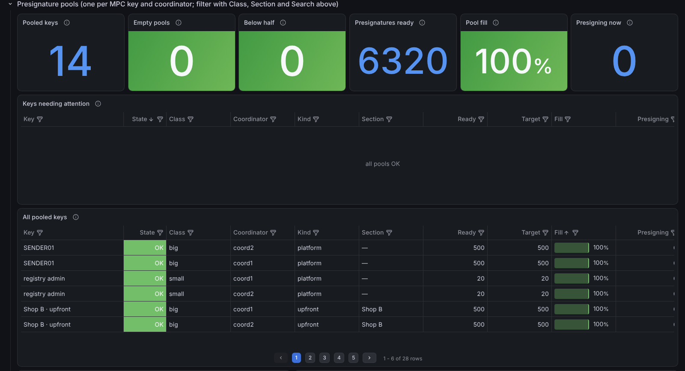
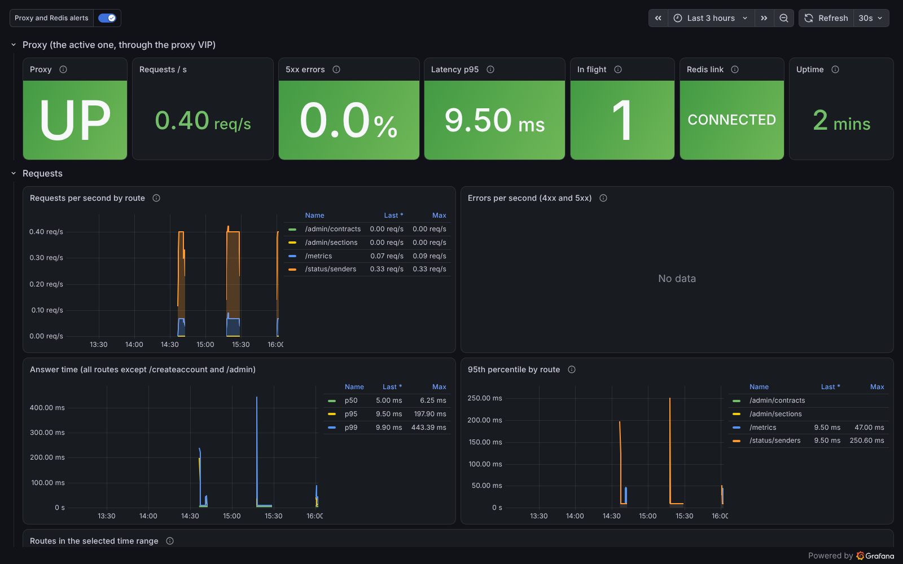
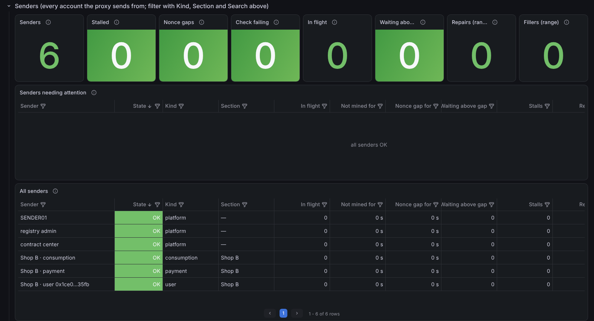
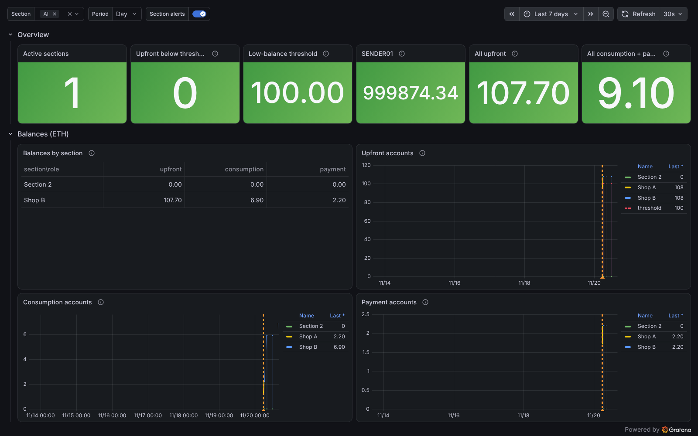
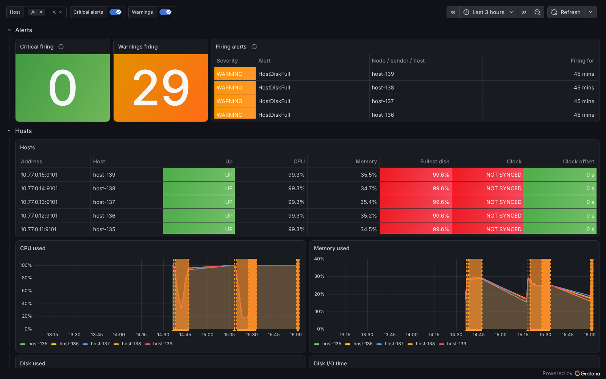
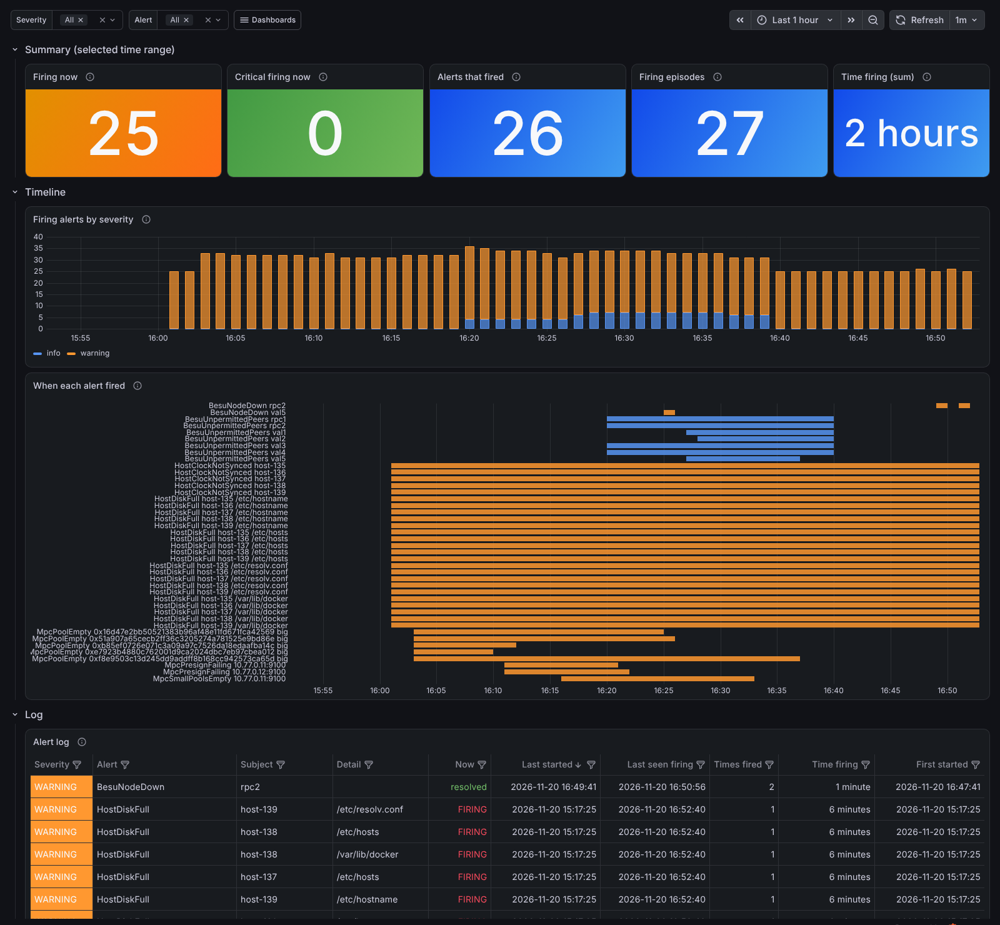

# Grafana dashboards

> **What:** every Grafana dashboard and every panel on it: what it shows, what healthy looks like,
> and what to do when it isn't.
>
> **For:** operators on duty, and anyone reading the dashboards.
>
> **Related:** [alerts](alerts.md) · [troubleshooting](troubleshooting.md) ·
> [monitoring](../components/monitoring.md) (how the stack is built) · [glossary](../glossary.md)

**Contents**

- [Reading any dashboard](#reading-any-dashboard)
- [Besu production (QBFT)](#besu-production-qbft)
- [MPC signer](#mpc-signer)
- [Proxy & Redis](#proxy--redis)
- [Sections](#sections)
- [Hosts](#hosts)
- [Alert log](#alert-log)
- [Which dashboard for which question](#which-dashboard-for-which-question)

---

## Reading any dashboard

**Where:** Grafana on the monitoring host, `http://192.168.68.139:3000` (user `admin`, password in
`ansible/state/secrets/grafana_admin_password`), folder **Production**. Who may open it:
`grafana_ips` in `settings.yml`.

| You see | It means |
|---|---|
| **Alerts row** at the top of every dashboard (Alert log: the history) | *Critical firing* and *Warnings firing* count every alert of the whole platform, not only this dashboard's. The *Firing alerts* table lists them, critical first, with the node, sender or host and *Firing for* (counted from when the condition started, including the rule's wait time). Every alert is explained in [alerts](alerts.md) |
| **Orange shaded bands with dashed lines** on time charts | periods when an alert was firing: the dashed lines are its start and end. Hover a line to see the alert's name |
| **Variables** at the top (`node`, `coordinator`, `host`, `kind`, `section`, `search`, `period`) | filters: *All* by default; pick one or several to narrow every panel |
| **Dashboards** menu (top right of the variables) | every dashboard, keeping the time range: the quickest way to the [Alert log](#alert-log) |
| **Times** | your browser's local time. Logs on the hosts (`docker logs`, `journalctl`) may be in UTC |
| **Small differences between nodes** | Prometheus reads each target every 15 s, at slightly different moments; with 1 s blocks two healthy nodes can differ by 10–15 blocks in one reading |
| **"No data"** | nothing has happened yet (a counter that never moved), the time range is too short for the query (Sections periods), or the target is down |

Dashboards are provisioned from `monitoring/grafana/dashboards/*.json` and can't be saved from
the browser. To change one, edit the file (or the generator for Sections, Proxy & Redis and Alert log,
`monitoring/grafana/tools/`), commit, and run `01-hosts.yml 09-monitoring.yml`.

---

## Besu production (QBFT)

The chain: is it making blocks, is every node current, how busy is it, and are the proxy's
transactions being mined. File: `besu-production.json`. Variable: **node** (val1–val4, rpc1, rpc2).

### Alerts

The platform-wide alert counters and table (see [Reading any dashboard](#reading-any-dashboard)).

### Network

| Panel | Shows | Healthy | If not |
|---|---|---|---|
| **Chain height** | the highest block number of any node | rising every second | flat: see *Seconds since last block* |
| **Seconds since last block** | age of the newest block on the most up-to-date node | under 1 s (the block period) | red after 3 × the block period: fewer validators than the quorum. Alerts `BesuNoNewBlocks`, `BesuValidatorQuorumLost` |
| **Validators up** | validators whose metrics answer | 4 | 3 still makes blocks, with no spare; 2 or fewer: the chain stops |
| **Validators expected** | validators Prometheus knows about | 4 | compare with *Validators up* |
| **Nodes up** | all Besu nodes answering (4 validators + 2 RPC nodes) | 6 | `BesuNodeDown` names the node |
| **Block period** | the QBFT block time from the genesis | 1 s | fixed setting |

**Nodes** table, one row per node:

| Column | Meaning | Colours |
|---|---|---|
| Node, Role, Metrics address | name, `validator` or `rpc`, where Prometheus reads it | |
| Up | metrics answer | UP green, DOWN red |
| Height | the node's newest block | |
| Behind | blocks below the highest node | green up to 30, orange from 31, red from 300. Up to ~15 is normal (reading skew) |
| Peers | connected nodes | should be (number of nodes − 1) = 5 |
| Sync | computed from measurements, not only the node's own report | **IN SYNC** green; **SYNCING** orange (the node says so); **STALLED** red (says in sync, but its newest block is over 60 s old while other nodes are current: it stopped importing); **BEHIND** orange (more than 30 blocks below and its newest block over 30 s old) |
| Last block age | age of the node's newest block when read | green under 30 s, orange from 30 s, red from 60 s |
| Tx pool | transactions waiting in the node's pool | about 0 when idle |

A **STALLED** RPC node is taken out of the RPC VIP within seconds and restarted after 5 minutes by
`besu-rpc-health` ([high availability](../deployment/high-availability.md)); a stalled validator
needs a restart by hand. Alert `BesuNodeStalled`.

### Blocks and transactions

| Panel | Shows | Healthy | If not |
|---|---|---|---|
| **Block height** | each node's height over time | all lines on one steady diagonal | a line that goes flat: that node stopped importing |
| **Seconds since last block** | each node's newest-block age at each reading | flat lines between 0 and 1 s (each node is read at its own moment in the second, so each sits at its own level) | a line climbing steadily: that node is stuck |
| **Transactions per second (in blocks)** | transactions included in blocks per second | follows your traffic | 0 while applications are sending: check Proxy & Redis → *Senders* below |
| **Gas used per block** | gas used (green) against the block gas limit (yellow, 30 M) | far below the limit | near the limit: blocks are full, transactions queue |
| **Transaction pool** | pending transactions per node | back to ~0 after bursts | steady growth: blocks can't keep up or nonces have gaps (`BesuTxPoolGrowing` above 1,000) |
| **Blocks behind** | the node's own estimate of how far it is behind the head it knows | 0 | stays up: it is catching up. A stalled node can show 0 here (it doesn't know): trust the Nodes table |

### Transaction volume

Counted exactly from Besu's transaction counter, minute by minute (no estimation).

| Panel | Shows |
|---|---|
| **Transactions in selected range** | transactions mined in the time range at the top right |
| **Last 1 hour** / **Last 24 hours** | the same over fixed windows (24 h needs 24 h of history) |
| **Average tx/s in range** | transactions ÷ seconds of the range |
| **Transactions per interval** | bars: transactions per interval (1 minute when zoomed in, wider for long ranges) |
| **Cumulative transactions in range** | running total from the start of the range |

### Peers and RPC

| Panel | Shows | Healthy | If not |
|---|---|---|---|
| **Peers** | connected peers per node | 5 for every node | lower: a node or the network between hosts is down (`BesuPeersMissing`); under 2: `BesuPeersLow`, the node is close to isolation |
| **Refused connections (node allowlist)** | connections refused because the peer isn't in `permissions_config.toml` | 0 | an unknown machine, or one of your nodes with a changed key or address (`BesuUnpermittedPeers`) |
| **JSON-RPC requests per second** | RPC calls answered per node | traffic on rpc1 (or rpc2 after a failover); validators near 0 | spikes after restarts are chainlens or the proxy catching up |
| **JSON-RPC latency p95 (slowest method)** | 95th-percentile answer time of each node's slowest method | a few ms | sustained hundreds of ms: the node is overloaded (CPU, disk) |
| **P2P traffic in / out** | bytes per second between Besu nodes (blocks, consensus) | steady, a few kB/s per node when idle | a spike when a node catches up after a restart is normal |

### JVM and process

Besu runs on Java.

| Panel | Shows | Healthy | If not |
|---|---|---|---|
| **CPU (cores)** | CPU per node (1.0 = one full core) | low when idle | sustained high: load or a stuck task |
| **JVM heap used** | Java memory in use; the green line is the maximum (`-Xmx`, `besu_java_opts`) | a sawtooth well below the maximum (memory fills, garbage collection frees it) | close to the maximum: long pauses come next (`BesuHeapHigh` above 90 %) |
| **GC time (share of wall time)** | share of time spent collecting garbage | under 1 % | above ~5 %: the heap is too small or under pressure |
| **Resident memory** | real memory of each Besu process (heap + RocksDB caches + threads): what counts against the host's RAM | grows slowly, then levels off | keeps climbing: watch the host's memory (`HostMemoryHigh`) |

### Proxy senders

Moved to **Proxy & Redis → [Senders](#senders)**: every sender by name (SENDER01, `Shop B · upfront`,
`Shop B · user 0x51a9…`), filters for kind, section and a search, the senders needing attention first.

---

## MPC signer

Signing: are enough MPC nodes up, how fast is signing, and are the presignature pools full. File:
`mpc-signer.json`. Variable: **coordinator** (coord1, coord2).

### Cluster

| Panel | Shows | Healthy | If not |
|---|---|---|---|
| **Coordinator** | a coordinator answers | UP | `MpcCoordinatorDown`; the other coordinator takes over through the VIP |
| **MPC nodes up** | MPC nodes reachable (most reachable from any coordinator) | 3 | 2: signing works, **new keys** (accounts, sections) can't be created; below 2: **no signatures** (`MpcBelowThreshold`) |
| **Threshold** | nodes needed to sign | 2 | fixed by the key ceremony |
| **Keys** | MPC keys (accounts) the cluster holds | grows with `/createaccount` | |
| **Presignatures ready** | ready presignatures across the hot keys | near the pools' targets | 0 while signing: signing falls back to the slow path |
| **Signatures / s** | signatures per second | follows traffic | |

**MPC nodes** table: each MPC node (mpc1 .135, mpc2 .137, mpc3 .138) as seen from each
coordinator: *Up (coord1)*, *Up (coord2)* and the health probe's answer time. Down from **one**
coordinator only: the network between those two hosts. Down from both: the node itself
(`MpcNodeDown`).

### Signing

| Panel | Shows | Healthy | If not |
|---|---|---|---|
| **Signatures per second** | by path: **hot** (from a ready presignature, milliseconds) and **cold** (full interactive protocol, ~0.6 s) | hot for SENDER01 and other big keys; cold is normal for rarely used keys | cold for a hot sender: its pool ran empty |
| **Signing latency** | p50 and p95 per path | hot: milliseconds; cold: under ~1 s | rising: CPU on the MPC nodes or network between them |
| **Failures** | signing failures, and policy refusals separately | 0 | refusals: a transaction outside a node's policy (value, gas, chain id, destination: `MpcPolicyRefusals`); other failures: coordinator log (`MpcSignErrors`) |
| **Open relay sessions** | protocol sessions passing through the coordinator's relay | small, back to 0 | stuck high: a node stopped answering mid-session |

### Presignature pool

Every pooled MPC key (classes `big` and `small`) has its own pool on **each** coordinator. With many
keys, read the counts and **Keys needing attention**; the rest is there to look one up. Keys are
**named** from the proxy (`proxy_account_info`, label `account`): SENDER01, registry admin, contract
center, `<section> · upfront` / `consumption` / `payment`; a key without a name shows its address.
Variables at the top: **Class** (big, small), **Section** and **Search** (part of a name or an
address); a key without a name ignores the Section filter.

| Panel | Shows | Healthy | If not |
|---|---|---|---|
| **Pooled keys** | keys with a pool, matching the filters | | |
| **Empty pools** | pools with no presignature: that key signs the slow way (~0.6–1.5 s) | 0 | refill by itself after a burst or a node restart (`MpcPoolEmpty`) |
| **Below half** | pools under half of their target | 0 | signing faster than presigning |
| **Presignatures ready** / **Pool fill** | ready in these pools / ready ÷ their targets | ~100 % | |
| **Presigning now** | presign sessions running for these keys | | |
| **Keys needing attention** | only the pools with a problem: **EMPTY** red, **LOW** orange (under half), one row per key and coordinator; *all pools OK* when none | empty | |
| **All pooled keys** | every key and coordinator, emptiest first, with pages: Key, State, Class, Coordinator, Kind, Section, Ready, Target, Fill (gauge), Presigning, Address | | |
| **Lowest pools: 10 keys** | the 10 lowest fills, with the coordinator | 100 % | |
| **Pool fill by class** | ready ÷ target of each class, per coordinator, over time | near 100 % | |
| **Big keys: the 10 lowest pools** | at each moment the 10 big keys (SENDER01, upfront accounts, other hot senders) with the fewest presignatures, by name, with the target line | near the target | stays low while signing: signing is faster than presigning; refill by itself after bursts (`MpcPoolEmpty`) |
| **Pools of small keys** | ready presignatures of all small keys (accounts from `/createaccount`), summed, with the total target | near the total | many small pools empty for long: `MpcSmallPoolsEmpty` |
| **Presignatures generated per second** | presigning rate | — | **this is the sustained capacity**: signing faster than this drains the pools |
| **Average presign duration** | seconds per presignature | stable | rising: CPU on the MPC nodes |
| **Presign sessions running** | presigning in progress | below the refill concurrency | |
| **Keys per pool class** | how many keys are `big`, `small`, `none` | | change a key's class: `POST /account/pool` ([proxy API](../reference/proxy-api.md)) |
| **MPC node reachability** | one line per coordinator and node (1 = answers) | all at 1 | dips: restarts or network |

After an MPC node restart, *Pools* empty and *Failures* may show a few presign failures for some
minutes (`MpcPoolEmpty`, `MpcPresignFailing`): they clear by themselves.

---

## Proxy & Redis

The application API, the accounts it sends from, and its nonce cache. Prometheus reads the proxy and
Redis **through the proxy VIP**, so this dashboard always shows the **active** proxy. File:
`proxy-redis.json` (generated by `monitoring/grafana/tools/gen_proxy_dashboard.py`). It starts with
the **Alerts** row like every dashboard.

### Proxy

| Panel | Shows | Healthy | If not |
|---|---|---|---|
| **Proxy** | the active proxy answers | UP | `ProxyDown`: keepalived should move the VIP |
| **Requests / s** | all requests per second | follows traffic | |
| **5xx errors** | share of answers with status 5xx (the proxy failed); 4xx (caller's mistakes) are not counted | 0 % | orange from 1 %, red from 5 % (`ProxyHttpErrors`) |
| **Latency p95** | 95th-percentile answer time, without `/createaccount` and `/admin` (key generation is slow by design) | under 1 s | orange from 2 s, red from 5 s (`ProxySlow`) |
| **In flight** | requests being answered now | small | growing: the proxy or what it waits for (signer, Besu) is slow |
| **Redis link** | the proxy's connection to its Redis | CONNECTED | NO REDIS: the proxy keeps working (memory + chain) but loses its nonce cache on a restart (`ProxyRedisDisconnected`) |
| **Uptime** | since the proxy started | grows | a reset: a restart or a failover to the other host |

### Requests

| Panel | Shows |
|---|---|
| **Requests per second by route** | stacked by route pattern (`/transfer/:txHash`, not each transaction) |
| **Errors per second (4xx and 5xx)** | per route and status: **5xx** the proxy failed; **4xx** refused (bad input, wrong key, not allowed); **aborted** the client hung up first |
| **Answer time** | p50, p95, p99 of all routes except `/createaccount` and `/admin` |
| **95th percentile by route** | every route, including the slow-by-design ones |
| **Routes in the selected time range** | per route: requests, 5xx + aborted, 4xx, p95, average (estimates from Prometheus `increase()`) |

### Senders

Every account the proxy sends from: SENDER01, the contract account center, the registry admin, each
section's accounts and the user accounts used in the last few minutes. With many senders, read the
counts and the **Senders needing attention** table; the rest is there to look one up.

Each sender has a **name** from the proxy (`proxy_sender_info`, label `account`): the platform
accounts by name, section accounts as `<section> · upfront` / `consumption` / `payment`, user
accounts as `<section> · user 0x1ce0…35fb`, others by their short address. Variables at the top:
**Kind** (platform, upfront, consumption, payment, user, retired, other), **Section**, and **Search**
(part of a name or an address).

| Panel | Shows | Healthy | If not |
|---|---|---|---|
| **Senders** | senders matching the filters | | |
| **Stalled** | senders whose ready transactions are not mined while blocks are produced | 0 | restart **one** validator (`ProxySenderStalled`) |
| **Nonce gaps** | senders with a missing nonce (later transactions wait) | 0 | the proxy repairs it in ~30 s; `ProxyNonceGap` after 120 s |
| **Check failing** | senders whose chain check failed | 0 | `ProxySenderCheckFailing`: the RPC VIP or Besu |
| **In flight** / **Waiting above gap** | transactions sent and not mined / held back behind a gap, all matching senders | back to ~0 after bursts / 0 | |
| **Repairs (range)** / **Fillers (range)** | gaps repaired / filler transactions sent in the selected time range | 0 | read the proxy log |

**Senders needing attention**: only the senders with a problem now, worst first; *all senders OK*
when there is none. **All senders**: every sender matching the filters, problems first, with pages
at the bottom. Columns (each can be sorted, or filtered with the funnel):

| Column | Meaning |
|---|---|
| **Sender** / **Kind** / **Section** / **Address** | the name, what it is, its section, the full address |
| **State** | **STALLED** red, **CHECK FAILING** purple, **NONCE GAP** orange, **WAITING** yellow (transactions above a gap), **OK** green |
| **In flight** | sent, not yet mined |
| **Not mined for** / **Nonce gap for** | how long ready transactions have waited / a nonce has been missing; orange from 30 s, red from 120 s |
| **Waiting above gap** | transactions held back behind the gap |
| **Stalls** / **Repairs** / **Fillers** | in the selected time range |

| Chart | Shows |
|---|---|
| **In flight: top 10 senders** | at each moment, the 10 senders with the most transactions not mined, by name |
| **In flight by kind** | platform, section and user accounts, stacked |
| **Not mined / nonce gap: top 10** | only senders where it is happening, the 10 longest |
| **Stalls, repairs and fillers per hour, by kind** | how often the proxy had to step in |

### Proxy process

| Panel | Shows | Healthy | If not |
|---|---|---|---|
| **Memory** | resident memory and V8 heap of the proxy | stable | steady growth: a leak; restart and report |
| **Event-loop delay** | how long a ready callback waited for the single Node.js thread (p99 and max) | under ~0.1 s | above: every request waits (`ProxyEventLoopBlocked` above 1 s) |
| **Requests in flight** | the same as the stat, over time | | |

### Redis

| Panel | Shows | Healthy |
|---|---|---|
| **Redis** | the active proxy's Redis answers | UP (`RedisDown` otherwise) |
| **Clients** | connections (the proxy and the exporter) | 2 or more |
| **Memory used** / **Keys** | size of the cache | small, stable |
| **Hit ratio** | reads that found their key | depends on traffic; 0 % on an idle proxy is normal |
| **Last save** | since Redis last wrote its snapshot | green under 1 h, orange to 1 day, red after |
| **Uptime** | since Redis started | |
| **Commands per second (the proxy's)** | commands by type, without the exporter's own polling | follows traffic |
| **Average command time** | per command | microseconds |
| **Memory and keys** | memory used, with the `maxmemory` line when one is set | below the line (`RedisMemoryHigh` above 90 %) |

---

## Sections

Money and activity per section ([sections](../features/sections.md)), built for many sections: counts
first, then the sections needing attention, one table with every section, and top / bottom 10 charts
instead of one line per section. File: `sections.json` (generated by
`monitoring/grafana/tools/gen_sections_dashboard.py`). It starts with the **Alerts** row. Variables:
**Section** (one, several or all), **Search** (part of a name) and **Period** (Day, Week, Month = 30
days, Quarter = 90 days, Year = 365 days). The default time range is the last 30 days.

### Overview

| Panel | Shows | Healthy | If not |
|---|---|---|---|
| **Active sections** / **Disabled** | enabled / disabled sections (archived ones are not listed) | your count | |
| **Upfront empty** | enabled sections whose upfront account is at 0: new accounts and −x fail | 0 (green) | red: top up now (`SectionUpfrontEmpty`) |
| **Upfront low** | enabled sections below `upfront_low_balance_eth` | 0 | top up on the chainlens Sections page (`SectionUpfrontLow`) |
| **Runs out within 7 days** | sections whose upfront account lasts less than 7 more days at the last 7 days' spending | 0 | top up before it runs out |
| **SENDER01 (ETH)** | SENDER01's balance: it funds every top-up | above `sender01_low_balance_eth` | refill, or pay back from the payment accounts (`Sender01Low`) |
| **All upfront (ETH)** / **Collected (ETH)** | ETH in every upfront account / in every consumption + payment account | | |

### Sections

**Sections needing attention**: only the sections with a problem now, worst first (*all sections OK*
when there is none). **All sections**: every section, lowest upfront first, with pages at the bottom.
Each column can be sorted, or filtered with the funnel.

| Column | Meaning |
|---|---|
| **State** | **EMPTY** red (upfront at 0), **LOW** orange (below the threshold), **< 7 DAYS LEFT** yellow, **OK** green |
| **Status** | active or disabled |
| **Upfront** / **Consumption** / **Payment** | balances now (ETH) |
| **Days left** | how long the upfront account lasts at the last 7 days' spending; *no spending* when it paid nothing out. Red under 3, orange under 7 |
| **Spend / day** | ETH paid out of the upfront account per day over the last 7 days (−x transfers and the funding of new accounts) |
| **New accounts**, **+x in**, **−x out**, **NFT sales**, **Top-ups**, **Swept**, **Paid back** (All sections only) | the last Period |

### Balances (ETH)

| Panel | Shows | What to do |
|---|---|---|
| **Lowest upfront: 10 sections** | the 10 enabled sections with the least upfront money (red at 0) | top up the first ones |
| **Fewest days left: 10 sections** | the 10 sections that run out first at their current spending | |
| **Most collected: 10 sections** | ETH in consumption + payment per section | sweep and pay back |
| **All sections, by account role** | upfront, consumption and payment of the selected sections, added up, over time | |
| **Lowest upfront over time: 10 sections** | the 10 lowest at each moment, with the threshold as a dashed red line | |

### Activity per period

Counted by the proxy since it started; Prometheus carries the counts over proxy restarts. Totals are
estimates from `increase()`: amounts can be slightly off, counts are rounded.

| Panel | Shows |
|---|---|
| **New accounts / +x from users / NFT first sales / Top-ups, last period** | all selected sections |
| **Most income / Most new accounts / Most spent, last period: 10 sections** | the top 10 sections of the last period |
| **Operations per period** / **ETH moved per period** | bars per period and kind of operation (all selected sections): `create_account`, `transfer_in` (+x), `transfer_out` (−x), `nft_first_sale`, `nft_resale`, `nickname_sale`, `edge_upgrade`, `topup`, `sweep`, `payback`. Each bar counts the period that **starts** at its date (today's bar = today so far) |
| **Income per period: top 10 sections** | +x and first NFT sales, the 10 sections with the most income in each period |
| **ETH moved in the selected time range** | per section (rows, with pages) and operation over the dashboard's whole time range |

Choose a time range that holds several periods (Day: the last 14–30 days; Year: several years).
Prometheus keeps `prometheus_retention` (default 400 days). The chainlens dashboard has the same
kind of statistics computed from the chain itself, with exact calendar periods
([chainlens](../components/chainlens.md)).

---

## Hosts

The machines and the backups. File: `hosts.json`. Variable: **host**.

**Hosts** table:

| Column | Meaning | Colours |
|---|---|---|
| Host, Address | the machine and its node-exporter | |
| Up | node-exporter answers | DOWN red: the host is off or unreachable (`HostDown`) |
| CPU, Memory, Fullest disk | use in % | memory above 90 % (`HostMemoryHigh`), a disk above 80 % (`HostDiskFull`) |
| Clock, Clock offset | NTP synchronized, offset from the time source | NOT SYNCED red; offset orange from 50 ms, red from 100 ms (`HostClockNotSynced`) |

| Panel | Shows | Healthy | If not |
|---|---|---|---|
| **CPU used** | % per host | headroom left | sustained near 100 %: find the process (`docker stats`) |
| **Memory used** | % per host (memory really in use, not cache) | under 90 % | `free -m`, `docker stats --no-stream`, `ps aux --sort=-rss` |
| **Disk used** | fullest filesystem per host | under 80 % | `df -h`, `docker system df`; a full disk stops Besu |
| **Disk I/O time** | share of time the disks are busy | low | near 1 (100 %): the disk is the bottleneck |
| **Network in / out** | bytes per second per host (without Docker's virtual interfaces) | steady | |

**Backups (last result per backup)** table, one row per backup and host:

| Column | Meaning |
|---|---|
| Backup, Node | `chain` (daily snapshot on val3), `validator-key` / `node-key` (Besu keys), `mpc-share` (hourly per MPC node) |
| Last success | how long ago it last succeeded |
| Last run | **OK**, or **FAILED** (red): run it by hand and read its error (`BackupFailed`) |
| Size, Block | archive size, and the chain block of a snapshot |

Each backup reports to the node-exporter of its own host: while a host is down its backups look
missing, and they come back with the host (`…BackupMissing`, `…TooOld`).

---

## Alert log

Every alert that fired, since the deployment: when it started, how often, how long, and whether it
still fires. File: `alert-log.json` (generated by `monitoring/grafana/tools/gen_alert_log_dashboard.py`).
Variables: **Severity** and **Alert** (one, several or all). The default time range is the last 30
days; choose a longer one (up to `prometheus_retention`, 400 days with Ansible) to go back further.

### Summary

Counted over the **selected time range** (the first two: right now).

| Panel | Shows | Healthy |
|---|---|---|
| *Firing now* | alerts firing at this moment (the severities selected) | 0 (green) |
| *Critical firing now* | critical alerts firing now | 0; red: [alert runbook](alert-runbook.md) |
| *Alerts that fired* | different alerts (name + subject + detail) that fired at least once: the rows of the log | low, and explained |
| *Firing episodes* | how many times an alert started firing (an alert that fired three times counts 3) | |
| *Time firing (sum)* | the time each alert spent firing, added up (overlapping alerts add up) | |

### Timeline

| Panel | Shows |
|---|---|
| *Firing alerts by severity* | bars: how many alerts were firing in each interval, red critical, orange warning, blue info. A tall bar = an incident; find it below |
| *When each alert fired* | one line per alert (name, subject, detail), coloured while it fired. At long time ranges one cell covers an interval, so a short alert still shows as a whole cell. Zoom in (drag over the chart) for exact times |

### Log

The **Alert log** table: one row per alert that fired in the time range, the latest start first.
Every column can be filtered (funnel icon) or sorted (click the title).

| Column | Meaning |
|---|---|
| **Severity**, **Alert** | the alert and its severity; what it means and what to do: [alerts](alerts.md), [alert runbook](alert-runbook.md) |
| **Subject** | what the alert is about: the section, node, sender, MPC key address, host or target, the first that the alert has |
| **Detail** | which part, when the subject has several: the disk (`mountpoint`), the pool class, the backup kind |
| **Now** | **FIRING** (red) or *resolved* (green) |
| **Last started** | when its latest episode in the range began (when the condition started, including the rule's wait time) |
| **Last seen firing** | for a resolved alert, about when it ended (within 15 s) |
| **Times fired** | episodes in the range |
| **Time firing** | how long it fired in total in the range |
| **First started** | when its earliest episode in the range began |

**How it is recorded.** Prometheus keeps every alert's state as `ALERTS` and `ALERTS_FOR_STATE`
(the start of each episode). Two recording rules (`monitoring/prometheus/rules/alert-log.yml`)
write, every 15 s while an alert fires, `alert_log:firing_since` (the episode's start) and
`alert_log:firing_seen` (the time), with the `subject` and `detail` labels. The table and the
summary read these, so they are fast over a whole year; alerts that only went *pending* and never
fired are not in the log.

- The table's columns start when the recording rules were installed (`09-monitoring.yml`): on an
  existing deployment, *Time firing* and *Times fired* count from then. The two timeline charts read
  `ALERTS` and show everything Prometheus still keeps.
- How far back: `prometheus_retention` (default 400 days) and `prometheus_retention_size` (20 GB);
  the older data is deleted. To keep a longer record, export the table (panel menu → *Inspect* →
  *Data* → *Download CSV*).
- In the lab the screenshot shows two `BesuNodeDown` episodes of rpc2 (stopped twice for a minute):
  *Times fired* 2, *Time firing* 1 minute, *resolved*. The `HostDiskFull` rows are a lab artefact.

## Which dashboard for which question

| Question | Dashboard → panel |
|---|---|
| Is the chain making blocks? | Besu production → *Seconds since last block* |
| Is a node stuck or behind? | Besu production → *Nodes* (Sync, Behind, Last block age) |
| Why are transactions not mined? | Proxy & Redis → *Senders needing attention* |
| Which section runs out of money first? | Sections → *Sections needing attention*, *Fewest days left* |
| Can we sign? Create accounts? | MPC signer → *MPC nodes up*, *Threshold* |
| Why is signing slow? | MPC signer → *Signatures per second* (cold path), *Keys needing attention* |
| Is the API failing or slow? | Proxy & Redis → *5xx errors*, *Latency p95*, *Errors per second* |
| Which section needs a top-up? | Sections → *Upfront below threshold*, *Upfront accounts* |
| How much did each section earn this week? | Sections, Period = Week → *ETH moved per period* |
| Is a host running out of memory or disk? | Hosts → *Hosts* table |
| Are the backups running? | Hosts → *Backups* |
| What fired last night, and for how long? | Alert log → *Alert log* table |
| How often has this alert fired this month? | Alert log, Alert = that alert, last 30 days → *Times fired* |
