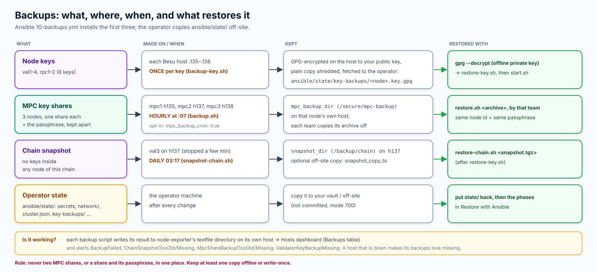

# 재해 복구

> **내용:** 무엇을 언제 백업하는지, 백업을 감시하는 알림, 시나리오별 복구 단계, 그리고 훈련을 설명합니다.
>
> **대상:** 운영자.
>
> **관련 문서:** [Ansible로 복원](restore.md) · [알림](alerts.md) · [GPG 키](../deployment/gpg-key.md)

**목차**

- [1. 역할과 연락처](#1-roles-and-contacts)
- [2. 반드시 보존해야 하는 것과 그 위치](#2-what-must-survive-and-where-it-is)
- [3. 백업 일정](#3-backup-schedule)
- [4. 복구 목표](#4-recovery-objectives)
- [5. 초기 대응 (모든 장애)](#5-first-response-any-incident)
- [6. 절차](#6-procedures)
- [7. 모든 복구 후: 점검 목록](#7-after-any-recovery-checklist)
- [8. 훈련](#8-drills)

---

무엇을 백업할지, 백업이 작동하는지 어떻게 알 수 있는지, 그리고 손실 유형별로 복구하는 정확한
단계를 설명합니다. 5대 호스트 프로덕션 구성([프로덕션 구성](../overview/production-layout.md))의
`besu-production/`, `mpc-signer/deploy/`, `proxy/`, `chainlens/`, `monitoring/` 및 `ha/`를 다룹니다.

| 호스트 | 실행 항목 |
|---|---|
| 192.168.68.135 | val1, rpc1, coord1, proxy1 (활성), mpc1, HAProxy + keepalived |
| 192.168.68.136 | val2, rpc2, coord2, proxy2 (대기), HAProxy + keepalived |
| 192.168.68.137 | val3, mpc2 (일일 체인 스냅샷 생성) |
| 192.168.68.138 | val4, mpc3 |
| 192.168.68.139 | Prometheus, Grafana (`:3000`), chainlens (`:30100`), Remix IDE (`:30200`), 문서 웹사이트 (`:30300`) |

이 페이지와 연락처 목록은 **인쇄본 또는 오프라인 사본**으로 보관하십시오. 재해 중에는 저장소, 위키
또는 네트워크를 사용할 수 없을 수 있습니다.

## 1. 역할과 연락처 {#1-roles-and-contacts}

운영 시작 전에 작성하십시오.

| 역할 | 담당 업무 | 이름 / 전화 |
|---|---|---|
| 장애 책임자 | 결정, 조율, 소통 | |
| Besu 운영자 | 네트워크 파일, 검증자 투표 | |
| 검증자 호스트 팀 | 각자의 호스트, 각자의 검증자 키 | |
| MPC 노드 팀 0 / 1 / 2 | 각자의 노드, 그 백업, 그 암호문(별도 보관) | |
| 애플리케이션 팀 | 프록시, 코디네이터, chainlens | |

**규칙:** 누구도 MPC 키 조각 두 개, 또는 키 조각 하나와 그 암호문을 함께 보유해서는 안 됩니다.

## 2. 반드시 보존해야 하는 것과 그 위치 {#2-what-must-survive-and-where-it-is}

| 항목 | 백업 없이 잃었을 때 | 백업 | 보관 위치 |
|---|---|---|---|
| **MPC 키 조각** (노드 3개) | 노드 1개: 더 이상 이중화가 없습니다. **노드 2개: 모든 MPC 계정의 자금이 영구히 손실됩니다.** | `mpc-signer/deploy/node/backup.sh`, 노드별 **매시간** | 해당 노드 팀의 저장소 + 외부 보관. **암호문은 별도로 보관** |
| **검증자 키** (4개) | 1개: 투표로 교체합니다. **4개 중 2개를 동시에: 체인이 영구히 멈춥니다**(교체 투표를 위한 쿼럼이 없음) | `besu-production/node/backup-key.sh`, **한 번**, 이후 암호화(Ansible: GPG 공개 키로) | 각 팀의 보관소 + 외부 보관. Ansible: `ansible/state/key-backups/` |
| **RPC 노드 키** | 새 키를 쓰면 모든 노드에 새 네트워크 파일이 필요합니다 | `backup-key.sh` (`node-key`로 기록됨) | 운영자 보관소. Ansible: `ansible/state/key-backups/` |
| **네트워크 파일** (`genesis.json`, `static-nodes.json`, `permissions_config.toml`, `SHA256SUMS`) | `genesis.json`은 동일하게 다시 생성할 수 없습니다 | 변경할 때마다 `network/` 복사 | 운영자 보관소 + 외부 보관 |
| **체인 데이터** | 모든 노드를 잃음 = 모든 잔액과 NFT를 잃음 | `besu-production/node/snapshot-chain.sh`, **매일** | 외부 보관(`COPY_TO`) |
| **설정과 시크릿** (각 호스트의 `.env`, `cluster.json`, 프록시 `.env`) | 서비스를 동일하게 재구성할 수 없습니다. MPC 암호문 분실 = 키 조각 분실 | 변경할 때마다 복사 | 각 팀의 보관소 |
| 프록시, chainlens, Redis | 잃을 것이 없습니다: git에서 다시 배포합니다(Redis는 캐시일 뿐이며, NFT 메타데이터는 체인에 있음) | — | — |
| 모니터링 | 기록만 잃습니다(설정은 git에 있음) | — | — |

**외부 보관**은 다른 건물 또는 다른 클라우드 계정을 뜻하며, 적어도 하나의 사본은 **오프라인 또는
한 번만 쓰기(write-once)** 여야 합니다(랜섬웨어는 접근할 수 있는 모든 백업을 암호화합니다).

## 3. 백업 일정 {#3-backup-schedule}



| 대상 | 명령(해당 호스트의 디렉터리에서) | 시기(cron 예시) |
|---|---|---|
| 체인 스냅샷 | **val3 (.137)** 에서: `COPY_TO=user@offsite:/besu-chain`과 함께 `./snapshot-chain.sh /backup/chain` | 매일: `17 3 * * * cd /opt/besu-val3 && COPY_TO=… ./snapshot-chain.sh /backup/chain`. Ansible(`10-backups.yml`)은 이 cron을 `snapshot_dir` 및 `snapshot_copy_to`와 함께 `snapshot_cron_hour`:`snapshot_cron_minute`(03:17)에 설치하고, 스냅샷이 없으면 첫 스냅샷을 생성합니다(`snapshot_first_run`) |
| MPC 키 조각 | mpc1 (.135), mpc2 (.137), mpc3 (.138)에서 각 팀이 `./backup.sh /secure/backup` 실행 | 매시간, 예: `7 * * * * /opt/mpc-node/backup.sh /secure/backup`. Ansible은 `mpc_backup_cron: true`인 경우에만 설치합니다(노드는 각 팀의 소유이므로 기본값은 꺼짐): 매시 :07에 `mpc_backup_dir`로, 그리고 첫 백업. 아카이브는 노드의 호스트에 남으므로 각 팀이 외부로 복사합니다 |
| 노드 키 | Ansible(`10-backups.yml`, `key_backup_gpg_public_key`): 호스트에서 GPG 공개 키로 암호화하고, 평문 사본은 파쇄하며, `ansible/state/key-backups/<node>.key.gpg`로 가져옵니다([노드 키 백업용 GPG 키](../deployment/gpg-key.md)). 수동: 6개 Besu 노드(val1–4, rpc1–2) 모두에서 `./backup-key.sh /secure/dir`을 실행한 다음 암호화하고 평문 사본을 삭제합니다 | 키당 한 번 |
| 네트워크 파일 | `cp -r network /secure/network-$(date +%F)` (운영자). Ansible을 사용하면 `ansible/state/`에 있습니다 | 변경할 때마다 |

**체인 스냅샷을 생성하는 노드:** 데이터를 아카이브하는 몇 분 동안 노드가 **중지**되므로, 구성에서는
**.137의 val3**을 사용합니다: 검증자이며(체인은 나머지 세 검증자로 계속됨), 호스트에 단독으로 있고
애플리케이션 경로에 있지 않습니다. rpc1은 사용하지 않습니다(프록시와 코디네이터에 서비스함). rpc2도
가능하지만, 장애 조치 대상이자 chainlens의 소스입니다. 스크립트는 모든 피어를 보지 못하는 노드(다른
노드가 이미 다운됨)는 중지하지 않으므로, 스냅샷 때문에 체인이 멈추지는 않습니다.

스냅샷에는 **키가 포함되지 않으며**, 같은 체인의 어느 노드에든 복원할 수 있습니다.

### 작동하고 있습니까? (모니터링) {#is-it-working-monitoring}

각 백업 스크립트(`snapshot-chain.sh`, `backup-key.sh`, MPC `backup.sh`)는 **자신의 호스트에 있는**
node-exporter의 textfile 디렉터리(`/var/lib/node_exporter/textfile`, `monitoring/node-exporter`의
기본값)의 파일에 결과를 기록합니다. **Hosts** 대시보드에는 **Backups** 표가 있으며, Prometheus
알림(`monitoring/prometheus/rules/backups.yml`, [알림](alerts.md#6-backups-backupsyml)에 설명됨)이
있습니다.

| 알림 | 발생 시점 |
|---|---|
| `BackupFailed` | 백업의 마지막 실행이 실패함 |
| `ChainSnapshotTooOld` / `ChainSnapshotMissing` | 2일 동안 / 한 번도 체인 스냅샷이 없음 |
| `MpcShareBackupTooOld` / `MpcShareBackupMissing` | MPC 노드가 2시간 동안 백업되지 않음 / 한 번이라도 백업된 노드가 3개 미만 |
| `ValidatorKeyBackupMissing` | 한 번도 백업되지 않은 검증자 키가 있음 |

결과는 각 호스트의 node-exporter가 게시하므로, **다운된 호스트는 그 백업이 누락된 것처럼 보이게
합니다**(예: .137 다운: `ChainSnapshotMissing`, MPC 호스트 다운: `MpcShareBackupMissing`). 백업
알림을 추적하기 전에 먼저 `HostDown`을 확인하십시오.

## 4. 복구 목표 {#4-recovery-objectives}

| 사건 | 데이터 손실 (RPO) | 복구 시간 (RTO, 대략) |
|---|---|---|
| 단일 노드 또는 호스트, 다른 노드는 정상 | 없음(피어에서 다시 동기화) | 30분 – 몇 시간, 주로 하드웨어 |
| MPC 노드 1개 | 없음(나머지 2개가 모든 키 조각을 보유) | 약 1시간 |
| 사이트 전체 | 체인: 마지막 **외부 보관 스냅샷** 이후(최대 1일), MPC: 마지막 백업 이후 | 하루 이상 |

## 5. 초기 대응 (모든 장애) {#5-first-response-any-incident}

1. **조치하기 전에 확인하십시오.** Grafana: 모든 대시보드의 Alerts 행, Besu: 가동 중인 검증자,
   마지막 블록 이후 초, MPC: 가동 중인 노드 대 임계값, Hosts: 어느 호스트가 다운되었는지. 각 알림의
   의미: [알림](alerts.md), 작은 문제의 증상과 해결 방법:
   [문제 해결](troubleshooting.md).
2. 모니터링 호스트에서: `./check-targets.sh`가 응답하지 않는 모든 노드를 나열합니다.
3. 아래 표로 **분류**하고, 장애 책임자를 지정하고, 다른 변경을 **동결**하십시오.
4. 실제 신호가 묻히지 않도록 후속 알림을 무음 처리하십시오(Alertmanager를 사용하는 경우).
5. 노드의 데이터가 필요 없다고 확신할 때까지 그 노드에서 `reset-chain.sh`, `docker volume rm` 또는
   `docker compose down -v`를 절대 실행하지 마십시오. 의심스러우면 먼저 복사하십시오.

| 보이는 상황 | 이동 |
|---|---|
| 검증자 하나가 다운, 블록은 계속됨 | [6.1](#61-one-validator-host-lost) |
| 호스트 .135 또는 .136 다운, 블록은 계속됨 | [6.2](#62-application-host-135-or-136-lost) |
| **블록 멈춤**: 검증자 호스트 두 대 다운 | [6.3](#63-two-validator-hosts-lost-blocks-stopped) |
| `MpcNodeDown`, 서명은 계속 작동 | [6.4](#64-one-mpc-node-lost) |
| `MpcBelowThreshold`, **서명 불가** | [6.5](#65-two-mpc-nodes-lost) |
| rpc1 또는 rpc2 다운, 또는 RPC 노드의 `BesuNodeStalled` | [6.3b](#63b-an-rpc-node-lost) |
| 코디네이터 / 프록시 / chainlens 다운 | [6.6](#66-coordinator-proxy-chainlens-or-monitoring-host-lost) |
| 모든 것이 다운 | [6.7](#67-whole-site-lost) |
| 침입 / 랜섬웨어 의심 | [6.8](#68-intrusion-or-ransomware) |

## 6. 절차 {#6-procedures}

모든 Besu 명령은 노드의 디렉터리(예: `/opt/besu-val3`)에서 실행합니다. 이 디렉터리에는
`besu-production/node` 파일, 해당 노드의 `.env` 및 `network/`가 있습니다.

### 6.1 검증자 호스트 하나 손실 {#61-one-validator-host-lost}

체인은 검증자 4개 중 3개로 계속됩니다. 이 검증자가 복구될 때까지 다른 검증자를 중지하지 마십시오.

1. **같은 IP**(네트워크 파일의 enode에 포함됨), Docker와 Compose, 방화벽 규칙(`ha/firewall-layout.sh <host number>`,
   또는 Ansible: [Ansible로 복원](restore.md))을 갖춘 호스트를 준비합니다.
2. 노드 패키지, 해당 `.env`(보관소에서: 같은 `NODE_NAME`, 포트, `BESU_ROLE`) 및 네트워크 파일 4개를
   `network/`에 복사합니다.
3. 키를 복원하고(먼저 백업을 복호화) 시작합니다. Ansible이 만든 백업
   (`ansible/state/key-backups/<node>.key.gpg`)은 오프라인 GPG 개인 키로 복호화합니다.
   예: `gpg --decrypt val3.key.gpg > val3.key` ([노드 키 백업용 GPG 키](../deployment/gpg-key.md),
   5단계). 결과를 SSH로 호스트에 복사하고, 복원이 끝나면 모든 곳에서 파쇄합니다
   (`shred -u val3.key`):
   ```bash
   ./restore-key.sh /secure/validator3.key        # prints the enode; must say "OK: … in static-nodes.json"
   ./start.sh                                     # syncs from the other nodes
   ```
4. 확인합니다(`qbft.sh`는 `besu-production/operator/`에 있으며, .135/.136에서 검증자의 `RPC_PORT`는 8645입니다):
   ```bash
   RPC=http://127.0.0.1:<RPC_PORT> /opt/besu-chain/besu-production/operator/qbft.sh health
   ```
   블록 번호가 증가하고 피어 수가 노드 수 − 1이어야 합니다.

**키 분실(백업 없음):** `./init.sh`(새 키)를 실행한 다음, 운영자 측에서
`operator/add-node.sh network/ <new node>.json`을 실행하고, 네트워크 파일을 모든 노드에 배포하고,
노드를 하나씩 재시작한 후 투표합니다: 검증자의 절반 초과에서 `qbft.sh propose 0x<new address> true`,
그다음 `qbft.sh propose 0x<old address> false`. [Besu 프로덕션 패키지](../deployment/besu-manual.md#operations)를
참조하십시오.

**새 IP(같은 키):** 운영자가 네트워크 파일(`static-nodes.json`, `permissions_config.toml`,
`SHA256SUMS`)에서 해당 enode의 `@<ip>:<port>`를 갱신합니다:
`operator/move-node.sh network/ <node>.json <new IP:port>`. 4개 파일을 **모든** 노드에 복사하고
다른 노드를 하나씩 재시작한 다음, 새 호스트에서 노드를 시작합니다. `genesis.json`은 절대 변경하지
말고, 하나의 키를 두 호스트에서 동시에 실행하지 마십시오.

### 6.2 애플리케이션 호스트(.135 또는 .136) 손실 {#62-application-host-135-or-136-lost}

**블록은 계속되고**(검증자 4개 중 3개), 서명도 계속됩니다(.135를 잃은 경우 MPC 노드 3개 중 2개).
**.135**였다면 keepalived가 몇 초 안에 두 플로팅 IP를 모두 .136으로 옮깁니다: 그곳의 HAProxy가 Besu
RPC를 **rpc2**로, 서명을 **coord2**로 보내고, **proxy2**가 시작됩니다. 애플리케이션에는 몇 초간 요청
실패가 보입니다. **.136**이었다면 애플리케이션에는 아무 변화도 없으며, 대기 호스트만 사라진 것입니다.

1. 장애 조치가 작동했는지 확인합니다: .136에서 `ip -br addr | grep -E '68\.15[01]/'`가 두 VIP를
   모두 나열하고, `curl -s http://192.168.68.151:30000/status/senders`가 응답하며, Grafana에 블록과
   서명이 표시됩니다.
2. 잃은 호스트를 **같은 IP**로 재구성합니다: 해당 호스트의 Besu 노드는 6.1과 같이(val과 rpc, 각각
   `restore-key.sh`와 `start.sh`, 큰 체인이면 먼저 `restore-chain.sh`), mpc1은 6.4와 같이(.135만),
   코디네이터와 프록시(6.6), `besu-rpc-health`, HAProxy 및 keepalived
   ([고가용성](../deployment/high-availability.md)). Ansible 사용 시: [Ansible로 복원](restore.md)
   또는 `ansible-playbook site.yml`.
3. VIP는 .136에 **그대로 남습니다**(`nopreempt`). 재구성한 호스트에서 프록시는 중지되어 있습니다
   (`docker ps -a`에 `Exited (137)`로 표시): `check-proxy.sh`가 `.151`이 없는 호스트의 프록시를
   중지하는 것이며, 이는 예상된 동작입니다. 한가한 시간에 .136에서 VIP를 다시 옮기십시오:
   ```bash
   systemctl restart keepalived
   ```

### 6.3 검증자 호스트 두 대 손실 (블록 멈춤) {#63-two-validator-hosts-lost-blocks-stopped}

**블록이 멈춥니다**(검증자 4개 중 2개). 우선순위: 두 검증자 중 **하나**를 복구하면 블록이 재개됩니다.
다른 모든 것은 블록에 의존합니다.

1. **같은 IP**의 대체 호스트(또는 6.1의 "새 IP"를 따르십시오).
2. 6.1의 2–3단계와 같이 검증자를 복원합니다(`restore-key.sh` + `start.sh`).
3. 검증자 3개가 피어를 가지면 블록이 재개됩니다. **약 1분 안에 새 블록이 없으면**, 장애 동안 검증자의
   QBFT 라운드가 서로 어긋난 것입니다: **네 검증자 모두를 동시에** 재시작하십시오(각 디렉터리에서
   `docker compose restart`). 잃는 것은 없습니다. 테스트에서는 약 25 s 안에 블록이 재개되었습니다.
4. 그다음 해당 호스트에서 실행되던 나머지 모든 것(MPC 노드 6.4/6.5, RPC 노드, 코디네이터, 프록시 6.6).

**두 검증자의 키를 모두 잃은 경우:** 체인은 계속될 수 없습니다(쿼럼이 없으므로 교체 투표도 불가).
복구는 **새 체인**을 의미합니다: 잔액을 다시 생성한 새 제네시스이며, 이는 런북의 단계가 아니라 비즈니스
결정입니다. 그래서 검증자 키 백업은 필수입니다.

### 6.3b RPC 노드 하나 손실 {#63b-an-rpc-node-lost}

블록은 계속됩니다. **rpc1**이라면 HAProxy가 이미 Besu RPC를 **rpc2**로 보냅니다(약 6 s 이내).
**rpc2**라면 chainlens의 갱신이 멈춥니다(임시로 `BESU_RPC`를 rpc1로 지정하십시오).

**정지된 RPC 노드**(응답은 하지만 블록 가져오기를 중단함, 알림 `BesuNodeStalled`)는 .135/.136의
`besu-rpc-health`가 처리합니다: 최신 블록이 `rpc_max_block_age`(30 s)보다 오래되거나
`rpc_max_blocks_behind`(10)블록 넘게 뒤처지면 RPC VIP에서 빠지고, `rpc_auto_restart_minutes`(5) 후
`docker restart`로 재시작됩니다. 판단 결과를 확인하십시오:

```bash
curl -s http://127.0.0.1:8410/
```

계속 정지되면 피어(`BesuPeersLow`)와
[문제 해결](troubleshooting.md#rpc-and-the-rpc-vip)을 확인하십시오.

6.1과 같이 재구성합니다(같은 IP, 백업된 노드 키로 `restore-key.sh`, `start.sh`). 큰 체인이면 전체
동기화를 건너뛰도록 먼저 최신 스냅샷을 복원하십시오:
`./restore-key.sh …` → `./restore-chain.sh /backup/chain/besu-chain-…tgz` (노드를 시작함).

### 6.4 MPC 노드 하나 손실 {#64-one-mpc-node-lost}

서명은 나머지 두 노드로 계속됩니다(사전 서명 풀이 다시 채워질 때까지 느림). `/createaccount`는 세
노드가 모두 가동될 때까지 실패합니다. 더 이상 이중화가 없으므로 **오늘 안에 해결하십시오**.

1. 새 호스트. 이전과 같은 `.env`(`MPC_NODE_ID`, **같은** `MPC_NODE_PASSPHRASE`, 토큰)와 같은
   `cluster.json`.
2. 복원하고 시작합니다:
   ```bash
   cd /opt/mpc-node
   docker compose down
   ./restore.sh /secure/backup/mpc-node1-<time>.tgz
   docker compose up -d
   ```
3. 노드의 **IP가 변경된** 경우: `cluster.json`에서 해당 `url`을 갱신하고, 모든 팀과
   `sha256sum cluster.json`을 비교하고, 모든 노드와 코디네이터에 복사한 다음 하나씩 재시작합니다.
4. 코디네이터에서: `POST /admin/pool/clear`(관리자 토큰)를 실행한 다음 MPC 대시보드를 확인합니다:
   가동 중인 노드 = 3.
5. 해당 백업 **이후에** 생성된 계정: 이 노드에는 그 키 조각이 없습니다(나머지 두 노드에는 여전히 있으므로
   서명은 가능). 지금 모든 노드에서 새 백업을 만들고, 해당 계정의 완전한 이중화를 되찾으려면 그
   자금을 새 키로 옮길 계획을 세우십시오.

**해당 노드의 백업 또는 암호문이 없는 경우:** 3개 중 2개로 서명은 계속 가능하지만, 이중화는 영구히
사라집니다(라이브러리가 키를 다시 분배할 수 없음). 새 클러스터를 구축하고 모든 자금을 옮기십시오:
[프로덕션 MPC 서명기, 14단계](../deployment/mpc-signer-production.md#14-if-a-share-is-lost-for-good).

### 6.5 MPC 노드 두 개 손실 {#65-two-mpc-nodes-lost}

**서명이 불가능합니다.** 두 노드를 각 팀의 백업에서 복원하십시오(6.4, 각 팀이 자신의 노드를 담당).
**두** 노드가 가동되는 즉시 서명이 다시 작동합니다.

- 둘 중 하나를 복원할 수 없는 경우: 남은 두 노드로 **즉시 모든 자금을** 새 클러스터로 옮기십시오
  ([프로덕션 MPC 서명기, 14단계](../deployment/mpc-signer-production.md#14-if-a-share-is-lost-for-good)).
  장애 한 번이면 자금을 잃게 됩니다.
- 둘 다 복원할 수 없는 경우: MPC 계정의 자금은 손실됩니다. 그래서 각 노드는 자체 팀이 매시간 외부
  보관으로 백업합니다.

### 6.6 코디네이터, 프록시, chainlens 또는 모니터링 호스트 손실 {#66-coordinator-proxy-chainlens-or-monitoring-host-lost}

네 가지 모두 상태가 없습니다: git과 저장해 둔 `.env` / `cluster.json`으로 다시 배포합니다. 코디네이터와
프록시는 .135/.136에 쌍둥이가 있습니다: HAProxy와 keepalived가 자동으로 쌍둥이로 전환하므로
([고가용성](../deployment/high-availability.md)) 잃은 것을 재구성하는 일이 급하지는 않지만, 복구될
때까지 이중화가 없습니다.

| 구성 요소 | 재구성 | 확인 |
|---|---|---|
| MPC 코디네이터 (coord1 .135 / coord2 .136) | `mpc-signer/deploy/coordinator`: `.env`(자체 `MPC_BIND_IP`, `MPC_RELAY_URL`), `cluster.json`, `docker compose up -d` | 로그 `keys loaded from nodes`, MPC 대시보드에서 두 코디네이터 모두 UP |
| 프록시 (proxy1 .135 / proxy2 .136) | `proxy/`: `.env`, `docker compose build`. **수동으로 시작하지 마십시오**: keepalived가 `.151`을 가진 호스트에서 시작합니다 | `GET http://192.168.68.151:30000/status/senders`: 공백 없음, 정지 없음. 테스트 송금 |
| Chainlens (.139) | `chainlens/`: `.env`(`BESU_RPC` = rpc2), `docker compose up -d --build`. Deploy 페이지를 사용하는 경우 그 기록(`/var/lib/chainlens/deployments`)을 보존하십시오 | 블록 0부터 저절로 다시 인덱싱합니다 |
| Remix IDE (.139) | Ansible `12-remix.yml` ([Remix IDE](../components/remix.md)) | `:30200`에서 열림 |
| 문서 웹사이트 (.139) | Ansible `13-docs-site.yml` ([문서 웹사이트](../components/docs-site.md)) | `:30300`에서 열림 |
| 모니터링 (.139) | `monitoring/`: 메트릭 토큰과 대상으로 `setup.sh`, `docker compose up -d` | `./check-targets.sh`. 손실 이전의 기록은 사라짐 |

### 6.7 사이트 전체 손실 {#67-whole-site-lost}

모든 것이 다운되었습니다. Ansible 배포를 사용하는 경우
**[Ansible로 복원](restore.md)** 을 따르십시오(같은 단계이며, Ansible이 먼저 호스트를 준비하고 복원 후
마무리합니다). 수동으로 할 때는 다음 순서로 진행하십시오. 각 단계는 이전 단계가 필요합니다.

1. **호스트와 네트워크:** **같은 IP**의 대체 호스트(그렇지 않으면 각 노드에 대해 6.1의 "새 IP"를
   따르십시오), 사설 네트워크, 방화벽, Docker.
2. **Besu, 모든 노드**, 각 노드 디렉터리에서(패키지 + `.env` + 운영자 보관소의 네트워크 파일 4개):
   ```bash
   ./restore-key.sh /secure/<node>.key                          # every node, validators first
   ./restore-chain.sh --yes /backup/chain/besu-chain-…tgz       # same latest snapshot on every node; starts it
   ```
   모든 노드에 스냅샷을 복원하면 각 노드가 블록 0부터 동기화하지 않아도 됩니다. (또는 한 노드에만
   복원하고 다른 노드는 그 노드에서 동기화하게 할 수 있습니다.)
3. **블록 확인:** 검증자에서 `qbft.sh health` → 높이가 스냅샷 블록보다 높고 증가해야 합니다.
   1분 안에 새 블록이 없으면 → 모든 검증자를 함께 재시작하십시오(6.3의 3단계 참조).
4. **MPC 노드:** 각 팀이 자신의 노드를 복원합니다(6.4의 1–2단계). 그다음 코디네이터(6.6).
5. **프록시, chainlens, 모니터링** (6.6).
6. **조정:** 체인은 스냅샷의 블록으로 돌아갑니다. 그 이후의 모든 것은 **사라집니다**: 송금, NFT 민팅과
   판매, 계정 자금 제공. 비즈니스 기록과 비교하여 다시 해야 할 것을 다시 하십시오. 프록시는 논스를
   체인에서 스스로 가져옵니다. 스냅샷 이후 생성된 MPC 계정은 여전히 키를 가지고 있지만(MPC 백업이 더
   최신인 경우), 체인상의 자금 제공은 사라졌습니다.

### 6.8 침입 또는 랜섬웨어 {#68-intrusion-or-ransomware}

1. 영향을 받은 호스트를 네트워크에서 **격리**하십시오. 아직 지우지 마십시오(증거).
2. 영향을 받은 호스트는 **깨끗한 이미지에서** 재구성하고, 침해된 시스템에서는 절대 재구성하지 마십시오.
3. 침입 **이전에** 만든 **오프라인 / 외부 보관** 사본에서 복원하십시오(6.1–6.7).
4. 공격자가 읽었을 수 있는 **모든 시크릿을 교체**하십시오: `MPC_NODE_TOKEN`, `MPC_ADMIN_TOKEN`,
   `MPC_METRICS_TOKEN`, `ansible/state/secrets/`의 다른 파일(프록시 관리자 토큰, chainlens 배포 토큰,
   VRRP 비밀번호), Grafana 비밀번호, SSH 키, 클라우드 자격 증명.
5. **MPC:** 공격자가 한 노드의 키 조각 **과** 그 암호문을 얻었을 수 있다면, 자금은 여전히 안전하지만
   (키 조각 두 개가 필요함) 여유를 되찾기 위해 새 클러스터로 옮기십시오
   ([프로덕션 MPC 서명기, 14단계](../deployment/mpc-signer-production.md#14-if-a-share-is-lost-for-good)).
   두 노드가 침해되었을 수 있다면 **즉시** 자금을 옮기십시오.
6. 검증자 키 도난: 해당 검증자를 투표로 제외하고 새 검증자를 투표로 추가하십시오(6.1 "키 분실").

## 7. 모든 복구 후: 점검 목록 {#7-after-any-recovery-checklist}

- [ ] Grafana: 발생 중인 알림 없음. 가동 중인 검증자 = 4, 가동 중인 노드가 예상대로, 매 주기마다 블록 생성
- [ ] 모든 Besu 노드의 피어 = 노드 수 − 1 (Nodes 표)
- [ ] 각 VIP를 정확히 한 호스트가 보유(.135와 .136에서 `ip -br addr | grep -E '68\.15[01]/'`)하고,
      두 호스트에서 `curl -s http://127.0.0.1:8410/`이 RPC 노드가 정상임을 표시
- [ ] MPC: 노드 3개 가동, 풀 보충 중, 테스트 서명(코디네이터에서 `eth_signTransaction`)
- [ ] 프록시: 공백이나 정지 없는 `GET /status/senders`. 테스트 송금 하나가 채굴됨
- [ ] chainlens가 최신 블록을 표시
- [ ] **지금 새 백업을 만드십시오**: 체인 스냅샷, 모든 노드의 MPC 백업, 새 노드의 키
- [ ] 무슨 일이 있었는지, 각 단계가 얼마나 걸렸는지, 이 런북에서 무엇을 개선할지 기록

## 8. 훈련 {#8-drills}

한 번도 복원해 보지 않은 백업은 검증된 것이 아닙니다. **분기마다**, 프로덕션 네트워크에 연결되지
**않은** **테스트 호스트**에서 다음을 수행하십시오:

| 훈련 | 방법 | 통과 기준 |
|---|---|---|
| 체인 스냅샷 | 노드 패키지와 `network/`를 테스트 호스트에 복사하고, `./init.sh`, `./restore-chain.sh --yes <latest snapshot>` | 노드가 시작되고 `eth_blockNumber`가 스냅샷의 블록을 반환합니다(피어가 없지만 예상된 것입니다) |
| MPC 키 조각 백업 | 각 팀: 자체 테스트 호스트에서 같은 `.env`를 가진 새 노드 디렉터리에 최신 아카이브를 `restore.sh`로 복원하고, 클러스터로의 네트워크 접근 **없이** 시작 | 로그에 예상된 계정 수의 `keys=`와 `has_aux=true`가 있는 `node loaded`가 표시됩니다 |
| 검증자 키 | 백업을 복호화하고, 해당 노드의 `.env`와 네트워크 파일이 있는 임시 디렉터리에 `./restore-key.sh` | `OK: this enode is in network/static-nodes.json`을 출력합니다 |
| 연락처 | 1장의 모든 번호로 전화 | 모두 연락 가능 |

각 훈련의 날짜와 결과를 기록하십시오.
