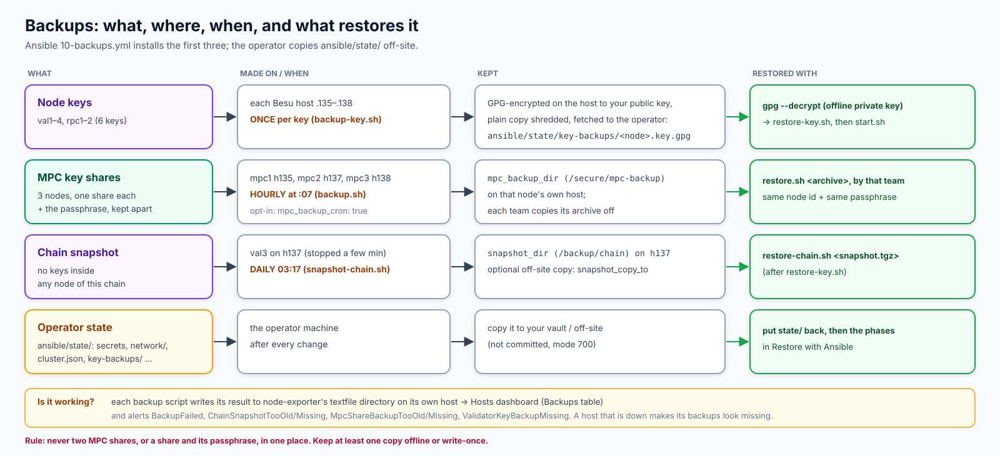

# Disaster recovery

> **What:** What is backed up and when, the alerts that watch the backups, recovery steps per scenario, and drills.
>
> **For:** operators.
>
> **Related:** [restore with Ansible](restore.md) · [alerts](alerts.md) · [GPG key](../deployment/gpg-key.md)

**Contents**

- [1. Roles and contacts](#1-roles-and-contacts)
- [2. What must survive, and where it is](#2-what-must-survive-and-where-it-is)
- [3. Backup schedule](#3-backup-schedule)
- [4. Recovery objectives](#4-recovery-objectives)
- [5. First response (any incident)](#5-first-response-any-incident)
- [6. Procedures](#6-procedures)
- [7. After any recovery: checklist](#7-after-any-recovery-checklist)
- [8. Drills](#8-drills)

---

What to back up, how to know the backups work, and the exact steps to recover from each kind of
loss. It covers `besu-production/`, `mpc-signer/deploy/`, `proxy/`, `chainlens/`, `monitoring/`
and `ha/`, in the 5-host production layout ([Production layout](../overview/production-layout.md)):

| Host | Runs |
|---|---|
| 192.168.68.135 | val1, rpc1, coord1, proxy1 (active), mpc1, HAProxy + keepalived |
| 192.168.68.136 | val2, rpc2, coord2, proxy2 (standby), HAProxy + keepalived |
| 192.168.68.137 | val3, mpc2 (takes the daily chain snapshot) |
| 192.168.68.138 | val4, mpc3 |
| 192.168.68.139 | Prometheus, Grafana (`:3000`), chainlens (`:30100`), Remix IDE (`:30200`), documentation website (`:30300`) |

Keep a **printed or offline copy** of this page and of the contact list: during a disaster the
repository, the wiki or the network may be unavailable.

## 1. Roles and contacts

Fill in before going live.

| Role | Responsible for | Name / phone |
|---|---|---|
| Incident lead | decides, coordinates, communicates | |
| Besu operator | network files, validator votes | |
| Validator host teams | their host, their validator key | |
| MPC node team 0 / 1 / 2 | their node, its backup, its passphrase (separately) | |
| Application team | proxy, coordinator, chainlens | |

**Rule:** no single person ever holds two MPC shares, or one share and its passphrase.

## 2. What must survive, and where it is

| Item | Loss without a backup | Backup | Where it's kept |
|---|---|---|---|
| **MPC key shares** (3 nodes) | 1 node: no redundancy left. **2 nodes: all MPC accounts' funds lost forever.** | `mpc-signer/deploy/node/backup.sh`, **hourly**, per node | that node team's storage + off-site; **passphrase stored separately** |
| **Validator keys** (4) | 1: replace by vote. **2 of 4 at once: the chain stops for good** (no quorum to vote replacements) | `besu-production/node/backup-key.sh`, **once**, then encrypted (Ansible: to your GPG public key) | each team's vault + off-site; Ansible: `ansible/state/key-backups/` |
| **RPC node keys** | new key needs new network files on every node | `backup-key.sh` (recorded as `node-key`) | operator vault; Ansible: `ansible/state/key-backups/` |
| **Network files** (`genesis.json`, `static-nodes.json`, `permissions_config.toml`, `SHA256SUMS`) | `genesis.json` can't be regenerated identically | copy of `network/`, after each change | operator vault + off-site |
| **Chain data** | all nodes lost = every balance and NFT lost | `besu-production/node/snapshot-chain.sh`, **daily** | off-site (`COPY_TO`) |
| **Settings and secrets** (`.env` of each host, `cluster.json`, proxy `.env`) | services can't be rebuilt identically; a lost MPC passphrase = a lost share | copy after each change | each team's vault |
| Proxy, chainlens, Redis | nothing to lose: redeploy from git (Redis is only a cache, NFT metadata is on chain) | — | — |
| Monitoring | history only (config is in git) | — | — |

**Off-site** means a different building or cloud account, and at least one copy **offline or
write-once** (ransomware encrypts every backup it can reach).

## 3. Backup schedule



| What | Command (from that host's directory) | When (cron example) |
|---|---|---|
| Chain snapshot | on **val3 (.137)**: `./snapshot-chain.sh /backup/chain` with `COPY_TO=user@offsite:/besu-chain` | daily: `17 3 * * * cd /opt/besu-val3 && COPY_TO=… ./snapshot-chain.sh /backup/chain`. Ansible (`10-backups.yml`) installs this cron at `snapshot_cron_hour`:`snapshot_cron_minute` (03:17) with `snapshot_dir` and `snapshot_copy_to`, and takes a first snapshot when none exists (`snapshot_first_run`) |
| MPC shares | `./backup.sh /secure/backup` on mpc1 (.135), mpc2 (.137), mpc3 (.138), each by its team | hourly, e.g. `7 * * * * /opt/mpc-node/backup.sh /secure/backup`. Ansible installs it only with `mpc_backup_cron: true` (off by default: the nodes belong to their teams): hourly at :07 into `mpc_backup_dir`, plus a first backup. The archives stay on the node's host: each team copies them off |
| Node keys | Ansible (`10-backups.yml`, `key_backup_gpg_public_key`): encrypted on the host to your GPG public key, plain copy shredded, fetched to `ansible/state/key-backups/<node>.key.gpg` ([GPG key for the node-key backups](../deployment/gpg-key.md)). By hand: `./backup-key.sh /secure/dir` on all 6 Besu nodes (val1–4, rpc1–2), then encrypt and delete the plain copy | once per key |
| Network files | `cp -r network /secure/network-$(date +%F)` (operator); with Ansible they are in `ansible/state/` | after every change |

**Which node takes the chain snapshot:** it is **stopped** for a few minutes while its data is
archived, so the layout uses **val3 on .137**: a validator (the chain continues with the other
three) that is alone on its host and not on the application path. Not rpc1 (it serves the proxy
and coordinators); rpc2 would also work, but it is the failover target and chainlens' source. The script refuses to stop a node that doesn't see all its peers (another node is
already down), so a snapshot can't halt the chain.

The snapshot contains **no keys** and can be restored onto any node of the same chain.

### Is it working? (monitoring)

Each backup script (`snapshot-chain.sh`, `backup-key.sh`, MPC `backup.sh`) records its result in
a file in node-exporter's textfile directory **on its own host** (`/var/lib/node_exporter/textfile`,
the default in `monitoring/node-exporter`). The **Hosts** dashboard shows a **Backups** table, and
Prometheus alerts (`monitoring/prometheus/rules/backups.yml`, explained in
[Alerts](alerts.md#6-backups-backupsyml)):

| Alert | When |
|---|---|
| `BackupFailed` | the last run of a backup failed |
| `ChainSnapshotTooOld` / `ChainSnapshotMissing` | no chain snapshot in 2 days / ever |
| `MpcShareBackupTooOld` / `MpcShareBackupMissing` | an MPC node not backed up in 2 hours / fewer than 3 nodes ever backed up |
| `ValidatorKeyBackupMissing` | a validator key has never been backed up |

Because the results are published by each host's node-exporter, **a host that is down makes its
backups look missing** (e.g. .137 down: `ChainSnapshotMissing`; an MPC host down:
`MpcShareBackupMissing`). Check `HostDown` first before chasing a backup alert.

## 4. Recovery objectives

| Event | Data loss (RPO) | Time to recover (RTO, rough) |
|---|---|---|
| Any single node or host, other nodes alive | none (they re-sync from peers) | 30 min – a few hours, mainly hardware |
| One MPC node | none (other 2 hold every share) | ~1 h |
| Whole site | chain: since the last **off-site snapshot** (up to 1 day); MPC: since the last backup | a day or more |

## 5. First response (any incident)

1. **Look before acting.** Grafana: the Alerts row on any dashboard; Besu: validators up, seconds
   since last block; MPC: nodes up vs threshold; Hosts: which hosts are down. What each alert
   means: [Alerts](alerts.md); symptoms and fixes for smaller problems:
   [Troubleshooting](troubleshooting.md).
2. On the monitoring host: `./check-targets.sh` lists every node that doesn't answer.
3. **Classify** with the table below, name an incident lead, **freeze** other changes.
4. Silence follow-on alerts (if Alertmanager is used) so the real signal isn't buried.
5. Never run `reset-chain.sh`, `docker volume rm` or `docker compose down -v` on a node until you are
   sure its data isn't needed. Copy first if in doubt.

| What you see | Go to |
|---|---|
| one validator down, blocks continue | [6.1](#61-one-validator-host-lost) |
| host .135 or .136 down, blocks continue | [6.2](#62-application-host-135-or-136-lost) |
| **blocks stopped**: two validator hosts down | [6.3](#63-two-validator-hosts-lost-blocks-stopped) |
| `MpcNodeDown`, signing still works | [6.4](#64-one-mpc-node-lost) |
| `MpcBelowThreshold`, **no signatures** | [6.5](#65-two-mpc-nodes-lost) |
| rpc1 or rpc2 down, or `BesuNodeStalled` on an RPC node | [6.3b](#63b-an-rpc-node-lost) |
| coordinator / proxy / chainlens down | [6.6](#66-coordinator-proxy-chainlens-or-monitoring-host-lost) |
| everything down | [6.7](#67-whole-site-lost) |
| suspected intrusion / ransomware | [6.8](#68-intrusion-or-ransomware) |

## 6. Procedures

All Besu commands run in the node's directory (e.g. `/opt/besu-val3`), which holds the
`besu-production/node` files, its `.env` and `network/`.

### 6.1 One validator host lost

The chain continues with 3 of 4 validators. Don't take another validator down until this one is
back.

1. Prepare a host with the **same IP** (the enode in the network files contains it), Docker and
   Compose, firewall rules (`ha/firewall-layout.sh <host number>`, or Ansible: [Restore with Ansible](restore.md)).
2. Copy the node package, its `.env` (from the vault: same `NODE_NAME`, ports, `BESU_ROLE`) and the
   4 network files into `network/`.
3. Restore its key (decrypt the backup first) and start. A backup made by Ansible
   (`ansible/state/key-backups/<node>.key.gpg`) is decrypted with your offline GPG private key,
   e.g. `gpg --decrypt val3.key.gpg > val3.key` ([GPG key for the node-key backups](../deployment/gpg-key.md),
   step 5); copy the result to the host over SSH, and shred it everywhere once restored
   (`shred -u val3.key`):
   ```bash
   ./restore-key.sh /secure/validator3.key        # prints the enode; must say "OK: … in static-nodes.json"
   ./start.sh                                     # syncs from the other nodes
   ```
4. Check (`qbft.sh` is in `besu-production/operator/`; on .135/.136 the validator's `RPC_PORT` is 8645):
   ```bash
   RPC=http://127.0.0.1:<RPC_PORT> /opt/besu-chain/besu-production/operator/qbft.sh health
   ```
   Expect the block number rising and peers = nodes − 1.

**Key lost (no backup):** run `./init.sh` (new key), then on the operator side
`operator/add-node.sh network/ <new node>.json`, distribute the network files to every node,
restart them one at a time, and vote: `qbft.sh propose 0x<new address> true` on more than half of
the validators, then `qbft.sh propose 0x<old address> false`. See
[Besu production packages](../deployment/besu-manual.md#operations).

**New IP (same key):** the operator updates that enode's `@<ip>:<port>` in the network files
(`static-nodes.json`, `permissions_config.toml`, `SHA256SUMS`):
`operator/move-node.sh network/ <node>.json <new IP:port>`. Copy the 4 files to **every** node and
restart the others one at a time, then start the node on its new host. Never change
`genesis.json`, and never run one key on two hosts at once.

### 6.2 Application host (.135 or .136) lost

**Blocks continue** (3 of 4 validators), and signing continues (2 of 3 MPC nodes when .135 is
lost). If it was **.135**, keepalived moves both floating IPs to .136 within seconds: HAProxy there
sends Besu RPC to **rpc2** and signing to **coord2**, and **proxy2** starts. Applications see a few
seconds of failed requests. If it was **.136**, nothing changes for applications: only the standby
is gone.

1. Check the failover worked: on .136 `ip -br addr | grep -E '68\.15[01]/'` lists both VIPs;
   `curl -s http://192.168.68.151:30000/status/senders` answers; Grafana shows blocks and signatures.
2. Rebuild the lost host with the **same IP**: its Besu nodes as in 6.1 (val and rpc, each with
   `restore-key.sh` and `start.sh`; for a large chain `restore-chain.sh` first), mpc1 as in 6.4
   (.135 only), the coordinator and the proxy (6.6), `besu-rpc-health`, HAProxy and keepalived
   ([High availability](../deployment/high-availability.md)). With Ansible: [Restore with Ansible](restore.md)
   or `ansible-playbook site.yml`.
3. The VIPs **stay** on .136 (`nopreempt`). On the rebuilt host the proxy is stopped
   (`docker ps -a` shows `Exited (137)`): `check-proxy.sh` stops a proxy on the host without
   `.151`, which is expected. Move the VIPs back at a quiet time, on .136:
   ```bash
   systemctl restart keepalived
   ```

### 6.3 Two validator hosts lost (blocks stopped)

**Blocks stop** (2 of 4 validators). Priority: get **one** of the two validators back, then blocks
resume; everything else depends on blocks.

1. Replacement host(s) with the **same IP** (or follow "New IP" in 6.1).
2. Restore the validator(s) as in 6.1 steps 2–3 (`restore-key.sh` + `start.sh`).
3. When 3 validators have peers, blocks resume. **If no new block within about a minute**, the
   validators' QBFT rounds have drifted apart during the outage: restart **all four validators at
   the same time** (`docker compose restart` in each directory). Nothing is lost; in tests blocks
   resumed within ~25 s.
4. Then everything else that ran on those hosts (MPC nodes 6.4/6.5, RPC node, coordinator, proxy 6.6).

**If two validators' keys are both lost:** the chain can't continue (no quorum, so no vote to
replace them). Recovery means a **new chain**: new genesis with the balances re-created, which is a
business decision, not a runbook step. This is why validator key backups are mandatory.

### 6.3b An RPC node lost

Blocks continue. If it is **rpc1**, HAProxy already sends Besu RPC to **rpc2** (within ~6 s);
if it is **rpc2**, chainlens stops updating (point its `BESU_RPC` at rpc1 temporarily).

**A stalled RPC node** (it answers but stopped importing blocks, alert `BesuNodeStalled`) is
handled by `besu-rpc-health` on .135/.136: it leaves the RPC VIP once its newest block is older than
`rpc_max_block_age` (30 s) or it is more than `rpc_max_blocks_behind` (10) blocks behind, and it is
restarted with `docker restart` after `rpc_auto_restart_minutes` (5). See what it decided:

```bash
curl -s http://127.0.0.1:8410/
```

If it keeps stalling, check its peers (`BesuPeersLow`) and
[Troubleshooting](troubleshooting.md#rpc-and-the-rpc-vip).

Rebuild as 6.1 (same IP, `restore-key.sh` with its backed-up node key, `start.sh`). For a large
chain, restore the latest snapshot first to skip the full sync:
`./restore-key.sh …` → `./restore-chain.sh /backup/chain/besu-chain-…tgz` (starts the node).

### 6.4 One MPC node lost

Signing continues with the other two (slower until the presignature pool refills); `/createaccount`
fails until all three are up. **Fix it today**: there is no redundancy left.

1. New host. Same `.env` as before (`MPC_NODE_ID`, **same** `MPC_NODE_PASSPHRASE`, tokens) and the
   same `cluster.json`.
2. Restore and start:
   ```bash
   cd /opt/mpc-node
   docker compose down
   ./restore.sh /secure/backup/mpc-node1-<time>.tgz
   docker compose up -d
   ```
3. If the node's **IP changed**: update its `url` in `cluster.json`, compare `sha256sum cluster.json`
   with all teams, copy it to every node and coordinator, restart them one by one.
4. On the coordinator: `POST /admin/pool/clear` (admin token), then check the MPC dashboard: nodes
   up = 3.
5. Accounts created **after** that backup: their share on this node is missing (the other two still
   have it, so they can sign). Take a fresh backup on all nodes now, and plan to move those accounts'
   funds to new keys if you want full redundancy back for them.

**No backup or no passphrase for that node:** signing still works with 2 of 3, but redundancy is
gone for good (the library can't re-share keys). Build a new cluster and move all funds:
[MPC signer in production, step 14](../deployment/mpc-signer-production.md#14-if-a-share-is-lost-for-good).

### 6.5 Two MPC nodes lost

**No signatures possible.** Restore both nodes from their teams' backups (6.4, each team for its own
node). As soon as **two** nodes are up, signing works again.

- If one of the two can't be restored: with the remaining two, **immediately move all funds** to a
  new cluster ([MPC signer in production, step 14](../deployment/mpc-signer-production.md#14-if-a-share-is-lost-for-good)).
  You are one failure away from losing them.
- If neither can be restored: the funds on MPC accounts are lost. This is why each node is backed up
  hourly, by its own team, off-site.

### 6.6 Coordinator, proxy, chainlens or monitoring host lost

All four are stateless: redeploy from git plus the saved `.env` / `cluster.json`. The coordinator
and the proxy have twins on .135/.136: HAProxy and keepalived switch to the twin automatically
([High availability](../deployment/high-availability.md)), so rebuilding the lost one isn't urgent,
but redundancy is gone until it's back.

| Component | Rebuild | Check |
|---|---|---|
| MPC coordinator (coord1 .135 / coord2 .136) | `mpc-signer/deploy/coordinator`: `.env` (its own `MPC_BIND_IP`, `MPC_RELAY_URL`), `cluster.json`, `docker compose up -d` | log `keys loaded from nodes`; both coordinators UP on the MPC dashboard |
| Proxy (proxy1 .135 / proxy2 .136) | `proxy/`: `.env`, `docker compose build`; **don't start it by hand**: keepalived starts it on the host holding `.151` | `GET http://192.168.68.151:30000/status/senders`: no gap, no stall; a test transfer |
| Chainlens (.139) | `chainlens/`: `.env` (`BESU_RPC` = rpc2), `docker compose up -d --build`. With the Deploy page on, keep its records (`/var/lib/chainlens/deployments`) | re-indexes from block 0 by itself |
| Remix IDE (.139) | Ansible `12-remix.yml` ([Remix IDE](../components/remix.md)) | opens on `:30200` |
| Documentation website (.139) | Ansible `13-docs-site.yml` ([documentation website](../components/docs-site.md)) | opens on `:30300` |
| Monitoring (.139) | `monitoring/`: `setup.sh` with the metrics token, targets, `docker compose up -d` | `./check-targets.sh`; history before the loss is gone |

### 6.7 Whole site lost

Everything down. With the Ansible deployment, follow
**[Restore with Ansible](restore.md)** (the same steps, with Ansible preparing the
hosts first and finishing after the restore). By hand, work in this order; each step needs the
previous one.

1. **Hosts and network:** replacement hosts with the **same IPs** (otherwise follow "New IP" in 6.1
   for each node), the private network, firewalls, Docker.
2. **Besu, all nodes**, in each node directory (package + `.env` + the 4 network files from the
   operator vault):
   ```bash
   ./restore-key.sh /secure/<node>.key                          # every node, validators first
   ./restore-chain.sh --yes /backup/chain/besu-chain-…tgz       # same latest snapshot on every node; starts it
   ```
   Restoring the snapshot on every node avoids each node syncing from block 0. (Alternatively
   restore it on one node only and let the others sync from it.)
3. **Check blocks:** `qbft.sh health` on a validator → height above the snapshot block and rising.
   No new block within a minute → restart all validators together (see 6.3 step 3).
4. **MPC nodes:** each team restores its node (6.4 steps 1–2). Then the coordinator(s) (6.6).
5. **Proxy, chainlens, monitoring** (6.6).
6. **Reconcile:** the chain is back at the snapshot's block. Everything after it is **gone**:
   transfers, NFT mints and sales, account fundings. Compare with your business records and redo
   what must be redone. The proxy takes its nonces from the chain by itself. MPC accounts created
   after the snapshot still have their keys (if the MPC backups are newer), but their on-chain
   funding is gone.

### 6.8 Intrusion or ransomware

1. **Isolate** the affected hosts from the network; don't wipe them yet (evidence).
2. Rebuild affected hosts **from clean images**, never from the compromised system.
3. Restore from **offline / off-site** copies taken **before** the intrusion (6.1–6.7).
4. **Rotate every secret** the attacker could have read: `MPC_NODE_TOKEN`, `MPC_ADMIN_TOKEN`,
   `MPC_METRICS_TOKEN`, the other files in `ansible/state/secrets/` (proxy admin token, chainlens
   deploy token, VRRP passwords), Grafana password, SSH keys, cloud credentials.
5. **MPC:** if an attacker may have obtained one node's share **and** its passphrase, the funds are
   still safe (two shares are needed), but move them to a new cluster
   ([MPC signer in production, step 14](../deployment/mpc-signer-production.md#14-if-a-share-is-lost-for-good))
   to restore the margin. If two nodes may be compromised, move the funds **immediately**.
6. Validator key stolen: vote that validator out and a new one in (6.1 "Key lost").

## 7. After any recovery: checklist

- [ ] Grafana: no firing alerts; validators up = 4, nodes up as expected, blocks every period
- [ ] every Besu node has peers = nodes − 1 (Nodes table)
- [ ] exactly one host holds each VIP (`ip -br addr | grep -E '68\.15[01]/'` on .135 and .136), and
      `curl -s http://127.0.0.1:8410/` on both shows the RPC nodes healthy
- [ ] MPC: 3 nodes up, pool refilling, a test signature (`eth_signTransaction` on the coordinator)
- [ ] proxy: `GET /status/senders` with no gap or stall; one test transfer mined
- [ ] chainlens shows the latest blocks
- [ ] **take fresh backups now**: a chain snapshot, an MPC backup on every node, keys of any new node
- [ ] write down what happened, how long each step took, and what to improve in this runbook

## 8. Drills

A backup that has never been restored isn't proven. Every **quarter**, on a **test host** that is
**not** connected to the production network:

| Drill | How | Pass |
|---|---|---|
| Chain snapshot | copy the node package and `network/` to the test host, `./init.sh`, `./restore-chain.sh --yes <latest snapshot>` | the node starts and `eth_blockNumber` returns the snapshot's block (it has no peers; that's expected) |
| MPC share backup | each team: on its own test host, `restore.sh` the latest archive into a fresh node directory with the same `.env`, start it **without** network access to the cluster | its log shows `node loaded` with `keys=` the expected number of accounts and `has_aux=true` |
| Validator key | decrypt the backup, `./restore-key.sh` into a scratch directory with that node's `.env` and network files | prints `OK: this enode is in network/static-nodes.json` |
| Contacts | call every number in section 1 | everyone reachable |

Record the date and the result of each drill.
