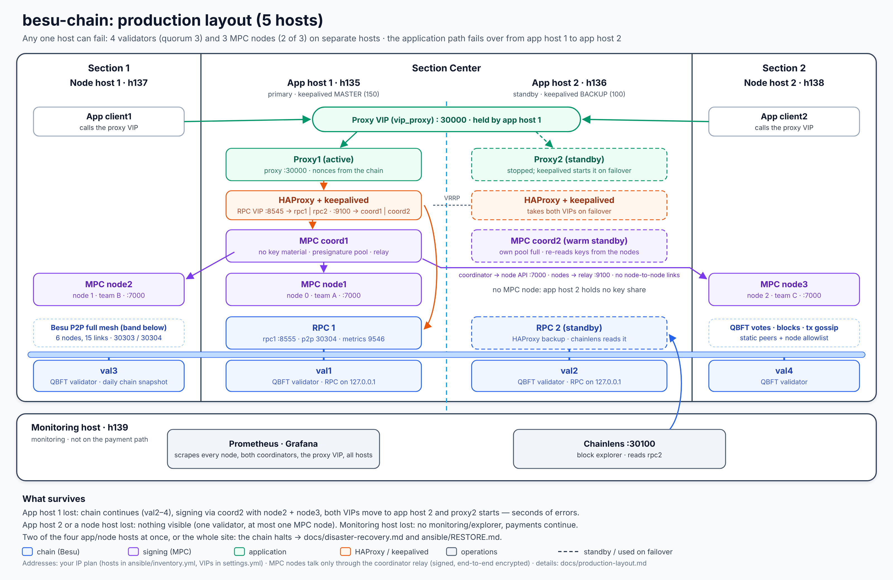
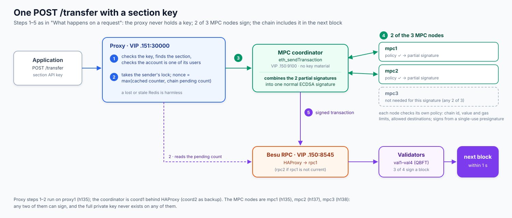

# 프로덕션 아키텍처

> **내용:** 프로덕션 시스템의 구성 방식을 설명합니다. 호스트, 플로팅 IP, 네트워크 영역, 요청 시 일어나는 일,
> 장애 시 유지되는 것, 알려진 한계를 다룹니다.
>
> **대상:** 운영자, 아키텍트, 검토자.
>
> **관련 문서:** [프로덕션 구성](production-layout.md) (모든 포트와 설정) ·
> [고가용성](../deployment/high-availability.md) · [재해 복구](../operations/disaster-recovery.md)

**목차**

- [호스트](#hosts)
- [플로팅 IP](#floating-ips)
- [네트워크 영역](#network-zones)
- [요청 시 일어나는 일](#what-happens-on-a-request)
- [장애 발생 시 계속 동작하는 것](#what-keeps-running-when-something-fails)
- [알려진 한계](#known-gaps)

---

원본: [`architecture-production.svg`](../images/architecture-production.svg)

## 호스트 {#hosts}

하나의 사설 네트워크에 있는 호스트 5대:

| 호스트 | 실행 항목 |
|---|---|
| **h135** `192.168.68.135` | val1, rpc1, coord1, **proxy1** (활성), mpc1, Redis, HAProxy + keepalived, besu-rpc-health |
| **h136** `192.168.68.136` | val2, rpc2, coord2 (웜), **proxy2** (대기), Redis, HAProxy + keepalived, besu-rpc-health |
| **h137** `192.168.68.137` | val3, mpc2 (일일 체인 스냅샷) |
| **h138** `192.168.68.138` | val4, mpc3 |
| **h139** `192.168.68.139` | Prometheus, Grafana, chainlens, Remix |

- **체인:** 검증자 4개, 호스트 .135–.138에 하나씩 있습니다. QBFT는 3개가 필요하므로 어느 호스트 하나가 실패해도 됩니다.
- **서명:** MPC 노드 3개(.135, .137, .138)는 각각 **자체 팀**이 운영하며, 3개 중 2개가 서명합니다.
  코디네이터 2개는 키 자료를 보유하지 않으며, 어느 쪽이든 모든 계정에 대해 서명할 수 있습니다.
- **애플리케이션 경로:** .135의 모든 것은 .136에 쌍이 있습니다. keepalived가 플로팅 IP를 옮기고
  대기 프록시를 시작합니다. 프록시는 항상 하나만 활성입니다(메모리에서 논스를 계산하기 때문입니다).

## 플로팅 IP {#floating-ips}

| VIP | 포트 | 제공 서비스 |
|---|---|---|
| `192.168.68.150` | 8545 | HAProxy → Besu RPC: rpc1, 백업으로 rpc2. 노드는 최신 상태(블록 경과 시간과 높이, `besu-rpc-health`)일 때만 사용됩니다 |
| `192.168.68.150` | 9100 | HAProxy → MPC 서명기: coord1, 백업으로 coord2 |
| `192.168.68.151` | 30000 | 활성 프록시: **애플리케이션의 진입점** (9121에서 Redis 메트릭도 제공) |

## 네트워크 영역 {#network-zones}

| 영역 | 구성 | 접근 가능한 곳 |
|---|---|---|
| **퍼블릭 엣지** | `192.168.68.151:30000` 앞단의 API 게이트웨이 (직접 준비: TLS, 클라이언트 인증, 속도 제한) | 인터넷: **유일한** 공개 진입점 |
| **App** | proxy1 / proxy2, HAProxy, chainlens, Remix | 게이트웨이; 등록된 클라이언트 ([접근 제어](../deployment/access-control.md)) |
| **Signing** | coord1 / coord2 (키 자료 없음), mpc1 / mpc2 / mpc3 | 프록시 → 코디네이터 → 노드; 각 팀의 관리자 |
| **Chain** | val1–val4 (p2p만, RPC는 localhost), rpc1 / rpc2 | HAProxy를 통한 코디네이터와 프록시; chainlens → rpc2 |
| **Ops** | Prometheus, Grafana, 모든 곳의 node-exporter, 백업 | 메트릭을 읽음; 서명 API는 호출할 수 없음 |

`ha/firewall-layout.sh`는 각 호스트에서 firewalld로 이 규칙을 적용하고, Docker가 게시하는 포트에도
동일한 접근 목록을 적용합니다(nftables 테이블 `inet besu_docker`).

## 요청 시 일어나는 일 {#what-happens-on-a-request}

**섹션 키를 사용한 `POST /transfer`** (+x: 사용자가 자신의 섹션에 지불):
1. 프록시가 키를 확인하고, 섹션을 찾고, 해당 계정이 섹션의 사용자인지 확인합니다.
2. 발신자의 잠금을 획득하고 논스를 계산합니다: max(캐시된 카운터, 체인의 pending 수). 따라서
   Redis가 손실되거나 오래된 상태여도 문제가 없습니다.
3. MPC 코디네이터(VIP .150:9100)에서 `eth_sendTransaction`을 호출합니다.
4. **MPC 노드 3개 중 2개**가 트랜잭션을 자체 정책(chain id, 금액과 가스 한도, 허용된 수신처)과 대조하고,
   각각 일회용 사전 서명으로 부분 서명을 생성합니다. 코디네이터가 이를 결합하여 일반 ECDSA 서명을 만듭니다.
5. 서명된 트랜잭션은 Besu(VIP .150:8545)로 전달되고, 검증자가 다음 블록(1초)에 포함합니다.

**`POST /createaccount`:** MPC 노드 3개 모두가 **분산 키 생성**을 실행합니다. 새 개인 키는
어디에도 존재하지 않습니다. 계정은 체인에서 해당 섹션 아래에 등록되고, 섹션의 선지급 계정에서 자금을 받습니다.

**아이템 판매 (`POST /contract/send`, 함수 `buy`):** 구매자는 정확히 가격만큼의 금액으로 **하나의** `buy` 트랜잭션에
서명합니다(프록시가 가격과 payee를 채움). 컬렉션 자체가 자금이 구매자 자신의 섹션의 소비 계정으로 즉시 가는지
확인합니다. 아이템과 자금은 함께 이동하거나, 전혀 이동하지 않으며, 아바타와 닉네임은 재판매되지 않습니다. 보류 기간(기본 7일)
안에는 섹션이 판매를 **취소**할 수 있습니다: 프록시가 그 소비 계정으로 서명하고, 소비 계정이 같은 트랜잭션에서 구매자에게 환불합니다.

**컨트랙트:** 애플리케이션은 모든 등록 컨트랙트(아바타 컬렉션, 닉네임, 그 밖의 컨트랙트)를 하나의 범용 API로
읽고 씁니다: `/contract/call`, `/contract/send`, `/contract/events`, `/contract/list`. 컨트랙트 계정 센터로서의
관리자 쓰기(민팅, 닉네임 설정)는 `/admin/contract/send`를 사용합니다([프록시 API](../reference/proxy-api.md#contracts)).

**섹션 게이트웨이(선택):** 섹션의 애플리케이션은 프록시 대신 옆 호스트의 게이트웨이(`:30010`)를 같은 키와
API로 호출할 수 있습니다. 게이트웨이는 프록시가 응답하는 동안 요청을 그대로 전달하고, VIP로의 연결이 끊기면
자체 원장으로 응답하고 쓰기를 큐에 저장했다가 연결이 돌아오면 순서대로 전송합니다. 체인이 거부한 요청은
정정으로 보고합니다([섹션 게이트웨이](../components/gateway.md)).

섹션의 자금 흐름: [섹션](../features/sections.md).

## 장애 발생 시 계속 동작하는 것 {#what-keeps-running-when-something-fails}

| 장애 | 영향 |
|---|---|
| **호스트 .135** | 체인은 계속됩니다(검증자 3개). 서명은 coord2 + mpc2 + mpc3으로 수행합니다. VIP가 .136으로 이동하고 proxy2가 시작됩니다: 몇 초간 요청이 실패합니다. 새 키(계정, 섹션)는 mpc1을 기다립니다 |
| 호스트 .136, .137 또는 .138 | 서비스 영향 없음(검증자 하나와 최대 MPC 노드 하나 손실). 남은 예비가 없습니다 |
| 호스트 .139 | 모니터링, 탐색기, Remix 없음. 결제는 계속됩니다 |
| 섹션 호스트와 VIP 사이의 연결 | [섹션 게이트웨이](../components/gateway.md)가 있으면 애플리케이션은 계속 동작합니다(쓰기는 큐에 저장, 연결이 돌아오면 전송). 없으면 그 애플리케이션이 멈춥니다 |
| rpc1, coord1 또는 프록시 프로세스 | HAProxy 또는 keepalived가 .136의 쌍으로 전환합니다 |
| RPC 노드가 블록 가져오기를 멈춤 | 몇 초 내에 RPC VIP에서 제외되고 5분 후 재시작됩니다([고가용성](../deployment/high-availability.md)) |
| MPC 노드 1개 또는 해당 팀 | 영향 없음: 3개 중 2개가 서명합니다. `/createaccount`와 새 섹션은 3개 모두를 기다립니다 |
| MPC 노드, 디스크 또는 백업 1개 도난 | 공격자는 키 조각 하나만 얻습니다: **키도 없고, 서명할 수도 없습니다** |
| Redis 중단, 비어 있음 또는 오래된 상태 | 정확성에 영향 없음: 프록시가 메모리 + 체인을 사용합니다 |
| .135–.138 중 **두 대** 동시 또는 사이트 전체 | 체인이 중단됩니다: [재해 복구](../operations/disaster-recovery.md) |
| 사전 서명 생성 속도를 넘는 지속 부하 | 서명이 콜드 경로로 느려집니다(서명당 ~0.6초). MPC CPU는 지속 TPS당 ~0.4코어로 산정하십시오([벤치마크](../development/mpc-benchmarks.md)) |

## 알려진 한계 {#known-gaps}

- **단일 사이트:** 모든 호스트가 하나의 서브넷을 공유합니다(플로팅 IP에 필요합니다). 사이트 전체 재해는
  장애 조치가 아니라 외부 백업과 재해 복구 런북으로 대응합니다.
- **프록시:** 한 번에 하나의 활성 인스턴스만 실행됩니다(논스를 메모리에서 계산합니다).
- **MPC 서명기:** 노드 API에 mTLS가 없고 릴레이에 인증이 없습니다(사설 네트워크와 방화벽으로 완화).
  키 갱신이 없습니다(키 조각을 영구히 잃으면 새 키를 만들고 자금을 옮겨야 합니다). EIP-1559 트랜잭션을
  지원하지 않습니다. `cggmp24 0.7.0-alpha.3`은 알파 릴리스이며, 감사는 이전 버전을 대상으로 했습니다.
- **Besu:** JSON-RPC에 TLS가 없습니다(사설 네트워크). 노드 허용 목록은 파일이므로 변경하려면
  노드를 재시작해야 합니다.
- **포함되지 않음:** API 게이트웨이와 알림 전달(Alertmanager 또는 Grafana contact points).
