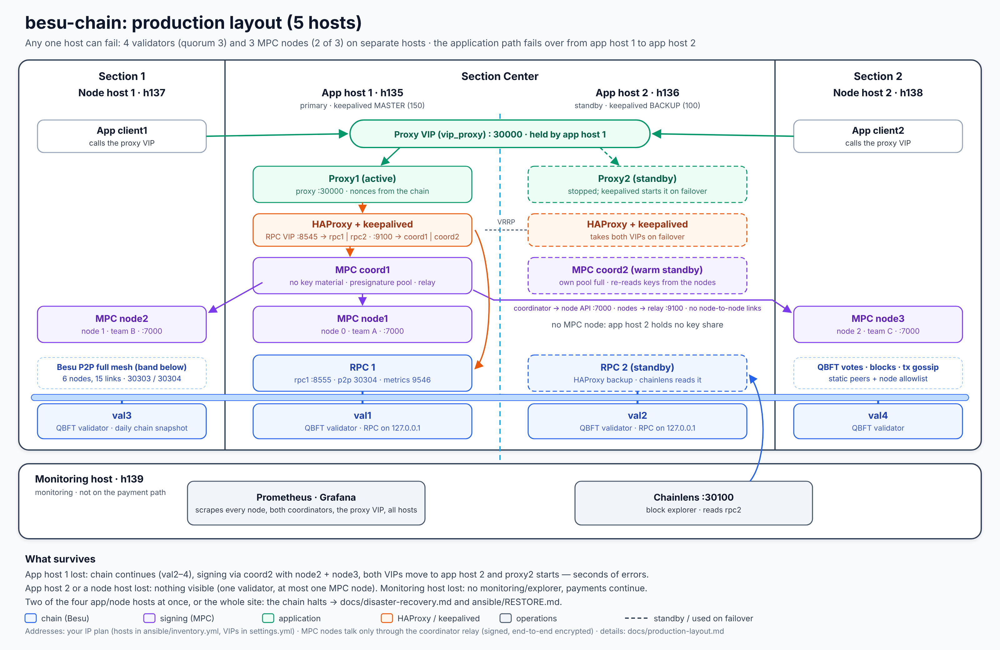
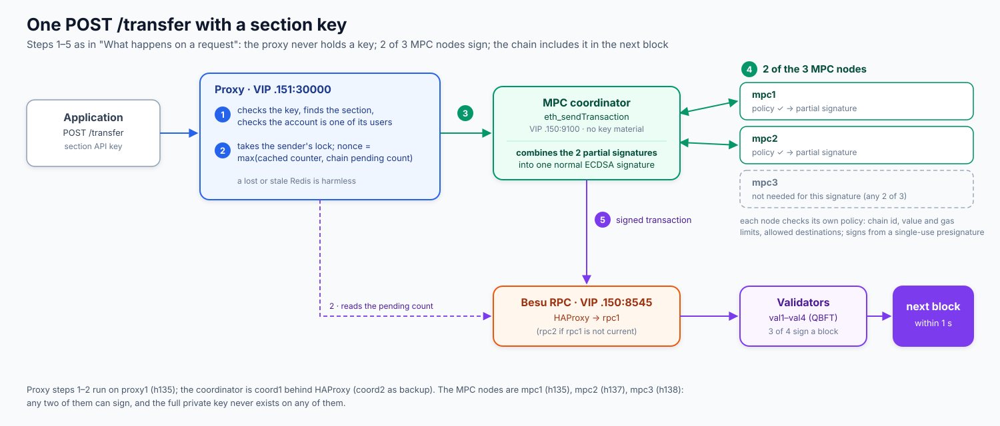

# Production architecture

> **What:** how the production system is built: hosts, floating IPs, network zones, what happens on
> a request, what survives a failure, and the known gaps.
>
> **For:** operators, architects, reviewers.
>
> **Related:** [production layout](production-layout.md) (every port and setting) ·
> [high availability](../deployment/high-availability.md) · [disaster recovery](../operations/disaster-recovery.md)

**Contents**

- [Hosts](#hosts)
- [Floating IPs](#floating-ips)
- [Network zones](#network-zones)
- [What happens on a request](#what-happens-on-a-request)
- [What keeps running when something fails](#what-keeps-running-when-something-fails)
- [Known gaps](#known-gaps)

---

Source: [`architecture-production.svg`](../images/architecture-production.svg)

## Hosts

Five hosts on one private network:

| Host | Runs |
|---|---|
| **h135** `192.168.68.135` | val1, rpc1, coord1, **proxy1** (active), mpc1, Redis, HAProxy + keepalived, besu-rpc-health |
| **h136** `192.168.68.136` | val2, rpc2, coord2 (warm), **proxy2** (standby), Redis, HAProxy + keepalived, besu-rpc-health |
| **h137** `192.168.68.137` | val3, mpc2 (daily chain snapshot) |
| **h138** `192.168.68.138` | val4, mpc3 |
| **h139** `192.168.68.139` | Prometheus, Grafana, chainlens, Remix |

- **Chain:** 4 validators, one per host .135–.138; QBFT needs 3, so any one host can fail.
- **Signing:** 3 MPC nodes (.135, .137, .138), each run by **its own team**; 2 of 3 sign. Two
  coordinators hold no key material; either one signs for every account.
- **Application path:** everything on .135 has a twin on .136; keepalived moves the floating IPs
  and starts the standby proxy. Only one proxy is ever active (it counts nonces in memory).

## Floating IPs

| VIP | Port | Serves |
|---|---|---|
| `192.168.68.150` | 8545 | HAProxy → Besu RPC: rpc1, rpc2 as backup. A node is used only while it is current (block age and height, `besu-rpc-health`) |
| `192.168.68.150` | 9100 | HAProxy → MPC signer: coord1, coord2 as backup |
| `192.168.68.151` | 30000 | the active proxy: **the entry point for applications** (and Redis metrics on 9121) |

## Network zones

| Zone | Contents | Reachable from |
|---|---|---|
| **Public edge** | an API gateway in front of `192.168.68.151:30000` (bring your own: TLS, client authentication, rate limits) | the internet: the **only** public entry |
| **App** | proxy1 / proxy2, HAProxy, chainlens, Remix | the gateway; listed clients ([access control](../deployment/access-control.md)) |
| **Signing** | coord1 / coord2 (no key material), mpc1 / mpc2 / mpc3 | proxy → coordinator → nodes; each team's admin |
| **Chain** | val1–val4 (p2p only, RPC on localhost), rpc1 / rpc2 | coordinators and proxies through HAProxy; chainlens → rpc2 |
| **Ops** | Prometheus, Grafana, node-exporter everywhere, backups | reads metrics; cannot call signing APIs |

`ha/firewall-layout.sh` applies these rules with firewalld on each host, and the same allow lists to
the ports Docker publishes (nftables table `inet besu_docker`).

## What happens on a request

**`POST /transfer` with a section key** (+x: a user pays its section):
1. The proxy checks the key, finds the section and checks the account is one of its users.
2. It takes the sender's lock and computes the nonce: max(cached counter, chain pending count), so a
   lost or stale Redis is harmless.
3. It calls `eth_sendTransaction` on the MPC coordinator (VIP .150:9100).
4. **2 of the 3 MPC nodes** check the transaction against their own policy (chain id, value and gas
   limits, allowed destinations) and each produce a partial signature from a single-use
   presignature; the coordinator combines them into a normal ECDSA signature.
5. The signed transaction goes to Besu (VIP .150:8545); a validator includes it in the next block (1 s).

**`POST /createaccount`:** all 3 MPC nodes run **distributed key generation**; the new private key
never exists. The account is registered under the section on chain and funded from the section's
upfront account.

**NFT sale (`POST /contract/send`, function `buy`):** the buyer signs **one** `buy` transaction with
exactly the price (the proxy fills in the price and the payee). On a first sale the collection itself
checks that the money goes to a live section's consumption account; on a resale (after the seller's
`approve`) it goes to the seller. NFT and money move together or not at all.

**Contracts:** applications read and write every registered contract (NFT collections, nicknames,
others) through one generic API: `/contract/call`, `/contract/send`, `/contract/events` and
`/contract/list`; the admin's writes as the contract account center (mint, nickname settings) go
through `/admin/contract/send` ([proxy API](../reference/proxy-api.md#contracts)).

The money flow of a section: [sections](../features/sections.md).

## What keeps running when something fails

| Failure | Effect |
|---|---|
| **host .135** | chain continues (3 validators); signing via coord2 + mpc2 + mpc3; the VIPs move to .136 and proxy2 starts: a few seconds of failed requests. New keys (accounts, sections) wait for mpc1 |
| host .136, .137 or .138 | none for service (one validator and at most one MPC node lost); no spare left |
| host .139 | no monitoring, explorer or Remix; payments continue |
| rpc1, coord1 or the proxy process | HAProxy or keepalived switches to the twin on .136 |
| an RPC node stops importing blocks | it leaves the RPC VIP within seconds and is restarted after 5 min ([high availability](../deployment/high-availability.md)) |
| 1 MPC node or its team | none: 2 of 3 sign. `/createaccount` and new sections wait for all 3 |
| theft of 1 MPC node, disk or backup | the attacker gets one share: **no key, cannot sign** |
| Redis down, empty or stale | none for correctness: the proxy uses memory + the chain |
| **two** of .135–.138 at once, or the whole site | the chain halts: [disaster recovery](../operations/disaster-recovery.md) |
| sustained load beyond the presignature rate | signing slows to the cold path (~0.6 s per signature); size MPC CPU at ~0.4 cores per sustained TPS ([benchmarks](../development/mpc-benchmarks.md)) |

## Known gaps

- **One site:** all hosts share one subnet (the floating IPs need it). A site-wide disaster is
  covered by off-site backups and the DR runbook, not by failover.
- **Proxy:** one active instance at a time (nonces are counted in its memory).
- **MPC signer:** no mTLS on the node API and no authentication on the relay (mitigated by the
  private network and firewall); no key refresh (a share lost for good means new keys and moving
  funds); no EIP-1559 transactions; `cggmp24 0.7.0-alpha.3` is an alpha release, and its audit
  covers an earlier version.
- **Besu:** no TLS on JSON-RPC (private network); the node allowlist is a file, so changing it means
  restarting the nodes.
- **Not included:** the API gateway and alert delivery (Alertmanager or Grafana contact points).
