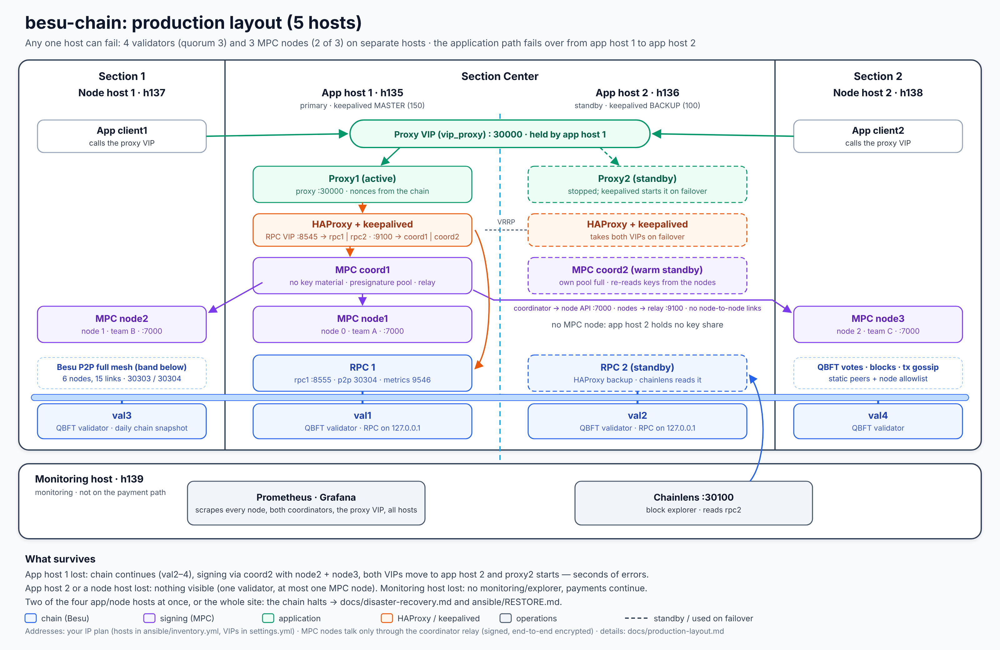

# 프로덕션 구성

> **내용:** 프로덕션 구성 전체를 설명합니다. 모든 호스트, 포트, 설정, 처음부터 수동 배포하는 방법, 장애 표와 장애 조치 테스트를 다룹니다.
>
> **대상:** 운영자, 검토자.
>
> **관련 문서:** [아키텍처](architecture.md) · [Ansible](../deployment/ansible.md) · [고가용성](../deployment/high-availability.md)

**목차**

- [1. 호스트](#1-hosts)
- [2. 구성 요소별 설정](#2-settings-per-component)
- [3. 포트와 방화벽](#3-ports-and-firewall)
- [4. 처음부터 배포하기](#4-deploying-from-scratch)
- [5. 장애 시 유지되는 것](#5-what-survives-a-failure)
- [6. 장애 조치 테스트 (운영 개시 전, 이후 연 2회)](#6-failover-tests-before-going-live-then-twice-a-year)

---

이 저장소의 프로덕션 배포를 호스트별로 설명합니다. 어디서 무엇이 실행되는지, 정확한 설정, 포트,
처음부터 수행하는 전체 배포, 어떤 장애에서 무엇이 유지되는지를 다룹니다. 자세한 내용은 각 구성 요소의
가이드에 있습니다:
[Besu 프로덕션 패키지 (수동 설정)](../deployment/besu-manual.md),
[프로덕션 환경의 MPC 서명기](../deployment/mpc-signer-production.md),
[프록시 (애플리케이션 API)](../components/proxy.md), [고가용성 (HAProxy와 keepalived)](../deployment/high-availability.md),
[모니터링 (Prometheus와 Grafana)](../components/monitoring.md),
[재해 복구](../operations/disaster-recovery.md).



## 1. 호스트 {#1-hosts}

이 문서의 주소는 기준 계획입니다. Ansible 배포를 사용하면 다른 주소를 사용할 수 있습니다.
`ansible/inventory.yml`(호스트)과 `ansible/group_vars/all/settings.yml`(두 VIP와 마스크)에 설정하면
Ansible이 주소가 포함된 모든 파일을 생성합니다
([Ansible 배포](../deployment/ansible.md), "The IP plan").

| 호스트 | 실행 항목 | 역할 |
|---|---|---|
| **192.168.68.135** | val1, **rpc1**, **coord1**, **proxy1** (활성), mpc1, HAProxy + keepalived | 주 애플리케이션 호스트 |
| **192.168.68.136** | val2, **rpc2**, **coord2** (웜 대기), **proxy2** (대기, 중지됨), HAProxy + keepalived | .135가 실패하면 애플리케이션 경로를 인수 |
| **192.168.68.137** | val3, mpc2 | 검증자 + MPC 노드; 일일 체인 스냅샷 |
| **192.168.68.138** | val4, mpc3 | 검증자 + MPC 노드 |
| **192.168.68.139** | Prometheus, Grafana (`:3000`), chainlens (`:30100`), Remix IDE (`:30200`) | 모니터링, 탐색기, 컨트랙트 도구 (결제 경로에 포함되지 않음) |
| 모든 호스트 | node-exporter (`:9101`) | 호스트 메트릭과 백업 결과 |

**플로팅 IP** (keepalived, 평소에는 .135, 장애 조치 후에는 .136):

| VIP | 제공 서비스 | 사용처 |
|---|---|---|
| `192.168.68.150` | HAProxy: `:8545` → rpc1 `:8555` (백업으로 rpc2), `:9100` → coord1 (백업으로 coord2) | 프록시 (`BESU_IP`, `SIGNER_IP`, `MPC_ADMIN_URL`), 코디네이터 (`MPC_BESU_RPC`) |
| `192.168.68.151` | `:30000` → 활성 프록시; `:9121` → 해당 redis-exporter | 애플리케이션, Prometheus (proxy와 redis 작업) |

```
                applications ──► 192.168.68.151:30000 (proxy VIP)
                                       │
                 ┌─────────────────────┴───────────────────────┐
     ┌── .135 ───┴──────────────┐              ┌── .136 ───────┴───────────┐
     │ proxy1 (active)          │              │ proxy2 (stopped: standby) │
     │ HAProxy ◄── VIP .150 ──► │◄── keepalived ──►│ HAProxy               │
     │   :8545 → rpc1|rpc2 :8555│              │                           │
     │   :9100 → coord1 | coord2│              │                           │
     │ rpc1  coord1  val1  mpc1 │              │ rpc2  coord2  val2        │
     └──────────────────────────┘              └───────────────────────────┘
     ┌── .137 ──────┐  ┌── .138 ──────┐  ┌── .139 ─────────────────────────┐
     │ val3  mpc2   │  │ val4  mpc3   │  │ Prometheus  Grafana  chainlens  │
     └──────────────┘  └──────────────┘  │ Remix  (chainlens reads rpc2)   │
                                         └─────────────────────────────────┘
     QBFT: 4 validators, quorum 3 · MPC: 3 nodes, threshold 2 · one of each per host (.135–.138)
```

## 2. 구성 요소별 설정 {#2-settings-per-component}

### Besu 노드 (`besu-production/node`, 노드마다 디렉터리 하나) {#besu-nodes-besu-productionnode-one-directory-per-node}

| 노드 | 호스트 | 디렉터리 (예) | `BESU_ROLE` | `P2P_PORT` | `METRICS_PORT` | `RPC_BIND_IP:RPC_PORT` | `WS_PORT` | `COMPOSE_FILE` |
|---|---|---|---|---|---|---|---|---|
| val1 | .135 | `/opt/besu-val1` | validator | 30303 | 9545 | `127.0.0.1:8645` | 8646 | `docker-compose.host.yml` |
| rpc1 | .135 | `/opt/besu-rpc1` | rpc | 30304 | 9546 | `192.168.68.135:8555` | 8546 | `docker-compose.host.yml` |
| val2 | .136 | `/opt/besu-val2` | validator | 30303 | 9545 | `127.0.0.1:8645` | 8646 | `docker-compose.host.yml` |
| rpc2 | .136 | `/opt/besu-rpc2` | rpc | 30304 | 9546 | `192.168.68.136:8555` | 8546 | `docker-compose.host.yml` |
| val3 | .137 | `/opt/besu-val3` | validator | 30303 | 9545 | `127.0.0.1:8545` | 8546 | 기본값 |
| val4 | .138 | `/opt/besu-val4` | validator | 30303 | 9545 | `127.0.0.1:8545` | 8546 | 기본값 |

모든 노드: `NODE_NAME` = 노드 이름, `P2P_HOST`와 `BIND_IP` = 해당 호스트의 IP.
RPC 노드는 8545가 아니라 **8555**에서 수신합니다. 같은 호스트에서 HAProxy가 VIP `.150`의 8545를 사용하며,
Besu는 호스트의 어느 주소에서든 포트가 사용 중이면 시작을 거부하기 때문입니다(재부팅 후에는
HAProxy가 먼저 시작됩니다). 클라이언트는 항상 VIP `192.168.68.150:8545`를 사용합니다.
RPC 노드의 `BESU_HOST_ALLOWLIST`(클라이언트와 `besu-rpc-health`는 `Host: 192.168.68.150`을 보냅니다):

- rpc1: `192.168.68.135,192.168.68.150,localhost,127.0.0.1`
- rpc2: `192.168.68.136,192.168.68.150,localhost,127.0.0.1` (chainlens가 `.136`으로 호출합니다)

검증자: `tx-pool-max-future-by-sender=2000`(`validator.toml`에 설정). 한 호스트에 노드가 두 개이면
서로 피어로 연결할 수 있도록 호스트 네트워킹(`docker-compose.host.yml`)이 필요합니다.

### MPC (`mpc-signer/deploy`) {#mpc-mpc-signerdeploy}

| 구성 요소 | 호스트 | 설정 |
|---|---|---|
| mpc1 | .135 | `MPC_NODE_ID=0`, `MPC_BIND_IP=192.168.68.135`, 포트 7000 |
| mpc2 | .137 | `MPC_NODE_ID=1`, `MPC_BIND_IP=192.168.68.137` |
| mpc3 | .138 | `MPC_NODE_ID=2`, `MPC_BIND_IP=192.168.68.138` |
| `cluster.json` | 모든 곳 | url `http://192.168.68.135:7000`, `…137:7000`, `…138:7000` (`deploy/cluster.example.json`); 모든 노드와 코디네이터에서 동일 |
| coord1 | .135 | `MPC_BIND_IP=192.168.68.135`, `MPC_RELAY_URL=ws://192.168.68.135:9100/relay`, `MPC_BESU_RPC=http://192.168.68.150:8545` |
| coord2 | .136 | `MPC_BIND_IP=192.168.68.136`, `MPC_RELAY_URL=ws://192.168.68.136:9100/relay`, `MPC_BESU_RPC=http://192.168.68.150:8545` |

두 코디네이터 모두: 동일한 토큰(`MPC_NODE_TOKEN`, `MPC_ADMIN_TOKEN`, `MPC_METRICS_TOKEN`),
`MPC_POOL_KEYS=<SENDER01>`. 둘 다 항상 실행됩니다. HAProxy는 요청을 coord1로 보내고, coord2는
자체 사전 서명 풀을 가득 채운 채 인수할 준비를 합니다. 코디네이터는 모르는 계정을 만났을 때,
`eth_accounts` 호출 시, 그리고 30초마다 MPC 노드에서 키 목록을 다시 읽습니다. 따라서 한 코디네이터를 통해
생성한 계정은 즉시 다른 코디네이터를 통해서도 서명할 수 있습니다. 코디네이터는 시작하는 데 노드 3개 중
2개만 있으면 됩니다.

각 MPC 노드는 계속 **자체 팀**이 운영합니다(호스트 .135, .137, .138에 하나씩). 어떤 사람이나
저장소도 키 조각 두 개를 보유하지 않습니다.

### 프록시 (`proxy/`, .135와 .136) {#proxy-proxy-on-135-and-136}

두 호스트에서 동일한 `.env`(`proxy/.env.example`)를 사용합니다: `BESU_IP=192.168.68.150`, `SIGNER_IP=192.168.68.150`,
`SIGNER_PORT=9100`(MPC 서명기의 이더리움 서명기 JSON-RPC: `eth_accounts`,
`eth_signTransaction`, `eth_sendTransaction`), `MPC_ADMIN_URL=http://192.168.68.150:9100`,
`SENDER01`, `MPC_ADMIN_TOKEN`. 프록시는
`192.168.68.151`을 보유한 호스트에서만 실행됩니다. keepalived가 프록시를 시작하고 중지하며(`ha/proxy-start.sh`,
`ha/proxy-stop.sh`), `ha/check-proxy.sh`는 VIP가 없는 호스트에서 부팅 시 Docker가 다시 시작한 프록시를
중지합니다. 따라서 대기 호스트에서 프록시 컨테이너가 `Exited (137)` 상태인 것은 정상입니다.
시작하는 프록시는 체인에서 논스를 가져오므로, 장애 조치에는 상태가 필요하지 않습니다.
Redis와 redis-exporter(`:9121`)는 두 호스트 모두에서 프록시 옆에서 실행됩니다. Prometheus는 `.151`을 통해
활성 쪽을 수집합니다.

### HAProxy와 keepalived (.135, .136) {#haproxy-and-keepalived-135-136}

`ha/haproxy.cfg`(두 호스트에서 동일), `ha/keepalived-135.conf` / `ha/keepalived-136.conf`, 세 개의
keepalived 스크립트, 그리고 `besu-rpc-health`(`ha/rpc-health.py`, systemd 서비스)로 구성됩니다. HAProxy는
`besu-rpc-health`가 rpc1을 최신 상태로 보고하는 동안에만 RPC를 rpc1로 보냅니다. 최신 상태란 동기화 중이 아니고,
최고 헤드보다 최대 `rpc_max_blocks_behind`(10) 블록 뒤처지며, 최신 블록이 `rpc_max_block_age`(30초)보다
최근인 상태입니다. 체인이 진행되는 동안 `rpc_auto_restart_minutes`(5) 동안 정지된 로컬 RPC 노드는
재시작됩니다. Ansible을 사용하면 이 모든 것이 IP 계획에서 생성됩니다(`07-ha.yml`).
절차: [고가용성 (HAProxy와 keepalived)](../deployment/high-availability.md).

### Chainlens와 모니터링 (.139) {#chainlens-and-monitoring-139}

- chainlens (`:30100`): `BESU_RPC=http://192.168.68.136:8555`(rpc2를 사용하여 탐색기 폴링이 rpc1에
  부하를 주지 않게 합니다). Deploy 페이지에서 브라우저로 컨트랙트를 배포할 수 있습니다(`chainlens_deploy_enabled`, 기본값은
  꺼짐; [컨트랙트 배포](../features/contract-deployment.md)).
- 모니터링: Prometheus와 Grafana (`:3000`), `BIND_IP=192.168.68.139`. `monitoring/prometheus/targets/`의
  대상 파일은 이 구성에 맞게 설정되어 있습니다(Besu 노드 6개, 각자의 IP에 있는 coord1과 coord2,
  프록시 VIP의 프록시와 redis-exporter, 호스트 5대의 node-exporter).
- Remix IDE (`:30200`, `remix_enabled`): [Remix IDE (자체 호스팅)](../components/remix.md).

## 3. 포트와 방화벽 {#3-ports-and-firewall}

`ha/firewall-layout.sh`는 각 호스트에 이 규칙을 적용합니다. 호스트 자체 포트에는 firewalld를,
Docker가 게시하는 포트에는 nftables 테이블 `inet besu_docker`를 사용합니다(아래 참조). 호스트의
마지막 숫자를 지정하여 실행하십시오:

```bash
PROXY_CLIENTS="…" ADMIN=… ./firewall-layout.sh 135
```

Ansible을 사용하면 목록은 `ansible/group_vars/all/settings.yml`에서 가져옵니다(표에 이름이 있습니다.
[접근 제어](../deployment/access-control.md) 참조). 목록에 없는 것은 모두 닫힌 상태로 유지됩니다.

| 포트 | 대상 | 허용 출발지 |
|---|---|---|
| 30303, 30304 tcp+udp | .135–.138의 Besu p2p | 다른 Besu 호스트 |
| 9545, 9546 | Besu 메트릭 | .139 |
| 8545 | VIP `.150`의 HAProxy | .135, .136 (프록시, 코디네이터), 관리자 |
| 8555 | rpc1 / rpc2 | .135, .136 (HAProxy), .139 (chainlens), 관리자 |
| 9100 | coord1 / coord2 (및 VIP `.150`) | .135, .136, MPC 노드 (relay), .139 (메트릭), 관리자 |
| 7000 | mpc1 / mpc2 / mpc3 | .135, .136 (코디네이터) |
| 30000 | 프록시 (및 VIP `.151`) | 애플리케이션 (`proxy_client_ips`), .139, 관리자 |
| 9121 | .135, .136의 redis-exporter (VIP `.151` 경유) | .139 |
| VRRP (프로토콜 112) | .135 ↔ .136 | 서로 |
| 9101 | 모든 호스트의 node-exporter | .139 |
| 3000 | .139의 Grafana | 관리자, `grafana_ips` |
| 30100 | .139의 chainlens | 관리자, `chainlens_ips` |
| 30200 | .139의 Remix IDE ([Remix IDE (자체 호스팅)](../components/remix.md)) | 관리자, `remix_ips` |
| 30300 | .139의 문서 웹사이트 (`docs_site_enabled`) | 관리자, `docs_ips` |
| 22 | 모든 호스트 | 관리자 / 배스천 (`operator_ip`) |

**Docker가 게시하는 포트는 firewalld를 우회합니다.** 프록시, 코디네이터, MPC 노드, Grafana,
chainlens, Remix, Redis, redis-exporter, 그리고 호스트 네트워킹을 사용하지 않는 Besu 노드(val3, val4)는
Docker의 포트 포워딩(DNAT 후 FORWARD 체인)을 통해 접근되며, firewalld의 영역 규칙은 이를 보지 못합니다. 추가 조치가 없으면
네트워크의 모든 호스트가 이들에 연결할 수 있습니다. 따라서 `firewall-layout.sh`는 포워딩된 연결에도 동일한
접근 목록을 자체 nftables 테이블(`inet besu_docker`, systemd 유닛 `besu-docker-firewall`로 설치되며
부팅할 때마다 적용됨)에 적용합니다. 목록에 있는 출발지는 목록에 있는 포트에 접근할 수 있고, 게시된 포트로의
그 밖의 새 연결은 모두 차단됩니다. Docker와 firewalld는 이 테이블을 건드리지 않으므로, Docker 재시작이나
`firewall-cmd --reload`로 틈이 생기지 않습니다(Docker 자체의 `DOCKER-USER` 체인은 firewalld를 다시 로드할 때마다
Docker가 점프 순서를 바꾸기 때문에 사용하지 않습니다). 접근 목록은 `/etc/besu-docker-firewall.rules`에 있으며,
`besu-docker-firewall.service`가 부팅 시 이를 적용합니다. 확인하십시오:

```bash
nft list table inet besu_docker
```

목록에 **없는** 호스트에서는 게시된 모든 포트가 시간 초과되어야 합니다:

```bash
timeout 3 bash -c '</dev/tcp/<host>/9100' || echo blocked
```

## 4. 처음부터 배포하기 {#4-deploying-from-scratch}

빈 호스트 5대에 새 체인과 새 MPC 클러스터를 구축합니다. **자동화:** [Ansible 배포](../deployment/ansible.md)가
MPC 노드를 제외한 모든 작업을 실행합니다. MPC 노드는 각 팀이 실행합니다(Ansible이 멈추고 언제 해야 하는지 알려 줍니다).
수동으로 할 경우 **이 순서대로** 단계를 수행하십시오. 제네시스에는
`SENDER01`(MPC 키 세레모니)이 필요하고, HAProxy에는 RPC 노드가, keepalived에는 프록시가 필요합니다.

| 단계 | 위치 | 작업 |
|---|---|---|
| [4.1](#41-prepare-every-host) | .135–.139 | Docker, 시계, 저장소, 방화벽, node-exporter |
| [4.2](#42-mpc-image-and-tokens-operator) | 운영자 | MPC 이미지 빌드, 토큰 생성 |
| [4.3](#43-mpc-nodes-135-137-138) | .135, .137, .138 | mpc1, mpc2, mpc3 (각각 자체 팀이 수행) |
| [4.4](#44-clusterjson-operator) | 운영자 | `cluster.json`, 이후 MPC 노드 3개 시작 |
| [4.5](#45-coordinators-and-key-ceremony-135-136) | .135, .136 | coord1, coord2, 키 세레모니 → `SENDER01` |
| [4.6](#46-besu-node-keys-135138) | .135–.138 | Besu 노드 6개: 키 |
| [4.7](#47-besu-network-files-operator) | 운영자 | 제네시스와 네트워크 파일 (`SENDER01`에 자금 할당) |
| [4.8](#48-start-besu-135138) | .135–.138 | 검증자, 이후 RPC 노드 |
| [4.9](#49-proxy-135-136) | .135, .136 | 프록시 빌드 (시작하지 않음) |
| [4.10](#410-haproxy-and-keepalived-135-136) | .135, .136 | `besu-rpc-health`, HAProxy, keepalived: VIP 활성화, proxy1 시작 |
| [4.11](#411-check-the-application-path) | 아무 곳 | VIP를 통한 테스트 계정과 이체 |
| [4.12](#412-monitoring-chainlens-remix-and-documentation-139) | .139 | Prometheus, Grafana, chainlens, Remix, 문서 웹사이트 |
| [4.13](#413-backups) | .135–.138 | 키 백업, MPC 백업, 일일 체인 스냅샷 |
| [4.14](#414-failover-tests-then-go-live) | — | 6절의 장애 조치 테스트, 이후 운영 개시 |

**운영자** 머신은 배스천(또는 .139)입니다. Docker와 이 저장소의 클론이 필요합니다.
운영자 머신은 공개 파일과 공유 토큰만 다루며, Besu 키나 MPC 키 조각은 절대 그곳으로 가지 않습니다.
아래의 모든 명령어는 root로(또는 `sudo`로) 실행합니다.

### 4.1 모든 호스트 준비 {#41-prepare-every-host}

.135, .136, .137, .138, .139 **각각에서**:

1. Docker Engine과 Compose 플러그인(사용 중인 배포판에 대한 Docker의 설치 안내 참조), 그리고:

   ```bash
   dnf install -y git chrony firewalld && systemctl enable --now docker chronyd firewalld
   ```

   `chronyc tracking`은 동기화된 시계를 표시해야 합니다(QBFT와 알림이 이에 의존합니다).
2. 저장소를 모든 호스트의 같은 경로에 둡니다(keepalived 스크립트가 이 경로를 사용합니다):

   ```bash
   git clone https://github.com/JordanD105/besu-chain.git /opt/besu-chain
   ```

   (저장소가 비공개이면 배포 키나 토큰을 사용하십시오).

3. 방화벽, 해당 호스트의 마지막 숫자(`135` … `139`)로:

   ```bash
   PROXY_CLIENTS="<application IPs>" CHAINLENS_USERS="<explorer users>" GRAFANA_USERS="<dashboard users>" REMIX_USERS="<developers>" ADMIN=<bastion IP> /opt/besu-chain/ha/firewall-layout.sh 135
   ```

4. node-exporter, 해당 호스트의 IP로:

   ```bash
   cd /opt/besu-chain/monitoring/node-exporter && echo BIND_IP=192.168.68.135 > .env && docker compose up -d
   ```

### 4.2 MPC 이미지와 토큰 (운영자) {#42-mpc-image-and-tokens-operator}

```bash
cd /opt/besu-chain/mpc-signer
docker build --build-arg BIGINT=bigint-rug -t registry.example.com/mpc-signer:1.3.0 .
docker push registry.example.com/mpc-signer:1.3.0
```

레지스트리가 없으면 MPC 구성 요소를 실행하는 호스트 4대에 복사하십시오:

```bash
for h in 135 136 137 138; do docker save registry.example.com/mpc-signer:1.3.0 | ssh root@192.168.68.$h docker load; done
```

공유 토큰 세 개를 생성하십시오(각 팀의 비밀 채널로 전달하고, 채팅이나 이메일로는 절대
전달하지 마십시오):

```bash
openssl rand -hex 32    # MPC_NODE_TOKEN    : the 3 MPC nodes and both coordinators
openssl rand -hex 32    # MPC_ADMIN_TOKEN   : both coordinators, the operator, both proxies
openssl rand -hex 32    # MPC_METRICS_TOKEN : both coordinators and the monitoring host
```

### 4.3 MPC 노드 (.135, .137, .138) {#43-mpc-nodes-135-137-138}

각 노드는 **자체 팀**이 자체 호스트에서 설치합니다:

| 노드 | 호스트 | `MPC_NODE_ID` | `MPC_BIND_IP` |
|---|---|---|---|
| mpc1 | .135 | 0 | `192.168.68.135` |
| mpc2 | .137 | 1 | `192.168.68.137` |
| mpc3 | .138 | 2 | `192.168.68.138` |

```bash
cp -r /opt/besu-chain/mpc-signer/deploy/node /opt/mpc-node && cd /opt/mpc-node
cp .env.example .env && chmod 600 .env
```

`.env`에 다음을 설정합니다: `MPC_IMAGE=registry.example.com/mpc-signer:1.3.0`, 표의 `MPC_NODE_ID`와 `MPC_BIND_IP`,
`MPC_NODE_TOKEN`, `MPC_COMPUTE_THREADS` = 호스트의 코어 수 정도. 그런 다음:

```bash
./init.sh
```

이 스크립트는 이 노드의 `MPC_NODE_PASSPHRASE`를 생성하여 `.env`에 기록합니다. **지금 이 팀의 볼트에 저장하십시오**
(이것이 없으면 키 조각과 그 백업을 열 수 없습니다). `node<ID>.json`(공개 키만 포함)을
운영자에게 보내십시오. 아직 노드를 시작하지 마십시오.

### 4.4 `cluster.json` (운영자) {#44-clusterjson-operator}

```bash
cd /opt/besu-chain/mpc-signer/deploy
CHAIN_ID=1337 MAX_VALUE_WEI=1000000000000000000000 MAX_GAS=30000000 \
  ./make-cluster.sh node0.json node1.json node2.json > cluster.json
sha256sum cluster.json
```

`ALLOWED_TO`는 비워 두십시오(프록시가 계정을 생성하고 컨트랙트를 배포합니다). `cluster.json`을
.135, .137, .138의 `/opt/mpc-node/`와 아래의 운영자용 코디네이터 사본에 복사하십시오. 모든 팀이
`sha256sum`을 비교합니다. 그런 다음 각 MPC 팀이 자신의 노드를 시작합니다:

```bash
cd /opt/mpc-node && docker compose up -d && docker compose logs --tail 5
```

`node loaded`와 `node API listening`이 표시되어야 합니다.

### 4.5 코디네이터와 키 세레모니 (.135, .136) {#45-coordinators-and-key-ceremony-135-136}

.135(coord1)와 .136(coord2)에서:

```bash
cp -r /opt/besu-chain/mpc-signer/deploy/coordinator /opt/mpc-coordinator && cd /opt/mpc-coordinator
cp .env.example .env && chmod 600 .env
```

| 설정 | coord1 (.135) | coord2 (.136) |
|---|---|---|
| `MPC_IMAGE` | `registry.example.com/mpc-signer:1.3.0` | 동일 |
| `MPC_BIND_IP` | `192.168.68.135` | `192.168.68.136` |
| `MPC_RELAY_URL` | `ws://192.168.68.135:9100/relay` | `ws://192.168.68.136:9100/relay` |
| `MPC_BESU_RPC` | `http://192.168.68.150:8545` | 동일 |
| `MPC_NODE_TOKEN`, `MPC_ADMIN_TOKEN`, `MPC_METRICS_TOKEN` | 4.2에서 생성 | 동일 |
| `MPC_POOL_KEYS` | 지금은 비워 둠 | 지금은 비워 둠 |

`cluster.json`을 `docker-compose.yml` 옆에 복사한 다음:

```bash
docker compose up -d && docker compose logs --tail 5
```

`keys loaded from nodes keys=0`이 표시되어야 합니다. `MPC_BESU_RPC`는 4.10에서 활성화되는 VIP를 가리킵니다.
그때까지 코디네이터는 Besu에 접근할 수 없지만 문제가 없습니다(아직 보낼 것이 없습니다).

**키 세레모니** (운영자, MPC 노드 3개 모두 실행 중), coord1에 직접 실행합니다:

```bash
COORD=http://192.168.68.135:9100 ADMIN_TOKEN=<MPC_ADMIN_TOKEN> /opt/besu-chain/mpc-signer/deploy/ceremony.sh
```

Aux info에 1–3분이 걸리고, 이후 분산 키 생성이 첫 번째 주소를 출력합니다. 이것이
**`SENDER01`**입니다. 기록해 두십시오. 제네시스가 여기에 자금을 할당하고(4.7) 프록시가 이를 사용합니다(4.9).

**두** 코디네이터 모두에서 `.env`에 `MPC_POOL_KEYS=<SENDER01>`을 설정한 다음 `docker compose up -d`를 실행하십시오.
각 코디네이터가 풀을 채우는지 확인하십시오(`"pooled": true`, `ready` 증가):

```bash
curl -s -H "Authorization: Bearer <MPC_ADMIN_TOKEN>" http://192.168.68.135:9100/admin/pool
curl -s -H "Authorization: Bearer <MPC_ADMIN_TOKEN>" http://192.168.68.136:9100/admin/pool
```

### 4.6 Besu 노드 키 (.135–.138) {#46-besu-node-keys-135138}

노드마다 디렉터리 하나, 2절의 값을 사용합니다:

| 호스트 | 디렉터리 |
|---|---|
| .135 | `/opt/besu-val1`, `/opt/besu-rpc1` |
| .136 | `/opt/besu-val2`, `/opt/besu-rpc2` |
| .137 | `/opt/besu-val3` |
| .138 | `/opt/besu-val4` |

각 노드에 대해(예: val1):

```bash
cp -r /opt/besu-chain/besu-production/node /opt/besu-val1 && cd /opt/besu-val1
cp .env.example .env && chmod 600 .env
```

**val1**(.135)의 `.env`:

```bash
BESU_IMAGE=hyperledger/besu:26.11.1
BESU_ROLE=validator
NODE_NAME=val1
P2P_HOST=192.168.68.135
BIND_IP=192.168.68.135
P2P_PORT=30303
METRICS_PORT=9545
RPC_BIND_IP=127.0.0.1
RPC_PORT=8645
WS_PORT=8646
JAVA_OPTS=-Xmx4g
COMPOSE_FILE=docker-compose.host.yml
```

**rpc1**(.135)의 `.env`:

```bash
BESU_IMAGE=hyperledger/besu:26.11.1
BESU_ROLE=rpc
NODE_NAME=rpc1
P2P_HOST=192.168.68.135
BIND_IP=192.168.68.135
P2P_PORT=30304
METRICS_PORT=9546
RPC_BIND_IP=192.168.68.135
RPC_PORT=8555
WS_PORT=8546
JAVA_OPTS=-Xmx4g
COMPOSE_FILE=docker-compose.host.yml
BESU_HOST_ALLOWLIST=192.168.68.135,192.168.68.150,localhost,127.0.0.1
BESU_RPC_HTTP_API=ETH,NET,WEB3,TXPOOL
BESU_RPC_WS_API=ETH,NET,WEB3,TXPOOL
```

- **val2 / rpc2** (.136): val1 / rpc1과 동일하되 모든 곳에 `192.168.68.136`을 사용하고
  `NODE_NAME=val2` / `rpc2`로 설정합니다(rpc2의 허용 목록: `192.168.68.136,192.168.68.150,localhost,127.0.0.1`).
- **val3** (.137) / **val4** (.138): val1과 같되 자체 IP와 이름, `RPC_PORT=8545`,
  `WS_PORT=8546`을 사용하고 `COMPOSE_FILE` 줄은 **없습니다**(호스트에 노드 하나: 기본 네트워킹).

그런 다음 각 디렉터리에서:

```bash
./init.sh
```

이 스크립트는 데이터 볼륨 안에 노드 키를 생성하고(키는 호스트를 떠나지 않습니다)
`<NODE_NAME>.json`(공개 enode와 주소)을 작성합니다. 여섯 개 파일 `val1.json` … `val4.json`,
`rpc1.json`, `rpc2.json`을 운영자에게 보내십시오.

### 4.7 Besu 네트워크 파일 (운영자) {#47-besu-network-files-operator}

```bash
cd /opt/besu-chain/besu-production/operator
CHAIN_ID=1337 BLOCK_PERIOD=1 REQUEST_TIMEOUT=2 \
ALLOC="<SENDER01>=1000000000000000000000000" \
  ./make-network.sh network/ val1.json val2.json val3.json val4.json rpc1.json rpc2.json
cat network/SHA256SUMS
```

- `CHAIN_ID`는 `cluster.json`(4.4)의 값과 같아야 합니다.
- `ALLOC`은 제네시스에서 `SENDER01`에 자금을 할당합니다(여기서는 1,000,000 ETH, wei 단위).
- `BLOCK_PERIOD=1`과 `REQUEST_TIMEOUT=2`는 하나의 LAN에 있는 호스트에 적합합니다.

`network/`의 파일 4개(`genesis.json`, `static-nodes.json`, `permissions_config.toml`,
`SHA256SUMS`)를 **여섯 개 모든** 노드 디렉터리의 `network/` 디렉터리에 복사하십시오. 각 팀은 두 번째 채널로
운영자와 `SHA256SUMS`를 비교합니다. `network/`의 사본을 안전한 곳에 보관하십시오
(4.13절).

### 4.8 Besu 시작 (.135–.138) {#48-start-besu-135138}

먼저 검증자를 각 디렉터리에서 시작합니다: `/opt/besu-val1`(.135), `/opt/besu-val2`(.136),
`/opt/besu-val3`(.137), `/opt/besu-val4`(.138):

```bash
./start.sh
```

검증자가 3개 이상 실행되면 블록 생성이 시작됩니다. .135에서 확인하십시오(.137/.138에서는 `RPC=` 없이,
포트 8545):

```bash
RPC=http://127.0.0.1:8645 /opt/besu-chain/besu-production/operator/qbft.sh health
```

블록 번호가 증가하고 피어가 5개여야 합니다. 그런 다음 RPC 노드 `/opt/besu-rpc1`(.135)과
`/opt/besu-rpc2`(.136)를 `./start.sh`로 시작하고 각각 확인하십시오:

```bash
curl -s http://192.168.68.135:8555 -H 'content-type: application/json' --data '{"jsonrpc":"2.0","id":1,"method":"eth_syncing","params":[]}'
```

`"result":false`(동기화됨)가 나와야 합니다. rpc2는 `.136`을 사용합니다.

### 4.9 프록시 (.135, .136) {#49-proxy-135-136}

두 호스트 모두에서 동일한 `.env`를 사용합니다:

```bash
cd /opt/besu-chain/proxy && cp .env.example .env && chmod 600 .env
```

`.env`에 `SENDER01=<SENDER01>`과 `MPC_ADMIN_TOKEN`을 설정합니다. VIP 주소는 이미 설정되어 있습니다
(`BESU_IP`/`SIGNER_IP=192.168.68.150`, `MPC_ADMIN_URL=http://192.168.68.150:9100`).
이미지를 빌드하되 **시작하지는 마십시오**. `.151`을 보유한 호스트에서 keepalived가 시작합니다.

```bash
docker compose build
```

### 4.10 HAProxy와 keepalived (.135, .136) {#410-haproxy-and-keepalived-135-136}

[고가용성 (HAProxy와 keepalived)](../deployment/high-availability.md)의 1절과
3–5절을 따르십시오: `ip_nonlocal_bind`, SELinux, `besu-rpc-health`, `haproxy.cfg`(`besu-rpc-health`에 질의하는
`besu_rpc` 백엔드 포함), 그다음 keepalived(`INTERFACE`, 두 개의 `auth_pass` 값,
`PROXY_DIR=/opt/besu-chain/proxy`). keepalived는 **.135에서 먼저** 시작한 다음 .136에서 시작하십시오. .135에서 확인하십시오:

```bash
ip -br addr | grep -E '68\.15[01]/'
```

두 VIP가 모두 .135에 있고, keepalived가 proxy1을 시작했습니다(`docker ps`에 프록시가 표시됨;
`journalctl -t besu-ha`). .136은 VIP를 보유하지 않으며 프록시가 중지되어 있습니다. 두 RPC 노드 모두 정상입니다:

```bash
curl -s http://127.0.0.1:8410/
```

### 4.11 애플리케이션 경로 확인 {#411-check-the-application-path}

애플리케이션 호스트에서:

```bash
curl -s http://192.168.68.150:8545 -H 'content-type: application/json' --data '{"jsonrpc":"2.0","id":1,"method":"eth_blockNumber","params":[]}'
curl -s http://192.168.68.151:30000/status/senders
curl -s -X POST http://192.168.68.151:30000/createaccount -H 'content-type: application/json' --data '{"amount":"1"}'
```

마지막 호출은 MPC 계정을 생성하고 `SENDER01`에서 자금을 보냅니다. 그런 다음
`POST /transfer`(`from`, `to`, `amount`)로 이체를 보내고 사용하는 NFT 호출을 실행하십시오
([프록시 API 참조](../reference/proxy-api.md), [프록시 (애플리케이션 API)](../components/proxy.md)).

### 4.12 모니터링, chainlens, Remix, 문서 (.139) {#412-monitoring-chainlens-remix-and-documentation-139}

```bash
cp -r /opt/besu-chain/monitoring /opt/monitoring && cd /opt/monitoring
MPC_METRICS_TOKEN=<MPC_METRICS_TOKEN> ./setup.sh
```

`setup.sh`는 Grafana 관리자 비밀번호를 한 번만 출력합니다. `.env`에 `BIND_IP=192.168.68.139`를 설정하십시오.
`prometheus/targets/`의 대상은 이미 이 구성에 맞습니다. 시작하고 모든 대상을 확인하십시오:

```bash
docker compose up -d && ./check-targets.sh
```

Grafana: `http://192.168.68.139:3000`. rpc2를 읽는 Chainlens:

```bash
cd /opt/besu-chain/chainlens && cp .env.example .env
sed -i 's|^BESU_RPC=.*|BESU_RPC=http://192.168.68.136:8555|' .env && docker compose up -d --build
```

탐색기: `http://192.168.68.139:30100`. Remix IDE(`:30200`)는 Ansible이 빌드하고 시작합니다
(`02-images.yml`, `12-remix.yml`): [Remix IDE (자체 호스팅)](../components/remix.md).
문서 웹사이트(`:30300`):

```bash
cd /opt/besu-chain && docker compose -f docs-site/docker-compose.yml up -d --build
```

Ansible을 사용하면 각각 자체 단계가 있습니다: `09-monitoring.yml`(Prometheus, Grafana),
`11-chainlens.yml`, `12-remix.yml`, `13-docs-site.yml` ([Ansible 배포](../deployment/ansible.md)).

### 4.13 백업 {#413-backups}

| 대상 | 위치 | 방법 | Ansible 사용 시 (`10-backups.yml`) |
|---|---|---|---|
| Besu 노드 키 | 노드 디렉터리 6개 모두 | 한 번: `./backup-key.sh /secure/dir`, 이후 암호화하고 평문 사본 삭제 | 호스트에서 GPG 공개 키(`key_backup_gpg_public_key`)로 암호화하여 `ansible/state/key-backups/<node>.key.gpg`로 가져옴 ([GPG 키](../deployment/gpg-key.md)) |
| MPC 키 조각 | .135, .137, .138의 `/opt/mpc-node` (각 팀) | cron, 매시간: `7 * * * * /opt/mpc-node/backup.sh /secure/backup` | 선택 사항(`mpc_backup_cron: true`): 매시간 :07에 `mpc_backup_dir`로; 각 팀은 여전히 아카이브를 호스트 밖으로 복사해야 함 |
| 체인 스냅샷 | .137의 `/opt/besu-val3` | cron, 매일: `17 3 * * * cd /opt/besu-val3 && COPY_TO=user@offsite:/besu-chain ./snapshot-chain.sh /backup/chain` | 매일 `snapshot_cron_hour`:`snapshot_cron_minute`(03:17)에 `snapshot_dir`로, 외부 사본은 `snapshot_copy_to`로 |
| 네트워크 파일, `cluster.json`, 토큰 | 운영자 | 변경할 때마다 볼트에 보관 | `ansible/state/`에 있음: 볼트에 복사 |

각 백업 스크립트는 결과를 해당 호스트의 node-exporter textfile 디렉터리에 기록하며,
백업이 너무 오래되었거나 없거나 실패하면 Prometheus가 알림을 보냅니다([알림](../operations/alerts.md)).
따라서 중단된 호스트의 백업은 없는 것으로 보입니다. 자세한 내용과 복원 절차:
[재해 복구](../operations/disaster-recovery.md).

### 4.14 장애 조치 테스트 후 운영 개시 {#414-failover-tests-then-go-live}

6절의 테스트를 하나씩 실행하고, 테스트 사이마다 Grafana를 확인하십시오. 그런 다음
애플리케이션이 `http://192.168.68.151:30000`을 사용하도록 설정하십시오.

## 5. 장애 시 유지되는 것 {#5-what-survives-a-failure}

| 손실 | 체인 (검증자 4개, 정족수 3) | 서명 (MPC 3개 중 2개) | 애플리케이션 경로 | 영향 |
|---|---|---|---|---|
| **.135** | ✅ val2–val4 | ✅ coord2를 통한 mpc2 + mpc3 | ✅ VIP가 .136으로 이동: HAProxy → rpc2 + coord2, proxy2 시작 | 몇 초간 요청 실패 |
| **.136** | ✅ | ✅ | ✅ 이미 .135에 있음 | 없음 (복구될 때까지 이중화 상실) |
| **.137** | ✅ | ✅ mpc1 + mpc3 | ✅ | 복구될 때까지 일일 체인 스냅샷 없음 (val3에서만 실행); 모니터링에서 해당 백업이 없는 것으로 보임 |
| **.138** | ✅ | ✅ mpc1 + mpc2 | ✅ | 없음 |
| **.139** | ✅ | ✅ | ✅ | 모니터링 없음, 탐색기 없음 |
| **.135–.138 중 두 대** | ❌ 중단 (4개 중 2개) | ❌ 두 호스트 모두 MPC 노드가 있었던 경우 | — | [재해 복구](../operations/disaster-recovery.md) |
| .135 **와** .136 | ❌ 중단 (val3 + val4 = 4개 중 2개) | ❌ mpc2 + mpc3은 살아 있지만 코디네이터 없음 | ❌ | 재해 복구 런북 |

계획된 유지 보수: .135–.138 중 두 대를 동시에 내리지 마십시오.

## 6. 장애 조치 테스트 (운영 개시 전, 이후 연 2회) {#6-failover-tests-before-going-live-then-twice-a-year}

| 테스트 | 작업 | 예상 결과 |
|---|---|---|
| RPC | rpc1 중지 | ~6초 내에 HAProxy가 rpc2를 사용; 이체가 계속 동작; .135에서 `curl -s http://127.0.0.1:8410/`이 rpc1을 접근 불가로 표시 |
| 코디네이터 | coord1 중지 | 즉시 coord2를 통해 서명 (웜 풀); 새 계정도 서명됨 |
| 프록시 | proxy1 중지 | VIP `.151`이 .136으로 이동, proxy2 시작, `.151`에서 `/status/senders` 응답; VIP는 그대로 유지됨 (되돌리기: [HA 운영](../deployment/high-availability.md#6-operations)) |
| HAProxy | .135에서 `systemctl stop haproxy` | VIP `.150`이 .136으로 이동 |
| 호스트 | .135 전원 끄기 | 두 VIP 모두 .136에; 체인 계속; 몇 초간 오류 |
| 검증자 | 검증자 하나 중지 | 블록 생성 계속; `BesuNodeDown` 알림 |
| MPC 노드 | mpc2 중지 | 서명 계속; `MpcNodeDown` 알림 |

각 테스트 후 구성 요소를 다시 시작하고, 다음 테스트 전에 Grafana에서 모든 것이 정상으로 표시될 때까지
기다리십시오. `.151`이 없는 호스트에서 프록시를 수동으로 시작하지 마십시오. `check-proxy.sh`가 이를 중지합니다.
각 알림의 의미: [알림](../operations/alerts.md); 증상과 해결 방법:
[문제 해결](../operations/troubleshooting.md).
